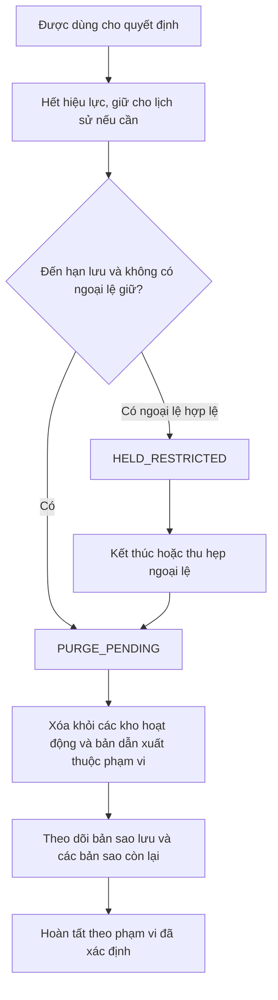

# Fraud signal retention

## 1. Vì sao tín hiệu gian lận cần có vòng đời?

**Fraud signal retention** là chính sách và cơ chế quản lý việc giữ, sử dụng, hạn chế truy cập và xóa các tín hiệu phục vụ phát hiện gian lận.

Trong khôi phục tài khoản, tín hiệu có thể gồm thay đổi mạng bất thường, thiết bị chưa biết, nhiều lần thử mã sai, dấu hiệu phiên bị đánh cắp hoặc việc kênh khôi phục vừa được thay đổi. Những dữ liệu này giúp quyết định có cần xác minh thêm trước khi đặt lại mật khẩu, thay MFA hoặc đăng ký passkey mới.

Giữ quá ít dữ liệu làm mất bối cảnh để phát hiện một chuỗi tấn công hoặc giải thích quyết định đã đưa ra. Giữ quá nhiều làm tăng hậu quả khi dữ liệu bị truy cập trái phép và nguy cơ dùng thông tin cũ để đánh giá người dùng hiện tại.

Một chính sách đầy đủ phải trả lời:

- Dữ liệu nào cần thu thập và phục vụ mục đích gì?
- Tín hiệu còn được dùng trong quyết định trực tuyến đến thời điểm nào?
- Bản ghi được lưu đến khi nào và ai được xem?
- Có những bản sao, đặc trưng hoặc dữ liệu dẫn xuất nào?
- Khi nào việc xóa được xem là hoàn tất?
- Ngoại lệ giữ lại được duyệt, giới hạn và kết thúc ra sao?

OWASP khuyến nghị thiết kế log theo mục đích, bảo vệ dữ liệu nhạy cảm và quản lý việc hủy log cùng các bản sao. [OWASP Logging Cheat Sheet](https://cheatsheetseries.owasp.org/cheatsheets/Logging_Cheat_Sheet.html).

Bài sử dụng một hệ thống khôi phục tài khoản giả định. Các thời lượng minh họa là lựa chọn thiết kế để giải thích cơ chế, không phải thời hạn bắt buộc cho mọi dịch vụ.

## 2. Phân biệt thời hạn sử dụng với thời hạn lưu trữ

Một tín hiệu còn nằm trong cơ sở dữ liệu không có nghĩa nó còn đủ mới để ảnh hưởng đến việc khôi phục.

| Khái niệm | Câu hỏi cần trả lời | Ví dụ |
| --- | --- | --- |
| Cửa sổ phát hiện | Detector xem các sự kiện trong khoảng nào? | Đếm lần nộp mã sai trong một cửa sổ gần đây |
| Thời hạn hiệu lực của tín hiệu | Tín hiệu còn dùng được cho quyết định hiện tại không? | Một đánh giá mạng hết hiệu lực sau thời điểm đã xác định |
| Thời hạn lưu bản ghi | Khi nào dữ liệu đến hạn xóa khỏi kho tương ứng? | Giữ bản ghi chuẩn hóa một thời gian để điều tra |
| Thời hạn giữ quyết định | Cần giải thích quyết định lịch sử trong bao lâu? | Lưu kết quả, mã lý do và phiên bản chính sách |
| Độ trễ xóa | Sau khi đến hạn, mất bao lâu để hệ thống thực hiện xóa? | Tác vụ xóa chạy theo lô và cần thời gian hoàn tất |
| Vòng đời bản sao lưu | Khi nào bản sao không còn chứa dữ liệu? | Backup hết hạn theo lịch riêng |

Giả sử một tín hiệu có:

```text
observedAt  = 2026-11-23T08:00:00Z
validUntil  = 2026-11-24T08:00:00Z
retainUntil = 2026-12-07T08:00:00Z
```

Sau `validUntil`, bản ghi có thể còn được người có quyền xem để điều tra lịch sử. Dịch vụ ra quyết định trực tuyến phải loại tín hiệu đó khỏi tập đang có hiệu lực, ngay cả khi tác vụ xóa chưa chạy.

Đến `retainUntil`, bản ghi đến hạn xử lý theo chính sách lưu trữ của nó. Nếu có ngoại lệ giữ bằng chứng hợp lệ, bản ghi có thể được chuyển sang kho hạn chế. Việc giữ để điều tra không tự kích hoạt lại hiệu lực dùng trong quyết định khôi phục.

Ba quyền cần tách riêng:

1. Được lưu một bản ghi.
2. Được truy cập bản ghi cho một mục đích.
3. Được dùng bản ghi làm căn cứ cho một quyết định hiện tại.

## 3. Phân loại dữ liệu trước khi chọn thời hạn

Không nên áp một TTL duy nhất cho toàn bộ hồ sơ khôi phục. Từng nhóm dữ liệu có độ nhạy cảm, mục đích và cách xóa khác nhau.

| Nhóm dữ liệu | Nội dung có thể có | Hướng quản lý |
| --- | --- | --- |
| Quan sát mạng thô | IP, user agent, thời gian nhận request | Giữ đủ ngắn cho mục đích cụ thể, truy cập hạn chế |
| Sự kiện chuẩn hóa | Loại sự kiện, thời gian, định danh nội bộ, chất lượng nguồn | Có lịch lưu và nguồn gốc rõ |
| Đặc trưng phát hiện | Số lần thử, mức bất thường, loại mạng | Gắn với cửa sổ tính và dữ liệu nguồn |
| Đánh giá rủi ro | Trạng thái, mã lý do, detector version, thời hạn hiệu lực | Chặn sử dụng khi hết hạn |
| Dấu vết quyết định | Thao tác, kết quả, bằng chứng đã chấp nhận ở mức tham chiếu | Lưu tối thiểu để giải thích lịch sử |
| Bằng chứng điều tra được giữ riêng | Phần dữ liệu liên quan một sự cố cụ thể | Quyền riêng, mục đích riêng, lịch xem xét riêng |
| Thống kê tổng hợp | Số cảnh báo, tỷ lệ chuyển hỗ trợ, độ trễ | Giảm khả năng liên kết về cá nhân |
| Bí mật xác thực | Mật khẩu, OTP, token, TOTP seed, mã khôi phục | Không đưa vào kho tín hiệu hoặc log thông thường |

Thông tin “mã khôi phục được chấp nhận” có thể hữu ích trong dấu vết quyết định. Giá trị thật của mã đó không cần xuất hiện trong bản ghi chống gian lận.

Tương tự, tham chiếu tới một phiên khác với việc lưu cookie hoặc bearer token của phiên. Với passkey, một kho tín hiệu không cần bản sao dữ liệu bí mật hoặc nội dung không liên quan chỉ để ghi rằng quá trình đăng ký credential mới đã xảy ra.

### 3.1. Giảm dữ liệu ngay khi thu thập

Chỉ thu trường cần cho mục đích đã xác định. Nếu một detector chỉ cần loại mạng và mức bất thường, không mặc định sao chép toàn bộ request vào sự kiện.

Có thể tách vùng dữ liệu thô khỏi dữ liệu chuẩn hóa. Bộ phận hỗ trợ thường chỉ cần diễn biến hồ sơ và mã lý do; người điều tra được phân quyền mới có thể cần thông tin mạng chi tiết.

Mã hóa giúp bảo vệ dữ liệu trong phạm vi mô hình khóa đã thiết kế. Nó không loại bỏ nhu cầu đặt thời hạn lưu hoặc hạn chế người được giải mã.

### 3.2. Băm định danh không tự tạo dữ liệu vô danh

IP và một số định danh có không gian giá trị hoặc tính dự đoán cho phép thử đoán. Băm trực tiếp không bảo đảm che được nguồn ban đầu.

HMAC với khóa được bảo vệ có thể hỗ trợ liên kết theo phạm vi đã chọn. Tuy nhiên, định danh ổn định vẫn cho phép theo dõi nhiều sự kiện và có thể liên kết lại thông qua dữ liệu khác. Nó vẫn cần chính sách truy cập và lưu giữ phù hợp.

Thống kê bỏ tên tài khoản nhưng giữ thiết bị hiếm, thời gian rất chi tiết và vị trí đặc biệt cũng có thể còn khả năng nhận diện. Tính tổng hợp phải được xem cùng độ chi tiết và nguy cơ liên kết, không chỉ dựa vào việc đã xóa một cột tên.

## 4. Xây lịch lưu giữ có chủ sở hữu

Mỗi loại dữ liệu nên có:

- Mục đích sử dụng được mô tả rõ.
- Trường được phép lưu và mức độ nhạy cảm.
- Nguồn thời gian bắt đầu tính thời hạn.
- Thời hạn hiệu lực và thời hạn lưu.
- Các kho và bên xử lý nhận dữ liệu.
- Người chịu trách nhiệm phê duyệt chính sách.
- Cách xử lý ngoại lệ, yêu cầu xóa và dữ liệu trong backup.
- Phiên bản chính sách để giải thích bản ghi lịch sử.

Một lịch **giả định** có thể là:

| Loại dữ liệu | Thời hạn minh họa | Cách sử dụng sau đó |
| --- | --- | --- |
| Quan sát mạng thô | 72 giờ từ quan sát hợp lệ | Đến hạn xóa nếu không thuộc phần bằng chứng được giữ riêng |
| Bản ghi tín hiệu chuẩn hóa | 14 ngày từ quan sát | Hiệu lực trực tuyến có thể ngắn hơn, do detector quy định |
| Dấu vết quyết định tối thiểu | 90 ngày từ quyết định | Phục vụ giải thích lịch sử, không làm bằng chứng xác thực mới |
| Thống kê đã giảm khả năng liên kết | 180 ngày từ kỳ tổng hợp | Dùng đánh giá hiệu quả theo mục đích đã định |
| Backup | 30 ngày theo vòng đời backup | Chặn phục hồi dữ liệu đã bị xóa về hệ thống hoạt động |

Các con số này không thể được sao chép thành cấu hình sản xuất chỉ vì xuất hiện trong ví dụ. Nhóm phụ trách cần chọn thời lượng theo mục đích, thời gian phát hiện sự cố, mức nhạy cảm, khả năng vận hành và các nghĩa vụ áp dụng.

Hướng dẫn của ICO về giới hạn lưu trữ nhấn mạnh việc có thể giải thích thời gian giữ dữ liệu theo mục đích, thay vì giữ vô hạn để phòng một khả năng không rõ. Đây là tham chiếu trong bối cảnh bảo vệ dữ liệu của Vương quốc Anh; phạm vi áp dụng của một dịch vụ phải được xác định riêng. [ICO: Storage limitation](https://ico.org.uk/for-organisations/uk-gdpr-guidance-and-resources/data-protection-principles/a-guide-to-the-data-protection-principles/storage-limitation/).

Một thay đổi chính sách cần nói rõ cách áp dụng với dữ liệu đã có. Không âm thầm kéo dài thời hạn mọi bản ghi cũ hoặc tái nhập dữ liệu đã xóa.

## 5. Tính thời hạn từ mốc ổn định

Một lỗi thường gặp là mỗi lần đọc, ghi lại hoặc xử lý lại sự kiện đều đặt lại TTL. Khi đó, dữ liệu thường được truy cập có thể tồn tại mãi dù chính sách nói chỉ lưu trong một khoảng hữu hạn.

Trong mô hình minh họa:

```text
validUntil  = min(observedAt + validityHorizon, sourceValidUntil)
retainUntil = retentionAnchor + storageHorizon
```

Nếu nguồn không cung cấp `sourceValidUntil`, bộ chính sách dùng quy tắc được định nghĩa cho loại nguồn đó, không tự bịa một thời hạn từ dữ liệu thiếu.

`retentionAnchor` là mốc đã được xác định cho loại bản ghi. Với quan sát do máy chủ tạo, có thể dùng thời điểm quan sát. Với quyết định, có thể dùng thời điểm quyết định được phát hành. Khi nhận sự kiện từ hệ thống ngoài, cần kiểm độ tin cậy của event time và độ trễ trước khi chọn mốc theo chính sách.

Các ràng buộc quan trọng:

1. Mốc ban đầu không bị thay chỉ vì consumer xử lý lại.
2. Event ID trùng không tạo một bản ghi mới có thời hạn mới.
3. Timestamp trong tương lai bất thường không được dùng để kéo dài thời hạn.
4. Sự kiện đến muộn không mặc nhiên nhận thêm một vòng đời đầy đủ.
5. Đổi định dạng hoặc chuyển kho không làm mất `retainUntil`.
6. Bản dẫn xuất phải có chính sách riêng và giữ nguồn gốc để xử lý vòng đời.

Nếu một tín hiệu cần được làm mới, hệ thống phải tạo quan sát hoặc đánh giá mới có căn cứ. Đọc lại bản ghi cũ không phải một quan sát mới.

### 5.1. Dữ liệu dẫn xuất không tự được giữ vô hạn

Một đặc trưng có thể được tính từ nhiều sự kiện. Khi nguồn hết hạn, cần xác định đặc trưng có còn cần giữ không, có thể liên kết về tài khoản không và có lịch riêng đã được duyệt hay chưa.

Không nhất thiết mọi dữ liệu dẫn xuất phải có cùng thời hạn với dữ liệu nguồn. Nhưng việc tạo một bảng mới không tự tạo quyền lưu lâu hơn. Nếu đặc trưng vẫn chứa đủ chi tiết để khôi phục gần nguyên dữ liệu thô, gọi nó là “aggregate” không làm giảm nghĩa vụ bảo vệ trong thiết kế.

### 5.2. Phân biệt ba mốc thường bị nhầm

```text
Sự kiện xảy ra:             observedAt
Hệ thống nhận sự kiện:      ingestedAt
Worker chạy lại sự kiện:   reprocessedAt
```

`reprocessedAt` hữu ích cho vận hành nhưng thường không phải mốc để bắt đầu lại thời hạn của nội dung. Với sự kiện quá trễ, hệ thống có thể chỉ giữ dấu vết phù hợp hoặc loại khỏi xử lý trực tuyến theo chính sách.

## 6. Bắt buộc kiểm tra hiệu lực ở đường đọc

Cơ chế TTL của kho dữ liệu hoặc tác vụ nền có thể xóa theo lịch và có độ trễ. Vì vậy, đường ra quyết định phải tự kiểm thời hạn.

Ví dụ truy vấn minh họa:

```sql
SELECT signal_id, signal_type, reason_code,
       observed_at, valid_until, detector_version
FROM fraud_signal
WHERE tenant_id = :tenantId
  AND account_id = :accountId
  AND observed_at <= :decisionTime
  AND valid_until > :decisionTime
  AND risk_use_disabled = FALSE;
```

`decisionTime` do máy chủ xác định. Trạng thái giữ riêng cho điều tra không làm truy vấn này bỏ qua điều kiện hiệu lực.

Nếu ứng dụng đọc từ cache, cache cũng phải kiểm `validUntil`. Một mục chưa bị đuổi khỏi cache không có nghĩa còn hợp lệ.

Ở bước cuối của quá trình khôi phục, kiểm lại độ mới của đánh giá cùng tài khoản, mục đích và phiên bản cấu hình bảo mật. Người dùng hoàn tất bằng chứng sau một thời gian chờ có thể cần đánh giá mới; không dùng kết quả lúc mở hồ sơ mãi mãi.

Khi không tìm được tín hiệu còn hiệu lực, cần phân biệt:

- Không có quan sát trong cửa sổ yêu cầu.
- Quan sát đã hết hạn.
- Nguồn dữ liệu chưa từng cung cấp loại tín hiệu này.
- Dịch vụ tín hiệu đang lỗi hoặc dữ liệu bị chậm.
- Đã có quyết định rõ ràng từ một nguồn khác.

Các tình huống đó không cùng nghĩa “rủi ro thấp”. Chính sách lựa chọn bằng chứng bổ sung hoặc đường xử lý thích hợp thay vì biến dữ liệu thiếu thành sự xác nhận quyền sở hữu.

## 7. Ví dụ Java biểu diễn hai thời hạn

Lớp dưới đây chỉ minh họa sự khác nhau giữa hiệu lực sử dụng và thời hạn lưu. Nó không xử lý phê duyệt giữ bằng chứng, phân quyền hoặc xóa dữ liệu thực tế.

```java
import java.time.Instant;
import java.util.Objects;

public final class SignalLifetime {
    private final Instant observedAt;
    private final Instant validUntil;
    private final Instant retainUntil;

    public SignalLifetime(
            Instant observedAt,
            Instant validUntil,
            Instant retainUntil) {

        this.observedAt = Objects.requireNonNull(
                observedAt, "observedAt");
        this.validUntil = Objects.requireNonNull(
                validUntil, "validUntil");
        this.retainUntil = Objects.requireNonNull(
                retainUntil, "retainUntil");

        if (!validUntil.isAfter(observedAt)) {
            throw new IllegalArgumentException(
                    "validUntil must be after observedAt");
        }
        if (retainUntil.isBefore(validUntil)) {
            throw new IllegalArgumentException(
                    "retainUntil must not precede validUntil");
        }
    }

    public boolean isUsableAt(Instant now) {
        Objects.requireNonNull(now, "now");
        return !now.isBefore(observedAt)
                && now.isBefore(validUntil);
    }

    public boolean isRetentionDueAt(Instant now) {
        Objects.requireNonNull(now, "now");
        return !now.isBefore(retainUntil);
    }
}
```

Lớp chọn quy ước hiệu lực dạng `[observedAt, validUntil)`: ngay tại `validUntil`, tín hiệu đã hết hiệu lực. Ngay tại `retainUntil`, bản ghi đến hạn xử lý lưu giữ.

Ràng buộc `validUntil <= retainUntil` phù hợp với loại bản ghi minh họa này. Một hệ thống có dữ liệu nguồn và bản dẫn xuất ở những kho khác nhau cần mô hình riêng cho từng đối tượng; không suy ra dữ liệu thô phải sống lâu bằng mọi đặc trưng được tạo từ nó.

Thời gian nên được truyền từ nguồn máy chủ phù hợp, chẳng hạn thông qua `Clock` được quản lý ở tầng gọi. Đường quyết định dùng cùng một instant cho một lần đánh giá để tránh điều kiện ở sát ranh giới được tính bằng nhiều thời điểm không nhất quán.

Kết quả `isUsableAt` chỉ nói về thời gian. Để dùng tín hiệu, vẫn cần kiểm nguồn, phạm vi tài khoản, quyền truy cập, chất lượng và các điều kiện vô hiệu hóa khác.

## 8. Xóa là một quy trình có trạng thái

Đặt `retainUntil` chỉ mô tả thời hạn; nó không chứng minh dữ liệu đã được xóa.

Một vòng đời có thể gồm:



Dù tác vụ xóa đang lỗi, tín hiệu hết hiệu lực vẫn bị chặn trên đường quyết định. Lỗi xóa không phải lý do kéo dài quyền sử dụng dữ liệu.

### 8.1. Tác vụ xóa theo lô

Một worker xóa có thể thực hiện quy trình:

```text
1. Chọn một lô bản ghi đến hạn.
2. Kiểm phạm vi tenant, loại dữ liệu và ngoại lệ giữ còn hiệu lực.
3. Xác nhận phiên bản để tránh dùng quyết định xóa đã lỗi thời.
4. Tạo công việc xóa có định danh ổn định.
5. Xóa ở kho nguồn và phát sự kiện tới các đích liên quan.
6. Thu nhận xác nhận hoặc lỗi từ từng đích.
7. Thử lại an toàn với những đích chưa hoàn tất.
8. Ghi kết quả tối thiểu và các nghĩa vụ còn đang chờ.
```

Việc kiểm giữ bằng chứng và thực hiện xóa cần cơ chế đồng bộ phù hợp. Nếu một ngoại lệ được duyệt đồng thời với worker xóa, hệ thống phải có thứ tự và kết quả rõ, thay vì mặc nhiên cho cả hai bên đều thành công.

Công việc xóa nên có tính idempotent: chạy lại không làm sai dữ liệu khác và không gây lỗi chỉ vì bản ghi đã vắng mặt. Mỗi đích vẫn cần phân biệt “đã xóa”, “đã vắng mặt”, “đang chờ” và “thất bại”.

Không xóa cả tài khoản hoặc credential khi mục tiêu chỉ là bản ghi tín hiệu đến hạn. Phạm vi xóa phải gắn với đối tượng và loại dữ liệu cụ thể.

## 9. Theo dõi mọi đích chứa dữ liệu

Một bản ghi có thể xuất hiện ở nhiều nơi. Xóa dòng trong cơ sở dữ liệu chính mới giải quyết một phần phạm vi.

| Nơi chứa dữ liệu | Nguy cơ khi bỏ sót | Cơ chế cần xác định |
| --- | --- | --- |
| Cơ sở dữ liệu và bản sao đọc | Dịch vụ vẫn đọc được dữ liệu cũ | Xử lý sao chép, quyền đọc và xác nhận xóa |
| Cache | Bản hết hạn vẫn được dùng hoặc hiển thị | Kiểm hiệu lực lúc đọc và vô hiệu hóa theo chính sách |
| Search index | Dữ liệu đã xóa vẫn tìm kiếm được | Công việc xóa theo tham chiếu và xác nhận đích |
| Feature store | Đặc trưng cũ tiếp tục ảnh hưởng đánh giá | Vòng đời đặc trưng, nguồn gốc và cơ chế thu hồi |
| Hàng đợi và dead-letter queue | Sự kiện cũ được xử lý lại như dữ liệu mới | Giữ thời hạn gốc, giới hạn lưu và kiểm khi consume |
| Kho phân tích hoặc tệp xuất | Có bản sao ngoài lịch xóa chính | Kiểm kê đích, chủ sở hữu và chính sách riêng |
| Log vận hành | Payload bị sao lại khi báo lỗi | Ghi mã tham chiếu, không ghi nguyên dữ liệu nhạy cảm |
| Backup và kho lưu trữ lạnh | Phục hồi đưa dữ liệu đã xóa trở lại | Vòng đời backup và lọc dữ liệu trước khi đưa vào hoạt động |
| Hệ thống bên xử lý khác | Không biết dữ liệu đã được xóa chưa | Giao ước vòng đời, yêu cầu xóa và trạng thái xác nhận |

Mỗi đích nhận dữ liệu nên nhận cả metadata vòng đời cần thiết. Chuyển một bản ghi sang kho lạnh không được tự đặt lại hạn lưu. Một consumer nhận lại sự kiện từ dead-letter queue cũng phải kiểm tuổi dữ liệu trước khi tạo tín hiệu.

### 9.1. Backup và phục hồi

Một backup bất biến có thể không hỗ trợ xóa chọn lọc từng bản ghi. Thiết kế cần mô tả rõ trường hợp đó:

1. Backup có thời hạn hữu hạn đã được phê duyệt.
2. Quyền truy cập bị hạn chế, không dùng làm kho điều tra thường ngày.
3. Yêu cầu xóa hoặc bản ghi chống phục hồi được quản lý theo chính sách riêng.
4. Khi phục hồi, hệ thống áp lại các mốc hết hạn và yêu cầu xóa trước khi phục vụ.
5. Dữ liệu không được tự đưa trở lại pipeline huấn luyện hoặc phân tích sau restore.
6. Trạng thái báo cáo phản ánh backup còn đang chờ hết vòng đời nếu thực tế là vậy.

Một receipt có thể nói `ONLINE_PURGED_BACKUP_PENDING` thay vì tuyên bố toàn bộ dữ liệu đã biến mất. Thời gian hoàn tất phụ thuộc phạm vi được xác định và xác nhận thực tế của các đích.

Việc xóa logic cũng cần phân biệt với việc loại bỏ khỏi phương tiện lưu trữ vật lý. Cơ chế của kho dữ liệu, lịch xử lý và mô hình mã hóa phải được xem trong kiến trúc cụ thể; không suy ra một lệnh DELETE đã làm mọi byte không thể khôi phục.

### 9.2. Mã hóa và xóa khóa

Trong một kiến trúc thích hợp, hủy khóa riêng cho một tập dữ liệu có thể hỗ trợ làm dữ liệu không thể giải mã. Điều này chỉ có ý nghĩa nếu các bản sao khóa, khóa bọc, cache khóa và bản sao dữ liệu đọc được cũng nằm trong phạm vi kiểm soát.

Không thể hủy một khóa dùng chung cho toàn bộ tenant để xóa riêng một bản ghi mà không tác động dữ liệu khác. “Đã mã hóa” và “đã xóa” là hai trạng thái khác nhau.

### 9.3. Dữ liệu dùng cho mô hình

Một bộ dữ liệu huấn luyện hoặc một đặc trưng đưa vào mô hình cần mục đích, nguồn gốc và vòng đời được xác định riêng. Không mặc định xuất bản ghi thô sang huấn luyện là cách giữ dữ liệu vô hạn.

Nếu dữ liệu đã được dùng trong một mô hình, cần đánh giá việc xử lý yêu cầu liên quan ở cả bộ dữ liệu và sản phẩm dẫn xuất theo đặc điểm mô hình. Xóa một dòng khỏi kho nguồn không tự chứng minh mô hình đã loại bỏ mọi ảnh hưởng của dòng đó.

## 10. Giữ bằng chứng có kiểm soát

Một sự cố cụ thể có thể cần giữ một phần dữ liệu lâu hơn lịch thông thường. Ngoại lệ giữ lại nên là đối tượng được quản lý, chẳng hạn:

```text
EvidenceHold
  holdId
  caseReference
  purpose
  scopedRecordReferences
  approvedBy
  approvedAt
  reviewAt
  plannedEndAt
  accessPolicy
  state
```

Thiết kế cần giữ những giới hạn sau:

- Chỉ giữ tập dữ liệu liên quan và cần thiết.
- Có người phê duyệt và mục đích cụ thể.
- Có lịch rà soát và cách kết thúc.
- Có quyền truy cập tách khỏi dịch vụ quyết định trực tuyến.
- Không kéo dài `validUntil` của tín hiệu chỉ vì bản ghi được giữ.
- Khi thu hẹp hoặc kết thúc ngoại lệ, tính lại nghĩa vụ xóa còn lại.

Một nhãn “đang điều tra” không đủ để giữ toàn bộ dữ liệu của mọi người dùng mãi mãi. Nếu cần gia hạn, phải có căn cứ và quyết định mới theo thẩm quyền.

Trường hợp có nghĩa vụ giữ bằng chứng hoặc yêu cầu xóa được xử lý theo phạm vi và quy trình áp dụng cho dịch vụ. Worker xóa dữ liệu không tự quyết định cách giải quyết một xung đột chưa được phê duyệt.

### 10.1. Giữ khả năng giải thích mà không sao chép mọi dữ liệu

Một dấu vết quyết định tối thiểu có thể ghi:

```text
decisionId
recoveryCaseReference
purpose
outcome
decidedAt
policyVersion
detectorVersions
reasonCodes
acceptedEvidenceCategories
signalReferences
decisionSnapshot
```

`decisionSnapshot` chỉ chứa những giá trị tối thiểu đã được cho phép giữ để giải thích kết quả. Không nhét lại toàn bộ IP, request, token hoặc tài liệu xác minh vào một trường JSON không kiểm soát.

Sau khi dữ liệu thô bị xóa, hệ thống có thể giải thích rằng quyết định dựa trên loại tín hiệu và giá trị đã lưu trong snapshot. Nó có thể không tái chạy chính xác toàn bộ phép tính từ nguồn ban đầu nữa. Đây là giới hạn cần được thừa nhận khi thiết kế khả năng điều tra.

Một giá trị băm có thể hỗ trợ kiểm tra tính nhất quán khi còn dữ liệu để đối chiếu; nó không tự khôi phục bằng chứng đã xóa hoặc chứng minh nguồn ban đầu đáng tin.

## 11. Không để xóa tín hiệu làm mất trạng thái bảo mật cần thiết

Kho tín hiệu gian lận khác với kho trạng thái kiểm soát xác thực.

Ví dụ, hệ thống có thể cần quản lý riêng:

- Trạng thái token khôi phục đã được tiêu thụ.
- Bộ đếm giới hạn thử của một thử thách.
- Trạng thái thu hồi phiên hoặc refresh token.
- Credential đã bị gỡ hoặc thay thế.
- Phiên bản bảo mật hiện tại của tài khoản.

Những đối tượng đó có vòng đời theo cơ chế bảo vệ tương ứng. Xóa một bản ghi phân tích đến hạn không được tự làm token đã dùng có hiệu lực trở lại hoặc đặt bộ đếm chống thử mã về trạng thái mới.

Ngược lại, không nên giữ toàn bộ log chống gian lận chỉ vì cần một trạng thái thu hồi nhỏ. Thiết kế kho kiểm soát tối thiểu với mục đích, thời hạn và quyền riêng.

Cần xác thực và phân quyền các yêu cầu xóa có tác động tới tài khoản. Người ngoài không được gửi một request khôi phục để làm hệ thống xóa bằng chứng chống lạm dụng của nạn nhân.

## 12. Ví dụ vòng đời của một tín hiệu trong hồ sơ khôi phục

Lan yêu cầu thay TOTP sau khi mất điện thoại. Hệ thống quan sát một nguồn mạng mới, nhiều lần nhập mã sai và tạo đánh giá rủi ro cho hồ sơ.

Một vòng đời giả định:

| Thời điểm hoặc sự kiện | Hành động |
| --- | --- |
| Khi quan sát | Ghi dữ liệu tối thiểu, nguồn thời gian, phiên bản chính sách và các mốc hết hạn |
| Khi ra quyết định đầu | Chỉ dùng tín hiệu còn hiệu lực cùng bằng chứng xác minh phù hợp |
| Khi Lan quay lại sau thời gian chờ | Kiểm tra độ mới; tạo đánh giá mới nếu kết quả trước không còn dùng được |
| Đến hạn dữ liệu mạng thô | Xóa theo lịch nếu không thuộc ngoại lệ giữ đã được duyệt |
| Đến hạn tín hiệu chuẩn hóa | Xóa khỏi kho và xử lý các bản dẫn xuất thuộc phạm vi |
| Trong thời hạn giữ quyết định | Chỉ người có quyền xem dấu vết tối thiểu để giải thích lịch sử |
| Khi backup hết vòng đời | Hoàn tất phần nghĩa vụ liên quan tới các bản sao đó |
| Khi quyết định lịch sử đến hạn | Xóa hoặc xử lý theo lịch riêng đã xác định |

Nếu một đích tìm kiếm đang lỗi lúc xóa, hệ thống ghi công việc còn chờ và thử lại. Nó vẫn không dùng tín hiệu đã hết hiệu lực để quyết định yêu cầu mới của Lan.

Nếu phát hiện một sự cố cần giữ bằng chứng, chỉ phần dữ liệu thuộc phạm vi ngoại lệ được chuyển sang chế độ hạn chế. Quyết định giữ được ghi nhận; việc giữ không tạo thêm quyền thay MFA cho bất kỳ ai.

Nếu phục hồi từ một backup cũ, quy trình phải loại bỏ dữ liệu đã hết hạn hoặc thuộc yêu cầu xóa trước khi kho được dùng trở lại. Nó không bắt đầu lại thời hạn 14 ngày chỉ vì dữ liệu vừa được restore.

## 13. Quan sát việc thực thi chính sách

Một lịch lưu giữ chỉ có ý nghĩa khi hệ thống thực hiện được và phát hiện được sai lệch.

Các chỉ số có thể gồm:

- Số bản ghi đã đến hạn nhưng chưa xóa, theo từng đích.
- Tuổi của công việc xóa cũ nhất và độ trễ xóa so với hạn.
- Tỷ lệ công việc thất bại, thử lại hoặc không được xác nhận.
- Số lần đường đọc chặn tín hiệu hết hiệu lực.
- Số ngoại lệ giữ bằng chứng đã quá ngày rà soát.
- Số tập dữ liệu chưa có chủ sở hữu hoặc lịch lưu.
- Số bản sao khôi phục chưa được áp lại chính sách xóa.
- Khối lượng dữ liệu nhạy cảm theo lớp lưu giữ và mục đích.

Bản ghi công việc xóa chỉ cần đủ để theo dõi phạm vi, chính sách, thời điểm và kết quả. Nếu log xóa chứa lại toàn bộ payload đã xóa, chính tác vụ xóa tạo ra một bản sao mới ngoài ý muốn.

Receipt, tombstone và định danh chống phục hồi cũng có thể còn khả năng liên kết. Chúng cần mục đích, quyền truy cập và lịch lưu riêng; không được mặc nhiên tồn tại vĩnh viễn.

NIST SP 800-92 xem quản lý log là việc tổ chức cả hạ tầng lẫn quy trình vận hành trong doanh nghiệp. Với hệ thống khôi phục, điều đó gợi ý cần phối hợp chủ sở hữu detector, dịch vụ xác thực, kho dữ liệu và bộ phận xử lý sự cố để thực hiện vòng đời đã chọn. [NIST SP 800-92: Guide to Computer Security Log Management](https://csrc.nist.gov/pubs/sp/800/92/final).

## 14. Những nguyên tắc cần giữ

1. Tín hiệu còn lưu không đồng nghĩa còn hiệu lực.
2. Mỗi nhóm dữ liệu cần mục đích, chủ sở hữu và lịch riêng.
3. Không lưu bí mật xác thực trong kho tín hiệu thông thường.
4. Retry, replay, chuyển kho và restore không tự khởi động lại thời hạn.
5. Đường đọc phải chặn dữ liệu hết hiệu lực ngay cả khi xóa vật lý đang chờ.
6. Việc xóa phải theo dõi các bản sao và dữ liệu dẫn xuất thuộc phạm vi.
7. Ngoại lệ giữ bằng chứng có phạm vi, quyền riêng và lịch rà soát.
8. Dữ liệu thiếu hoặc hết hạn không phải bằng chứng người dùng hợp lệ.
9. Xóa lịch sử phân tích không được làm suy yếu trạng thái kiểm soát xác thực.
10. Báo cáo hoàn tất phải phản ánh những đích thực sự đã xử lý và những phần còn chờ.

Một cơ chế retention tốt giúp giữ đủ bối cảnh cho phát hiện và điều tra, đồng thời ngăn dữ liệu cũ tồn tại hoặc tiếp tục tác động tới quyền khôi phục ngoài mục đích đã xác định.
