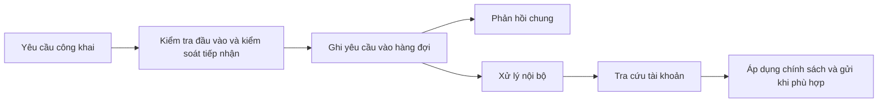

# Account existence privacy

## 1. Vì sao sự tồn tại của tài khoản cần được bảo vệ?

**Account existence privacy** là việc hạn chế khả năng một người chưa được xác minh suy ra rằng một email, số điện thoại hoặc định danh có tài khoản trong hệ thống. Trong recovery, người yêu cầu thường chưa đăng nhập và có thể tự nhập định danh của người khác. Vì vậy, đây là một ranh giới riêng tư cần được thiết kế ngay từ bước tiếp nhận.

Ví dụ, một người gửi yêu cầu khôi phục cho hai địa chỉ:

```text
Email A → “Đã gửi liên kết đặt lại mật khẩu”
Email B → “Không tìm thấy tài khoản”
```

Dù chưa lấy được mật khẩu, họ đã biết địa chỉ nào gắn với dịch vụ. Thông tin đó có thể hỗ trợ nhắm mục tiêu lừa đảo, dò danh sách người dùng hoặc suy ra việc một người sử dụng một dịch vụ nhạy cảm.

Bảo vệ ranh giới này không chỉ là thay câu thông báo. Người ngoài còn có thể quan sát mã HTTP, thời gian phản hồi, hướng chuyển trang, cookie, yêu cầu CAPTCHA hoặc kết quả gửi lại code.

OWASP khuyến nghị phản hồi nhất quán cho yêu cầu quên mật khẩu với cả tài khoản tồn tại và không tồn tại, đồng thời chú ý thời gian xử lý. [OWASP Forgot Password Cheat Sheet](https://cheatsheetseries.owasp.org/cheatsheets/Forgot_Password_Cheat_Sheet.html#forgot-password-request)

Các API, trạng thái và luồng bên dưới là ví dụ thiết kế để giải thích nguyên tắc, không phải một giao thức recovery hoàn chỉnh.

## 2. Phân biệt định danh được khai báo với bằng chứng đã xác minh

Một email được nhập vào biểu mẫu chỉ là **lời khai về tài khoản cần tìm**. Nó chưa chứng minh người gửi kiểm soát email đó, có quyền dùng tài khoản hoặc được phép biết các phương thức recovery của tài khoản.

Một ranh giới quyền truy cập có thể chia thành:

| Giai đoạn | Người yêu cầu đã chứng minh gì? | Thông tin phù hợp để cung cấp |
| --- | --- | --- |
| Chỉ nhập định danh | Chưa có bằng chứng sở hữu | Hướng dẫn chung và xác nhận tiếp nhận phù hợp |
| Được cấp mã yêu cầu công khai | Chỉ biết mã của lần gửi yêu cầu | Thông tin tiếp nhận không tiết lộ việc tra cứu tài khoản |
| Đã xác minh bằng chứng recovery | Có bằng chứng với phạm vi cụ thể | Bước tiếp theo trong phạm vi đã xác minh |
| Hoàn tất recovery và xác thực theo chính sách | Đủ điều kiện tương ứng với phiên hoặc thao tác | Dữ liệu tài khoản theo quyền được cấp |

Mã theo dõi ngẫu nhiên không tự nâng người yêu cầu lên giai đoạn đã xác minh. Nếu người ngoài có thể tự tạo yêu cầu rồi dùng mã đó để xem “tài khoản tồn tại”, ranh giới riêng tư vẫn bị phá vỡ.

Tương tự, kiểm soát hộp thư là một loại bằng chứng về kênh; không tự suy ra rằng bằng chứng đó đủ để gỡ MFA hoặc thay passkey. Phạm vi được tiết lộ và quyền được cấp cần đi theo điều thực sự đã xác minh.

## 3. Mô hình quan sát của người ngoài

Giả sử người tấn công có thể:

- Gửi yêu cầu recovery cho nhiều định danh.
- Lặp lại yêu cầu và đo thời gian.
- Đọc phản hồi API trực tiếp, kể cả trường mà giao diện không hiển thị.
- Thử nút gửi lại, chọn phương thức khác hoặc xem trạng thái yêu cầu.
- Đổi trình duyệt, địa chỉ nguồn và tenant trong phạm vi giao diện công khai.
- Gọi bộ phận hỗ trợ với định danh của người khác.

Mục tiêu thiết kế là tránh để **trạng thái tồn tại của tài khoản** quyết định một khác biệt công khai mà người này có thể khai thác.

Có thể mô tả tính chất mong muốn:

```text
Với hai đầu vào đều hợp lệ về cú pháp,
trong điều kiện tiếp nhận và giới hạn công khai tương đương:

quan_sát_công_khai(tài_khoản_tồn_tại)
    ≈
quan_sát_công_khai(tài_khoản_không_tồn_tại)
```

Dấu gần bằng thể hiện một mục tiêu về hành vi có thể quan sát, không phải lời hứa rằng mọi gói mạng hoặc thời gian phản hồi đều giống hệt nhau.

Định danh sai cú pháp có thể nhận thông báo kiểm tra đầu vào. Điều cần tránh là dùng “sai định dạng” để che một phép tra cứu tồn tại: một email có cú pháp hợp lệ không được bị báo sai chỉ vì không có trong cơ sở dữ liệu.

## 4. Giữ nhất quán toàn bộ phản hồi công khai

Một phản hồi minh họa cho yêu cầu đã được hệ thống tiếp nhận:

```http
HTTP/1.1 202 Accepted
Content-Type: application/json
Cache-Control: no-store

{
  "message": "Nếu thông tin phù hợp với tài khoản và phương thức khôi phục được hỗ trợ, bạn sẽ nhận được hướng dẫn tiếp theo."
}
```

Ở ví dụ này, `202` biểu thị đã tiếp nhận để xử lý; nó không khẳng định tài khoản tồn tại hoặc email đã gửi thành công. Chọn mã khác có thể phù hợp với hợp đồng API khác, miễn không phân nhánh theo sự tồn tại của tài khoản.

Những thành phần cần giữ cùng ý nghĩa đối với các trạng thái tài khoản:

| Thành phần | Ví dụ làm lộ thông tin |
| --- | --- |
| Mã HTTP | Tài khoản có thật nhận `200`, không có nhận `404` |
| Nội dung JSON | Cùng thông báo nhưng có thêm `accountFound: true` |
| Trường tùy chọn | Chỉ tài khoản có thật nhận `deliveryChannel` |
| Header | `Location` chỉ xuất hiện khi tìm thấy tài khoản |
| Cookie | Chỉ nhánh tồn tại được cấp cookie có cấu trúc riêng |
| Chuyển trang | Một nhánh sang trang nhập OTP, nhánh kia ở lại biểu mẫu |
| Trang HTML | Cùng chữ nhưng có dữ liệu tài khoản trong HTML hoặc script |
| Lỗi kỹ thuật | Chỉ nhánh có thật trả lỗi nhà cung cấp email |

Không cần làm phản hồi HTTP giống nhau cho mọi loại lỗi của toàn hệ thống. Ví dụ, đầu vào quá lớn hoặc hàng đợi tiếp nhận toàn cục đang lỗi có thể có phản hồi riêng. Sự khác biệt đó phải phản ánh điều kiện kỹ thuật hoặc kiểm soát công khai, thay vì bí mật “có tài khoản hay không”.

OWASP lưu ý rằng mã lỗi, URL và thời gian có thể tạo khác biệt cho việc dò tài khoản ngay cả khi thông báo đã được làm chung. [OWASP Authentication Cheat Sheet](https://cheatsheetseries.owasp.org/cheatsheets/Authentication_Cheat_Sheet.html#authentication-and-error-messages)

## 5. Không tiết lộ phương thức trước khi xác minh

Một giao diện có thể vô tình trả lời câu hỏi tồn tại bằng cách liệt kê:

```text
Chọn cách khôi phục:
- Gửi email đến l***@example.com
- Gửi SMS đến số kết thúc bằng 82
- Dùng passkey đã đăng ký
```

Dù đã che một phần, các dữ liệu trên vẫn xác nhận có một tài khoản và tiết lộ cấu hình bảo mật. Người biết thêm thông tin bên ngoài có thể ghép những mảnh bị che để suy ra địa chỉ hoặc số điện thoại đầy đủ.

Một cách thiết kế là cung cấp hướng dẫn chung về các phương thức hệ thống hỗ trợ, rồi chỉ hiển thị cấu hình cụ thể khi có bằng chứng và phạm vi truy cập phù hợp.

Nếu một sản phẩm cần bước khám phá tài khoản hoặc tổ chức trước đăng nhập, cần xác định rõ thông tin nào được coi là công khai. Việc một miền email hỗ trợ SSO không tự đồng nghĩa một cá nhân cụ thể có tài khoản trong tenant đó.

Quyết định cho phép tiết lộ một phần thông tin phải được thể hiện rõ trong thiết kế sản phẩm. Không để một nhánh recovery riêng tự làm lộ cấu hình chỉ vì muốn rút ngắn vài thao tác.

## 6. Thời gian phản hồi là một kênh riêng

Hai phản hồi có cùng nội dung vẫn có thể khác nhau vì xử lý bên trong:

```text
Tài khoản không tồn tại:
    tra cứu → trả về

Tài khoản tồn tại:
    tra cứu → tạo token → gọi nhà cung cấp email → trả về
```

Nếu nhánh thứ hai thường chậm hơn, người ngoài có thể lặp lại nhiều lần để suy ra khác biệt thống kê.

### 6.1. Tách tiếp nhận khỏi xử lý recovery

Một thiết kế minh họa:



Ở thiết kế này, bước phản hồi không chờ kết quả tra cứu hay kết quả gửi email. Đầu vào hợp lệ được đưa qua cùng cơ chế tiếp nhận, kể cả khi sau đó không tìm thấy tài khoản.

Cần giữ hàng đợi có giới hạn dung lượng, hạn mức tài nguyên và kiểm soát lạm dụng. Đưa mọi đầu vào hợp lệ vào hàng đợi không có nghĩa là chấp nhận lưu vô hạn hoặc gửi vô hạn.

### 6.2. Bất đồng bộ chưa tự giải quyết mọi rò rỉ

Một hàng đợi có ưu tiên, nhánh chống lạm dụng hoặc bộ nhớ đệm vẫn có thể tạo khác biệt ở đường công khai. Nếu API chờ một bước nội bộ phân nhánh theo tài khoản trước khi ghi hàng đợi, thời gian có thể tiếp tục lộ.

Cần xem toàn bộ đường phản hồi từ gateway đến ứng dụng, thay vì chỉ thấy có một worker xử lý nền rồi kết luận đã kín.

### 6.3. Trì hoãn ngẫu nhiên không xóa được khác biệt gốc

Thêm một khoảng chờ ngẫu nhiên có thể làm từng phép đo khó đọc hơn, nhưng không bảo đảm loại bỏ chênh lệch có hệ thống qua nhiều lần đo. Chờ lâu cũng làm tốn tài nguyên và tăng độ trễ cho người thật.

Mục tiêu là giảm sự phụ thuộc của đường phản hồi vào dữ liệu tồn tại, đồng thời giới hạn khả năng quan sát hàng loạt. Không nên gọi một API mạng có độ trễ thay đổi là “constant-time” chỉ vì đã thêm lệnh ngủ.

## 7. Rate limit và CAPTCHA cũng có thể làm lộ tài khoản

Giả sử hệ thống chỉ tạo bộ đếm gửi lại cho tài khoản có thật:

```text
Định danh có tài khoản:
    lần thứ 4 → “Hãy chờ 60 giây”

Định danh không có tài khoản:
    lần thứ 4 → thông báo tiếp nhận bình thường
```

Người ngoài không cần biết email có được gửi hay không; khác biệt ở lần thử thứ tư đã đủ làm tín hiệu.

Một cách thiết kế là tách hai lớp:

| Lớp | Dữ liệu dùng để quyết định | Hành vi |
| --- | --- | --- |
| Kiểm soát tiếp nhận công khai | Nguồn yêu cầu, lưu lượng, định danh được khai báo, trạng thái thử thách công khai | Không cần biết tài khoản có tồn tại |
| Kiểm soát gửi và bảo vệ tài khoản nội bộ | Lịch sử tài khoản, trạng thái kênh, số lần gửi, rủi ro | Quyết định có gửi hay giữ lại, không xuất chi tiết ra API công khai |

Bộ đếm theo định danh được khai báo có thể áp dụng cho cả định danh tồn tại và không tồn tại. Cần giới hạn số lượng khóa bộ đếm để tránh bị tạo dữ liệu vô hạn.

Nếu API trả `429` hoặc yêu cầu CAPTCHA, nguyên nhân công khai không nên là một cờ bí mật như “tài khoản này có thật và đã nhận ba email”. Các header về hạn mức và `Retry-After` cũng cần tuân theo cùng ranh giới.

Không khóa tài khoản chỉ vì có người ngoài khởi tạo nhiều yêu cầu recovery. Hãy ưu tiên kiểm soát yêu cầu và việc gửi thông báo, để người tấn công không dễ gây gián đoạn cho chủ tài khoản.

## 8. Mã giả cho bước tiếp nhận

Mã giả sau mô tả sự tách biệt giữa hợp đồng công khai và xử lý riêng tư:

```text
function requestRecovery(input, requestContext):
    validateSizeAndSyntaxWithoutAccountLookup(input)

    identifier = normalizeUsingIdentityRules(input.identifier)
    publicLimits.check(requestContext, identifier)

    receipt = createRandomReceipt()

    queue.enqueue(
        receipt = receipt,
        identifier = identifier,
        tenantContext = resolveAllowedTenantContext(requestContext)
    )

    return genericAcceptedResponse(receipt)

function processRecovery(job):
    account = findAccountWithinTenant(
        job.identifier,
        job.tenantContext
    )

    if account is absent:
        recordRestrictedOutcome(job.receipt, NO_ACTION)
        return

    decision = recoveryPolicy.evaluate(account, job)

    if not decision.maySend:
        recordRestrictedOutcome(job.receipt, NO_ACTION)
        return

    token = createScopedSingleUseRecoveryToken(account, job)
    sendViaApprovedRegisteredChannel(account, token)
    recordRestrictedOutcome(job.receipt, DISPATCH_REQUESTED)
```

Một số ranh giới của ví dụ:

- `receipt` không phải token xác minh và không được mở quyền đọc cấu hình tài khoản.
- Trang xem receipt, nếu có, không được lộ kết quả tra cứu hoặc trạng thái gửi riêng tư.
- Kênh gửi lấy từ chính sách và dữ liệu đã thiết lập của tài khoản, không tùy ý đổi sang một địa chỉ do người chưa xác minh cung cấp.
- Dữ liệu hàng đợi có thể chứa định danh nhạy cảm, nên cần bảo vệ và thời gian lưu phù hợp.
- Quy tắc chuẩn hóa phải khớp hệ thống định danh. Không tự bỏ dấu chấm, phần sau dấu cộng hoặc thay đổi email theo quy tắc của một nhà cung cấp cho mọi miền.

Đoạn mã chưa mô tả đầy đủ độ bền hàng đợi, giao dịch dữ liệu, khử trùng lặp hoặc xử lý token. Nó minh họa ranh giới tiết lộ; các cơ chế còn lại cần được thiết kế riêng.

## 9. Bảo vệ các bước tiếp theo

Bước đầu kín nhưng bước thứ hai hở vẫn cho phép dò tài khoản.

### 9.1. Gửi lại hướng dẫn

Nút gửi lại cần giữ cùng nguyên tắc với lần đầu: không trả lý do như “không có email đăng ký”, “đã bật passkey nên không gửi” hoặc “địa chỉ đã bị khóa” cho người chưa xác minh.

### 9.2. Đổi phương thức recovery

Một endpoint như `GET /recovery/methods?email=...` có thể làm vô hiệu mọi bảo vệ của endpoint tiếp nhận. Việc chọn phương thức phải được đặt trong giai đoạn và phạm vi chứng minh phù hợp.

### 9.3. Xác minh code hoặc token

Đầu vào sai, hết hạn hoặc không dùng được không nên trả về dữ liệu tài khoản chưa được phép biết. Có thể dùng thông báo chung rằng bằng chứng không hợp lệ hoặc không còn hiệu lực, kèm hướng dẫn bắt đầu lại.

Khi một token hợp lệ được trình bày, hệ thống có thể cho phép bước tiếp theo trong phạm vi token đã chứng minh. Không tự biến việc biết token recovery thành quyền liệt kê toàn bộ session, thông tin liên hệ hoặc phương thức MFA.

### 9.4. Trạng thái tài khoản đặc biệt

Tài khoản bị vô hiệu hóa, đã xóa theo quy trình, dùng đăng nhập liên kết hoặc không hỗ trợ phương thức được chọn đều cần chính sách nội bộ. Không trả từng trạng thái chi tiết qua một API công khai chỉ nhận email.

Đồng bộ tenant cũng là một ranh giới: yêu cầu trong tenant A không được dùng để xác nhận một cá nhân có tài khoản ở tenant B.

## 10. Email, SMS và bên gửi thông báo

Phản hồi chung cho người khởi tạo không có nghĩa hệ thống phải gửi tin nhắn giả đến mọi định danh không tồn tại. Việc đó vừa gây quấy rối vừa tạo chi phí không cần thiết.

Với tài khoản đủ điều kiện, gửi hướng dẫn qua kênh được phép. Với định danh không có tài khoản, xử lý nội bộ theo chính sách và vẫn giữ hợp đồng phản hồi công khai.

Các kênh phụ cần lưu ý:

- API công khai không xuất lỗi “mailbox không tồn tại” của nhà cung cấp.
- Webhook trạng thái gửi phải được xác thực và giới hạn cho hệ thống có quyền.
- Không cung cấp trang theo dõi công khai cho biết email recovery đã được gửi cho tài khoản nào.
- Mẫu tin nhắn hạn chế dữ liệu cá nhân không cần thiết.
- Token hoặc URL chứa bí mật không được đưa vào hệ thống phân tích tùy ý.

Người thật kiểm soát hộp thư nhận hướng dẫn có thể biết rằng hệ thống đã gửi recovery đến họ. Đây là một ranh giới khác với việc cho bất kỳ người ngoài nào hỏi qua API. Thiết kế cần nêu rõ đối tượng được bảo vệ và thông tin tất yếu phải cung cấp để người dùng khôi phục.

## 11. Nhật ký và hỗ trợ không được trở thành cổng dò khác

Một hệ thống có thể cần phân biệt kết quả nội bộ để điều tra. Điều đó không có nghĩa mọi người hỗ trợ hoặc mọi công cụ theo dõi đều được xem toàn bộ dữ liệu tài khoản.

Một bản ghi hạn chế có thể chứa:

```json
{
  "eventType": "RECOVERY_REQUEST_PROCESSED",
  "receiptRef": "opaque-reference",
  "publicOutcome": "ACCEPTED",
  "internalOutcome": "NO_ACTION",
  "policyVersion": "existence-privacy-example-v1"
}
```

Không đặt `internalOutcome` vào phản hồi công khai hoặc hệ thống phân tích ở trình duyệt. Nếu cần thêm lý do chi tiết, giới hạn quyền đọc và giữ dữ liệu đúng mục đích.

OWASP khuyến nghị tránh ghi trực tiếp access token, giá trị session và các bí mật hoặc dữ liệu nhạy cảm không phù hợp vào log. [OWASP Logging Cheat Sheet](https://cheatsheetseries.owasp.org/cheatsheets/Logging_Cheat_Sheet.html#data-to-exclude)

Email hoặc số điện thoại có ít khả năng hơn một bí mật ngẫu nhiên dài; băm thông thường không tự ngăn được việc dò lại từ danh sách ứng viên. Khi cần liên kết sự kiện mà không lưu định danh rõ, có thể cân nhắc định danh dẫn xuất bằng khóa bí mật với phạm vi, thời gian lưu và quản lý khóa phù hợp. Dữ liệu đó vẫn có khả năng liên kết và cần được bảo vệ.

Bộ phận hỗ trợ không nên xác nhận “đúng, email đó có tài khoản” chỉ vì người gọi đọc được địa chỉ. Hướng dẫn ban đầu có thể là hướng dẫn chung; dữ liệu cụ thể chỉ xuất hiện sau quy trình xác minh và trong phạm vi công việc được phép.

## 12. Giữ trải nghiệm rõ ràng mà không tiết lộ

Một thông báo chung quá ngắn như “Đã xử lý” có thể khiến người thật không biết làm gì. Có thể hướng dẫn thêm mà không dựa trên dữ liệu tài khoản:

```text
Nếu thông tin phù hợp với tài khoản và phương thức được hỗ trợ,
bạn sẽ nhận được hướng dẫn tiếp theo.

Hãy kiểm tra địa chỉ đã nhập và thư mục thư rác.
Nếu bạn thường đăng nhập qua tổ chức hoặc nhà cung cấp liên kết,
hãy sử dụng luồng đăng nhập tương ứng.
Nếu không còn giữ phương thức khôi phục, hãy xem hướng dẫn hỗ trợ.
```

Đây là hướng dẫn chung cho mọi người, không phải kết luận rằng tài khoản cụ thể có SSO, có email hoặc còn hoạt động.

Thông báo lỗi cú pháp cần giúp sửa đầu vào mà không thực hiện tra cứu tồn tại. Trang hỗ trợ cũng cần tránh phân nhánh công khai kiểu “không tìm thấy tài khoản nên không thể mở yêu cầu”.

Nếu sản phẩm chủ ý chấp nhận một mức tiết lộ để phục vụ mục tiêu khác, cần ghi rõ phạm vi và hậu quả trong thiết kế. Không nên gọi luồng đó là bảo vệ đầy đủ sự tồn tại tài khoản rồi dựa vào một câu thông báo chung để biện minh.

## 13. Những khác biệt nhỏ có thể phá vỡ ranh giới

| Thiết kế tưởng đã kín | Thông tin còn bị lộ | Cách sửa về kiến trúc |
| --- | --- | --- |
| Cùng thông báo ở giao diện | JSON có `userId` trong một nhánh | Giới hạn schema công khai |
| Cùng mã HTTP và nội dung | Nhánh gửi email chậm rõ rệt | Tách tiếp nhận khỏi xử lý nhạy cảm |
| API đầu tiên phản hồi chung | API gửi lại trả “không có tài khoản” | Giữ ranh giới xuyên suốt giao dịch |
| Email và số điện thoại được che | Vẫn lộ cấu hình recovery | Chỉ tiết lộ sau bằng chứng phù hợp |
| Có CAPTCHA cho tài khoản có thật | Thử thách xác nhận sự tồn tại | Dùng tiêu chí công khai không cần tra cứu tài khoản |
| Không công khai trạng thái email | Endpoint theo dõi receipt trả `DELIVERED` | Tách kết quả riêng tư khỏi receipt công khai |
| Không ghi mật khẩu trong log | Log còn token recovery và email rõ | Giảm dữ liệu và bảo vệ bí mật |
| Recovery không làm lộ | Đăng ký hoặc hỗ trợ vẫn xác nhận email | Giữ chính sách nhất quán giữa các luồng |

Một endpoint kín không đủ nếu luồng đăng ký, đăng nhập, khám phá SSO hoặc hỗ trợ công khai cùng một thông tin. Mục tiêu cần được áp dụng ở phạm vi sản phẩm phù hợp, dù trách nhiệm triển khai của từng endpoint khác nhau.

## 14. Nguyên tắc áp dụng

Trước khi xác minh, định danh người dùng nhập không cấp cho họ quyền biết tài khoản có tồn tại, đang ở trạng thái nào hoặc dùng phương thức bảo mật nào. Hãy thiết kế phản hồi công khai dựa trên việc tiếp nhận yêu cầu và các điều kiện được phép công khai.

Giữ kết quả tra cứu, lựa chọn kênh gửi và quyết định nội bộ ở phía có quyền; chỉ mở thêm thông tin khi bằng chứng và phạm vi truy cập cho phép. Nhờ đó, recovery có thể hướng dẫn người dùng thật mà không trở thành một dịch vụ tra cứu danh sách tài khoản.
