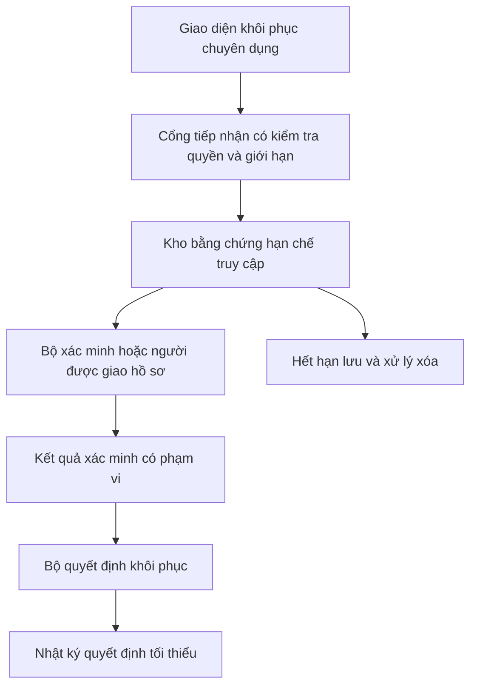

# Recovery evidence privacy — Bảo vệ quyền riêng tư của bằng chứng khôi phục

## 1. Bằng chứng khôi phục tạo ra một ranh giới dữ liệu nhạy cảm

Khi người dùng mất mật khẩu, MFA, passkey hoặc thiết bị xác thực, hệ thống cần bằng chứng để quyết định có trao lại quyền kiểm soát tài khoản hay không. Bằng chứng có thể là kết quả xác minh một phương thức đã đăng ký, recovery code, lịch sử bảo mật hoặc tài liệu được cung cấp trong một quy trình xác minh riêng.

**Recovery evidence privacy** là việc giới hạn cách thu thập, sử dụng, truy cập, chia sẻ và lưu giữ những dữ liệu này theo mục đích khôi phục tài khoản.

Một luồng khôi phục có thể chống chiếm đoạt tốt nhưng vẫn làm lộ thông tin nếu:

- Nhân viên hỗ trợ nhận ảnh giấy tờ qua email rồi chuyển tiếp cho nhiều người.
- Token hoặc recovery code xuất hiện trong log.
- Một liên kết đính kèm cho phép tải tài liệu mà không kiểm tra người truy cập.
- Tài liệu được giữ vô thời hạn sau khi vụ việc đã kết thúc.
- Dữ liệu vốn chỉ để khôi phục được đưa sang phân tích hành vi hoặc mục đích khác.

Mục tiêu là thu được bằng chứng đủ cho quyết định an toàn trong khi giảm dữ liệu nhạy cảm phải đi qua và tồn tại trong hệ thống. Không nên thu thập càng nhiều càng tốt chỉ vì người dùng đang cần lấy lại tài khoản.

## 2. Phân biệt bằng chứng, bí mật và kết quả xác minh

Ba khái niệm này thường bị trộn lẫn:

| Loại dữ liệu | Ví dụ | Cách xử lý theo mục đích |
| --- | --- | --- |
| Bí mật dùng để chứng minh quyền kiểm soát | Recovery code, token khôi phục | Chỉ tiếp nhận qua luồng chuyên dụng, kiểm tra và xử lý vòng đời bí mật |
| Dữ liệu hoặc tài liệu làm bằng chứng | Tài liệu định danh trong một luồng xác minh cụ thể | Hạn chế nội dung, người đọc, bản sao và thời gian lưu |
| Kết quả xác minh | Một phương thức đủ điều kiện đã được xác minh lúc nào, cho giao dịch nào | Lưu kết quả tối thiểu cần cho quyết định và truy vết |

### 2.1. Không biến bí mật thành tài liệu hỗ trợ

Người dùng có thể cần nhập recovery code vào giao diện chuyên dụng để máy chủ xác minh. Điều đó không có nghĩa họ nên gửi code vào hội thoại hỗ trợ, ảnh chụp màn hình hoặc tệp đính kèm.

Tương tự:

- Passkey được sử dụng qua cơ chế chứng minh quyền kiểm soát; ứng dụng không cần người dùng xuất hoặc gửi khóa riêng.
- Một thử thách MFA nên được xử lý trong luồng được thiết kế cho nó, thay vì nhân viên yêu cầu người dùng đọc mã rồi ghi vào ghi chú.
- Token khôi phục không phải một định danh thông thường để sao chép vào báo cáo sự cố.

Trong thiết kế, cần phân biệt nơi máy chủ được phép xử lý bí mật với nơi con người được phép xem bằng chứng. Hai quyền này không tự động đi cùng nhau.

### 2.2. Ưu tiên kết quả đủ dùng thay vì bản sao đầy đủ

Nếu quyết định chỉ cần biết “người yêu cầu đã hoàn thành thử thách bằng phương thức đã đăng ký trước sự cố”, thường không cần đưa toàn bộ nội dung trao đổi hoặc bí mật của thử thách vào hồ sơ xét duyệt.

Một kết quả có phạm vi có thể gồm:

```text
recoveryCaseRef: case-123
evidenceKind: PREEXISTING_AUTHENTICATOR
verificationState: VERIFIED
verifiedAt: thời điểm máy chủ
validUntil: thời hạn sử dụng kết quả
allowedPurpose: REPLACE_LOST_MFA
verificationRef: tham chiếu nội bộ
```

Đây là mô tả minh họa, không phải schema bắt buộc. Kết quả vẫn là dữ liệu nhạy cảm: nó có thể tiết lộ cấu hình bảo mật và khả năng khôi phục của tài khoản.

Một cờ `VERIFIED` cũng không đủ nếu thiếu ngữ cảnh. Kết quả phải gắn với đối tượng, mục đích, thời hạn và bằng chứng thực sự đã được xác minh, tránh tái sử dụng cho một thao tác khác.

## 3. Thu thập tối thiểu theo từng nhánh khôi phục

### 3.1. Bắt đầu từ quyết định cần đưa ra

Trước khi thêm một trường vào biểu mẫu, cần trả lời:

1. Trường đó chứng minh điều gì?
2. Điều đó có cần cho thao tác đang được yêu cầu không?
3. Có thể dùng bằng chứng ít nhạy cảm hơn nhưng vẫn đủ sức xác minh không?
4. Ai cần đọc dữ liệu, trong bao lâu?
5. Nếu không thu thập trường đó thì quyết định an toàn nào không thể thực hiện?

Ví dụ, khi người dùng còn một passkey đủ điều kiện để xác minh theo chính sách, yêu cầu thêm ảnh giấy tờ chỉ vì có quy trình tải ảnh sẵn có thể tạo dữ liệu nhạy cảm không cần thiết.

Ngược lại, tối thiểu hóa dữ liệu không có nghĩa bỏ qua bằng chứng bắt buộc hoặc hạ mức xác minh. Mục tiêu là loại dữ liệu không giúp ích cho quyết định, đồng thời giữ đủ căn cứ an toàn.

### 3.2. Không biến mọi phương thức thành yêu cầu mặc định

Một biểu mẫu duy nhất yêu cầu email, số điện thoại, địa chỉ nhà, ngày sinh, ảnh giấy tờ và ảnh khuôn mặt cho mọi tình huống có thể thu thập nhiều hơn nhu cầu thực tế.

Nên thiết kế theo nhánh:

- Còn phương thức đã đăng ký phù hợp: xác minh qua phương thức đó.
- Còn recovery code đủ điều kiện: dùng luồng code chuyên dụng.
- Không còn phương thức phù hợp: chuyển sang một quy trình xác minh khác đã được thiết kế.
- Không đủ bằng chứng: giữ hoặc từ chối giao dịch theo chính sách, thay vì liên tục yêu cầu người dùng gửi thêm thông tin tùy ý.

Một tài liệu có chứa tên và ảnh không tự chứng minh quyền sở hữu tài khoản. Thu thập tài liệu nhạy cảm chỉ có giá trị khi quy trình giải thích được cách nó hỗ trợ xác minh và giới hạn của nó.

### 3.3. Hướng dẫn rõ phần nào cần và phần nào không cần

Nếu một nhánh thực sự cần tài liệu, giao diện nên giải thích mục đích, nội dung cần cung cấp, người có thể xử lý và vòng đời dự kiến.

Có thể cho phép che phần không cần thiết khi điều đó không làm mất giá trị xác minh. Không hướng dẫn che một trường mà bộ xác minh lại âm thầm yêu cầu đọc, khiến người dùng phải gửi đi gửi lại nhiều bản.

Ảnh có thể chứa dữ liệu phụ: tài liệu khác trong nền, thông tin thành viên gia đình hoặc metadata không liên quan. Cần giới hạn những dữ liệu này theo mục đích. Nếu phải tạo bản đã loại thông tin phụ, bản gốc và bản dẫn xuất cần có quyền truy cập, liên kết và thời hạn rõ ràng.

## 4. Chia dữ liệu theo vai trò và khả năng truy cập

Không phải ai làm việc trên hồ sơ khôi phục cũng cần xem cùng một lượng dữ liệu.

| Thành phần hoặc vai trò | Dữ liệu có thể cần | Giới hạn nên thể hiện trong thiết kế |
| --- | --- | --- |
| Bộ xác minh tự động | Dữ liệu cần cho thử thách hoặc kiểm tra được chỉ định | Không phát tán dữ liệu thô sang log và công cụ phân tích |
| Nhân viên tiếp nhận hỗ trợ | Trạng thái hồ sơ, bước tiếp theo, kết quả đủ dùng | Không mặc định được tải tài liệu gốc |
| Người xác minh chuyên trách | Phần bằng chứng cần để xử lý hồ sơ được giao | Quyền theo hồ sơ và nhiệm vụ, có thời hạn |
| Bộ quyết định rủi ro | Thuộc tính hoặc kết quả xác minh cần thiết | Không tự nhận toàn bộ tệp khi chỉ cần vài thuộc tính |
| Người vận hành hạ tầng | Chỉ số, mã lỗi, tình trạng dịch vụ | Không dùng quyền vận hành như quyền đọc mọi bằng chứng |
| Bên xử lý bên ngoài | Phần dữ liệu cần cho công việc đã xác định | Không tự mở rộng mục đích hoặc nhận toàn bộ hồ sơ |

### 4.1. Phân quyền phải kiểm tra trên máy chủ

Ẩn nút tải xuống ở giao diện không bảo vệ được tệp nếu endpoint vẫn cho phép truy cập bằng một ID đoán được hoặc lấy từ hồ sơ khác.

Mỗi lần đọc bằng chứng cần kiểm tra những điều kiện liên quan, chẳng hạn:

- Người truy cập hoặc dịch vụ đã được xác thực.
- Thuộc đúng tổ chức hoặc phạm vi tài khoản.
- Có nhiệm vụ xử lý hồ sơ tương ứng.
- Có quyền đọc đúng loại bằng chứng.
- Hồ sơ và quyền truy cập còn hiệu lực.
- Tệp chưa bị xóa, thu hồi hoặc chuyển sang trạng thái không được phục vụ.

ID hồ sơ khó đoán là một lớp giảm khả năng dò tìm, không thay thế kiểm tra quyền.

### 4.2. Quyền khởi tạo khôi phục không phải quyền đọc hồ sơ

Một người biết email của tài khoản có thể được phép bắt đầu luồng “quên mật khẩu”. Họ không vì thế mà được tải bằng chứng từng nộp, xem email dự phòng hoặc biết tài khoản có những phương thức xác thực nào.

Ngay cả một token khôi phục hợp lệ cũng chỉ nên có phạm vi được cấp. Token cho phép thực hiện một bước không tự có quyền xuất toàn bộ hồ sơ xác minh.

Điều này đặc biệt quan trọng khi hồ sơ chứa dữ liệu do người khác nộp trong một lần thử đáng ngờ. Hệ thống cần xác định quyền xem dữ liệu theo mục đích và chủ thể liên quan, tránh mặc định mọi dữ liệu gắn account ID đều có thể công khai cho bất kỳ phiên khôi phục nào của tài khoản đó.

## 5. Thiết kế đường đi của bằng chứng

Một đường đi có thể được tổ chức như sau:



Sơ đồ không yêu cầu mọi hệ thống phải tách thành từng dịch vụ. Điểm cốt lõi là tài liệu thô, kết quả xác minh và nhật ký có quyền sử dụng khác nhau.

### 5.1. Tiếp nhận qua kênh chuyên dụng

Một luồng tải bằng chứng cần giới hạn loại tệp, kích thước và số lượng; xử lý nội dung không tin cậy bằng cơ chế phù hợp; và tránh để tệp được phục vụ như nội dung có thể thực thi.

Tên tệp do người dùng cung cấp có thể chứa dữ liệu cá nhân. Không dùng tên đó làm khóa công khai hoặc mặc định ghi nguyên vào mọi log. Có thể dùng mã đối tượng nội bộ và giữ tên hiển thị ở nơi có quyền truy cập tương ứng.

Đường truyền bảo mật là điều kiện cần, nhưng dữ liệu vẫn có thể bị sao chép ở các lớp phía sau: gateway, công cụ theo dõi lỗi, dịch vụ quét tệp hoặc hộp thư hỗ trợ.

### 5.2. Kiểm soát quyền đọc tại kho và ứng dụng

Kho bằng chứng nên có ranh giới truy cập riêng, giới hạn dịch vụ nào được đọc và tách khỏi nội dung công khai.

Nếu dùng liên kết tải có thời hạn, phải hiểu rằng người giữ liên kết có thể có khả năng truy cập theo quyền mà liên kết mang lại. Cần giới hạn đối tượng, thời gian, thao tác và cách phát hành liên kết; tránh đưa nó vào log, email chuyển tiếp hoặc ghi chú hỗ trợ.

Thời hạn của liên kết không thay thế thời hạn lưu tệp. Liên kết hết hạn cũng không thu hồi được một bản sao đã tải xuống.

### 5.3. Không để dữ liệu tràn sang hệ thống quan sát

Cần thiết kế rõ dữ liệu nào được ghi ở từng lớp:

- Không ghi request body có recovery code hoặc tài liệu vào log thông thường.
- Không gửi nội dung biểu mẫu nhạy cảm đến analytics hoặc cơ chế ghi lại phiên thao tác.
- Không gắn token, đường dẫn tải có quyền truy cập hoặc trích xuất tài liệu vào thông báo lỗi.
- Không đưa hồ sơ bằng chứng vào dashboard mà người vận hành chỉ cần số lượng và trạng thái.
- Không dùng tệp thật trong ví dụ, ảnh chụp hướng dẫn hoặc dữ liệu phát triển.

Lọc ở ứng dụng chưa đủ nếu lớp trung gian vẫn lưu toàn bộ request. Ranh giới dữ liệu phải được hiểu xuyên suốt đường đi, kể cả khi một công cụ chỉ được bổ sung để điều tra lỗi.

## 6. Ví dụ: xác minh mất toàn bộ thiết bị mà không phát tán hồ sơ

Giả sử Hà mất điện thoại có MFA và không còn phương thức khác đủ điều kiện. Chính sách của sản phẩm có một nhánh xác minh thủ công cần một tài liệu cụ thể.

### 6.1. Cách thu thập gây dư thừa

Nhân viên yêu cầu Hà gửi nhiều ảnh qua email, dán token khôi phục vào nội dung thư và trả lời các câu hỏi không liên quan. Thư được chuyển tiếp sang nhóm kỹ thuật, rồi tệp được đính kèm vào một công cụ theo dõi lỗi.

Dù cuối cùng tài khoản được khôi phục đúng người, quy trình đã tạo nhiều bản sao và nhiều người đọc. Việc đóng ticket không xác định được tất cả nơi dữ liệu còn tồn tại.

### 6.2. Cách tổ chức theo mục đích

Một quy trình có ranh giới rõ có thể:

1. Tạo hồ sơ khôi phục ở máy chủ với mục đích và thời hạn xác định.
2. Hướng dẫn Hà cung cấp đúng phần tài liệu cần thiết qua giao diện riêng.
3. Lưu tài liệu trong kho bằng chứng với quyền theo hồ sơ.
4. Chỉ cho người xác minh được giao xem phần cần thiết.
5. Ghi kết quả xác minh có thời hạn và căn cứ ngắn gọn.
6. Cho nhân viên hỗ trợ thấy kết quả và bước tiếp theo, thay vì tài liệu gốc.
7. Thực hiện quyết định theo đúng phạm vi, sau đó áp dụng vòng đời lưu giữ riêng cho từng loại dữ liệu.

Việc có một tài liệu không tự làm kết quả xác minh thành công. Nếu bằng chứng không đủ, quy trình vẫn cần giữ hoặc từ chối theo chính sách. Bảo vệ quyền riêng tư và xác minh đúng chủ tài khoản phải được bảo toàn cùng nhau.

## 7. Tách thời hạn sử dụng bằng chứng khỏi thời hạn lưu dữ liệu

Một tài liệu còn được lưu không có nghĩa nó còn đủ mới để cho phép khôi phục. Ngược lại, một kết quả đã hết thời hạn sử dụng không tự làm mọi bản sao tài liệu biến mất.

Nên phân biệt ít nhất ba mốc:

- **Thời hạn giao dịch:** người yêu cầu có thể tiếp tục luồng đến khi nào.
- **Thời hạn giá trị xác minh:** kết quả có thể được dùng cho quyết định nào và đến khi nào.
- **Thời hạn lưu dữ liệu:** từng bản dữ liệu được giữ đến khi nào và vì mục đích gì.

Ví dụ mô tả metadata:

```text
artifactRef: evidence-789
caseRef: case-123
purpose: LOST_AUTHENTICATOR_REVIEW
receivedAt: thời điểm tiếp nhận
retentionPolicyRef: evidence-retention-v3
deleteAfter: thời điểm xác định theo chính sách áp dụng
verificationResultRef: verification-456
accessState: RESTRICTED
```

Một phiên bản chính sách lưu giữ giúp giải thích tại sao dữ liệu được giữ và quy trình nào quản lý nó. Không nên để `deleteAfter` rỗng mặc định cho mọi bằng chứng chỉ vì chưa xây dựng cơ chế xóa.

### 7.1. Mỗi nhóm dữ liệu có thể có vòng đời khác nhau

| Nhóm dữ liệu | Mục đích có thể cần giữ | Điều cần giới hạn |
| --- | --- | --- |
| Tệp thô | Hoàn tất xác minh hoặc xử lý tranh chấp cụ thể | Không mặc định lưu cùng thời gian với nhật ký |
| Bản trích xuất | Cung cấp thuộc tính cần cho xác minh | Không giữ toàn bộ nội dung OCR nếu chỉ dùng một phần |
| Kết quả xác minh | Hỗ trợ quyết định và giải thích hồ sơ | Gắn mục đích, thời hạn và phiên bản |
| Ghi chú xử lý | Ghi nhận căn cứ của người xác minh | Tránh chép lại tài liệu và thông tin không cần thiết |
| Nhật ký truy cập | Truy vết ai đã đọc hoặc thao tác | Không biến thành bản sao nội dung bằng chứng |
| Bản sao tạm hoặc bản xem trước | Phục vụ xử lý trong một bước | Có cơ chế hết hạn và dọn riêng |

Giữ nhật ký rằng một bằng chứng đã được kiểm tra không nhất thiết đòi hỏi giữ ảnh gốc. Quyết định giữ mỗi nhóm cần có lý do cụ thể và thời hạn tương ứng.

### 7.2. Hồ sơ thất bại hoặc bị hủy cũng cần điểm kết thúc

Một luồng không hoàn tất có thể để lại tài liệu tải lên, bản quét tạm hoặc ghi chú của nhân viên. Không nên chỉ chạy vòng đời lưu giữ cho hồ sơ thành công.

Nếu có nhu cầu giữ dữ liệu để xử lý một sự cố đã xác định, cần có phạm vi, trách nhiệm, quyền đọc và thời điểm xem xét lại. Không dùng nhãn “chống gian lận” như lý do giữ mọi dữ liệu vô thời hạn.

## 8. Xóa dữ liệu phải xét cả bản dẫn xuất và bản sao

Xóa một hàng trong cơ sở dữ liệu chưa chắc đã xóa bằng chứng.

Một tài liệu có thể đã tạo ra:

- Đối tượng lưu trữ gốc và các phiên bản trước.
- Ảnh xem trước, thumbnail hoặc bản chuyển định dạng.
- Văn bản OCR và dữ liệu trích xuất.
- Tệp tạm của bước quét hoặc xử lý.
- Bản sao trong công cụ hỗ trợ hay hệ thống ngoài.
- Nội dung được cache hoặc sao lưu.

Cần có liên kết đủ để nhận biết các đối tượng thuộc cùng một bằng chứng và áp dụng vòng đời tương ứng. Việc thu hồi quyền phục vụ, xóa bản đang hoạt động và hết hạn bản sao lưu là những hoạt động khác nhau.

### 8.1. Xóa khả năng truy cập trước khi coi hồ sơ đã dọn xong

Khi một bằng chứng hết hạn phục vụ, ứng dụng cần ngừng cấp quyền đọc mới. Nếu dùng liên kết đã phát hành, phải tính đến khả năng nó vẫn có hiệu lực đến thời điểm hết hạn hoặc đến khi cơ chế lưu trữ thực thi thu hồi.

Nếu yêu cầu cần thu hồi ngay mỗi lần quyền thay đổi, một đường đọc đi qua máy chủ có kiểm tra quyền tại thời điểm truy cập có thể phù hợp hơn việc phát một liên kết có khả năng sử dụng độc lập. Lựa chọn kiến trúc cần phản ánh yêu cầu thu hồi thực tế.

Không thể thu hồi một bản sao mà người đọc đã tải về chỉ bằng cách đổi trạng thái hồ sơ. Vì vậy, giới hạn người được tải và hạn chế xuất dữ liệu là kiểm soát quan trọng từ trước.

### 8.2. Phục hồi từ sao lưu không nên làm dữ liệu hết hạn xuất hiện lại

Bản sao lưu có vòng đời riêng và thường không được sửa giống dữ liệu đang hoạt động. Thiết kế cần xác định cách hạn chế truy cập, thời hạn hết hiệu lực và cách xử lý dữ liệu đã bị xóa nếu phải phục hồi.

Một lần phục hồi không nên vô tình đưa bằng chứng hết hạn trở lại giao diện hỗ trợ hoặc tái cấp liên kết tải. Trạng thái xóa và chính sách lưu giữ phải được đưa vào quy trình phục hồi phù hợp.

## 9. Chia sẻ và tái sử dụng cần có ranh giới mục đích

### 9.1. Chuyển cấp xử lý không đồng nghĩa chuyển toàn bộ hồ sơ

Khi một người xác minh cần xin ý kiến, có thể chỉ cần chuyển:

- Loại bằng chứng đã được xem.
- Kết quả kiểm tra liên quan.
- Điểm chưa thể kết luận.
- Tham chiếu hồ sơ để người có quyền truy cập đúng phần cần thiết.

Đính kèm lại toàn bộ tài liệu vào một cuộc trò chuyện mới sẽ tạo thêm bản sao và một vòng đời dữ liệu khác. Phạm vi chia sẻ nên được quyết định theo nhiệm vụ, không chỉ theo việc người nhận cũng làm trong cùng tổ chức.

### 9.2. Kết nối bên xử lý ngoài theo đúng công việc được giao

Nếu có dịch vụ OCR, quét nội dung hoặc xác minh ngoài, cần xác định dữ liệu thực sự phải gửi, kết quả cần nhận, quyền truy cập và vòng đời tại bên nhận.

Một công cụ hỗ trợ hoặc dịch vụ phân tích mới không tự có quyền nhận tài liệu khôi phục chỉ vì nó được kết nối vào hệ thống. Việc tái sử dụng bằng chứng cho huấn luyện, phân tích sản phẩm hoặc một mục đích khác phải được xem như một quyết định xử lý dữ liệu riêng, thay vì hệ quả mặc định của việc tải tệp.

Các bản lỗi kỹ thuật cũng có thể chứa dữ liệu: ảnh màn hình, payload mẫu và transcript cần được giảm thông tin trước khi đưa sang công cụ khác.

### 9.3. Che thông tin và thay định danh không đồng nghĩa ẩn danh

Một bản ghi thay email bằng account ID vẫn có thể liên kết ngược với người dùng nếu hệ thống còn bảng ánh xạ hoặc nhiều thuộc tính nhận diện.

Hash trực tiếp một email cũng không tự bảo đảm không thể nhận diện: miền giá trị có thể đoán được, và các bản ghi cùng giá trị có thể bị liên kết với nhau.

Nếu cần định danh để liên kết nội bộ, có thể dùng mã ngẫu nhiên hoặc cơ chế mã hóa định danh có khóa phù hợp với kiến trúc. Nhưng dữ liệu đó vẫn cần kiểm soát truy cập và mục đích; không nên gọi là dữ liệu vô danh chỉ vì không còn hiển thị tên thật.

Tương tự, mã băm của tệp có thể giúp kiểm tra tính toàn vẹn hoặc nhận biết bản sao. Nó không thay thế việc bảo vệ nội dung và không tự xóa tính nhạy cảm của hồ sơ.

## 10. Ví dụ kiểm tra quyền đọc bằng chứng

Mã giả dưới diễn đạt ranh giới quyền đọc, không phải một triển khai đầy đủ:

```text
readRecoveryEvidence(principal, caseRef, artifactRef):
    require principal is authenticated

    case = loadCaseMetadata(caseRef)
    artifact = loadArtifactMetadata(artifactRef)

    require artifact.caseRef == case.ref
    require principal belongs to the allowed organization or scope
    require principal has an active assignment for this case
    require assignment allows reading this evidence kind
    require artifact is available under its access and retention policy

    recordAccessDecision(
        principalRef,
        caseRef,
        artifactRef,
        action = READ,
        outcome = ALLOWED
    )

    return deliverThroughControlledPath(artifact)
```

Trong thiết kế thực tế, còn cần xử lý những tình huống như quyền bị thu hồi giữa lúc kiểm tra và lúc đọc, lỗi kho lưu trữ hoặc hồ sơ đã đóng. Điều cần giữ là nội dung chỉ được phục vụ khi các điều kiện đọc còn đúng tại ranh giới có ý nghĩa.

Một số giới hạn khác:

- Không tin `caseRef` hoặc `organizationId` từ client để xác định quyền mà không đối chiếu máy chủ.
- Không cấp quyền tải mọi tệp chỉ vì người đó xem được metadata hồ sơ.
- Phản hồi từ chối không nên tiết lộ nội dung hoặc sự tồn tại của một hồ sơ ngoài phạm vi.
- Ghi nhận truy cập bị từ chối khi cần truy vết, nhưng không chép bí mật hoặc nội dung tệp vào log.
- Dịch vụ tự động cũng cần danh tính và quyền có phạm vi; không chỉ áp dụng kiểm tra cho con người.

Quyền đọc bằng chứng và quyền phê duyệt khôi phục là hai khả năng khác nhau. Tùy mức nhạy cảm, hệ thống có thể tách trách nhiệm để một người không mặc định vừa tải mọi dữ liệu vừa quyết định mọi thay đổi.

## 11. Kết quả xác minh cũng cần giới hạn sử dụng

Một kết quả đã được giảm thông tin vẫn có thể bị dùng sai.

Ví dụ, kết quả xác minh cho phép thay MFA trong hồ sơ A không nên bị sao chép sang hồ sơ B để đổi email, hoặc dùng lại sau khi trạng thái tài khoản đã thay đổi.

Bộ quyết định cần xác định:

- Kết quả thuộc đúng tài khoản và giao dịch.
- Loại bằng chứng phù hợp với thao tác đang yêu cầu.
- Nguồn kết quả được tin cậy và không do client tự khai.
- Kết quả còn trong thời hạn sử dụng.
- Không có sự kiện làm mất hiệu lực, chẳng hạn bằng chứng bị thu hồi.
- Phạm vi hành động không bị mở rộng ngoài quyết định đã được cấp.

Không đưa dữ liệu thô vào quyết định chỉ để “phòng khi cần”. Nếu một tham chiếu nội bộ và kết quả có phạm vi đã đủ, việc sao chép tài liệu chỉ làm tăng nơi cần bảo vệ.

Cũng không nên trả chi tiết phương pháp kiểm tra nội bộ cho người chưa được xác minh. Giao diện có thể hướng dẫn bước tiếp theo mà không tiết lộ tài liệu trước đó của tài khoản, cấu hình xác thực hoặc cách vượt qua một điều kiện kiểm tra.

## 12. Nhật ký và trách nhiệm xử lý

Một hồ sơ có thể cần giải thích được ai đã xem bằng chứng và vì sao một quyết định được đưa ra. Điều này không đòi hỏi ghi toàn bộ bằng chứng vào nhật ký.

Một nhật ký truy cập tối thiểu có thể bao gồm:

```text
actorRef
serviceOrRole
caseRef
artifactRef
action
outcome
timestamp
assignmentOrPurposeRef
```

Ghi chú xác minh nên tập trung vào căn cứ liên quan, kết quả và điểm chưa chắc chắn. Tránh chép toàn bộ số giấy tờ, địa chỉ hoặc mô tả đời sống cá nhân vào ghi chú tự do.

Cần phân biệt:

- Sự kiện “đã đọc một tài liệu”.
- Sự kiện “đã xác minh một điều kiện”.
- Quyết định “cho phép thay phương thức”.
- Sự kiện “đã thực hiện thay đổi”.

Gộp chúng thành một nhãn “đã duyệt” làm mất ngữ nghĩa và dễ dẫn đến dùng lại quyền sai mục đích.

Những chỉ số vận hành như số hồ sơ chờ, độ trễ xử lý và số tệp hết hạn có thể được tổng hợp mà không cần hiển thị bằng chứng cá nhân trên dashboard. Khi dữ liệu tổng hợp có nhóm quá nhỏ hoặc còn khả năng liên kết với tài khoản cụ thể, vẫn cần xem xét quyền truy cập phù hợp.

## 13. Những lỗi thiết kế thường gặp

| Lỗi | Hệ quả | Hướng thiết kế phù hợp |
| --- | --- | --- |
| Yêu cầu mọi người gửi bộ tài liệu đầy đủ | Thu thập vượt nhu cầu và tạo nhiều dữ liệu nhạy cảm | Chọn bằng chứng theo nhánh và quyết định |
| Nhân viên nhận OTP hoặc recovery code trong chat | Bí mật bị lưu lại và có thêm người biết | Dùng luồng xác minh chuyên dụng |
| Mọi người xử lý ticket đều tải được tệp gốc | Quyền xem bằng chứng vượt phạm vi nhiệm vụ | Phân quyền theo hồ sơ, vai trò và loại dữ liệu |
| Token khôi phục cũng mở được toàn bộ hồ sơ | Quyền thực hiện một bước bị mở rộng thành quyền đọc dữ liệu | Tách phạm vi hành động và quyền truy cập |
| Chỉ mã hóa kho nhưng cho ứng dụng đọc không giới hạn | Mã hóa không ngăn được việc sử dụng sai qua quyền hợp lệ | Kiểm soát cả quyền, mục đích và đường phục vụ |
| Giữ nguyên mọi request để điều tra lỗi | Bằng chứng và bí mật lan sang hệ thống quan sát | Giới hạn trường được ghi và loại nội dung nhạy cảm |
| Đóng hồ sơ nhưng không quản lý bản dẫn xuất | Tài liệu còn trong OCR, ảnh xem trước và tệp tạm | Theo dõi vòng đời theo từng đối tượng |
| Liên kết tải hết hạn được coi là tệp đã bị xóa | Nhầm hiệu lực truy cập với lưu giữ dữ liệu | Quản lý hai vòng đời riêng |
| Gọi dữ liệu đã thay account ID là vô danh | Xem nhẹ khả năng liên kết lại | Tiếp tục phân quyền và giới hạn mục đích |
| Kết quả xác minh được dùng lại cho mọi thao tác | Một bằng chứng cấp quyền vượt mục đích ban đầu | Gắn tài khoản, giao dịch, thời hạn và phạm vi |

## 14. Điểm cần ghi nhớ

Bằng chứng khôi phục thường được thu thập khi người dùng đang ở tình huống dễ bị tổn thương về quyền truy cập. Hệ thống cần tránh biến nhu cầu lấy lại tài khoản thành lý do thu thập hoặc phát tán thông tin quá mức.

Thiết kế tốt bắt đầu từ quyết định cần đưa ra, dùng bằng chứng đủ mạnh nhưng tối thiểu, tách tài liệu thô khỏi kết quả xác minh, và chỉ cấp quyền đọc theo nhiệm vụ. Mỗi bản dữ liệu cần có mục đích cùng vòng đời rõ ràng; mỗi kết quả cần có phạm vi sử dụng. Nhờ đó, việc khôi phục quyền kiểm soát tài khoản không đồng thời tạo ra một kho bằng chứng nhạy cảm khó kiểm soát.
