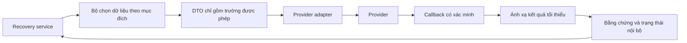

# Provider data minimization: tối thiểu hóa dữ liệu gửi nhà cung cấp trong luồng khôi phục tài khoản

## 1. Mục tiêu và phạm vi

Một hệ thống khôi phục tài khoản có thể sử dụng nhà cung cấp email, SMS, xác minh danh tính, đánh giá gian lận hoặc hỗ trợ khách hàng. Mỗi tích hợp tạo thêm một nơi dữ liệu của người dùng có thể được xử lý, lưu trữ, sao chép hoặc truy cập.

**Provider data minimization** là thiết kế để mỗi nhà cung cấp chỉ nhận, tạo và giữ dữ liệu cần thiết cho nhiệm vụ đã xác định. Nguyên tắc này áp dụng cả với dữ liệu gửi đi, dữ liệu nhận về và các bản sao phát sinh trong log, hàng đợi, trang quản trị hoặc hệ thống hỗ trợ.

Trong module khôi phục tài khoản, câu hỏi thiết kế là:

> Nhà cung cấp cần biết chính xác điều gì để thực hiện bước này, và phần còn lại có thể ở lại trong hệ thống của chúng ta không?

Ví dụ, dịch vụ gửi SMS cần số điện thoại đích và nội dung phải gửi. Nó thường không cần biết tài khoản có vai trò quản trị, số dư, danh sách passkey hay toàn bộ lịch sử đăng nhập. Dịch vụ đánh giá gian lận có thể cần một số đặc trưng ngữ cảnh, nhưng không vì vậy mà cần nhận mật khẩu hoặc token recovery.

NIST SP 800-63A-4 nêu nguyên tắc chỉ thu thập, xử lý thông tin cá nhân cần thiết cho mục đích xác minh danh tính và các nhiệm vụ liên quan đã xác định. Phần cân nhắc quyền riêng tư cũng giải thích rằng giảm dữ liệu giúp giảm phần thông tin có thể bị truy cập hoặc sử dụng trái phép. [Nguồn: NIST — Privacy Considerations](https://pages.nist.gov/800-63-4/sp800-63a.html#privacy-considerations).

Bài này tập trung vào thiết kế kỹ thuật và ranh giới dữ liệu. Các thời hạn, trường dữ liệu và luồng minh họa cần được điều chỉnh theo mục đích, chính sách và khả năng thực tế của từng tích hợp.

## 2. Tối thiểu hóa khác với mã hóa hoặc che giao diện

Ba biện pháp sau giải quyết các vấn đề khác nhau:

| Biện pháp | Điều được giải quyết | Điều chưa được giải quyết |
| --- | --- | --- |
| Chỉ gửi dữ liệu cần thiết | Giảm lượng dữ liệu đi qua ranh giới nhà cung cấp | Phần dữ liệu đã gửi vẫn cần được bảo vệ |
| Mã hóa khi truyền hoặc lưu | Giảm nguy cơ đọc trái phép ở một số vị trí | Nhà cung cấp có quyền giải mã vẫn có thể đọc dữ liệu |
| Che một phần trên giao diện | Giảm việc người xem màn hình thấy toàn bộ dữ liệu | Bản đầy đủ có thể còn trong API, log hoặc export |
| Thay định danh bằng mã tương quan | Giảm việc lộ định danh nội bộ trực tiếp | Dữ liệu vẫn có thể liên kết với một người qua ngữ cảnh |
| Xóa sau thời hạn cần thiết | Giảm thời gian dữ liệu còn tồn tại | Cần xử lý cả bản sao, dữ liệu dẫn xuất và backup |

Ví dụ, gửi toàn bộ hồ sơ qua HTTPS vẫn là gửi toàn bộ hồ sơ. Che số giấy tờ trong trang hỗ trợ không xóa số đầy đủ khỏi response hoặc lịch sử request.

Một thiết kế nên giảm dữ liệu trước khi truyền, rồi bảo vệ phần dữ liệu còn cần thiết. Không dùng mã hóa để biện minh cho việc gửi mọi thứ.

## 3. Lập bản đồ dữ liệu theo nhiệm vụ

### 3.1. Đặt tên nhiệm vụ trước khi chọn trường dữ liệu

Các nhiệm vụ cần được tách rõ:

- Gửi một thông báo khôi phục.
- Gửi mã hoặc liên kết cho một bước xác minh.
- Kiểm tra một bằng chứng danh tính theo phương thức đã chọn.
- Đánh giá một nhóm tín hiệu gian lận.
- Hỗ trợ xử lý một hồ sơ ngoại lệ.

Một nhà cung cấp có thể làm nhiều nhiệm vụ, nhưng mỗi nhiệm vụ vẫn cần phạm vi riêng. Việc đã dùng nhà cung cấp cho thông báo không tự tạo lý do gửi thêm giấy tờ hoặc lịch sử bảo mật cho họ.

Có thể dùng ma trận sau để bắt đầu thiết kế:

| Loại tích hợp | Dữ liệu có thể cần | Dữ liệu không gửi mặc định |
| --- | --- | --- |
| Gửi email | Địa chỉ đích, mẫu thư, biến nội dung cần thiết | Hồ sơ tài khoản đầy đủ, mật khẩu, refresh token |
| Gửi SMS | Số điện thoại đích, nội dung hoặc mã cần giao | Email khác, danh sách authenticator, chi tiết tài chính |
| Xác minh danh tính | Bằng chứng cần cho phương thức xác minh đã chọn | Các giấy tờ bổ sung chỉ để “phòng khi cần”, lịch sử ứng dụng không liên quan |
| Đánh giá gian lận | Đặc trưng thực sự được dùng cho quyết định đã xác định | Toàn bộ request, toàn bộ lịch sử đăng nhập, bí mật xác thực |
| Hỗ trợ thủ công | Mã hồ sơ, trạng thái, dữ liệu cần cho tác vụ được giao | Token có thể dùng, khóa phiên, bản sao hồ sơ không phục vụ quyết định |

“Có thể cần” không có nghĩa mọi tích hợp phải nhận toàn bộ cột đó. Mỗi trường vẫn phải có lý do cụ thể.

### 3.2. Không nhầm dữ liệu bắt buộc và dữ liệu tùy chọn

API của nhà cung cấp có thể hỗ trợ hàng chục thuộc tính. Điều đó không chứng minh sản phẩm cần điền tất cả.

Với mỗi trường, cần trả lời:

1. Trường này phục vụ bước nào?
2. Nếu bỏ trường này, nhiệm vụ nào không thực hiện được hoặc kém chính xác đáng kể?
3. Có thể thay bằng dữ liệu ít chi tiết hơn không?
4. Có cần gửi ngay, hay chỉ gửi khi một nhánh xử lý thực sự cần?
5. Nhà cung cấp có giữ hoặc dùng trường này cho mục đích khác không?

Ví dụ, nếu chỉ cần quyết định người dùng đã đạt một điều kiện tuổi, một kết quả xác nhận điều kiện có thể phù hợp hơn việc trả lại đầy đủ ngày sinh. Nếu nhà cung cấp phải đọc ngày sinh để thực hiện kiểm tra, việc trả về ít dữ liệu hơn vẫn giúp giảm bản sao bên hệ thống nhận.

## 4. Giảm dữ liệu ở cả hai chiều

### 4.1. Chiều gửi đi

Một lỗi phổ biến là đưa đối tượng miền trực tiếp vào SDK:

```text
provider.send(accountEntity)
```

Đối tượng đó có thể chứa email, vai trò, số điện thoại, quan hệ tổ chức, cấu hình MFA và dữ liệu được bổ sung sau này. Khi entity thay đổi, payload gửi ra ngoài có thể mở rộng mà không ai chủ động chọn trường.

Nên có bộ chuyển đổi chuyên biệt, chỉ đưa vào các trường được cho phép:

```text
recovery request
    -> dữ liệu cần cho nhiệm vụ
    -> DTO chuyên biệt
    -> kiểm tra schema và mục đích
    -> provider adapter
```

Không dùng quy tắc “serialize hết rồi xóa các trường nhạy cảm đã biết”. Cách đó dễ bỏ sót trường mới. Danh sách trường được phép giúp mặc định không truyền trường chưa được đánh giá.

### 4.2. Chiều nhận về

Nhà cung cấp xác minh danh tính có thể trả nhiều dữ liệu hơn hệ thống cần: ảnh đã xử lý, văn bản OCR, đặc trưng khuôn mặt, địa chỉ hoặc chi tiết tài liệu.

Nếu hệ thống chỉ cần trạng thái xác minh và tham chiếu bằng chứng, nên ánh xạ sang kết quả tối thiểu rồi bỏ các trường dư khỏi nơi lưu thông thường.

Ví dụ kết quả nội bộ:

```json
{
  "recoveryRequestId": "rr_502",
  "providerTransactionRef": "pv_tx_91",
  "verificationMethod": "DOCUMENT_AND_HOLDER_CHECK",
  "result": "VERIFIED",
  "completedAt": "2026-11-23T08:40:00Z",
  "evidenceReference": "evidence_308",
  "mappingVersion": "identity-result-v2"
}
```

Tên phương thức trong ví dụ là mô tả minh họa, không phải tên API của một dịch vụ cụ thể. Kết quả này vẫn cần bảo vệ vì nó liên quan đến một hồ sơ khôi phục.

Không lưu response gốc chỉ vì có sẵn. Nếu điều tra hoặc xử lý khiếu nại cần một phần bằng chứng chi tiết, phải xác định rõ phần đó, nơi lưu, người truy cập và thời hạn riêng.

### 4.3. Kết quả xác minh không tự cấp quyền recovery

Một nhà cung cấp có thể xác minh người đang cầm giấy tờ là người xuất hiện trên giấy tờ. Điều đó chưa tự chứng minh người ấy sở hữu một tài khoản cụ thể.

Backend cần kiểm tra mối liên hệ với tài khoản, bằng chứng còn hiệu lực, mục đích yêu cầu và chính sách khôi phục. Một tài khoản ban đầu không liên kết với danh tính thật có thể không có cơ sở để dùng giấy tờ làm bằng chứng quyền sở hữu.

Vì vậy, callback `VERIFIED` chỉ cập nhật kết quả của một bước đã được xác định; nó không tự bỏ MFA, đổi email hay tạo phiên đăng nhập đầy đủ.

## 5. Thiết kế định danh và liên kết dữ liệu

### 5.1. Ưu tiên mã tương quan theo giao dịch

Nếu nhà cung cấp chỉ cần ghép request với callback, có thể dùng một mã ngẫu nhiên riêng cho giao dịch:

```text
Nội bộ:
recoveryRequestId -> providerCorrelationId -> providerTransactionRef

Gửi nhà cung cấp:
providerCorrelationId
```

Mã tương quan không nên chứa email, số điện thoại, tên tài khoản, tenant hoặc ý nghĩa đặc quyền dưới dạng dễ đọc. Tránh tên như:

```text
admin-nguyen-a-reset-mfa
```

Một mã ngẫu nhiên cũng không phải bí mật xác thực chỉ vì khó đoán. Endpoint nhận callback vẫn phải xác minh nhà gửi và kiểm tra trạng thái.

Bảng ánh xạ nằm trong hệ thống nội bộ, được phân quyền theo nhu cầu. Không cần gửi khóa chính tài khoản cho nhà cung cấp chỉ để tiện tra cứu.

### 5.2. Định danh ổn định cần có lý do riêng

Một số phương thức chống gian lận thực sự cần liên kết nhiều giao dịch. Khi đó, mã chỉ dùng một lần có thể không đáp ứng được nhiệm vụ. Cần xác định rõ phạm vi liên kết cần thiết, thay vì mặc định dùng một định danh ổn định toàn hệ thống.

Có thể cân nhắc một định danh được tạo bằng HMAC với khóa bí mật và ngữ cảnh phân tách theo provider, tenant, mục đích và phiên bản. Đây là lựa chọn kỹ thuật cần quản lý khóa và vòng đời cẩn thận.

Các giới hạn cần hiểu:

- Hash thuần email hoặc số điện thoại có thể bị dò từ tập giá trị có thể đoán.
- Định danh thay thế vẫn cho phép nhà cung cấp nối các giao dịch nếu nó ổn định.
- Metadata hoặc địa chỉ liên lạc đi kèm có thể làm lộ người dùng.
- Mất khóa hoặc thay khóa có thể ảnh hưởng khả năng đối chiếu.
- Không nên tạo khả năng liên kết xuyên tenant hoặc xuyên provider khi nhiệm vụ không cần.

Thay định danh trực tiếp giúp giảm một số rủi ro, nhưng không tự biến dữ liệu thành vô danh.

## 6. Ví dụ payload tối thiểu cho một bước đánh giá

Giả sử hệ thống cần nhà cung cấp đánh giá một nhóm tín hiệu cho yêu cầu thay authenticator bị mất. Một payload minh họa có thể như sau:

```json
{
  "correlationId": "pc_7b2f",
  "purpose": "RECOVERY_RISK_REVIEW",
  "schemaVersion": "risk-review-v1",
  "action": "REPLACE_LOST_AUTHENTICATOR",
  "features": {
    "networkNovelty": "NEW",
    "recentRecoveryChannelChange": true,
    "attemptBand": "ELEVATED"
  }
}
```

Ví dụ này chỉ phù hợp nếu phương thức đánh giá của nhà cung cấp dùng được các đặc trưng ấy. Không thể bỏ IP thô nếu dịch vụ cụ thể phải dùng IP để thực hiện chức năng đã chọn, rồi vẫn giả định kết quả tương đương.

Cách ra quyết định là:

1. Xác định dữ liệu thật sự cần cho phương thức.
2. Tính đặc trưng tại nội bộ khi có thể và phù hợp.
3. Nếu phải gửi dữ liệu chi tiết hơn, ghi rõ lý do và phạm vi.
4. Không gửi thêm các dữ liệu không giúp hoàn thành nhiệm vụ.

Payload không chứa mật khẩu, TOTP seed, mã dự phòng, cookie phiên hoặc toàn bộ tài khoản. Bộ chuyển đổi cũng không tự thêm “metadata tiện dụng” như vai trò quản trị hoặc ghi chú hỗ trợ.

Các đặc trưng tổng hợp vẫn có thể tiết lộ thông tin về người dùng. Việc giảm chi tiết cần đi cùng giới hạn mục đích và thời gian lưu.

## 7. Bí mật recovery và giới hạn của provider gửi thông điệp

### 7.1. Nhà cung cấp gửi mã có thể nhìn thấy mã

Nếu provider giao email hoặc SMS chứa token, mã xác minh hoặc liên kết có token, nó cần nhận nội dung tương ứng để chuyển tới người dùng. Không thể khẳng định provider “không biết bí mật” chỉ vì token là chuỗi ngẫu nhiên hoặc nằm trong một URL.

Ranh giới này phải được ghi nhận trong mô hình đe dọa:

- Provider có thể nhìn thấy người nhận và nội dung cần giao.
- Một liên kết chứa bearer token có thể trao quyền cho người cầm liên kết.
- Nội dung có thể xuất hiện trong lịch sử gửi, log, hệ thống xử lý lỗi hoặc giao diện hỗ trợ của provider.
- Việc mã hết hạn trong ứng dụng không tự xóa bản sao thông điệp.

Do đó, tích hợp gửi thông điệp cần phạm vi dữ liệu chặt, quyền truy cập phù hợp và vòng đời bí mật rõ ràng.

### 7.2. Chỉ đưa nội dung cần cho thông điệp

Một yêu cầu gửi có thể gồm địa chỉ đích, mã mẫu, ngôn ngữ, mã tương quan và các biến cần thiết. Không cần đính kèm toàn bộ lịch sử recovery để giải thích lý do gửi.

Nội dung thông báo nên đủ rõ để người dùng hiểu hành động và cách phản hồi, nhưng không phơi bày thêm thông tin không cần thiết. Ví dụ, thông báo về một yêu cầu khôi phục thường không cần chứa toàn bộ địa chỉ, số giấy tờ hay tên tất cả thiết bị đã đăng ký.

Cần chú ý các tính năng phụ:

- Theo dõi lượt mở hoặc click có thể tạo thêm dữ liệu.
- Việc viết lại liên kết có thể đưa token qua một miền hoặc hệ thống khác.
- Một số công cụ bảo mật có thể truy cập liên kết trước người nhận.
- Báo cáo gửi thành công không chứng minh chủ tài khoản đã đọc hoặc chấp thuận.

Với liên kết recovery, có thể lựa chọn cấu hình mẫu gửi hạn chế các tính năng không cần thiết. Việc mở liên kết bằng GET không nên tự hoàn tất một thay đổi nhạy cảm; máy chủ cần xác nhận hành động và kiểm tra quyền ở bước tương ứng.

### 7.3. Giữ quyền xác minh tại backend

Provider gửi thông điệp trả về trạng thái `DELIVERED` chỉ cho biết kết quả giao theo ngữ nghĩa dịch vụ đó. Backend vẫn chịu trách nhiệm kiểm tra mã, hạn dùng, số lần thử, mục đích và trạng thái sử dụng.

Không lấy callback giao thành công làm bằng chứng đủ để thay MFA. Cũng không gửi mật khẩu mới, refresh token hoặc phiên đăng nhập đầy đủ chỉ để provider “đồng bộ trạng thái”.

## 8. Adapter là ranh giới thực thi minimization

Một kiến trúc có thể tách trách nhiệm như sau:



Recovery service không nên phụ thuộc vào toàn bộ mô hình response của SDK. Adapter chuyển dữ liệu sang schema riêng và trả kết quả nội bộ đã được giới hạn.

Pseudocode:

```text
startProviderStep(recoveryRequest, providerPurpose):
    require providerPurpose is allowed for this recovery action
    require this step is authorized and still needed

    correlationId = createRandomTransactionReference()

    selectedData = selectAllowedFields(
        purpose = providerPurpose,
        source = recoveryRequest
    )

    require selectedData meets the purpose-specific schema

    persistInternalMapping(
        recoveryRequest.id,
        correlationId,
        providerPurpose,
        currentMappingVersion
    )

    sendThroughConfiguredProviderAdapter(
        correlationId,
        selectedData
    )


acceptProviderResult(providerEvent):
    verify provider authenticity and event integrity
    reject replay or invalid transaction binding
    load internal mapping by provider and correlation reference

    require mapping.purpose matches the expected step
    require recovery request still accepts a result for this step

    minimalResult = mapAllowedResultFields(providerEvent)
    save scoped verification result

    continue recovery policy evaluation
```

Mã minh họa tập trung vào ranh giới dữ liệu. Triển khai còn phải xử lý tính bền vững, yêu cầu đồng thời và thử lại phù hợp.

### 8.1. Callback cần đúng người gửi và đúng giao dịch

Callback có chữ ký hợp lệ vẫn phải gắn với đúng provider, môi trường, tenant, giao dịch và bước xử lý. Không cho một sự kiện của hồ sơ A cập nhật tài khoản B.

Tùy cơ chế provider hỗ trợ, việc xác minh có thể liên quan đến chữ ký trên payload gốc, timestamp, định danh sự kiện và cửa sổ chống phát lại. Không tự sáng tác cách kiểm chữ ký khác với hợp đồng của provider.

Chỉ nhận các loại sự kiện đã dùng. Callback thừa trường không có nghĩa ứng dụng phải lưu mọi trường. Một kết quả đến sau khi yêu cầu đã hủy cũng không được mở lại recovery một cách tự động.

### 8.2. File đính kèm cần quyền truy cập hẹp

Nếu provider cần đọc một tài liệu, nên tránh cấp quyền vào cả bucket hoặc thư mục chứa nhiều người dùng.

Một quyền lấy tài liệu có thể được giới hạn theo:

- Đúng một đối tượng.
- Đúng thao tác cần thiết.
- Thời hạn ngắn phù hợp với công việc.
- Đối tượng nhận và cơ chế truy cập mà hệ thống có thể kiểm soát.
- Khả năng thu hồi hoặc kết thúc quyền khi không còn cần.

Một URL có chữ ký vẫn có thể là bí mật truy cập. Không ghi nó nguyên vẹn vào log hoặc gửi cho hệ thống không cần biết.

Nếu provider tổ chức upload trực tiếp, hệ thống có thể giảm một số bản sao tài liệu ở phía mình. Tuy nhiên, provider vẫn nhận dữ liệu và SDK trên trang có thể thu thêm metadata. Cần xem xét toàn bộ luồng thực tế thay vì coi upload trực tiếp là tự đạt minimization.

Endpoint và địa chỉ callback cũng cần được cấu hình kiểm soát. Không cho dữ liệu người dùng tùy ý chọn nơi hệ thống gửi hồ sơ hoặc nơi adapter gọi lấy tài liệu.

## 9. Đừng để log, trace và hàng đợi phá vỡ ranh giới dữ liệu

Dù payload nghiệp vụ đã gọn, các hệ thống phụ có thể tạo ra bản sao đầy đủ:

- HTTP client ghi request và response body.
- APM lưu span attribute hoặc exception.
- Hàng đợi lưu payload qua nhiều lần thử lại.
- Dead-letter queue giữ dữ liệu vô thời hạn.
- Trang hỗ trợ xuất toàn bộ response để tiện điều tra.
- Nhân viên dán payload vào một ticket hoặc đoạn chat.

OWASP khuyến nghị không ghi trực tiếp các dữ liệu như access token, mật khẩu và thông tin cá nhân nhạy cảm vào log; cần loại bỏ hoặc áp dụng cách bảo vệ phù hợp. [Nguồn: OWASP — Logging, Data to exclude](https://cheatsheetseries.owasp.org/cheatsheets/Logging_Cheat_Sheet.html#data-to-exclude).

Thiết kế log có thể ưu tiên các trường:

```text
recoveryRequestRef
providerName
providerTransactionRef
purpose
schemaVersion
eventType
normalizedStatus
durationBand
errorCode
```

Ngay cả các tham chiếu này vẫn cần phân quyền vì có thể nối với hồ sơ nội bộ. Nếu cần dữ liệu chi tiết để điều tra một sự cố cụ thể, hãy dùng kho bằng chứng có kiểm soát thay vì bật ghi body cho toàn bộ người dùng.

Thông điệp trong hàng đợi cũng nên dùng tham chiếu khi phù hợp. Tuy nhiên, việc dùng tham chiếu chỉ dời dữ liệu sang một nơi khác; nơi đó vẫn cần quyền truy cập, thời hạn và cơ chế xóa.

Một tác vụ gửi lại không nên giữ mã recovery đã hết hạn rồi tiếp tục phát ra. Cần kiểm tra trạng thái yêu cầu và sự cần thiết của thông điệp trước khi giao lại.

## 10. Lưu giữ, xóa và xử lý bản sao

### 10.1. Mỗi lớp dữ liệu có vòng đời riêng

Thời hạn xác minh, thời hạn lưu bằng chứng và thời hạn giữ log là các khái niệm khác nhau.

| Lớp dữ liệu | Mục đích | Câu hỏi cần có câu trả lời |
| --- | --- | --- |
| Token hoặc mã recovery | Chứng minh quyền trong một bước | Khi nào hết hạn hoặc bị vô hiệu hóa? |
| Bằng chứng gốc | Thực hiện xác minh theo phương thức đã chọn | Cần giữ bao lâu sau kết quả và vì sao? |
| Kết quả xác minh tối thiểu | Theo dõi quyết định và xử lý tranh chấp | Cần những trường nào và trong thời gian nào? |
| Log vận hành | Theo dõi lỗi và sự cố | Có thể giữ tham chiếu thay cho dữ liệu đầy đủ không? |
| Dữ liệu dẫn xuất | Hỗ trợ đánh giá hoặc chống gian lận | Có còn liên kết với cá nhân hoặc giao dịch không? |
| Backup | Phục hồi hệ thống | Khi nào bản sao hết vòng đời và điều gì xảy ra khi restore? |

Các mốc thời gian cụ thể phải có lý do. Không đặt một TTL ngắn cho token rồi tuyên bố toàn bộ dữ liệu recovery đã được xóa.

### 10.2. Xóa là một công việc có trạng thái

Có thể quản lý tác vụ xóa provider theo vòng đời:

```text
SCHEDULED
    -> REQUESTED
    -> CONFIRMED
    hoặc RETRY_PENDING / REQUIRES_REVIEW
```

Lưu tham chiếu công việc và xác nhận phù hợp, tránh sao chép lại nội dung nhạy cảm vào chính hồ sơ xóa.

Một HTTP 202 có thể chỉ là đã nhận yêu cầu. Nếu hợp đồng provider yêu cầu kiểm tra kết quả sau đó, không được coi phản hồi nhận việc là bằng chứng đã xóa xong.

Cũng cần hiểu phạm vi xác nhận:

- Có xóa tài liệu gốc và bản đã xử lý không?
- Có bao gồm OCR hoặc dữ liệu sinh trắc học dẫn xuất nếu đã tạo không?
- Có còn bản sao ở log, cache hoặc hệ thống hỗ trợ không?
- Backup được xử lý theo vòng đời nào?
- Nhà cung cấp phụ hoặc dịch vụ liên quan có nằm trong phạm vi không?

Không suy diễn rằng một API xóa giao dịch có nghĩa mọi bản sao ở mọi hệ thống đều biến mất ngay. Cần dựa trên ngữ nghĩa thực tế của dịch vụ và ghi nhận phần giới hạn.

### 10.3. Dữ liệu phục hồi từ backup cần được xử lý tiếp

Nếu một bản backup cũ được phục hồi, dữ liệu đã hết thời hạn có thể xuất hiện lại. Thiết kế phục hồi nên tái áp dụng các quyết định xóa hoặc hạn chế trước khi dữ liệu được đưa trở lại xử lý bình thường.

Trong trường hợp cần giữ một phần bằng chứng theo chính sách ngoại lệ đã xác định, phải giới hạn đúng dữ liệu, mục đích và người truy cập. Ngoại lệ không nên biến thành lý do giữ toàn bộ hồ sơ recovery vô thời hạn.

## 11. Thử lại và chuyển provider không được nhân bản dữ liệu ngoài ý muốn

Giả sử một request tới provider A bị timeout. Ứng dụng chưa biết A đã tạo giao dịch hay chưa.

Nếu ngay lập tức gửi cùng bộ giấy tờ sang provider B, hệ thống có thể tạo hai hồ sơ ở hai nơi, trong khi người dùng tưởng chỉ có một bước xác minh.

Một thiết kế cần xác định:

- Provider có hỗ trợ idempotency và trong phạm vi nào?
- Có thể tra trạng thái bằng tham chiếu giao dịch không?
- Khi nào được phép tạo giao dịch mới?
- Nếu đã tạo bản sao, bản nào tiếp tục và bản nào phải kết thúc?
- Việc chuyển provider có thay đổi loại dữ liệu hoặc mục đích xử lý không?

Idempotency giúp giảm giao dịch lặp khi được triển khai đúng, nhưng không tự bảo đảm xóa bản sao hoặc thống nhất kết quả giữa hai provider.

Không dùng “fallback” để tự mở rộng phạm vi dữ liệu. Nếu provider dự phòng yêu cầu dữ liệu chi tiết hơn, hệ thống cần lộ trình phù hợp trước khi thu thập hoặc chuyển tiếp thêm.

## 12. Ví dụ xuyên suốt

Nam mất điện thoại có ứng dụng MFA. Anh còn một phương thức recovery được chính sách hỗ trợ, nhưng yêu cầu hiện tại cần thêm một bước xác minh theo quy trình đã định.

### Bước 1: Chọn nhánh trước khi thu thập

Backend xác định bước nào thật sự cần thiết. Nếu bằng chứng hiện có đã đủ theo chính sách, hệ thống không yêu cầu giấy tờ chỉ vì SDK xác minh đã được tích hợp.

Nếu cần dùng provider, hệ thống chọn mục đích và trường dữ liệu cụ thể cho nhánh đó.

### Bước 2: Gửi dữ liệu theo nhiệm vụ

Provider gửi thông báo chỉ nhận địa chỉ đích và nội dung cần giao. Nó không nhận hồ sơ xác minh danh tính.

Provider xác minh chỉ nhận bằng chứng cần cho phương thức đã chọn cùng mã tương quan. Nó không nhận mật khẩu, TOTP seed hoặc quyền truy cập các tài liệu khác.

### Bước 3: Nhận kết quả có giới hạn

Backend xác minh callback, đối chiếu giao dịch và lưu kết quả tối thiểu. Kết quả được dùng như một bằng chứng có phạm vi trong quyết định recovery.

Backend không tự tạo phiên đầy đủ chỉ vì provider trả về `VERIFIED`. Nó vẫn kiểm tra mối liên hệ với tài khoản, trạng thái yêu cầu và các điều kiện còn lại.

### Bước 4: Kết thúc và xử lý vòng đời

Sau khi yêu cầu kết thúc, token và quyền tạm được xử lý theo vòng đời tương ứng. Bằng chứng, kết quả và log được giữ hoặc xóa theo từng mục đích đã xác định.

Nếu provider chỉ nhận việc xóa nhưng chưa xác nhận hoàn tất, công việc vẫn được theo dõi. Lỗi xóa cần được xử lý tiếp; không ghi nhận thành công chỉ vì recovery nghiệp vụ đã hoàn tất.

## 13. Các lỗi thiết kế thường gặp

| Lỗi | Hậu quả | Hướng thiết kế phù hợp |
| --- | --- | --- |
| Serialize nguyên account entity | Trường mới có thể tự bị gửi ra ngoài | DTO theo mục đích với danh sách trường được phép |
| Điền mọi trường tùy chọn của SDK | Tăng dữ liệu mà không có lý do nhiệm vụ | Chỉ điền trường cần thiết cho phương thức được chọn |
| Dùng email làm correlation ID | Lộ định danh trực tiếp và tạo liên kết dễ dàng | Mã giao dịch ngẫu nhiên, ánh xạ nội bộ |
| Dùng một pseudonym toàn hệ thống | Tạo khả năng liên kết vượt mục đích | Phân tách phạm vi khi cần định danh ổn định |
| Cho rằng HTTPS là đủ minimization | Provider vẫn nhận toàn bộ dữ liệu | Giảm nội dung trước khi truyền |
| Lưu toàn bộ response xác minh | Tạo thêm bản sao giấy tờ và dữ liệu dẫn xuất | Ánh xạ kết quả tối thiểu, tách bằng chứng cần giữ |
| Callback thành công tự bỏ MFA | Kết quả một bước bị nâng thành quyền recovery | Kiểm tra liên kết tài khoản và chính sách nội bộ |
| Ghi body request trong APM | Dữ liệu lan sang hệ thống quan sát | Log sự kiện và tham chiếu theo schema hạn chế |
| Token hết hạn được coi là dữ liệu đã xóa | Bản sao thông điệp hoặc hồ sơ còn tồn tại | Quản lý riêng hạn dùng và lưu giữ |
| Chuyển provider ngay khi timeout | Tạo hồ sơ trùng ở nhiều nơi | Đối chiếu trạng thái và thiết kế fallback rõ ràng |
| Gửi yêu cầu xóa rồi bỏ theo dõi | Không biết kết quả xóa thực tế | Tác vụ xóa có trạng thái, thử lại và xác nhận |
| Thu thêm dữ liệu để “sau này có thể dùng” | Mở rộng mục đích và bề mặt rò rỉ | Xác định nhu cầu trước khi thu thập |

## 14. Câu hỏi tự suy luận

1. Provider gửi SMS thật sự cần biết những gì? Vì sao không thể nói provider không nhìn thấy mã nếu nó giao chính mã đó?
2. Khi nào mã tương quan theo giao dịch đã đủ, và khi nào một định danh ổn định cần được giải thích riêng?
3. Nếu provider trả về ảnh tài liệu và dữ liệu OCR nhưng hệ thống chỉ cần kết quả xác minh, nên giữ phần nào?
4. Vì sao một người vượt qua xác minh giấy tờ chưa tự chứng minh quyền sở hữu một tài khoản dùng biệt danh?
5. Một payload tối thiểu vẫn có thể bị sao chép sang những hệ thống phụ nào?
6. Timeout trước khi nhận transaction ID có thể làm dữ liệu bị nhân bản ra sao?
7. Phản hồi “đã nhận yêu cầu xóa” khác gì xác nhận xóa hoàn tất?
8. Sau khi phục hồi backup, hệ thống cần làm gì với dữ liệu đã hết thời hạn?

Một tích hợp đạt mục tiêu minimization phải mô tả được mục đích, dữ liệu tối thiểu ở từng chiều, quyền truy cập, vòng đời và phạm vi xác nhận xóa. Phần dữ liệu không cần cho nhiệm vụ nên ở ngoài ranh giới provider ngay từ đầu.