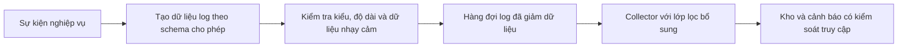

# Sensitive log redaction

## 1. Vì sao log recovery là một ranh giới bảo mật?

**Sensitive log redaction** là việc loại bỏ hoặc thay thế dữ liệu nhạy cảm trong sự kiện nhật ký trước khi dữ liệu đó đi tới các nơi lưu, truyền hoặc hiển thị log. Trong khôi phục tài khoản, log có thể vô tình chứa chính bí mật dùng để cấp lại quyền: token đặt lại mật khẩu, OTP, recovery code hoặc session mới.

Ví dụ, một dịch vụ không lưu token dạng rõ trong cơ sở dữ liệu nhưng lại ghi toàn bộ URL:

```text
GET /recovery/complete?token=TOKEN_PLACEHOLDER
```

Nếu token thật xuất hiện trong access log, người có quyền đọc log có thể lấy được nó trong thời hạn sử dụng. Việc bảo vệ bảng token chưa đủ khi một bản sao khác đã nằm trong hệ thống quan sát.

Mục tiêu là ghi được **sự kiện nào xảy ra, vào lúc nào, kết quả ra sao và liên quan giao dịch nào**, đồng thời tránh lưu bí mật để thực hiện lại recovery.

OWASP liệt kê access token, giá trị session, mật khẩu và nhiều loại dữ liệu nhạy cảm trong nhóm không nên được ghi trực tiếp vào log. [OWASP Logging Cheat Sheet](https://cheatsheetseries.owasp.org/cheatsheets/Logging_Cheat_Sheet.html#data-to-exclude)

Các schema, luồng và đoạn mã trong bài là ví dụ thiết kế cho hệ thống recovery, không phải một bộ lọc hoàn chỉnh áp dụng được cho mọi hạ tầng.

## 2. Nhận diện dữ liệu nhạy cảm theo công dụng

Một trường có tên bình thường như `value`, `payload` hoặc `message` vẫn có thể mang bí mật. Vì thế, phân loại cần dựa vào dữ liệu dùng để làm gì.

| Nhóm | Ví dụ trong recovery | Cách xử lý mặc định trong log |
| --- | --- | --- |
| Bí mật cấp quyền | Reset token, recovery code, OTP, cookie session | Không ghi giá trị |
| Bí mật authenticator | Mật khẩu mới, TOTP seed, khóa riêng | Không đưa vào sự kiện log |
| Thông tin định danh | Email, số điện thoại, định danh giấy tờ | Chỉ giữ khi có mục đích rõ và phạm vi phù hợp |
| Bằng chứng xác minh | Ảnh giấy tờ, ảnh khuôn mặt, nội dung đối chiếu | Không sao chép vào log vận hành thông thường |
| Dữ liệu môi trường | IP, fingerprint, User-Agent | Giảm chi tiết và giới hạn lưu theo nhu cầu thực tế |
| Kết quả bảo mật | Bằng chứng không hợp lệ, thao tác bị từ chối | Ghi mã kết quả được kiểm soát |
| Định danh giao dịch | Correlation ID do máy chủ tạo | Có thể dùng để liên kết sự kiện, với quyền truy cập phù hợp |

Một mã định danh không có quyền cấp access vẫn có thể liên kết hoạt động của người dùng. “Không phải mật khẩu” không đồng nghĩa “không cần bảo vệ”.

Không ghi một phần OTP hoặc recovery code chỉ để tiện tìm kiếm. Với bí mật có không gian giá trị nhỏ, việc giữ vài ký tự có thể làm giảm đáng kể số khả năng còn lại.

## 3. Phân biệt loại bỏ, che, giả danh hóa và mã hóa

Các kỹ thuật này có mục đích khác nhau:

| Kỹ thuật | Ví dụ | Giới hạn |
| --- | --- | --- |
| Loại bỏ | Không có trường `resetToken` trong sự kiện | Phù hợp khi không cần giá trị để vận hành |
| Thay bằng nhãn | `token="[REDACTED]"` | Nhãn chỉ báo có dữ liệu bị loại, không chứng minh toàn pipeline đã kín |
| Che một phần | Chỉ hiện một phần email | Vẫn có thể nhận diện khi ghép với thông tin khác |
| Giả danh hóa | Dùng định danh dẫn xuất có khóa để liên kết sự kiện | Vẫn có khả năng liên kết và cần quản lý khóa |
| Mã hóa | Lưu dữ liệu trong kho giới hạn quyền giải mã | Dữ liệu vẫn tồn tại; người có khóa có thể đọc |

Với token recovery, cách đơn giản thường là không ghi nó và dùng một ID giao dịch riêng để điều tra. Không cần tạo thêm bản sao mã hóa của token chỉ vì log đã có cơ chế mã hóa.

Băm thường cũng không làm mọi dữ liệu trở nên vô danh:

- OTP ngắn có thể bị dò hết không gian giá trị nếu chỉ lưu một hash dễ tính.
- Email hoặc số điện thoại có thể bị đối chiếu với danh sách ứng viên.
- Hash ổn định có thể liên kết một người qua nhiều lần recovery.
- Hash token dùng để kiểm chứng trong kho nghiệp vụ không mặc nhiên là một trường được phép xuất sang log.

Nếu cần giả danh hóa định danh để phát hiện lạm dụng, thiết kế riêng phạm vi khóa, thời gian liên kết và quyền sử dụng. Ưu tiên ID giao dịch ngẫu nhiên khi mục tiêu chỉ là theo dấu một lần recovery.

## 4. Lập bản đồ mọi nơi có thể ghi dữ liệu

Log ứng dụng chỉ là một nơi. Dữ liệu còn có thể đi qua:

```text
trình duyệt hoặc ứng dụng
    → CDN / WAF / reverse proxy
    → gateway
    → middleware HTTP
    → mã nghiệp vụ recovery
    → client gọi email, SMS hoặc dịch vụ xác minh
    → agent quan sát
    → collector
    → kho log / trace / cảnh báo / bản xuất
```

Một bộ lọc trong logger nghiệp vụ không sửa được token đã ghi tại reverse proxy trước khi request đến ứng dụng.

Những điểm dễ bị bỏ sót gồm:

- Access log ghi query string hoặc đường dẫn chứa bí mật.
- HTTP interceptor ghi toàn bộ request và response body.
- Header `Authorization`, `Cookie` hoặc `Set-Cookie`.
- Trace span tự động thu thập URL đầy đủ hoặc thông báo exception.
- MDC, context hoặc baggage mang email, token hay định danh người dùng.
- Hàng đợi log bất đồng bộ, vùng đệm trên đĩa và dead-letter queue.
- Bản chụp lỗi, session replay và công cụ hỗ trợ từ xa.
- Tin nhắn cảnh báo, email báo lỗi hoặc tệp log xuất để chia sẻ.

OpenTelemetry nhấn mạnh rằng bên triển khai cần hiểu telemetry do các thư viện instrumentation phát ra; hệ thống không tự biết dữ liệu nào nhạy cảm trong mọi ngữ cảnh. [OpenTelemetry: Handling sensitive data](https://opentelemetry.io/docs/security/handling-sensitive-data/)

Đối với recovery, nên kiểm soát thu thập tại từng ranh giới có thể thấy dữ liệu thô, thay vì chờ dữ liệu đến kho trung tâm mới xử lý.

## 5. Bắt đầu bằng danh sách trường được phép ghi

Một thiết kế dễ kiểm soát là tạo sự kiện log riêng, chỉ gồm các trường đã được chọn. Không chuyển nguyên request, tài khoản hoặc đối tượng token sang logger rồi hy vọng bộ lọc sẽ tìm hết dữ liệu nhạy cảm.

Ví dụ một sự kiện:

```json
{
  "eventType": "RECOVERY_EVIDENCE_CHECKED",
  "correlationId": "6c641a0e-1b79-4ed6-9bcb-19833d508f14",
  "operation": "RESET_PASSWORD",
  "outcome": "REJECTED",
  "reasonCode": "INVALID_EVIDENCE",
  "policyVersion": "recovery-log-example-v1"
}
```

Đây là dữ liệu minh họa. Sự kiện cho biết một lần xác minh bị từ chối mà không chứa token, email hoặc mật khẩu mới.

Các trường có giá trị hữu hạn như `operation`, `outcome` và `reasonCode` giúp hạn chế nội dung tự do. Nếu cần `tenantRef` hoặc `accountRef`, chỉ bổ sung khi mục tiêu điều tra cần chúng và quyền đọc log đáp ứng được phạm vi đó.

Không đưa kết quả nội bộ vào phản hồi công khai. Một log có quyền truy cập hạn chế có thể chứa thông tin vận hành mà người khởi tạo recovery chưa được phép biết.

## 6. Ví dụ Java: log từ một kiểu sự kiện riêng

Đoạn mã dưới dùng các kiểu có phạm vi giá trị rõ ràng. Nó minh họa cách tránh truyền đối tượng chứa bí mật vào logger, không triển khai toàn bộ hệ thống audit.

```java
import java.util.Objects;
import java.util.UUID;

public final class RecoverySecurityLog {
    private static final System.Logger LOGGER =
            System.getLogger(RecoverySecurityLog.class.getName());

    public enum Operation {
        RESET_PASSWORD,
        REPLACE_MFA,
        REPLACE_PASSKEY
    }

    public enum Outcome {
        ACCEPTED,
        REJECTED,
        DEFERRED
    }

    public enum Reason {
        EVIDENCE_VERIFIED,
        INVALID_EVIDENCE,
        POLICY_REVIEW_REQUIRED
    }

    public record Event(
            UUID correlationId,
            Operation operation,
            Outcome outcome,
            Reason reason) {

        public Event {
            Objects.requireNonNull(correlationId);
            Objects.requireNonNull(operation);
            Objects.requireNonNull(outcome);
            Objects.requireNonNull(reason);
        }
    }

    private RecoverySecurityLog() {
    }

    public static void write(Event event) {
        Objects.requireNonNull(event);

        LOGGER.log(
                System.Logger.Level.INFO,
                "event=RECOVERY_EVIDENCE_CHECKED "
                        + "correlationId={0} operation={1} "
                        + "outcome={2} reason={3}",
                event.correlationId(),
                event.operation(),
                event.outcome(),
                event.reason());
    }
}
```

Cách dùng minh họa:

```java
UUID correlationId = UUID.randomUUID();

RecoverySecurityLog.write(
        new RecoverySecurityLog.Event(
                correlationId,
                RecoverySecurityLog.Operation.RESET_PASSWORD,
                RecoverySecurityLog.Outcome.REJECTED,
                RecoverySecurityLog.Reason.INVALID_EVIDENCE));
```

Correlation ID ở đây do máy chủ tạo. Ví dụ không nhận chuỗi thông báo, token hoặc body request để ghi log. Các tổ hợp outcome và reason vẫn cần được mã nghiệp vụ sử dụng đúng ý nghĩa.

`System.Logger` hỗ trợ mẫu thông báo với tham số theo `MessageFormat`; ví dụ sử dụng `{0}`, `{1}` tương ứng với API này. [Java SE 21: System.Logger](https://docs.oracle.com/en/java/javase/21/docs/api/java.base/java/lang/System.Logger.html)

Việc dùng tham số không tự che bí mật. Nếu thay `event.reason()` bằng token thật, token vẫn bị ghi. Tính an toàn của ví dụ đến từ dữ liệu được phép đưa vào sự kiện, cùng việc kiểm soát các nơi ghi khác.

Tương tự, không log nguyên một Java record hoặc entity chứa `newPassword`, `otp` hay `resetToken`: phương thức `toString()` hoặc serializer có thể đưa các trường đó ra ngoài.

## 7. Bộ lọc redaction phải xử lý đúng cấu trúc

Danh sách cho phép ở nguồn là lớp chính. Khi cần xử lý dữ liệu từ nguồn khác, bộ lọc nên hiểu cấu trúc thay vì chỉ tìm chuỗi theo một mẫu duy nhất.

### 7.1. JSON và các trường lồng nhau

Bí mật có thể xuất hiện trong:

```json
{
  "request": {
    "credentials": {
      "value": "SECRET_PLACEHOLDER"
    }
  }
}
```

Bộ lọc chỉ xóa field có tên `token` sẽ bỏ sót. Nên xác định schema được phép hoặc loại bỏ cả vùng credentials theo ngữ cảnh.

Cũng cần xử lý mảng, trường trùng tên, giá trị bị cắt, dữ liệu mã hóa và biến thể mà parser của pipeline thực sự hỗ trợ. Nếu không phân tích được, không ghi lại payload thô như một cách dự phòng.

### 7.2. Header và cookie

Tên header không phân biệt hoa thường, còn một header có thể có nhiều giá trị. Chính sách phải áp dụng cho toàn bộ `Authorization`, `Cookie` và `Set-Cookie`, kể cả khi nguồn thu thập đổi cách biểu diễn.

Không che riêng một cookie session rồi vô tình giữ nguyên cookie chứa recovery state khác.

### 7.3. URL và đường dẫn

Ưu tiên ghi tên route hoặc mẫu đường dẫn, chẳng hạn:

```text
route=/recovery/complete
```

thay vì URL đầy đủ có query string. Nếu token nằm trong path, chỉ bỏ query string là chưa đủ.

Nếu cần xử lý URL, phải xét cách giải mã, tên tham số lặp và dữ liệu không hợp lệ. Một biểu thức chính quy đơn giản tìm `token=...` không đủ làm ranh giới duy nhất cho mọi định dạng.

### 7.4. Trường không nhận diện được

Trường mới không nên tự được xuất vào log chỉ vì chưa có trong danh sách cấm. Một schema sự kiện có phiên bản có thể loại trường ngoài danh sách cho phép hoặc từ chối phần dữ liệu bổ sung, trong khi vẫn giữ sự kiện cốt lõi an toàn.

Regex có ích như lớp phát hiện bổ sung, nhưng không hiểu đầy đủ ý nghĩa của dữ liệu hoặc mọi cách biểu diễn bí mật.

## 8. Exception, log injection và dữ liệu tự do

Một lỗi gọi nhà cung cấp email có thể mang nguyên URL, request body hoặc nội dung phản hồi trong exception. Ghi một câu thông báo an toàn rồi đính kèm toàn bộ `Throwable` vẫn có thể làm lộ dữ liệu.

Cách xử lý phù hợp có thể là:

1. Ánh xạ lỗi sang mã được kiểm soát như `DELIVERY_PROVIDER_UNAVAILABLE`.
2. Giữ correlation ID để liên kết với giao dịch.
3. Không xuất trực tiếp `exception.getMessage()` nếu chưa biết nội dung có thể chứa gì.
4. Chỉ thu thập thông tin chẩn đoán bổ sung qua đường đã xử lý dữ liệu nhạy cảm.

Cần xem cả message của cause, suppressed exception và thuộc tính tự động do công cụ ghi lỗi thu thập. Stack trace không mặc nhiên là dữ liệu sạch.

Log injection là vấn đề khác nhưng có liên quan. Nếu một định danh chứa ký tự xuống dòng được nối trực tiếp vào log dạng văn bản, nó có thể tạo dòng giống một sự kiện khác. Che bí mật chưa bảo đảm tính toàn vẹn của nhật ký.

Nên dùng trường được kiểm soát, encoder phù hợp với định dạng đầu ra và giới hạn độ dài. Nếu cần giữ dữ liệu tự do, xử lý ký tự điều khiển và ngữ cảnh hiển thị; không xem việc dùng structured logging là bảo đảm rằng mọi giao diện xuất hoặc tải log đều xử lý đúng.

## 9. Redaction phải xảy ra trước nơi tạo bản sao đầu tiên

Một pipeline thiết kế có thể như sau:



Nếu hàng đợi bất đồng bộ chứa đối tượng request gốc, việc che ở lúc ghi tệp là quá muộn đối với vùng đệm đó. Nếu collector nhận dữ liệu thô qua mạng, việc che ở collector không bảo vệ những bản ghi đã tạo tại agent.

Vì vậy, nên tạo payload log an toàn trước khi đưa vào hàng đợi, tệp hoặc đường xuất đầu tiên do thành phần đó kiểm soát. Ở những thành phần phía trước ứng dụng như gateway, cần cấu hình thu thập riêng.

Lớp xử lý ở collector vẫn có ích để chặn sai sót còn lại, nhưng phải xét từng loại tín hiệu: log body, attribute của trace, resource attribute, sự kiện exception và metric label không nhất thiết đi qua cùng một quy tắc.

Sampling chỉ làm giảm số sự kiện được lưu, không che bí mật trong các sự kiện được chọn. Truyền mã hóa và phân quyền kho log cũng không thay thế việc giảm dữ liệu.

## 10. Khi bộ lọc hoặc hệ thống log gặp lỗi

Một kiểu dự phòng nguy hiểm là:

```text
Không parse được payload
    → ghi nguyên payload để debug
```

Chính payload bất thường có thể chứa bí mật hoặc được cố ý tạo để vượt bộ lọc.

Một hành vi dự phòng an toàn hơn:

```json
{
  "eventType": "RECOVERY_LOG_PAYLOAD_OMITTED",
  "correlationId": "server-generated-reference",
  "reasonCode": "UNSUPPORTED_PAYLOAD_FORMAT"
}
```

Giữ sự kiện tối thiểu để vận hành biết có dữ liệu bị loại, nhưng không đính kèm bản gốc. Với hàng đợi xử lý lỗi, cũng không tự chuyển payload chưa che vào dead-letter queue có quyền đọc rộng hơn.

Tách hai vấn đề:

- **Bảo vệ bí mật:** lỗi bộ lọc không được làm hệ thống xuất dữ liệu thô.
- **Bảo đảm audit:** chính sách của thao tác nhạy cảm phải xác định cách xử lý khi không thể ghi sự kiện audit cần thiết.

Một cảnh báo kỹ thuật có thể báo số lần loại payload hoặc tình trạng mất kết nối kho log mà không chứa định danh người dùng. Không tự giảm yêu cầu xác minh hoặc cấp lại quyền chỉ vì hạ tầng log gặp lỗi.

## 11. Giữ khả năng điều tra mà không lưu token

Một ID giao dịch có thể liên kết các sự kiện:

```text
RECOVERY_REQUEST_ACCEPTED
    → RECOVERY_EVIDENCE_CHECKED
    → RECOVERY_POLICY_EVALUATED
    → RECOVERY_COMPLETED
    → SESSION_INVALIDATION_REQUESTED
```

Mỗi sự kiện có thể giữ thời điểm, loại thao tác, kết quả và phiên bản chính sách. Khi cần điều tra chi tiết tài khoản, người có quyền dùng một quy trình tra cứu riêng thay vì lấy email và bí mật từ log.

Cần phân biệt “đã yêu cầu” với “đã hoàn tất”. Ví dụ, `SESSION_INVALIDATION_REQUESTED` không chứng minh mọi session đã bị vô hiệu hóa. Thiết kế tên sự kiện rõ giúp điều tra mà không cần ghi nội dung nhạy cảm.

Không dùng correlation ID như mật khẩu để truy cập dữ liệu. Nếu một endpoint hỗ trợ tra cứu giao dịch chỉ yêu cầu ID có trong log, quyền đọc log có thể biến thành quyền đọc tài khoản.

Khi cần theo dõi hoạt động theo tài khoản, cân nhắc kho audit giới hạn quyền hơn log vận hành chung. Dữ liệu tối thiểu và khả năng liên kết phải được chọn theo câu hỏi điều tra cụ thể.

## 12. Quyền truy cập, lưu giữ và xử lý sự cố lộ log

Log đã được redaction vẫn có thể tiết lộ thời điểm recovery, loại phương thức bị thay hoặc hành vi tài khoản. Cần phân quyền theo vai trò, giới hạn xuất dữ liệu và ghi nhận các hoạt động truy cập phù hợp.

Thời gian lưu cần xét cả:

- Kho log đang hoạt động.
- Chỉ mục tìm kiếm và bản sao.
- Vùng đệm, tệp cục bộ và dead-letter queue.
- Bản xuất cho hỗ trợ, công cụ cảnh báo và bản sao lưu.

Nếu phát hiện token thật đã bị ghi, chỉ sửa template log không giải quyết những bản sao đã có. Quy trình xử lý nên xác định phạm vi, hạn chế truy cập và vô hiệu hóa những bí mật còn hiệu lực khi phù hợp, đồng thời bảo toàn bằng chứng qua đường được kiểm soát.

Không sao chép nguyên token bị lộ vào ticket để báo rằng “token này đã bị lộ”. Dùng ID giao dịch và thông tin vị trí bản ghi với quyền truy cập thích hợp.

Tương tự, không bật ghi đầy đủ body trên production như một cách chẩn đoán mặc định. Nhu cầu chẩn đoán nên được đáp ứng bằng sự kiện có chọn lọc; mọi đường thu thập bổ sung vẫn phải giữ ranh giới dữ liệu đã xác định.

## 13. Những lỗi thiết kế thường gặp

| Cách làm | Vì sao chưa đủ | Hướng thiết kế phù hợp hơn |
| --- | --- | --- |
| Chỉ che ở màn hình xem log | Dữ liệu thô còn trong kho và bản xuất | Loại dữ liệu trước khi lưu hoặc truyền |
| Che field `password` | Token có thể nằm ở URL, header hoặc `value` | Dựa vào schema và ngữ cảnh |
| Chỉ áp dụng ở mức INFO | DEBUG và exception vẫn lộ | Giữ quy tắc dữ liệu ở mọi mức |
| Băm OTP rồi ghi log | Không gian OTP nhỏ vẫn có thể bị dò | Dùng ID giao dịch độc lập |
| Chỉ bỏ query string | Token có thể ở path hoặc body | Giảm dữ liệu theo route và cấu trúc |
| Log nguyên entity để tiện debug | Serializer có thể xuất trường bí mật mới | Tạo sự kiện riêng với danh sách cho phép |
| Collector đã có bộ lọc | Agent hoặc proxy có thể lưu trước đó | Kiểm soát tại từng nơi thu thập |
| Log đã mã hóa nên giữ đầy đủ | Người có quyền giải mã vẫn đọc bí mật | Giảm dữ liệu trước, bảo vệ kho sau |
| Bộ lọc lỗi thì ghi payload gốc | Tạo đường vượt redaction | Giữ sự kiện tối thiểu, bỏ phần không an toàn |
| Không ghi gì liên quan recovery | Mất dấu hiệu điều tra và phát hiện lạm dụng | Ghi sự kiện có cấu trúc và dữ liệu tối thiểu |

## 14. Nguyên tắc áp dụng

Một bản ghi recovery tốt giải thích được kết quả mà không chứa bí mật để thực hiện lại thao tác. Hãy bắt đầu từ câu hỏi điều tra cần trả lời, chọn các trường được phép và tạo sự kiện riêng trước khi dữ liệu đi vào hạ tầng log.

Kết hợp giảm dữ liệu tại nguồn, lớp lọc bổ sung, quyền truy cập và thời gian lưu phù hợp. Giữ nguyên nguyên tắc đó cho URL, body, exception, trace, cảnh báo và bản xuất để nhật ký phục vụ bảo vệ tài khoản mà không trở thành một bản sao của kho bí mật recovery.
