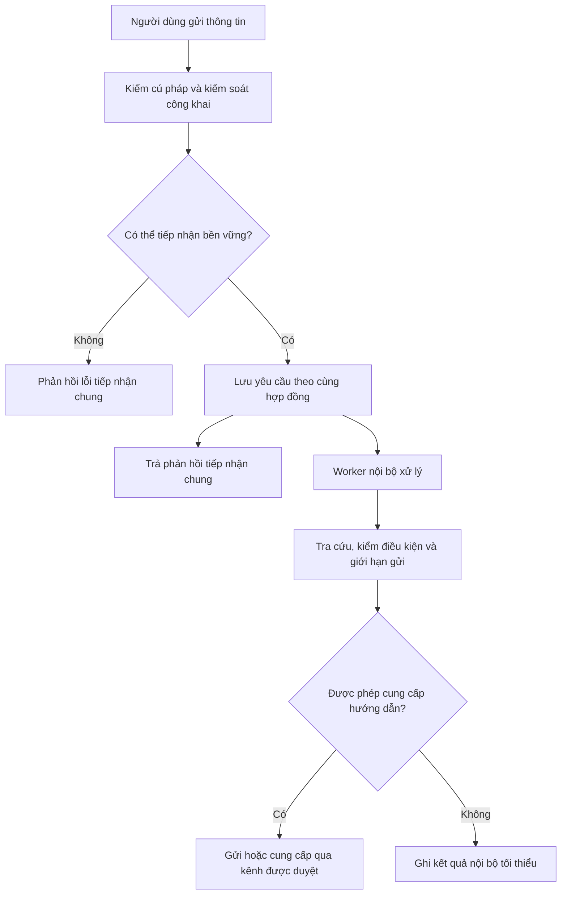

# Generic recovery response

## 1. Phản hồi khôi phục chung bảo vệ điều gì?

**Generic recovery response** là phản hồi công khai không tiết lộ một định danh có khớp tài khoản, tài khoản đang ở trạng thái nào hoặc đã thiết lập những phương thức xác thực nào.

Người gửi yêu cầu ban đầu có thể là chủ tài khoản, người nhập nhầm địa chỉ hoặc kẻ đang dò danh sách người dùng. Hệ thống chưa thể coi việc biết email hay tên đăng nhập là bằng chứng sở hữu.

Ví dụ, một trang khôi phục có thể hiển thị:

> Yêu cầu đã được tiếp nhận. Nếu thông tin phù hợp với tài khoản đủ điều kiện, bạn sẽ nhận được hướng dẫn qua kênh khôi phục đã thiết lập. Nếu bạn không còn truy cập được kênh đó, hãy chọn Hỗ trợ khôi phục.

Câu thông báo này xác nhận việc tiếp nhận yêu cầu theo hợp đồng của dịch vụ. Nó không khẳng định tài khoản tồn tại, thư đã được gửi hay người yêu cầu đã được phép thay mật khẩu, MFA hoặc passkey.

OWASP khuyến nghị dùng thông báo nhất quán cho tài khoản tồn tại và không tồn tại trong tính năng quên mật khẩu, đồng thời tránh chênh lệch thời gian xử lý làm lộ kết quả tra cứu. [OWASP Forgot Password Cheat Sheet](https://cheatsheetseries.owasp.org/cheatsheets/Forgot_Password_Cheat_Sheet.html).

Mục tiêu là giúp người thật biết bước tiếp theo, trong khi người chưa được xác minh không nhận thêm thông tin riêng của tài khoản.

## 2. Vì sao chỉ sửa câu thông báo là chưa đủ?

Giả sử giao diện luôn hiện “Hãy kiểm tra hướng dẫn khôi phục”, nhưng API trả:

```text
Email có tài khoản:     HTTP 200
Email không có tài khoản: HTTP 404
```

Người dùng giao diện có thể không thấy khác biệt. Một chương trình gọi API vẫn phân biệt được qua status code.

OWASP mô tả thông tin rò rỉ từ nội dung phản hồi, mã HTTP, URL và thời gian như những khác biệt có thể hỗ trợ dò tài khoản. [OWASP Authentication Cheat Sheet](https://cheatsheetseries.owasp.org/cheatsheets/Authentication_Cheat_Sheet.html).

Trong thiết kế minh họa của bài này, hợp đồng công khai được xem ở nhiều lớp:

| Thành phần quan sát được | Ví dụ làm lộ thông tin | Cách thiết kế |
| --- | --- | --- |
| Nội dung hiển thị | “Tài khoản không tồn tại” | Thông báo tiếp nhận có điều kiện |
| Status code | Chỉ trả 404 khi tra cứu không có kết quả | Cùng kết quả tiếp nhận cho cùng loại yêu cầu công khai |
| JSON | Có thêm `accountExists: true` | Không trả kết quả tra cứu nội bộ |
| Header | Chỉ có `X-Recovery-Channel: email` với tài khoản thật | Không đưa cấu hình tài khoản vào header công khai |
| Redirect | Có tài khoản thì chuyển sang trang khác | Dùng cùng bước hiển thị ở ranh giới chưa xác minh |
| Cookie | Chỉ tạo cookie mang account ID khi tìm thấy người dùng | Tách ngữ cảnh tiếp nhận khỏi phiên đã xác thực |
| Thời gian | Tài khoản không tồn tại được trả về ngay | Không đặt nhánh tra cứu có khác biệt rõ trên đường phản hồi |
| Giao diện | Chỉ hiện nút “Gửi lại” khi tài khoản thật | Điều khiển trạng thái theo hợp đồng công khai |
| Endpoint phụ | API tiến độ báo “Không tìm thấy tài khoản” | Giữ cùng ranh giới bảo mật cho các API liên quan |

Không cần mọi phản hồi của hệ thống giống nhau trong mọi tình huống. Điều cần tránh là khác biệt phụ thuộc vào thông tin tài khoản chưa được phép tiết lộ.

Ví dụ, lỗi JSON sai cú pháp và một yêu cầu hợp lệ có thể có status khác nhau. Khác biệt đó xuất phát từ dữ liệu người gửi đã cung cấp, không phải kết quả tìm tài khoản.

## 3. Xác định ranh giới giữa công khai và đã được xác minh

Thông tin có thể tiết lộ phụ thuộc vào bằng chứng và quyền của ngữ cảnh hiện tại.

| Ngữ cảnh | Có thể hướng dẫn | Không tự được tiết lộ hoặc cấp |
| --- | --- | --- |
| Chỉ nhập email hoặc tên đăng nhập | Cách tiếp tục chung, kiểm tra thông tin đã nhập, đường hỗ trợ | Tài khoản tồn tại, tên chủ tài khoản, loại MFA |
| Có mã tham chiếu tiếp nhận | Tham chiếu để hỗ trợ nếu được thiết kế an toàn | Kết quả tra cứu tài khoản hoặc quyền đặt lại credential |
| Hoàn thành một thử thách | Bước tiếp theo được chính sách cho phép | Mọi thông tin và quyền của tài khoản |
| Đã xác minh phù hợp cho thao tác | Chi tiết cần thiết để hoàn tất đúng thao tác | Thay đổi khác ngoài phạm vi đã được duyệt |
| Phiên đăng nhập có quyền phù hợp | Hướng dẫn quản lý tài khoản theo quyền và độ mới xác thực | Bỏ qua xác minh lại cho mọi hành động nhạy cảm |

Một token gửi qua email có thể cho phép đi tiếp trong luồng đặt lại mật khẩu được sản phẩm hỗ trợ. Điều đó không tự cho phép gỡ MFA hoặc đổi địa chỉ khôi phục.

Đối với tài khoản có nhiều phương thức, trang công khai không nên trả danh sách được lấy từ cấu hình thật như:

```json
{
  "accountExists": true,
  "hasTotp": true,
  "hasPasskey": false,
  "recoveryPhone": "***1234"
}
```

Che một phần số điện thoại vẫn làm lộ thông tin vốn chỉ có trong hồ sơ tài khoản. Việc che không thay thế quyết định người đang xem có được biết dữ liệu đó hay không.

Sau một bước xác minh đủ điều kiện, sản phẩm có thể hiển thị lựa chọn cụ thể trong phạm vi quyền đã cấp. Quyền này được máy chủ kiểm tra; việc giao diện đã chuyển sang một màn hình khác không phải bằng chứng xác minh.

## 4. Viết nội dung chung nhưng có hướng dẫn rõ

Một mẫu thông báo nên có ba phần:

1. **Điều hệ thống thực sự đã làm:** tiếp nhận yêu cầu nếu đã tiếp nhận thành công.
2. **Điều kiện cho bước kế tiếp:** hướng dẫn được gửi hoặc cung cấp khi thông tin và chính sách phù hợp.
3. **Việc người dùng có thể làm:** kiểm tra thông tin, kiểm tra kênh liên hệ hoặc chọn đường hỗ trợ.

### 4.1. Ví dụ theo loại màn hình

| Màn hình | Nội dung minh họa |
| --- | --- |
| Yêu cầu bằng địa chỉ email | “Nếu địa chỉ này khớp với tài khoản đủ điều kiện, bạn sẽ nhận được hướng dẫn khôi phục. Hãy kiểm tra hộp thư và thư rác.” |
| Khôi phục khi mất MFA hoặc thiết bị | “Yêu cầu đã được tiếp nhận. Hãy tiếp tục theo hướng dẫn qua kênh đã thiết lập. Nếu không còn truy cập được kênh đó, chọn Hỗ trợ khôi phục.” |
| Sau khi yêu cầu gửi lại được tiếp nhận | “Yêu cầu gửi lại đã được tiếp nhận. Hướng dẫn sẽ được cung cấp nếu yêu cầu đáp ứng điều kiện.” |
| Không thể tiếp nhận do sự cố dịch vụ | “Hiện chưa thể tiếp nhận yêu cầu. Vui lòng thử lại sau.” |
| Định dạng email không hợp lệ | “Hãy nhập địa chỉ email đúng định dạng.” |

Có thể thay câu chữ theo kênh người dùng chủ động chọn hoặc theo loại biểu mẫu công khai. Không thay theo việc tài khoản được tra cứu có email, SMS, TOTP hay passkey.

### 4.2. Những câu cần tránh ở bước chưa xác minh

- “Email này chưa đăng ký.”
- “Chúng tôi đã gửi mã đến số kết thúc bằng 1234.”
- “Tài khoản của bạn đang bị khóa vì rủi ro cao.”
- “Tài khoản này chỉ đăng nhập bằng SSO.”
- “Bạn đã bật TOTP nhưng chưa có passkey.”
- “Đường dẫn đã gửi thành công” khi hệ thống mới tiếp nhận tác vụ.

Một câu như “Nếu thông tin phù hợp…” bảo vệ kết quả tra cứu. Nó vẫn cần được ghép với hướng dẫn đủ cụ thể để người dùng không phải thử đi thử lại vô hạn.

### 4.3. Giúp người nhập nhầm mà không xác nhận tài khoản

Giao diện có thể cho phép sửa thông tin đã nhập, giải thích định dạng được chấp nhận và cung cấp hướng dẫn kiểm tra hộp thư. Đó là hỗ trợ dựa trên dữ liệu người dùng tự cung cấp.

Không cần xác nhận rằng địa chỉ đã tồn tại để nhắc người dùng kiểm tra lỗi gõ. Nếu hiển thị lại đầu vào, phải mã hóa đầu ra phù hợp và hạn chế lưu thông tin nhạy cảm trên URL, analytics hoặc log trình duyệt.

## 5. Thiết kế hợp đồng API cho bước tiếp nhận

Một API giả định có thể nhận yêu cầu:

```http
POST /account-recovery/requests
Content-Type: application/json

{
  "identifier": "lan@example.test",
  "purpose": "RESET_PASSWORD",
  "locale": "vi"
}
```

Nếu yêu cầu hợp lệ được tiếp nhận để xử lý, API trả:

```http
HTTP/1.1 202 Accepted
Content-Type: application/json; charset=utf-8
Cache-Control: no-store

{
  "code": "RECOVERY_REQUEST_RECEIVED",
  "message": "Nếu thông tin phù hợp với tài khoản đủ điều kiện, bạn sẽ nhận được hướng dẫn khôi phục."
}
```

Đối với cùng loại yêu cầu hợp lệ và cùng ngữ cảnh công khai, phản hồi tiếp nhận không thay đổi theo việc định danh có khớp tài khoản hay không.

Theo RFC 9110, `202 Accepted` biểu thị yêu cầu đã được nhận để xử lý nhưng xử lý chưa hoàn tất. Nó không bảo đảm hành động sau đó sẽ xảy ra. [RFC 9110, mục 15.3.3](https://www.rfc-editor.org/rfc/rfc9110.html#section-15.3.3).

Vì vậy, không dùng `202` để nói “khôi phục thành công”, “đã gửi email” hoặc “đã xác minh danh tính”. Sản phẩm có thể chọn hợp đồng HTTP khác phù hợp kiến trúc; điểm quan trọng là ngữ nghĩa đúng và không phân nhánh theo thông tin tài khoản chưa được phép công khai.

### 5.1. Các trường không đưa ra ranh giới công khai

```text
accountExists
accountId
accountStatus
recoveryEligible
registeredChannels
maskedStoredEmail
maskedStoredPhone
mfaEnabled
passkeyCount
internalRiskReason
notificationDeliveryResult
```

Một mã phản hồi như `RECOVERY_REQUEST_RECEIVED` mô tả trạng thái tiếp nhận. Một mã như `USER_NOT_FOUND` lại mô tả kết quả tra cứu nội bộ.

Nếu cần mã tham chiếu để hỗ trợ, mã đó được tạo cho mọi yêu cầu đã tiếp nhận theo cùng quy tắc, không chứa hoặc mã hóa một cách có thể suy ra account ID. Mã tham chiếu không đồng nghĩa quyền truy cập hồ sơ tài khoản.

### 5.2. Lỗi nào có thể khác phản hồi tiếp nhận?

Trong thiết kế minh họa:

| Điều kiện | Phản hồi công khai có thể dùng | Điều kiện bảo mật |
| --- | --- | --- |
| JSON sai hoặc trường bắt buộc thiếu | 400 với hướng dẫn sửa đầu vào | Không cần tra cứu tài khoản để xác định |
| Định dạng định danh không được hỗ trợ | Lỗi đầu vào rõ ràng theo hợp đồng | Quy tắc không phụ thuộc dữ liệu tài khoản |
| Request vượt giới hạn công khai của nguồn gửi | Phản hồi giới hạn như 429 | Không chỉ xuất hiện với tài khoản thật |
| Chưa hoàn thành thử thách chống tự động hóa được yêu cầu | Hướng dẫn hoàn thành thử thách | Quy tắc hiển thị không tiết lộ trạng thái tài khoản |
| Hệ thống không thể tiếp nhận yêu cầu | Lỗi dịch vụ chung, có thể là 503 trong tình huống thích hợp | Không biến lỗi của một tài khoản thành tín hiệu riêng |
| Tài khoản không tồn tại, bị vô hiệu hóa hoặc không có đường tự phục vụ | Phản hồi tiếp nhận chung khi yêu cầu đã được nhận | Xử lý riêng ở phía máy chủ |

Không cần cố biến mọi lỗi thành 200. Một phản hồi chung phải trung thực về việc hệ thống có tiếp nhận yêu cầu hay không.

Nếu việc ghi yêu cầu thất bại trước khi được tiếp nhận, hiển thị “đã tiếp nhận” sẽ khiến người thật chờ hướng dẫn không bao giờ được xử lý. Lỗi tiếp nhận nên được xử lý thống nhất trước nhánh tra cứu bí mật.

## 6. Tách đường tiếp nhận khỏi công việc phụ thuộc tài khoản

Một kiến trúc minh họa tiếp nhận yêu cầu trước, rồi để worker nội bộ xử lý việc tra cứu và thông báo.



Giả mã cho đường tiếp nhận:

```text
receiveRecoveryRequest(input, requestContext):
    normalized = validatePublicInput(input)
    enforcePublicRequestControls(requestContext, normalized)
    command = createRecoveryCommand(normalized, requestContext)
    acceptanceStore.acceptDurably(command)
    return genericAcknowledgment()
```

Trong mô hình này, `acceptDurably` chỉ trả thành công khi yêu cầu đã được ghi nhận đủ bền vững theo hợp đồng. Nó không phải lời hứa rằng email hoặc SMS đã đến tay người nhận.

Worker nội bộ có thể thực hiện:

```text
processRecoveryCommand(command):
    account = resolveAccountWithinScope(command.identifier)

    if account is absent:
        recordInternalOutcomeWithoutSensitivePayload()
        finish

    if selfServiceRecoveryIsNotAllowed(account, command.purpose):
        recordInternalOutcomeWithoutPublicDisclosure()
        finish

    if notificationSuppressedByInternalPolicy(account, command):
        recordSuppression()
        finish

    arrangeApprovedRecoveryInstructions(account, command)
```

Nhánh nội bộ có thể khác nhau vì nghiệp vụ thực tế khác nhau. Thiết kế tránh đưa kết quả, thời gian hoàn thành riêng của những nhánh đó trở lại cho người chưa được xác minh.

### 6.1. Không chỉ đẩy việc gửi email sang bất đồng bộ

Nếu API vẫn tra cứu tài khoản đồng bộ, trả ngay khi không có tài khoản và chỉ ghi hàng đợi khi có, thời gian phản hồi vẫn có thể khác nhau.

Trong kiến trúc minh họa, mọi đầu vào hợp lệ được tiếp nhận theo cùng đường trước khi tra cứu. Chi phí này cần được quản lý bằng giới hạn kích thước đầu vào, dung lượng, tốc độ, thời hạn lưu và cơ chế chống lạm dụng.

Cần nhìn cả hạ tầng dùng chung. Backpressure, cache, shard hoặc đường điều phối phụ thuộc tài khoản có thể đưa khác biệt trở lại đường tiếp nhận. Việc dùng hàng đợi không tự chứng minh toàn bộ hệ thống đã hết kênh rò rỉ.

### 6.2. Không hứa thời gian phản hồi bằng nhau tuyệt đối

Độ trễ mạng và tải hệ thống luôn dao động. Mục tiêu thiết kế là tránh sự khác biệt có hệ thống, có thể khai thác từ trạng thái tài khoản.

Thêm một khoảng sleep cố định chỉ cho nhánh “không tồn tại” vẫn có thể tạo mẫu khác biệt khi hệ thống chịu tải. Thêm nhiễu ngẫu nhiên cũng không tự xóa được chênh lệch nền khi người gọi có nhiều quan sát.

Ưu tiên loại bớt công việc phụ thuộc bí mật khỏi đường phản hồi, dùng quy tắc nhất quán và quan sát phân bố độ trễ trong điều kiện vận hành phù hợp. Không coi một lần gọi có thời gian gần nhau là bằng chứng đầy đủ về tính nhất quán.

## 7. Giới hạn yêu cầu mà không tạo điểm dò tài khoản mới

Phản hồi chung không thay thế kiểm soát lạm dụng. Kẻ tấn công vẫn có thể làm ngập hệ thống hoặc gửi nhiều yêu cầu gây phiền cho chủ tài khoản.

Có thể tách hai lớp:

### Lớp công khai

Lớp này áp dụng quy tắc có thể giải thích từ request hoặc nguồn gửi, chẳng hạn giới hạn tốc độ của nguồn, kích thước payload và thử thách chống tự động hóa.

Thông báo “Bạn đã gửi quá nhiều yêu cầu từ nguồn này” không nên chỉ xuất hiện khi định danh tra cứu được. Nếu thử thách chỉ hiện với tài khoản thật, chính thử thách trở thành dấu hiệu xác nhận tài khoản.

### Lớp nội bộ theo tài khoản hoặc kênh

Lớp này kiểm soát số lần gửi hướng dẫn và những hành động thực tế. Yêu cầu có thể đã được tiếp nhận nhưng việc gửi thông báo bị gộp hoặc tạm ngăn theo chính sách.

Không trả số lần gửi còn lại, thời điểm email gần nhất hoặc trạng thái giới hạn của tài khoản cho người chưa được xác minh. Những giá trị đó có thể tiết lộ hoạt động của người khác.

Mọi định danh và khóa giới hạn cần được xử lý theo quy tắc nhận diện của hệ thống. Không tự sửa địa chỉ bằng cách bỏ dấu chấm, thay tên miền hoặc áp dụng quy tắc riêng của một nhà cung cấp cho mọi địa chỉ.

Một request công khai cũng không nên tự khóa tài khoản hoặc thu hồi mọi phiên chỉ để thực hiện giới hạn. Giới hạn yêu cầu và thay đổi trạng thái bảo mật của tài khoản là hai việc cần quyền và căn cứ khác nhau.

## 8. Giữ nguyên tắc ở bước gửi lại và theo dõi yêu cầu

Một thông báo ban đầu an toàn có thể bị vô hiệu hóa bởi endpoint tiếp theo.

### 8.1. Gửi lại hướng dẫn

Ví dụ, API đầu trả phản hồi chung nhưng nút gửi lại gọi API khác và nhận:

```text
Có tài khoản:          "Đã gửi lại mã"
Không có tài khoản:    "Yêu cầu không tồn tại"
```

Kênh dò tài khoản vẫn tồn tại. Bước gửi lại cần giữ cùng ranh giới công khai và không công bố kết quả tra cứu hoặc trạng thái giao thông báo.

Một đồng hồ đếm ngược trên giao diện có thể bắt đầu theo thời gian của yêu cầu mà người dùng vừa gửi và cấu hình công khai. Không lấy thời điểm gửi thực tế gần nhất của tài khoản làm dữ liệu công khai.

Không vô hiệu hóa mọi liên kết hợp lệ hoặc làm hỏng một hồ sơ đã xác minh chỉ vì người ngoài liên tục yêu cầu gửi lại. Chính sách vòng đời token và chống lạm dụng phải được thiết kế để hạn chế tác động gây gián đoạn.

### 8.2. Mã tham chiếu và API tiến độ

Nếu có mã tham chiếu, nó mô tả yêu cầu đã được tiếp nhận theo cùng quy tắc. Không cấp mã chỉ khi tìm thấy tài khoản.

Một API công khai không nên biến mã đó thành quyền đọc các trạng thái như:

```text
ACCOUNT_NOT_FOUND
ACCOUNT_DISABLED
SMS_SENT_TO_REGISTERED_PHONE
RECOVERY_BLOCKED_HIGH_RISK
```

Ngay cả khác biệt về thời gian “đã xử lý xong” cũng có thể phản ánh nhánh nội bộ. Có thể chỉ hiển thị trạng thái tiếp nhận chung và hướng dẫn tiếp theo ở bước chưa xác minh, thay vì công bố tiến độ chi tiết của worker.

Mã dùng để trao đổi với hỗ trợ không tự là bằng chứng sở hữu. Nhân viên hỗ trợ vẫn cần quy trình xác minh trước khi cung cấp thông tin riêng hoặc thực hiện thay đổi.

## 9. Thiết kế trải nghiệm cho người thật

Thông báo chung không nên để người dùng mắc kẹt.

### 9.1. Cung cấp đường đi có thể thực hiện

Trang phản hồi có thể có các hành động:

- Quay lại sửa email hoặc tên đăng nhập đã nhập.
- Xem hướng dẫn kiểm tra hộp thư, thư rác hoặc kênh đã chủ động chọn.
- Gửi lại theo quy tắc công khai.
- Chọn hỗ trợ khi không còn truy cập được kênh khôi phục.
- Quay lại đăng nhập nếu vẫn còn một phương thức xác thực hoạt động.

Các lựa chọn này có thể xuất hiện nhất quán mà không cần công bố tài khoản có tồn tại hay phương thức nào đã đăng ký.

Nếu dịch vụ công bố thời gian chờ dự kiến, thời gian đó nên phản ánh năng lực vận hành và loại quy trình công khai. Không hứa thư sẽ đến trong một số giây cố định khi hệ thống không kiểm soát được việc giao thư cuối cùng.

### 9.2. Đồng bộ web, ứng dụng và API

Web hiển thị thông báo chung nhưng ứng dụng di động hiện “Không tìm thấy người dùng” vẫn làm lộ cùng dữ liệu. Các client nên dùng mã nghiệp vụ và hợp đồng công khai nhất quán.

Không tải các trường nội bộ vào JavaScript rồi chỉ giấu chúng bằng CSS. Nội dung API, dữ liệu khởi tạo trang và lỗi debug vẫn có thể được quan sát.

Locale có thể lấy từ lựa chọn hoặc ngữ cảnh công khai của người yêu cầu. Nếu trang tự đổi sang ngôn ngữ lưu trong tài khoản chỉ khi tìm thấy tài khoản, sự thay đổi đó có thể trở thành dấu hiệu phụ.

### 9.3. Khả năng tiếp cận

Thông báo sau submit cần xuất hiện ở vị trí dễ tìm và được công cụ hỗ trợ nhận biết, chẳng hạn một vùng trạng thái phù hợp trên web. Người dùng không nên phải suy ra kết quả từ màu sắc hoặc một biểu tượng đơn lẻ.

Nút gửi lại bị tạm ngăn cần có giải thích và trạng thái rõ. Việc này phải dựa trên quy tắc công khai, không vô tình tạo hai trải nghiệm khác nhau theo kết quả tra cứu.

Văn bản nên ngắn, tránh trách người dùng và nói rõ hành động có thể thực hiện. Những chi tiết về hàng đợi, mã rủi ro hoặc cách phân loại tài khoản thuộc vận hành nội bộ, không cần đưa vào thông báo người dùng.

## 10. Thông báo qua kênh đã xác minh và hỗ trợ

Phản hồi công khai và nội dung gửi tới một kênh được hệ thống cho phép có mục đích khác nhau.

Trong kênh phù hợp, dịch vụ có thể cung cấp hướng dẫn thực hiện thử thách, thời hạn của liên kết và cách báo một yêu cầu không nhận ra. Thông tin đó vẫn cần tuân theo chính sách cho thao tác đang thực hiện.

Một email chứa liên kết đặt mật khẩu không nên nói rằng người nhận đã được phép gỡ MFA. Một hướng dẫn đăng ký passkey mới không nên khẳng định khóa riêng cũ được khôi phục.

Ở giao diện hỗ trợ chưa xác minh, nên tiếp tục tránh xác nhận chi tiết tài khoản. Nhân viên không được dùng tên, số điện thoại che một phần hoặc cấu hình MFA làm câu trả lời cho bất kỳ ai chỉ đọc được một mã tham chiếu.

Sau khi có bằng chứng và quyền phù hợp, hỗ trợ có thể nói rõ bước đang chờ, điều kiện còn thiếu và phạm vi thay đổi được phép. Không cần duy trì thông báo mơ hồ khi hệ thống đã có cơ sở để cung cấp hướng dẫn cụ thể.

Một thông báo ở giai đoạn cuối cũng phải phản ánh kết quả thực tế. Chỉ hiển thị “Mật khẩu đã được cập nhật” khi thay đổi đã commit thành công; không dùng phản hồi tiếp nhận ban đầu làm bằng chứng rằng khôi phục đã hoàn tất.

## 11. Ví dụ xuyên suốt và các trạng thái nội bộ

Giả sử ba yêu cầu cùng dùng biểu mẫu đặt lại mật khẩu:

| Trường hợp nội bộ | Phản hồi khi yêu cầu đã được tiếp nhận | Công việc phía máy chủ |
| --- | --- | --- |
| Định danh không khớp tài khoản | Thông báo tiếp nhận chung | Kết thúc theo chính sách, không công bố kết quả tra cứu |
| Tài khoản có đường khôi phục được phép | Thông báo tiếp nhận chung | Kiểm điều kiện rồi sắp xếp hướng dẫn qua kênh đã thiết lập |
| Tài khoản cần quy trình hỗ trợ riêng | Thông báo tiếp nhận chung | Áp dụng chính sách riêng, không công bố trạng thái nhạy cảm |

Một trường hợp khác là kho tiếp nhận đang không hoạt động. Khi đó, cả ba đầu vào đều chưa được tiếp nhận theo hợp đồng của kiến trúc này và có thể nhận thông báo lỗi dịch vụ chung. Hệ thống không nói đã tiếp nhận chỉ để giữ nguyên câu chữ.

### 11.1. Khi người dùng thật chưa nhận được hướng dẫn

Lan nhập địa chỉ cũ rồi chờ nhưng không thấy thư. Trang cho Lan sửa thông tin, kiểm tra hộp thư và chọn hỗ trợ nếu không còn kênh đã thiết lập.

Nếu Lan vẫn có passkey hoạt động ở một thiết bị khác, đường đăng nhập thông thường có thể giúp Lan truy cập phần quản lý tài khoản theo quyền và yêu cầu xác thực của hệ thống. Trang công khai không cần tra cứu rồi tiết lộ rằng tài khoản Lan có passkey.

### 11.2. Khi người gọi cố suy ra thông tin

Một người thử nhiều định danh và so sánh nội dung, mã phản hồi, redirect, trạng thái gửi lại cùng thời gian. Thiết kế bảo vệ ranh giới ở toàn bộ các điểm đó, thay vì chỉ làm giống đoạn văn trên trang.

Hạn chế tốc độ và phát hiện hành vi tự động giảm khả năng dò ở quy mô lớn. Chúng không bù cho một trường JSON đang trả thẳng `accountExists`.

### 11.3. Khi việc gửi thông báo gặp lỗi sau tiếp nhận

Yêu cầu đã được lưu, nhưng worker gặp lỗi nhà cung cấp email. Hệ thống ghi lỗi nội bộ, xử lý thử lại theo chính sách và theo dõi tuổi công việc.

Phản hồi ban đầu vẫn có nghĩa đã tiếp nhận để xử lý; nó chưa từng khẳng định thư đã được giao. Không mở một endpoint công khai để giải thích riêng rằng địa chỉ đó có tài khoản nhưng gửi thư thất bại.

## 12. Quan sát vận hành mà không tạo thêm rò rỉ

Hệ thống cần phân biệt các sự kiện:

```text
RECOVERY_REQUEST_RECEIVED
RECOVERY_COMMAND_ACCEPTED
RECOVERY_NOTIFICATION_SUPPRESSED
RECOVERY_NOTIFICATION_DISPATCHED
RECOVERY_NOTIFICATION_FAILED
RECOVERY_EVIDENCE_VERIFIED
RECOVERY_CHANGE_COMPLETED
```

“Dispatched” có thể chỉ phản ánh việc tác vụ đã được gửi hoặc nhà cung cấp đã nhận, tùy hợp đồng nội bộ. Tên trạng thái phải được định nghĩa rõ; không gộp mọi mốc thành “khôi phục thành công”.

Log và dashboard dành cho người có quyền có thể giúp tìm lỗi tiếp nhận, hàng đợi chậm, giao thông báo thất bại hoặc tỷ lệ người dùng chuyển hỗ trợ. Không đưa token, OTP, mã khôi phục, cookie hoặc payload chứa bí mật vào log.

Một correlation ID ngẫu nhiên có thể giúp theo dõi request. Nó không cần chứa định danh tài khoản, và không tự cấp quyền xem log hay hồ sơ.

Các chỉ số hữu ích gồm tỷ lệ lỗi tiếp nhận, độ trễ xử lý, số lần gửi lại, mức tăng thử tự động và tỷ lệ bỏ cuộc. Khi quan sát tính nhất quán của phản hồi, cần xem phân bố theo điều kiện tải và các lớp hạ tầng, thay vì chỉ nhìn câu chữ hoặc một lần gọi riêng lẻ.

## 13. Những nguyên tắc cần giữ

1. Biết email hoặc tên đăng nhập chưa tạo quyền biết thông tin tài khoản.
2. Phản hồi tiếp nhận chung không phải xác nhận gửi thư hay khôi phục thành công.
3. Nội dung, API, header, redirect và bước gửi lại cùng thuộc ranh giới công khai.
4. Lỗi đầu vào và lỗi tiếp nhận có thể được nói rõ khi không làm lộ kết quả tra cứu.
5. Thông tin tài khoản cần được tiết lộ dần theo bằng chứng và quyền đã được xác minh.
6. Kiểm soát lạm dụng cần hoạt động mà không tạo một điểm dò tài khoản mới.
7. Người dùng thật vẫn cần hướng dẫn sửa thông tin và đường hỗ trợ có thể thực hiện.
8. Quyền thay mật khẩu, MFA hoặc passkey do máy chủ kiểm tra riêng với thông báo hiển thị.

Một phản hồi khôi phục chung tốt vừa bảo vệ thông tin ở bước chưa xác minh, vừa nói đúng điều hệ thống đã làm và giúp người dùng hiểu cách tiếp tục.
