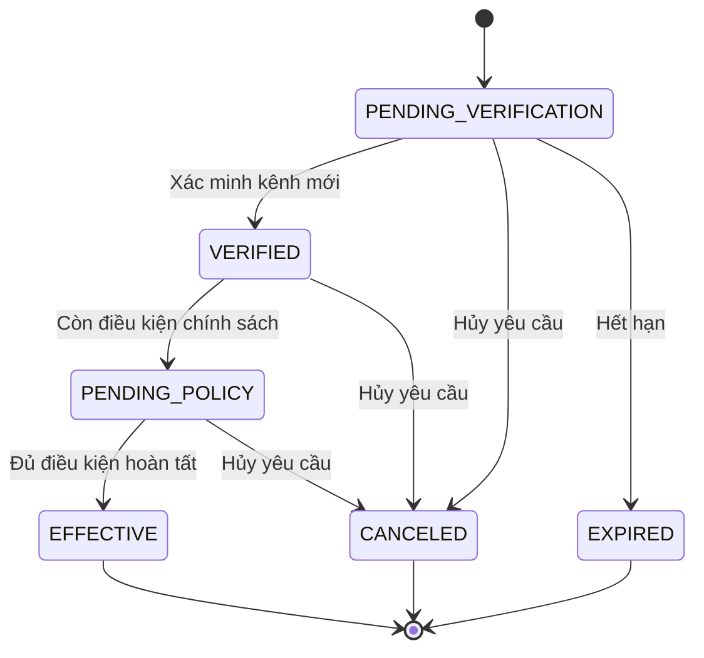

# Contact change notification

## 1. Vì sao đổi thông tin liên hệ cần thông báo riêng?

**Contact change notification** là thông báo bảo mật khi địa chỉ email, số điện thoại hoặc địa chỉ nhận thông báo của tài khoản được yêu cầu thay đổi, đã thay đổi hoặc bị hủy thay đổi. Trong recovery, những địa chỉ này có thể là nơi nhận token hoặc phát hiện hành vi chiếm đoạt tài khoản.

Giả sử kẻ tấn công chiếm được một session và đổi email recovery từ địa chỉ của chủ tài khoản sang địa chỉ của họ. Nếu hệ thống chỉ gửi thông báo đến email hiện tại sau khi cập nhật, thông báo có thể đến chính kẻ tấn công. Chủ tài khoản không được cảnh báo qua kênh đã thiết lập trước đó.

Vì vậy, thiết kế cần trả lời bốn câu hỏi:

1. Đang thông báo về một yêu cầu hay một thay đổi đã có hiệu lực?
2. Những kênh nào cần nhận, và chúng được xác định ở thời điểm nào?
3. Người nhận có thể làm gì nếu không nhận ra thay đổi?
4. Việc gửi thất bại ảnh hưởng thế nào đến quy trình?

Thông báo giúp phát hiện và phản ứng với thay đổi bất thường. Nó không thay thế xác minh danh tính hoặc điều kiện cho phép đổi thông tin liên hệ.

## 2. Phân biệt thông báo, xác minh và chấp thuận

Ba chức năng thường cùng xuất hiện trong email nhưng có ý nghĩa khác nhau:

| Chức năng | Câu hỏi được giải quyết | Điều không tự chứng minh |
| --- | --- | --- |
| Thông báo | Người nhận có được biết một sự kiện đã xảy ra không? | Không chứng minh họ đã đọc hoặc đồng ý |
| Xác minh kênh mới | Người đang thực hiện có kiểm soát địa chỉ mới không? | Không chứng minh họ được quyền thay địa chỉ của tài khoản |
| Chấp thuận thay đổi | Các điều kiện cho thao tác đã được đáp ứng chưa? | Không thể suy ra chỉ từ việc nhà cung cấp nhận gửi email |

Ví dụ, nhập code gửi đến email mới chứng minh một mức kiểm soát email đó. Kẻ tấn công cũng kiểm soát email của họ, nên việc xác minh kênh mới không tự cấp quyền thay kênh recovery của người khác.

OWASP mô tả quy trình đổi email có trạng thái chờ, kiểm tra xác thực phù hợp và nội dung khác nhau cho địa chỉ hiện tại với địa chỉ đề xuất. Cách xác nhận còn phụ thuộc việc tài khoản có MFA hay không. [OWASP Authentication Cheat Sheet](https://cheatsheetseries.owasp.org/cheatsheets/Authentication_Cheat_Sheet.html#changing-a-users-registered-email-address)

Những trạng thái, mẫu nội dung và kiến trúc bên dưới là mô hình thiết kế minh họa. Khi áp dụng một tiêu chuẩn hoặc chính sách cụ thể, phải giữ các yêu cầu riêng của tiêu chuẩn hoặc chính sách đó.

## 3. Xác định rõ loại thông tin đang thay

Không phải mọi số điện thoại hoặc email đều có cùng quyền:

| Loại dữ liệu | Ví dụ | Hệ quả khi đổi |
| --- | --- | --- |
| Thông tin liên hệ thông thường | Email nhận bản tin | Có thể chỉ ảnh hưởng việc liên lạc |
| Định danh đăng nhập | Email dùng để đăng nhập | Có thể thay cách truy cập tài khoản |
| Địa chỉ recovery | Email nhận liên kết khôi phục | Có thể thay đường cấp lại quyền |
| Địa chỉ thông báo bảo mật | Email hoặc kênh push nhận cảnh báo | Có thể làm chủ tài khoản mất khả năng phát hiện thay đổi |
| Kênh phục vụ authenticator | Số điện thoại dùng trong một phương thức xác thực | Có thể liên quan đăng ký hoặc thay thế authenticator |

Một trường email có thể đang được dùng cho nhiều vai trò. Nếu vậy, giao diện và chính sách phải giải thích việc thay đổi ảnh hưởng đến những vai trò nào.

Không được dùng thao tác “cập nhật thông tin liên hệ” để âm thầm thay một phương thức xác thực mà không áp dụng điều kiện tương ứng. Nếu người dùng đã mất mật khẩu, MFA, passkey hoặc thiết bị, việc cấp quyền đổi kênh phải dựa trên quy trình recovery được phép.

NIST SP 800-63B-4 xem thông báo độc lập là một phần giúp phát hiện gian lận đối với các sự kiện tài khoản, bao gồm recovery. Mục 4.6 quy định các địa chỉ thông báo và hướng dẫn cho trường hợp người nhận phủ nhận sự kiện. [NIST SP 800-63B-4, mục 4.6](https://pages.nist.gov/800-63-4/sp800-63b.html#account-notifications)

## 4. Chọn người nhận từ ngữ cảnh trước thay đổi

Một lỗi phổ biến:

```text
cập nhật account.email = newEmail
gửi thông báo đến account.email
```

Sau dòng cập nhật, hệ thống không còn dùng địa chỉ cũ để cảnh báo. Nếu một worker xử lý sau đó mới đọc email hiện tại, vấn đề vẫn tồn tại dù thông báo được tạo bất đồng bộ.

Một cách thiết kế là ghi nhận các vai trò người nhận gắn với sự kiện:

```text
changeId
accountVersionBefore
previousNotificationRecipientRefs
proposedContactRef
eventType
occurredAt
policyVersion
```

Các `RecipientRef` phải trỏ đến dữ liệu người nhận được bảo vệ và phù hợp với sự kiện, không chỉ trỏ đến thuộc tính “email hiện tại” có thể bị đổi trước lúc gửi.

Cần phân biệt:

- **Kênh cũ đã thiết lập:** phù hợp để cảnh báo về sự thay đổi liên quan đến nó.
- **Kênh mới được đề xuất:** cần nhận nội dung xác minh hoặc thông tin phù hợp về đề xuất đó.
- **Các kênh thông báo độc lập khác:** được dùng theo chính sách và yêu cầu áp dụng.

Nếu kênh cũ được báo là đã mất hoặc bị xâm phạm, không coi việc truy cập nó là bằng chứng đủ để khôi phục quyền. Thông báo đến kênh đó cũng không được chứa bí mật recovery. Cần có đường xử lý với bằng chứng và kênh độc lập phù hợp.

Không tự khôi phục địa chỉ cũ chỉ vì nó có trong lịch sử: địa chỉ đó có thể đã bị bỏ, bị chiếm quyền hoặc được thay vì một lý do bảo mật hợp lệ.

## 5. Thông báo theo trạng thái thay đổi

Một luồng minh họa có thể gồm:



Mô hình này có thể được rút gọn nếu hệ thống không có giai đoạn chờ chính sách. Tên và số trạng thái là ví dụ, không phải một yêu cầu chuẩn.

| Sự kiện | Nội dung cần nói rõ | Điều cần tránh |
| --- | --- | --- |
| Đã nhận đề xuất thay đổi | Có yêu cầu; địa chỉ chưa có hiệu lực | Viết “đã đổi thành công” |
| Kênh mới được xác minh | Đã xác minh kênh; có thể còn điều kiện khác | Đồng nhất xác minh kênh với phê duyệt toàn bộ |
| Thay đổi có hiệu lực | Điều gì đã đổi và từ khi nào | Nói chung chung không rõ trạng thái |
| Yêu cầu bị hủy hoặc hết hạn | Đề xuất không còn tiếp tục | Khẳng định đã khôi phục mọi session hay quyền |
| Nhận báo cáo trái phép | Đã tiếp nhận báo cáo và bước tiếp theo | Hứa tài khoản đã an toàn khi chưa xử lý xong |

Nếu có thời gian chờ, cần thông báo mốc hiệu lực và múi giờ rõ ràng. Không lấy một số giờ cố định làm chuẩn cho mọi tài khoản. Thời gian chờ do chính sách xác định và không tự thay thế bằng chứng cần thiết.

## 6. Nội dung tối thiểu của thông báo

Một thông báo hữu ích thường có:

- Tên dịch vụ rõ ràng.
- Loại thay đổi và trạng thái hiện tại.
- Thời điểm sự kiện với múi giờ.
- Thông tin đã giảm chi tiết để nhận ra thay đổi khi cần.
- Bước tiếp theo nếu người nhận là người yêu cầu.
- Đường xử lý nếu người nhận không thực hiện thay đổi.
- Cách truy cập ứng dụng hoặc trang chính thức một cách độc lập.

Tránh đưa mật khẩu, OTP của phiên khác, recovery code, ảnh giấy tờ hoặc đầy đủ dữ liệu của kênh liên hệ khác vào thông báo.

Tên thiết bị hoặc vị trí suy ra từ IP chỉ có giá trị ngữ cảnh. Nếu sử dụng, cần tránh mô tả chúng như bằng chứng chắc chắn về người thực hiện. Với nhiều trường hợp, thời điểm và loại thao tác đã đủ giúp người dùng nhận biết.

Một phần email hoặc số điện thoại bị che vẫn có thể là dữ liệu riêng tư. Chỉ đưa vào khi người nhận cần biết để hiểu sự kiện và đã được phép nhận thông tin đó.

## 7. Mẫu thông báo cho kênh cũ

Ví dụ khi đề xuất còn đang chờ:

```text
Tiêu đề: Có yêu cầu thay đổi email khôi phục

Chúng tôi đã nhận yêu cầu thay đổi email khôi phục
cho tài khoản của bạn lúc 21:15 ngày 23/11/2026 (UTC+7).

Thay đổi này chưa có hiệu lực.

Nếu bạn thực hiện yêu cầu, hãy tiếp tục các bước trong ứng dụng.
Nếu bạn không thực hiện, hãy mở ứng dụng hoặc truy cập trang
chính thức và chọn mục Bảo mật để báo thay đổi không được phép.

Không cung cấp mật khẩu, OTP hoặc mã khôi phục cho người liên hệ
tự nhận là nhân viên hỗ trợ.
```

Mốc thời gian trên chỉ là dữ liệu minh họa. Nội dung thực tế phải lấy đúng thời điểm và trạng thái của sự kiện.

Nếu hệ thống cung cấp liên kết báo cáo trực tiếp, cần giải thích đúng chức năng của liên kết. Không đặt nhãn “khôi phục tài khoản” khi nó chỉ gửi báo cáo để xem xét.

Sau khi thay đổi đã có hiệu lực, mẫu thông báo cần đổi câu trạng thái, chẳng hạn:

```text
Email khôi phục đã được thay đổi lúc 21:20 ngày 23/11/2026 (UTC+7).

Nếu bạn không thực hiện thay đổi này, hãy bắt đầu quy trình
bảo vệ tài khoản qua ứng dụng hoặc trang chính thức.
```

Không giữ câu “chưa có hiệu lực” từ mẫu cũ sau khi giao dịch đã hoàn tất.

## 8. Mẫu xác minh cho kênh mới

Người nhận ở kênh mới có thể là người khác nếu địa chỉ bị nhập nhầm. Thông báo cần hạn chế thông tin của tài khoản cũ:

```text
Tiêu đề: Xác minh địa chỉ email được đề xuất

Địa chỉ này vừa được đề xuất làm email liên hệ bảo mật
trong dịch vụ của chúng tôi.

Nếu bạn đang thực hiện thao tác trong ứng dụng,
hãy dùng bước xác minh được cung cấp để tiếp tục.

Xác minh địa chỉ này chưa đồng nghĩa mọi thay đổi đã có hiệu lực.

Nếu bạn không thực hiện thao tác, không tiếp tục xác minh.
Bạn có thể sử dụng hướng dẫn trên trang chính thức để báo thư gửi nhầm.
```

Nếu thông báo chứa code hoặc liên kết xác minh, bí mật đó phải dành riêng cho việc xác minh kênh mới của đúng giao dịch. Không dùng chung token để đồng thời đăng nhập, gỡ MFA và thay địa chỉ recovery.

Không gửi cho kênh mới đầy đủ địa chỉ cũ, số điện thoại cũ hoặc lịch sử bảo mật trước khi có cơ sở tiết lộ phù hợp. Người kiểm soát một địa chỉ mới chưa tự có quyền xem dữ liệu của tài khoản đang được đề xuất liên kết.

## 9. Liên kết “Tôi không thực hiện thay đổi này”

Đây là chức năng có giá trị bảo mật nhưng cũng có thể trở thành đường cấp quyền sai.

Một liên kết báo cáo nên có phạm vi rõ ràng, chẳng hạn:

```text
REPORT_UNRECOGNIZED_CONTACT_CHANGE
```

Nó có thể mở một giao diện tiếp nhận báo cáo và bước xử lý phù hợp. Nó không nên tự cấp session đầy đủ hoặc cho người cầm liên kết đổi mọi phương thức xác thực.

Nếu cho phép tạm dừng một đề xuất đang chờ bằng một capability trong thông báo, cần định nghĩa:

- Capability gắn với đúng giao dịch nào.
- Thời hạn và trạng thái sử dụng.
- Phạm vi tạm dừng được phép.
- Cách chống lặp, lạm dụng và tranh chấp đồng thời.
- Bằng chứng cần có để thay đổi quyền lâu dài.

Đặc biệt, không tự đổi email về địa chỉ cũ và đăng nhập người dùng chỉ vì họ bấm liên kết. Hộp thư cũ hoặc email chuyển tiếp có thể nằm trong tay người khác.

### 9.1. Không thực hiện thao tác nhạy cảm chỉ bằng GET

Công cụ quét email có thể truy cập liên kết trước người dùng. Bước mở trang nên hiển thị thông tin tối thiểu và yêu cầu hành động chủ động ở bước tiếp theo, với kiểm tra phía máy chủ phù hợp.

Theo ngữ nghĩa HTTP, GET là phương thức an toàn với ý nghĩa chủ yếu là đọc. Vì vậy, không gắn việc chấp thuận đổi địa chỉ, hủy thay đổi hoặc cấp quyền tài khoản trực tiếp vào GET. [RFC 9110, mục 9.2.1](https://www.rfc-editor.org/rfc/rfc9110.html#section-9.2.1)

Dùng POST không tự giải quyết toàn bộ vấn đề: vẫn cần xác minh capability, trạng thái, mục đích và bảo vệ CSRF khi dùng session cookie.

### 9.2. Không coi báo cáo là xác minh chủ tài khoản

Một người có liên kết có thể báo nghi ngờ. Quy trình cần tách việc tiếp nhận tín hiệu đó khỏi việc kết luận ai là chủ tài khoản và ai được cấp lại quyền.

Các biện pháp bảo vệ tạm thời phải có phạm vi và chính sách rõ để cân bằng nguy cơ chiếm đoạt với nguy cơ gây gián đoạn.

## 10. Gửi thông báo gắn với giao dịch dữ liệu

Nếu lưu thay đổi thành công nhưng tiến trình dừng trước khi gửi email, cảnh báo có thể bị mất. Nếu gửi trước khi lưu rồi giao dịch thất bại, người dùng lại nhận thông báo về thay đổi chưa từng có hiệu lực.

Một kiến trúc minh họa là **transactional outbox**:

```text
Trong cùng giao dịch dữ liệu:
    kiểm tra quyền và phiên bản tài khoản
    ghi trạng thái thay đổi
    ghi sự kiện thông báo với ngữ cảnh người nhận
commit

Tiến trình gửi:
    đọc sự kiện outbox
    chọn mẫu đúng loại sự kiện
    phân giải người nhận từ ngữ cảnh được bảo vệ
    gửi qua nhà cung cấp
    ghi trạng thái gửi
```

Sự kiện outbox cần phản ánh trạng thái đã được commit. Nếu chỉ mới tạo đề xuất, event là `CONTACT_CHANGE_REQUESTED`; nếu đã có hiệu lực, event mới là `CONTACT_CHANGE_EFFECTIVE`.

Một schema minh họa:

```json
{
  "eventId": "opaque-event-reference",
  "changeId": "opaque-change-reference",
  "eventType": "CONTACT_CHANGE_EFFECTIVE",
  "accountVersion": 18,
  "recipientRoles": [
    "PREVIOUS_NOTIFICATION_CHANNEL",
    "VERIFIED_NEW_CHANNEL"
  ],
  "templateVersion": "contact-change-example-v1",
  "occurredAt": "2026-11-23T14:20:00Z"
}
```

Ví dụ chỉ thể hiện vai trò người nhận. Hệ thống thực tế cần các tham chiếu hoặc snapshot được bảo vệ để xác định đúng địa chỉ. Không ghi token, URL có bí mật hoặc thông tin liên hệ đầy đủ vào log vận hành khi theo dõi event.

## 11. Retry, trùng lặp và sự kiện đến muộn

Một tiến trình có thể gửi thành công rồi dừng trước khi đánh dấu hoàn tất. Khi chạy lại, nó có thể gửi trùng. Vì vậy, cần cơ chế hạn chế gửi lại theo event, vai trò người nhận và kênh.

Nếu nhà cung cấp hỗ trợ khóa idempotency, có thể dùng khóa theo lần gửi logic. Tuy nhiên, không tự hứa “gửi đúng một lần” chỉ nhờ có hàng đợi hoặc một cờ trong cơ sở dữ liệu.

Các điểm cần làm rõ:

| Tình huống | Cách xử lý thiết kế |
| --- | --- |
| Nhà cung cấp tạm lỗi | Retry có giới hạn và theo dõi |
| Địa chỉ không nhận được thư | Ghi lỗi, dùng quy trình hoặc kênh thay thế phù hợp |
| Có thay đổi tiếp theo trước khi gửi | Giữ đúng ngữ cảnh sự kiện và tránh liên kết đã cũ |
| Người dùng đã hủy đề xuất | Không tiếp tục gửi thư khẳng định đề xuất đang chờ như thể chưa bị hủy |
| Gửi trùng cùng một sự kiện | Dùng ID sự kiện và nội dung nhất quán |
| Nhiều thay đổi liên tiếp | Theo dõi phiên bản để không áp dụng hành động cho nhầm giao dịch |

Nếu email cũ đến muộn, nội dung nên có thời điểm của sự kiện để người dùng hiểu thứ tự. Liên kết hành động phải kiểm tra trạng thái hiện tại, không chỉ dựa vào trạng thái được ghi lúc tạo thông báo.

Không chuyển người nhận của sự kiện cũ sang địa chỉ hiện tại chỉ để “cập nhật thông tin gửi”; điều đó có thể làm mất cảnh báo qua kênh đã thiết lập trước thay đổi.

## 12. Phân biệt trạng thái gửi với trạng thái bảo mật

Các trạng thái sau không đồng nghĩa:

```text
OUTBOX_RECORDED
    ≠ PROVIDER_ACCEPTED
    ≠ DELIVERY_REPORTED
    ≠ USER_READ
    ≠ USER_APPROVED
```

Nhà cung cấp nhận yêu cầu gửi chưa bảo đảm người dùng đã nhận. Một tín hiệu mở thư cũng có thể do phần mềm hoặc cơ chế bảo vệ riêng tư tạo ra. Không lấy nó làm bằng chứng chấp thuận.

Nếu việc nhận thông báo là một điều kiện của quy trình, phải định nghĩa điều kiện đó chính xác. Một điều kiện cần xác nhận chủ động không thể được đáp ứng chỉ bằng trạng thái gửi thành công.

Đối với lỗi kéo dài, hệ thống cần hành vi rõ ràng: giữ đề xuất chờ, chuyển sang kênh khác đã được phép hoặc chuyển xử lý hỗ trợ. Không tự nới yêu cầu recovery vì email không gửi được.

Giao diện chỉ nên nói những gì đã biết. Ví dụ, “đang xử lý việc gửi thông báo” khác với “chủ tài khoản đã được thông báo và đồng ý”.

## 13. Quyền riêng tư, chống lạm dụng và đường hỗ trợ

Thông báo bảo mật vẫn có thể tiết lộ tài khoản sử dụng dịch vụ nào hoặc vừa thay phương thức liên hệ. Vì vậy:

- Không đưa dữ liệu nhạy cảm vào tiêu đề hoặc phần xem trước nếu không cần.
- Chỉ gửi nội dung phù hợp với vai trò người nhận.
- Dùng tên miền và đường truy cập chính thức rõ ràng; tránh liên kết rút gọn khó nhận diện.
- Không yêu cầu người dùng trả lời email bằng mật khẩu hoặc OTP.
- Kiểm soát tốc độ khởi tạo thay đổi và gửi lại để tránh quấy rối.
- Không biến tùy chọn tắt quảng cáo thành quyền tắt tùy tiện cảnh báo bảo mật cần thiết.

Trước khi xác minh, một biểu mẫu công khai không nên xác nhận tài khoản tồn tại hoặc liệt kê kênh cũ qua thông báo trên màn hình. Việc gửi cảnh báo phải gắn với sự kiện đủ điều kiện, không phải mọi lần người ngoài nhập một email.

Người không còn truy cập kênh cũ cần một đường hỗ trợ dựa trên quy trình recovery phù hợp. Không yêu cầu họ vô hạn xác nhận bằng chính phương tiện đã mất. Đồng thời, không cho nhân viên hỗ trợ bỏ qua điều kiện chỉ vì người gọi đọc đúng email cũ.

## 14. Những lỗi thiết kế thường gặp

| Lỗi | Hệ quả | Hướng thiết kế phù hợp hơn |
| --- | --- | --- |
| Chỉ gửi đến email mới | Chủ tài khoản có thể không biết | Xác định các kênh thông báo trước và sau thay đổi |
| Xác minh email mới là đủ đổi recovery | Người tấn công chỉ cần kiểm soát email của họ | Kiểm tra quyền đổi và bằng chứng riêng |
| Email đề xuất ghi “đổi thành công” | Người dùng hiểu sai trạng thái | Chọn mẫu theo sự kiện đã commit |
| Worker đọc email hiện tại khi gửi | Có thể gửi cảnh báo nhầm người | Giữ ngữ cảnh người nhận của sự kiện |
| GET trên liên kết tự hủy hoặc phê duyệt | Công cụ quét có thể gây thao tác ngoài ý muốn | Mở trang an toàn, tách hành động có kiểm tra |
| Liên kết báo trái phép cấp full session | Thông báo thành đường chiếm quyền | Giới hạn capability theo mục đích |
| Khôi phục ngay địa chỉ cũ | Có thể phục hồi kênh đã bị xâm phạm | Xác minh và áp dụng chính sách phục hồi |
| Nhà cung cấp nhận gửi là người dùng đồng ý | Cấp quyền trên bằng chứng không tồn tại | Tách trạng thái gửi và chấp thuận |
| Retry tạo nhiều thư hoặc hành động | Gây nhầm lẫn, lạm dụng | Khử trùng lặp và kiểm tra phiên bản |
| Lỗi gửi thì bỏ qua kiểm tra | Hạ mức bảo đảm recovery | Giữ điều kiện và cung cấp nhánh phù hợp |

## 15. Nguyên tắc áp dụng

Thông báo đổi thông tin liên hệ cần phản ánh đúng trạng thái, đến đúng vai trò người nhận và đưa ra bước xử lý mà người dùng có thể thực hiện an toàn. Kênh mới được xác minh không tự chứng minh quyền thay kênh cũ; thông báo được gửi cũng không tự chứng minh người nhận đã đồng ý.

Gắn thông báo với sự kiện dữ liệu, bảo vệ ngữ cảnh người nhận và giới hạn quyền của các liên kết hành động. Nhờ đó, thông báo hỗ trợ phát hiện thay đổi trái phép trong recovery mà không tạo thêm một đường cấp lại quyền ngoài chính sách.
