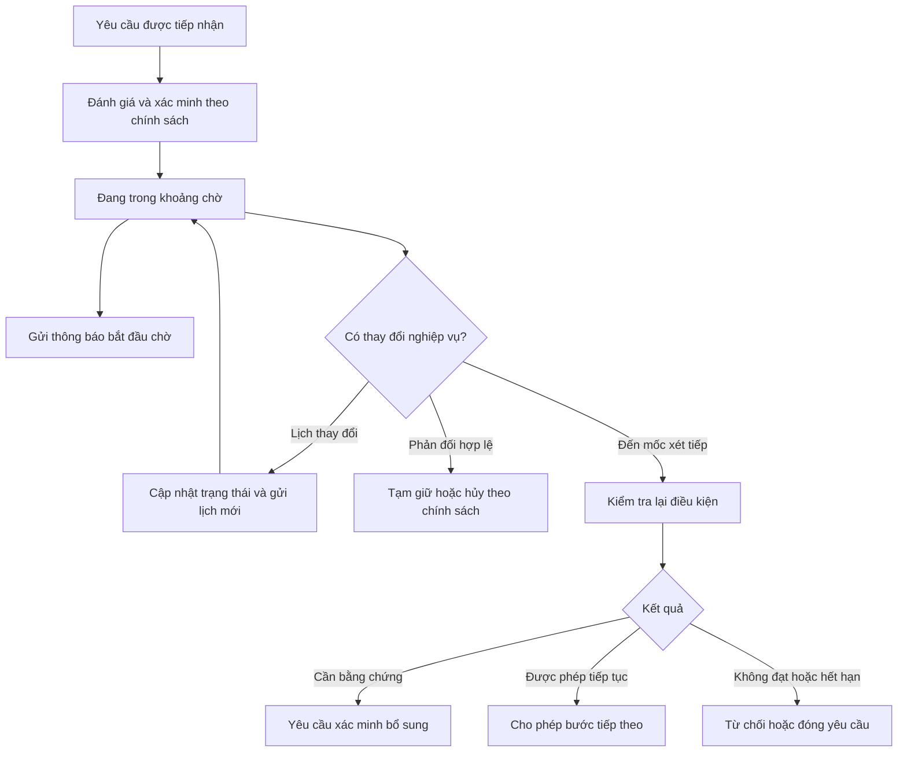

# Recovery delay notification

## 1. Thông báo trì hoãn khôi phục tài khoản là gì?

**Recovery delay notification** là thông báo cho biết một yêu cầu khôi phục tài khoản đang phải chờ trước khi được xét tiếp hoặc trước khi một thay đổi bảo mật có thể có hiệu lực. Trong luồng khôi phục khi mất mật khẩu, MFA, passkey hoặc thiết bị xác thực, khoảng chờ có thể tạo thêm thời gian để chủ tài khoản phát hiện và phản đối một yêu cầu đáng ngờ.

Thông báo này phải giải thích được ba điều: **điều gì đang chờ, người dùng cần làm gì và điều gì xảy ra tiếp theo**. Nó không được biến việc “đang chờ” thành lời hứa rằng người gửi yêu cầu đã chứng minh được danh tính hoặc chắc chắn sẽ lấy lại tài khoản.

Ví dụ, người dùng mất điện thoại chứa ứng dụng MFA. Sau khi nhận yêu cầu khôi phục và đánh giá rủi ro, hệ thống đặt yêu cầu vào trạng thái chờ đến một mốc cụ thể. Chủ tài khoản nhận thông báo qua kênh bảo mật đã đăng ký từ trước. Hết khoảng chờ, hệ thống vẫn phải kiểm tra trạng thái yêu cầu, điều kiện xác minh và chính sách áp dụng; thời gian trôi qua không tự trở thành bằng chứng danh tính.

Phạm vi bài học là cách truyền đạt khoảng chờ an toàn trong chương **User Messaging**. Việc chọn thời lượng chờ, xác minh danh tính và thực thi thay đổi bảo mật thuộc chính sách và dịch vụ khôi phục; lớp thông báo phải phản ánh chính xác các quyết định đó.

## 2. Phân biệt khoảng chờ bảo mật với chậm xử lý kỹ thuật

Hai nguyên nhân đều khiến người dùng phải đợi nhưng cần lời giải thích khác nhau.

| Tình huống | Ý nghĩa thực tế | Cách diễn đạt phù hợp |
|---|---|---|
| Khoảng chờ bảo mật có chủ đích | Chính sách chưa cho phép bước khôi phục tiếp theo trước một thời điểm | “Yêu cầu đang trong khoảng chờ bảo mật. Bạn có thể kiểm tra bước tiếp theo từ…” |
| Đang kiểm tra thủ công | Chưa có kết quả đánh giá hoặc chưa thể xác định mốc hoàn tất | “Yêu cầu đang được kiểm tra. Chúng tôi sẽ cập nhật khi có kết quả.” |
| Lỗi hoặc tồn đọng kỹ thuật | Hệ thống chưa xử lý được tác vụ theo kế hoạch | “Việc xử lý đang chậm hơn dự kiến. Trạng thái mới nhất được hiển thị tại…” |
| Lỗi gửi thông báo | Một kênh liên lạc không gửi được hoặc chưa xác nhận được kết quả | Hiển thị thông tin liên lạc trên trang trạng thái khi người xem đã có quyền phù hợp; không suy ra yêu cầu khôi phục thất bại |

Không dùng câu “vì lý do bảo mật” để che một sự cố kỹ thuật. Cũng không hứa “tài khoản sẽ được mở sau 24 giờ” nếu thời điểm đó chỉ là lúc sớm nhất hệ thống được phép đánh giá lại.

Cần đặt tên rõ cho từng mốc:

- **Thời điểm nhận yêu cầu:** khi hệ thống tiếp nhận hồ sơ khôi phục.
- **Thời điểm sớm nhất được xét tiếp:** trước mốc này, yêu cầu chưa đủ điều kiện về thời gian.
- **Thời điểm cập nhật tiếp theo:** lúc dự kiến có bản cập nhật, không nhất thiết là lúc khôi phục hoàn tất.
- **Thời điểm hết hạn:** sau mốc này, bằng chứng, liên kết hoặc yêu cầu có thể không còn hợp lệ, tùy chính sách.

Không dùng một trường “thời gian còn lại” để đại diện cho cả bốn ý nghĩa.

## 3. Thông báo gửi cho ai và được tiết lộ đến mức nào?

### 3.1. Người vừa gửi yêu cầu chưa chắc là chủ tài khoản

Nếu một biểu mẫu công khai nhận email hoặc tên tài khoản, thông báo phản hồi phải tránh làm lộ việc tài khoản có tồn tại, có bật MFA hay có kênh khôi phục nào.

Ví dụ phản hồi công khai:

> Nếu thông tin bạn cung cấp phù hợp với một tài khoản đủ điều kiện, hướng dẫn sẽ được gửi qua kênh khôi phục đã đăng ký. Việc gửi lại yêu cầu không bảo đảm rút ngắn thời gian xử lý.

Phản hồi này cần đi cùng thiết kế chống dò tài khoản ở mã trạng thái, cấu trúc phản hồi, giới hạn tốc độ và hành vi xử lý. Chỉ thay một câu chữ trong khi API vẫn trả về trạng thái nội bộ của từng tài khoản thì chưa giải quyết được vấn đề.

Một mã yêu cầu hoặc đường dẫn trang trạng thái không mặc nhiên cho phép xem dữ liệu nhạy cảm. Nếu đường dẫn chứa bí mật truy cập, hệ thống phải coi bí mật đó như thông tin xác thực và giới hạn dữ liệu cũng như thao tác tương ứng.

### 3.2. Chủ tài khoản nhận cảnh báo qua kênh đã thiết lập

Cảnh báo bảo mật thường được gửi đến kênh liên lạc đáng tin cậy đã được xác lập trước yêu cầu, theo chính sách của hệ thống. Địa chỉ mới do người gửi yêu cầu cung cấp không tự trở thành đích nhận cảnh báo dành cho chủ tài khoản.

Có thể tách hai loại thông điệp:

- **Cập nhật cho người yêu cầu:** hướng dẫn kiểm tra hồ sơ, yêu cầu bằng chứng tiếp theo và thời gian chờ trong phạm vi họ được phép biết.
- **Cảnh báo cho chủ tài khoản:** cho biết một hoạt động khôi phục có thể ảnh hưởng đến tài khoản, thời điểm có thể xảy ra thay đổi và cách phản đối an toàn.

Một hộp thư đã đăng ký vẫn có thể bị chiếm quyền, được chia sẻ hoặc không còn truy cập được. Vì vậy, gửi được email không chứng minh rằng chủ tài khoản đã đọc cảnh báo, và không thể thay thế toàn bộ kiểm soát khôi phục.

### 3.3. Mỗi bề mặt có mức hiển thị riêng

| Bề mặt | Nội dung phù hợp | Nội dung cần hạn chế |
|---|---|---|
| Màn hình khóa, tiêu đề push, tiêu đề email | “Có cập nhật về bảo mật tài khoản” | Tên đầy đủ, mã xác minh, loại yếu tố bị mất, chi tiết yêu cầu |
| Nội dung gửi qua kênh đã đăng ký | Trạng thái chờ, mốc thời gian được phép công bố, cách vào ứng dụng chính thức | Token khôi phục, bản chụp giấy tờ, lý do rủi ro chi tiết |
| Trang trạng thái có kiểm soát truy cập | Trạng thái hiện hành, mốc xét tiếp, hành động được phép cho người xem | Dữ liệu của yêu cầu khác hoặc chức năng vượt quyền của phiên hiện tại |
| Công cụ hỗ trợ nội bộ | Thông tin cần thiết theo vai trò và nhật ký truy cập | Toàn bộ bí mật xác thực hoặc dữ liệu nhận dạng không phục vụ xử lý |

Không mặc định rằng mọi phiên đang đăng nhập đều đáng tin cậy. Quyền xem và phản đối yêu cầu còn phụ thuộc mức xác thực, dấu hiệu bị chiếm quyền và chính sách của phiên.

## 4. Một thông báo trì hoãn cần chứa gì?

Một thông báo đầy đủ thường có các thành phần sau:

1. **Trạng thái rõ ràng:** yêu cầu đang trong khoảng chờ, đang được kiểm tra hoặc đã được cập nhật.
2. **Phạm vi ảnh hưởng:** ví dụ yêu cầu khôi phục phương thức xác thực đang chờ; không mô tả một thay đổi chưa xảy ra như việc đã hoàn tất.
3. **Mốc thời gian có ý nghĩa:** ghi rõ là “sớm nhất được xét tiếp” hay “dự kiến cập nhật”, kèm múi giờ.
4. **Việc người dùng cần làm:** chờ, kiểm tra trạng thái hoặc thực hiện một bước xác minh đã được cho phép.
5. **Hướng xử lý khi không nhận ra yêu cầu:** truy cập ứng dụng hoặc website chính thức và dùng chức năng bảo vệ tài khoản.
6. **Giới hạn của lời hứa:** hết thời gian chờ vẫn có thể cần kiểm tra bổ sung.
7. **Đường hỗ trợ đáng tin cậy:** chỉ dẫn đến kênh chính thức đã được cấu hình, không nhận từ dữ liệu người gửi yêu cầu.

Có thể giải thích ngắn rằng khoảng chờ giúp bảo vệ tài khoản và tạo thời gian phát hiện yêu cầu bất thường. Không công bố điểm rủi ro, ngưỡng chống gian lận, đặc trưng thiết bị bị đánh dấu hoặc các điều kiện giúp né khoảng chờ.

### Mẫu cảnh báo khi bắt đầu khoảng chờ

> **Yêu cầu khôi phục đang trong khoảng chờ bảo mật**
>
> Chúng tôi đã nhận một yêu cầu khôi phục phương thức xác thực cho tài khoản của bạn. Bước thay đổi phương thức xác thực của yêu cầu này chưa được thực hiện.
>
> Thời điểm sớm nhất yêu cầu được xét tiếp: **14:30 ngày 12/12/2026, giờ Việt Nam (UTC+07:00)**. Sau thời điểm này, hệ thống vẫn có thể yêu cầu xác minh bổ sung.
>
> Nếu bạn đã tạo yêu cầu, hãy mở ứng dụng hoặc website chính thức để kiểm tra trạng thái. Bạn không cần gửi lại yêu cầu chỉ để hỏi tiến độ.
>
> Nếu bạn không nhận ra hoạt động này, hãy truy cập mục **Bảo mật → Khôi phục tài khoản** trong ứng dụng hoặc website chính thức để báo cáo và xem các bước bảo vệ tài khoản.
>
> Không gửi mật khẩu, mã xác minh hoặc mã khôi phục cho người tự xưng là nhân viên hỗ trợ.

Đây là mẫu cho một sự kiện cụ thể trong đó thay đổi phương thức xác thực thực sự chưa xảy ra. Các biện pháp khác, chẳng hạn hạn chế một phiên bị nghi ngờ, có thể đã được áp dụng. Không thay câu trên bằng lời khẳng định rộng rằng “tài khoản chưa có bất kỳ thay đổi nào” nếu hệ thống không bảo đảm điều đó.

### Mẫu thông báo thay đổi lịch

> **Thời gian xét tiếp yêu cầu khôi phục đã được cập nhật**
>
> Yêu cầu của bạn vẫn đang được kiểm tra. Thời điểm sớm nhất được xét tiếp hiện là **09:00 ngày 13/12/2026, giờ Việt Nam (UTC+07:00)**.
>
> Mốc thời gian trong thông báo trước không còn áp dụng. Hãy mở ứng dụng hoặc website chính thức để xem trạng thái hiện hành. Khoảng chờ kết thúc không đồng nghĩa yêu cầu đã được phê duyệt.

Mẫu này chỉ được dùng sau khi dịch vụ khôi phục đã ghi nhận lịch mới. Lỗi gửi email hoặc thao tác gửi lại thông báo không được tự làm thay đổi lịch.

### Mẫu khi chưa xác định được thời điểm

> Yêu cầu khôi phục đang được kiểm tra và hiện chưa có thời điểm hoàn tất được xác nhận. Bạn có thể xem trạng thái tại ứng dụng hoặc website chính thức. Chúng tôi sẽ gửi cập nhật khi có thay đổi cần bạn biết hoặc thực hiện.

Nếu hệ thống có cam kết về lần cập nhật tiếp theo, có thể bổ sung mốc cập nhật đó. Không tự tạo thời hạn hoàn tất chỉ để thông báo trông cụ thể hơn.

## 5. Hiển thị thời gian để người dùng hiểu đúng

### 5.1. Dùng thời điểm tuyệt đối làm mốc tham chiếu

Câu “còn khoảng 24 giờ” dễ trở nên sai khi email đến muộn hoặc được đọc lại. Thông báo nên có ngày, giờ và múi giờ; bộ đếm ngược trên trang trạng thái chỉ là thông tin hỗ trợ.

Ví dụ:

```text
Được xét tiếp sớm nhất: 14:30 ngày 12/12/2026
Múi giờ: Asia/Ho_Chi_Minh (UTC+07:00)
Trạng thái cập nhật lúc: 10:05 ngày 11/12/2026, cùng múi giờ
```

Các mốc trên là dữ liệu minh họa, không phải thời lượng chờ khuyến nghị cho mọi dịch vụ. Khi phục vụ người dùng ở nhiều múi giờ, cần bảo đảm cách hiển thị không nhầm ngày và không dùng một độ lệch UTC cố định cho những khu vực có thay đổi giờ theo mùa.

### 5.2. Máy chủ quyết định điều kiện thời gian

Dịch vụ khôi phục lưu thời điểm theo một chuẩn thống nhất, chẳng hạn `Instant`, rồi chuyển đổi sang múi giờ phù hợp khi hiển thị. Đồng hồ thiết bị của người dùng không quyết định yêu cầu đã hết chờ hay chưa.

Khi bộ đếm về 0, giao diện lấy trạng thái mới từ máy chủ. Nó có thể hiện “Đang kiểm tra trạng thái mới nhất” thay vì tự bật nút hoàn tất khôi phục.

### 5.3. Liên kết và yêu cầu có vòng đời riêng

Liên kết xem trạng thái, token xác minh và yêu cầu khôi phục có thể hết hạn vào các thời điểm khác nhau. Nếu token chỉ hợp lệ trong 15 phút nhưng khoảng chờ kéo dài nhiều giờ, thông báo không nên hướng dẫn người dùng giữ token đó đến cuối khoảng chờ.

Gửi lại thông báo không được âm thầm gia hạn token, đặt lại thời điểm bắt đầu hoặc tạo một yêu cầu khôi phục mới. Mỗi hành vi này phải là một thao tác nghiệp vụ riêng với kiểm soát tương ứng.

## 6. Ánh xạ thông báo với trạng thái khôi phục

Lớp thông báo đọc trạng thái đã được ghi nhận từ dịch vụ khôi phục. Nó không tự quyết định yêu cầu đã đủ điều kiện hay đã được phê duyệt.



Trong sơ đồ, “cho phép bước tiếp theo” vẫn khác với “đã thay mật khẩu”, “đã gỡ MFA” hoặc “đã thêm passkey”. Chỉ gửi thông báo hoàn tất sau khi đúng thay đổi tương ứng đã được ghi nhận.

| Sự kiện đã được ghi nhận | Mục tiêu thông báo | Điều cần tránh |
|---|---|---|
| Bắt đầu chờ | Xác nhận trạng thái và hướng dẫn theo dõi | Khẳng định người yêu cầu đã được xác minh hoàn toàn |
| Thay đổi lịch | Cung cấp mốc mới và vô hiệu hóa kỳ vọng về mốc cũ | Để người dùng tiếp tục dựa vào thông báo đã lỗi thời |
| Gần đến mốc xét tiếp | Nhắc lại nếu chính sách thấy có ích | Gửi dồn dập hoặc quảng bá cách rút ngắn khoảng chờ |
| Cần xác minh bổ sung | Chỉ dẫn bước tiếp theo trong kênh chính thức | Yêu cầu trả lời email bằng mật khẩu, OTP hoặc mã khôi phục |
| Được phép tiếp tục | Hướng dẫn truy cập bước được cấp quyền | Nói “khôi phục thành công” khi chưa thay đổi gì |
| Tạm giữ, hủy hoặc hết hạn | Giải thích trạng thái hiện tại và khả năng tiếp tục | Vẫn gửi thông báo cũ rằng yêu cầu sắp được thực hiện |
| Hoàn tất thay đổi | Xác nhận đúng thay đổi đã xảy ra và việc cần làm tiếp | Gộp trạng thái hoàn tất với thông báo kết thúc chờ |

## 7. Thiết kế nút “Tôi không thực hiện yêu cầu này”

Đây là lối vào chức năng bảo vệ tài khoản. Cần phân biệt việc mở trang, gửi tín hiệu phản đối và thực hiện một thay đổi có ảnh hưởng đến tài khoản.

Một thiết kế có thể yêu cầu người dùng mở ứng dụng chính thức, xác thực bằng yếu tố còn tin cậy và xác nhận phản đối. Nếu người dùng đã mất mọi yếu tố, hệ thống cần một nhánh xử lý phù hợp với chính sách; nội dung thông báo không được hứa rằng chỉ cần bấm liên kết là có thể dừng mọi thay đổi.

Các nguyên tắc quan trọng:

- **GET không thay đổi trạng thái.** Phần mềm quét email có thể tự mở liên kết. Chỉ truy cập URL không được hủy yêu cầu, đổi mật khẩu hoặc đăng xuất tài khoản.
- **Thao tác thay đổi phải được kiểm soát quyền.** Với phiên dùng cookie, cần bảo vệ CSRF và kiểm tra quyền trên đúng yêu cầu. Nếu dùng token hành động qua email, token phải có phạm vi hẹp, thời hạn, ràng buộc yêu cầu và cơ chế chống dùng lại thích hợp.
- **Báo cáo phản đối không mặc nhiên cấp quyền quản trị tài khoản.** Một tín hiệu có thể đưa yêu cầu vào trạng thái cần đánh giá; quyền gỡ MFA, đổi email hoặc thu hồi phiên là quyết định riêng.
- **Liên kết không được trở thành công cụ gây khóa tài khoản tùy ý.** Một người chỉ biết email hoặc mã yêu cầu không nên có khả năng liên tục hủy luồng hợp lệ của người khác.
- **Hiển thị kết quả thật.** Nếu yêu cầu đã hoàn tất trước khi phản đối được xử lý, hệ thống cần chuyển sang hướng xử lý sự cố phù hợp, không báo “đã hủy thành công” cho một thay đổi đã xảy ra.

Lớp thông báo chỉ đặt nhãn và đường dẫn đến chức năng được thiết kế sẵn. Nó không tự thu hồi session hoặc vô hiệu hóa yếu tố xác thực khi gửi cảnh báo.

## 8. Tránh để thông báo trở thành công cụ lạm dụng

### 8.1. Chống gửi dồn và quấy rối

Kẻ tấn công có thể gửi lặp yêu cầu hoặc bấm gửi lại nhằm làm chủ tài khoản mệt mỏi, bỏ qua cảnh báo thật hoặc vô tình chấp thuận hành động.

Các kiểm soát thường cần phối hợp gồm giới hạn tần suất theo tài khoản và nguồn gửi, gộp các yêu cầu trùng, giới hạn gửi lại và chỉ gửi khi có thay đổi đáng kể. Đếm theo IP đơn lẻ không đủ để đối phó nhiều nguồn gửi và cũng có thể ảnh hưởng người dùng chung mạng.

Không nên gửi một email “bắt đầu chờ” mới cho mọi lần thử lại của cùng yêu cầu. Khi gộp thông báo, vẫn cần giữ các cập nhật bảo mật quan trọng, đặc biệt là thay đổi lịch hoặc trạng thái.

### 8.2. Không tạo thông điệp giúp lừa đảo

Câu “Liên hệ ngay số điện thoại trong email để mở khóa nhanh” dễ bị giả mạo và tạo thói quen nguy hiểm. Nên hướng dẫn người dùng mở ứng dụng hoặc tự truy cập website chính thức đã biết.

Nếu có liên kết, đích phải lấy từ cấu hình đáng tin cậy; không dựng từ `Host` header chưa được xác minh hoặc URL do người yêu cầu nhập. Không đặt token khôi phục vào công cụ phân tích, log truy cập, mã theo dõi hay tài nguyên bên thứ ba.

Thông báo không nên quảng bá “nộp phí để bỏ chờ”, yêu cầu cung cấp OTP cho hỗ trợ hoặc tiết lộ một thủ thuật tạo yêu cầu mới để có lịch sớm hơn.

### 8.3. Giữ riêng tư trên thiết bị dùng chung

Không nhét mật khẩu tạm, token hay bản chụp giấy tờ vào thông báo. Thông tin thiết bị, địa chỉ IP và vị trí chỉ hiển thị khi giúp người dùng nhận ra hoạt động và khi chính sách cho phép. Vị trí suy từ IP chỉ là ước lượng, không nên viết như vị trí vật lý đã được xác thực.

Tiêu đề thông báo nên trung tính. Chi tiết hơn có thể nằm trong ứng dụng sau khi kiểm tra quyền truy cập phù hợp. Việc che một phần email cũng không làm dữ liệu tự động trở nên vô hại nếu xuất hiện trên biểu mẫu công khai.

## 9. Tính nhất quán giữa trạng thái và hệ thống gửi

Thông báo trì hoãn dễ sai khi trạng thái yêu cầu và việc gửi được cập nhật độc lập.

Ví dụ: dịch vụ đặt lịch xét tiếp lúc 14:30, nhưng tiến trình gửi lỗi sau khi cập nhật cơ sở dữ liệu. Hoặc một email theo lịch cũ còn nằm trong hàng đợi sau khi yêu cầu đã bị hủy. Cần thiết kế để thông báo có thể thử lại mà không đổi nghiệp vụ.

Một cách tổ chức là dùng **transactional outbox**: cùng giao dịch ghi trạng thái khôi phục và bản ghi sự kiện cần gửi. Tiến trình gửi xử lý outbox sau đó, với chính sách thử lại riêng.

```text
Giao dịch nghiệp vụ:
  1. Ghi trạng thái WAITING và eligibleAt.
  2. Ghi phiên bản trạng thái mới.
  3. Ghi sự kiện RecoveryDelayStarted vào outbox.
  4. Commit.

Tiến trình thông báo:
  1. Nhận sự kiện và kiểm tra trùng.
  2. Đối chiếu trạng thái, phiên bản và quyền của đích nhận.
  3. Bỏ qua thông báo đã lỗi thời hoặc chọn thông báo cập nhật phù hợp.
  4. Kết xuất nội dung rồi gửi qua nhà cung cấp.
  5. Ghi kết quả gửi; thử lại có kiểm soát nếu cần.
```

Khóa chống trùng có thể dựa trên `requestId + eventType + stateVersion + recipientId + channel`. Không nên chỉ dùng `requestId`, vì cùng một yêu cầu có thể có nhiều cập nhật hợp lệ. Ngược lại, thử gửi lại cùng một sự kiện không nên tạo thông báo nghiệp vụ mới.

Kiểm tra phiên bản trước khi gửi giúp giảm thông báo cũ nhưng không loại bỏ mọi tranh chấp: trạng thái vẫn có thể thay đổi sau khi email rời hệ thống. Vì vậy, thông báo cần có thời điểm cập nhật và chỉ rõ trang trạng thái hiện hành là nơi kiểm tra lại. Không hứa có thể thu hồi một email đã gửi.

Nếu nhà cung cấp nhận được yêu cầu gửi nhưng phản hồi bị mất, lần thử lại có thể tạo bản sao. Có thể dùng cơ chế chống trùng của nhà cung cấp khi khả dụng, nhưng vẫn cần thiết kế chịu được thông báo lặp. Không giả định mọi kênh đều bảo đảm gửi đúng một lần.

### Theo dõi kết quả gửi đúng nghĩa

`QUEUED`, `PROVIDER_ACCEPTED`, `DELIVERED` và “người dùng đã đọc” là những khái niệm khác nhau. Tín hiệu giao thành công hoặc mở email, nếu có, không phải bằng chứng xác minh danh tính.

Nếu chính sách yêu cầu một cảnh báo phải đạt một điều kiện gửi trước khi khôi phục được xét tiếp, điều kiện đó phải được định nghĩa và thực thi rõ trong dịch vụ khôi phục. Tiến trình gửi không được tự bỏ khoảng chờ vì gửi thất bại hoặc coi một lần thử gửi là người dùng đã có cơ hội phản đối.

## 10. Ví dụ Java: kết xuất thông báo từ một trạng thái đã được xác lập

Ví dụ sau minh họa lớp trình bày bằng Java có hỗ trợ `record`. Đầu vào là dữ liệu do dịch vụ khôi phục cung cấp sau khi đã kiểm tra quyền xem; lớp này không xác minh danh tính, không chọn thời lượng chờ và không thực hiện khôi phục.

```java
import java.time.Instant;
import java.time.ZoneId;
import java.time.format.DateTimeFormatter;
import java.util.Locale;
import java.util.Objects;

public final class RecoveryDelayMessageRenderer {
    private static final DateTimeFormatter DISPLAY_TIME =
            DateTimeFormatter.ofPattern(
                    "HH:mm 'ngày' dd/MM/uuuu '('XXX')'",
                    Locale.forLanguageTag("vi"));

    public enum RecoveryState {
        WAITING,
        REVIEW_REQUIRED,
        READY_FOR_NEXT_STEP,
        CANCELED,
        EXPIRED,
        COMPLETED
    }

    public record DelayView(
            RecoveryState state,
            Instant eligibleAt,
            Instant updatedAt,
            long version) {
        public DelayView {
            Objects.requireNonNull(state);
            Objects.requireNonNull(eligibleAt);
            Objects.requireNonNull(updatedAt);
            if (version < 1) {
                throw new IllegalArgumentException("Invalid state version");
            }
        }
    }

    public record Message(String subject, String plainTextBody) {}

    public Message renderWaiting(DelayView view, ZoneId displayZone) {
        Objects.requireNonNull(view);
        Objects.requireNonNull(displayZone);

        if (view.state() != RecoveryState.WAITING) {
            throw new IllegalStateException(
                    "Waiting message requires WAITING state");
        }

        String eligible = format(view.eligibleAt(), displayZone);
        String updated = format(view.updatedAt(), displayZone);

        String body = """
                Yêu cầu khôi phục đang trong khoảng chờ bảo mật.
                Thời điểm sớm nhất được xét tiếp: %s.
                Múi giờ hiển thị: %s.
                Thông tin được cập nhật lúc: %s.

                Hết khoảng chờ, yêu cầu vẫn có thể cần xác minh bổ sung.
                Hãy mở ứng dụng hoặc website chính thức để xem trạng thái.
                Nếu bạn không nhận ra yêu cầu, hãy vào mục Bảo mật để báo cáo.
                Không gửi mật khẩu hoặc mã xác minh cho người khác.
                """.formatted(eligible, displayZone.getId(), updated);

        return new Message("Có cập nhật về bảo mật tài khoản", body);
    }

    private String format(Instant instant, ZoneId zone) {
        return DISPLAY_TIME.withZone(zone).format(instant);
    }
}
```

Các điểm cần hiểu trong ví dụ:

- `eligibleAt` là mốc xét tiếp sớm nhất được tính ở nơi khác. Renderer không cộng thời gian vào thời điểm gửi email.
- Chỉ trạng thái `WAITING` được dùng cho mẫu chờ. Các trạng thái khác cần thông báo riêng; lỗi ở đây phải được bên gọi xử lý thay vì thử vô hạn cùng một sự kiện cũ.
- `version` phục vụ đối chiếu ở lớp xử lý sự kiện. Renderer không tự kiểm tra được liệu snapshot có còn mới hay không; không nên hiểu việc mang theo phiên bản là đã xử lý xong tranh chấp đồng thời.
- Múi giờ được truyền rõ ràng. Cùng một `Instant` có thể hiển thị khác nhau mà không làm thay đổi lịch nghiệp vụ.
- Ví dụ trả về văn bản thuần. Nếu chuyển sang HTML, phải escape dữ liệu động theo ngữ cảnh và dùng hệ thống template phù hợp.

Lớp này không nhận mật khẩu, OTP hay token khôi phục vì việc kết xuất thông báo trì hoãn không cần những dữ liệu đó. Đích nhận, chính sách chống trùng, kiểm soát tần suất và quyết định gửi thuộc các thành phần khác.

## 11. Xử lý các tình huống dễ gây nhầm

### Người dùng mất cả kênh nhận cảnh báo

Không hướng dẫn “chỉ cần mở email cũ để tiếp tục” nếu chính tình huống là mất quyền truy cập email đó. Hệ thống có thể cần một nhánh xác minh khác theo chính sách. Trang công khai vẫn không được tiết lộ các kênh bảo mật còn lại cho người chưa đủ quyền.

### Người dùng gửi lại nhiều lần

Hiển thị rằng yêu cầu hiện tại vẫn đang được xử lý khi người xem có quyền biết. Việc tạo yêu cầu mới, thay thế yêu cầu cũ hoặc giữ nguyên lịch phải do nghiệp vụ quy định. Lớp thông báo không tự chọn một lịch “có lợi hơn” từ các yêu cầu đang tồn tại.

### Người dùng đã khôi phục bằng yếu tố dự phòng

Nếu tài khoản đã hoàn tất một luồng khôi phục khác, cần xử lý yêu cầu đang chờ theo chính sách rồi phát thông báo tương ứng. Không để email chờ cũ tiếp tục hướng dẫn thực hiện lại một thay đổi không còn cần thiết.

### Mốc xét tiếp đã qua nhưng kiểm tra chưa xong

Hiển thị trạng thái hiện tại và nguyên nhân ở mức được phép công bố. Không giữ bộ đếm âm hoặc khẳng định “đã được phê duyệt” chỉ vì đồng hồ đã qua mốc.

### Lịch bị kéo dài

Thông báo cần nói rõ mốc mới thay thế mốc cũ. Việc kéo dài phải có cơ sở nghiệp vụ, dấu vết quyết định và cách hỗ trợ phù hợp. Đừng biến mỗi lần thử gửi lại thông báo thành một lần bắt đầu khoảng chờ mới hoặc kéo dài vô hạn mà người dùng không hiểu điều gì đang xảy ra.

### Cảnh báo đến sau khi yêu cầu đã bị hủy

Trang trạng thái trả về tình trạng đã hủy và hướng dẫn thích hợp. Không tạo lại yêu cầu từ liên kết cũ. Nếu gửi thông báo đính chính, phải dựa vào sự kiện trạng thái hiện hành và kiểm soát gửi trùng.

## 12. Khả năng tiếp cận và ngôn ngữ

Người đang mất quyền truy cập thường chịu áp lực. Thông báo nên dùng câu ngắn, động từ cụ thể và mô tả việc cần làm theo đúng thứ tự.

- Đặt nhãn nút theo hành động, chẳng hạn “Xem trạng thái yêu cầu” hoặc “Báo cáo yêu cầu không nhận ra”.
- Không chỉ dùng màu đỏ, biểu tượng đồng hồ hay animation để truyền đạt trạng thái.
- Có bản văn bản thuần và cấu trúc đọc được bằng công nghệ hỗ trợ.
- Hiển thị ngày giờ theo ngôn ngữ người dùng nhưng luôn chỉ rõ múi giờ.
- Dùng nhất quán “được xét tiếp”, “được phê duyệt” và “đã hoàn tất”; ba cụm này mô tả ba ý khác nhau.
- Không gây hoảng sợ bằng lời đe dọa khóa tài khoản ngay lập tức nếu nghiệp vụ không thực sự có hành vi đó.

Hỗ trợ khách hàng cũng cần dùng cùng thuật ngữ với ứng dụng. Nếu hỗ trợ nói “đã duyệt” trong khi trang trạng thái chỉ nói “đã hết khoảng chờ”, người dùng có thể thực hiện sai hoặc tin vào một thông điệp giả.

## 13. Các tình huống nên dùng để kiểm chứng thiết kế

Bảng dưới là các tình huống học tập để nhận biết hành vi mong đợi của thông báo và hệ thống liên quan.

| Tình huống | Hành vi mong đợi |
|---|---|
| Nhập tài khoản không tồn tại ở biểu mẫu công khai | Phản hồi không xác nhận tồn tại, phương thức xác thực hay lịch nội bộ |
| Yêu cầu hợp lệ bắt đầu chờ | Cảnh báo đến đúng kênh được phép, ghi rõ mốc xét tiếp và hành động phù hợp |
| Email đến muộn nhiều giờ | Mốc tuyệt đối vẫn đọc được; có chỉ dẫn kiểm tra trạng thái hiện hành |
| Đổi giờ trên điện thoại | Không làm yêu cầu hết chờ hoặc cấp quyền thực hiện bước tiếp theo |
| Người dùng gửi lại cùng yêu cầu | Không tự đặt lại lịch, gia hạn token hoặc tạo hàng loạt cảnh báo |
| Yêu cầu bị hủy trong khi email còn trong hàng đợi | Tiến trình gửi xử lý sự kiện lỗi thời; trang trạng thái không cho tiếp tục yêu cầu đã hủy |
| Bộ quét email tự mở liên kết | Không xảy ra hủy yêu cầu, thay đổi thông tin xác thực hay thu hồi phiên |
| Người xem có mã yêu cầu nhưng không đủ quyền | Không xem được trạng thái hoặc thao tác vượt phạm vi được cấp |
| Nhà cung cấp gửi phản hồi lỗi không rõ kết quả | Thử lại có kiểm soát, chịu được bản sao, không thay lịch nghiệp vụ |
| Hết khoảng chờ nhưng còn thiếu bằng chứng | Hiển thị bước xác minh tiếp theo hoặc trạng thái kiểm tra, không tự thông báo thành công |
| Yêu cầu hoàn tất trước khi người dùng phản đối | Không báo hủy thành công sai sự thật; hướng dẫn xử lý sự cố theo trạng thái thực |
| Token cũ hết hạn | Không được sử dụng lại; trang chính thức hướng dẫn bước hợp lệ mà không âm thầm hồi sinh token |

## 14. Những lỗi thiết kế cần nhận ra

**“Sau 24 giờ tài khoản của bạn sẽ được mở.”** Câu này hứa kết quả mà luồng khôi phục có thể chưa đủ điều kiện thực hiện. Cần ghi rõ đây là mốc xét tiếp hay cam kết hoàn tất thực sự.

**“Bấm vào đây để hủy ngay” và GET thực hiện hủy.** Hệ thống quét liên kết có thể kích hoạt ngoài ý muốn. Trang mở bằng GET cần tách khỏi thao tác thay đổi có kiểm soát.

**Gửi cảnh báo chủ tài khoản đến email mới vừa nhập.** Người gửi yêu cầu có thể kiểm soát địa chỉ này. Kênh mới chỉ được dùng trong phạm vi mà chính sách cho phép, không tự thay thế kênh bảo mật đã xác lập.

**Email nói 14:30 nhưng trang trạng thái nói 09:00 ngày hôm sau.** Cần giải thích lịch đã thay đổi, ghi rõ thông báo cũ không còn áp dụng và lấy trạng thái máy chủ làm căn cứ cho hành động.

**Gửi được email được xem như xác minh xong.** Trạng thái gửi mô tả hệ thống liên lạc, không chứng minh danh tính người đọc và không cấp quyền thay đổi yếu tố xác thực.

**Đưa toàn bộ lý do rủi ro vào cảnh báo.** Người dùng cần hiểu phải làm gì, nhưng không cần biết các ngưỡng và dấu hiệu có thể dùng để điều chỉnh một cuộc tấn công.

**Cứ hết bộ đếm là tạo session đầy đủ.** Khoảng chờ kết thúc chỉ đáp ứng một điều kiện thời gian. Quyền truy cập và kiểm soát session vẫn do luồng khôi phục quyết định sau các kiểm tra bắt buộc.

Một thông báo trì hoãn có chất lượng giúp người dùng biết chính xác yêu cầu đang ở đâu và phản ứng đúng khi có dấu hiệu chiếm đoạt tài khoản. Nội dung, mốc thời gian, quyền xem và đường dẫn hành động phải cùng phản ánh trạng thái thực của yêu cầu khôi phục.
