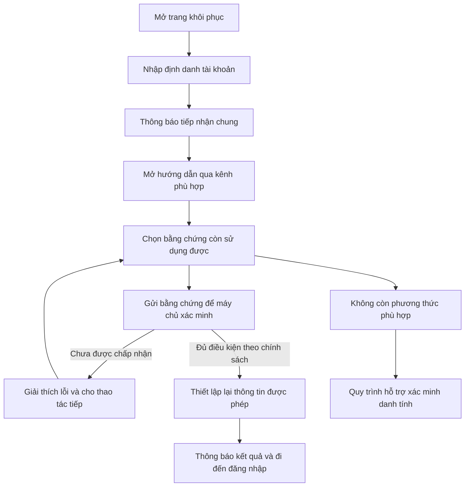

# Keyboard recovery flow — Khôi phục tài khoản bằng bàn phím

Một luồng khôi phục tài khoản chỉ sử dụng được khi người dùng có thể đi hết hành trình: mở trang trợ giúp, chọn phương thức còn dùng được, nhận và nhập bằng chứng, xử lý lỗi, thiết lập lại thông tin xác thực và quay về đăng nhập. Nút “Tiếp tục” nhận được phím Tab mới là một phần của hành trình đó.

Trong module SECURITY_AUTHENTICATION_ACCOUNT_RECOVERY, bài này tập trung vào cách thiết kế hành trình ấy cho người dùng mất mật khẩu, MFA, passkey hoặc thiết bị xác thực. Ví dụ và quy ước dưới đây là phương án thiết kế minh họa; chúng cần được kết hợp với chính sách xác minh danh tính của từng hệ thống.

## 1. Mục tiêu và ranh giới

Sau bài học, bạn có thể:

- Mô tả đường đi bằng Tab, Shift+Tab và Enter qua từng bước khôi phục.
- Chọn vị trí focus khi chuyển bước, xuất hiện lỗi hoặc hoàn tất yêu cầu.
- Thiết kế nhập mã, gửi lại, hết hạn và chọn phương thức khác mà không bắt người dùng thao tác chuột.
- Phân biệt tiện ích giao diện với quyết định bảo mật của máy chủ.

**Keyboard flow** là đường thao tác qua các phần tử tương tác bằng giao diện bàn phím. Nó cũng có ích cho công nghệ hỗ trợ phát sinh thao tác tương đương bàn phím. WCAG 2.1.1 đặt yêu cầu về khả năng thao tác chức năng bằng bàn phím, không đòi hỏi nhịp gõ cụ thể. [W3C: Keyboard](https://www.w3.org/WAI/WCAG22/Understanding/keyboard.html)

Có hai lớp cần phân biệt:

| Lớp | Ví dụ | Trách nhiệm |
| --- | --- | --- |
| Điều khiển trên trang | Chọn mã dự phòng, nhập email, gửi biểu mẫu | Cung cấp phần tử HTML và đường focus có thể sử dụng |
| Xác thực bên ngoài trang | Hộp thoại của hệ điều hành, thao tác hiện diện trên khóa bảo mật | Giải thích yêu cầu, cho phép quay lại và cung cấp nhánh khôi phục phù hợp nếu phương thức không còn dùng được |

Trang web không thể dùng JavaScript để bỏ qua yêu cầu hiện diện của một authenticator. Khi người dùng không còn thiết bị phù hợp, nút “Tôi không dùng được phương thức này” phải dẫn đến một quy trình xác minh đã được hệ thống cho phép. Chỉ chọn nút đó không phải là bằng chứng sở hữu tài khoản.

## 2. Xây dựng hành trình trước khi viết trình xử lý phím

Giả sử Lan mất điện thoại chứa ứng dụng MFA và đang dùng máy tính với bàn phím. Luồng sau cho thấy những quyết định cần xuất hiện rõ ràng:



Sơ đồ thể hiện các trạng thái sản phẩm, không có nghĩa hệ thống phải hiển thị danh sách MFA của tài khoản ngay khi ai đó nhập email. Trước khi có bằng chứng thích hợp, trang chỉ nên cho biết các hướng lựa chọn chung mà người dùng có thể thực hiện.

Với mỗi màn hình, ghi rõ bốn thông tin:

1. Người dùng cần hiểu điều gì trước khi hành động?
2. Phần tử tương tác đầu tiên và cuối cùng là gì?
3. Hành động nào chuyển bước, quay lại hoặc hủy?
4. Sau mỗi kết quả, người dùng tiếp tục từ vị trí nào?

Ví dụ, tại bước nhập mã dự phòng, thứ tự hợp lý là: hướng dẫn → ô mã → nút xác minh → nút chọn phương thức khác → liên kết hỗ trợ. Hướng dẫn là nội dung để đọc; nó không cần trở thành một điểm Tab riêng.

## 3. Thứ tự focus và hành vi phím

Thứ tự focus phải giữ được ý nghĩa và khả năng thao tác. Với biểu mẫu thông thường, nên sắp DOM theo trình tự đọc và hành động; việc đảo thứ tự hiển thị bằng CSS dễ tạo đường Tab khó hiểu. Đây là cách áp dụng nguyên tắc của [W3C: Focus Order](https://www.w3.org/WAI/WCAG22/Understanding/focus-order.html).

| Phần tử | Cách triển khai ưu tiên | Hành vi cần có |
| --- | --- | --- |
| Điều hướng sang trang khác | `<a href="…">` | Tab đến liên kết, Enter mở đích |
| Gửi dữ liệu để xác minh | `<button type="submit">` trong `<form>` | Gửi qua nút hoặc hành vi gửi biểu mẫu bằng Enter |
| Mở phần giải thích | `<button type="button">` | Có thể kích hoạt bằng Enter hoặc Space |
| Chọn một phương thức trong nhóm | Radio trong `<fieldset>` có `<legend>` | Dùng hành vi bàn phím native của nhóm radio |
| Nội dung đầu bước mới | Heading có `tabindex="-1"` khi cần | Nhận focus bằng chương trình, không thêm một điểm Tab |
| Vùng không hoạt động | `hidden`, hoặc cơ chế bất hoạt phù hợp | Không để người dùng Tab vào nút của bước cũ |

Các quy ước triển khai cho bài này:

- Tránh `tabindex` dương như `1`, `2`, `3`. Khi thêm nút “Gửi lại”, một dãy chỉ số thủ công rất dễ sai.
- Không biến `<div>` thành nút chỉ bằng `onclick`. Nút native đã có nhiều hành vi cần thiết.
- Không chặn Tab trên toàn trang. Các thành phần phức tạp có thể quản lý phím bên trong phạm vi của chúng.
- Không tự chuyển bước khi người dùng mới focus một lựa chọn.
- Không bắt giữ Enter ở cấp `document` để gọi một API xác minh. Hành vi đó có thể gửi nhầm biểu mẫu hoặc gây khó khăn khi nhập liệu bằng bộ gõ.
- Nút “Quay lại”, “Gửi lại” và “Hiện mật khẩu” trong form cần khai báo `type="button"` nếu chúng không phải hành động submit.

Đường Tab nên ngắn và có ý nghĩa. Đặt `tabindex="0"` lên mọi đoạn văn sẽ khiến người dùng phải đi qua hàng chục điểm dừng trước khi đến ô nhập.

## 4. Focus phải nhìn thấy và không bị che

Người nhìn màn hình nhưng không dùng chuột cần biết điểm thao tác hiện tại. Focus indicator phải tồn tại đủ lâu để theo dõi vị trí. [W3C: Focus Visible](https://www.w3.org/WAI/WCAG22/Understanding/focus-visible.html)

Ví dụ CSS:

```css
:focus {
  outline: 3px solid #174ea6;
  outline-offset: 3px;
}

input,
button,
a,
[tabindex="-1"] {
  scroll-margin-block: 6rem;
}

@media (forced-colors: active) {
  :focus {
    outline-color: Highlight;
  }
}
```

`6rem` là khoảng chừa minh họa cho bố cục cụ thể, cần chọn lại theo header và banner thực tế. Không xóa outline mặc định khi chưa có chỉ báo thay thế.

WCAG 2.4.11 ở mức tối thiểu yêu cầu phần tử nhận keyboard focus không bị nội dung do tác giả tạo che hoàn toàn. Thiết kế nên hướng đến việc nhìn rõ cả phần tử đang thao tác. [W3C: Focus Not Obscured](https://www.w3.org/WAI/WCAG22/Understanding/focus-not-obscured-minimum.html)

Trong trang khôi phục, những thành phần dễ che focus gồm banner cookie, thanh hỗ trợ cố định và thông báo lỗi ở cuối màn hình. Chừa khoảng cuộn không giải quyết được mọi bố cục; cần tránh đặt nút xác minh ngay phía sau một lớp phủ.

## 5. Quy tắc focus theo sự kiện

Đừng gọi `focus()` sau mọi lần render. Một bản cập nhật trạng thái có thể xuất hiện khi người dùng đang đọc hướng dẫn hoặc chuyển sang liên kết hỗ trợ.

| Sự kiện | Hành vi thiết kế đề xuất |
| --- | --- |
| Mở trang mới | Cung cấp title và heading rõ; không tự mở hộp thoại hoặc giành focus vào ô nhập |
| Người dùng chủ động chuyển bước trong cùng trang | Đưa focus đến heading của bước mới hoặc vị trí bắt đầu phù hợp |
| Submit có nhiều lỗi trường | Đưa focus đến phần tổng hợp lỗi, có liên kết đến từng trường |
| Một trường sai trong bước ngắn | Có thể giữ hoặc đưa focus đến trường đó, gắn lỗi bằng `aria-describedby` |
| Gửi lại mã thành công | Giữ focus tại nút gửi lại và thông báo trạng thái |
| Có phản hồi nền khi người dùng đã chuyển sang vùng khác | Thông báo thích hợp, tránh giành lại focus |
| Đóng phần trợ giúp dạng modal | Trả focus về nút đã mở nó nếu nút còn tồn tại |
| Mã hết hạn | Giải thích và cung cấp hành động tiếp theo; không tự bấm “Gửi lại” |

Khi chuyển bước, thực hiện việc hiện nội dung đích trước khi focus vào đó. Đừng cố focus một heading còn `hidden`. Khi quay lại, có thể đưa người dùng về trường đang sửa; không khôi phục mã bí mật cũ chỉ để giữ nguyên hình thức của màn hình.

### Phân biệt focus với thông báo

Một vùng `role="status"` giúp công nghệ hỗ trợ nhận biết thay đổi mà không cần chuyển focus. Đây là mục đích của [W3C: Status Messages](https://www.w3.org/WAI/WCAG22/Understanding/status-messages.html).

Dùng hai cơ chế theo mục đích:

- **Thay đổi bước do người dùng yêu cầu:** heading mới giúp định hướng ngữ cảnh.
- **Phản hồi tại chỗ:** thông báo như “Đang xử lý” hoặc “Bạn có thể gửi lại” thường không cần giành focus.

Đừng vừa focus nội dung vừa phát lại toàn bộ nội dung đó qua live region. Cách làm ấy dễ tạo thông báo lặp và khiến người dùng khó biết việc gì vừa xảy ra.

## 6. Ví dụ: gửi yêu cầu khôi phục

Ví dụ dưới đây minh họa biểu mẫu, trạng thái đang xử lý và chuyển đến thông báo tiếp nhận. Nó không triển khai gửi email hoặc xác minh tài khoản.

Hợp đồng API giả định:

- `POST /account-recovery/request` nhận dữ liệu biểu mẫu.
- Máy chủ trả `202` với mọi yêu cầu hợp lệ về hình thức mà hệ thống tiếp nhận, bất kể việc tài khoản có tồn tại.
- Chính sách giới hạn yêu cầu được thực thi ở máy chủ và không để phản hồi tiết lộ tài khoản tồn tại.
- Token CSRF được render bằng template của máy chủ; chuỗi placeholder trong ví dụ phải được thay bằng giá trị hợp lệ và escape phù hợp.

```html
<main>
  <h1>Khôi phục tài khoản</h1>

  <form id="request-form"
        action="/account-recovery/request"
        method="post"
        aria-labelledby="request-title">
    <h2 id="request-title">Nhận hướng dẫn khôi phục</h2>

    <input type="hidden"
           name="_csrf"
           value="{{CSRF_TOKEN}}">

    <label for="recovery-email">Email tài khoản</label>
    <p id="email-help">
      Nhập email bạn đã dùng. Chúng tôi sẽ hướng dẫn bước tiếp theo
      nếu thông tin phù hợp.
    </p>
    <input id="recovery-email"
           name="email"
           type="email"
           autocomplete="username"
           aria-describedby="email-help"
           required>

    <button id="send-request" type="submit">
      Nhận hướng dẫn
    </button>
  </form>

  <section id="accepted-panel"
           aria-labelledby="accepted-title"
           hidden>
    <h2 id="accepted-title" tabindex="-1">
      Yêu cầu đã được tiếp nhận
    </h2>
    <p>
      Nếu thông tin phù hợp, bạn sẽ nhận hướng dẫn qua kênh đã đăng ký.
      Bạn cũng có thể xem các phương án trợ giúp khôi phục.
    </p>
    <a href="/account-recovery/help">Xem trợ giúp khôi phục</a>
    <a href="/login">Quay về đăng nhập</a>
  </section>

  <p id="request-status" role="status" aria-atomic="true"></p>
</main>

<script>
  const form = document.querySelector("#request-form");
  const sendButton = document.querySelector("#send-request");
  const acceptedPanel = document.querySelector("#accepted-panel");
  const acceptedTitle = document.querySelector("#accepted-title");
  const status = document.querySelector("#request-status");
  let pending = false;

  form.addEventListener("submit", async (event) => {
    event.preventDefault();

    if (pending || !form.reportValidity()) {
      return;
    }

    pending = true;
    form.setAttribute("aria-busy", "true");
    sendButton.setAttribute("aria-disabled", "true");
    status.textContent = "Đang xử lý yêu cầu.";

    try {
      const response = await fetch(form.action, {
        method: "POST",
        body: new FormData(form),
        credentials: "same-origin",
        headers: { Accept: "application/json" }
      });

      if (response.status !== 202) {
        status.textContent = response.status === 429
          ? "Bạn đang gửi quá nhiều yêu cầu. Vui lòng thử lại sau."
          : "Chưa thể tiếp nhận yêu cầu. Vui lòng thử lại.";
        return;
      }

      const focusWasInForm = form.contains(document.activeElement);

      acceptedPanel.hidden = false;
      form.hidden = true;

      if (focusWasInForm) {
        status.textContent = "";
        acceptedTitle.focus();
      } else {
        status.textContent = "Yêu cầu đã được tiếp nhận.";
      }
    } catch {
      status.textContent =
        "Chưa nhận được phản hồi. Kiểm tra kết nối trước khi thử lại.";
    } finally {
      pending = false;
      form.removeAttribute("aria-busy");
      sendButton.removeAttribute("aria-disabled");
    }
  });
</script>
```

Ví dụ giữ nút trong đường focus bằng `aria-disabled` thay vì dùng thuộc tính `disabled` khi chờ phản hồi. **`aria-disabled` chỉ mô tả trạng thái, không tự chặn hành động.** Biến `pending` mới là phần ngăn submit lặp trong trình duyệt này. Máy chủ vẫn phải xử lý trùng lặp và chống lạm dụng độc lập.

Vùng status nằm ngoài form có `aria-busy` để việc công bố trạng thái không phụ thuộc vùng đang bận. Việc chuyển focus chỉ diễn ra khi focus hiện tại vẫn thuộc biểu mẫu vừa gửi. Nếu người dùng đã chuyển sang phần khác, mã không kéo họ trở lại.

Nếu JavaScript không chạy, server phải trả trang HTML có title, heading và nội dung phản hồi sử dụng được. Một endpoint chỉ trả JSON không tạo được phương án dự phòng đó. Dự án có thể dùng một route HTML riêng hoặc thương lượng kiểu phản hồi.

Không hiển thị trực tiếp thông báo lỗi tùy ý từ backend bằng `innerHTML`. Thông điệp hiển thị trong ví dụ là chuỗi do ứng dụng kiểm soát.

## 7. Nhập OTP và mã dự phòng

Một ô nhập duy nhất thường giúp người dùng dán toàn bộ mã, sửa lỗi và di chuyển con trỏ dễ hơn sáu ô có logic tự chuyển focus. Nếu thiết kế nhiều ô, đội triển khai phải xử lý cả dán, xóa, sửa giữa chuỗi, nhãn và công nghệ hỗ trợ; phần trang trí không nên làm thay đổi quyền kiểm soát của người dùng.

Ví dụ cho **mã số dùng một lần gồm sáu chữ số trong một sản phẩm giả định**:

```html
<label for="verification-code">Mã xác minh</label>
<p id="code-help">
  Nhập hoặc dán đủ 6 chữ số, kể cả số 0 ở đầu.
</p>
<input id="verification-code"
       name="code"
       type="text"
       inputmode="numeric"
       autocomplete="one-time-code"
       pattern="[0-9]{6}"
       maxlength="6"
       aria-describedby="code-help"
       required>
<button type="submit">Xác minh mã</button>
```

Độ dài sáu chữ số ở đây là giả định của ví dụ, không phải khuyến nghị áp dụng cho mọi mã khôi phục. Hình thức và độ dài phải khớp loại bằng chứng mà máy chủ phát hành.

Các quyết định cần giữ rõ:

- `type="text"` giữ được số 0 đầu chuỗi; `inputmode="numeric"` chỉ gợi ý bàn phím nhập, không xác minh dữ liệu.
- Mã dự phòng có chữ không dùng cùng ràng buộc chỉ nhận số. Đổi nhãn và hướng dẫn theo đúng loại mã.
- Cho phép copy, paste và cơ chế tự điền phù hợp; không ghi mã vào analytics, log sự kiện bàn phím hoặc thông báo hỗ trợ.
- Nhập đủ độ dài không đồng nghĩa người dùng đã đồng ý gửi. Nút xác minh giữ quyền quyết định ở người dùng.
- Lỗi định dạng có thể giải thích ngay tại trường. Kết quả mã hợp lệ, hết hạn hoặc đã dùng phải đến từ máy chủ.

WCAG 3.3.8 đề cập cả việc xác thực bằng thông tin thay thế để khôi phục tài khoản. Hỗ trợ dán và trình quản lý mật khẩu có thể giảm yêu cầu ghi nhớ, chép lại. Đừng hiểu “có thể gõ bằng bàn phím” là đã giải quyết mọi trở ngại xác thực. [W3C: Accessible Authentication](https://www.w3.org/WAI/WCAG22/Understanding/accessible-authentication-minimum.html)

## 8. Lỗi phải dẫn đến hành động tiếp theo

Thông báo “Có lỗi” không cho biết người dùng nên sửa gì. Với lỗi định dạng, có thể nêu cụ thể: “Nhập đủ 6 chữ số”. Với kết quả xác minh bí mật, ứng dụng có thể dùng thông điệp chung: “Mã không hợp lệ hoặc không còn dùng được. Bạn có thể thử lại hoặc chọn phương thức khác”.

Khi dùng tổng hợp lỗi:

1. Đặt heading như “Cần kiểm tra thông tin”.
2. Liệt kê liên kết đến trường cần sửa.
3. Đặt `aria-invalid="true"` lên trường bị lỗi.
4. Gắn văn bản lỗi vào `aria-describedby` cùng hướng dẫn liên quan.
5. Xóa trạng thái lỗi khi trường được sửa hoặc khi có kết quả xác minh mới thích hợp.

Chỉ dùng màu đỏ để biểu thị lỗi khiến thông tin khó nhận biết. Cần văn bản rõ ràng, gắn với đúng trường.

Không tiết lộ danh tính qua nhánh focus. Ví dụ, tài khoản tồn tại được chuyển đến bước MFA, còn tài khoản không tồn tại vẫn ở ô email: dù câu thông báo giống nhau, cấu trúc trang đã cho thấy khác biệt. Trong phương án của bài này, giai đoạn tiếp nhận định danh dùng cùng trạng thái giao diện công khai; thông tin cá nhân hóa chỉ xuất hiện trong ngữ cảnh đã được phép.

## 9. Hết hạn và gửi lại mà không tạo cuộc đua

Người dùng có thể cần đổi cửa sổ để lấy mã, mở trình quản lý mật khẩu hoặc điều khiển máy tính qua công cụ hỗ trợ. Thiết kế một màn hình vừa xuất hiện đã đếm ngược gấp gáp tạo thêm trở ngại.

Cần phân biệt:

| Loại thời gian | Ý nghĩa | Quyết định thiết kế |
| --- | --- | --- |
| Thời gian hiển thị giao diện | Người dùng đang đọc hoặc điền biểu mẫu | Cho đủ thời gian và xem xét cơ chế điều chỉnh thích hợp |
| Thời hạn bí mật khôi phục | Khoảng mà token hoặc mã được máy chủ chấp nhận | Máy chủ kiểm tra; giao diện không tự gia hạn |
| Thời gian chờ gửi lại | Hạn chế phát hành yêu cầu mới | Hiển thị và giải thích; máy chủ vẫn là nơi quyết định |

WCAG 2.2.1 quy định các cách xử lý giới hạn thời gian và một số ngoại lệ. Không mặc định mọi timeout liên quan bảo mật đều thuộc ngoại lệ “thiết yếu”; cần xem xét từng giới hạn. Chỉ thêm nút gửi lại cũng không tự chứng minh đáp ứng tiêu chí này. [W3C: Timing Adjustable](https://www.w3.org/WAI/WCAG22/Understanding/timing-adjustable.html)

Phương án sản phẩm cho ví dụ:

- Nếu có đồng hồ, dùng mốc thời gian từ máy chủ để hiển thị; không dựa vào việc người dùng chỉnh giờ máy tính để ra quyết định.
- Không cho live region đọc từng giây. Thông báo ở những thay đổi có ý nghĩa, như khi có thể gửi lại hoặc khi mã không còn dùng được.
- Khi hết hạn, giữ ngữ cảnh giải thích và đưa ra nút xin mã mới hoặc chọn nhánh khác.
- Gửi lại là hành động rõ ràng của người dùng, không phải vòng lặp nền.
- Nếu gửi lại làm mã cũ mất hiệu lực, thông báo “Dùng mã mới nhất” sau kết quả phù hợp.
- Nếu người dùng chuyển phương thức khi còn request đang chạy, bỏ qua phản hồi đã lỗi thời ở giao diện. Máy chủ vẫn phải ràng buộc yêu cầu với đúng giao dịch.
- Nếu cho phép kéo dài phiên điền biểu mẫu, việc đó không tự kéo dài hiệu lực của mã bí mật.

“Có thể thử lại” phải là khả năng thực tế theo chính sách, không phải lời hứa rằng mọi yêu cầu gửi lại sẽ được chấp nhận ngay.

## 10. Modal, CAPTCHA và đường hỗ trợ

Một trang khôi phục tuần tự thường dễ theo dõi hơn nhiều modal lồng nhau. Nếu dùng modal để giải thích phương thức:

- Khi mở, đưa focus vào vị trí thích hợp trong hộp thoại.
- Giữ Tab và Shift+Tab trong modal đang mở.
- Cung cấp nút đóng và hành vi Escape.
- Khi đóng, trả focus về điểm mở hoặc một vị trí hợp lý nếu điểm đó đã biến mất.

Đó là các hành vi trong [W3C APG: Modal Dialog](https://www.w3.org/WAI/ARIA/apg/patterns/dialog-modal/). Giữ focus trong modal có đường đóng khác với việc nhốt người dùng ở một vùng không thể thoát.

Nếu hệ thống dùng thử thách chống lạm dụng, người dùng cần đường thao tác phù hợp. Một thử thách kéo thả hoặc chọn ảnh không tự có khả năng sử dụng chỉ vì thêm nhãn ARIA. Kênh hỗ trợ cũng phải có cách tiếp cận phù hợp; liên kết “Gọi hỗ trợ” có thể chưa đủ với người không sử dụng được cuộc gọi thoại.

Trong thiết kế của module, nhánh hỗ trợ chuyển yêu cầu sang quy trình xác minh có kiểm soát. Nhân viên không được bỏ qua bằng chứng chỉ vì người dùng báo gặp khó khăn thao tác. Sản phẩm cần chuẩn bị phương án tiếp cận được mà vẫn đáp ứng mức bảo đảm cần thiết.

## 11. Giữ ranh giới bảo mật trong suốt hành trình

Ở tầng nền, OWASP khuyến nghị phản hồi tiếp nhận nhất quán, chống yêu cầu quá mức và bí mật khôi phục ngẫu nhiên, dùng một lần, có hạn sử dụng. Những quyết định này thuộc máy chủ. [OWASP: Forgot Password](https://cheatsheetseries.owasp.org/cheatsheets/Forgot_Password_Cheat_Sheet.html)

Với giao diện trong bài, có thể diễn đạt hợp đồng giữa frontend và backend như sau:

| Hành động giao diện | Điều giao diện có thể làm | Điều giao diện không được tự kết luận |
| --- | --- | --- |
| Người dùng gửi email | Báo đã tiếp nhận hoặc lỗi kỹ thuật phù hợp | Tài khoản thuộc về người gửi |
| Người dùng chọn mã dự phòng | Hiện form tương ứng | Người dùng đã qua MFA |
| Người dùng nhập đủ mã | Cho gửi yêu cầu xác minh | Mã đúng hoặc chưa được sử dụng |
| Người dùng bấm “Cần thêm thời gian” | Xin máy chủ xử lý chính sách thời gian | Token đã được gia hạn |
| Hiện bước thiết lập mới | Hướng dẫn hành động đã được phép | Mọi thay đổi tài khoản đều được phép |
| Hiện kết quả hoàn tất | Giải thích trạng thái và bước đăng nhập tiếp | Một biến JavaScript đã tạo session đăng nhập |

Đổi nội dung DOM, tab qua một bước hoặc gọi trực tiếp API không được làm thay đổi điều kiện cấp quyền. Nếu backend từ chối một chuyển trạng thái, frontend phải hiển thị kết quả đó theo cách có thể thao tác tiếp.

Với tài khoản nghi bị chiếm đoạt, phần kết thúc còn cần xử lý phiên và phương thức bị xâm phạm theo chính sách của hệ thống. Màn hình nên giải thích kết quả liên quan, tránh để người dùng hiểu rằng thay một mật khẩu đã tự giải quyết mọi nguy cơ.

## 12. Những tình huống giúp làm rõ thiết kế

Các tình huống sau là ví dụ để thảo luận yêu cầu khi xây dựng luồng:

| Tình huống | Hành vi mong muốn |
| --- | --- |
| Người dùng đi bằng Tab từ đầu đến cuối | Tìm được mọi hành động cần thiết, nhìn thấy focus và có cách quay lại |
| Nhập email sai định dạng rồi Enter | Được hướng dẫn sửa trường; không gửi yêu cầu không hợp lệ |
| Bấm gửi liên tục khi mạng chậm | Có trạng thái bận rõ, không tạo hàng loạt tác vụ chỉ vì giao diện nhận nhiều phím |
| Chuyển sang liên kết trợ giúp trong lúc chờ | Phản hồi nền không giành lại focus |
| Dán mã bắt đầu bằng 0 | Giá trị không mất số đầu, có thể kiểm tra trước khi gửi |
| Mã hết hạn lúc người dùng đang đọc hướng dẫn | Được thông báo và có đường xin mã mới; không bị đẩy sang một bước không rõ |
| Không còn thiết bị MFA | Có thể mở nhánh thay thế bằng bàn phím, tiếp tục theo chính sách xác minh |
| Mở rồi đóng modal trợ giúp | Focus trở về vị trí có ý nghĩa |
| Phản hồi của bước cũ đến sau khi đã đổi phương thức | Không ghi đè màn hình hiện tại hoặc cấp quyền cho sai giao dịch |
| Hoàn tất khôi phục | Hiểu thay đổi nào đã có hiệu lực và hành động tiếp theo là gì |

Một luồng tốt giúp người dùng luôn trả lời được ba câu: **Tôi đang ở đâu? Hệ thống đang chờ điều gì? Tôi có thể làm gì tiếp theo?** Đường bàn phím, nội dung phản hồi và trạng thái máy chủ cần cùng trả lời nhất quán những câu đó.