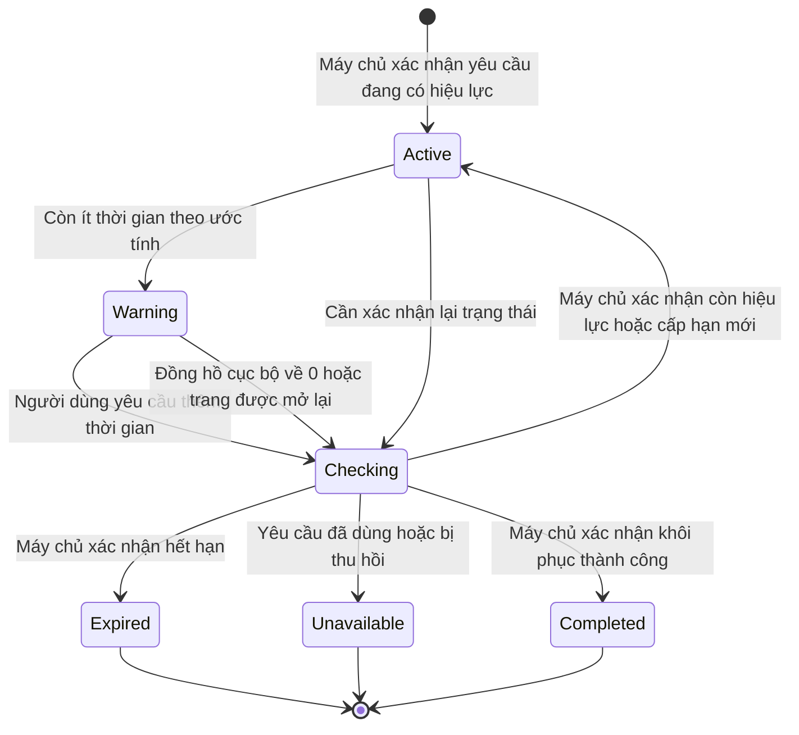

# Timeout announcement — Thông báo giới hạn thời gian khi khôi phục tài khoản

## 1. Thông báo hết hạn phải giúp người dùng tiếp tục được công việc

Khi quên mật khẩu hoặc mất MFA, passkey hay thiết bị xác thực, người dùng thường phải chuyển qua email, ứng dụng nhắn tin, kho mã dự phòng hoặc một thiết bị khác. Với người dùng trình đọc màn hình, bàn phím, công cụ điều khiển bằng công tắc hoặc công cụ hỗ trợ nhập liệu, mỗi lần chuyển ngữ cảnh có thể cần thêm thời gian.

**Timeout announcement** là cách giao diện thông báo một giới hạn thời gian đang áp dụng, cảnh báo trước khi giới hạn đó kết thúc và giải thích hành động có thể thực hiện sau đó. Một đồng hồ chuyển sang màu đỏ chưa đủ: người không nhìn thấy màn hình phải nhận được thông tin tương đương, còn người đang đọc hướng dẫn phải có cơ hội xử lý cảnh báo.

Trong khôi phục tài khoản, thông báo tốt cần trả lời bốn câu hỏi:

1. Điều gì sắp hết hạn: mã xác minh, đường dẫn, bước xác minh hay phiên khôi phục?
2. Người dùng còn khoảng bao lâu để hành động?
3. Họ có thể xin thêm thời gian, yêu cầu mã mới hoặc chuyển sang phương thức nào?
4. Nếu hết hạn, phần công việc nào cần làm lại và thông tin nào còn được giữ?

Mục tiêu là tạo đủ thời gian và hướng dẫn rõ ràng trong khi vẫn giữ nguyên yêu cầu xác minh danh tính, giới hạn chống lạm dụng và kiểm soát phiên của hệ thống.

## 2. Phân biệt các loại thời hạn trước khi viết thông báo

Các đồng hồ khác nhau có ý nghĩa khác nhau. Nhãn chung chung như “Phiên sắp hết hạn” dễ khiến người dùng hiểu sai rằng toàn bộ tài khoản hoặc phiên đăng nhập đang bị đóng.

| Giới hạn | Ý nghĩa | Thông báo phù hợp | Hành vi cần kiểm soát |
|---|---|---|---|
| Thời hạn mã xác minh | Mã chỉ được chấp nhận trong một khoảng thời gian | “Mã xác minh còn hiệu lực khoảng 2 phút.” | Máy chủ kiểm tra hạn và số lần thử khi nhận mã |
| Thời hạn đường dẫn khôi phục | Đường dẫn chỉ có thể bắt đầu hoặc tiếp tục một hành động nhất định trong hạn | “Đường dẫn này đã hết hạn. Bạn có thể bắt đầu yêu cầu mới.” | Không phục hồi hiệu lực của token bằng thao tác giao diện |
| Giới hạn không hoạt động | Phiên khôi phục kết thúc nếu không có hoạt động được hệ thống công nhận | “Nếu không tiếp tục thao tác trong 5 phút, bạn cần xác minh lại.” | Xác định rõ hoạt động nào được tính; polling không tự giữ phiên |
| Giới hạn tuyệt đối của phiên khôi phục | Yêu cầu kết thúc tại một mốc dù vẫn có thao tác | “Yêu cầu khôi phục này sẽ kết thúc lúc 14:30, giờ Việt Nam.” | Hoạt động hoặc yêu cầu gia hạn không được vượt chính sách |
| Thời gian chờ gửi lại | Người dùng phải đợi trước khi yêu cầu một lần gửi nữa | “Bạn có thể yêu cầu gửi lại sau 30 giây.” | Chờ gửi lại không có nghĩa là mã hiện tại đã hết hạn |
| Thời gian chờ xét duyệt hoặc bảo vệ | Bước kiểm tra rủi ro chưa cho phép tiếp tục | “Bạn có thể kiểm tra kết quả sau thời điểm được thông báo.” | Không diễn đạt thành hạn chót buộc người dùng thao tác gấp |

Các thời lượng trong bài chỉ minh họa thiết kế. Thời lượng thực tế cần được xác định theo loại yếu tố xác thực, rủi ro tài khoản và khả năng hoàn thành của người dùng.

Nếu cùng tồn tại nhiều giới hạn, giao diện phải cho biết giới hạn đang tác động trực tiếp đến hành động. Ví dụ: mã còn 4 phút nhưng phiên khôi phục chỉ còn 1 phút thì chỉ hiển thị “Mã còn 4 phút” sẽ gây hiểu nhầm. Máy chủ có thể trả về thời hạn hữu hiệu của bước cùng lý do phù hợp để giao diện giải thích.

Với passkey hoặc MFA, còn có thể tồn tại thời hạn của một challenge riêng. Phiên khôi phục vẫn đang mở không đồng nghĩa challenge cũ còn hợp lệ. Sau khi tạo challenge mới, hướng dẫn phải gắn với challenge mới và tránh khiến người dùng tiếp tục thao tác trên yêu cầu cũ.

## 3. Hiểu yêu cầu tiếp cận mà không nới lỏng xác minh

### 3.1. Cảnh báo là một phần của việc cung cấp đủ thời gian

WCAG 2.2, tiêu chí **2.2.1 Timing Adjustable, mức A**, yêu cầu ít nhất một phương án phù hợp cho giới hạn thời gian do nội dung đặt ra: tắt giới hạn, điều chỉnh trước khi gặp giới hạn với phạm vi tối thiểu gấp 10 lần mặc định, hoặc cho gia hạn. Nếu dùng phương án gia hạn, cần cảnh báo trước, cho ít nhất 20 giây để thực hiện một hành động đơn giản và cho gia hạn ít nhất 10 lần. Tiêu chí có các ngoại lệ, gồm giới hạn thiết yếu, sự kiện thời gian thực và giới hạn dài hơn 20 giờ. Một số mã xác thực có thời hạn có thể thuộc ngoại lệ thiết yếu; việc gắn nhãn “vì bảo mật” tự nó chưa chứng minh ngoại lệ. [W3C: Timing Adjustable](https://www.w3.org/WAI/WCAG22/Understanding/timing-adjustable.html)

Vì vậy, cần đánh giá riêng từng đồng hồ của luồng khôi phục. Thời hạn thiết yếu của mã không tự động giải thích được một giới hạn rất ngắn cho trang đọc hướng dẫn. Nếu sản phẩm chọn phương án gia hạn để đáp ứng tiêu chí, một lần cộng thêm thời gian duy nhất không tự động đủ.

Mốc cảnh báo 20 giây cũng không nên được biến thành mục tiêu thiết kế chung. Thời gian đọc thông báo, tìm nút, điều khiển bằng bàn phím và chờ phản hồi mạng đều ảnh hưởng đến khả năng hành động. Nhóm thiết kế nên chọn mốc sớm hơn khi thao tác có nhiều bước.

### 3.2. Thông báo phải được xác định bằng chương trình

WCAG **4.1.3 Status Messages, mức AA**, đề cập việc các thông báo trạng thái xuất hiện mà không đổi ngữ cảnh vẫn được công nghệ hỗ trợ nhận biết qua vai trò hoặc thuộc tính phù hợp. Điều đó không có nghĩa mọi thay đổi của bộ đếm đều phải được đọc thành tiếng. [W3C: Status Messages](https://www.w3.org/WAI/WCAG22/Understanding/status-messages.html)

WCAG **2.2.6 Timeouts, mức AAA**, tập trung vào việc cảnh báo khoảng không hoạt động có thể gây mất dữ liệu, trừ khi dữ liệu được giữ hơn 20 giờ khi người dùng không thao tác. Đây không phải yêu cầu giữ token khôi phục có hiệu lực hơn 20 giờ. [W3C: Timeouts](https://www.w3.org/WAI/WCAG22/Understanding/timeouts.html)

Một triển khai có thuộc tính ARIA đúng vẫn cần được kiểm tra với trình đọc màn hình và thao tác thực tế. Thuộc tính trên DOM không chứng minh người dùng đã nghe, hiểu và kịp sử dụng hành động được cung cấp.

## 4. Thiết kế chuỗi thông báo theo trạng thái

Một luồng dễ theo dõi có thể dùng các trạng thái sau:



`Checking` thể hiện một khoảng chưa có kết luận. Lỗi mạng trong trạng thái này không được diễn đạt thành “Mã đã hết hạn” và cũng không cho phép tiếp tục như thể xác minh đã thành công. Khi mạng trở lại, giao diện đối chiếu với máy chủ.

### 4.1. Khi bắt đầu

Giải thích thời hạn trước khi người dùng đầu tư công sức:

> Mã xác minh có hiệu lực trong khoảng 5 phút kể từ khi được tạo. Nếu cần mã mới, chọn “Yêu cầu gửi lại”. Hệ thống sẽ cho biết mã nào còn sử dụng được.

Thông báo tĩnh này nằm trong thứ tự đọc bình thường của trang. Không dựa vào một live region có sẵn nội dung lúc tải trang làm cách duy nhất cung cấp thông tin ban đầu.

Đối với giới hạn không hoạt động, phải nói rõ đó là thời gian **không thao tác**, thay vì khiến người dùng hiểu họ chỉ có từng ấy thời gian cho toàn bộ quá trình.

### 4.2. Khi sắp hết hạn

Một chính sách minh họa có thể cảnh báo ở các mốc 2 phút, 1 phút và một mốc khẩn cấp còn 20 giây. Không có yêu cầu phải dùng đúng ba mốc này. Với một bước chỉ dài 1 phút, cần thiết kế lại mốc cảnh báo cho phù hợp.

| Tình huống | Nội dung minh họa | Hành động đi kèm |
|---|---|---|
| Phiên được phép gia hạn | “Bước xác minh còn khoảng 1 phút. Chọn ‘Tôi cần thêm thời gian’ nếu bạn muốn tiếp tục.” | Nút gia hạn đã sẵn sàng và dùng được bằng bàn phím |
| Mã có hạn cố định | “Mã hiện tại còn khoảng 1 phút. Nếu mã hết hạn, bạn có thể yêu cầu mã mới.” | Hướng dẫn rõ cách lấy mã mới theo chính sách |
| Phiên sắp kết thúc và không được gia hạn | “Yêu cầu khôi phục còn khoảng 1 phút. Sau đó bạn cần bắt đầu yêu cầu mới.” | Đường dẫn bắt đầu lại và thông tin về dữ liệu được giữ |
| Chưa xác nhận được hạn | “Chưa thể cập nhật thời gian còn lại. Hãy kiểm tra kết nối và thử lại.” | Thao tác thử kết nối lại, không kết luận hết hạn |

Mỗi thông báo phải nói trọn ý. Chỉ đọc “20” hoặc “Còn một chút” không cho biết đối tượng và hành động cần thiết.

### 4.3. Khi hết hạn

Khi máy chủ xác nhận hết hạn, thông báo cần tồn tại đủ lâu để người dùng đọc lại:

> Mã xác minh đã hết hạn. Chọn “Yêu cầu mã mới” để tiếp tục. Bạn sẽ cần nhập mã mới được gửi đến kênh khôi phục đã chọn.

Nếu mất toàn bộ quyền tiếp tục phiên:

> Phiên khôi phục đã kết thúc. Bạn cần bắt đầu yêu cầu mới và xác minh lại. Mật khẩu hoặc phương thức xác thực của tài khoản chưa được thay đổi bởi bước này.

Câu cuối chỉ dùng khi máy chủ đã xác nhận đúng trạng thái nghiệp vụ đó. Nếu phản hồi của một lần gửi biểu mẫu bị mất, giao diện chưa thể biết thay đổi đã xảy ra hay chưa; cần kiểm tra kết quả trước khi phát thông báo khẳng định.

Không tự chuyển trang ngay khi đồng hồ chạm 0. Giữ thông báo, đưa ra hành động rõ ràng và xử lý chuyển trang theo lựa chọn của người dùng hoặc một luồng đã được thông báo trước.

## 5. Dùng live region, cảnh báo và focus đúng vai trò

### 5.1. Tách đồng hồ nhìn thấy khỏi kênh đọc thông báo

Đồng hồ có thể cập nhật mỗi giây để người nhìn thấy màn hình ước lượng thời gian, trong khi kênh đọc chỉ cập nhật khi có thay đổi đáng chú ý.

```html
<section aria-labelledby="recovery-title" lang="vi">
  <h2 id="recovery-title">Xác minh yêu cầu khôi phục</h2>

  <p id="timeout-help">
    Thời gian hiển thị là ước tính. Hệ thống xác nhận hiệu lực
    khi bạn tiếp tục. Gia hạn chỉ khả dụng khi yêu cầu được cho phép.
  </p>

  <p>
    Thời gian ước tính còn lại:
    <span id="recovery-timer" role="timer" aria-live="off">--:--</span>
  </p>

  <p id="timeout-status" role="status" aria-atomic="true"></p>
  <p id="timeout-alert" role="alert" aria-atomic="true"></p>

  <button id="extend-time" type="button"
          aria-describedby="timeout-help" disabled>
    Tôi cần thêm thời gian
  </button>
  <button id="restart-recovery" type="button" disabled>
    Bắt đầu yêu cầu mới
  </button>
</section>
```

`role="status"` phù hợp với cập nhật thông thường; `role="alert"` dành cho thông tin khẩn cần được chú ý ngay. Không đặt cả hai vai trò lên cùng thông báo và không sao chép cùng câu vào nhiều vùng đọc. Đồng hồ vẫn có thể được người dùng trình đọc màn hình tìm đến để đọc theo nhu cầu.

Vùng thông báo động nên có sẵn trước khi nội dung được cập nhật. Cảnh báo phải hiện bằng chữ và không phụ thuộc riêng vào màu sắc, âm thanh hay rung. Một thông báo khẩn không nên tự biến mất sau vài giây. [W3C APG: Alert Pattern](https://www.w3.org/WAI/ARIA/apg/patterns/alert/)

Nếu người dùng tắt hoặc giảm thông báo âm thanh, thông tin nhìn thấy và hành động vẫn phải hoạt động. Không dùng hiệu ứng nhấp nháy hoặc chuyển động để tạo cảm giác khẩn cấp.

### 5.2. Giữ focus ổn định

Cảnh báo thông thường không cần lấy focus khỏi ô nhập mã. Người dùng có thể đang ở ký tự cuối, đang nghe nhãn của một trường hoặc đang dùng lệnh điều hướng của trình đọc màn hình. Việc chuyển focus bất ngờ có thể làm họ mất vị trí và mất thêm thời gian.

Nếu thiết kế thực sự cần một hộp thoại yêu cầu quyết định, phải triển khai đầy đủ hành vi bàn phím và quản lý focus cho hộp thoại. Không chỉ thêm `role="alertdialog"` vào một khối chữ. Nút gia hạn cần có tên rõ ràng; thao tác đóng hộp thoại không tự động được hiểu là đồng ý gia hạn.

Sau khi người dùng chủ động bắt đầu một yêu cầu mới và giao diện đổi sang bước khác, có thể chuyển focus đến tiêu đề hoặc trường đầu tiên phù hợp. Đây là thay đổi ngữ cảnh có chủ đích, khác với tự cướp focus ở mỗi mốc thời gian.

## 6. Minh họa lớp hiển thị không đọc lại mỗi giây

Ví dụ sau chỉ minh họa cách trình bày trạng thái và chống lặp thông báo. Nó không xác thực token, không gọi API gia hạn và không thay thế xử lý phiên trên máy chủ.

Lớp điều phối cung cấp `state`, số giây ước tính còn lại, quyền hiển thị hành động và `windowVersion`. `windowVersion` là định danh phiên bản cửa sổ thời gian do máy chủ cấp hoặc được ánh xạ từ phản hồi máy chủ; nó không phải mã bí mật và không có quyền xác thực.

```javascript
const timer = document.querySelector('#recovery-timer');
const statusRegion = document.querySelector('#timeout-status');
const alertRegion = document.querySelector('#timeout-alert');
const extendButton = document.querySelector('#extend-time');
const restartButton = document.querySelector('#restart-recovery');

let currentVersion;
let lastMessageKey = '';
const announcedBands = new Set();

function announce(key, message, urgent = false) {
  if (key === lastMessageKey) return;
  statusRegion.textContent = urgent ? '' : message;
  alertRegion.textContent = urgent ? message : '';
  lastMessageKey = key;
}

function renderTimeout(model) {
  if (model.windowVersion !== currentVersion) {
    currentVersion = model.windowVersion;
    announcedBands.clear();
    lastMessageKey = '';
  }

  let state = model.state;
  const seconds = model.remainingSeconds;
  if (state === 'ACTIVE'
      && (!Number.isFinite(seconds) || seconds <= 0)) {
    // Đồng hồ cục bộ không có quyền kết luận EXPIRED.
    state = 'CHECKING';
  }

  const active = state === 'ACTIVE';
  extendButton.disabled = !(active && model.canExtend);
  restartButton.disabled = !model.canRestart;

  if (!active) {
    timer.textContent = '--:--';
    const messages = {
      CHECKING: 'Đang xác nhận trạng thái. Hãy giữ trang này mở.',
      UNKNOWN: 'Chưa xác nhận được trạng thái. Hãy kiểm tra kết nối.',
      EXPIRED: 'Yêu cầu đã hết hạn. Bạn cần bắt đầu yêu cầu mới.',
      CONSUMED: 'Yêu cầu này không còn dùng được. Hãy kiểm tra kết quả.',
      REVOKED: 'Yêu cầu này không còn dùng được. Hãy xem hướng dẫn tiếp tục.',
      COMPLETED: 'Bước khôi phục đã hoàn tất.'
    };
    announce(
      state,
      messages[state] ?? messages.UNKNOWN,
      ['EXPIRED', 'CONSUMED', 'REVOKED'].includes(state)
    );
    return;
  }

  const rounded = Math.ceil(seconds);
  const minutes = Math.floor(rounded / 60);
  const remainder = String(rounded % 60).padStart(2, '0');
  timer.textContent = `${minutes}:${remainder}`;

  // Khi quay lại từ tab nền, chỉ chọn mốc đang phù hợp nhất.
  const band = seconds <= 20 ? 20
    : seconds <= 60 ? 60
    : seconds <= 120 ? 120
    : null;

  if (band === null) {
    announce('ACTIVE', 'Yêu cầu đang có hiệu lực. Bạn có thể tiếp tục xác minh.');
    return;
  }

  if (announcedBands.has(band)) return;
  announcedBands.add(band);
  const action = model.canExtend
    ? 'Chọn “Tôi cần thêm thời gian” nếu cần.'
    : 'Nếu yêu cầu hết hạn, hãy làm theo hướng dẫn để tiếp tục.';
  announce(
    `WARNING-${band}`,
    `Yêu cầu còn khoảng ${Math.ceil(seconds)} giây. ${action}`,
    band === 20
  );
}
```

Lớp gọi hàm cần thực hiện các phần còn lại:

- Lấy trạng thái từ API của đúng yêu cầu khôi phục; bỏ phản hồi cũ đến muộn bằng phiên bản hoặc số thứ tự tương ứng.
- Tính số giây còn lại từ mốc máy chủ và thời gian trôi qua, thay vì trừ một giây sau mỗi callback.
- Khi ước tính về 0, xác nhận trạng thái hoặc xử lý kết quả của thao tác đang gửi; chỉ dùng `EXPIRED` sau kết luận của máy chủ.
- Khi mất kết nối hoặc quá thời gian chờ API, chuyển sang `UNKNOWN` với hành động thử lại phù hợp.
- Sau khi máy chủ chấp nhận gia hạn, cung cấp cửa sổ thời gian mới và thông báo “Đã thêm thời gian” nếu phù hợp; không đổi phiên bản chỉ vì render lại trang.
- Gắn sự kiện cho hai nút, hiển thị tiến trình khi đang gửi và ngăn gửi trùng. Không diễn giải `canExtend` phía trình duyệt thành quyền được gia hạn ở máy chủ.
- Dừng bộ lập lịch, hủy yêu cầu mạng không còn cần thiết và gỡ listener khi rời bước hoặc hoàn tất.

Ví dụ dùng một bộ thông báo cho **thời hạn hữu hiệu của yêu cầu**. Nếu sản phẩm có đồng hồ riêng cho mã và phiên, mỗi thông báo cần tên đối tượng rõ ràng và một cơ chế điều phối để tránh hai cảnh báo nói chồng lên nhau.

## 7. Thời gian máy chủ và các tình huống trình duyệt thực tế

### 7.1. Không dùng số lần callback làm đồng hồ

`setInterval` là lịch yêu cầu chạy mã, không phải bằng chứng rằng đúng một giây đã trôi qua. Trình duyệt có thể làm chậm tab nền, thiết bị có thể ngủ và người dùng có thể đổi giờ hệ thống.

Một phản hồi mô tả thời gian có thể có dạng:

```json
{
  "state": "ACTIVE",
  "serverNow": "2026-11-24T07:00:00Z",
  "effectiveExpiresAt": "2026-11-24T07:05:00Z",
  "windowVersion": "window-3",
  "canExtend": false,
  "canRestart": true
}
```

Các trường này phục vụ hiển thị. Token, mã xác minh và dữ liệu chứng minh danh tính không cần xuất hiện trong phản hồi thời gian.

Trong lúc trang hoạt động, có thể ước tính:

```text
ngân_sách_ban_đầu = effectiveExpiresAt - serverNow
thời_gian_còn_lại ≈ ngân_sách_ban_đầu - thời_gian_đã_trôi_qua
```

Cần tính đến độ trễ truyền phản hồi. Nếu bắt đầu đo lúc gửi yêu cầu, trừ cả thời gian khứ hồi là một cách ước tính bảo thủ, nhưng có thể khiến giao diện báo còn ít thời gian hơn thực tế. Nếu bắt đầu đo lúc nhận phản hồi mà không bù độ trễ, giao diện có thể báo còn nhiều thời gian hơn thực tế. Cả hai đều không được trở thành cơ sở chấp nhận hay từ chối token.

Đồng hồ đơn điệu như `performance.now()` giúp đo thời gian trôi qua khi trang đang chạy, nhưng vẫn cần đối chiếu lại với máy chủ khi thiết bị thức dậy hoặc trang được khôi phục. Không giả định bộ đếm trên mọi hệ điều hành đều xử lý trạng thái ngủ giống nhau.

### 7.2. Tab nền, nhiều tab và phản hồi đến muộn

Khi trang quay lại từ nền, không phát lần lượt tất cả cảnh báo đã bỏ lỡ. Nếu trạng thái hiện tại chỉ còn vài giây, phát một thông báo phù hợp với hiện tại, rồi xác nhận trạng thái nếu cần.

Khi người dùng mở nhiều tab, tab A có thể hoàn tất khôi phục trong lúc tab B vẫn hiện đồng hồ. Tab B phải chấp nhận kết luận rằng yêu cầu đã dùng hoặc đã thu hồi khi liên hệ lại máy chủ. Đồng bộ giữa các tab có thể giúp cập nhật giao diện sớm hơn, nhưng không thay thế kiểm tra phía máy chủ và không nên truyền mã bí mật qua kênh đồng bộ giao diện.

Giả sử phản hồi gia hạn mới đã về, sau đó một phản hồi kiểm tra trạng thái cũ mới đến. Nếu giao diện áp dụng theo thứ tự nhận mà không xét phiên bản, hạn mới có thể bị ghi đè bởi hạn cũ. Cần ràng buộc phản hồi với đúng yêu cầu, đúng phiên bản và trạng thái hiện hành. Một phản hồi `ACTIVE` cũ cũng không được mở lại yêu cầu đã hoàn tất.

### 7.3. Thao tác gửi xảy ra sát hạn

Người dùng có thể nhấn “Xác minh” trước khi đồng hồ về 0 nhưng yêu cầu đến máy chủ sau hạn. Chính sách phải xác định mốc quyết định và xử lý nhất quán ở máy chủ; giao diện không tự công nhận thời điểm bấm nút là bằng chứng.

Ngược lại, máy chủ có thể đã xử lý thành công nhưng phản hồi về chậm. Không để callback đếm giờ ghi đè kết quả thành công bằng thông báo hết hạn. Kết quả nghiệp vụ đã được máy chủ xác nhận phải được phản ánh nhất quán trong giao diện.

## 8. Gia hạn phiên, cấp mã mới và xác minh lại là các hành động khác nhau

### 8.1. Gia hạn phiên khôi phục

Nếu chính sách cho phép gia hạn, nút “Tôi cần thêm thời gian” gửi một yêu cầu rõ ràng tới máy chủ. Máy chủ cần xét lại trạng thái, giới hạn tuyệt đối, số lần gia hạn và điều kiện rủi ro. Thời hạn chỉ thay đổi sau khi máy chủ chấp nhận.

Không gia hạn vì một screen reader vừa đọc cảnh báo, vì bộ đếm render lại hoặc vì một request polling chạy nền. Những sự kiện đó không chứng minh người dùng đang tiếp tục xác minh.

Một yêu cầu gia hạn cũng không có quyền bỏ qua bước chứng minh danh tính. Kẻ tấn công có thể giữ giao diện mở hoặc tự gọi endpoint; quyền tiếp tục luồng phải được kiểm tra ở máy chủ cho từng hành động.

### 8.2. Cấp mã mới

Yêu cầu mã mới tạo một tình huống khác với kéo dài phiên. Hệ thống phải xác định rõ mã cũ còn hiệu lực hay bị thay thế, đồng thời thông báo chính sách đó khi phù hợp. Không âm thầm đặt lại đồng hồ của mã cũ và khiến người dùng nghĩ mã đó đã được gia hạn.

Nếu chính sách là chỉ mã mới nhất được dùng, có thể thông báo sau khi việc cấp mã được xác nhận:

> Bạn đã yêu cầu mã mới. Khi nhận được, hãy dùng mã mới nhất; mã trước đó không còn sử dụng được.

Chỉ dùng câu này khi đúng hành vi thực tế. Phản hồi “đã tiếp nhận yêu cầu gửi” cũng không đồng nghĩa email hoặc SMS đã được chuyển đến thiết bị người dùng.

OWASP khuyến nghị mã hoặc token đặt lại mật khẩu có tính ngẫu nhiên phù hợp, được bảo vệ, chỉ dùng một lần và hết hạn sau khoảng thích hợp; yêu cầu khôi phục cũng cần chống gửi lặp và tránh tiết lộ sự tồn tại của tài khoản. Các nguyên tắc này vẫn áp dụng khi cung cấp hành động tiếp cận như xin mã mới. [OWASP: Forgot Password Cheat Sheet](https://cheatsheetseries.owasp.org/cheatsheets/Forgot_Password_Cheat_Sheet.html)

### 8.3. Xác minh lại hoặc chuyển phương thức

Khi mất thiết bị MFA hoặc passkey, người dùng có thể cần một đường khôi phục khác đã được thiết kế và đánh giá rủi ro. Thông báo hết hạn nên dẫn đến đường đó khi thích hợp, thay vì lặp vô hạn thao tác với thiết bị đã mất.

Việc cung cấp thêm thời gian không thay cho bằng chứng danh tính. Không biến lựa chọn “Tôi cần thêm thời gian” thành quyền tắt MFA, đổi địa chỉ khôi phục hoặc đăng ký passkey mới ngay lập tức. Nếu cần hỗ trợ thủ công, quy trình đó vẫn phải có yêu cầu chứng minh và kiểm soát hành động rõ ràng.

## 9. Giữ ngữ cảnh vừa đủ và tránh rò rỉ qua thông báo

Người dùng không nên phải đọc lại toàn bộ hướng dẫn chỉ vì mã hết hạn. Có thể giữ lại lựa chọn ngôn ngữ, bước hướng dẫn đang xem hoặc loại phương thức họ đã chọn nếu các dữ liệu đó phù hợp với chính sách của sản phẩm.

Không dùng yêu cầu tránh mất dữ liệu làm lý do lưu mật khẩu mới, mã OTP, mã dự phòng hoặc token vào `localStorage`, bản nháp phân tích hành vi hay log. Việc giữ ngữ cảnh không có nghĩa giữ hiệu lực của bằng chứng xác minh đã hết hạn. Với trường chứa bí mật, cần chính sách xóa phù hợp khi rời bước, hết hạn hoặc hoàn tất.

Trước khi chứng minh quyền kiểm soát kênh, các biến thể thông báo và API thời gian cũng có thể trở thành kênh dò tài khoản. Ví dụ, trả thời hạn thật cho email có tài khoản nhưng trả lỗi ngay cho email khác sẽ làm lộ khác biệt dù nội dung trên màn hình giống nhau.

Vì vậy, thông báo cho bước yêu cầu ban đầu nên nhất quán, chẳng hạn:

> Nếu thông tin phù hợp, hướng dẫn khôi phục sẽ được gửi qua kênh đã đăng ký. Bạn có thể yêu cầu lại sau khoảng thời gian được hiển thị.

Chỉ hiển thị trạng thái chi tiết hơn khi ngữ cảnh khôi phục cho phép. Không đưa nguyên địa chỉ email, số điện thoại, mã xác minh hay token vào live region nếu không cần thiết. Nội dung được đọc thành tiếng có thể bị người xung quanh nghe thấy.

Thời gian cũng cần được bản địa hóa rõ ràng: “2 phút” dễ hiểu hơn “120000 ms”. Với một mốc tuyệt đối, hiển thị múi giờ; với một giới hạn không hoạt động, nói rõ điều kiện không thao tác. Tránh viết tắt gây khó đọc cho trình đọc màn hình.

## 10. Các tình huống cần kiểm chứng khi triển khai

Bảng sau mô tả tình huống kiểm thử cho một sản phẩm triển khai bài học, không phải tuyên bố một giao diện cụ thể đã đạt chuẩn.

| Tình huống | Kết quả cần quan sát |
|---|---|
| Chỉ dùng bàn phím | Tìm và kích hoạt được hành động gia hạn hoặc bắt đầu lại; cảnh báo không làm mất vị trí nhập |
| Dùng trình đọc màn hình khi nhập mã | Nghe được cảnh báo đủ ngữ cảnh; không nghe bộ đếm đọc mỗi giây |
| Trang đã có thông tin thời hạn lúc tải | Có thể tìm thông tin trong thứ tự đọc thông thường, không phụ thuộc thông báo động |
| Cảnh báo đến khi đang nghe hướng dẫn | Có thể tiếp tục hoặc đọc lại hướng dẫn; mức khẩn cấp không bị dùng quá thường xuyên |
| Phóng to hoặc xem trên màn hình nhỏ | Thông báo và nút không che trường nhập hoặc nằm ngoài vùng có thể tiếp cận |
| Tab bị đưa xuống nền rồi mở lại | Hiển thị trạng thái hiện tại; không phát chuỗi cảnh báo cũ |
| Người dùng đổi giờ máy | Máy chủ vẫn quyết định hạn; giao diện có cách đối chiếu lại |
| Mất mạng khi xin thêm thời gian | Không thông báo gia hạn thành công khi chưa có xác nhận; có cách kiểm tra lại |
| Hai lần nhấn hoặc phản hồi đến đảo thứ tự | Không nhân đôi hành động; phản hồi cũ không ghi đè hạn mới |
| Mã được gửi sát hạn | Thông báo phản ánh kết quả xử lý thực tế, không suy từ lúc bấm nút |
| Khôi phục đã hoàn tất ở tab khác | Tab còn lại không cho tái sử dụng yêu cầu và có thông báo tiếp tục phù hợp |
| Yêu cầu mã mới bị giới hạn | Giải thích thời gian chờ gửi lại mà không nhầm với thời hạn mã |
| Phiên hết hạn khi đang nhập | Thông báo ổn định, nói rõ bước làm lại và xử lý trường bí mật theo chính sách |
| Tên tài khoản không tồn tại | Thông báo, hành vi API và thông tin thời gian không vô tình tiết lộ khác biệt |

Kiểm thử tự động có thể kiểm tra trạng thái, phiên bản và số lần cập nhật live region. Cần bổ sung kiểm thử thực tế trên các tổ hợp trình đọc màn hình, trình duyệt và thiết bị được hỗ trợ; kiểm tra DOM riêng lẻ không xác nhận được toàn bộ trải nghiệm đọc.

Nếu đo hiệu quả, có thể theo dõi số lần hết hạn, số lần bắt đầu lại, tỷ lệ xin thêm thời gian và thời gian hoàn thành theo bước. Không ghi bí mật vào telemetry và không suy đoán người dùng có khuyết tật chỉ từ hành vi dùng giao diện.

## 11. Những lỗi thiết kế thường gặp

- **Chỉ đổi màu hoặc dùng biểu tượng đồng hồ:** thiếu thông tin bằng chữ và thiếu thông báo tương đương cho công nghệ hỗ trợ.
- **Đặt toàn bộ bộ đếm trong vùng đọc khẩn:** liên tục ngắt hướng dẫn và thao tác nhập.
- **Mở hộp thoại ở mọi mốc:** tăng số bước thao tác, làm người dùng mất vị trí và tiêu tốn thời gian còn lại.
- **Nói “đã gia hạn” ngay sau khi nhấn nút:** giao diện đưa ra kết luận trước máy chủ, dễ sai khi lỗi mạng hoặc bị từ chối.
- **Tự cấp mã mới để tránh hết hạn:** có thể gây gửi dồn, thay mã người dùng đang nhập và làm khó kiểm soát lạm dụng.
- **Cho mọi thao tác nền giữ phiên sống:** khiến giới hạn không hoạt động mất ý nghĩa và kéo dài cửa sổ tấn công.
- **Dùng hết hạn cục bộ để kết luận thất bại nghiệp vụ:** có thể che khuất một thay đổi đã được máy chủ thực hiện thành công.
- **Đưa người dùng về đầu luồng mà không giải thích:** làm mất ngữ cảnh và gây lặp lại thao tác với phương thức xác thực đã mất.

Thiết kế thông báo hết hạn cần nối được ba phần: người dùng hiểu điều gì đang xảy ra, giao diện cung cấp hành động có thể tiếp cận và máy chủ thực thi đúng thời hạn cùng điều kiện xác minh. Khi ba phần này thống nhất, người dùng có thêm cơ hội hoàn thành khôi phục mà không làm yếu quyền kiểm soát tài khoản.
