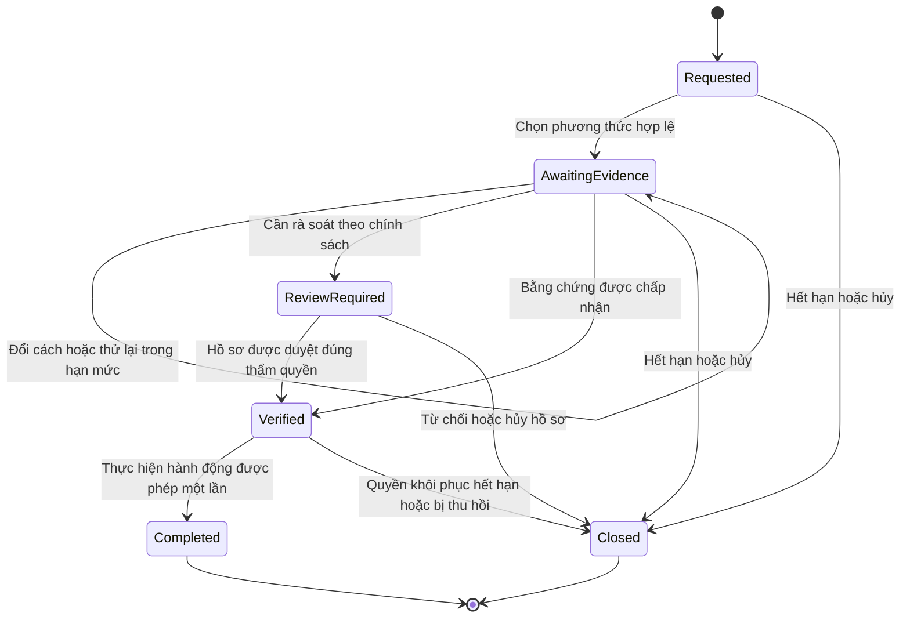

# Alternative verification method — Phương thức xác minh thay thế

## 1. Vì sao khôi phục tài khoản cần nhiều con đường xác minh?

Trong module `SECURITY_AUTHENTICATION_ACCOUNT_RECOVERY`, khôi phục tài khoản là quá trình giúp đúng chủ tài khoản lấy lại khả năng truy cập khi mất mật khẩu, MFA, passkey hoặc thiết bị xác thực. Một luồng chỉ hoạt động với một loại giác quan, một thiết bị hay một thao tác nhập liệu có thể khiến người dùng hợp lệ bị mắc kẹt.

Ví dụ, người khiếm thị có thể không sử dụng được bước chụp ảnh theo hướng dẫn chỉ xuất hiện trên màn hình. Người khiếm thính không thể hoàn tất cuộc gọi chỉ đọc mã bằng giọng nói. Người bị hạn chế vận động có thể gặp khó khăn với thao tác nhập sáu ô riêng lẻ trong thời gian ngắn. Người mất điện thoại có thể đồng thời mất ứng dụng tạo mã, SIM và passkey lưu trên thiết bị đó.

**Phương thức xác minh thay thế** là một con đường khác, được chính sách khôi phục chấp nhận, để chứng minh quyền kiểm soát tài khoản trong tình huống phương thức ban đầu không dùng được. Con đường này phải vừa khả dụng với người dùng, vừa cung cấp đủ bằng chứng cho hành động đang yêu cầu.

Mục tiêu không phải cung cấp thật nhiều nút dự phòng. Mục tiêu là tạo các đường khôi phục có thể hoàn tất, với yêu cầu bằng chứng và quyền cấp ra được thiết kế rõ ràng. Nếu một nút “Tôi không dùng được cách này” dẫn thẳng tới đặt lại MFA mà không cần bằng chứng phù hợp, nó trở thành đường chiếm đoạt tài khoản.

Sau bài này, người học cần có khả năng phân biệt thay đổi cách tương tác với thay đổi bằng chứng xác minh; chọn phương thức thay thế theo rủi ro và khả năng tiếp cận; thiết kế token, trạng thái và quyền khôi phục; xử lý xác minh có nhân viên hỗ trợ; và kiểm thử cả trải nghiệm lẫn các đường lạm dụng.

## 2. Phân biệt hỗ trợ tương tác và thay thế bằng chứng

Hai nhu cầu thường bị gộp thành một, nhưng có tác động bảo mật khác nhau.

| Nhu cầu | Ví dụ | Bằng chứng có thay đổi không? | Cách xử lý |
| --- | --- | --- | --- |
| Thay cách nhập cùng một bằng chứng | Cho dán mã dự phòng, nhập bằng bàn phím hoặc công nghệ hỗ trợ | Không | Giữ nguyên quy tắc kiểm tra và giới hạn thử mã |
| Thay cách trình bày | Đọc hướng dẫn bằng trình đọc màn hình, phóng to chữ | Không | Cung cấp cấu trúc nội dung và trạng thái tương đương |
| Thay phương thức chứng minh | Dùng khóa bảo mật đã đăng ký thay vì ứng dụng tạo OTP bị mất | Có | Đánh giá phương thức mới theo chính sách và hành động |
| Chuyển sang xử lý có hỗ trợ | Người dùng không còn phương thức tự phục vụ khả dụng | Có thể có | Mở hồ sơ xử lý, xác định bằng chứng và thẩm quyền riêng |

Việc cho phép dán một mã hợp lệ không làm mã đó bớt ngẫu nhiên hay mất tính dùng một lần. Ngược lại, thay mã dự phòng bằng ngày sinh là thay đổi hẳn chất lượng bằng chứng: ngày sinh có thể đã công khai hoặc bị lộ.

Không nên yêu cầu người dùng khai báo chẩn đoán, xuất trình giấy chứng nhận khuyết tật hoặc giải thích tình trạng sức khỏe để được dùng một giao diện dễ tiếp cận. Những thông tin đó không chứng minh quyền sở hữu tài khoản. Đồng thời, lời khai “tôi cần hỗ trợ tiếp cận” cũng không phải căn cứ bỏ qua xác minh.

Một nguyên tắc hữu ích là: **khả năng tiếp cận quyết định cách người dùng tương tác; chính sách bằng chứng quyết định quyền hệ thống có thể cấp**.

## 3. Chọn phương thức dựa trên thứ người dùng thực sự còn giữ

Không thể thiết kế phương thức thay thế chỉ bằng tên kênh “email”, “SMS” hay “hỗ trợ”. Cần xác định kênh được thiết lập lúc nào, còn đáng tin cậy không, có phụ thuộc vào yếu tố bị mất hay bị nghi xâm phạm không, và đủ cho hành động nào.

| Phương thức | Điều kiện cần xem xét | Lợi ích tiếp cận có thể có | Giới hạn bảo mật |
| --- | --- | --- | --- |
| Mã khôi phục đã phát hành trước | Mã chưa dùng, còn hiệu lực và thuộc đúng tài khoản | Có thể lưu trong trình quản lý mật khẩu, cho dán và nhập bằng công nghệ hỗ trợ | Mã là bí mật mang quyền sử dụng; người đánh cắp được mã có thể sử dụng |
| Khóa bảo mật hoặc passkey khác đã đăng ký | Người dùng còn kiểm soát authenticator phù hợp; đáp ứng yêu cầu xác minh của luồng | Có thể tránh nhập OTP hoặc nghe điện thoại | Không phải mọi thiết bị đều dễ thao tác; một số passkey có chung miền đồng bộ hoặc phụ thuộc thiết bị bị mất |
| Email khôi phục đã xác minh trước | Hòm thư còn truy cập được, không bị nghi xâm phạm; chính sách cho phép | Hỗ trợ nhiều thiết bị và trình đọc màn hình nếu nội dung được soạn đúng | Kiểm soát email không tự động tương đương với mọi mức xác thực của tài khoản |
| SMS hoặc cuộc gọi đã thiết lập trước | Người dùng còn kiểm soát số; rủi ro chuyển SIM, chuyển tiếp và kênh phải được đánh giá | Có thể hữu ích cho một số người không dùng ứng dụng xác thực | Không khả dụng với mọi người; email và SMS cùng nằm trên điện thoại bị mất có thể cùng thất bại |
| Thiết bị hoặc phiên đã có | Có bằng chứng bổ sung phù hợp, phiên còn đủ độ tin cậy và chính sách cho phép | Giảm thao tác chuyển thiết bị trong một số tình huống | Cookie phiên bị đánh cắp không được trở thành cách tự động thay toàn bộ yếu tố xác thực |
| Xác minh danh tính có hỗ trợ | Có quy trình và bằng chứng phù hợp với cách tài khoản được thiết lập, cùng cơ chế rà soát | Cho phép xử lý trường hợp không hoàn tất được tự phục vụ | Tốn thời gian, có rủi ro giả mạo và thiên lệch; không đảm bảo lúc nào cũng khôi phục được |

Đây là bảng phân tích thiết kế, không phải danh sách các phương thức mà hệ thống nào cũng phải bật. Một tài khoản rủi ro thấp và một tài khoản có quyền quản trị có thể cần chính sách khác nhau. Không được mặc định rằng mọi phương thức trong bảng đều đủ để thay MFA hay chuyển quyền truy cập.

### 3.1. Hai kênh chưa chắc là hai nguồn bằng chứng độc lập

Giả sử cả email khôi phục và mã SMS đều được đọc trên điện thoại vừa mất. Đối với người dùng, đó là hai mục trong giao diện nhưng không phải hai đường dự phòng thực sự khả dụng. Nếu điện thoại đã bị mở khóa bởi người khác, cả hai kênh cũng có thể cùng bị xâm phạm.

Tương tự, passkey trên hai thiết bị có thể phụ thuộc cùng một tài khoản đồng bộ. Điều đó không tự làm chúng không hợp lệ, nhưng cần được xem xét khi đánh giá giả định “mất một nơi vẫn còn nơi khác”.

Khi hướng dẫn thiết lập trước, hãy giúp người dùng hiểu sự phụ thuộc này. Ví dụ: lưu mã dự phòng ở nơi có thể truy cập độc lập với thiết bị chính, hoặc đăng ký thêm một authenticator phù hợp với khả năng sử dụng của họ.

### 3.2. Không dùng kênh mới khai báo để chứng minh chính nó

Người đang yêu cầu khôi phục có thể nhập một địa chỉ email mới để nhận thông tin về hồ sơ. Việc họ nhận được thư tại địa chỉ đó chỉ chứng minh họ kiểm soát địa chỉ mới, không chứng minh tài khoản cũ thuộc về họ.

Vì vậy phải tách hai khái niệm:

- Kênh liên lạc với người nộp yêu cầu, dùng cho trao đổi về hồ sơ theo phạm vi cho phép.
- Kênh hoặc yếu tố đã được chấp nhận làm bằng chứng khôi phục tài khoản.

Đổi kênh khôi phục, đăng ký authenticator mới và thay MFA là các hành động nhạy cảm. Chúng cần được phép bởi kết quả xác minh thích hợp; không được tự trở thành bước “chuẩn bị” trước xác minh.

## 4. Thiết kế bộ chọn phương thức dễ tiếp cận và kín thông tin

Một màn hình có thể bắt đầu bằng yêu cầu đơn giản: “Chọn cách bạn có thể sử dụng để tiếp tục”. Tên phương thức cần rõ nghĩa, kèm mô tả ngắn về thứ cần có, chẳng hạn “Dùng mã khôi phục đã lưu” hoặc “Dùng khóa bảo mật đã đăng ký”.

Các lựa chọn cần thao tác được bằng bàn phím; có tên truy cập rõ ràng; có thứ tự focus hợp lý; và không dựa riêng vào màu sắc, biểu tượng, âm thanh hay thao tác kéo thả. Tránh yêu cầu người dùng ghi nhớ một chuỗi dài từ màn hình trước khi họ có thể tiếp tục.

Tuy nhiên, bộ chọn phương thức còn có ràng buộc về bí mật tài khoản. Nếu chỉ cần nhập email bất kỳ mà hệ thống trả về “Tài khoản này có hai khóa bảo mật và số điện thoại kết thúc bằng 1234”, giao diện đã cung cấp thêm dữ liệu cho kẻ dò tài khoản.

Thiết kế nên phân biệt hai thời điểm:

1. **Trước khi có bằng chứng phù hợp:** trình bày lựa chọn chung và phản hồi trung tính theo chính sách, hạn chế tiết lộ tài khoản có tồn tại hoặc đã cấu hình yếu tố nào.
2. **Trong một giao dịch đã được phép tiết lộ thông tin cần thiết:** có thể hiển thị thông tin che một phần để người dùng nhận diện kênh, với phạm vi tối thiểu.

Địa chỉ đã che vẫn có thể là dữ liệu nhạy cảm. Che một phần không thay thế việc kiểm tra quyền xem. Cả nội dung phản hồi, mã lỗi, API liệt kê phương thức, hành vi chuyển trang và chênh lệch thời gian xử lý đều cần được xem xét đối với nguy cơ dò tài khoản.

Ví dụ thông báo cho bước yêu cầu liên kết:

> Nếu thông tin phù hợp với tài khoản và phương thức khôi phục được hỗ trợ, bạn sẽ nhận được hướng dẫn. Bạn cũng có thể chọn một cách khác để tiếp tục.

Thông báo này vẫn phải được công nghệ hỗ trợ nhận biết. “Trung tính” không có nghĩa là âm thầm không báo gì, khiến người dùng không biết thao tác đã được tiếp nhận.

Không đưa toàn bộ chính sách bảo mật vào giao diện. Người dùng cần biết họ cần gì, thao tác tiếp theo là gì, lựa chọn nào còn có thể thử, và khi nào cần liên hệ hỗ trợ.

## 5. Giữ chính sách xác minh ở phía máy chủ

Ẩn một lựa chọn trên giao diện không phải là kiểm soát quyền. Kẻ tấn công có thể gọi trực tiếp API để yêu cầu email, đổi phương thức, nộp bằng chứng hoặc hoàn tất đặt lại MFA.

Ở mỗi thao tác nhạy cảm, máy chủ cần xác định lại ít nhất những điều sau:

- Giao dịch thuộc đúng tài khoản và tenant, nếu hệ thống có nhiều tenant.
- Phương thức có đủ điều kiện trong trạng thái hiện tại và có được thiết lập hợp lệ không.
- Bằng chứng có hợp lệ, còn hiệu lực, chưa tiêu thụ và gắn với đúng mục đích không.
- Hành động người dùng muốn thực hiện có được phép bởi mức bằng chứng đã đạt không.
- Có dấu hiệu làm thay đổi rủi ro hoặc yêu cầu rà soát hay không.
- Hạn mức thử, gửi lại và tạo hồ sơ có đang cho phép tiếp tục không.

Người dùng có thể đổi phương thức vì không thao tác được, nhưng việc đổi đó không được xóa lịch sử thử hoặc tăng vô hạn ngân sách thử mã. Giới hạn chỉ theo IP cũng chưa đủ: nhiều người có thể dùng chung mạng, còn một kẻ tấn công có thể đổi IP.

Một hệ thống có thể kết hợp hạn mức theo tài khoản, giao dịch, loại hành động và nguồn truy cập. Cần tránh khóa tài khoản lâu dài chỉ vì người ngoài liên tục tạo yêu cầu khôi phục. Phản hồi nên giúp chủ tài khoản tìm đường tiếp tục mà không cung cấp thông tin hữu ích để dò mã.

Các tín hiệu như thiết bị quen thuộc hoặc vị trí quen thuộc có thể hỗ trợ đánh giá. Chúng không tự chứng minh danh tính: cookie có thể bị đánh cắp, thiết bị có thể dùng chung và địa chỉ mạng có thể thay đổi vì lý do hợp lệ.

## 6. Mô hình hóa giao dịch khôi phục và quyền được cấp

Tách việc nộp yêu cầu, xác minh bằng chứng và thay đổi thông tin xác thực giúp hệ thống tránh cấp quyền quá sớm.



`Verified` không nhất thiết đồng nghĩa với “được đăng nhập đầy đủ”. Nó có thể chỉ cho phép đặt lại mật khẩu, đăng ký một yếu tố thay thế hoặc tiếp tục một bước xác minh khác. Chính sách phải quy định rõ bằng chứng nào dẫn tới quyền nào.

Có thể biểu diễn quyền khôi phục ngắn hạn bằng các thuộc tính khái niệm:

| Thuộc tính | Ý nghĩa |
| --- | --- |
| `accountId`, `tenantId` | Chủ thể và phạm vi tài khoản được phép tác động |
| `attemptId` | Giao dịch đã tạo ra quyền |
| `allowedAction` | Hành động cụ thể, ví dụ `RESET_PASSWORD` hoặc `REPLACE_MFA` |
| `evidencePolicy` | Chính sách bằng chứng đã được đáp ứng, do máy chủ xác định |
| `expiresAt` | Thời điểm quyền hết hiệu lực |
| `consumedAt` hoặc trạng thái tương đương | Cơ sở thực thi quyền dùng một lần |

Các thuộc tính này là mô hình thiết kế, không bắt buộc phải gửi hết xuống trình duyệt. Nếu dùng token tự chứa, chữ ký bảo vệ tính toàn vẹn nhưng không tự tạo ra tính dùng một lần. Vẫn cần cơ chế phía máy chủ để phát hiện token đã bị tiêu thụ hoặc thu hồi.

Không tin `accountId`, `allowedAction` hay mức xác minh do phía máy khách tự khai báo. Máy chủ phải lấy chúng từ trạng thái đáng tin cậy hoặc kiểm tra chúng với trạng thái đó. Một quyền dành cho đặt lại mật khẩu không được dùng để xóa MFA chỉ vì hai endpoint nhận cùng kiểu token.

## 7. Token một lần, thời gian và thao tác nhập liệu

### 7.1. Thiết kế token và mã khôi phục

Token khôi phục cần được tạo bằng nguồn ngẫu nhiên mật mã và có đủ độ khó đoán cho mục đích sử dụng. Không dẫn xuất token từ email, thời gian hiện tại, số thứ tự hồ sơ hoặc một mã nhận diện công khai.

Token ngẫu nhiên có entropy cao có thể được lưu dưới dạng giá trị băm hoặc cấu trúc kiểm tra thích hợp để giảm hậu quả khi dữ liệu lưu trữ bị lộ. Mã ngắn do con người nhập có không gian giá trị nhỏ hơn nhiều: chỉ băm mã không làm mã chống được việc thử toàn bộ nếu dữ liệu bị lộ. Cần cơ chế bảo vệ bí mật phía máy chủ phù hợp, giới hạn thử, thời hạn và ràng buộc giao dịch.

Không ghi token, OTP, mã dự phòng, liên kết khôi phục đầy đủ hoặc nội dung giấy tờ vào log vận hành. Trang nhận liên kết cần hạn chế bên thứ ba và nguy cơ rò bí mật qua URL, lịch sử truy cập, telemetry hoặc thông tin giới thiệu trang.

Một lượt quét liên kết tự động của hệ thống email không nên tự thực hiện thay đổi thông tin xác thực. Hành động nhạy cảm cần một bước chủ ý và kiểm tra thích hợp; liên kết có chứa bí mật không được coi như lệnh thay MFA ngay khi có yêu cầu GET.

### 7.2. Cho phép thao tác phù hợp với công nghệ hỗ trợ

Đối với mã người dùng phải nhập:

- Cho phép dán từ trình quản lý mật khẩu hoặc nguồn lưu trữ hợp lệ.
- Cân nhắc một ô nhập có nhãn rõ ràng thay vì nhiều ô tự nhảy focus.
- Mô tả định dạng trước khi nhập; thông báo lỗi bằng văn bản và liên kết lỗi với ô nhập.
- Chỉ chuẩn hóa khoảng trắng hoặc dấu phân cách theo định dạng đã định nghĩa; không tự bỏ ký tự tùy ý hoặc đổi hoa thường khi mã phân biệt chúng.
- Không dùng bàn phím ảo bắt buộc hay thao tác chuột đặc biệt khiến công nghệ hỗ trợ không hoạt động.

Thông báo “Mã không hợp lệ hoặc đã hết hạn” có thể vừa trung tính vừa đủ giúp người dùng biết cần thử lại hoặc xin mã mới. Không cần thông báo chi tiết rằng mã có tồn tại nhưng thuộc tài khoản khác.

### 7.3. Tách thời gian đọc hướng dẫn khỏi hiệu lực bằng chứng

Một người dùng cần thêm thời gian đọc nội dung không nhất thiết cần token có hiệu lực lâu hơn. Có thể cho họ đọc hướng dẫn trước khi tạo challenge, cảnh báo trước khi hết thời gian, xin mã mới hoặc quay lại chọn phương thức khác.

Ví dụ, một hệ thống minh họa cho mã hiệu lực năm phút. Con số này là lựa chọn sản phẩm của ví dụ, không phải giá trị mặc định bắt buộc. Khi người dùng xin mã mới, hệ thống phải áp dụng quy tắc rõ ràng cho mã cũ và ngân sách thử; gửi lại không được tự động gia hạn vô hạn hay xóa bộ đếm.

Một thiết kế có thể chỉ chấp nhận mã mới nhất của cùng challenge. Thiết kế khác có thể quản lý nhiều challenge còn hiệu lực, nhưng phải kiểm soát số lượng, thời hạn và cách tiêu thụ. Trong cả hai trường hợp, giao diện cần nói rõ mã nào nên dùng để tránh người dùng thử nhầm nhiều lần.

## 8. Hoàn tất khôi phục mà không tạo cửa sổ chiếm đoạt

Kiểm tra mã hợp lệ rồi đánh dấu đã dùng bằng hai thao tác rời rạc có thể tạo lỗi đồng thời. Hai yêu cầu đến gần nhau đều có thể thấy token “chưa dùng” và cùng thực hiện thay đổi.

Mã giả dưới đây diễn tả ranh giới cần bảo vệ; không phải mã triển khai hoàn chỉnh:

```text
completeRecovery(recoverySecret, requestedAction, replacement):
    validateReplacementFormat(replacement)
    grant = locateGrantUsingProtectedLookup(recoverySecret)

    transaction:
        lockGrantAndRelevantAccountState(grant)
        requireSecretMatches(recoverySecret, grant)
        requireGrantIsActiveAndUnconsumed(grant)
        requireNotExpiredUsingServerTime(grant)
        requireRequestedActionMatchesGrant(requestedAction, grant)
        requireCurrentPolicyStillAllows(grant, account)

        applyAllowedCredentialChange(account, replacement)
        markGrantConsumed(grant)
        invalidateConflictingRecoveryGrants(account)
        advanceAccountSecurityVersionWhenRequired(account)
        recordAuditEventWithoutSecrets()
        enqueueRequiredNotificationsWithoutSecrets()

    return nextPermittedStep()
```

Việc tiêu thụ quyền và thay đổi trạng thái tài khoản phải có tính nguyên tử thích hợp. Khi các thành phần nằm ở nhiều dịch vụ, không thể giả định một transaction cục bộ bảo vệ tất cả. Cần thiết kế idempotency, thứ tự chuyển trạng thái và khả năng phục hồi tương ứng; đồng thời bảo đảm retry không tạo thêm thay đổi có hiệu lực.

Nếu dùng phiên bản bảo mật của tài khoản để thu hồi phiên, các thành phần chấp nhận phiên phải kiểm tra hoặc thực thi phiên bản đó theo thiết kế. Chỉ tăng một con số trong cơ sở dữ liệu không tự làm access token cũ ngừng hoạt động ở mọi nơi.

Sau khôi phục, hệ thống còn phải quyết định:

- Những phiên, refresh token, thiết bị tin cậy và quyền khôi phục nào cần bị vô hiệu hóa theo loại sự cố.
- Yếu tố cũ nào đã bị mất hoặc nghi xâm phạm và phải được thu hồi.
- Có cần đăng nhập lại với thông tin mới hoặc xác minh thêm trước khi thao tác nhạy cảm không.
- Cách thông báo thay đổi tới kênh đã thiết lập, cùng đường báo cáo hành động trái phép.

Nếu cho phép đăng ký authenticator mới, cần hoàn tất kiểm tra đăng ký theo giao thức của authenticator đó trước khi coi nó có thể sử dụng. Không đánh dấu thiết bị “đã xác minh” chỉ vì người dùng nhập một tên hiển thị.

Quyền khôi phục chưa hoàn tất không nên cho phép đổi email, xóa cảnh báo, tạo khóa API hoặc truy cập dữ liệu riêng tư ngoài phạm vi cần thiết. Điều này đặc biệt quan trọng khi đang có thời gian chờ hoặc chờ rà soát.

## 9. Thiết kế xác minh có nhân viên hỗ trợ

Hỗ trợ là phương thức thay thế hữu ích khi tự phục vụ không khả dụng, nhưng cần một quy trình riêng để tránh mỗi nhân viên tự quyết định chất lượng bằng chứng.

### 9.1. Bằng chứng phải liên quan đến tài khoản

Một tài khoản bí danh chỉ đăng ký bằng email có thể không có mối liên hệ đã xác lập với tên pháp lý trên giấy tờ. Nhận được ảnh giấy tờ từ người yêu cầu không tự tạo ra mối liên hệ đó.

Tương tự, ngày sinh, địa chỉ, câu hỏi bí mật và các thông tin cá nhân dễ thu thập không nên được xem là bằng chứng mạnh chỉ vì người dùng trả lời chính xác. Chi tiết giao dịch có thể hỗ trợ một quy trình đã định nghĩa, nhưng cần xét khả năng thông tin bị chia sẻ, bị lộ hoặc thuộc người khác.

Một quy trình có hỗ trợ phải quy định trước loại bằng chứng được chấp nhận, cách kiểm tra, mức quyền có thể cấp và trường hợp không thể kết luận. Không có đủ bằng chứng có thể dẫn tới việc không khôi phục được; nhân viên không được giải quyết khoảng trống đó bằng cách yêu cầu một thông tin tùy hứng.

### 9.2. Hỗ trợ tiếp cận trong quá trình rà soát

Không bắt buộc mọi hồ sơ phải qua cuộc gọi thoại hoặc video trực tiếp nếu có thể xây dựng phương thức khác đạt mục tiêu xác minh. Có thể cung cấp trao đổi văn bản, đặt lịch với thời gian phù hợp, hướng dẫn theo từng bước hoặc hỗ trợ phiên dịch theo chính sách.

Người hỗ trợ, người phiên dịch hoặc người đi cùng có thể giúp người dùng hiểu và thao tác. Họ không tự trở thành chủ tài khoản hay người được quyền đọc dữ liệu. Nếu có cơ chế đại diện hợp pháp hoặc ủy quyền, phải áp dụng chính sách riêng cho cơ chế đó.

Chỉ thu thập dữ liệu cần thiết qua kênh được bảo vệ, giới hạn quyền xem và thời gian lưu. Tránh đưa ảnh giấy tờ, tình trạng sức khỏe hoặc bí mật khôi phục vào hệ thống ticket chung chỉ để thuận tiện.

### 9.3. Giới hạn thẩm quyền nhân viên

Nhân viên không nên yêu cầu người dùng gửi mật khẩu hiện tại, mã dự phòng còn dùng được hoặc mã xác thực đang có hiệu lực vào cuộc trò chuyện. Nếu quy trình yêu cầu nhập bằng chứng bí mật, nên dùng thành phần xác minh chuyên biệt có khả năng kiểm soát việc lộ bí mật.

Những hồ sơ nhạy cảm có thể cần người rà soát thứ hai, thời gian chờ hoặc hạn chế tạm thời đối với hành động giá trị cao. Các biện pháp này bổ sung cho bằng chứng, không thay thế bằng chứng. Chờ lâu không làm một người yêu cầu chưa được xác minh trở thành chủ tài khoản.

Nhật ký cần ghi người thực hiện, quyết định, loại bằng chứng đã kiểm tra, lý do và các thay đổi được phép, nhưng không sao chép bí mật hoặc tài liệu gốc vào log. Thông báo cho chủ tài khoản cần đủ để phát hiện hành động trái phép, không làm lộ thêm thông tin cho người đang nộp yêu cầu chưa xác minh.

## 10. Tình huống xuyên suốt: mất điện thoại, không thể nhận cuộc gọi

Lan dùng một nền tảng học tập có tài khoản giảng viên. Cô bị mất điện thoại chứa ứng dụng OTP và SIM. Cô cũng không thể sử dụng cuộc gọi thoại. Trước đó, cô đã đăng ký thêm một khóa bảo mật và lưu mã dự phòng trong trình quản lý mật khẩu trên máy tính cá nhân.

Một luồng phù hợp có thể diễn ra như sau:

1. Lan mở trang khôi phục bằng bàn phím và công nghệ hỗ trợ. Hướng dẫn giải thích các phương thức chung, không yêu cầu khai báo tình trạng sức khỏe.
2. Cô chọn “Dùng khóa bảo mật đã đăng ký”. Máy chủ kiểm tra bằng chứng từ khóa và chính sách cho hành động thay yếu tố bị mất; giao diện không tự quyết định cô đã đủ quyền.
3. Nếu thao tác với khóa không khả dụng trên thiết bị hiện tại, cô quay lại chọn mã khôi phục. Việc đổi phương thức giữ nguyên giao dịch và các giới hạn phù hợp.
4. Lan dán một mã dự phòng. Máy chủ xác minh mã thuộc đúng tài khoản, chưa dùng, còn được chấp nhận; rồi cấp quyền giới hạn để thay yếu tố bị mất theo chính sách.
5. Cô đăng ký và hoàn tất xác minh một authenticator mới. Hệ thống thu hồi yếu tố cũ theo phạm vi sự cố, xử lý các phiên cần thu hồi và tiêu thụ quyền khôi phục.
6. Hệ thống gửi cảnh báo về thay đổi, hướng dẫn lưu phương án dự phòng mới và đưa Lan tới bước đăng nhập hoặc bước tiếp theo được chính sách cho phép.

Nếu Lan không còn khóa hay mã dự phòng và email cũng chỉ truy cập được trên điện thoại đã mất, giao diện cần cho phép mở hồ sơ có hỗ trợ. Hồ sơ đó không được cấp quyền quản trị chỉ vì cô cung cấp một email mới hoặc giải thích tình huống rất thuyết phục.

Nếu email khôi phục còn truy cập độc lập, máy chủ vẫn phải xác định nó đủ cho hành động nào. Có thể chính sách cho phép khôi phục một phần hoặc yêu cầu rà soát trước khi thay MFA của tài khoản giảng viên có quyền nhạy cảm. Đây là quyết định về bằng chứng và rủi ro, không phải hình phạt cho việc sử dụng một phương thức dễ tiếp cận hơn.

## 11. Các lỗi thiết kế thường gặp

| Lỗi | Hậu quả | Hướng thiết kế phù hợp |
| --- | --- | --- |
| Chỉ cung cấp OTP thoại làm dự phòng | Người không nghe được hoặc không còn SIM bị mắc kẹt | Có các đường xác minh khác phù hợp và phương án hỗ trợ |
| Mọi phương thức dự phòng phụ thuộc cùng thiết bị | Mất một thiết bị làm mất toàn bộ đường khôi phục | Phân tích phụ thuộc ngay khi thiết lập phương án dự phòng |
| Nút hỗ trợ bỏ qua MFA | Kẻ tấn công dùng câu chuyện khó khăn để lấy quyền | Giữ chính sách bằng chứng tại mọi endpoint và quy trình nhân viên |
| Cho thêm email mới trước xác minh rồi gửi quyền reset vào đó | Người nộp yêu cầu tự tạo nguồn bằng chứng | Phân biệt kênh liên lạc mới với bằng chứng đã được chấp nhận |
| Chặn dán mã hoặc bắt tự chép nhanh | Tăng rào cản cho người dùng công nghệ hỗ trợ | Cho dán và cải thiện nhập liệu, giữ kiểm soát phía máy chủ |
| Đổi phương thức làm mất bộ đếm thử | Có thể thử vượt hạn mức qua nhiều đường | Áp dụng ngân sách thử và đánh giá rủi ro xuyên phương thức |
| Chỉ ẩn nút không đủ điều kiện ở giao diện | API vẫn chấp nhận phương thức trái chính sách | Xác minh điều kiện và quyền tại máy chủ |
| Kiểm tra và tiêu thụ token tách rời | Hai yêu cầu cùng sử dụng một quyền | Đồng bộ hóa việc tiêu thụ và thay đổi trạng thái |
| Reset xong nhưng phiên bị đánh cắp vẫn hoạt động | Kẻ xâm nhập giữ quyền truy cập | Thực thi chính sách phiên và thu hồi theo loại sự cố |
| Thu thập giấy tờ cho mọi trường hợp | Tăng rủi ro riêng tư, vẫn có thể không liên kết được tài khoản | Thu thập có mục đích và dùng bằng chứng phù hợp mô hình tài khoản |

## 12. Kiểm thử phương thức thay thế

Kiểm thử cần chứng minh hai việc: người dùng hợp lệ có thể hoàn tất luồng bằng cách họ sử dụng được, và người không đủ bằng chứng không thể lấy quyền thông qua cách đó.

| Nhóm kiểm thử | Tình huống | Kết quả cần quan sát |
| --- | --- | --- |
| Bàn phím và công nghệ hỗ trợ | Chọn phương thức, nhập sai mã, đổi cách và hoàn tất chỉ bằng bàn phím | Focus hợp lý, điều khiển có tên rõ ràng, lỗi và trạng thái được nhận biết |
| Nhập liệu | Dán mã đúng, mã có dấu phân cách được cho phép, mã sai định dạng | Mã hợp lệ được xử lý; chuẩn hóa không biến chuỗi sai thành bằng chứng khác |
| Thời gian | Đọc hướng dẫn chậm, token hết hạn, xin mã mới | Có đường tiếp tục rõ ràng; token hết hạn bị từ chối ở máy chủ |
| Dò tài khoản | Dùng định danh tồn tại và không tồn tại trước xác minh | Không tiết lộ trái chính sách qua API hoặc giao diện |
| Đổi phương thức | Thử sai rồi chuyển giữa OTP, mã dự phòng và hỗ trợ | Giới hạn thử và lịch sử rủi ro không bị xóa |
| Ràng buộc quyền | Dùng quyền đặt lại mật khẩu để gọi endpoint thay MFA | Máy chủ từ chối hành động ngoài phạm vi |
| Ràng buộc chủ thể | Dùng token của tài khoản hoặc tenant khác | Máy chủ từ chối, không sửa trạng thái bên không liên quan |
| Dùng lại và đồng thời | Gửi hai yêu cầu hoàn tất với cùng token | Tối đa một thay đổi có hiệu lực; retry không tạo quyền mới |
| Phiên sau khôi phục | Sử dụng phiên cũ sau khi chính sách yêu cầu thu hồi | Các thành phần liên quan thực thi việc thu hồi theo thiết kế |
| Hỗ trợ thủ công | Cung cấp email mới, câu chuyện khẩn cấp hoặc giấy tờ không liên kết tài khoản | Nhân viên không cấp quyền khi chưa đủ bằng chứng |

Kiểm tra tự động có thể phát hiện một số lỗi nhãn, cấu trúc hoặc trạng thái. Đánh giá thực tế với bàn phím, trình đọc màn hình và người dùng có nhu cầu khác nhau vẫn cần thiết để nhận ra những điểm gây mắc kẹt mà công cụ không phản ánh.

Về vận hành, có thể theo dõi tỷ lệ hoàn tất, tỷ lệ đổi phương thức, thời gian xử lý hồ sơ, số lần mã hết hạn và tỷ lệ yêu cầu bị xác định là lạm dụng. Khi phân tích, cần xét khác biệt giữa nhóm phương thức và bối cảnh sử dụng; không tối ưu tỷ lệ hoàn tất bằng cách âm thầm giảm yêu cầu xác minh. Dữ liệu đo lường không cần chứa bí mật khôi phục hoặc hồ sơ sức khỏe của người dùng.

## 13. Bài tập vận dụng

Thiết kế hai con đường khôi phục cho một nền tảng học tập: một con đường tự phục vụ dành cho người còn mã dự phòng, và một con đường có hỗ trợ dành cho người không còn phương thức đã đăng ký nào khả dụng.

Với mỗi con đường, hãy xác định bằng chứng được kiểm tra, điều kiện phương thức đủ tư cách, hành động tối đa được cấp, cách dùng một lần, điểm hết hạn và xử lý các phiên cũ. Sau đó mô tả cách một người dùng bàn phím hoặc trình đọc màn hình hoàn tất các bước, bao gồm trường hợp nhập sai và cần đổi phương thức.

Cuối cùng, thử phản biện thiết kế bằng ba yêu cầu của người không có quyền: nhập email mới để nhận liên kết reset, đổi phương thức liên tục sau khi thử sai, và gửi đồng thời hai yêu cầu hoàn tất. Một thiết kế đạt mục tiêu phải giải thích được cả cách giúp chủ tài khoản tiếp tục lẫn lý do các yêu cầu này không tạo ra quyền trái phép.
