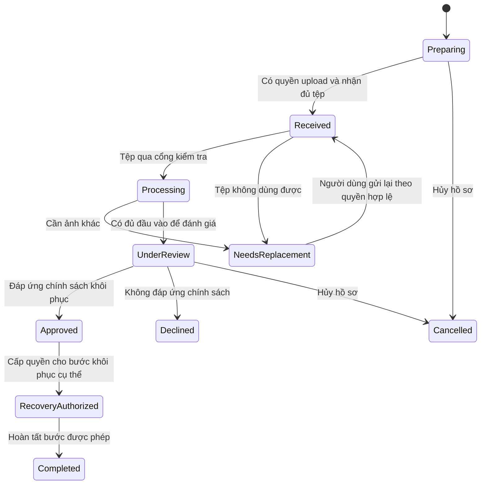

# Accessible document capture — Thu nhận giấy tờ có khả năng tiếp cận

## 1. Mục tiêu và phạm vi

Trong module `SECURITY_AUTHENTICATION_ACCOUNT_RECOVERY`, khôi phục tài khoản là quá trình giúp người dùng lấy lại quyền truy cập khi mất mật khẩu, MFA, passkey hoặc thiết bị xác thực. Một số trường hợp cần xác minh danh tính bằng giấy tờ. Khi đó, giao diện thu nhận giấy tờ phải cho phép người dùng hoàn thành bằng bàn phím, trình đọc màn hình, thao tác cảm ứng hoặc phương thức hỗ trợ phù hợp.

**Accessible document capture** là thiết kế toàn bộ bước chuẩn bị, chụp hoặc chọn tệp, kiểm tra chất lượng, gửi và nhận phản hồi sao cho người có nhu cầu tiếp cận khác nhau có thể sử dụng. Chỉ thêm nút “Tải giấy tờ” chưa giải quyết được việc người dùng không nhìn thấy khung camera, không giữ được thiết bị ổn định hoặc không thể hoàn thành trước bộ đếm thời gian.

Sau bài này, người học có thể:

- Xác định khi nào giấy tờ có ích cho khôi phục tài khoản và khi nào thu thập giấy tờ không đủ cơ sở.
- Thiết kế đường đi thay thế cho người không thể sử dụng camera hoặc một thao tác xác minh cụ thể.
- Tách lỗi thu nhận, lỗi chất lượng, kết quả xác minh và quyết định khôi phục.
- Kết hợp khả năng tiếp cận với quyền upload giới hạn, bảo vệ dữ liệu và kiểm soát phiên.

Bài tập trung vào giấy tờ phục vụ khôi phục tài khoản. Selfie, đối sánh khuôn mặt hoặc kiểm tra hiện diện, nếu có, là những bước xác minh riêng cần đánh giá độc lập; chúng không tự nhiên trở nên tiếp cận được chỉ vì phần tải giấy tờ hoạt động tốt.

## 2. Trước khi yêu cầu giấy tờ: cần chứng minh điều gì?

Giả sử một người báo mất điện thoại chứa ứng dụng MFA. Họ vẫn còn một passkey trên máy tính đã đăng ký hoặc mã khôi phục chưa dùng. Một thiết kế hợp lý nên đánh giá các phương án đó trước khi yêu cầu ảnh căn cước.

Giấy tờ là dữ liệu nhạy cảm, đồng thời tạo thêm yêu cầu về thiết bị và kỹ năng. Vì vậy, hệ thống cần trả lời ba câu hỏi:

1. Có căn cứ nào liên kết danh tính trên giấy tờ với tài khoản đang yêu cầu khôi phục?
2. Bằng chứng này đóng góp gì cho quyết định, bên cạnh khả năng kiểm soát kênh liên lạc và các tín hiệu rủi ro?
3. Người không thể dùng cách thu nhận mặc định có phương án nào đạt mức bảo đảm cần thiết?

Ví dụ, nếu tài khoản được tạo bằng biệt danh và chưa từng xác minh tên thật, ảnh một giấy tờ hợp lệ không đủ để chứng minh quyền sở hữu tài khoản đó. Tên giống thông tin công khai cũng không giải quyết được vấn đề này.

Cần phân biệt:

| Kết quả | Điều có thể kết luận | Điều chưa thể kết luận |
|---|---|---|
| Tệp tải lên thành công | Máy chủ đã nhận một tệp trong hồ sơ được phép | Giấy tờ thật hoặc người gửi là chủ tài khoản |
| Chất lượng đạt yêu cầu | Ảnh đủ dùng cho bước xử lý tiếp theo | Nội dung đúng hoặc không bị chỉnh sửa |
| Giấy tờ qua kiểm tra | Bằng chứng đáp ứng các kiểm tra đã áp dụng | Một mình bằng chứng đủ để bỏ MFA |
| Hồ sơ được phê duyệt | Chính sách khôi phục cho phép bước tiếp theo | Mọi phiên cũ và thiết bị cũ đều còn đáng tin |

Nguyên tắc thiết kế của bài là: thay đổi cách người dùng cung cấp bằng chứng phải đi cùng đánh giá mức bảo đảm của cách mới. Nhu cầu hỗ trợ không phải dấu hiệu gian lận, và hỗ trợ cũng không phải quyền bỏ qua kiểm tra danh tính.

## 3. Những rào cản cần nhận diện

Không nên đồng nhất accessibility với việc “đọc được chữ”. Thu nhận giấy tờ kết hợp đọc hướng dẫn, điều khiển thiết bị, thao tác vật lý và xử lý thông báo.

| Tình huống sử dụng | Rào cản thường gặp | Cách thiết kế đề xuất |
|---|---|---|
| Người dùng trình đọc màn hình | Khung căn chỉnh chỉ thể hiện bằng hình | Hướng dẫn bằng chữ và trạng thái có thể được công bố |
| Người có thị lực thấp | Chữ nhỏ, nút chìm vào nền, hướng dẫn mất khi phóng to | Bố cục co giãn, tương phản phù hợp, focus dễ nhận biết |
| Người run tay hoặc hạn chế vận động | Phải giữ máy đúng vị trí rồi chạm nút nhỏ | Cho dùng ảnh quét, giá đỡ và nút chụp dễ thao tác |
| Người điều khiển bằng bàn phím hoặc switch | Crop hoặc xoay ảnh chỉ có kéo thả | Có nút xoay và lựa chọn thay ảnh; không bắt buộc kéo thả |
| Người gặp khó khăn nhận thức | Nhiều yêu cầu cùng lúc, lỗi mơ hồ | Chia bước, ngôn ngữ cụ thể, giữ hướng dẫn cạnh thao tác |
| Người không nghe được âm báo | Chỉ dùng tiếng bíp để báo đã chụp | Có trạng thái bằng chữ tương ứng |
| Người có thiết bị cũ hoặc mạng yếu | Chỉ cho camera trực tiếp, phải tải lại toàn bộ | Có tải tệp và phục hồi thao tác theo chính sách |
| Người dùng máy công cộng | Ảnh được lưu lại hoặc hồ sơ tự mở khi quay lại | Giảm dấu vết cục bộ và yêu cầu quyền truy cập phù hợp |

Bảng này phục vụ thiết kế đường đi, không phải danh sách thuộc tính để suy đoán khuyết tật. Không cần yêu cầu người dùng khai báo chẩn đoán y tế để được chọn “Tải tệp có sẵn”.

## 4. Một hành trình thu nhận có thể sử dụng được

### 4.1. Giải thích trước khi mở camera

Trước khi yêu cầu quyền camera hoặc chọn tệp, màn hình nên cho biết:

- Vì sao hồ sơ này cần giấy tờ và giấy tờ sẽ được dùng ở bước nào.
- Loại giấy tờ, mặt giấy tờ hoặc trang nào được chấp nhận.
- Định dạng và giới hạn kích thước mà hệ thống thực sự hỗ trợ.
- Cách chọn phương thức khác hoặc yêu cầu hỗ trợ.
- Thông tin về bên xử lý, thời hạn lưu giữ và cách hủy hồ sơ theo chính sách áp dụng.

Không yêu cầu mặt sau “cho đủ bộ” nếu quy trình chỉ cần mặt trước. Nếu cho phép che một số thông tin không cần thiết, phải nói rõ phần nào được che và phần nào phải giữ; không để người dùng tự đoán rồi bị từ chối sau khi đã gửi.

Thông tin riêng tư có thể trình bày theo lớp: phần giải thích ngắn cạnh thao tác và liên kết đến nội dung đầy đủ. Liên kết không được là cách duy nhất để biết hệ thống đang yêu cầu dữ liệu gì.

### 4.2. Cung cấp lựa chọn trước khi người dùng thất bại

Có thể cung cấp “Chụp bằng camera”, “Chọn ảnh hoặc bản quét” và “Tôi cần cách xác minh khác”. Mỗi lựa chọn chỉ xuất hiện khi backend và quy trình nghiệp vụ có hỗ trợ.

Cho phép ảnh có sẵn là một quyết định về bằng chứng, không chỉ là cải tiến giao diện. Nếu chính sách yêu cầu thu nhận trực tiếp để đáp ứng mục tiêu chống phát lại cụ thể, bản quét cũ không tự động tương đương. Khi đó cần một đường đi thay thế được thẩm định, chẳng hạn phiên hỗ trợ có kiểm soát hoặc bằng chứng khác đã được chính sách chấp nhận.

Người dùng không nên phải chụp thất bại nhiều lần mới nhìn thấy lựa chọn hỗ trợ. Các lỗi căn chỉnh liên tiếp có thể cho thấy cách tương tác không phù hợp, chứ không chứng minh người đang thao tác có ý đồ xấu.

### 4.3. Chia bước theo quyết định của người dùng

Một hành trình ví dụ:

1. Chọn phương án khôi phục và nhận hồ sơ có quyền hạn giới hạn.
2. Đọc yêu cầu giấy tờ; chọn cách thu nhận.
3. Cung cấp đúng mặt hoặc trang được yêu cầu.
4. Xem lại, thay ảnh hoặc yêu cầu hỗ trợ.
5. Chủ động xác nhận gửi.
6. Nhận xác nhận đã tiếp nhận và cách theo dõi.
7. Chờ quyết định xác minh; sau đó thực hiện bước khôi phục được phép.

Trạng thái “Bước 2/4: Cung cấp mặt trước” giúp định hướng, nhưng không nên hứa số bước cố định nếu hồ sơ có thể cần đánh giá bổ sung. Có thể nói rõ “Có thể cần thêm một bước kiểm tra tùy kết quả”.

## 5. Hướng dẫn chụp và phản hồi chất lượng

Hướng dẫn cần mô tả hành động có thể thực hiện:

> Đặt giấy tờ trên mặt phẳng. Đưa toàn bộ bốn góc vào ảnh. Tránh ánh sáng phản chiếu che phần chữ. Bạn có thể chọn ảnh có sẵn nếu khó giữ camera ổn định.

Nếu dùng hình minh họa, cung cấp nội dung chữ tương đương cho yêu cầu chính. Không đặt một đoạn hướng dẫn dài bên trong ảnh rồi dùng alt ngắn “Hướng dẫn chụp”.

Phản hồi nên phân biệt mức độ và bước tiếp theo:

| Phản hồi khó sử dụng | Phản hồi đề xuất |
|---|---|
| “Ảnh không hợp lệ” | “Ảnh bị cắt mất mép dưới. Hãy chụp lại toàn bộ giấy tờ hoặc chọn ảnh khác.” |
| “Quality score: 0.31” | “Phần chữ chưa đủ rõ để xử lý. Hãy thử đặt máy trên điểm tựa.” |
| Viền đỏ, không có chữ | “Có ánh sáng phản chiếu ở giữa ảnh. Thử đổi góc chiếu sáng.” |
| “OCR failed” | “Hệ thống chưa đọc được ảnh. Bạn có thể thay ảnh hoặc chọn bước hỗ trợ.” |
| “Lỗi” sau khi upload | “Chưa xác nhận được máy chủ đã nhận tệp. Hãy kiểm tra trạng thái trước khi gửi lại.” |

Đây là lỗi thu nhận mà người dùng có thể sửa. Những kết luận chống gian lận khác cần phản hồi theo chính sách để tránh lộ tiêu chí kiểm tra hoặc thông tin của tài khoản.

Một số điểm triển khai quan trọng:

- Có nút chụp chủ động; tự chụp, nếu được cung cấp, cần tránh tạo tình huống người dùng không biết ảnh đã được lấy.
- Cho xem lại và thay ảnh trước khi gửi. Nếu SDK gửi ảnh để đánh giá ngay khi chụp, giải thích điều đó trước thao tác.
- Với hướng dẫn camera liên tục, công bố thay đổi có ý nghĩa, không đọc lại hàng chục lần mỗi giây.
- Bổ sung chữ cho tín hiệu màu, âm thanh hoặc rung. Người dùng có thể cần tắt âm thanh ở nơi công cộng.
- Nếu có xoay hoặc cắt ảnh, cung cấp thao tác bằng nút hoặc bàn phím tương đương; không ép người dùng vẽ chính xác khung bằng chuột.
- Không tự động làm đẹp hoặc tăng nét theo cách có thể làm biến đổi đặc điểm cần kiểm tra. Bước xử lý ảnh phải được đánh giá với pipeline xác minh.

OCR chỉ tạo dữ liệu trích xuất, có thể sai với dấu tiếng Việt, ký tự gần giống hoặc giấy tờ bị mờ. Nếu cần người dùng kiểm tra trường trích xuất, cho họ đọc và sửa theo quy trình. Sửa dữ liệu nhập không được biến thành việc hệ thống coi nội dung sửa là bằng chứng đã được xác thực.

## 6. Ví dụ giao diện HTML có ngữ nghĩa rõ ràng

Ví dụ sau minh họa bước **chọn tệp và xác nhận gửi** cho một hồ sơ đã được phép sử dụng phương thức này. Giới hạn 8 MiB là cấu hình minh họa, cần đồng bộ với máy chủ.

```html
<section aria-labelledby="capture-title">
  <h1 id="capture-title">Cung cấp mặt trước giấy tờ</h1>

  <p id="capture-purpose">
    Tệp được dùng để xét yêu cầu khôi phục của bạn.
    Gửi tệp chưa đồng nghĩa yêu cầu đã được phê duyệt.
  </p>

  <form action="/recovery/document-capture"
        method="post"
        enctype="multipart/form-data">
    <!-- Máy chủ chèn giá trị bảo vệ CSRF phù hợp với phiên hiện tại. -->

    <fieldset>
      <legend>Chọn tệp mặt trước</legend>

      <p id="file-help">
        Chấp nhận JPEG, PNG hoặc PDF, tối đa 8 MiB.
        Cần thấy toàn bộ giấy tờ và đọc được phần chữ.
      </p>

      <label for="document-file">Ảnh hoặc bản quét mặt trước</label>
      <input id="document-file"
             name="document"
             type="file"
             accept="image/jpeg,image/png,application/pdf"
             aria-describedby="file-help document-error"
             required>

      <p id="document-error" hidden></p>
    </fieldset>

    <p id="upload-status" role="status" aria-atomic="true"></p>

    <button type="submit">Gửi tệp để xét hồ sơ</button>

    <p>
      <a href="/recovery/alternative">
        Tôi cần cách cung cấp bằng chứng khác
      </a>
    </p>
  </form>
</section>
```

Input file có nhãn được liên kết trực tiếp. Hướng dẫn hiển thị trước thao tác; nút gửi diễn đạt đúng ý nghĩa nghiệp vụ. `accept` hỗ trợ lựa chọn tệp trên giao diện, không phải kiểm tra bảo mật. Khả năng mở camera từ bộ chọn tệp phụ thuộc thiết bị và trình duyệt; ví dụ này không bảo đảm có chế độ chụp trực tiếp.

Các URL là đường dẫn minh họa. Máy chủ phải lấy hồ sơ và quyền thao tác từ ngữ cảnh đã được xác thực hoặc phiên khôi phục giới hạn, kiểm tra CSRF khi phù hợp và xử lý lỗi. Đoạn HTML không triển khai những phần đó, cũng chưa triển khai thông báo tải lên bất đồng bộ.

Khi bổ sung JavaScript hoặc phản hồi từ máy chủ, cần giữ một giao ước rõ:

- Lỗi của tệp được ghi vào `document-error`, bỏ `hidden` và đặt `aria-invalid="true"` trên input.
- Khi lỗi đã được xử lý, xóa trạng thái invalid và cập nhật thông báo tương ứng.
- Thành công hoặc chuyển bước phải có nội dung chữ; không chỉ thay biểu tượng.
- Khi gửi bất đồng bộ, cập nhật vùng status tại các mốc như bắt đầu gửi và đã tiếp nhận. Không cần công bố từng phần trăm.
- Với nhiều lỗi sau submit, có thể tạo phần tổng hợp với liên kết tới các trường; lựa chọn thông báo và quản lý focus cần được thử bằng công nghệ trợ năng.

W3C WAI hướng dẫn thông báo kết quả, mô tả lỗi và cách sửa, đồng thời liên kết lỗi với trường liên quan. Các kỹ thuật thông báo nên được chọn phù hợp cách trang cập nhật, thay vì áp dụng mọi kiểu cảnh báo cùng lúc. Xem [User Notifications](https://www.w3.org/WAI/tutorials/forms/notifications/).

Cần kiểm tra thực tế rằng style của sản phẩm không che focus, cắt mất nhãn hoặc khiến nội dung tràn khi phóng to. Một ví dụ HTML có ngữ nghĩa tốt vẫn có thể bị làm hỏng bởi CSS hoặc component bọc ngoài.

## 7. Thời gian hoàn thành và quyền truy cập ngắn hạn

Người dùng có thể cần thời gian lấy giấy tờ, nhờ hỗ trợ đặt camera hoặc đọc hướng dẫn bằng trình đọc màn hình. Nếu quyền upload hết hạn quá sớm, việc chụp lại nhiều lần làm tăng áp lực và có thể khiến họ chuyển sang gửi ảnh qua kênh không phù hợp.

Thiết kế nên tách ba khái niệm:

| Loại thời gian | Mục đích | Cách xử lý đề xuất |
|---|---|---|
| Thời gian thao tác trên màn hình | Cho người dùng đọc, chọn và xem lại | Hạn chế việc bắt đầu lại chỉ vì thao tác chậm |
| Hạn của quyền upload | Giới hạn khả năng sử dụng credential upload | Cấp lại sau kiểm tra ngữ cảnh và chính sách |
| Thời hạn hồ sơ | Giới hạn vòng đời yêu cầu khôi phục | Có thông báo, đường đi tiếp tục hoặc khởi tạo lại an toàn |

Không giả định mọi timeout “vì bảo mật” đều được miễn yêu cầu accessibility. WCAG 2.2 SC 2.2.1 nêu các phương án tắt, điều chỉnh hoặc gia hạn giới hạn thời gian và các ngoại lệ cụ thể; phương án gia hạn có yêu cầu định lượng về cảnh báo và số lần. Cần đánh giá chính tiêu chí, không coi một nút “Thêm thời gian” là đủ để tuyên bố đáp ứng. Xem [Timing Adjustable](https://www.w3.org/WAI/WCAG22/Understanding/timing-adjustable.html).

Một cách thiết kế ứng dụng:

1. Cho chuẩn bị và xem lại ảnh trước khi cấp quyền gửi có hạn ngắn.
2. Khi người dùng xác nhận gửi, máy chủ đánh giá phiên khôi phục và cấp quyền cho đúng thao tác.
3. Nếu quyền hết hạn, giữ trạng thái giao diện trong phạm vi an toàn và hướng dẫn cấp lại; không âm thầm đổi sang credential không hết hạn.
4. Việc cấp lại tuân thủ hạn hồ sơ, giới hạn lạm dụng và các kiểm tra hiện hành.
5. Khi phiên không còn hợp lệ, giải thích bước cần làm tiếp theo và tránh hiển thị lại giấy tờ cho người không có quyền.

Nếu giữ ảnh trong bộ nhớ trình duyệt để người dùng thử lại, cần nói rõ hành vi và giải phóng khi hủy hoặc rời luồng theo thiết kế. Không mặc định lưu ảnh giấy tờ vào localStorage, cơ sở dữ liệu cục bộ hay cache của ứng dụng để giải quyết timeout.

## 8. Mô hình trạng thái: gửi thành công chưa phải khôi phục thành công

Sơ đồ sau là một mô hình minh họa cho dịch vụ. Mỗi chuyển trạng thái phải được backend kiểm tra; giao diện chỉ phản ánh kết quả.



Mô hình triển khai còn cần xử lý hết hạn, thu hồi và lỗi xử lý nền ở các trạng thái phù hợp. Một callback đến muộn không được làm hồ sơ đã hủy hoặc hết hạn quay lại `Approved`.

Cần tách hai loại phản hồi:

- **Thu nhận:** “Đã nhận tệp, hồ sơ đang được xử lý.”
- **Quyết định:** “Bạn có thể tiếp tục bước khôi phục” hoặc thông báo không chấp thuận theo chính sách.

Người dùng cần biết có phải thao tác nữa hay không, nhưng không cần thấy điểm chống gian lận hoặc toàn bộ tiêu chí nội bộ. Màn hình theo dõi chỉ tiết lộ thông tin tương ứng với quyền của phiên đang dùng.

Khi người dùng bấm gửi lại vì mất mạng, hệ thống nên có cơ chế tránh tạo nhiều bằng chứng hoặc nhiều quyết định cho cùng thao tác. Có thể dùng khóa idempotency gắn với hồ sơ và lần gửi. Khóa này phục vụ chống thực thi trùng, không thay thế xác thực hoặc quyền upload.

## 9. Ranh giới bảo mật của bước thu nhận

### 9.1. Quyền gửi tệp chỉ cho phép gửi tệp

Phiên khôi phục là ngữ cảnh hạn chế. Quyền upload cần gắn với hồ sơ, mục đích, loại bằng chứng và trạng thái được phép; không thể dùng nó để xem toàn bộ tài khoản, đổi email hoặc vô hiệu hóa MFA.

Nếu thiết kế dùng token một lần, máy chủ cần kiểm tra hạn, scope và trạng thái chưa tiêu thụ, rồi xử lý tiêu thụ nguyên tử. Mất phản hồi không nên khiến hệ thống chấp nhận token đã dùng như token mới; có thể trả lại kết quả của thao tác cũ khi ngữ cảnh và cơ chế idempotency hợp lệ.

Trường hợp dùng URL ký sẵn cũng cần xem đúng khả năng của nền tảng lưu trữ. URL có hạn không mặc nhiên là URL chỉ dùng một lần; yêu cầu một lần phải được thực thi ở lớp thiết kế phù hợp.

### 9.2. Tệp vẫn là đầu vào không đáng tin

Máy chủ cần giới hạn định dạng và kích thước, kiểm tra kiểu nội dung thực, dùng tên lưu trữ do hệ thống sinh, lưu ở vùng riêng và kiểm soát quyền đọc. Thành phần xử lý ảnh hoặc PDF cần giới hạn tài nguyên và cô lập phù hợp. Kiểm tra chống mã độc, nếu áp dụng, bổ sung chứ không thay thế các lớp kiểm soát khác. Đây là các hướng bảo vệ được mô tả trong [OWASP File Upload Cheat Sheet](https://cheatsheetseries.owasp.org/cheatsheets/File_Upload_Cheat_Sheet.html).

Với hồ sơ khôi phục, còn cần chú ý mối quan hệ giữa tệp và hồ sơ:

- Không cho thay tệp đã được duyệt mà vẫn giữ nguyên kết quả duyệt cũ.
- Mỗi phiên bản bằng chứng cần có định danh nội bộ để quyết định tham chiếu đúng phiên bản.
- Chỉ chấp nhận callback của nhà cung cấp sau khi xác thực nguồn và kiểm tra hồ sơ, phiên bản, trạng thái.
- Không tin dữ liệu `qualityPassed` hay `identityVerified` do trình duyệt gửi lên.
- Không dùng ảnh giấy tờ làm tài nguyên công khai để tiện hiển thị preview.

### 9.3. Bảo vệ nội dung và dấu vết

Ảnh gốc, bản xem trước, dữ liệu OCR và kết quả đánh giá có thể tồn tại ở nhiều nơi. Thiết kế vòng đời cần xác định nơi nào lưu bản nào, ai được đọc và khi nào được xóa.

Với trang thu nhận giấy tờ, nên loại trừ nội dung nhạy cảm khỏi ghi lại phiên sử dụng, analytics và công cụ chẩn đoán không cần thiết. Log nghiệp vụ có thể ghi mã hồ sơ nội bộ, loại sự kiện và mã lỗi; không ghi toàn bộ giấy tờ, token hoặc nội dung OCR.

Nếu cần chuẩn hóa ảnh hoặc xử lý metadata, phải xác định bản nào được dùng cho quyết định và liệu có cần bản gốc trong thời gian xét duyệt. Không tự ý biến đổi bằng chứng rồi bỏ bản cần thiết cho kiểm tra. Đồng thời, việc giữ bản gốc “phòng khi cần” phải có lý do và thời hạn cụ thể.

Chính sách xóa cần bao quát cả thumbnail, bản tạm, dữ liệu trích xuất và bản sao tại nhà cung cấp trong phạm vi kiểm soát. Việc hết hạn credential upload không có nghĩa ảnh đã được xóa khỏi nơi lưu trữ.

## 10. Đường đi hỗ trợ có mức bảo đảm phù hợp

“Tôi cần trợ giúp” nên mở ra một quy trình rõ ràng: người dùng sẽ làm gì, hỗ trợ qua kênh nào và bằng chứng nào có thể được chấp nhận. Một số trường hợp có thể dùng kênh văn bản, phiên hỗ trợ theo lịch hoặc bằng chứng thay thế đã được phê duyệt.

Không nên coi gọi điện là lựa chọn chung cho mọi người. Người khiếm thính, người khó nói hoặc người đang ở môi trường không riêng tư có thể cần hình thức khác. Tương tự, video trực tiếp không giải quyết mọi khó khăn về camera và thao tác vật lý.

Có thể cho người tin cậy hỗ trợ đặt giấy tờ hoặc điều chỉnh máy, nhưng phải giữ ranh giới:

- Người hỗ trợ không cần biết mật khẩu, mã khôi phục hoặc mã xác thực của chủ tài khoản.
- Hỗ trợ vật lý không được coi là ủy quyền quản lý tài khoản.
- Nhân viên xử lý theo hồ sơ và quyền hạn được cấp, không tự bỏ bước vì thấy người dùng gặp khó khăn.
- Bất kỳ thay đổi nào về phương thức bằng chứng đều có căn cứ chính sách và dấu vết quyết định.

Nếu một phương thức tự động không thể dùng, đội ngũ cần có cơ chế xem xét thay thế. “Đánh giá thủ công” chỉ có ý nghĩa khi reviewer có tiêu chí, công cụ tiếp cận được và khả năng đưa ra kết quả có kiểm soát; không phải một hộp thư nhận ảnh không giới hạn.

W3C giải thích SC 3.3.8 bao gồm trường hợp dùng thông tin thay thế để khôi phục tài khoản và yêu cầu đường đi không phụ thuộc vào kiểm tra chức năng nhận thức theo các điều kiện của tiêu chí. Điều này không có nghĩa giấy tờ luôn bắt buộc, cũng không chứng nhận mọi luồng chụp giấy tờ là tiếp cận được. Xem [Accessible Authentication (Minimum)](https://www.w3.org/WAI/WCAG22/Understanding/accessible-authentication-minimum.html).

## 11. Tình huống thực tế

Một người dùng mất điện thoại chứa MFA và không còn mã khôi phục. Tài khoản đã được liên kết với danh tính qua quy trình trước đó. Sau đánh giá ban đầu, hệ thống cho phép mở hồ sơ xác minh bổ sung.

Người dùng có hạn chế vận động nên không thể giữ camera và căn giấy tờ cùng lúc. Thiết kế chỉ có khung tự chụp liên tục báo “Di chuyển vào giữa” khiến họ bị mắc kẹt. Sau vài lần, người dùng có thể nghĩ cần gửi ảnh qua email cho hỗ trợ, làm giấy tờ đi ra khỏi luồng kiểm soát.

Một phương án được thiết kế lại:

1. Ngay từ đầu, màn hình nêu các cách thu nhận được chính sách cho phép.
2. Người dùng chọn bản quét từ máy tính thay vì chụp trực tiếp; đây là phương thức đã được phê duyệt cho loại hồ sơ này.
3. Hệ thống báo lỗi cụ thể khi tệp quá lớn và giữ người dùng ở đúng bước.
4. Sau khi gửi, màn hình xác nhận tiếp nhận, cho biết hồ sơ đang chờ đánh giá và cách theo dõi.
5. Bộ phận xét duyệt kiểm tra bằng chứng theo cùng chính sách, bổ sung đánh giá khi cần.
6. Khi được chấp thuận, dịch vụ cấp quyền riêng cho bước đăng ký lại yếu tố xác thực.

Chọn bản quét không được tính là điểm rủi ro chỉ vì đó là lựa chọn tiếp cận. Tuy nhiên, dịch vụ vẫn có thể đánh giá thuộc tính bằng chứng và bối cảnh của hồ sơ theo mô hình đã được kiểm chứng.

Sau phê duyệt, hệ thống còn phải áp dụng chính sách thông báo, thu hồi phiên hoặc yếu tố bị mất, đăng ký phương thức mới và tiêu thụ quyền khôi phục. Hoàn thành thu nhận giấy tờ không tự động thực hiện những việc đó.

Nếu tài khoản trong ví dụ chưa từng được liên kết với danh tính xác minh, bước 2 không thể tự giải quyết thiếu căn cứ liên kết. Đội ngũ cần phương án bằng chứng khác phù hợp hoặc kết luận không đủ điều kiện khôi phục, thay vì yêu cầu thêm nhiều ảnh giấy tờ.

## 12. Những lựa chọn dễ gây lỗi thiết kế

| Lựa chọn | Hệ quả | Hướng điều chỉnh |
|---|---|---|
| Chỉ có camera trực tiếp | Loại trừ người không thể điều khiển camera | Thiết kế phương thức thay thế đáp ứng mục tiêu bằng chứng |
| Bắt buộc kéo thả để crop | Không thể hoàn thành bằng một số công nghệ trợ năng | Có điều khiển tương đương hoặc thay ảnh |
| Gộp lỗi OCR với nghi ngờ giả mạo | Người dùng không biết sửa gì, khó đo chất lượng hệ thống | Tách phân loại nội bộ và phản hồi thích hợp |
| Bắt đầu lại toàn bộ khi credential upload hết hạn | Tăng gánh nặng cho người thao tác chậm | Tách thời gian chuẩn bị và quyền gửi |
| Lưu ảnh vào cache để “khỏi mất” | Có thể để lại giấy tờ trên thiết bị dùng chung | Thiết kế tiếp tục hồ sơ có kiểm soát |
| Tự động bỏ MFA ngay sau upload | Tệp được nhận trở thành lối chiếm tài khoản | Chỉ cấp quyền sau quyết định chính sách riêng |
| Gửi ảnh sang hộp thư hỗ trợ tùy ý | Khó kiểm soát quyền đọc và thời hạn lưu | Dùng kênh hỗ trợ tích hợp với hồ sơ |
| Thu thêm giấy tờ khi có lỗi thao tác | Tăng thu thập dữ liệu mà chưa tăng căn cứ | Sửa đường thu nhận và đánh giá lại nhu cầu bằng chứng |

## 13. Tiêu chí nghiệm thu cho một luồng thực tế

Đây là các tình huống kiểm tra sản phẩm, dùng để đánh giá một triển khai cụ thể:

| Nhóm | Tình huống | Kết quả cần quan sát |
|---|---|---|
| Bàn phím | Đi hết bước chọn, xem lại, thay và gửi tệp | Không mắc kẹt; thao tác và focus có thể theo dõi |
| Trình đọc màn hình | Chọn tệp sai định dạng rồi sửa | Biết trường nào lỗi, cách sửa và kết quả mới |
| Bố cục | Phóng to hoặc dùng màn hình hẹp | Hướng dẫn, nút và thông báo vẫn có thể đọc, thao tác |
| Camera | Từ chối quyền hoặc không có camera | Có đường đi tiếp theo rõ ràng theo chính sách |
| Vận động | Không thể thực hiện kéo thả hoặc giữ máy | Có cách tương tác hoặc quy trình thay thế đã được duyệt |
| Thời gian | Quyền gửi hết hạn trong lúc chuẩn bị | Biết cách tiếp tục; máy chủ vẫn kiểm tra quyền mới |
| Mạng | Mất phản hồi sau khi gửi | Xác định trạng thái, tránh tạo kết quả trùng |
| Phân quyền | Dùng credential của hồ sơ A cho hồ sơ B | Máy chủ từ chối |
| Tính toàn vẹn | Thay bằng chứng sau khi có kết quả | Kết quả cũ không phê duyệt phiên bản mới |
| Vòng đời | Callback đến sau khi hồ sơ hủy | Hồ sơ không được khôi phục ngoài chính sách |
| Riêng tư | Kiểm tra telemetry, preview và bản tạm | Không có bản sao không được dự kiến hoặc quyền đọc công khai |
| Khôi phục | Chỉ hoàn tất upload, chưa có quyết định | Không được đổi yếu tố xác thực hoặc nhận phiên đăng nhập đầy đủ |

Công cụ kiểm tra tự động có thể phát hiện một số lỗi nhãn hoặc cấu trúc, nhưng không chứng minh rằng người dùng có thể chụp giấy tờ, hiểu phản hồi hay vượt qua một SDK của bên thứ ba. Cần thử các đường đi thực tế bằng công nghệ trợ năng và với người sử dụng phù hợp.

Khi theo dõi vận hành, nên tách tỷ lệ lỗi kỹ thuật, lỗi chất lượng ảnh, từ bỏ và kết quả xét duyệt. Có thể so sánh theo phương thức thu nhận hoặc loại thiết bị nếu có căn cứ thu thập phù hợp. Không suy diễn tình trạng khuyết tật từ việc chọn hỗ trợ, và không đưa suy diễn đó vào điểm rủi ro.

## 14. Bài tập áp dụng

Thiết kế một màn hình thu nhận giấy tờ cho người mất toàn bộ thiết bị MFA. Giả định dịch vụ đã có căn cứ liên kết danh tính với tài khoản và chính sách cho phép cả camera lẫn bản quét.

Hãy mô tả:

1. Hướng dẫn trước thao tác và cách người dùng chọn phương thức.
2. Thông báo cho ba trường hợp: ảnh bị cắt, tệp không được hỗ trợ, chưa xác nhận được kết quả gửi.
3. Cách hết hạn quyền upload mà không tự động làm mất mọi tiến độ.
4. Quyền của phiên khôi phục trước và sau quyết định xét duyệt.
5. Đường đi cho người không thể sử dụng cả hai phương thức thu nhận hiện có.
6. Cách bảo đảm ảnh được duyệt chính là ảnh mà quyết định khôi phục tham chiếu.

Một lời giải có cơ sở cần cho thấy người dùng có thể tiếp tục bằng phương thức phù hợp, máy chủ vẫn kiểm soát bằng chứng và không cấp quyền đổi yếu tố xác thực chỉ dựa trên việc tải tệp thành công.
