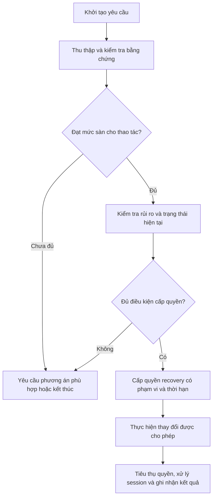

# Minimum recovery assurance: mức bảo đảm tối thiểu khi khôi phục tài khoản

Một hệ thống đăng nhập có thể yêu cầu passkey hoặc MFA, nhưng đường “Tôi mất thiết bị” lại cho phép thay mọi phương tiện xác thực chỉ bằng một mã gửi qua SMS. Khi đó, chính sách recovery đã cấp quyền kiểm soát tài khoản từ một bằng chứng yếu hơn mức mà sản phẩm dự định chấp nhận.

**Minimum recovery assurance** là mức bảo đảm tối thiểu mà một yêu cầu phải đáp ứng trước khi hệ thống cho phép một kết quả khôi phục cụ thể. Đó là chính sách nối **bằng chứng đã xác minh** với **quyền được cấp**, trong điều kiện người dùng có thể mất mật khẩu, MFA, passkey hoặc thiết bị xác thực.

Bài học này thuộc chủ đề **Recovery Policy** trong phạm vi khôi phục tài khoản an toàn. Mục tiêu là xây dựng chính sách có thể thực thi: biết bằng chứng nào đủ cho thao tác nào, khi nào cần xác minh thêm, và khi nào phải dừng thay vì tự động hạ mức yêu cầu.

## 1. Mức bảo đảm tối thiểu trả lời câu hỏi gì?

Câu hỏi trung tâm là:

> Với những gì hệ thống thực sự đã kiểm tra, người yêu cầu được phép thay đổi phần nào của tài khoản?

Cần phân biệt các khái niệm sau:

| Khái niệm | Câu hỏi nó trả lời | Ví dụ |
| --- | --- | --- |
| Định danh tài khoản | Đang yêu cầu khôi phục tài khoản nào? | Nhập email hoặc tên đăng nhập |
| Bằng chứng | Người yêu cầu trình được điều gì? | Mã dự phòng đã đăng ký, thử thách passkey, mã từ một kênh liên hệ |
| Mức bảo đảm | Bằng chứng và quy trình tạo ra độ tin cậy nào cho quyết định này? | Có chứng minh được quyền sử dụng một phương tiện đã liên kết từ trước không? |
| Tín hiệu rủi ro | Có điều gì làm yêu cầu đáng nghi hoặc cần thận trọng hơn? | Kênh liên hệ vừa đổi, hành vi thử mã bất thường |
| Quyền recovery | Hệ thống cho phép làm gì sau khi kiểm tra? | Đặt mật khẩu mới, thay MFA, đăng ký passkey |
| Kết quả khôi phục | Những thay đổi và quyền truy cập nào đã thực sự có hiệu lực? | MFA mới hoạt động, phiên cũ đã được xử lý theo chính sách |

Biết email chỉ giúp chọn tài khoản. Nhận được mã chỉ chứng minh khả năng đáp ứng thử thách qua kênh tương ứng trong thời điểm đó. Hai sự kiện này chưa tự xác định người yêu cầu được phép gỡ MFA hoặc thay toàn bộ phương tiện xác thực.

Mức bảo đảm không chỉ nằm trong độ dài token. Nó còn phụ thuộc việc bằng chứng được gắn với tài khoản như thế nào, kênh có thể bị chiếm ra sao, kiểm tra có còn mới không và quyền cuối cùng rộng đến đâu.

## 2. Xác định mức tối thiểu theo kết quả được cấp

Không nên đặt một câu hỏi duy nhất là “Người này đã qua recovery chưa?”. Một giao dịch recovery thường chứa nhiều quyết định với hậu quả khác nhau.

| Kết quả dự kiến | Tác động cần xem xét | Chính sách phải làm rõ |
| --- | --- | --- |
| Bắt đầu yêu cầu khôi phục | Tạo giao dịch, gửi thông báo hoặc thử thách | Giới hạn lạm dụng; chưa cấp quyền thay tài khoản |
| Đặt lại mật khẩu | Thay một bí mật đăng nhập | Yếu tố nào còn bắt buộc sau đó? Có tạo phiên không? |
| Thay hoặc gỡ MFA | Loại bỏ một lớp chặn đăng nhập | Bằng chứng nào thay thế được yếu tố đang mất? |
| Đăng ký passkey mới | Tạo một phương tiện đăng nhập có thể dùng lâu dài | Ai có quyền cho phép gắn khóa mới vào tài khoản? |
| Đổi email hoặc số recovery | Thay căn cứ cho các lần khôi phục tương lai | Có đang cho người yêu cầu tự chọn rồi tự xác minh căn cứ của mình không? |
| Cấp phiên truy cập | Cho phép đọc dữ liệu hoặc dùng chức năng | Phiên giới hạn hay đầy đủ, và API nào chấp nhận nó? |
| Thực hiện thao tác nhạy cảm | Có thể gây thiệt hại ngay sau khôi phục | Có cần xác thực bổ sung hoặc hạn chế sau recovery không? |

Chính sách phải xét cả chuỗi thao tác. Một quyền “chỉ đặt lại mật khẩu” vẫn có thể trở thành quyền kiểm soát toàn bộ tài khoản nếu mật khẩu mới đủ để đăng nhập rồi đổi MFA.

Ngược lại, nếu tài khoản vẫn bắt buộc một yếu tố độc lập sau khi đặt lại mật khẩu, quyền này có phạm vi khác. Tuy vậy, đặt lại trái phép vẫn có thể làm gián đoạn người dùng; không được xem đó là thao tác vô hại.

### 2.1. Viết các bất biến trước khi chọn công nghệ

Một số bất biến có thể đưa vào thiết kế:

- Một yêu cầu công khai chưa xác minh không được thay thông tin xác thực hoặc tự làm mất mọi đường truy cập hợp lệ.
- Quyền kiểm soát một kênh không tự cấp quyền thay mọi yếu tố khác của tài khoản.
- Phương tiện mới chỉ trở thành căn cứ tin cậy khi việc liên kết nó đã được cho phép bằng chính sách phù hợp.
- Mỗi API thay đổi bảo mật phải kiểm tra quyền tương ứng ở backend.
- Hết thời gian chờ hoặc không có phản đối không tự biến bằng chứng chưa đủ thành bằng chứng đủ.
- Đường hỗ trợ thủ công không được cấp cùng một quyền với ít bằng chứng hơn một cách tùy ý.

Đây là những quy tắc cần chuyển thành hành vi thực thi, không chỉ là lời hướng dẫn cho giao diện.

## 3. Đặt mức tối thiểu từ tài sản và đối thủ

Không có một công thức duy nhất phù hợp mọi tài khoản. Chính sách phải xuất phát từ hậu quả của việc cấp nhầm quyền và năng lực của đối thủ dự kiến.

Ví dụ, một diễn đàn không lưu dữ liệu nhạy cảm và một tài khoản quản trị hạ tầng có thể chọn các phương án recovery khác nhau. Ngay trong một sản phẩm, tài khoản quản trị có thể cần điều kiện khác tài khoản thông thường.

Quy trình xác định mức tối thiểu có thể gồm:

1. Liệt kê quyền mà recovery sẽ cấp và thiệt hại nếu cấp nhầm.
2. Nêu đối thủ có thể kiểm soát những tài sản nào.
3. Liệt kê các phương án recovery đã được người dùng đăng ký hoặc tổ chức thiết lập.
4. Xem mỗi phương án còn giá trị gì trước từng đối thủ.
5. Chọn tổ hợp bằng chứng và giới hạn quyền phù hợp.
6. Xác định đường xử lý khi không đủ bằng chứng.
7. Kiểm tra các đường kết hợp có làm tăng quyền ngoài dự kiến không.

| Giả định đối thủ | Vì sao ảnh hưởng đến mức tối thiểu? |
| --- | --- |
| Biết thông tin cá nhân và định danh tài khoản | Những dữ liệu dễ biết không đủ làm bí mật xác thực |
| Kiểm soát email | Mọi thử thách gửi đến email đó có cùng điểm phụ thuộc |
| Kiểm soát số điện thoại | SMS và cuộc gọi tới cùng số có thể cùng bị vượt qua |
| Có mật khẩu đã lộ | Mật khẩu không còn là căn cứ độc lập đáng tin trong kịch bản đó |
| Có một phiên bị đánh cắp | “Đang đăng nhập” chưa chắc đủ quyền thay phương tiện xác thực |
| Có thể thuyết phục nhân viên hỗ trợ | Quy trình con người cũng là một phần đường cấp quyền |

Không nên tuyên bố một bằng chứng “mạnh” mà không nêu mạnh trước đối thủ nào và đủ cho kết quả nào.

### 3.1. Mức sàn và tín hiệu rủi ro có vai trò khác nhau

**Mức sàn** quy định bằng chứng bắt buộc. **Tín hiệu rủi ro** có thể làm hệ thống yêu cầu thêm, giảm phạm vi quyền, trì hoãn hoặc từ chối.

Nếu chính sách yêu cầu căn cứ độc lập để thay MFA, một IP quen thuộc không nên xóa yêu cầu đó. Một điểm rủi ro thấp cũng không chứng minh người yêu cầu có phương tiện xác thực đã đăng ký.

Một cách biểu diễn quyết định là:

```text
ĐƯỢC PHÉP =
    giao_dịch_hợp_lệ
    VÀ bằng_chứng_đạt_mức_sàn_của_thao_tác
    VÀ điều_kiện_rủi_ro_được_chấp_nhận
    VÀ quyền_được_cấp_bao_phủ_thao_tác
    VÀ trạng_thái_bảo_mật_vẫn_phù_hợp
```

Đây là biểu thức chính sách, không phải công thức tính xác suất. Không cộng tùy ý nhiều tín hiệu yếu thành một bằng chứng xác thực mạnh.

## 4. Đánh giá bằng chứng thay vì chỉ đếm số bước

Một luồng có ba màn hình chưa chắc có ba căn cứ độc lập. Cần xem bằng chứng đến từ đâu và đối thủ có thể lấy đồng thời chúng bằng một cách hay không.

### 4.1. Các thuộc tính cần đánh giá

| Thuộc tính | Câu hỏi kiểm tra |
| --- | --- |
| Liên kết với tài khoản | Phương tiện hoặc kênh đã được gắn bằng một quy trình có quyền từ trước chưa? |
| Năng lực được chứng minh | Đang chứng minh nhận được thông điệp, giữ bí mật hay sử dụng khóa đã đăng ký? |
| Tính độc lập | Một sự cố có làm lộ đồng thời các bằng chứng đang được tính riêng không? |
| Độ mới | Kiểm tra diễn ra khi nào và có đủ mới cho thao tác này không? |
| Mục đích | Bằng chứng có được kiểm tra cho đúng tài khoản, giao dịch và hành động không? |
| Khả năng chống lạm dụng | Có chống đoán, phát lại, đánh cắp hoặc sử dụng sai ngữ cảnh theo loại bằng chứng không? |
| Trạng thái hiện tại | Phương tiện đã bị thu hồi, kênh vừa đổi hoặc tài khoản đang có sự cố chưa? |
| Hệ quả được phép | Bằng chứng này chỉ mở bước tiếp theo hay đủ quyền thực hiện thay đổi cuối? |

Một liên kết email được sinh an toàn vẫn là bằng chứng qua email. Một token dùng một lần không tự biến kênh bị chiếm thành kênh đáng tin.

### 4.2. Ví dụ về sự độc lập

| Tổ hợp | Điểm cần xem xét |
| --- | --- |
| SMS và cuộc gọi tới cùng số | Có thể cùng bị kiểm soát khi số bị chiếm |
| Email và mã dự phòng lưu ngay trong hộp thư đó | Chiếm email có thể lấy cả hai |
| Mật khẩu và câu hỏi dựa trên thông tin công khai | Câu hỏi không tự tạo thêm một bí mật có chất lượng |
| Hai mã được gửi liên tiếp tới cùng email | Thường chỉ lặp lại một căn cứ |
| Passkey còn sử dụng được và kênh liên hệ riêng | Cần xét cách tài khoản đồng bộ passkey và kênh liên hệ được bảo vệ |
| Mã dự phòng đã đăng ký, lưu ngoại tuyến riêng | Có thể là căn cứ hữu ích trước đối thủ chỉ chiếm kênh liên hệ; cần bảo vệ việc lưu và sử dụng |

Số lượng bằng chứng cần thiết là lựa chọn của chính sách cho từng thao tác. Không có quy tắc chung rằng mọi recovery đều phải có đúng hai bằng chứng. Một mã dự phòng đủ mạnh được thiết kế từ trước có thể được chấp nhận cho một quyền xác định; hai thử thách cùng phụ thuộc một kênh có thể vẫn không đạt mức tối thiểu.

### 4.3. Xác minh danh tính không tự động giải quyết mọi tài khoản

Giấy tờ hoặc đối chiếu danh tính chỉ có ý nghĩa khi có quan hệ đáng tin giữa danh tính đó và tài khoản. Với tài khoản không gắn danh tính pháp lý từ trước, việc một người xuất trình giấy tờ không tự chứng minh họ là chủ tài khoản.

Một quy trình có xác minh danh tính cần xác định căn cứ đối chiếu, chất lượng kiểm tra, cách xử lý sai lệch và quyền được cấp sau kết quả. Không nên coi việc “đã tải lên giấy tờ” là điều kiện đủ.

Cũng cần giới hạn dữ liệu thu thập và quyền truy cập hồ sơ. Quy trình recovery không nên thu thêm thông tin nhạy cảm nếu nó không tạo ra bằng chứng có ích cho quyết định.

## 5. Chuyển chính sách thành ma trận quyết định

Chính sách dễ thực thi hơn khi mỗi hàng mô tả một kết quả có thể kiểm tra được. Tránh ghi chung “recovery thành công nếu xác minh hợp lệ” mà không định nghĩa thế nào là hợp lệ.

Bảng sau là **ví dụ thiết kế cho một dịch vụ giả định**, không phải mức bảo đảm theo một tiêu chuẩn hoặc cấu hình dùng chung cho mọi sản phẩm.

| Tình huống | Bằng chứng được dịch vụ giả định chấp nhận | Quyền được cấp | Phần chưa được cấp |
| --- | --- | --- | --- |
| Mất mật khẩu nhưng còn phương tiện xác thực độc lập đã đăng ký | Chứng minh mới bằng phương tiện đó, đạt điều kiện đã định cho đặt lại mật khẩu | Đặt mật khẩu mới trong giao dịch giới hạn | Không tự đổi email hoặc gỡ mọi yếu tố khác |
| Mất ứng dụng MFA nhưng còn mã dự phòng phù hợp | Mã dự phòng đã cấp trước, được kiểm tra đúng mục đích cùng các điều kiện của luồng thay MFA | Thay yếu tố MFA theo phạm vi đã quy định | Không tự thêm kênh recovery hoặc cấp quyền quản trị mới |
| Mất một thiết bị passkey nhưng còn passkey sử dụng được | Thử thách mới bằng passkey còn hợp lệ và quyền quản lý phương tiện | Đăng ký passkey mới theo chính sách | Không suy ra mọi thiết bị cũ đều bị chiếm |
| Chỉ nhận được mã qua email liên hệ | Bằng chứng kiểm soát email tại thời điểm kiểm tra | Tiếp tục một giao dịch cần xác minh thêm | Chưa đủ thay toàn bộ phương tiện xác thực trong chính sách ví dụ |
| Mất mọi phương tiện, tài khoản thuộc tổ chức có đường thẩm định đã thiết lập | Hoàn tất quy trình thẩm định và phê duyệt được thiết kế trước cho tài khoản đó | Quyền khôi phục cụ thể được phê duyệt | Không có quyền vô hạn chỉ vì nhân viên mở yêu cầu |
| Không có phương án đạt mức sàn | Chưa có bằng chứng được chấp nhận | Không cấp quyền thay thông tin xác thực | Không tự chuyển sang câu hỏi yếu hơn để hoàn tất |

Một ma trận vận hành còn cần các cột: điều kiện tài khoản, phiên bản chính sách, thời hạn bằng chứng, điều kiện rủi ro, thông báo, xử lý session và trách nhiệm phê duyệt.

### 5.1. Đừng tạo bế tắc bằng cách yêu cầu đúng yếu tố đã mất

Nếu mục đích là thay MFA bị mất, yêu cầu chính MFA đó trong mọi nhánh sẽ khiến đường recovery không sử dụng được.

Giải pháp là thiết kế trước một phương án thay thế có mức bảo đảm phù hợp: phương tiện khác còn hợp lệ, mã dự phòng hoặc quy trình tổ chức có căn cứ. Không phải mọi phương án đều cần dùng cùng công nghệ với phương tiện đã mất.

Nếu không có phương án nào đạt mức tối thiểu, hệ thống phải chấp nhận rằng một số trường hợp chưa thể khôi phục. Thông điệp sản phẩm khi đăng ký cần giúp người dùng hiểu tầm quan trọng của phương án dự phòng.

### 5.2. Tránh vòng lặp tự tạo bằng chứng

Một thiết kế có vấn đề:

1. Người yêu cầu nhập email mới để liên hệ.
2. Hệ thống gửi mã đến email mới.
3. Người yêu cầu nhập đúng mã.
4. Hệ thống coi email mới là căn cứ đủ để thay chủ tài khoản.

Các bước trên chỉ chứng minh người yêu cầu kiểm soát email họ vừa chọn. Chưa có bằng chứng nối email đó với tài khoản cần khôi phục.

Tương tự, tạo passkey mới chỉ chứng minh người yêu cầu có thể sử dụng khóa mới. Nó chưa chứng minh quyền gắn khóa đó vào tài khoản đích.

## 6. Ràng buộc bằng chứng và quyền vào một giao dịch

Một cờ chung như `recoveryVerified = true` rất dễ bị dùng rộng hơn dự kiến. Backend cần biết chính xác điều đã được xác minh và quyền nào được cấp.

Một giao dịch có thể lưu:

```text
recovery_transaction:
  id
  account_id
  purpose
  requested_operation
  policy_version
  security_state_version
  evidence_references
  evidence_verified_at
  expires_at
  state
  authorized_scope
  consumed_at
```

Các trường trên là mô hình minh họa, không phải dữ liệu cần trả hết cho trình duyệt. Tham chiếu bằng chứng không chứa OTP, token nguyên vẹn hoặc bí mật xác thực.

Những ràng buộc quan trọng:

- **Tài khoản:** bằng chứng cho tài khoản A không cấp quyền trên tài khoản B.
- **Mục đích:** mã cho xác minh liên hệ không tự dùng để gỡ MFA.
- **Giao dịch:** kết quả kiểm tra không được ghép tùy ý từ nhiều yêu cầu không liên quan.
- **Thời hạn:** bằng chứng hết hạn không còn đủ mới để cấp hoặc sử dụng quyền.
- **Phạm vi:** quyền đặt mật khẩu không mặc định bao gồm đổi email.
- **Trạng thái bảo mật:** thay đổi hoặc thu hồi liên quan phải khiến giao dịch được đánh giá lại.
- **Số lần sử dụng:** một quyền dùng một lần phải được thực thi như vậy ở backend.

### 6.1. Tách trạng thái đã kiểm tra khỏi trạng thái đã cấp quyền



Nhập đúng một mã chỉ hoàn tất một bước kiểm tra. Nó không nhất thiết đưa giao dịch thẳng đến trạng thái có quyền thay thông tin xác thực.

Nếu người dùng chuyển từ “đặt lại mật khẩu” sang “thay MFA”, hệ thống cần đánh giá mức sàn cho thao tác mới. Không mang nguyên một cờ đã xác minh từ thao tác ít quyền sang thao tác nhiều quyền.

### 6.2. Ví dụ quyết định ở backend

```text
authorizeRecoveryOperation(transactionId, requestedOperation):
    tx = loadTransaction(transactionId)

    require tx is active and not expired
    require requestedOperation matches tx purpose
    require request is bound to the intended transaction

    account = loadCurrentAccountSecurityState(tx.accountId)
    policy = resolveApplicablePolicy(tx.policyVersion, account)

    evidence = loadVerifiedEvidence(tx)
    require evidence is still valid, fresh and appropriately bound
    require policy.minimumEvidenceFor(requestedOperation).isSatisfied(evidence)
    require policy.riskConditionsFor(requestedOperation).areSatisfied(tx, account)

    return issueScopedGrant(
        account = account.id,
        transaction = tx.id,
        operation = requestedOperation,
        evidenceReferences = evidence.references,
        securityStateVersion = account.securityStateVersion,
        expiresAt = policy.grantExpiry()
    )
```

Đây là mã giả để mô tả ranh giới quyết định. Mã thật còn phải xử lý xác thực ngữ cảnh yêu cầu, chống giả mạo yêu cầu phù hợp với kiến trúc, bảo vệ dữ liệu và các lỗi đồng thời.

Khi thực hiện thay đổi, backend phải kiểm tra lại hiệu lực của quyền và trạng thái bảo mật liên quan. Việc kiểm tra, tiêu thụ quyền dùng một lần và cập nhật thông tin xác thực cần có cơ chế giao dịch hoặc đồng bộ phù hợp để hai yêu cầu cạnh tranh không cùng thành công.

Không để mã dùng một lần được kiểm tra là “chưa sử dụng” ở hai tiến trình, rồi cả hai đều thay yếu tố. Retry hợp lệ cũng cần kết quả nhất quán, tránh tạo nhiều phương tiện ngoài dự kiến.

## 7. Session sau recovery phải phản ánh đúng căn cứ

Recovery có thể hoàn thành một thay đổi mà chưa đủ căn cứ cấp phiên đầy đủ. Chính sách phải quyết định việc này rõ ràng.

Ví dụ, dịch vụ có thể cấp một ngữ cảnh chỉ cho phép đặt mật khẩu mới. Ngữ cảnh đó không được đọc hồ sơ, xuất dữ liệu hoặc thay kênh liên hệ chỉ vì nó có hình thức giống một session.

Một phiên hoặc quyền tạm thời nên thể hiện được:

| Thông tin | Tác dụng |
| --- | --- |
| Nguồn cấp quyền là recovery | Không nhầm với một lần đăng nhập thông thường bằng phương tiện khác |
| Phương pháp và thời điểm kiểm tra bằng chứng | Hỗ trợ quyết định xác thực bổ sung |
| Phạm vi thao tác | Chặn việc dùng quyền hẹp ở API nhiều quyền |
| Giao dịch và tài khoản liên quan | Tránh dùng chéo ngữ cảnh |
| Thời hạn và trạng thái thu hồi | Giới hạn việc tiếp tục sử dụng |
| Điều kiện cấp phiên đầy đủ | Xác định bước tiếp theo thay vì tự động mở mọi quyền |

Không gắn nhãn một phiên là đã xác thực bằng passkey nếu bằng chứng thực tế chỉ là SMS. Nếu hệ thống dùng mức bảo đảm theo một chuẩn cụ thể, việc ánh xạ nhãn phải được thiết kế theo chuẩn đó; tên nội bộ không tự tạo ra bảo đảm.

### 7.1. Phương tiện mới không tự sửa chất lượng của lần khôi phục

Giả sử đối thủ vượt qua một recovery yếu rồi thêm passkey của họ. Lần sử dụng passkey mới có thể chứng minh quyền sử dụng khóa đó, nhưng việc gắn khóa vào tài khoản đã bị cấp sai ngay từ đầu.

Vì vậy, cần bảo vệ quyết định đăng ký phương tiện mới. Không thể sửa một quy trình gắn khóa thiếu căn cứ chỉ bằng yêu cầu dùng khóa vừa tạo để đăng nhập lại.

Một khoảng chờ có thể giảm tác động hoặc hỗ trợ phát hiện, nhưng không tự chứng minh rằng lần gắn khóa trước đó đúng chủ tài khoản.

### 7.2. Xử lý các quyền cũ là một phần kết quả

Chính sách phải nói rõ sau khi thay mật khẩu hoặc MFA sẽ xử lý những gì:

- Phiên đang mở và thiết bị được tin cậy.
- Refresh token, quyền recovery tạm thời và token đang chờ.
- Phương tiện được xác định là mất, bị lộ hoặc bị thêm trái phép.
- Mã dự phòng có cần thay mới trong tình huống tương ứng không.
- Kênh recovery và thông báo cho người dùng.

Không nhất thiết mọi lần khôi phục đều phải xóa mọi session. Quyết định phụ thuộc loại sự cố và chính sách, nhưng phải được định nghĩa và thực thi.

Đánh dấu thu hồi ở một nơi chưa chắc khiến mọi API từ chối ngay. Ví dụ, access token tự chứa thông tin có thể tiếp tục được chấp nhận nếu nơi kiểm tra không có cơ chế nhận biết thu hồi. Kết quả thông báo cho người dùng phải phù hợp hiệu lực thực tế.

## 8. Đường hỗ trợ thủ công và ngoại lệ

Một mức sàn chỉ có ý nghĩa nếu các đường tự động, ứng dụng di động, API và nhân viên hỗ trợ đều tôn trọng nó.

Quy trình hỗ trợ cần xác định:

1. Loại bằng chứng được phép thu thập và cách kiểm tra.
2. Bằng chứng được nối với tài khoản bằng căn cứ nào.
3. Thao tác nhân viên được thực hiện sau mỗi kết quả.
4. Điều kiện chuyển người có thẩm quyền phê duyệt.
5. Cách ghi nhận quyết định và thời hạn quyền.
6. Hướng xử lý khi bằng chứng không đủ hoặc mâu thuẫn.

Phê duyệt của một người thứ hai có thể giảm nguy cơ nhân viên lạm quyền hoặc thao tác sai. Tuy nhiên, hai người cùng xem một bằng chứng không đủ vẫn không làm nó tự chứng minh quyền sở hữu tài khoản.

Nếu tổ chức chấp nhận một đường đặc biệt cho tài khoản được quản lý, đường đó cần được thiết kế trước với thẩm quyền, căn cứ và phạm vi riêng. “Khách hàng đang rất gấp” không phải một loại bằng chứng mới.

Ngoại lệ không được biến thành nút bỏ qua mọi điều kiện mà không xác định ai chịu trách nhiệm và rủi ro nào được chấp nhận.

## 9. Chống lạm dụng mà không biến recovery thành công cụ khóa tài khoản

Mức bảo đảm tối thiểu cần đi cùng bảo vệ cơ chế thu thập bằng chứng. Nếu mã có thể bị đoán không giới hạn hoặc thông báo bị gửi dồn dập, chính sách trên giấy khó giữ được hiệu lực.

Các lớp thường cần xác định gồm:

- Giới hạn khởi tạo, gửi lại và kiểm tra mã theo các khóa phù hợp.
- Giới hạn tổng thể để tránh đối thủ chia lưu lượng qua nhiều địa chỉ hoặc giao dịch.
- Thời hạn hợp lý và cơ chế dùng một lần cho token tương ứng.
- Thông báo công khai hạn chế làm lộ việc tài khoản có tồn tại hay không.
- Nhật ký và cảnh báo để nhận diện chuỗi thay đổi đáng nghi.
- Cách xử lý nhà cung cấp kênh gửi bị lỗi hoặc chậm.

Đối thủ cũng có thể lợi dụng cơ chế phòng vệ. Chẳng hạn, nếu mỗi yêu cầu chưa xác minh đều vô hiệu hóa mọi mã cũ hoặc khóa toàn bộ đăng nhập, người ngoài có thể liên tục cản người dùng thật.

Cần phân biệt **đã nhận một yêu cầu** với **đã xác nhận đủ quyền thực hiện thay đổi**. Các tác động mạnh lên tài khoản phải được kiểm soát theo mức độ tin cậy của sự kiện.

Khi nhà cung cấp email hoặc SMS gặp sự cố, không nên âm thầm đổi sang một bằng chứng yếu hơn. Có thể cho thử lại, dùng phương án khác đã được chính sách chấp nhận hoặc thông báo chưa thể hoàn thành.

### 9.1. Thông báo và trì hoãn hỗ trợ mức sàn như thế nào?

Thông báo qua kênh còn đáng tin có thể giúp phát hiện yêu cầu trái phép. Trì hoãn một thay đổi nhạy cảm có thể tạo thời gian phản ứng.

Nhưng cần ghi rõ:

- Không nhận được phản đối không chứng minh yêu cầu là hợp pháp.
- Gửi cảnh báo đến chính kênh bị chiếm có thể không giúp người dùng thật biết sự việc.
- Hành động báo cáo hoặc hủy cần được thiết kế để tránh bị dùng làm cách khóa nạn nhân.
- Hết thời gian chờ không thay thế phần bằng chứng còn thiếu.

Thông báo là một lớp phát hiện và phản ứng. Nó không nên được mô tả như một yếu tố xác thực độc lập nếu thực tế chỉ thông tin về giao dịch.

## 10. Ví dụ xuyên suốt: thay MFA khi mất điện thoại

Giả sử tài khoản của An dùng mật khẩu và ứng dụng TOTP. Dịch vụ đã cấp mã dự phòng khi An thiết lập MFA. Trong chính sách giả định này, quyền thay MFA yêu cầu một bộ điều kiện được định nghĩa trước, gồm mật khẩu và một mã dự phòng còn hiệu lực, cùng các kiểm tra giao dịch và rủi ro.

Đây chỉ là một lựa chọn minh họa. Nếu mô hình đối thủ hoặc giá trị tài khoản đòi hỏi cao hơn, dịch vụ cần thiết kế bộ điều kiện khác.

### 10.1. Đường có đủ căn cứ theo chính sách ví dụ

1. An bắt đầu luồng mất MFA; hệ thống tạo giao dịch cho mục đích thay MFA.
2. An cung cấp mật khẩu và một mã dự phòng được cấp từ trước.
3. Backend kiểm tra từng bằng chứng, tài khoản, mục đích, độ mới và hiệu lực.
4. Chính sách đánh giá bộ bằng chứng và các điều kiện rủi ro hiện tại.
5. Hệ thống cấp quyền chỉ để hoàn tất việc thay MFA theo giao dịch.
6. An thiết lập yếu tố mới; hệ thống kiểm tra việc sử dụng yếu tố mới theo giao thức tương ứng.
7. Backend hoàn tất thay đổi, tiêu thụ quyền và xử lý mã dự phòng đã sử dụng cùng các quyền cũ theo chính sách.
8. Hệ thống gửi thông báo và cho biết việc đăng nhập tiếp theo phải đáp ứng điều kiện nào.

Việc kiểm tra yếu tố mới ở bước 6 xác nhận An cấu hình được phương tiện mới. Căn cứ cho phép gắn nó vào tài khoản đến từ quyết định recovery trước đó.

### 10.2. Đường chỉ có email

Một đối thủ biết mật khẩu của An và kiểm soát email liên hệ, nhưng không có mã dự phòng. Nếu email không được chính sách chấp nhận thay mã dự phòng cho quyền này, đối thủ chưa đạt mức sàn.

Hệ thống có thể hướng đến một phương án đã được phê duyệt khác nếu tồn tại. Nó không nên tự tạo chuỗi “không có mã dự phòng → gửi email → gỡ MFA” chỉ để người yêu cầu luôn hoàn tất được.

Nếu sản phẩm muốn email là một đường thay thế, phải đánh giá và ghi rõ đường đó ngay trong chính sách. Khi đó, tác động của việc chiếm email phải được chấp nhận như một phần mô hình đe dọa, thay vì bị che sau tên “xác minh bổ sung”.

### 10.3. Đường không còn bằng chứng phù hợp

Nếu An mất điện thoại, mật khẩu và mã dự phòng, dịch vụ cần dùng một quy trình thay thế đã thiết kế nếu có. Không thể bảo đảm vừa khôi phục mọi trường hợp vừa luôn phân biệt được chủ tài khoản với người ngoài khi không còn căn cứ đáng tin.

Kết quả hợp lệ của chính sách có thể là **chưa đủ bằng chứng để khôi phục**. Hệ thống cần giải thích bước tiếp theo được hỗ trợ mà không hứa một nhân viên có thể luôn bỏ qua mức sàn.

## 11. Ghi nhận và quản lý chính sách

Chính sách nên có chủ sở hữu và phiên bản để quyết định recovery có thể được giải thích sau này.

Một bản ghi chính sách có thể mô tả:

```text
policy:
  id: replace-mfa
  version: example-v1
  applies_to: nhóm tài khoản được xác định
  outcome: thay yếu tố MFA
  accepted_evidence_sets: các tổ hợp được phê duyệt
  evidence_freshness: điều kiện độ mới theo loại bằng chứng
  risk_conditions: điều kiện tiếp tục, bổ sung hoặc từ chối
  authorized_scope: các thao tác cụ thể
  grant_lifetime: thời hạn quyền
  completion_effects: phương tiện, session và token cần xử lý
  fallback: chỉ những đường thay thế đã được định nghĩa
```

Tên và cấu trúc trên chỉ dùng để minh họa; không phải cấu hình có thể triển khai trực tiếp.

Khi thay đổi chính sách, cần quyết định giao dịch đang mở sẽ dùng phiên bản nào và điều kiện nào buộc phải đánh giá lại. Không để một giao dịch cũ tiếp tục cấp quyền theo chính sách đã bị xác định là không còn chấp nhận được chỉ vì nó chưa hết hạn.

Nhật ký cần giúp trả lời:

- Giao dịch đã yêu cầu kết quả gì?
- Phiên bản chính sách nào được áp dụng?
- Loại bằng chứng nào đã được kiểm tra, vào thời điểm nào?
- Quyền nào được cấp và đã được sử dụng cho thay đổi nào?
- Có bước hỗ trợ hoặc phê duyệt nào tham gia?
- Session, token và thông báo đã được xử lý đến đâu?

Không ghi OTP, token recovery nguyên vẹn, mật khẩu hoặc bí mật mã dự phòng. Dữ liệu liên hệ và hồ sơ xác minh cần được truy cập, lưu giữ và xóa theo chính sách phù hợp.

Chỉ số hoàn thành recovery giúp hiểu trải nghiệm người dùng, nhưng không đủ đánh giá chất lượng chính sách. Cũng cần quan sát dấu hiệu chiếm đoạt, gián đoạn do lạm dụng, quyết định hỗ trợ và số trường hợp không có phương án dự phòng.

## 12. Các tình huống cần được đặc tả rõ

| Tình huống | Kết quả mong đợi từ chính sách |
| --- | --- |
| Đúng mã nhưng sai tài khoản hoặc mục đích | Không cấp quyền cho thao tác đích |
| Có đủ số bước nhưng các bước cùng phụ thuộc một kênh | Đánh giá theo căn cứ thực tế, không theo số màn hình |
| Điểm rủi ro thấp nhưng thiếu bằng chứng bắt buộc | Không tự bỏ mức sàn |
| Kênh recovery vừa được thêm từ ngữ cảnh ít quyền | Không tự dùng kênh đó để nâng lên toàn quyền |
| Đã đủ bằng chứng để đặt mật khẩu, nay yêu cầu đổi email | Đánh giá chính sách cho quyền đổi email |
| Bằng chứng hết hạn hoặc phương tiện đã bị thu hồi | Không tiếp tục dùng như bằng chứng còn hiệu lực |
| Hai yêu cầu cùng dùng một quyền recovery một lần | Không cho cả hai thực hiện thay đổi độc lập |
| Một API khác nhận được quyền recovery giới hạn | Từ chối thao tác ngoài phạm vi ở backend |
| Người yêu cầu thêm passkey mới sau recovery | Kiểm tra quyền gắn phương tiện; không coi khóa mới là bằng chứng nguồn gốc của recovery |
| Nhân viên hỗ trợ muốn hoàn tất khi thiếu bằng chứng | Chỉ dùng đường đã được quy định; không bỏ qua tùy ý |
| Người ngoài gửi liên tục yêu cầu chưa xác minh | Hạn chế lạm dụng, tránh tự khóa mọi đường truy cập hợp lệ |
| Người dùng mất mọi căn cứ được chấp nhận | Chuyển quy trình thay thế đã thiết kế hoặc kết thúc chưa thể khôi phục |

Các tình huống này là đầu vào cho đặc tả và kiểm thử triển khai. Chúng buộc chính sách thể hiện một ranh giới có thể quan sát được giữa tiếp nhận yêu cầu, xác minh bằng chứng và cấp quyền.

Một chính sách minimum recovery assurance có thể sử dụng được phải trả lời rõ ba điều: **cần bằng chứng gì cho từng kết quả, quyền được cấp hẹp đến đâu, và hệ thống làm gì khi không đạt điều kiện**. Khi ba điều này được giữ nhất quán từ API đến hỗ trợ thủ công và quản lý session, recovery mới có cơ sở giảm nguy cơ chiếm đoạt tài khoản mà vẫn có đường khôi phục được thiết kế trước cho người dùng hợp pháp.
