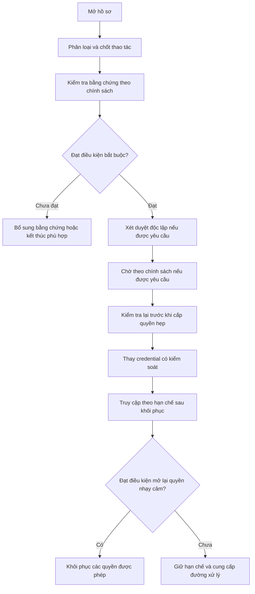

# High value account rules: Quy tắc khôi phục tài khoản có giá trị cao

Trong chương **Recovery Policy** của `SECURITY_AUTHENTICATION_ACCOUNT_RECOVERY`, tài khoản có giá trị cao là tài khoản mà việc chiếm quyền hoặc mất khả năng truy cập có thể gây hậu quả lớn. Giá trị đó có thể đến từ quyền quản trị, dữ liệu nhạy cảm, khả năng phê duyệt giao dịch, quyền thay đổi chính sách bảo mật hoặc mức phụ thuộc của cả tổ chức vào tài khoản.

Khôi phục an toàn phải giúp chủ tài khoản trở lại khi mất mật khẩu, MFA, passkey hoặc thiết bị xác thực, đồng thời ngăn đối phương biến đường dự phòng thành cách vượt xác thực mạnh. Với tài khoản có tác động lớn, câu hỏi không chỉ là “đã đủ điều kiện đổi mật khẩu chưa”, mà còn là “được thay yếu tố nào, tạo phiên nào và khôi phục những quyền nào”.

Bài học xây dựng cách diễn đạt các quy tắc đó thành chính sách có thể thực thi, xét cả xác minh danh tính, token dùng một lần, chống lạm dụng, phê duyệt và kiểm soát session. Các cấu hình và tình huống trong bài là ví dụ thiết kế, không phải một bộ yêu cầu chuẩn áp dụng cho mọi hệ thống.

## 1. Mục tiêu học tập

Sau bài học, bạn có thể:

- Phân loại tài khoản theo tác động khi bị chiếm quyền và khi bị khóa khỏi hệ thống.
- Xác định điều kiện bắt buộc mà điểm rủi ro thấp hoặc lý do khẩn cấp không được bỏ qua.
- Chọn đường khôi phục phù hợp với loại yếu tố đã mất và bằng chứng còn lại.
- Tách quyền thay credential, quyền tạo phiên và quyền thực hiện hành động nhạy cảm.
- Thiết kế phê duyệt, ngoại lệ, thu hồi và audit cho tài khoản đặc quyền.
- Nhận diện giới hạn khi nhiều bằng chứng cùng phụ thuộc một thiết bị, hộp thư hoặc tài khoản đồng bộ.

## 2. Xác định tài khoản có giá trị cao bằng tác động thực tế

Không nên đồng nhất tài khoản có giá trị cao với người nổi tiếng, khách hàng trả nhiều tiền hoặc chức danh lãnh đạo. Một tài khoản ít được sử dụng nhưng có quyền sửa cấu hình SSO có thể gây ảnh hưởng lớn hơn một tài khoản được đánh dấu VIP chỉ vì doanh thu.

| Đặc điểm | Hậu quả có thể xảy ra khi bị chiếm quyền | Hàm ý cho chính sách |
|---|---|---|
| Quản trị người dùng hoặc thay MFA cho người khác | Mở rộng chiếm quyền sang nhiều tài khoản | Bảo vệ cả quyền khôi phục cho người khác và quyền của chính tài khoản quản trị |
| Sửa cấu hình SSO, chính sách xác thực hoặc khóa hệ thống | Thay ranh giới tin cậy của nhiều dịch vụ | Xác định đúng thành phần có thẩm quyền khôi phục; hạn chế ngoại lệ cục bộ |
| Truy cập dữ liệu nhạy cảm trên diện rộng | Lộ lượng lớn dữ liệu hoặc bí mật nghiệp vụ | Kiểm soát cả phiên sau khôi phục và khả năng xuất dữ liệu |
| Phê duyệt hành động có tác động lớn | Phát sinh thay đổi khó đảo ngược | Không tự khôi phục quyền phê duyệt chỉ vì đã đổi được credential |
| Là quản trị viên duy nhất hoặc tài khoản vận hành thiết yếu | Tổ chức có thể mất đường quản trị | Chuẩn bị phương tiện và người dự phòng trước sự cố |
| Tạo API key hoặc cấp quyền cho ứng dụng | Đối phương thiết lập truy cập lâu dài ngoài session hiện tại | Đưa các phương tiện này vào phạm vi kiểm tra và thu hồi |

### Phân tầng để chọn chính sách

Một hệ thống có thể phân biệt tài khoản thông thường, tài khoản có tác động cao và tài khoản có đặc quyền trọng yếu. Tên và số tầng là lựa chọn nội bộ. Điều quan trọng là mỗi tầng gắn với các điều kiện cụ thể: bằng chứng được chấp nhận, quyền phê duyệt, hạn chế sau khôi phục và cách xử lý khi mất toàn bộ yếu tố.

Cần xét cả hai phía: thiệt hại do chấp nhận nhầm đối phương và thiệt hại do từ chối chủ tài khoản hợp lệ. Chính sách chặt nhưng không có đường dự phòng cho quản trị viên duy nhất sẽ tạo áp lực phải phá quy trình khi xảy ra sự cố.

### Bảo vệ chính việc phân loại

Mức bảo vệ phải được xác định từ dữ liệu đáng tin cậy phía máy chủ, như quyền hiệu lực, phạm vi tenant và cấu hình được quản lý. Không để client tự gửi `highValue = false` hoặc nhân viên hỗ trợ tự hạ tầng tài khoản để dễ khôi phục.

Nếu quyền của tài khoản thay đổi trong khi hồ sơ đang mở, cần đánh giá lại quyết định. Việc mất vai trò hiện tại không tự chứng minh rủi ro trước đó đã biến mất: tài khoản có thể đã tạo khóa truy cập, đăng ký ứng dụng hoặc nắm quyền gián tiếp. Chính sách cần chỉ rõ khi nào được hạ mức bảo vệ và ai có thẩm quyền thực hiện việc đó.

## 3. Tách các quyền thường bị gộp vào chữ “khôi phục”

Một bằng chứng hợp lệ không nhất thiết cho phép mọi thay đổi bảo mật. Cần tách ít nhất các quyền sau:

| Quyền | Phạm vi cần quyết định |
|---|---|
| Đặt lại mật khẩu | Được thay bí mật mật khẩu của đúng tài khoản |
| Thay authenticator | Được đăng ký yếu tố mới và xử lý yếu tố đã mất theo hồ sơ |
| Đổi kênh khôi phục | Được thay nơi nhận quyền khôi phục trong tương lai |
| Tạo phiên sau khôi phục | Phiên có mức xác thực và hạn chế nào |
| Khôi phục thao tác nhạy cảm | Khi nào được sửa chính sách, cấp quyền, xuất dữ liệu hoặc phê duyệt hành động lớn |
| Phát hành phương tiện truy cập mới | Có được tạo recovery code, API key hoặc dấu tin cậy thiết bị hay không |

Ví dụ, một token được cấp để đặt lại mật khẩu không được tự dùng để tắt MFA. Một hồ sơ được duyệt để thay thiết bị MFA cũng không tự cho phép chuyển email khôi phục sang địa chỉ mới.

Với tài khoản có giá trị cao, có thể cho phép lấy lại quyền truy cập giới hạn trước, rồi chỉ khôi phục thao tác nhạy cảm sau khi đáp ứng những điều kiện bổ sung đã định nghĩa. Đây phải là trạng thái được API thực thi; chỉ hiển thị cảnh báo trên giao diện không đủ.

## 4. Các điều kiện bắt buộc của chính sách

Các quy tắc dưới đây là khung để xây dựng chính sách nội bộ. Mức cụ thể phải phù hợp với tác động và đường dự phòng thực tế của dịch vụ.

| Nhóm quy tắc | Điều cần quy định | Ví dụ lỗi cần ngăn |
|---|---|---|
| Tài khoản và phạm vi | Mọi bằng chứng, phê duyệt và grant gắn với đúng subject, tenant và thao tác | Dùng phê duyệt của tài khoản này cho tài khoản khác |
| Bằng chứng | Nêu các tổ hợp được chấp nhận và điều kiện loại trừ | Biết mật khẩu là đủ để xóa MFA đang chặn đối phương |
| Kênh tin cậy | Thay kênh là một quyết định bảo mật riêng | Nhận mã ở email vừa nhập rồi được đổi cả MFA |
| Đặc quyền | Không hạ mức bảo vệ qua chính luồng đang xin khôi phục | Bỏ vai trò quản trị tạm thời để đi qua đường yếu hơn |
| Phê duyệt | Người duyệt có thẩm quyền, đạt yêu cầu xác thực và không tự duyệt hồ sơ của mình | Chủ hồ sơ dùng một session khác để tự phê duyệt |
| Nội dung được duyệt | Quyết định gắn với phiên bản thay đổi và có thời hạn | Thay email đích sau khi đã được duyệt |
| Quyền tiếp tục | Grant hẹp, có thời hạn và giới hạn sử dụng | Một token dùng nhiều lần để thêm nhiều authenticator |
| Áp dụng | Kiểm tra và tiêu thụ quyền phối hợp nguyên tử với thay đổi | Hai request đồng thời dùng cùng một quyền thành công |
| Sau khôi phục | Quy định thu hồi và thời điểm mở lại quyền nhạy cảm | Đổi mật khẩu nhưng giữ nguyên session hoặc passkey của đối phương |
| Ngoại lệ | Có tiêu chí, thẩm quyền và phạm vi xác định trước | Lý do khẩn cấp trở thành quyền bỏ mọi bước |

### Điểm rủi ro không thay thế điều kiện bắt buộc

Tín hiệu như thiết bị quen hoặc vị trí quen có thể giúp chọn mức kiểm tra bổ sung. Chúng không được tự xóa yêu cầu bắt buộc đối với tài khoản đặc quyền. Ngược lại, IP lạ không tự chứng minh gian lận vì người mất thiết bị có thể đang dùng một máy khác.

Nên diễn đạt quyết định theo hai lớp: trước hết kiểm tra các điều kiện bắt buộc; sau đó dùng tín hiệu rủi ro để yêu cầu thêm bước, chuyển xét duyệt hoặc tạm dừng. Một điểm số thấp không được biến tổ hợp bằng chứng bị cấm thành hợp lệ.

## 5. Ma trận theo thứ người dùng đã mất

| Tình huống | Điều có thể dùng làm đầu vào | Quy tắc đối với tài khoản có giá trị cao |
|---|---|---|
| Mất mật khẩu, còn authenticator được chính sách chấp nhận | Xác thực bằng phương tiện còn lại và bằng chứng phục vụ đặt lại | Chỉ cấp quyền đặt lại cần thiết; không tự xóa MFA hay đổi kênh |
| Còn mật khẩu nhưng mất MFA | Mật khẩu và đường dự phòng đã thiết lập | Mật khẩu đơn lẻ không đủ để loại bỏ chính lớp MFA còn thiếu |
| Mất thiết bị chứa passkey, còn passkey dự phòng hợp lệ | Xác thực bằng authenticator còn lại theo chính sách | Có thể dùng đường quản lý credential thông thường nếu đạt yêu cầu, không cần ép sang đường khôi phục yếu hơn |
| Mất thiết bị nhưng passkey đồng bộ vẫn sử dụng được | Khả năng dùng passkey trên môi trường khác được chấp nhận | Đánh giá cả trạng thái thiết bị bị mất và miền phụ thuộc của tài khoản đồng bộ |
| Mất toàn bộ authenticator, còn mã dự phòng | Recovery code và các điều kiện bổ sung của tầng tài khoản | Quy định rõ mã được phép mở quyền gì; mã không mặc nhiên phục hồi toàn bộ đặc quyền |
| Không còn authenticator và không truy cập được kênh dự phòng | Quy trình xác minh và phê duyệt ngoại lệ đã được thiết kế | Không tự chuyển sang câu hỏi cá nhân hoặc email mới để giải quyết thiếu bằng chứng |
| Nghi cả thiết bị và hộp thư đã bị chiếm | Bằng chứng và kênh còn độc lập với phần bị chiếm | Xử lý như khả năng chiếm quyền; không dựa riêng vào chính hộp thư đó |

Một quy tắc phải có đường xử lý khi điều kiện không đạt: bổ sung bằng chứng, chuyển quy trình phù hợp, từ chối thay đổi hoặc xử lý sự cố. Không thể yêu cầu người dùng chứng minh bằng đúng authenticator họ đã mất rồi gọi đó là một phương án khôi phục khả thi.

Với passkey, khôi phục tài khoản thường là cấp quyền đăng ký authenticator thay thế hoặc dùng phương tiện còn lại. Máy chủ dịch vụ không mặc nhiên có khả năng lấy lại khóa riêng từ thiết bị đã mất. Việc tạo một passkey mới có mật mã hợp lệ cũng không tự chứng minh người đăng ký có quyền với tài khoản; quyền đăng ký phải được xác lập trước.

## 6. Đánh giá chất lượng và tính độc lập của bằng chứng

Đếm số màn hình hoặc số lần nhập mã không phản ánh đúng độ tin cậy. Cần hỏi mỗi bằng chứng dựa vào bí mật, thiết bị, kênh hoặc người phê duyệt nào, và những thành phần đó có thể cùng bị chiếm hay không.

- Mật khẩu và recovery code cùng nằm trong một kho bí mật có thể cùng bị lấy khi kho đó bị chiếm.
- Hai passkey đồng bộ qua cùng một tài khoản có thể cùng phụ thuộc vào khả năng khôi phục tài khoản đồng bộ; không nên mặc nhiên coi chúng là hai nguồn dự phòng độc lập.
- Email và SMS nhận trên cùng điện thoại có thể cùng mất khi thiết bị bị chiếm hoặc không còn sử dụng được.
- Hai người duyệt cùng tin vào một lời khai chưa kiểm chứng không tạo ra hai bằng chứng danh tính.
- Ảnh giấy tờ có thể hỗ trợ một quy trình xác minh được thiết kế phù hợp, nhưng không tự chứng minh quyền giữ vai trò quản trị của tổ chức.

Chính sách cần mô tả loại bằng chứng, nguồn kiểm tra, thời điểm kiểm tra, mục đích và điều kiện chấp nhận. Không gọi hai lần hỏi lại cùng mật khẩu là hai yếu tố độc lập. Cũng không suy ra một số lượng yếu tố cố định chỉ từ tên gọi passkey; phải xét phương thức xác thực thực tế và thuộc tính mà hệ thống đã kiểm tra.

Nếu dùng xác minh danh tính ngoài đời thực, cần phân biệt hai câu hỏi: người yêu cầu là ai và người đó có quyền đối với tài khoản, tenant hoặc vai trò nào. Xác minh được một cá nhân không tự cho phép cấp lại mọi quyền mà họ yêu cầu.

## 7. Chuyển chính sách thành một luồng có trạng thái

Một luồng cho tài khoản có giá trị cao có thể dùng các trạng thái sau:



Không phải hồ sơ nào cũng cần mọi bước tùy chọn. Chính sách phải xác định khi nào cần phê duyệt, khi nào cần chờ và ai được chuyển trạng thái. Những trạng thái từ chối, hết hạn, bị hủy hoặc cần đánh giá lại phải được mô hình hóa rõ, thay vì để hồ sơ treo vô thời hạn.

### Những gì cần gắn với hồ sơ

Hồ sơ nên chứa định danh tài khoản và tenant, thao tác yêu cầu, mức bảo vệ đã xác định, kết quả kiểm tra bằng chứng, nội dung thay đổi được duyệt và phiên bản chính sách. Các giá trị này đến từ hệ thống đáng tin cậy; client không tự khai rằng tài khoản đã được xác minh hoặc có tầng thấp hơn.

Nếu tài khoản được cấp thêm đặc quyền, bằng chứng hết hiệu lực, kênh dự phòng bị báo chiếm hoặc chính sách thay đổi, hồ sơ có thể cần đánh giá lại. Không được giữ một quyết định cũ vô thời hạn chỉ vì nó từng hợp lệ khi mở yêu cầu.

### Thời gian chờ có vai trò giới hạn

Khoảng chờ có thể giúp phát hiện và phản đối một thay đổi. Chính sách phải nói rõ thời điểm bắt đầu, điều kiện hủy, cách xử lý thay đổi hồ sơ và điều kiện thực thi sau khi hết chờ. Không có một khoảng thời gian cố định phù hợp với mọi loại tài khoản.

Hết thời gian chờ không thay thế bằng chứng, phê duyệt hoặc kiểm tra trạng thái mới nhất. Nếu kênh nhận cảnh báo đã bị chiếm hoặc người dùng mất thiết bị, việc không có phản hồi cũng không chứng minh yêu cầu là hợp lệ.

## 8. Cấp và sử dụng quyền khôi phục có phạm vi hẹp

Ví dụ dưới đây thể hiện trình tự quyết định, không phải mã triển khai hoàn chỉnh:

```text
evaluate_recovery(case, account, server_evidence):
    require case.subject == account.id
    require case.tenant == account.tenant
    require case is active and not expired

    tier = policy.determine_protection_tier(
        opening_snapshot = case.protection_snapshot,
        current_authority = account.current_authority,
        relevant_security_history = account.security_history
    )

    rules = policy.resolve(tier, case.operation)
    require server_evidence belongs to this case and purpose
    require server_evidence satisfies rules.mandatory_evidence
    require approvals satisfy rules.authority_and_separation
    require case.approved_change_version == case.current_change_version
    require waiting_condition_satisfied_if_required(rules, case)
    require latest_security_state_allows_recovery(account, case)

    additional_decision = risk_policy.evaluate(account, case)
    if additional_decision requires more review or evidence:
        return PENDING_ADDITIONAL_CHECKS

    return issue_grant(
        subject = account.id,
        tenant = account.tenant,
        operation = case.operation,
        case_id = case.id,
        change_version = case.current_change_version,
        expiry = rules.grant_expiry,
        use_limit = 1
    )
```

Ở bước áp dụng, máy chủ phải kiểm tra lại grant, phạm vi thao tác, phiên bản thay đổi và trạng thái bảo mật liên quan. Kiểm tra token ở đầu request rồi cho phép payload tùy ý sửa email, MFA và vai trò là không đủ.

Token mang quyền cần được sinh bằng nguồn ngẫu nhiên mật mã hoặc cơ chế mật mã được thiết kế phù hợp, có thời hạn và được bảo vệ trong lưu trữ, truyền nhận, giao diện và log. Với token ngẫu nhiên lưu phía máy chủ, có thể lưu giá trị băm thay vì token nguyên văn; biện pháp đó không bảo vệ token đã bị lấy từ email hoặc trình duyệt.

Nếu dùng recovery code, phải kiểm soát việc tiêu thụ bằng chứng ngay tại giai đoạn mà chính sách chấp nhận nó; không để một mã đồng thời tạo nhiều hồ sơ đã được xác minh. Quyền tiếp tục của hồ sơ cũng cần giới hạn dùng riêng. Không tiêu thụ bí mật chỉ vì một trình quét email mở liên kết bằng request đọc trang.

Trong giao dịch áp dụng hoặc cơ chế bảo đảm tương đương, hệ thống thay đúng credential được phép, đánh dấu quyền đã dùng và ghi nhận kết quả. Thao tác lặp lại phải được từ chối hoặc trả kết quả đã có theo thiết kế, không tạo thêm credential hay session ngoài dự kiến.

Nếu không thể xác định chính sách, trạng thái thu hồi hoặc bằng chứng cần thiết, không được mặc định cấp quyền. Hệ thống cần cung cấp trạng thái xử lý và đường hỗ trợ phù hợp, đồng thời giữ nguyên các đường truy cập hợp lệ chưa có căn cứ phải đình chỉ.

## 9. Phê duyệt và ngoại lệ cho tài khoản đặc quyền

### Thẩm quyền không xuất phát từ lời tự khai

Người phê duyệt phải được xác định từ quyền đã quản lý trong tổ chức và tenant tương ứng. Tự xưng là quản lý, gửi email có tên hiển thị quen thuộc hoặc được người yêu cầu chỉ định không tự tạo ra thẩm quyền.

Người duyệt cần xác thực ở mức phù hợp, xem đúng nội dung thay đổi và xác nhận theo quy trình. Chính sách phải ngăn việc tự duyệt, kể cả khi một người có nhiều tài khoản mà hệ thống quản lý có thể nhận diện là cùng một chủ thể.

Với tài khoản trọng yếu, tổ chức có thể yêu cầu nhiều vai trò độc lập cùng phê duyệt. Đây là lựa chọn cần gắn với rủi ro và năng lực vận hành, không phải cứ tăng số người ký là giải quyết được bằng chứng yếu. Phải xác định từng người kiểm tra điều gì và có quyền quyết định phần nào.

### Nhân viên hỗ trợ không mặc nhiên được thực hiện mọi thay đổi

Nên tách quyền tiếp nhận hồ sơ, kiểm tra bằng chứng, phê duyệt và áp dụng. API cần thực thi quyền theo vai trò và tenant. Một ghi chú hỗ trợ viết “đã xác minh” không được tự đóng vai trò bằng chứng mật mã hoặc mở quyền quản trị.

Đối với tài khoản do nhà cung cấp danh tính tập trung quản lý, dịch vụ phụ thuộc không nên tự khôi phục đặc quyền bằng đường cục bộ yếu hơn. Chính sách cần chỉ rõ quyền sở hữu quyết định giữa tổ chức, nhà cung cấp danh tính và ứng dụng.

### Chuẩn bị cho quản trị viên duy nhất

Nếu chỉ có một quản trị viên, yêu cầu người quản trị khác phê duyệt sẽ không thể thực hiện. Cần chuẩn bị trước một phương án như authenticator dự phòng được bảo vệ, người giám hộ được đăng ký, quy trình với nhà cung cấp hoặc tài khoản khẩn cấp có quản trị vòng đời riêng.

Không nên đợi tới sự cố rồi tự cho phép một người không có thẩm quyền xác nhận, hay coi việc chờ lâu là đủ để bỏ phê duyệt. Nếu tổ chức không chấp nhận rủi ro của bất kỳ đường dự phòng nào, cần nói rõ khả năng không thể khôi phục trong trường hợp mất toàn bộ bằng chứng và thiết kế vận hành phù hợp.

### Truy cập khẩn cấp không phải miễn trừ toàn bộ chính sách

Tài khoản hoặc quy trình khẩn cấp cần có người chịu trách nhiệm, phạm vi quyền, cách bảo quản, giám sát sử dụng và điều kiện kết thúc. Có thể cấp quyền tạm thời đủ để xử lý nhu cầu vận hành cụ thể nếu mô hình cho phép, thay vì lập tức phục hồi mọi quyền của tài khoản đang tranh chấp.

Mọi ngoại lệ phải có căn cứ, người duyệt và thời hạn phù hợp. Sau khi dùng cần xử lý phương tiện đã cấp và xác nhận lại trạng thái bảo mật. Một ô chọn “khẩn cấp” do người yêu cầu tự bật không được làm mất các điều kiện bắt buộc.

## 10. Kiểm soát session và quyền nhạy cảm sau khôi phục

### Quy định rõ những gì cần thu hồi

Chính sách cần trả lời về session hiện có, refresh token, token khôi phục chưa dùng, dấu tin cậy thiết bị, authenticator đã mất và các phương tiện mới có thể do đối phương thêm. Không mặc định đổi mật khẩu sẽ tự thu hồi tất cả.

Với access token tự chứa, dịch vụ tài nguyên có thể tiếp tục chấp nhận tới khi hết hạn nếu chỉ kiểm tra chữ ký và thời hạn. Muốn thu hồi sớm phải có cơ chế được các thành phần thực thi, chẳng hạn kiểm tra trạng thái hoặc phiên bản bảo mật phù hợp. Việc tăng một trường trong cơ sở dữ liệu không có tác dụng tức thời nếu bên sử dụng token không kiểm tra trường đó.

Thu hồi session cũng không tự xóa passkey, API key hoặc quyền cấp cho ứng dụng. Khi có khả năng chiếm quyền, cần kiểm tra các thay đổi nhạy cảm trong khoảng thời gian liên quan và xử lý từng loại phương tiện theo cơ chế của nó.

### Phiên sau khôi phục có thể bị hạn chế

Một phiên giới hạn có thể cho xem trạng thái hồ sơ, đăng ký yếu tố được phê duyệt hoặc hoàn tất bước xác minh còn lại. Nó không nên đồng thời có quyền sửa chính sách xác thực, tạo khóa truy cập lâu dài hoặc phê duyệt hành động lớn nếu chính sách chưa cho phép.

Hạn chế phải được áp dụng ở các API và dịch vụ liên quan, kể cả đường truy cập cũ có thể bỏ qua giao diện. Không chỉ gắn một nhãn ở trang chủ rồi vẫn cho gọi API quản trị bằng cùng session.

### Điều kiện mở lại quyền phải có thể kiểm chứng

Có thể yêu cầu hoàn tất đăng ký và kiểm tra authenticator mới, đạt phê duyệt bổ sung, xử lý cảnh báo chưa giải quyết và kết thúc khoảng hạn chế được quy định. Các điều kiện cụ thể phụ thuộc tầng tài khoản và mục tiêu bảo vệ.

Đăng ký xong authenticator mới chỉ chứng minh phương tiện mới hoạt động theo cơ chế đã kiểm tra; nó không sửa sai sót nếu quyết định cho phép đăng ký trước đó đã chấp nhận nhầm người. Do đó, cả bước cấp quyền và bước mở lại đặc quyền đều cần được bảo vệ.

## 11. Tình huống thực tế: Thay MFA cho tài khoản quản trị

Hà quản trị người dùng và cấu hình bảo mật của một hệ thống doanh nghiệp. Tài khoản được phân loại đặc quyền trọng yếu. Hà mất điện thoại chứa ứng dụng MFA, còn biết mật khẩu và có bộ recovery code cất ở nơi dự phòng. Hộp thư khôi phục cũng được dùng trên điện thoại đã mất nên không được mặc nhiên coi là một nguồn độc lập với thiết bị đó.

Trong ví dụ này, tổ chức đã quy định trước đường thay MFA: mã dự phòng hợp lệ được nộp tại giao diện chính thức, một người duyệt độc lập có thẩm quyền trong tenant, khoảng chờ theo chính sách và quyền truy cập giới hạn sau thay đổi. Tổ hợp này là lựa chọn minh họa của tổ chức; không khẳng định nó đủ cho mọi tài khoản đặc quyền.

### Cách chính sách được áp dụng

1. Máy chủ xác định tầng bảo vệ từ quyền thực tế và mở hồ sơ `authenticator.replace`. Mật khẩu đúng không tự cấp quyền xóa MFA.
2. Hà nộp recovery code qua giao diện chính thức. Máy chủ kiểm tra và tiêu thụ mã theo chính sách, gắn kết quả với hồ sơ; nhân viên hỗ trợ không nhận mã nguyên văn.
3. Người duyệt dùng tài khoản riêng đạt mức xác thực yêu cầu, kiểm tra phạm vi hồ sơ và các căn cứ theo quy trình. Người này không được thay đổi email khôi phục như một phần bổ sung tùy ý.
4. Hồ sơ trải qua khoảng chờ nếu điều kiện đó áp dụng. Một thông báo hoặc phản đối mới có thể làm hồ sơ cần đánh giá lại; hết giờ không tự bỏ qua cảnh báo.
5. Trước khi thực thi, hệ thống kiểm tra lại bằng chứng, phê duyệt, quyền tài khoản và phiên bản thay đổi. Grant chỉ cho phép thay MFA cho đúng tài khoản trong hồ sơ.
6. Authenticator mới được đăng ký và kiểm tra theo quy trình. Yếu tố bị mất, các session và quyền tiếp tục liên quan được xử lý đúng chính sách, phối hợp với thay đổi để tránh trạng thái cấp quyền ngoài dự kiến.
7. Hà nhận phiên có giới hạn đã định nghĩa. Quyền sửa cấu hình SSO, tạo phương tiện truy cập lâu dài và khôi phục tài khoản của người khác chỉ được mở lại khi đủ điều kiện tương ứng.
8. Audit ghi nhận kết quả áp dụng và xử lý thu hồi thực tế. Thông báo đi tới các kênh phù hợp; không chỉ tới một địa chỉ mới do người yêu cầu cung cấp.

Nếu Hà không còn recovery code hoặc bằng chứng dự phòng nào khác, hệ thống phải dùng đường mất toàn bộ yếu tố đã được tổ chức thiết kế. Không thể tự thay mã dự phòng bằng vài câu hỏi về nhân sự hoặc một email mới chỉ để hoàn tất hồ sơ.

Nếu đối phương lấy được recovery code và còn tác động được người duyệt, rủi ro vẫn tồn tại. Đó là lý do phải bảo vệ cả nơi giữ mã, tài khoản người duyệt, căn cứ xét duyệt và khả năng phát hiện sau thay đổi.

## 12. Chống lạm dụng và bảo vệ khả năng sử dụng

Tài khoản có giá trị cao cũng là mục tiêu gây gián đoạn. Nếu một yêu cầu khôi phục chưa xác minh có thể khóa quản trị viên duy nhất hoặc thu hồi mọi phiên, đối phương có thể làm tổ chức mất quyền vận hành mà không cần vượt xác thực.

Cần tách giới hạn cho nguồn yêu cầu, trạng thái của hồ sơ và trạng thái tài khoản. Giới hạn tần suất, số lần thử và gửi lại mã phải giảm lạm dụng mà vẫn có đường xử lý cho người dùng hợp lệ. Chỉ dựa vào IP có thể ảnh hưởng cả tổ chức dùng chung mạng và không ngăn được nguồn phân tán.

Phản hồi công khai không nên tiết lộ không cần thiết rằng một địa chỉ thuộc tầng quản trị trọng yếu hay dùng một đường dự phòng cụ thể. Thông tin cần cho xét duyệt chỉ hiển thị cho người có quyền và được ghi nhận truy cập phù hợp.

### Audit và dữ liệu xác minh

Nên lưu định danh hồ sơ, tài khoản, tenant, thao tác, tầng bảo vệ, phiên bản chính sách, loại bằng chứng, người duyệt, thời điểm và kết quả. Cần phân biệt quyết định được duyệt với thay đổi đã thực sự áp dụng, nhất là khi phát thông báo hoặc thu hồi ở dịch vụ khác gặp lỗi.

Không ghi token, mật khẩu, recovery code hoặc bí mật MFA vào log. Nếu có tài liệu danh tính, chỉ thu thập dữ liệu cần thiết, giới hạn người xem, xác định thời hạn lưu và bảo vệ quá trình xử lý. Lưu thật nhiều giấy tờ không tự làm chính sách mạnh hơn.

### Trải nghiệm cần giải thích được

Người dùng nên biết mình đang khôi phục thao tác nào, còn thiếu điều kiện gì, liệu đang có khoảng chờ và cách liên hệ hỗ trợ chính thức. Không hứa một mốc hoàn tất chắc chắn nếu việc xét duyệt còn chưa đạt điều kiện.

Đường dự phòng cần tính đến người không còn thiết bị, không truy cập email cũ hoặc gặp hạn chế về khả năng tiếp cận. Cách thu thập bằng chứng có thể thay đổi theo phương án đã phê duyệt, trong khi mục tiêu bảo vệ của thao tác vẫn phải được đáp ứng.

## 13. Bảng kiểm tra hành vi của chính sách

| Tình huống | Hành vi cần đạt |
|---|---|
| Client tự khai tài khoản không có giá trị cao | Máy chủ vẫn chọn chính sách từ dữ liệu có thẩm quyền |
| Có mật khẩu nhưng chưa vượt MFA | Không tự được thay MFA hoặc thêm passkey |
| Có passkey dự phòng đạt yêu cầu | Được dùng đường xác thực và quản lý credential phù hợp, không bị ép dùng bằng chứng yếu hơn |
| Nhập email mới và nhận được mã ở đó | Chỉ xác nhận quyền kiểm soát email mới; quyền thay kênh vẫn được xét riêng |
| Người yêu cầu đồng thời là người duyệt | Không được tự phê duyệt khi chính sách yêu cầu độc lập |
| Tài khoản được cấp thêm đặc quyền lúc hồ sơ đang mở | Đánh giá lại theo mức bảo vệ phù hợp trước khi thực thi |
| Thay đích hoặc thao tác sau phê duyệt | Quyết định cũ không được dùng cho nội dung mới |
| Hai request cùng sử dụng một grant | Chỉ một lần áp dụng hợp lệ theo giới hạn sử dụng |
| Hết khoảng chờ nhưng bằng chứng đã bị vô hiệu hóa | Không tự cấp quyền chỉ vì thời gian đã trôi qua |
| Phiên khôi phục còn bị hạn chế gọi API quản trị trực tiếp | API thực thi hạn chế, kể cả khi bỏ qua giao diện |
| Đã đổi mật khẩu nhưng còn API key đáng ngờ | Tiếp tục xử lý API key theo phạm vi sự cố, không coi đổi mật khẩu là kết thúc |
| Một người lạ mở nhiều yêu cầu cho quản trị viên duy nhất | Chống lạm dụng không tự biến thành khóa tài khoản vô thời hạn |

Bảng này mô tả các kết quả cần xác minh khi triển khai chính sách. Các tiêu chí phải bao gồm cả nhánh thất bại và trạng thái đồng thời, không chỉ đường khôi phục thành công.

### Dấu hiệu chính sách đang có lỗ hổng

- Tất cả loại tài khoản dùng cùng một email OTP để thay toàn bộ yếu tố, dù đăng nhập thông thường có yêu cầu mạnh hơn.
- Nhân viên có thể hạ tầng tài khoản, đổi kênh rồi tự phê duyệt chính hồ sơ đó.
- Thông báo chỉ được gửi sau khi thay đổi tới đúng kênh vừa được thêm.
- Một ngoại lệ không có thời hạn hoặc không thể xác định người chịu trách nhiệm.
- Phiên bị hạn chế trên giao diện nhưng vẫn tạo được khóa truy cập qua API.
- Không có phương án đã chuẩn bị cho quản trị viên duy nhất mất toàn bộ yếu tố.

## 14. Bài tập áp dụng

**Đề bài:** Một hệ thống cho quản trị viên khôi phục bằng mật khẩu và mã gửi tới email. Nếu không còn email, nhân viên hỗ trợ được đổi email sau khi hỏi tên công ty và mã khách hàng. Sau khi đặt mật khẩu mới, hệ thống cấp session quản trị đầy đủ nhưng không kiểm tra các passkey hoặc API key đã thêm gần đây.

**Yêu cầu:**

1. Xác định các tài sản và quyền khiến tài khoản này thuộc nhóm có tác động lớn.
2. Chỉ ra bước nào đang biến thông tin nhận diện hoặc kênh mới thành quyền khôi phục.
3. Thiết kế riêng điều kiện đặt lại mật khẩu, thay MFA hoặc passkey, đổi kênh và mở lại quyền quản trị.
4. Đề xuất đường mất toàn bộ yếu tố có thể vận hành được mà không dùng câu hỏi công khai làm bằng chứng thay thế.
5. Nêu cách thực thi hạn chế phiên và xử lý phương tiện truy cập do đối phương có thể đã tạo.

**Gợi ý phân tích:** Mật khẩu có thể đã bị lộ; thông tin công ty và mã khách hàng không mặc nhiên là bí mật; email mới chỉ thuộc quyền kiểm soát của người đang cung cấp nó. Cần phân loại bằng dữ liệu có thẩm quyền, ràng buộc bằng chứng và phê duyệt vào thao tác cụ thể, kiểm tra lại trước khi áp dụng và xử lý quyền truy cập sau khôi phục theo kiến trúc thực tế.

## 15. Điều cần ghi nhớ

Tài khoản có giá trị cao cần quy tắc khôi phục dựa trên hậu quả của việc chiếm quyền và mất khả năng truy cập. Chính sách phải chỉ rõ bằng chứng nào được chấp nhận, ai có quyền phê duyệt, thay đổi nào được phép và khi nào được mở lại quyền nhạy cảm.

Không nên để một yếu tố bị lộ, một kênh mới do người yêu cầu chọn hoặc áp lực vận hành tự tháo bỏ các lớp bảo vệ khác. Đường dự phòng phải được chuẩn bị trước, có thể sử dụng khi mất yếu tố thật và được thực thi bằng quyền hẹp, kiểm soát session, thu hồi và audit tương xứng với tác động của tài khoản.