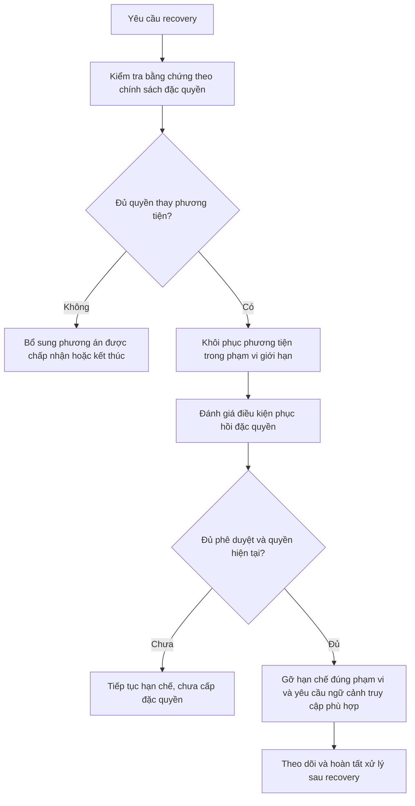

# Privileged account restrictions: giới hạn khôi phục đối với tài khoản đặc quyền

Khôi phục tài khoản của một người dùng có quyền quản trị không chỉ giúp họ đăng nhập lại. Nếu luồng đó đồng thời khôi phục quyền tạo quản trị viên, đổi chính sách MFA hoặc cấp khóa truy cập hạ tầng, một quyết định recovery sai có thể ảnh hưởng cả tổ chức.

**Privileged account restrictions** là những giới hạn được áp dụng cho việc khôi phục tài khoản có khả năng thực hiện hành động đặc quyền. Chính sách phải kiểm soát cả bằng chứng xác minh người yêu cầu, quyền được cấp trong thời gian khôi phục và điều kiện để sử dụng lại quyền quản trị.

Bài học này thuộc chủ đề **Recovery Policy**, trong phạm vi thiết kế luồng khôi phục an toàn khi mất mật khẩu, MFA, passkey hoặc thiết bị xác thực. Trọng tâm là giữ ranh giới giữa **lấy lại khả năng xác thực** và **được phép sử dụng đặc quyền**, đồng thời có phương án duy trì hoạt động khi người quản trị hợp pháp gặp sự cố.

## 1. Nhận diện tài khoản đặc quyền theo khả năng thực tế

Không nên chỉ kiểm tra tên role có chứa chữ `admin` hay không. Một tài khoản có thể rất nhạy cảm vì nó điều khiển đường cấp quyền, phương tiện recovery hoặc bí mật mà tài khoản khác phụ thuộc.

| Khả năng của tài khoản | Vì sao recovery cần giới hạn riêng? |
| --- | --- |
| Quản trị toàn hệ thống hoặc nhiều tenant | Cấp nhầm quyền có thể ảnh hưởng nhiều tổ chức |
| Chủ sở hữu một tổ chức hoặc workspace | Có thể chuyển quyền sở hữu, mời quản trị viên hoặc thay cấu hình tin cậy |
| Quản lý danh tính và phân quyền | Có thể thay quyền, đặt lại MFA hoặc hỗ trợ recovery cho người khác |
| Quản lý khóa, secret, token tích hợp | Có thể tạo đường truy cập còn tồn tại sau khi phiên bị thu hồi |
| Thay chính sách xác thực hoặc liên kết danh tính | Có thể làm yếu yêu cầu đăng nhập của nhiều người dùng |
| Xuất dữ liệu nhạy cảm, sửa cấu hình triển khai hoặc phê duyệt tác vụ quan trọng | Tác động có thể vượt xa phạm vi hồ sơ cá nhân |
| Phê duyệt recovery đặc quyền | Có thể trở thành điểm khởi đầu để chiếm các tài khoản khác |
| Truy cập khẩn cấp theo kế hoạch của tổ chức | Được thiết kế để xử lý sự cố nên cần bảo vệ đường sử dụng và phục hồi riêng |

Quyền có thể đến từ role trực tiếp, nhóm, quyền kế thừa, ủy quyền hoặc khả năng kích hoạt một role khi cần. Vì vậy, phân loại cần xét **quyền hiệu lực và khả năng nâng quyền**, không chỉ quyền đang bật ở giao diện.

Cần xác định phạm vi chính sách: một tài khoản có thể là người dùng thường trong tổ chức A nhưng là owner của tổ chức B. Một hạn chế theo tenant không được vô tình bị bỏ qua khi người dùng đổi workspace.

### 1.1. Tài khoản con người và danh tính máy có quy trình khác nhau

Mất điện thoại của quản trị viên là vấn đề của phương tiện xác thực con người. Mất khóa của một workload là vấn đề quản lý danh tính máy và vòng đời bí mật.

Một danh tính máy có quyền cao không nên có đường “quên mật khẩu” cho phép bất kỳ ai nhận email liên hệ thay khóa của nó. Quy trình thay hoặc thu hồi khóa cần dựa vào chủ thể quản lý đã được thiết lập, quyền trên workload và chính sách thay đổi của tổ chức.

Trong bài này, luồng chính dành cho tài khoản con người. Những danh tính máy do tài khoản đó quản lý vẫn phải được xét khi đánh giá tác động và xử lý sau sự cố.

## 2. Vì sao recovery của tài khoản đặc quyền có mức tác động khác?

Với người dùng thông thường, chiếm tài khoản có thể làm lộ dữ liệu của chính người đó. Với quản trị viên, đối thủ có thể dùng tài khoản đầu tiên để mở rộng quyền và phá cơ chế khôi phục của cả tổ chức.

Một chuỗi có thể xảy ra:

1. Đối thủ kiểm soát email hoặc số điện thoại liên hệ của quản trị viên.
2. Đường recovery cho phép đặt mật khẩu mới hoặc thay MFA bằng kênh đó.
3. Backend mở phiên có đầy đủ quyền owner ngay sau recovery.
4. Đối thủ tạo quản trị viên mới, cấp API token hoặc sửa liên kết danh tính.
5. Chủ tài khoản lấy lại email nhưng các đường truy cập mới của đối thủ vẫn tồn tại.

Điểm nguy hiểm không chỉ là việc đặt lại một bí mật. Đó là việc chuyển bằng chứng của recovery thành năng lực quản trị mà không có quyết định cấp quyền tương ứng.

| Mối đe dọa | Hạn chế cần cân nhắc |
| --- | --- |
| Chiếm email hoặc số điện thoại | Không dùng quyền nhận mã làm căn cứ duy nhất cho mọi quyền quản trị |
| Giả mạo người quản trị để thuyết phục hỗ trợ | Giữ quy trình xác minh và thẩm quyền phê duyệt đã định |
| Lấy được một phiên trình duyệt | Yêu cầu bằng chứng mới phù hợp cho thao tác bảo mật; không chỉ dựa vào việc đang đăng nhập |
| Lạm dụng quyền phê duyệt recovery | Tách vai trò, ràng buộc phê duyệt và ghi nhận người thực hiện |
| Tạo đường truy cập lâu dài sau recovery | Kiểm soát việc tạo token, thêm quản trị viên và thay kênh tin cậy |
| Gửi hàng loạt yêu cầu để khóa quản trị viên thật | Không cho yêu cầu công khai chưa xác minh tự gây tác động mạnh lên tài khoản |

Bảo vệ recovery và bảo vệ tính sẵn sàng cần được thiết kế cùng nhau. Một cơ chế luôn khóa toàn bộ quản trị viên chỉ vì có người nhập đúng email có thể trở thành công cụ gây gián đoạn.

## 3. Tách ba quyết định trong chính sách

Một quy trình rõ ràng nên phân biệt:

1. **Xác minh quyền khôi phục tài khoản:** bằng chứng nào nối người yêu cầu với tài khoản đích?
2. **Khôi phục phương tiện xác thực:** họ được đặt lại hoặc đăng ký phương tiện nào?
3. **Khôi phục khả năng sử dụng đặc quyền:** họ được thực hiện những hành động quản trị nào và khi nào?

Ba quyết định có thể liên quan nhưng không đồng nhất. Nhập đúng mã recovery không tự chứng minh người đó vẫn được tổ chức cho phép làm quản trị viên.

Ví dụ, một người đã bị thu hồi vai trò do chuyển công việc có thể còn quyền khôi phục tài khoản cá nhân của họ. Việc khôi phục đó không được làm sống lại vai trò cũ.

### 3.1. Khôi phục tài khoản không phải khôi phục một bản chụp quyền cũ

Bản chụp role trước sự cố hữu ích cho điều tra, nhưng không phải nguồn cấp quyền tuyệt đối sau recovery.

Khi xem xét dùng lại đặc quyền, hệ thống phải đối chiếu:

- Tài khoản hiện còn thuộc tổ chức hay không.
- Quyền nào đã bị thu hồi hoặc hết hạn.
- Role, nhóm và điều kiện ủy quyền hiện tại.
- Phạm vi được phê duyệt trong chính giao dịch recovery.
- Các hạn chế đang áp dụng do sự cố hoặc chính sách tổ chức.

Không tự thêm lại quyền chỉ vì nó xuất hiện trong lịch sử. Cũng không tự mở mọi quyền vừa được gán trong lúc recovery đang chờ mà chưa đánh giá lại quyết định.

### 3.2. Không mặc định mọi thay đổi phương tiện đều là recovery rủi ro cao

Người quản trị còn sử dụng được một phương tiện mạnh đã đăng ký có thể thực hiện quy trình quản lý phương tiện thông thường với xác thực lại phù hợp. Trường hợp này khác với mất mọi phương tiện và chỉ còn kênh liên hệ.

Chính sách cần phân loại tình huống từ bằng chứng thực tế. Không hạ yêu cầu chỉ vì người dùng chọn nhãn “đổi điện thoại”, nhưng cũng không nhất thiết áp dụng cùng một quy trình khẩn cấp cho mọi lần thêm passkey hợp lệ.

## 4. Đặt các giới hạn theo giai đoạn

Bảng sau là ví dụ thiết kế cho một dịch vụ giả định. Điều kiện cụ thể phải được chọn theo mô hình đe dọa, tài sản và cơ cấu quản trị của dịch vụ.

| Giai đoạn | Quyền có thể cấp | Hạn chế điển hình |
| --- | --- | --- |
| Mới nhận yêu cầu | Mã giao dịch và hướng dẫn chung | Chưa thay phương tiện, chưa tự khóa toàn bộ tài khoản |
| Đang thu thập bằng chứng | Tiếp tục giao dịch trong phạm vi hẹp | Chưa đọc dữ liệu quản trị hoặc gọi API đặc quyền |
| Đủ căn cứ để thay phương tiện | Đặt lại phương tiện đã được cho phép | Không tự chuyển quyền sở hữu, thêm admin hoặc đổi chính sách tổ chức |
| Có thể đăng nhập nhưng còn hạn chế recovery | Truy cập những chức năng được chỉ định | Chặn đặc quyền cho tới khi đủ điều kiện phục hồi |
| Đã được phê duyệt phục hồi đặc quyền | Sử dụng đúng quyền còn hợp lệ và được chấp nhận | Không khôi phục quyền đã bị thu hồi; yêu cầu ngữ cảnh xác thực phù hợp |
| Xử lý theo đường khẩn cấp | Quyền tạm thời cho nhiệm vụ cụ thể | Phạm vi, thời hạn và người chịu trách nhiệm được xác định riêng |

Không phải hệ thống nào cũng cần mở phiên ở giai đoạn trung gian. Một lựa chọn hợp lệ là chỉ cấp quyền thay phương tiện, rồi yêu cầu một lần đăng nhập mới theo chính sách.

Nếu có phiên trung gian, không nên cho đọc dữ liệu nhạy cảm theo mặc định. Quyền chỉ đọc vẫn có thể làm lộ secret, bản sao lưu hoặc dữ liệu của tổ chức.

### 4.1. Những hành động nên được xác định rõ trong danh mục hạn chế

Tùy sản phẩm, danh mục có thể bao gồm:

- Thêm, xóa hoặc nâng quyền quản trị viên.
- Chuyển quyền sở hữu tổ chức.
- Sửa nhóm có khả năng cấp quyền hoặc phê duyệt recovery.
- Thay chính sách MFA, đăng nhập hoặc liên kết danh tính.
- Đổi kênh recovery hay thiết lập truy cập khẩn cấp.
- Đặt lại phương tiện xác thực cho người dùng khác.
- Tạo API token, khóa truy cập hoặc thông tin tích hợp có quyền cao.
- Xuất dữ liệu, tải bản sao lưu hoặc đọc bí mật.
- Xóa tài nguyên quan trọng hoặc tắt cơ chế kiểm toán.

Các đường gián tiếp cũng cần được bao phủ. Chặn nút “thêm admin” không đủ nếu tài khoản vẫn sửa được thành viên của nhóm tự động cấp role admin.

## 5. Chọn bằng chứng và đường thay thế cho tài khoản đặc quyền

Mức bằng chứng cần tương xứng với kết quả được cấp. Một kênh được dùng để liên hệ không nhất thiết đủ để khôi phục quyền quản trị.

| Bằng chứng hoặc ngữ cảnh | Giá trị có thể có | Giới hạn cần ghi rõ |
| --- | --- | --- |
| Phương tiện mạnh còn sử dụng được, đã đăng ký trước | Chứng minh quyền sử dụng phương tiện của tài khoản | Cần kiểm tra độ mới, mục đích và tình trạng thu hồi |
| Mã dự phòng được cấp từ trước | Tạo đường thay thế khi mất phương tiện chính | Chất lượng phụ thuộc việc sinh, lưu, xác minh và phạm vi được thiết kế |
| Phiên quản trị đang mở | Cho biết có một ngữ cảnh truy cập còn tồn tại | Phiên có thể bị đánh cắp; không tự đủ quyền thay phương tiện |
| Email hoặc SMS | Chứng minh nhận được thử thách qua kênh đó | Kênh có thể bị chiếm; nhiều thử thách cùng kênh không thành nhiều căn cứ độc lập |
| Phê duyệt của người có thẩm quyền trong tổ chức | Xác nhận một quyết định tổ chức theo quy trình | Không tự thay thế mọi bằng chứng về người yêu cầu |
| Hồ sơ xác minh danh tính | Có thể hỗ trợ đối chiếu trong quy trình đã thiết kế | Phải có căn cứ nối danh tính với tài khoản và tổ chức |
| IP, vị trí hoặc thiết bị quen thuộc | Bổ sung ngữ cảnh rủi ro | Không tự tạo quyền quản trị khi thiếu bằng chứng bắt buộc |

Ví dụ, nếu một dịch vụ yêu cầu phương án recovery đã đăng ký độc lập với email cho owner, việc nhận hai mã liên tiếp qua email không đạt yêu cầu đó.

Cũng không nên áp đặt một số lượng bằng chứng cố định cho mọi sản phẩm. Điều quan trọng là bộ điều kiện thực sự chống được đối thủ đang xét và có phạm vi quyền rõ ràng.

### 5.1. Phương tiện mới không chứng minh quyền sở hữu tài khoản cũ

Người yêu cầu có thể tự tạo passkey mới và chứng minh họ sử dụng được khóa đó. Kết quả này chưa chứng minh họ có quyền gắn khóa vào tài khoản quản trị đích.

Tương tự, xác minh một email vừa được nhập chỉ chứng minh quyền kiểm soát email mới. Nó không xác lập quan hệ với tài khoản cần khôi phục.

Quyền đăng ký phương tiện phải đến từ giao dịch đã đủ căn cứ. Không dùng phương tiện mới làm căn cứ duy nhất để hợp thức hóa chính quyết định đăng ký nó.

### 5.2. Khi không còn phương án đủ điều kiện

Nếu người quản trị mất mọi phương tiện được chấp nhận, hệ thống chỉ được chuyển sang một đường thay thế đã được thiết kế và có thẩm quyền phù hợp.

Đường đó có thể là quy trình quản trị của tổ chức hoặc thẩm định có đối chiếu liên hệ đã thiết lập từ trước. Không nên coi thông tin trên website công khai, email cùng tên miền hay lời tự nhận “tôi là giám đốc” là điều kiện đủ.

Nếu chưa có căn cứ đạt chính sách, kết quả có thể là chưa thể khôi phục. Tính khẩn cấp không tự nâng chất lượng bằng chứng.

## 6. Phê duyệt độc lập và phân tách trách nhiệm

Đối với một số đặc quyền, chính sách có thể yêu cầu người khác phê duyệt trước khi cho sử dụng lại quyền. Số người và loại người phê duyệt là lựa chọn theo rủi ro; không có một con số phù hợp mọi tổ chức.

Mục tiêu là tránh để một người hoặc một sự cố kiểm soát toàn bộ chuỗi:

```text
yêu cầu recovery
    -> xác minh bằng chứng
    -> cho phép thay phương tiện
    -> phê duyệt dùng lại đặc quyền
    -> thực hiện thay đổi có tác động lớn
```

Một người tự gửi yêu cầu rồi tự phê duyệt không tạo ra kiểm soát độc lập. Hai tài khoản cùng do một người kiểm soát cũng không tự tạo ra hai chủ thể phê duyệt.

### 6.1. Điều kiện đối với người phê duyệt

Chính sách nên trả lời:

- Người phê duyệt có được tổ chức ủy quyền từ trước cho loại quyết định này không?
- Họ có đang sử dụng tài khoản và phương tiện xác thực đạt yêu cầu không?
- Tài khoản của họ có đang recovery hoặc nằm trong cùng sự cố bị nghi ngờ không?
- Họ có quyền trên đúng tenant và đúng phạm vi cần phê duyệt không?
- Quyền phê duyệt có bị thay đổi sau khi họ đưa ra quyết định không?
- Việc phê duyệt có xung đột với quy tắc tách người yêu cầu và người chấp thuận không?

Không để một phiên recovery bị hạn chế tự thêm người vào nhóm phê duyệt rồi dùng người đó để mở lại quyền của mình.

Cũng cần xét vòng lặp: A có thể khôi phục B, B có thể khôi phục A, và cả hai đều chỉ dựa vào các bằng chứng vừa được tạo từ cùng một sự cố. Số bước nhiều không sửa được việc thiếu một căn cứ tin cậy độc lập.

### 6.2. Phê duyệt phải gắn với nội dung cụ thể

Một lời chấp thuận chung như “đồng ý hỗ trợ người dùng” dễ bị dùng quá phạm vi. Bản ghi phê duyệt nên gắn với:

| Thành phần | Mục đích |
| --- | --- |
| Định danh bất biến của tài khoản đích | Tránh nhầm với tên hiển thị hoặc email gần giống |
| Tổ chức hoặc tenant | Tránh sử dụng phê duyệt chéo phạm vi |
| Giao dịch recovery và phiên bản quyết định | Không dùng lại cho một yêu cầu đã thay đổi |
| Thao tác và tập quyền được xem xét | Phân biệt thay MFA với phục hồi quyền owner |
| Người phê duyệt, thời điểm và căn cứ thẩm quyền | Có thể giải thích ai đã quyết định |
| Thời hạn và điều kiện mất hiệu lực | Không chấp nhận phê duyệt quá cũ hoặc không còn phù hợp |

Nếu người yêu cầu đổi mục tiêu từ “thay passkey” sang “chuyển quyền sở hữu”, cần đánh giá và phê duyệt cho nội dung mới.

Phê duyệt là một phần của quyết định cấp quyền. Nó không làm một bằng chứng đã hết hạn hoặc sai tài khoản trở nên hợp lệ.

## 7. Thực thi hạn chế ở backend và ở nơi quyết định truy cập

Ẩn các nút quản trị chỉ thay đổi giao diện. Hạn chế phải có hiệu lực ở API và các thành phần thực hiện hành động.

Một mô hình có thể tách:

- **Trạng thái giao dịch recovery:** yêu cầu đang chờ, đủ bằng chứng, hết hạn hay hoàn tất.
- **Hạn chế của tài khoản:** đặc quyền nào đang bị giữ lại sau một quyết định recovery đã được xác thực.
- **Ngữ cảnh session:** session được cấp bằng cách nào, xác thực gần nhất lúc nào, có phạm vi gì.
- **Quyền tổ chức hiện tại:** role và ủy quyền đang còn hiệu lực.

Các trạng thái này không nên bị gom thành một cờ `authenticated = true`.

### 7.1. Ví dụ kiểm tra thao tác đặc quyền

```text
authorizePrivilegedAction(subject, tenantId, action):
    account = loadCurrentAccountSecurityState(subject.accountId)
    session = validateCurrentSession(subject.sessionId)
    permissions = resolveCurrentPermissions(account.id, tenantId)

    require session is active and not revoked
    require session is valid for this tenant and action

    if action is privileged:
        require recoveryRestrictionsAllow(account, session, tenantId, action)
        require authenticationContextMeetsPolicy(session, action)
        require currentOrganizationApprovalIsValidIfRequired(account, action)

    require permissions allow action
    return ALLOW
```

Đây là mã giả cho ranh giới quyết định. Cách tổ chức dịch vụ và kỹ thuật kiểm tra phụ thuộc kiến trúc thực tế.

Điểm quan trọng là một role còn trong cơ sở dữ liệu không tự bỏ qua hạn chế recovery. Tương tự, một session mới xác thực bằng phương tiện vừa được khôi phục không tự làm mất trạng thái đang chờ phục hồi đặc quyền.

### 7.2. Hạn chế cần bao phủ cả đường thực thi gián tiếp

Các điểm thường dễ bỏ sót gồm:

- API khác với API mà giao diện quản trị đang gọi.
- Công cụ dòng lệnh, ứng dụng di động hoặc endpoint quản trị nội bộ.
- Yêu cầu xử lý hàng loạt và tác vụ được xếp hàng.
- Chức năng mạo danh người dùng hoặc ủy quyền thao tác.
- Đường tạo token có thể dùng tại một dịch vụ khác.
- Dịch vụ dựa vào role đã được cache hoặc nhúng trong token cũ.

Tác vụ đặc quyền có thể được đưa vào hàng đợi trước khi quyền bị hạn chế nhưng chỉ chạy sau đó. Kiến trúc cần quyết định khi nào kiểm tra lại và cách chặn tác vụ chưa thực hiện theo chính sách.

Với hành động có hậu quả lớn, việc kiểm tra quyền và thực hiện thay đổi phải được gắn kết phù hợp. Tránh khoảng trống mà quyền đã bị thu hồi nhưng một quyết định cho phép cũ vẫn được dùng để hoàn tất thay đổi.

### 7.3. Không tự nâng quyền khi thời gian trôi qua

Thời hạn giao dịch, thời gian chờ và thời hạn hạn chế là các khái niệm khác nhau.

- Giao dịch hết hạn có thể phải bắt đầu lại hoặc kết thúc yêu cầu.
- Thời gian chờ có thể hỗ trợ phát hiện và phản ứng.
- Hạn chế đặc quyền chỉ được gỡ khi điều kiện gỡ hạn chế đã được đáp ứng.

Không thiết kế “chờ đủ thời gian là trở lại owner” nếu phần bằng chứng hoặc phê duyệt vẫn chưa đủ. Đồng thời cần có đường xử lý rõ ràng để người dùng hợp pháp biết vì sao đang bị hạn chế và làm gì tiếp theo.

Việc gỡ hạn chế phải là một thay đổi có quyền, có kiểm tra điều kiện hiện tại và có dấu vết. Không để một session cũ tự bỏ qua thay đổi này vì nó vẫn mang role trước sự cố.

## 8. Phục hồi đặc quyền theo trạng thái hiện tại

Trước khi cho sử dụng lại quyền quản trị, cần đánh giá lại giao dịch và tài khoản. Các điều kiện có thể đã thay đổi trong thời gian chờ.



Không có nhánh tự động từ “đã đăng ký phương tiện mới” sang “được toàn quyền quản trị”.

### 8.1. Kiểm tra lại khi có thay đổi đồng thời

Ví dụ, trong lúc owner đang recovery:

- Tổ chức đã thu hồi quyền owner của người đó.
- Nhóm phê duyệt thay đổi thành viên.
- Tài khoản người phê duyệt bị phát hiện xâm nhập.
- Chính sách yêu cầu bằng chứng khác được ban hành.
- Một sự cố mới khiến token hoặc phương tiện liên quan bị thu hồi.

Giao dịch phải được đánh giá lại theo các thay đổi liên quan. Không chỉ kiểm tra rằng thời điểm hết hạn chưa đến.

Phiên bản trạng thái bảo mật, phiên bản quyết định và ràng buộc giao dịch là những cách có thể dùng để phát hiện thay đổi. Chúng cần đi cùng quy tắc xử lý rõ ràng, không chỉ được lưu cho có.

### 8.2. Chống dùng lại quyền phục hồi

Quyền cho phép thay phương tiện hoặc gỡ một hạn chế nên có phạm vi, thời hạn và cơ chế tiêu thụ phù hợp.

Backend cần ngăn hai yêu cầu cạnh tranh cùng dùng một quyền một lần để đăng ký nhiều phương tiện hoặc phục hồi những tập quyền khác nhau. Kiểm tra, tiêu thụ quyền và cập nhật trạng thái cần được đồng bộ hoặc thực hiện trong giao dịch thích hợp.

Retry hợp lệ phải có kết quả nhất quán. Nếu bước sau lỗi, hệ thống cần biết phần nào đã hoàn tất để không báo thành công quá sớm hoặc lặp lại một thay đổi nhạy cảm.

## 9. Xử lý session và các đường truy cập đã tồn tại

Lấy lại tài khoản không tự chấm dứt mọi quyền mà đối thủ đã tạo. Chính sách đặc quyền cần bao gồm việc xem xét các session và năng lực truy cập liên quan.

| Thành phần | Câu hỏi cần trả lời |
| --- | --- |
| Session trình duyệt và thiết bị được tin cậy | Có giữ, yêu cầu xác thực lại hay thu hồi? Khi nào quyết định có hiệu lực? |
| Refresh token | Có thể tiếp tục xin token mới sau recovery không? |
| Access token | Nơi kiểm tra có nhận biết hạn chế hoặc thu hồi trước khi token hết hạn không? |
| Passkey và MFA | Phương tiện nào còn hợp lệ, phương tiện nào bị mất hoặc được thêm trái phép? |
| Token recovery và mã dự phòng | Quyền nào đã tiêu thụ, còn chờ hoặc cần vô hiệu hóa? |
| API token và khóa tích hợp | Đối thủ có thể đã tạo đường truy cập không phụ thuộc session đăng nhập không? |
| Quản trị viên, nhóm và ủy quyền | Có thay đổi trái phép để duy trì quyền không? |
| Liên kết danh tính và kênh recovery | Có căn cứ tin cậy nào đã bị thay thế không? |

Không nhất thiết thu hồi mọi thứ trong mọi lần mất thiết bị. Nhưng nếu có dấu hiệu xâm nhập, chỉ đổi mật khẩu thường không đủ để xử lý những thay đổi do đối thủ tạo.

### 9.1. Thu hồi phải tới được nơi thực thi

Nếu một dịch vụ chỉ kiểm tra chữ ký và role trong access token, việc đặt cờ hạn chế tại dịch vụ tài khoản có thể chưa ngăn dịch vụ đó chấp nhận token cũ.

Kiến trúc có thể cần kiểm tra trạng thái trực tuyến, phiên bản quyền, danh sách thu hồi hoặc cơ chế khác phù hợp. Nếu vẫn có một cửa sổ mà token cũ còn được chấp nhận, phải xác định rõ giới hạn đó trong chính sách và quyết định phản ứng.

Không báo “mọi quyền đã bị thu hồi” khi thực tế chỉ ngăn việc phát hành refresh token mới.

### 9.2. Hạn chế tài khoản con người không tự thu hồi danh tính máy

Một API token do quản trị viên tạo có thể được dùng dưới một danh tính khác. Việc hạn chế session của người tạo chưa chắc làm token đó mất hiệu lực.

Cần có dấu vết ai tạo khóa, phạm vi khóa và tài nguyên liên quan để điều tra. Thay hoặc thu hồi bí mật của workload phải được phối hợp với người có thẩm quyền và kế hoạch vận hành tương ứng.

Nếu cần ứng phó xâm nhập, phải xét cả nơi bí mật đã được đưa vào như hệ thống triển khai hoặc kho cấu hình. Không giả định xóa một token khỏi giao diện là đã loại bỏ mọi bí mật liên quan.

## 10. Duy trì hoạt động và truy cập khẩn cấp

Một tổ chức chỉ có một owner và không có phương án dự phòng dễ rơi vào bế tắc khi người đó mất thiết bị. Giải pháp tốt nhất được chuẩn bị trước sự cố: có đường quản trị dự phòng và căn cứ recovery phù hợp.

Các khả năng thiết kế gồm:

- Có người quản trị dự phòng với trách nhiệm và phạm vi được xác định.
- Đăng ký phương tiện hoặc mã dự phòng được bảo quản tách biệt phù hợp.
- Xác định ai có thẩm quyền khi người giữ đặc quyền chính không còn truy cập.
- Thiết kế truy cập khẩn cấp có giám sát và phạm vi cụ thể.
- Kiểm tra định kỳ khả năng sử dụng phương án dự phòng theo quy trình vận hành.
- Điều chỉnh kế hoạch khi người quản trị chuyển vai trò hoặc rời tổ chức.

Không nên tạo nhiều tài khoản quản trị không được quản lý chỉ để tăng số lượng dự phòng. Mỗi tài khoản bổ sung cũng là một đường cần bảo vệ.

### 10.1. Truy cập khẩn cấp không phải lối tắt cho người đang yêu cầu recovery

**Break-glass access** là đường truy cập khẩn cấp được chuẩn bị để xử lý tình huống bất thường. Nó cần căn cứ ủy quyền riêng, thay vì coi người tự nhận là owner có quyền sử dụng.

Một thiết kế có thể cấp quyền tạm thời cho người ứng phó đã được tổ chức xác định, bằng phương tiện riêng của họ. Quyền đó phục vụ một nhiệm vụ giới hạn và không mặc định chuyển quyền sở hữu cho người đang recovery.

| Thuộc tính | Quyết định cần thiết kế |
| --- | --- |
| Điều kiện kích hoạt | Tình huống nào đủ để dùng đường khẩn cấp? |
| Chủ thể sử dụng | Ai được ủy quyền và bằng cách nào được xác minh? |
| Phạm vi | Tài nguyên và hành động nào được phép? |
| Thời hạn | Khi nào quyền hết hiệu lực và nơi nào kiểm tra hiệu lực? |
| Hạn chế | Có được tạo admin, token hoặc kênh recovery mới không? |
| Giám sát | Ai nhận cảnh báo và theo dõi hành động? |
| Kết thúc | Thu hồi quyền, kiểm tra thay đổi và bảo vệ lại bí mật ra sao? |

Không nên gửi mật khẩu quản trị dùng chung qua một kênh hỗ trợ tạm thời. Nếu có thông tin truy cập khẩn cấp được lưu từ trước, cần quản lý việc lưu, lấy ra, sử dụng và thay thế theo quy trình riêng.

### 10.2. Phân biệt phục hồi dịch vụ và phục hồi quyền sở hữu

Có thể dịch vụ cần được vận hành ngay trong khi quyền sở hữu tài khoản vẫn chưa xác minh xong. Hai mục tiêu này không nhất thiết phải giải quyết bằng cùng một quyết định.

Một quyền tạm thời có thể giúp xử lý sự cố mà chưa cho phép thay chính sách danh tính, tạo phương tiện truy cập lâu dài hoặc chuyển ownership.

Áp lực thời gian không làm bằng chứng yếu trở nên mạnh hơn. Nếu tổ chức chấp nhận rủi ro đặc biệt trong một tình huống, cần có quyết định của đúng chủ thể, phạm vi và dấu vết cụ thể thay vì một nút bỏ qua chính sách.

## 11. Ví dụ: owner mất điện thoại chứa phương tiện xác thực

Giả sử Lan là owner của một workspace. Chính sách của dịch vụ giả định phân biệt việc thay phương tiện với việc sử dụng lại quyền owner.

Lan đã đăng ký một phương án recovery dự phòng. Workspace cũng có một người được ủy quyền phê duyệt phục hồi đặc quyền. Hai phần này được thiết lập trước khi sự cố xảy ra.

### 11.1. Đường khôi phục hợp lệ

1. Lan báo mất thiết bị và bắt đầu giao dịch thay phương tiện.
2. Hệ thống xác định tài khoản có quyền owner nên áp dụng chính sách tương ứng.
3. Lan đáp ứng bộ bằng chứng recovery dự phòng đã được quy định.
4. Backend cho phép đăng ký phương tiện mới trong giao dịch giới hạn.
5. Lan chứng minh sử dụng được phương tiện mới; thao tác này không tự gỡ hạn chế owner.
6. Người phê duyệt dùng tài khoản và ngữ cảnh xác thực đáp ứng chính sách để xem xét giao dịch.
7. Backend kiểm tra quyền hiện tại của Lan, thẩm quyền người phê duyệt, hiệu lực bằng chứng và phạm vi quyết định.
8. Nếu đủ điều kiện, hệ thống cho phép sử dụng lại các quyền owner còn hợp lệ qua một ngữ cảnh truy cập phù hợp.
9. Hệ thống xử lý session và phương tiện cũ theo quyết định sự cố, gửi thông báo và ghi lại kết quả.

Số người phê duyệt trong ví dụ chỉ minh họa cơ chế. Dịch vụ có thể cần quy trình khác tùy mức rủi ro và cách tổ chức quản trị.

### 11.2. Đối thủ chỉ kiểm soát email của Lan

Đối thủ nhận được mã gửi vào email, nhưng không có căn cứ recovery dự phòng mà chính sách yêu cầu. Họ chưa đủ quyền thay phương tiện.

Nếu một đường hỗ trợ cho phép bỏ qua căn cứ đó chỉ vì email xác minh thành công, đối thủ sẽ dùng đường hỗ trợ. Vì vậy, các kênh phải có cùng ranh giới cấp quyền cho cùng loại kết quả.

Ngay cả nếu một chính sách khác chấp nhận email để cấp một quyền truy cập hẹp, quyền đó cũng không tự đủ để thực hiện các API quản trị.

### 11.3. Lan đã bị thu hồi quyền owner trong lúc giao dịch đang mở

Lan có thể hoàn tất việc khôi phục phương tiện tài khoản nếu vẫn đáp ứng điều kiện tương ứng. Nhưng hệ thống không được phục hồi quyền owner đã bị tổ chức thu hồi.

Bản chụp quyền tại thời điểm bắt đầu giao dịch không được ghi đè quyết định phân quyền mới. Phê duyệt cũ cũng cần được đánh giá lại nếu thay đổi này ảnh hưởng nội dung đã chấp thuận.

### 11.4. Không còn người phê duyệt truy cập được

Hệ thống không nên tự chuyển sang cho Lan tự phê duyệt. Nó cần dùng đường dự phòng hoặc đường khẩn cấp đã được thiết kế, nếu có.

Nếu chưa có phương án đáp ứng chính sách, giao dịch có thể tiếp tục bị hạn chế hoặc chưa thể hoàn tất. Trường hợp này phản ánh một thiếu hụt trong kế hoạch dự phòng của tổ chức, không phải lý do để tạo fallback yếu ngay trong lúc xử lý.

## 12. Nhật ký, thông báo và đặc tả vận hành

Một quyết định recovery đặc quyền cần có khả năng giải thích: ai yêu cầu, bằng chứng nào được kiểm tra, ai phê duyệt, quyền nào được cho phép và quyền nào vẫn bị chặn.

Nhật ký hữu ích có thể bao gồm:

- Định danh tài khoản, tenant và giao dịch.
- Phân loại đặc quyền và phiên bản chính sách áp dụng.
- Loại bằng chứng, thời điểm kiểm tra và kết quả, không chứa bí mật.
- Các hạn chế được đặt hoặc gỡ, phạm vi và căn cứ quyết định.
- Người phê duyệt, thẩm quyền tại thời điểm quyết định và nội dung được chấp thuận.
- Phương tiện được thêm, thay hoặc thu hồi.
- Session, token, quyền nhóm và cấu hình tin cậy được xử lý.
- Việc gửi thông báo và các bước còn chờ.
- Mọi lần dùng đường khẩn cấp và kết quả sau khi quyền tạm thời hết hiệu lực.

Không ghi mật khẩu, OTP, token recovery nguyên vẹn hoặc bí mật mã dự phòng. Quyền truy cập nhật ký và hồ sơ thẩm định cũng cần được kiểm soát.

Thông báo nên tới các chủ thể và kênh phù hợp đã được tin cậy từ trước, tránh chỉ báo cho chính kênh đang bị nghi ngờ. Nội dung cần phân biệt “đã thay phương tiện” với “đã phục hồi quyền quản trị”.

### 12.1. Các tình huống phải được mô tả trong đặc tả

| Tình huống | Hành vi chính sách cần xác định |
| --- | --- |
| Tài khoản có quyền gián tiếp qua nhóm | Vẫn áp dụng hạn chế theo quyền hiệu lực |
| Yêu cầu công khai chưa được xác minh | Không tự xóa phương tiện hoặc khóa mọi session hợp lệ |
| Session recovery gọi API thêm admin | Backend từ chối nếu ngoài phạm vi được cấp |
| Token cũ vẫn mang role owner | Nơi thực thi áp dụng hạn chế và thu hồi theo bảo đảm đã thiết kế |
| Tác vụ quản trị đã nằm trong hàng đợi | Xác định điều kiện kiểm tra lại trước thực thi |
| Người yêu cầu cũng là người phê duyệt | Không tính là phê duyệt độc lập khi chính sách yêu cầu tách vai trò |
| Quyền người phê duyệt bị thu hồi | Đánh giá lại hiệu lực phê duyệt liên quan |
| Role của tài khoản đích bị thu hồi | Recovery không làm sống lại role cũ |
| Tài khoản vừa được gán thêm quyền trong lúc chờ | Đánh giá lại phạm vi, không tự mở toàn bộ quyền mới |
| Có phương tiện mới nhưng chưa đủ điều kiện phục hồi đặc quyền | Tiếp tục giữ ranh giới quyền quản trị |
| Hết thời gian chờ nhưng còn thiếu bằng chứng | Không tự nâng quyền |
| Quyền recovery dùng một lần bị gửi đồng thời | Không cho nhiều thay đổi độc lập cùng thành công |
| Không còn quản trị viên có thể phê duyệt | Chỉ dùng đường dự phòng đã được thiết kế hoặc báo chưa thể hoàn tất |
| Tài khoản con người bị hạn chế nhưng API token khác còn hoạt động | Điều tra và xử lý đường truy cập riêng theo thẩm quyền |
| Đường khẩn cấp đã hoàn thành nhiệm vụ | Thu hồi quyền tạm thời, rà soát thay đổi và kết thúc theo quy trình |

Những tình huống này là đầu vào cho đặc tả và kiểm thử triển khai; chúng chưa thay thế việc kiểm tra kiến trúc cụ thể.

Chính sách cho tài khoản đặc quyền cần giữ được một ranh giới rõ: **bằng chứng đủ để lấy lại phương tiện xác thực chưa chắc đã đủ để sử dụng lại quyền quản trị**. Quyền được phục hồi phải còn hợp lệ, đúng phạm vi được chấp thuận và có hiệu lực kiểm soát tại nơi thực hiện hành động. Kế hoạch dự phòng giúp duy trì hoạt động khi quản trị viên mất truy cập mà vẫn giữ ranh giới đó.
