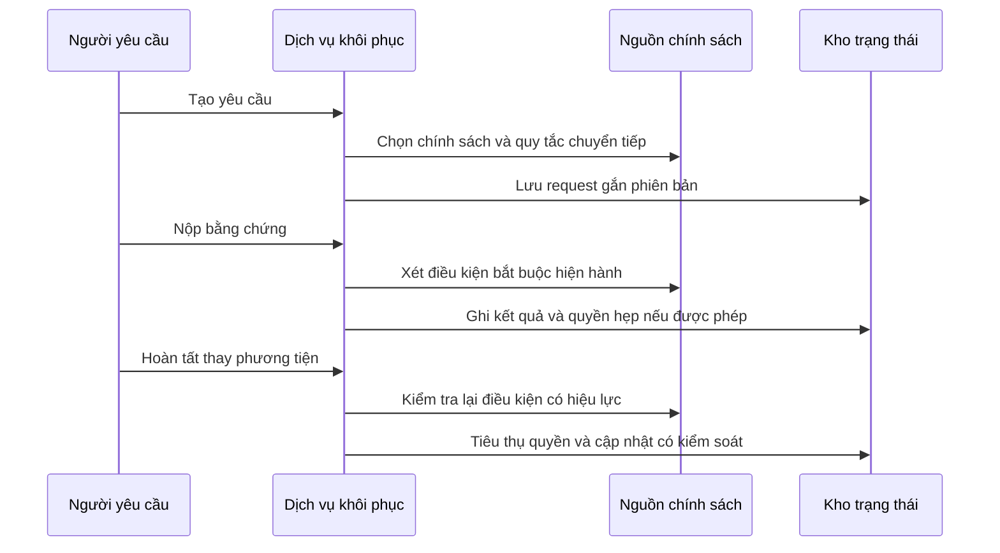

# Triển khai phiên bản chính sách khôi phục tài khoản

## 1. Phiên bản chính sách là một phần của quyết định bảo mật

**Triển khai phiên bản chính sách — policy version rollout — là quá trình đưa một tập quy tắc khôi phục mới vào sử dụng có kiểm soát, đồng thời xử lý rõ các yêu cầu đang chạy theo quy tắc cũ.** Đây không chỉ là cập nhật một tệp cấu hình hoặc đưa bản build mới lên máy chủ.

Trong module `SECURITY_AUTHENTICATION_ACCOUNT_RECOVERY`, chính sách quyết định người mất mật khẩu, MFA, passkey hoặc thiết bị xác thực được dùng bằng chứng nào để lấy lại quyền kiểm soát tài khoản. Một thay đổi nhỏ có thể ảnh hưởng trực tiếp tới khả năng chống chiếm đoạt:

- Cho phép hoặc ngừng dùng một kênh khôi phục.
- Thay yêu cầu xác minh danh tính hay mức bằng chứng cần đạt.
- Đổi thời hạn token, số lượt thử hoặc quy tắc gửi lại.
- Bổ sung khoảng chờ, phê duyệt thủ công hoặc điều kiện theo rủi ro.
- Đổi phạm vi quyền được cấp sau xác minh.
- Thay cách thu hồi session và quyền khôi phục còn lại khi hoàn tất.

Ví dụ, phiên bản R12 cho phép dùng OTP email để đặt lại MFA. R13 yêu cầu thêm bằng chứng cho nhóm tài khoản rủi ro cao. Nếu request được tạo dưới R12 nhưng hoàn tất khi R13 đã có hiệu lực, backend phải biết áp dụng quy tắc nào. Không thể để kết quả phụ thuộc vào instance tình cờ nhận request.

Một rollout tốt cần bảo vệ đồng thời ba điều:

1. Không mở đường khôi phục yếu ngoài chủ đích đã được phê duyệt.
2. Không khiến người dùng mất phương tiện xác thực bị mắc kẹt do chuyển phiên bản không rõ ràng.
3. Có khả năng giải thích vì sao một yêu cầu được tiếp tục, bổ sung bằng chứng, khởi động lại hoặc từ chối.

Các tên phiên bản và thời lượng trong bài là ví dụ thiết kế. Chúng không đại diện cho một chính sách bắt buộc áp dụng cho mọi sản phẩm.

## 2. Tách phiên bản chính sách khỏi phiên bản phần mềm

### 2.1. Ba loại phiên bản có vai trò khác nhau

| Loại phiên bản | Trả lời câu hỏi | Ví dụ minh họa |
| --- | --- | --- |
| Phiên bản chính sách | Bộ quy tắc cụ thể nào quyết định yêu cầu? | `recovery-R13` |
| Phiên bản bộ thực thi | Mã đang chạy có hiểu và thực thi đúng những quy tắc đó không? | `recovery-service-build-B` |
| Phiên bản cấu trúc dữ liệu | Bản ghi và thông điệp dùng cấu trúc nào? | `recovery-request-schema-3` |

Một bản build có thể hỗ trợ nhiều phiên bản chính sách trong thời gian chuyển tiếp. Ngược lại, cùng một tên chính sách không nên mang nội dung khác nhau trên các máy.

Không sửa trực tiếp nội dung R13 rồi vẫn gọi là R13. Khi cần thay quy tắc, tạo phiên bản mới hoặc một quyết định bổ sung có danh tính và lịch sử rõ ràng. Nếu không, log ghi “R13” sẽ không đủ để tái dựng quyết định.

### 2.2. Bản chính sách cần có danh tính và phạm vi

Một mô tả khái niệm có thể gồm:

```yaml
policy_id: recovery-R13
schema_version: 3
policy_digest: "<dau-van-tay-cua-noi-dung-da-phe-duyet>"
scope:
  recovery_purpose: replace_mfa
  account_tier: high_risk
required_capabilities:
  - evaluate_registered_recovery_evidence
  - enforce_recovery_wait
  - issue_scoped_setup_grant
transition_rule: require_explicit_migration
```

Đây là cấu trúc minh họa trong bài học, không phải một schema triển khai hoàn chỉnh. Trong hệ thống thực, bản chính sách còn cần chủ thể chịu trách nhiệm, nội dung thay đổi, phê duyệt, phạm vi thử nghiệm, điều kiện kích hoạt và phương án dừng.

Dấu vân tay nội dung giúp phát hiện việc các thành phần đang cầm những nội dung khác nhau dưới cùng một định danh. Nó không tự cấp quyền xuất bản chính sách: quyền ghi, kênh phân phối và nguồn cấu hình vẫn cần được kiểm soát.

### 2.3. Không suy mức an toàn từ số phiên bản

R14 mới hơn R13 không có nghĩa R14 nghiêm ngặt hơn trên mọi chiều. R14 có thể giảm thời gian chờ cho một nhóm người dùng nhưng tăng yêu cầu bằng chứng cho nhóm khác.

Vì vậy, biểu thức kiểu `max(request.version, active.version)` không diễn đạt được quy tắc an toàn. Cần kiểm tra các điều kiện thực tế: bằng chứng nào bắt buộc, kênh nào bị cấm, trạng thái tài khoản có cho phép tiếp tục và quyền nào có thể cấp.

## 3. Gắn chính sách với yêu cầu đang chạy

### 3.1. Ghi nhận quyết định ngay từ đầu

Khi tạo yêu cầu, server nên lưu đủ dữ liệu để giải thích lựa chọn:

```text
request_id
account_id
recovery_purpose
created_at
assigned_policy_id
assigned_policy_digest
assignment_rule_version
cohort_id
request_revision
expires_at
```

Các trường trên là mô hình minh họa. Danh tính tài khoản và mục đích phải được xác định có thẩm quyền ở backend. Client không được tự gửi `policy_id=R12` để chọn một đường dễ hơn.

Nếu bước công khai chưa xác định được tài khoản, có thể cần chính sách tiếp nhận riêng để hạn chế lạm dụng và tránh lộ thông tin. Khi đã xác định chủ thể, việc chọn chính sách có quyền cấp khôi phục phải theo quy tắc server; không kế thừa một lựa chọn tùy ý từ request ẩn danh.

### 3.2. Phiên bản được gắn không phải giấy phép bỏ qua tình trạng mới

Gắn một phiên bản cho yêu cầu giúp giữ ổn định cách diễn giải. Nó không buộc hệ thống phải tiếp tục chấp nhận một kênh vừa bị phát hiện không an toàn.

Cần tách ba nhóm điều kiện:

| Nhóm | Ví dụ | Cách sử dụng |
| --- | --- | --- |
| Quy tắc đã gắn với yêu cầu | Thứ tự bước, loại bằng chứng, phạm vi thiết lập | Dùng để diễn giải quy trình đang chạy theo hợp đồng chuyển tiếp |
| Điều kiện bắt buộc đang có hiệu lực | Kênh bị cấm khẩn cấp, phiên bản bị thu hồi, bằng chứng tối thiểu bắt buộc | Phải được xét khi thực hiện thao tác nhạy cảm |
| Trạng thái hiện tại của tài khoản và quyền | Tài khoản đã xóa, token đã dùng, phương tiện đã thu hồi, hạn chế an ninh | Không được thay bằng ảnh chụp tại thời điểm tạo yêu cầu |

Trong bài, nhóm thứ hai được gọi là **điều kiện an toàn bắt buộc hiện hành**. Nó là một tập điều kiện có ý nghĩa cụ thể, không phải một con số phiên bản duy nhất.

Ví dụ, request gắn R12 có thể tiếp tục với quy trình cũ trong một đợt chuyển đổi thông thường. Nhưng nếu email của tài khoản vừa bị đánh dấu không còn đủ tin cậy để khôi phục, việc còn mang R12 không làm mã email trở lại hợp lệ.

### 3.3. Bốn cách xử lý yêu cầu đang chạy

| Quyết định chuyển tiếp | Khi có thể phù hợp | Điều cần làm rõ |
| --- | --- | --- |
| Tiếp tục theo bản đã gắn | Thay đổi không yêu cầu loại bỏ ngay các yêu cầu cũ | Mốc hết hạn, phạm vi ngoại lệ và điều kiện hiện hành vẫn phải thỏa |
| Yêu cầu bổ sung bằng chứng | Bằng chứng cũ có thể dùng một phần nhưng chưa đủ | Bằng chứng bổ sung, thời hạn và quyền hiện có bị hạn chế thế nào |
| Khởi động lại có kiểm soát | Không thể chuyển đổi đúng ngữ nghĩa của trạng thái cũ | Thu hồi token, quyền cũ và tránh cấp lại ngân sách vô hạn |
| Từ chối hoặc thu hồi | Quyền yêu cầu không còn hợp lệ hay không còn đường khôi phục được phép | Lý do nội bộ, thông điệp phù hợp và đường xử lý có thẩm quyền |

Không chỉ đổi nhãn `assigned_policy_id` từ R12 sang R13 rồi coi mọi bước đã hoàn tất là đáp ứng R13. Cần chứng minh bằng chứng cũ có cùng ý nghĩa, độ mới, ràng buộc và mức tin cậy mà quy tắc mới yêu cầu.

Nếu R13 bổ sung thời gian chờ sau khi hoàn tất xác minh, một request cũ không có thời điểm xác minh đáng tin cậy không thể được suy đoán là “đã chờ đủ lâu” từ `created_at`.

### 3.4. Không kéo dài quyền cũ ngoài ý định

Giả sử token cũ có thời hạn ngắn hơn chính sách mới. Việc kích hoạt chính sách mới không nên tự gia hạn token cũ. Nếu cần phát hành lại, đó là một hành động riêng với kiểm tra và ngân sách phù hợp.

Tương tự, đổi phiên bản không được đặt lại lượt đoán, khôi phục token đã dùng hoặc xóa thời gian chờ đang có hiệu lực. Kẻ tấn công không nên nhận thêm cơ hội chỉ bằng cách tạo lại request ở một phiên bản khác.

## 4. Kiểm tra lại ở thời điểm cấp quyền và hoàn tất

### 4.1. Một lần đánh giá lúc tạo request chưa đủ

Một yêu cầu có thể kéo dài qua nhiều thời điểm:



Trong thời gian đó, chính sách có thể thay đổi, tài khoản có thể bị vô hiệu hóa, mã có thể bị thu hồi hoặc một request khác đã hoàn tất khôi phục.

Do vậy, cần xác định những điểm quyết định có tác động bảo mật: phát hành bằng chứng, chấp nhận bằng chứng, cấp quyền thiết lập và thực hiện thay đổi cuối. Không phải mọi màn hình đều cần toàn bộ lần đánh giá giống nhau, nhưng không được bỏ sót điểm thật sự tạo quyền.

### 4.2. Quyền thiết lập phải mang đủ ràng buộc

Một quyền thiết lập sau xác minh có thể tham chiếu:

- Đúng tài khoản và yêu cầu khôi phục.
- Đúng thao tác, chẳng hạn chỉ thêm phương tiện MFA mới.
- Kết quả xác minh và chính sách đã dùng để cấp.
- Thời hạn, tính dùng một lần và trạng thái thu hồi.
- Phiên bản trạng thái yêu cầu hoặc mốc bảo mật cần đối chiếu.
- Những điều kiện phải kiểm tra lại khi quyền được sử dụng.

Chỉ có chữ ký hợp lệ và trường `policy_id` trong token chưa bảo đảm quyền vẫn dùng được sau một quyết định thu hồi khẩn cấp. Điểm sử dụng cần thực thi cơ chế nhận biết tình trạng hiện hành theo thiết kế.

### 4.3. Tránh khoảng trống giữa đánh giá và ghi thay đổi

Một mã giả mô tả mục tiêu phối hợp có thể là:

```text
completeRecovery(requestId, setupGrant):
    đọc request, bằng chứng và quyền có thẩm quyền
    đọc chính sách đã gắn và quyết định chuyển tiếp
    đọc điều kiện bắt buộc hiện hành cùng revision của chúng
    đọc trạng thái tài khoản và mốc bảo mật hiện tại

    xác định yêu cầu được tiếp tục, bổ sung, khởi động lại hay từ chối
    nếu chưa được phép:
        ghi kết quả cần thiết và kết thúc mà không thay phương tiện

    trong phạm vi cập nhật có điều kiện:
        xác nhận request chưa thay đổi hoặc bị hoàn tất
        xác nhận setupGrant còn hiệu lực và chưa dùng
        xác nhận những revision quyết định vẫn còn phù hợp
        xác nhận điều kiện vòng đời tài khoản
        tiêu thụ setupGrant và ghi thay đổi được phép
        ghi sự kiện phục vụ thông báo, thu hồi và audit

    nếu điều kiện đã đổi:
        đánh giá lại theo chính sách chuyển tiếp, không tự bỏ kiểm tra
```

Phạm vi cập nhật có điều kiện ở đây là yêu cầu thiết kế. Một giao dịch cơ sở dữ liệu cục bộ không tự làm các kho chính sách, trạng thái và dịch vụ khác trở nên nhất quán. Nếu quyết định chặn khẩn cấp phải có hiệu lực trước mọi lần ghi tiếp theo, hệ thống cần cơ chế phối hợp hoặc một điểm kiểm tra có thẩm quyền đáp ứng bảo đảm đó.

Nếu dùng cache, thông điệp thu hồi hoặc kiểm tra định kỳ, phải nêu độ trễ có thể xảy ra. Không tuyên bố chặn tức thời khi các điểm thực thi vẫn được phép dùng dữ liệu cũ trong một khoảng thời gian.

Thông báo và thu hồi ở hệ thống ngoài cần cơ chế xử lý lại an toàn, có theo dõi kết quả. Ghi được sự kiện cần làm không đồng nghĩa mọi session ngoài hệ thống đã bị thu hồi xong.

## 5. Chuẩn bị khả năng tương thích trước khi kích hoạt

### 5.1. Phân phối mã hỗ trợ trước, kích hoạt quy tắc sau

Một thứ tự triển khai thường hữu ích:

1. Chuẩn bị cấu trúc dữ liệu và thông điệp để các thành phần có thể đọc được trạng thái mới theo hợp đồng tương thích.
2. Đưa bộ thực thi hỗ trợ chính sách mới tới các điểm có liên quan.
3. Kiểm tra khả năng đọc, đánh giá và thực thi nghĩa vụ của phiên bản mới.
4. Kích hoạt chính sách cho phạm vi nhỏ đã chọn.
5. Chỉ ngừng hỗ trợ cấu trúc cũ khi không còn yêu cầu hoặc đường rollback cần tới nó.

Khả năng “đọc được” không đồng nghĩa “thực thi đúng”. Một dịch vụ đọc được trường thời gian chờ nhưng bỏ qua trường đó chưa đủ điều kiện xử lý chính sách yêu cầu thời gian chờ.

### 5.2. Không âm thầm hạ xuống phiên bản cũ

Nếu một instance không hiểu một quy tắc bảo mật bắt buộc, không nên tự bỏ qua quy tắc hoặc chuyển request sang R12 để tiếp tục. Các lựa chọn có thể gồm định tuyến tới bộ thực thi tương thích, trả trạng thái chờ được kiểm soát hoặc từ chối thao tác nhạy cảm.

Cần xét cả API web, ứng dụng di động, công cụ hỗ trợ, worker nền và dịch vụ cấp session. Nếu một đường vẫn thực thi bản cũ, tác nhân có thể tìm đến đường đó dù giao diện chính đã chuyển đổi thành công.

Các thông điệp xử lý bất đồng bộ nên tham chiếu rõ request, revision và phiên bản cần diễn giải. Một worker đọc thông điệp “đã xác minh” mà không biết xác minh theo chính sách nào có thể cấp quyền vượt quá kết quả thực tế.

### 5.3. Trường hợp rollback phần mềm

Bản build cũ có thể không hiểu dữ liệu mà R13 đã ghi, hoặc không kiểm tra được điều kiện mới bắt buộc. Vì vậy, “đưa lại binary cũ” không tự tạo rollback an toàn.

Trước khi kích hoạt, phải biết bản build dự phòng nào còn đọc được dữ liệu và thực thi được các điều kiện an toàn cần giữ. Không xóa trường cũ hoặc đổi ngữ nghĩa dữ liệu quá sớm nếu đường khôi phục vận hành còn phụ thuộc vào chúng.

## 6. Triển khai theo từng giai đoạn

### 6.1. Rà soát thay đổi và tập quyết định mẫu

Trước khi bật phiên bản mới, cần mô tả thay đổi theo hành vi cụ thể. Ví dụ: “Yêu cầu thay MFA của nhóm rủi ro cao phải có thêm bằng chứng đã đăng ký từ trước” có thể kiểm tra được rõ hơn mô tả “tăng bảo mật khôi phục”.

Tập tình huống cần bao gồm người mất từng loại phương tiện, mất nhiều phương tiện cùng lúc, tài khoản có hạn chế, token hết hạn, request đồng thời, luồng thủ công và lỗi hệ thống liên quan. Mục tiêu là hiểu sự khác nhau giữa quyết định cũ và mới, không chỉ xác nhận cấu hình hợp lệ về cú pháp.

Mỗi thay đổi nên có một kết quả mong đợi: ai được tiếp tục, ai phải bổ sung bằng chứng, ai bị từ chối và lý do nào được ghi. Nếu chưa thể giải thích nhóm chịu ảnh hưởng, việc mở rộng rollout sẽ khó kiểm soát.

### 6.2. Đánh giá song song không tạo hiệu ứng thật

Ở giai đoạn đánh giá song song, thường gọi là *shadow evaluation*, chính sách hiện hành vẫn quyết định thực tế. Phiên bản mới chỉ tính kết quả để so sánh.

```text
Đầu vào có cùng ngữ nghĩa tại cùng mốc đánh giá
    -> bản hiện hành: quyết định thực tế
    -> bản mới: kết quả giả định, không cấp quyền
```

Bản đánh giá song song không được:

- Gửi thêm OTP, email hoặc SMS.
- Tiêu thụ token, mã dự phòng hay ngân sách thử của người dùng.
- Tạo quyền thiết lập, thay MFA hoặc mở session.
- Ghi đè trạng thái request đang phục vụ.
- Gọi một bước kiểm chứng bên ngoài có tác động thực mà không được thiết kế cho chế độ này.

Nếu phiên bản mới cần một loại bằng chứng mà luồng cũ chưa thu thập, kết quả phù hợp có thể là “thiếu dữ liệu để đánh giá”. Không tự tạo giả định rằng bằng chứng đó đã đạt rồi thống kê chính sách mới là an toàn hoặc có tỷ lệ hoàn tất cao.

Đầu vào so sánh cần cùng thời điểm và cùng cách diễn giải. So một trạng thái tài khoản trước thu hồi với một trạng thái sau thu hồi có thể tạo khác biệt do thời gian, không phải do chính sách.

### 6.3. Bật thật cho nhóm giới hạn

Sau khi hiểu khác biệt quyết định và khả năng tương thích, phiên bản mới có thể được bật cho một phạm vi nhỏ. Từ thời điểm này, kết quả mới có tác động thật tới người dùng, token và quyền truy cập.

Nhóm đầu nên nằm trong phạm vi đã được đánh giá, có khả năng quan sát và hỗ trợ. Không mặc định tài khoản quản trị nhạy cảm hoặc người dùng mất toàn bộ phương tiện là đối tượng tốt để thử trước chỉ vì số lượng ít.

Cần ghi rõ phiên bản nào phục vụ từng nhóm, thời điểm bắt đầu và các tiêu chí dừng. Tỷ lệ nhỏ không có nghĩa hậu quả bảo mật nhỏ nếu nhóm đó chứa tài khoản có quyền lớn.

### 6.4. Mở rộng bằng điều kiện, không chỉ bằng lịch

Một kế hoạch minh họa có thể đi từ nhóm giới hạn tới phạm vi lớn hơn, rồi toàn bộ tài khoản đủ điều kiện. Các tỷ lệ cụ thể là quyết định vận hành của sản phẩm.

Mỗi lần mở rộng cần kiểm tra:

- Không có quyết định cấp quyền trái các điều kiện bắt buộc.
- Không xuất hiện đường API bỏ qua chính sách.
- Chênh lệch kết quả có thể giải thích bằng thay đổi đã dự kiến.
- Luồng đang chạy được chuyển tiếp đúng.
- Tỷ lệ lỗi, thời gian hoàn tất và tải hỗ trợ nằm trong giới hạn đã chấp nhận.
- Phương án dừng vẫn dùng được với trạng thái dữ liệu hiện có.

Không tự động mở rộng chỉ vì đã qua một khoảng thời gian trong khi dữ liệu quan sát chưa đủ, số người hoàn tất quá ít hoặc có lỗi chưa giải thích được.

## 7. Chọn nhóm triển khai ổn định và chống tự chọn chính sách

### 7.1. Gán nhóm ở phía server

Một cách minh họa là dùng định danh nội bộ ổn định của tài khoản, kết hợp định danh đợt rollout và một hàm phân nhóm do server kiểm soát. Có thể dùng hàm có khóa để tránh việc người ngoài dự đoán hoặc thao túng quá dễ, tùy mô hình đe dọa.

Không nên chọn phiên bản theo:

- Tham số `use_old_policy=true` do client gửi.
- Cookie mà người dùng có thể xóa để được bốc lại.
- IP khi tác nhân có thể đổi IP.
- Một request ID mới mà tác nhân tự tạo không giới hạn.
- Địa chỉ liên hệ mới chưa được xác minh hay thuộc tính người dùng dễ sửa.

Nếu mục tiêu là giữ một tài khoản trong cùng nhóm, việc tạo lại request hoặc đổi thiết bị không nên cho phép chọn lại nhóm tùy ý. Với hệ thống nhiều tenant, cần quyết định phạm vi gán nhóm có bao gồm tenant và vai trò hay không, tránh để một chủ thể nhận chính sách ngoài phạm vi đã phê duyệt.

### 7.2. Mở rộng tỷ lệ không tự thay request cũ

Gán nhóm tài khoản và gắn chính sách cho request là hai quyết định liên quan nhưng khác nhau. Khi tỷ lệ rollout tăng, tài khoản có thể dùng R13 cho yêu cầu mới, trong khi request đang chạy vẫn cần xử lý theo quy tắc chuyển tiếp đã công bố.

Nên lưu quyết định được chọn ở lúc tạo request. Không tính lại nhóm ở mỗi bước rồi để cùng một request lúc dùng R12, lúc dùng R13.

Nếu cần di chuyển request đang chạy, thực hiện một chuyển tiếp có điều kiện và ghi nhận rõ. Việc mở rộng nhóm không phải bằng chứng rằng các bước cũ đã đáp ứng chính sách mới.

### 7.3. Chống lạm dụng vẫn phải liên tục qua các phiên bản

Khi người dùng khởi động lại theo phiên bản mới, lịch sử gửi mã, số lượt đoán và tín hiệu lạm dụng có liên quan không nên bị xóa. Ngân sách theo tài khoản và mục đích cần được áp dụng theo chính sách chuyển tiếp phù hợp.

Thông điệp công khai cũng không nên trở thành cách dò tài khoản thuộc nhóm nào hoặc đường nào dễ hơn. Hỗ trợ có thể cần thông tin phiên bản để giải thích và xử lý; điều đó không có nghĩa phải công khai toàn bộ quy tắc phân nhóm trên endpoint ẩn danh.

## 8. Chọn chỉ số và điều kiện dừng

### 8.1. Quan sát cả an toàn và khả năng sử dụng

| Nhóm chỉ số | Ví dụ cần theo dõi | Lưu ý khi diễn giải |
| --- | --- | --- |
| Tuân thủ quyết định | Cấp quyền dù thiếu bằng chứng, bỏ qua thời gian chờ, dùng bản bị cấm | Một trường hợp xác nhận có thể đủ để dừng đường bị ảnh hưởng |
| Tính nhất quán phiên bản | Sai digest, bộ thực thi không hỗ trợ, request đổi bản ngoài quy tắc | Không chỉ là lỗi trải nghiệm nếu kết quả cấp quyền thay đổi |
| Hoàn tất hợp lệ | Tỷ lệ hoàn tất theo loại mất phương tiện và mức rủi ro | Mẫu số và nhóm so sánh phải rõ |
| Chất lượng bằng chứng | Từ chối, bổ sung, chuyển hỗ trợ theo mã lý do | Từ chối tăng có thể đúng chủ đích hoặc là lỗi |
| Chống lạm dụng | Gửi lại, đoán sai, phân tán mục tiêu, tạo request lại | Không coi lưu lượng bị chặn cao là bằng chứng duy nhất |
| Vận hành | Lỗi, độ trễ, hàng đợi, độ trễ phân phối chính sách | Cần xét các điểm thực thi còn dùng bản cũ |
| Sau khôi phục | Khiếu nại chiếm đoạt, thay đổi phương tiện bất thường, kết quả thu hồi session | Tín hiệu có thể tới muộn và cần điều tra |

Tỷ lệ hoàn tất tăng không tự chứng minh cải tiến. Nó có thể do luồng dễ dùng hơn, do nhóm đầu ít rủi ro hơn hoặc do một điều kiện xác minh bị bỏ qua.

Ngược lại, tỷ lệ từ chối tăng có thể là kết quả mong đợi khi loại một đường yếu. Cần xem đúng nhóm, đúng lý do và xem người dùng hợp lệ có đường thay thế phù hợp hay không.

### 8.2. Mẫu số và thời gian theo dõi phải nhất quán

Một request vừa tạo chưa có đủ thời gian hoàn tất. So trực tiếp tỷ lệ hoàn tất của nhóm mới tạo hôm nay với nhóm cũ đã chạy nhiều ngày có thể gây hiểu sai.

Cần tách các mốc: bắt đầu, nhận bằng chứng, được chấp nhận, hết thời gian chờ, cấp quyền thiết lập và hoàn tất. Đồng thời tách request thật của người dùng với yêu cầu lạm dụng trong phạm vi có thể xác định.

Các nhóm canary có thể khác nhóm còn lại về khu vực, loại tài khoản hoặc loại phương tiện bị mất. Số liệu mô tả cần ghi nhận khác biệt đó; không tự suy quan hệ nhân quả từ một tỷ lệ gộp.

### 8.3. Định nghĩa hành động tương ứng với cảnh báo

Ví dụ, phát hiện request hoàn tất mà thiếu bằng chứng bắt buộc cần hành động khác với hàng đợi hỗ trợ tăng nhẹ. Mỗi tín hiệu quan trọng nên gắn với người chịu trách nhiệm và một hành động cụ thể:

- Dừng mở rộng phạm vi.
- Ngừng phát hành request mới theo bản bị ảnh hưởng.
- Tạm dừng một kênh hoặc loại thao tác.
- Thu hồi quyền chưa dùng thuộc phạm vi lỗi.
- Điều tra tài khoản đã hoàn tất và xử lý session theo thẩm quyền.

Không mặc định một nút dừng sẽ thực hiện tất cả các việc trên. Phạm vi dừng phải được thiết kế và kiểm chứng riêng.

## 9. Dừng khẩn cấp và rollback an toàn

### 9.1. Rollback có nhiều đối tượng

| Đối tượng cần điều chỉnh | Ví dụ | Điều rollback không tự làm được |
| --- | --- | --- |
| Việc chọn chính sách cho request mới | Ngừng gán R13 | Không thay trạng thái request R13 đang chạy |
| Bộ thực thi | Dùng lại bản build tương thích đã chuẩn bị | Không phục hồi đúng dữ liệu nếu cấu trúc đã đổi không tương thích |
| Request đang chạy | Tiếp tục, bổ sung, khởi động lại hoặc thu hồi | Không thể chỉ đổi tên phiên bản và coi xong |
| Token và quyền thiết lập | Thu hồi theo bản cấp, mục đích hoặc mốc bảo mật | Không được làm sống lại token đã dùng |
| Thay đổi đã hoàn tất | Điều tra, xử lý session và phương tiện bị ảnh hưởng | Không thể coi như giao dịch chưa từng xảy ra |

Nếu R13 đã cho phép gắn MFA mới vào một tài khoản, chuyển cấu hình chọn bản về R12 không tự tháo MFA đó ra và cũng không chứng minh ai là chủ thật. Xử lý hậu quả cần một quyết định có thẩm quyền, bằng chứng và dấu vết riêng.

### 9.2. Bản dự phòng phải đáp ứng điều kiện an toàn hiện hành

Giả sử R12 dựa vào một kênh vừa bị xác định là không còn được phép dùng. Khi R13 gặp lỗi vận hành, quay về R12 nguyên trạng có thể tái mở đường chiếm đoạt.

Một lựa chọn an toàn hơn có thể là dùng bản dự phòng còn tương thích và vẫn thực thi điều kiện cấm kênh đó, hoặc tạm dừng loại khôi phục bị ảnh hưởng. Khả năng sẵn sàng quan trọng, nhưng không được diễn giải thành cho phép bỏ bằng chứng bắt buộc.

Quyết định khẩn cấp có thể được áp dụng như một điều kiện độc lập với bản chính sách đang gắn. Nó cần danh tính, phạm vi, thời điểm hiệu lực, người chịu trách nhiệm và cách gỡ. Không dùng một cờ không có lịch sử để âm thầm thay toàn bộ nghĩa của mọi phiên bản.

### 9.3. Các thao tác rollback không được phục hồi quyền cũ

Những bất biến cần giữ:

- Token đã dùng hoặc thu hồi vẫn không hợp lệ.
- Quyền đã hết hạn không tự có thêm thời gian sống.
- Lượt thử đã tiêu hao không được đặt lại chỉ vì đổi phiên bản.
- Hạn chế an ninh và trạng thái đã xóa vẫn có hiệu lực.
- Dữ liệu phương tiện đã bị loại bỏ không được phục hồi từ ảnh chụp cũ một cách máy móc.
- Thông điệp đến muộn không được phát hành lại quyền theo chính sách đã bị cấm.

Khôi phục cơ sở dữ liệu hoặc phát lại hàng đợi cũng phải xét các điều kiện này. Cần có cách áp lại quyết định thu hồi và thay đổi chính sách liên quan trước khi cho các điểm nhạy cảm hoạt động trở lại.

### 9.4. Xử lý request tại ranh giới kích hoạt

Với mỗi thay đổi có hiệu lực, phải xác định mốc quyết định: request đã đánh giá trước mốc nhưng chưa ghi xong có được hoàn tất không? Một tác vụ đã nằm trong hàng đợi có phải đánh giá lại không?

Nếu yêu cầu là chặn mọi lần cấp quyền sau mốc, cơ chế thực thi cần kiểm tra được điều đó tại điểm cấp quyền. Chỉ cập nhật đồng hồ hiệu lực trong kho cấu hình mà không phối hợp với các điểm ghi chưa đủ.

Nên dùng mốc thời gian có nguồn nhất quán và revision quyết định phù hợp. Không dựa riêng vào đồng hồ thiết bị của người dùng để xác định một request nằm trước hay sau ranh giới.

## 10. Ví dụ: chuyển chính sách đặt lại MFA từ R12 sang R13

### 10.1. Bối cảnh

Một dịch vụ có hai chính sách minh họa:

- **R12:** nhóm đủ điều kiện có thể đặt lại MFA sau khi xác minh email theo quy trình cũ.
- **R13:** nhóm rủi ro cao cần thêm bằng chứng khôi phục đã đăng ký trước; nếu không còn bằng chứng phù hợp, chỉ được chuyển sang quy trình hỗ trợ được phê duyệt. Quyền thiết lập được cấp sau khi đạt điều kiện, có phạm vi hẹp và dùng một lần.

Sự thay đổi ở đây là tăng yêu cầu bằng chứng cho một nhóm. Không giả định email đơn lẻ phù hợp với mọi tài khoản, và không coi xử lý thủ công là tự động được chấp nhận.

### 10.2. Kế hoạch chuyển đổi

| Giai đoạn | Hành động | Điều kiện trước bước tiếp theo |
| --- | --- | --- |
| Chuẩn bị | Phân phối bộ thực thi hiểu R13 và ghi nhận bằng chứng mới | Các điểm cấp quyền có khả năng thực thi yêu cầu |
| Đánh giá song song | Tính quyết định R13 bên cạnh R12 | Hiểu các trường hợp khác nhau và trường hợp thiếu dữ liệu |
| Bật nhóm nhỏ | Gắn R13 cho tài khoản được chọn ở server | Không có cấp quyền trái điều kiện, hỗ trợ tiếp nhận được |
| Mở rộng | Tăng phạm vi theo quyết định có theo dõi | Các chỉ số và hành vi chuyển tiếp đạt tiêu chí |
| Kết thúc chuyển tiếp | Ngừng tạo request R12; xử lý phần còn lại | Không còn request R12 có quyền sống ngoài thời hạn đã định |

Giả sử chính sách chuyển tiếp thông thường cho phép một số request R12 đã tạo tiếp tục tới thời hạn cũ, miễn không có điều kiện an toàn hiện hành ngăn lại. Ngoại lệ này phải được phê duyệt và ghi rõ; không tự phát sinh từ việc hệ thống chưa chuyển được dữ liệu.

### 10.3. Bốn request tại cùng thời điểm

| Request | Tình trạng | Xử lý theo chính sách minh họa |
| --- | --- | --- |
| A | Tạo dưới R12, chưa xác minh, không còn được phép tiếp tục bản cũ | Yêu cầu chuyển tiếp có kiểm soát hoặc khởi động lại; không đổi nhãn đơn thuần |
| B | Tạo dưới R12, thuộc diện được tiếp tục và không có hạn chế mới | Tiếp tục tới thời hạn cũ, vẫn kiểm tra điều kiện hiện hành ở điểm nhạy cảm |
| C | Tạo dưới R13, đã xác minh email nhưng chưa có bằng chứng bổ sung | Chưa cấp quyền thay MFA; chuyển đúng đường bổ sung hoặc hỗ trợ |
| D | Đã được cấp quyền hẹp nhưng kênh bằng chứng sau đó bị thu hồi | Kiểm tra lại và từ chối hoặc thu hồi theo quyết định hiện hành |

Nếu có sự cố khiến kênh email không còn được phép làm bằng chứng cho cả nhóm, request B không được tiếp tục chỉ vì trước đó thuộc ngoại lệ R12. Request D cũng không được hoàn tất chỉ vì quyền đã được ký trước sự cố.

### 10.4. Khi phiên bản mới làm tăng lỗi xử lý

Giả sử R13 có lỗi khiến một loại bằng chứng hợp lệ không được đọc đúng. Nhóm vận hành dừng mở rộng, ngừng gán thêm R13 và dùng bản thực thi dự phòng tương thích.

Cần xử lý riêng các request R13 đang chờ: giữ lại bằng chứng còn hợp lệ nếu cách diễn giải được xác nhận, đánh giá lại bằng bộ thực thi đã sửa hoặc chuyển tiếp theo quy tắc được phê duyệt. Không âm thầm hạ tất cả sang R12 để bỏ yêu cầu bằng chứng mới.

Nếu phải phát hành quyền mới sau đánh giá lại, quyền cũ phải được xử lý nhất quán. Retry không được tạo nhiều quyền độc lập và không được mở lại ngân sách đoán không giới hạn.

## 11. Dấu vết quyết định và kết thúc vòng đời phiên bản

### 11.1. Ghi đủ để giải thích một quyết định

Một bản ghi quyết định có thể chứa:

```text
decision_id, request_id, account_id_noi_bo
recovery_purpose, request_revision
assigned_policy_id, assigned_policy_digest
evaluator_build, assignment_rule_version, cohort_id
transition_rule_id
current_safety_revision
evidence_references, evidence_result
decision, reason_code, decided_at
granted_scope, grant_reference
```

Tham chiếu bằng chứng không phải nội dung bí mật của bằng chứng. Không ghi token, OTP, mã dự phòng, khóa riêng hoặc tài liệu danh tính thô vào log quyết định. Dữ liệu vận hành cần phạm vi truy cập và thời gian lưu phù hợp.

Những trường này giúp trả lời “tại sao request này được cấp quyền” hoặc “tại sao hai request cùng thời điểm khác kết quả”. Chúng không tự chứng minh quyết định đúng nếu bộ thực thi có lỗi; cần đối chiếu với quy tắc và bằng chứng được phép sử dụng.

### 11.2. Khi nào có thể ngừng hỗ trợ phiên bản cũ?

Cần kiểm kê các đối tượng còn tham chiếu bản cũ: request, token chưa hết hạn, quyền thiết lập, thời gian chờ, hàng đợi, quy trình hỗ trợ và khả năng rollback.

Có thể ngừng thực thi phiên bản cũ khi không còn đối tượng được phép cần tới nó, hoặc tất cả đã được chuyển tiếp hay thu hồi theo quyết định rõ ràng. Không chỉ đợi số request mới dùng bản đó về không.

Nội dung chính sách cũ và dấu vết tối thiểu phục vụ giải thích có thể cần vòng đời lưu riêng. Ngừng nhận request mới không đồng nghĩa xóa ngay mọi dữ liệu giải thích quyết định. Ngược lại, cần giải thích lịch sử không phải lý do giữ vô hạn toàn bộ bí mật và dữ liệu cá nhân.

## 12. Các thuộc tính cần giữ trong đặc tả rollout

| Tình huống | Thuộc tính cần bảo đảm |
| --- | --- |
| Cùng policy ID xuất hiện trên nhiều instance | Nội dung được kiểm tra nhất quán; sai lệch được phát hiện |
| Client đổi tham số phiên bản hoặc tạo lại request | Không tự chọn được chính sách yếu hơn |
| Request cũ đi qua thời điểm kích hoạt | Có quy tắc chuyển tiếp xác định và dấu vết quyết định |
| Phiên bản mới yêu cầu bằng chứng chưa có | Không coi bước cũ là đã thỏa nếu chưa chứng minh tương đương |
| Một instance không hỗ trợ quy tắc bắt buộc | Không bỏ qua hoặc tự hạ phiên bản để cấp quyền |
| Đánh giá song song | Không gửi mã, tiêu thụ bằng chứng hay thay đổi quyền thật |
| Mở rộng nhóm rollout | Không làm cùng request thay chính sách giữa các bước ngoài quy tắc |
| Chính sách hoặc trạng thái đổi ngay trước hoàn tất | Điều kiện cập nhật ngăn quyết định đã lỗi thời tạo quyền trái phép |
| Dừng hoặc rollback | Không phục hồi token, lượt thử, session hay quyền đã kết thúc |
| Hàng đợi phát lại thông điệp cũ | Không cấp lại quyền độc lập theo quyết định không còn hợp lệ |
| Hoàn tất chuyển đổi | Không còn đối tượng sống phụ thuộc bản cũ ngoài phạm vi đã định |
| Điều tra một yêu cầu | Có thể xác định quy tắc, bộ thực thi, chuyển tiếp và lý do quyết định |

Triển khai phiên bản chính sách khôi phục cần được diễn đạt thành các quyết định có thể thực thi: bản nào được chọn, request cũ chuyển tiếp ra sao, điều kiện nào luôn phải kiểm tra và phạm vi nào bị dừng khi có sự cố. Khi những điểm này rõ ràng, việc phát hành dần hay quay về bản dự phòng mới có thể giữ được cả quyền kiểm soát tài khoản và đường khôi phục cho người dùng hợp lệ.
