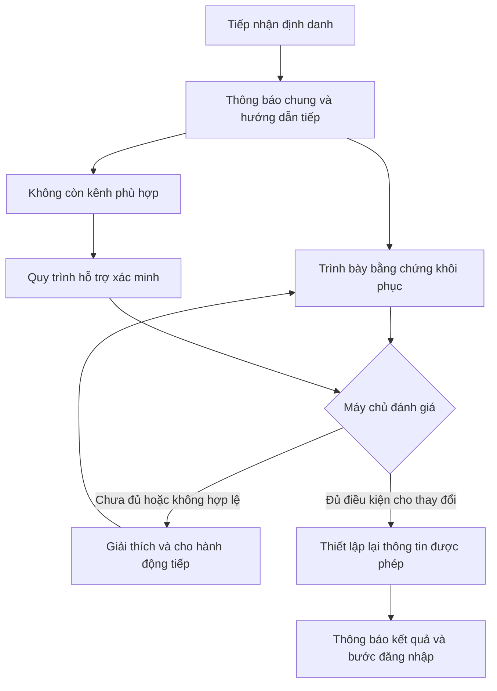

# Recovery form simplicity — Thiết kế biểu mẫu khôi phục đơn giản

Khi mất mật khẩu, điện thoại chứa MFA hoặc thiết bị có passkey, người dùng thường vừa lo lắng vừa thiếu thông tin. Một biểu mẫu yêu cầu quá nhiều dữ liệu khiến họ khó biết nên bắt đầu ở đâu, dữ liệu nào thật sự cần thiết và liệu mình có đang cung cấp thông tin cho đúng nơi hay không.

Trong module SECURITY_AUTHENTICATION_ACCOUNT_RECOVERY, **biểu mẫu đơn giản** là biểu mẫu hỏi đủ thông tin cho quyết định hiện tại, giải thích hành động tiếp theo và giữ nguyên điều kiện xác minh danh tính. Số trường ít là một phương tiện; khả năng hoàn thành khôi phục an toàn mới là mục tiêu.

Các màn hình, endpoint và thông điệp trong bài là phương án thiết kế minh họa, cần được kết hợp với chính sách khôi phục của sản phẩm.

## 1. Đơn giản hóa điều gì?

Có thể nhìn sự phức tạp qua bốn nguồn:

| Nguồn phức tạp | Ví dụ | Hướng xử lý |
| --- | --- | --- |
| Dữ liệu nhập | Hỏi email, số điện thoại, họ tên và ngày sinh ngay từ đầu | Chỉ yêu cầu định danh mà hệ thống thật sự hỗ trợ ở bước đó |
| Quyết định | Hiện mọi phương thức và tùy chọn nâng cao cùng lúc | Cho lựa chọn phù hợp với trạng thái và mức thông tin được phép công khai |
| Nội dung | Đoạn hướng dẫn dài, nhiều thuật ngữ nội bộ | Nêu mục đích, dữ liệu cần nhập và hành động tiếp theo |
| Trạng thái | Nút không phản hồi, không biết yêu cầu đã gửi chưa | Hiển thị rõ đang xử lý, đã tiếp nhận hoặc cần sửa gì |

Một biểu mẫu ba trường vẫn có thể khó dùng nếu nhãn mơ hồ. Một luồng nhiều bước vẫn có thể dễ theo dõi nếu mỗi bước có mục đích rõ và không bắt người dùng làm lại vô cớ.

Điều cần giảm là công việc không giúp hoàn thành quyết định. Những kiểm soát như xác minh bằng chứng, giới hạn số lần thử hoặc đánh giá rủi ro vẫn cần được hệ thống thực hiện.

### Ví dụ: biểu mẫu ban đầu quá tải

Giả sử trang “Khôi phục tài khoản” yêu cầu:

- Email tài khoản.
- Số điện thoại.
- Họ tên.
- Ngày sinh.
- Mật khẩu cũ.
- Mật khẩu mới.
- Ảnh giấy tờ.
- Email mới muốn sử dụng.

Người dùng chưa biết mình có cần đổi email hay không, và mất mật khẩu chính là lý do họ mở trang. Việc thu thập tất cả cùng lúc cũng làm tăng lượng dữ liệu nhạy cảm mà hệ thống phải xử lý.

Có thể phân tích từng trường bằng câu hỏi: **Hệ thống cần dữ liệu này để đưa ra quyết định nào ngay bây giờ?**

| Trường | Vấn đề nếu hỏi ngay bước đầu | Cách bố trí đề xuất |
| --- | --- | --- |
| Email tài khoản | Hữu ích nếu đây là định danh được hỗ trợ | Giữ ở bước tiếp nhận |
| Số điện thoại | Có thể không được đăng ký hoặc không còn dùng được | Chỉ hỏi trong nhánh thực sự cần |
| Mật khẩu cũ | Người dùng có thể đã quên | Không biến thành điều kiện bắt đầu khôi phục mật khẩu |
| Mật khẩu mới | Chưa có quyền đặt lại | Hỏi sau khi đủ điều kiện |
| Ảnh giấy tờ | Thu thập dữ liệu nhạy cảm trước khi rõ nhu cầu | Chỉ dùng trong quy trình xác minh đã được phép |
| Email mới | Chưa chứng minh quyền kiểm soát tài khoản hoặc kênh mới | Tách thành thay đổi có xác minh |
| Ngày sinh, họ tên | Không tự chứng minh quyền sở hữu | Không dùng làm lối tắt cấp quyền |

## 2. Chia hành trình theo quyết định

Một cách tổ chức là:



Mỗi bước có một nhiệm vụ chính:

1. **Tiếp nhận:** xác định thông tin người dùng muốn dùng để bắt đầu yêu cầu.
2. **Xác minh:** thu thập bằng chứng phù hợp và chờ máy chủ đánh giá.
3. **Thay đổi:** chỉ thực hiện thao tác nằm trong quyền đã được cấp.
4. **Kết thúc:** cho biết thay đổi nào thành công và người dùng cần làm gì tiếp.

Sơ đồ không bắt buộc mọi người đi cùng một nhánh. Người mất mật khẩu nhưng còn email khác với người mất cả thiết bị MFA và kênh khôi phục.

Không ghi “Chỉ còn một bước” nếu hệ thống có thể yêu cầu xác minh thêm. Khi không biết trước số màn hình, có thể dùng tên giai đoạn như “Xác minh quyền truy cập” thay vì một bộ đếm bước gây hiểu nhầm.

Phân chia giao diện cũng không tạo quyền. Người dùng mở trực tiếp URL của màn hình đặt mật khẩu vẫn phải đáp ứng điều kiện ở backend.

## 3. Bước đầu chỉ hỏi dữ liệu để bắt đầu

Trong ví dụ này, sản phẩm cho phép bắt đầu bằng email tài khoản. Màn hình đầu gồm:

- Tiêu đề “Khôi phục tài khoản”.
- Một câu giải thích ngắn.
- Một trường email có nhãn rõ.
- Một nút gửi yêu cầu.
- Liên kết trợ giúp và quay lại đăng nhập.

Không ghi “Email hoặc số điện thoại” nếu backend chỉ chấp nhận email. Nếu sản phẩm hỗ trợ nhiều định danh, nhãn và hướng dẫn phải phản ánh đúng tập đầu vào đó.

### Ví dụ HTML

```html
<main>
  <h1>Khôi phục tài khoản</h1>

  <p id="request-help">
    Nhập email tài khoản để bắt đầu. Nếu thông tin phù hợp,
    bạn sẽ nhận hướng dẫn qua kênh đã đăng ký.
  </p>

  <form action="/account-recovery/request"
        method="post"
        aria-describedby="request-help">
    <input type="hidden"
           name="_csrf"
           value="{{CSRF_TOKEN}}">

    <label for="account-email">
      Email tài khoản (bắt buộc)
    </label>
    <input id="account-email"
           name="email"
           type="email"
           autocomplete="username"
           autocapitalize="none"
           spellcheck="false"
           required>

    <button type="submit">Nhận hướng dẫn khôi phục</button>
  </form>

  <p>
    <a href="/account-recovery/help">
      Tôi không còn dùng được phương thức đăng nhập
    </a>
  </p>
  <p><a href="/login">Quay lại đăng nhập</a></p>
</main>
```

`{{CSRF_TOKEN}}` là placeholder cho template máy chủ, phải được thay bằng giá trị hợp lệ và escape đúng ngữ cảnh. Mẫu này không triển khai backend, gửi email hoặc xác minh token.

Một form native giúp giữ hành vi gửi biểu mẫu bằng bàn phím mà không cần tạo nút giả. Nếu dùng JavaScript để cải thiện phản hồi, vẫn cần xác định hành vi khi script hoặc kết nối gặp lỗi.

`type="email"` hỗ trợ kiểm tra hình thức ở trình duyệt; nó không chứng minh email có tài khoản hoặc thuộc về người nhập. Kiểm tra phía máy chủ vẫn bắt buộc, và tập định dạng được hỗ trợ cần nhất quán giữa các tầng.

### Nhãn và hướng dẫn

Nhãn cần tồn tại trong lúc người dùng nhập. Placeholder như “Nhập email…” biến mất sau khi có giá trị nên không thích hợp để thay toàn bộ nhãn.

WCAG 3.3.2 yêu cầu cung cấp nhãn hoặc hướng dẫn khi cần người dùng nhập dữ liệu. Thông tin nên đủ để hiểu cần nhập gì, tránh làm trang trở nên khó đọc vì giải thích thừa. [W3C: Labels or Instructions](https://www.w3.org/WAI/WCAG22/Understanding/labels-or-instructions.html)

Trong thiết kế của bài, chỉ thêm ví dụ định dạng nếu người dùng thật sự cần. Những giải thích dài hơn có thể đặt ở trang trợ giúp, nhưng thông tin thiết yếu cho bước hiện tại phải dễ tìm ngay tại form.

## 4. Một hành động chính và các đường thoát rõ ràng

Nút chính nên mô tả kết quả gần nhất mà người dùng đang yêu cầu:

| Bước | Nhãn có ích | Nhãn dễ gây hiểu nhầm |
| --- | --- | --- |
| Bắt đầu yêu cầu | Nhận hướng dẫn khôi phục | Hoàn tất |
| Gửi mã để kiểm tra | Xác minh mã | Đăng nhập ngay |
| Đổi mật khẩu đã được phép | Lưu mật khẩu mới | Tiếp tục không rõ mục đích |
| Xin gửi lại | Gửi lại hướng dẫn | Tạo tài khoản |
| Kết thúc | Đi đến đăng nhập | Đóng mà không rõ sẽ đi đâu |

Không đặt hai nút có độ nổi bật ngang nhau nhưng tác dụng khác nhau, chẳng hạn “Gửi mã” và “Xác minh mã” khi người dùng chưa nhận mã. Thứ tự và trạng thái cần giúp nhận ra hành động hiện tại.

Đường thoát cũng cần rõ:

- Quay lại bước chọn phương thức nếu có thể.
- Quay về đăng nhập.
- Mở trợ giúp khi mất thiết bị hoặc kênh liên lạc.
- Hủy yêu cầu nếu quy trình có hỗ trợ.

“Quay lại” không được âm thầm gửi một yêu cầu mới. “Hủy” trên giao diện cũng không tự có nghĩa token đã bị thu hồi; nếu cần thu hồi, backend phải xử lý theo hợp đồng tương ứng.

Tránh thêm lựa chọn không liên quan như đăng ký nhận tin, khảo sát hoặc cập nhật hồ sơ vào thời điểm người dùng đang cố giành lại quyền truy cập.

## 5. Thông báo đã tiếp nhận phải đúng sự thật

Một lỗi thường gặp là dùng câu “Email đã được gửi đến tài khoản của bạn” ngay khi người dùng bấm nút, dù máy chủ chưa xác nhận được điều đó.

Mẫu thông điệp chung:

```text
Yêu cầu đã được tiếp nhận.

Nếu thông tin phù hợp, bạn sẽ nhận hướng dẫn qua kênh đã đăng ký.
Bạn có thể kiểm tra thư rác hoặc xem các phương án trợ giúp khôi phục.
```

Thông báo này phân biệt **tiếp nhận yêu cầu** với **xác nhận tài khoản tồn tại** và **email đã được giao thành công**.

OWASP khuyến nghị phản hồi nhất quán cho tài khoản tồn tại và không tồn tại, đồng thời xử lý nguy cơ suy đoán qua thời gian phản hồi và yêu cầu quá mức. [OWASP: Forgot Password](https://cheatsheetseries.owasp.org/cheatsheets/Forgot_Password_Cheat_Sheet.html)

Phương án API minh họa cho yêu cầu hợp lệ về hình thức:

```http
HTTP/1.1 202 Accepted
Content-Type: application/json
```

```json
{
  "state": "REQUEST_ACCEPTED",
  "messageKey": "recovery.request.accepted",
  "nextActions": [
    "VIEW_HELP",
    "BACK_TO_LOGIN"
  ]
}
```

`202` trong ví dụ chỉ mô tả yêu cầu được tiếp nhận để xử lý. Nó không chứng minh đã gửi thư, đã xác minh hoặc đã cấp quyền khôi phục.

Tính nhất quán cần bao gồm nhiều tín hiệu của giao diện:

- Tiêu đề và nội dung thông báo.
- Các bước được mở hoặc ẩn.
- Trường bị đánh dấu lỗi.
- Vị trí focus sau submit.
- Hành động tiếp theo được cung cấp.
- Metadata hoặc mã trạng thái công khai có thể bị quan sát.

Ví dụ, câu thông báo giống nhau nhưng tài khoản tồn tại được hiện số điện thoại đã che một phần vẫn có thể lộ thông tin. Trước khi có bằng chứng thích hợp, chỉ đưa ra những lựa chọn chung được phép công khai.

Thông báo chung không có nghĩa xóa hết trợ giúp. Người dùng vẫn cần biết mình nên đợi, kiểm tra kênh liên lạc hay chọn một đường hỗ trợ khác.

## 6. Giảm lỗi bằng hướng dẫn đúng lúc

Một biểu mẫu đơn giản phải xử lý cả lúc người dùng nhập sai.

| Tình huống | Thông báo đề xuất | Thao tác tiếp |
| --- | --- | --- |
| Email bị bỏ trống | Nhập email tài khoản | Focus vào trường cần điền |
| Hình thức email không được hỗ trợ | Nhập email theo định dạng phù hợp | Giữ giá trị để sửa |
| Mất kết nối | Chưa nhận được phản hồi. Kiểm tra kết nối trước khi thử lại | Cho thử lại theo trạng thái thực tế |
| Yêu cầu bị giới hạn | Bạn đang gửi quá nhiều yêu cầu. Vui lòng thử lại sau | Hiện thông tin chờ nếu có và trợ giúp phù hợp |
| Mã chưa được chấp nhận | Mã không hợp lệ hoặc không còn dùng được | Thử lại hoặc chọn phương thức khác |
| Giao dịch không còn dùng được | Yêu cầu này không còn hiệu lực | Bắt đầu yêu cầu mới theo chính sách |

Lỗi định dạng có thể nêu cụ thể vì không cần truy vấn sự tồn tại của tài khoản. Tránh biến “không tìm thấy tài khoản” thành lỗi của trường email ở bước công khai.

WCAG 3.3.1 yêu cầu lỗi tự phát hiện được nhận diện và mô tả bằng văn bản. Chỉ đổi viền sang màu đỏ hoặc tải lại form mà không giải thích chưa giúp người dùng hiểu lỗi. [W3C: Error Identification](https://www.w3.org/WAI/WCAG22/Understanding/error-identification.html)

### Ví dụ trạng thái trường bị lỗi

Đoạn sau minh họa trạng thái được render khi email sai hình thức; không phải trạng thái mặc định của form:

```html
<label for="account-email">Email tài khoản (bắt buộc)</label>

<input id="account-email"
       name="email"
       type="email"
       value="{{ESCAPED_SUBMITTED_EMAIL}}"
       autocomplete="username"
       aria-invalid="true"
       aria-describedby="email-help email-error"
       required>

<p id="email-help">Dùng email bạn đã đăng ký với dịch vụ.</p>
<p id="email-error">
  Kiểm tra định dạng email, ví dụ ten@example.com.
</p>
```

Giá trị được giữ lại phải được escape theo ngữ cảnh thuộc tính HTML. Khi lỗi đã được giải quyết, xóa trạng thái `aria-invalid` và thông điệp cũ theo kết quả mới.

Nếu có nhiều lỗi, một vùng tổng hợp có liên kết đến từng trường có thể giúp định hướng. Với một trường duy nhất, tránh tạo nhiều lớp hộp thoại hoặc thông báo lặp lại cùng một nội dung.

Hướng dẫn chung và hướng dẫn theo trường nên được bố trí để người dùng nhận được khi thao tác. `aria-describedby` có thể kết nối phần giải thích phù hợp với control. [W3C WAI: Form Instructions](https://www.w3.org/WAI/tutorials/forms/instructions/)

## 7. Giữ thông tin cần sửa, không giữ bí mật vô cớ

Bắt người dùng nhập lại email sau mỗi lỗi mạng làm tăng công việc mà không tăng bằng chứng xác minh.

Trong cùng một giao dịch, có thể giữ định danh đã nhập để người dùng sửa hoặc xác nhận. Tuy nhiên, không đồng nghĩa mọi dữ liệu đều cần lưu bền vững.

| Dữ liệu | Cách xử lý trong thiết kế minh họa |
| --- | --- |
| Email vừa nhập | Có thể giữ trong phạm vi form hiện tại, tránh đưa lên URL |
| Phương thức đang chọn | Giữ nếu trạng thái giao dịch vẫn cho phép |
| Mã một lần đã gửi | Không lưu vào bộ nhớ lâu dài để tự điền ở lần sau |
| Mật khẩu mới | Không ghi log, analytics hoặc lưu làm bản nháp |
| Ảnh giấy tờ | Chỉ xử lý trong nhánh có nhu cầu và chính sách riêng |
| Token khôi phục | Không đưa vào công cụ đo hành vi hoặc bản ghi hỗ trợ tùy tiện |

WCAG 3.3.7 xử lý việc yêu cầu nhập lại thông tin trong cùng một quy trình, đồng thời có các ngoại lệ như yêu cầu bảo mật hoặc dữ liệu không còn hợp lệ. Không nên viện tiêu chí này để tự động sao chép mọi bí mật. [W3C: Redundant Entry](https://www.w3.org/WAI/WCAG22/Understanding/redundant-entry.html)

Ví dụ, yêu cầu xác nhận mật khẩu mới cần được đánh giá theo thiết kế và chính sách của sản phẩm. Không kết luận rằng mọi bước xác nhận đều thừa chỉ vì nó tăng số ô nhập.

Khi người dùng chuyển sang khôi phục tài khoản khác, những thông tin riêng của giao dịch trước phải được tách rõ. Không tự gắn mã hoặc bằng chứng đang có sang định danh mới.

## 8. Chỉ hiện lựa chọn phù hợp với mức thông tin được phép

Progressive disclosure là việc cung cấp chi tiết theo lúc người dùng cần đến chúng. Với recovery, cách làm này phải gắn với ranh giới tiết lộ thông tin.

Có thể chia ba nhóm:

| Ngữ cảnh | Thông tin nên trình bày |
| --- | --- |
| Chưa có bằng chứng phù hợp | Các hướng khôi phục chung và dữ liệu tối thiểu để tiếp nhận |
| Có ngữ cảnh giao dịch đã được máy chủ cho phép | Những lựa chọn được phép cho chính giao dịch đó |
| Đã đủ điều kiện cho thay đổi cụ thể | Form thực hiện thay đổi đó và các hệ quả liên quan |

Ví dụ ở bước công khai, liên kết “Tôi mất thiết bị xác thực” có thể mở hướng dẫn chung. Nó không nên tự truy vấn và công bố toàn bộ authenticator đã đăng ký với email vừa nhập.

Ở bước đã được phép, các lựa chọn cần có tên dễ hiểu:

- Dùng mã dự phòng.
- Dùng một phương thức khác còn truy cập được.
- Tiếp tục quy trình hỗ trợ xác minh.

Không dùng thuật ngữ nội bộ như “fallback assurance channel” làm nhãn duy nhất. Nếu cần giải thích “mã dự phòng”, dùng một câu mô tả nơi người dùng có thể đã lưu mã, không yêu cầu gửi mã cho nhân viên hỗ trợ trong đoạn chat thông thường.

Một lựa chọn được hiển thị cũng không bảo đảm người dùng sẽ được chấp nhận. Máy chủ còn phải đánh giá bằng chứng, rủi ro và trạng thái.

## 9. Form xác minh cũng cần gọn và dễ sửa

Sau bước tiếp nhận, người dùng có thể phải nhập mã một lần hoặc mã dự phòng. Mục tiêu là cho họ đưa đúng bằng chứng vào đúng nơi.

Các quyết định hữu ích:

- Nhãn phải phân biệt mã gửi qua kênh liên lạc với mã dự phòng đã lưu.
- Nêu hình thức cần thiết khi nó ảnh hưởng khả năng nhập.
- Cho phép dán cả mã và dùng cơ chế tự điền thích hợp.
- Không tự biến việc nhập đủ ký tự thành hành động gửi nếu người dùng chưa chủ động.
- Không ghi nội dung mã vào sự kiện đo lường.
- Có đường chọn phương thức khác khi phương thức hiện tại không còn dùng được.

Một ô mã duy nhất thường dễ dán và sửa hơn nhiều ô tự chuyển focus. Nếu dùng nhiều ô vì yêu cầu thiết kế, cần xử lý đầy đủ dán, xóa, sửa giữa chuỗi, nhãn và công nghệ hỗ trợ.

Không dùng ô số cho mọi loại mã. Mã dự phòng có thể chứa chữ, dấu phân cách hoặc số 0 ở đầu theo hợp đồng của sản phẩm. Chỉ chuẩn hóa những gì định dạng cho phép; không tự đổi nội dung bí mật theo quy tắc áp dụng cho email.

Tránh để form yêu cầu đồng thời “Mã SMS”, “Mã authenticator” và “Mã dự phòng” khi chính sách chỉ cần một nhánh đang chọn. Nếu thực sự cần nhiều bằng chứng độc lập, giải thích từng bước thay vì gom mọi loại mã vào một màn hình không phân biệt.

## 10. Đang xử lý, gửi lại và hết hạn

Một nút không phản hồi dễ khiến người dùng bấm nhiều lần. Trang cần cho biết đang xử lý mà vẫn giữ định hướng.

| Trạng thái | Điều người dùng nên biết | Hành vi giao diện |
| --- | --- | --- |
| Sẵn sàng | Có thể nhập và gửi | Hiện hành động chính rõ |
| Đang xử lý | Yêu cầu đang được gửi hoặc chờ phản hồi | Thông báo trạng thái, tránh gửi lặp trong client |
| Đã tiếp nhận | Hành động tiếp theo là gì | Hiện hướng dẫn chung phù hợp |
| Có thể gửi lại | Có hành động xin hướng dẫn mới | Nút có nhãn rõ, không tự gửi |
| Đang phải chờ | Vì sao chưa thể thử tiếp | Hiện thông tin chờ được phép công bố |
| Hết hiệu lực | Cần bắt đầu lại hoặc chọn nhánh khác | Giữ giải thích và đường tiếp tục |

Nếu dùng `disabled` khi chờ, cần xem tác động đến focus. Nếu dùng `aria-disabled`, phải nhớ thuộc tính đó không tự chặn click hoặc submit; chương trình vẫn cần xử lý.

Việc ngăn submit lặp ở client là tiện ích giao diện. Nó không thay thế rate limiting, kiểm soát giao dịch hoặc chống lạm dụng ở máy chủ.

Khi request bị lỗi mạng, không vội khẳng định yêu cầu chưa từng được xử lý. Máy chủ có thể đã tiếp nhận nhưng phản hồi không đến trình duyệt. Câu “Chưa nhận được phản hồi” mô tả đúng điều trang biết.

Không làm người dùng nhập lại toàn bộ thông tin chỉ vì yêu cầu gửi lại chưa được phép. Đồng thời, không tự động tạo mã mới theo vòng lặp khi đồng hồ chờ kết thúc.

## 11. Thiết lập lại và kết thúc đúng phạm vi

Sau khi đủ điều kiện, form chỉ nên thu thập thông tin cho thay đổi được phép.

| Mục đích | Nội dung form có thể cần |
| --- | --- |
| Đặt lại mật khẩu | Mật khẩu mới và cơ chế xác nhận phù hợp |
| Đăng ký lại phương thức MFA | Hướng dẫn phương thức mới và bước chứng minh việc đăng ký |
| Khôi phục khi mất passkey | Nhánh xác minh đã được phép, sau đó thiết lập phương thức phù hợp |
| Thay đổi kênh liên lạc | Xác minh quyền thay đổi và kiểm tra kênh mới theo chính sách |

Không gộp đổi mật khẩu, đổi email, tắt MFA và thu hồi tất cả thiết bị thành một nút “Hoàn tất” mà không nói rõ hệ quả.

Ở form mật khẩu mới:

- Cho biết chính sách cần thiết trước hoặc tại thời điểm nhập.
- Hỗ trợ trình quản lý mật khẩu và dán.
- Dùng ngữ nghĩa autocomplete phù hợp với mật khẩu mới.
- Nếu có nút hiện mật khẩu, nút phải thao tác được bằng bàn phím và không vô tình submit.
- Không thêm câu hỏi tiếp thị hoặc cập nhật hồ sơ.

Màn hình kết quả cần nói đúng việc đã hoàn thành. Ví dụ:

```text
Mật khẩu đã được cập nhật.

Bạn có thể đăng nhập bằng mật khẩu mới.
Nếu bạn không thực hiện thay đổi này, hãy mở hướng dẫn bảo vệ tài khoản.
```

Nếu hệ thống đã xử lý session hoặc authenticator bị xâm phạm, giải thích kết quả liên quan theo chính sách thực tế. Không tuyên bố “Tất cả thiết bị đã đăng xuất” nếu backend chưa xác nhận điều đó.

Đường đi đến đăng nhập giúp người dùng hiểu bước kế tiếp. Trạng thái hoàn thành của form không tự tạo một phiên đăng nhập có đầy đủ quyền.

## 12. Có đường hỗ trợ khi không thể đi tiếp

Một form ít trường nhưng chỉ hoạt động khi còn điện thoại cũ vẫn không giúp người đã mất điện thoại.

Liên kết trợ giúp nên mô tả đúng tình huống, chẳng hạn:

- Tôi không còn truy cập được email đã đăng ký.
- Tôi mất thiết bị xác thực.
- Tôi không tìm thấy mã dự phòng.
- Tôi không nhận được hướng dẫn.

Các đường này có thể dẫn đến tài liệu hoặc quy trình hỗ trợ phù hợp. Không có nghĩa mọi tình huống đều dẫn đến cấp quyền tức thì.

Nếu cần xác minh thủ công, trang cần giải thích:

1. Dữ liệu nào sẽ được yêu cầu và vì sao.
2. Cách cung cấp dữ liệu qua kênh phù hợp.
3. Yêu cầu đang ở trạng thái nào.
4. Người dùng nên làm gì trong lúc chờ.
5. Cách nhận thông báo kết quả.

Không hứa thời gian hoàn tất nếu hệ thống chưa có cơ sở. Không đưa ra một trường “email mới” rồi dùng giá trị đó làm kênh sở hữu đã được xác minh.

Nhân viên hỗ trợ cũng cần quy trình có kiểm soát. Một câu chuyện khẩn cấp hoặc việc form khó thao tác không tự làm giảm điều kiện xác minh.

## 13. Đo sự đơn giản qua khả năng hoàn thành

Số trường là một chỉ báo về thiết kế, không đủ để kết luận chất lượng. Có thể xem xét các loại dữ liệu tổng hợp sau khi sản phẩm được triển khai:

| Chỉ số | Câu hỏi giúp trả lời | Điểm cần diễn giải |
| --- | --- | --- |
| Tỷ lệ lỗi theo trường | Trường nào khó hiểu hoặc khó nhập? | Không ghi lại giá trị nhập để đo lỗi |
| Số lần gửi lại | Người dùng có đang thiếu phản hồi hoặc khó nhận hướng dẫn? | Cũng có thể xuất phát từ lạm dụng |
| Tỷ lệ chuyển sang trợ giúp | Nhánh hiện tại có phù hợp tình huống mất phương thức? | Chuyển sang trợ giúp không luôn là thất bại |
| Tỷ lệ hoàn thành theo nhánh | Nhánh nào đang gây trở ngại? | Không tối ưu bằng cách bỏ điều kiện bảo mật |
| Thời gian đến bước tiếp theo | Người dùng đang chờ mạng, kênh liên lạc hay thao tác? | Không dùng một ngưỡng chung cho mọi trường hợp |
| Tỷ lệ nhập lại cùng trường | Form có đang làm mất dữ liệu cần sửa? | Chỉ đo sự kiện cần thiết, tránh lưu nội dung |

Không ghi mã OTP, mật khẩu, token, ảnh giấy tờ hoặc toàn bộ liên kết khôi phục vào analytics. Kết nối số liệu trải nghiệm với tín hiệu lạm dụng theo thiết kế quyền riêng tư của sản phẩm; chỉ nhìn tỷ lệ hoàn thành có thể dẫn đến kết luận sai.

Các tình huống giúp làm rõ yêu cầu biểu mẫu gồm: người chỉ nhớ email, người mất thiết bị MFA, người dán mã có số 0 đầu, người gặp lỗi mạng sau khi gửi và người cần chuyển sang hỗ trợ xác minh. Với mỗi tình huống, form cần cho thấy **đang yêu cầu gì, vì sao cần và có thể làm gì tiếp theo**.

Một biểu mẫu khôi phục đơn giản tạo ra ít thao tác vô ích, thông tin vừa đủ và những chuyển bước có thể hiểu được. Quyền thay đổi tài khoản vẫn phải đến từ bằng chứng và chính sách của hệ thống.