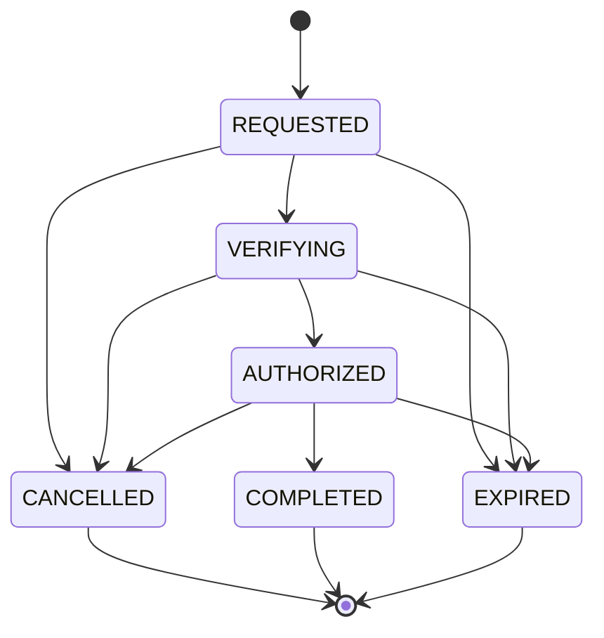

# Recovery cancellation experience — Trải nghiệm hủy yêu cầu khôi phục

Người dùng có thể muốn dừng khôi phục vì đã nhớ mật khẩu, tìm lại thiết bị, chọn nhầm tài khoản hoặc nhận ra mình không gửi yêu cầu. Một nút “Hủy” có vẻ đơn giản, nhưng kết quả của nó phụ thuộc vào trạng thái thực tế: yêu cầu còn đang chờ, đã có quyền đặt lại hay thay đổi tài khoản đã hoàn tất.

Trong module SECURITY_AUTHENTICATION_ACCOUNT_RECOVERY, trải nghiệm hủy cần giúp người dùng hiểu **đang hủy điều gì, việc hủy đã có hiệu lực chưa và có thể làm gì tiếp theo**. Máy chủ phải thực thi cùng ý nghĩa đó đối với token, quyền khôi phục và các thay đổi đang diễn ra.

Các trạng thái, endpoint và mẫu nội dung trong bài là một phương án thiết kế minh họa. Chúng không phải chính sách bắt buộc cho mọi sản phẩm.

## 1. Phân biệt rời trang, hủy yêu cầu và báo cáo sự cố

Ba hành động này thường xuất hiện gần nhau nhưng có tác dụng khác nhau:

| Hành động | Ý nghĩa đối với người dùng | Tác động hệ thống cần xác định |
| --- | --- | --- |
| Quay về đăng nhập hoặc đóng trang | Không tiếp tục thao tác tại màn hình hiện tại | Không mặc định thu hồi yêu cầu |
| Hủy yêu cầu khôi phục | Muốn chấm dứt một giao dịch khôi phục cụ thể | Chuyển trạng thái và vô hiệu hóa quyền thuộc giao dịch đó |
| Tôi không yêu cầu việc này | Báo khả năng có hoạt động không được mong muốn | Có thể mở quy trình bảo vệ tài khoản theo chính sách riêng |
| Đổi phương thức | Muốn tiếp tục bằng nhánh khác | Chuyển nhánh được phép, không nhất thiết hủy toàn bộ yêu cầu |
| Hoàn tác thay đổi đã xong | Muốn khôi phục trạng thái trước thay đổi | Là một thao tác nhạy cảm khác, không phải hủy yêu cầu đang chờ |

Nếu liên kết chỉ điều hướng về đăng nhập, đặt nhãn “Quay về đăng nhập”. Không dùng nhãn “Hủy yêu cầu” nếu backend không thực hiện thay đổi trạng thái.

Ngược lại, nếu nút thật sự thu hồi quyền khôi phục, cần nói rõ người dùng sẽ phải bắt đầu một yêu cầu mới nếu muốn tiếp tục sau đó.

Đóng hộp thoại xác nhận cũng khác với hủy yêu cầu. Escape hoặc nút đóng chỉ nên đóng phần xác nhận; chúng không tự gửi thao tác hủy.

## 2. Xác định phạm vi trước khi viết thông điệp

Trong phương án của bài, thao tác hủy nhắm đến **một recovery request**, không phải toàn bộ tài khoản.

Một yêu cầu có thể chứa:

- Token hoặc mã được phát hành cho yêu cầu đó.
- Kết quả xác minh đang chờ xử lý.
- Quyền có giới hạn để đặt lại mật khẩu hoặc đăng ký lại authenticator.
- Tác vụ gửi thông báo hoặc quy trình hỗ trợ liên quan.

Sau khi hủy thành công, những quyền dùng để tiếp tục giao dịch phải hết hiệu lực theo trạng thái đã lưu. Việc xóa một ô mã trên màn hình không đạt được kết quả này.

Các giới hạn cần nói rõ:

| Điều có thể nằm trong phạm vi hủy | Điều không tự xảy ra chỉ vì hủy |
| --- | --- |
| Chấm dứt giao dịch đang chờ | Xóa tài khoản |
| Ngăn token thuộc giao dịch tiếp tục cấp quyền | Thu hồi mọi session đăng nhập của tài khoản |
| Ngăn kết quả xác minh cũ làm giao dịch tiến lên | Đảo ngược mật khẩu đã được cập nhật thành công |
| Ghi nhận kết quả hủy | Thu hồi thư đã đến hộp thư người dùng |
| Dừng hoặc bỏ qua tác vụ còn có thể ngăn | Xóa mọi bằng chứng kiểm toán |

Nếu sản phẩm có một thao tác mạnh hơn như “Dừng mọi yêu cầu khôi phục”, nó cần quyền hạn, phạm vi và nội dung giải thích riêng. Không mở rộng một nút hủy thông thường thành thao tác đó.

### Ví dụ

Lan tạo yêu cầu R1 rồi tìm lại khóa bảo mật. Hủy R1 nên khiến token của R1 không còn dùng để khôi phục. Nó không tự làm mất hiệu lực khóa bảo mật vừa tìm lại hoặc đăng xuất mọi thiết bị đang hoạt động.

Nếu Lan đồng thời có yêu cầu R2, tác động đến R2 phải theo chính sách rõ ràng. Trong mô hình minh họa này, hủy R1 không tự hủy R2.

## 3. Mô hình trạng thái giúp giao diện nói đúng

Một mô hình rút gọn:



Ý nghĩa:

| Trạng thái | Mô tả | Cách xử lý hủy trong ví dụ |
| --- | --- | --- |
| `REQUESTED` | Đã tiếp nhận yêu cầu | Cho hủy nếu người gọi có quyền |
| `VERIFYING` | Đang thu thập hoặc đánh giá bằng chứng | Cho hủy; kết quả đến muộn không được mở lại |
| `AUTHORIZED` | Được phép thực hiện thay đổi cụ thể, chưa hoàn tất | Cho hủy trước khi thay đổi được ghi nhận |
| `CANCELLED` | Giao dịch đã bị chấm dứt | Không tạo thêm tác động khi gửi lại cùng ý định |
| `COMPLETED` | Thay đổi đã hoàn tất | Không thể coi hủy là hoàn tác |
| `EXPIRED` | Giao dịch hết thời hạn | Không tiếp tục; giải thích trạng thái phù hợp |

`AUTHORIZED` không đồng nghĩa có một phiên đăng nhập đầy đủ quyền. Nó có thể chỉ là quyền đặt lại một loại thông tin xác thực trong một giao dịch.

Các trạng thái thực tế có thể nhiều hơn, đặc biệt với hỗ trợ thủ công hoặc nhiều dịch vụ. Điều quan trọng là không để frontend tự suy ra “đã hủy” từ việc trang không còn hiển thị form.

Không có chuyển trạng thái từ `CANCELLED` về `AUTHORIZED` trong mô hình này. Người dùng muốn tiếp tục phải đi theo một yêu cầu mới được phép.

## 4. Đặt hành động hủy ở nơi dễ tìm

Hủy nên dễ phát hiện tại những bước mà giao dịch còn có thể dừng, nhưng không làm người dùng nhầm với hành động xác minh hoặc hoàn tất.

Ví dụ bố trí:

```text
Xác minh quyền truy cập

[Mã khôi phục                         ]
[Xác minh mã]

Chọn phương thức khác
Hủy yêu cầu khôi phục
```

Các lựa chọn thiết kế:

- Dùng nhãn đầy đủ như “Hủy yêu cầu khôi phục” khi một từ “Hủy” có thể chỉ đóng form.
- Không đặt hành động hủy ở vị trí rất dễ bấm nhầm sát nút xác minh.
- Không che giấu hủy trong nhiều lớp menu.
- Cho thao tác được bằng bàn phím và có focus nhìn thấy.
- Giữ cùng ý nghĩa của nhãn trên web, ứng dụng và thông báo liên quan.
- Khi người dùng đang chờ xác minh thủ công, vẫn giải thích liệu hủy có khả dụng ở trạng thái đó hay không.

Không cần đưa một nút hủy giao dịch vào trang chưa tạo giao dịch. Ở màn hình nhập email ban đầu, liên kết quay về đăng nhập có thể là đủ.

Nếu thao tác chỉ là bỏ phần nhập chưa gửi, một hộp thoại cảnh báo dài có thể gây phiền không cần thiết. Xác nhận nên tương xứng với tác động thật.

## 5. Xác nhận bằng hệ quả cụ thể

Một hộp xác nhận hữu ích cần trả lời:

1. Yêu cầu nào sẽ dừng?
2. Những liên kết hoặc mã nào không còn dùng được?
3. Muốn tiếp tục sau đó thì phải làm gì?
4. Hành động này có hoàn tác thay đổi đã xong không?

Mẫu cho yêu cầu còn đang hoạt động:

```text
Hủy yêu cầu khôi phục này?

Các mã và quyền khôi phục thuộc yêu cầu này sẽ không còn dùng được.
Nếu muốn khôi phục sau đó, bạn cần bắt đầu một yêu cầu mới.

[Tiếp tục khôi phục]  [Hủy yêu cầu]
```

Không dùng nhãn “Có” và “Không” khi người dùng phải nhớ lại câu hỏi để biết tác dụng. Không yêu cầu chọn một lý do bắt buộc nếu lý do đó không cần để quyết định hủy.

Nếu cung cấp mục lý do để cải thiện sản phẩm, nên để tùy chọn và tránh thu thập bí mật. “Tôi không yêu cầu việc này” có thể cần một đường báo cáo riêng thay vì chỉ trở thành một giá trị thống kê.

### Trang xác nhận đơn giản bằng HTML

Ví dụ dùng một trang riêng, không phụ thuộc JavaScript để mở modal:

```html
<main>
  <h1>Hủy yêu cầu khôi phục này?</h1>

  <p id="cancel-consequence">
    Nếu hủy thành công, các mã và quyền khôi phục thuộc yêu cầu này
    sẽ không còn dùng được. Bạn cần tạo yêu cầu mới nếu muốn tiếp tục.
  </p>

  <form action="/account-recovery/cancel"
        method="post"
        aria-describedby="cancel-consequence">
    <input type="hidden"
           name="_csrf"
           value="{{CSRF_TOKEN}}">
    <input type="hidden"
           name="requestId"
           value="{{REQUEST_ID}}">

    <button type="submit">Hủy yêu cầu</button>
  </form>

  <p>
    <a href="{{CONTINUE_URL}}">Tiếp tục khôi phục</a>
  </p>
</main>
```

Các placeholder phải do máy chủ render và escape theo ngữ cảnh. `CONTINUE_URL` phải là đích được ứng dụng cho phép, không phải redirect tùy ý do người gọi truyền.

`requestId` trong hidden input chỉ định đối tượng muốn thao tác; nó không chứng minh người gửi có quyền. Backend phải đối chiếu với ngữ cảnh đã được cấp và kiểm tra lại trạng thái.

Nếu dùng modal, cần đưa focus vào nội dung thích hợp khi mở, giữ trình tự Tab trong modal, cho đóng bằng Escape và trả focus hợp lý khi đóng. [W3C APG: Modal Dialog](https://www.w3.org/WAI/ARIA/apg/patterns/dialog-modal/)

Đóng modal phải giữ yêu cầu hiện tại như trước, trừ khi người dùng đã chủ động gửi và máy chủ đã thực hiện hủy.

## 6. Ai được hủy và hủy bằng chứng nào?

Một endpoint công khai chỉ cần email để hủy mọi recovery request sẽ tạo cơ hội cản trở chủ tài khoản. Biết email không phải bằng chứng sở hữu.

Có thể có các nguồn quyền khác nhau:

| Nguồn quyền | Phạm vi minh họa |
| --- | --- |
| Ngữ cảnh của người khởi tạo yêu cầu | Hủy đúng giao dịch mà ngữ cảnh đó quản lý |
| Phiên chủ tài khoản có mức xác thực phù hợp | Thao tác theo chính sách quản lý yêu cầu của tài khoản |
| Capability chỉ dành cho hủy | Chỉ hủy giao dịch đã ràng buộc, không đặt lại thông tin |
| Nhân viên hỗ trợ | Thao tác trong quy trình có phân quyền và kiểm toán |

Không được suy từ “có quyền hủy R1” thành “có quyền xem hoặc thay đổi toàn bộ tài khoản”.

Trong phương án dùng capability, cần ràng buộc tối thiểu:

- Mục đích là hủy, không phải xác minh để đặt mật khẩu.
- Đúng request và đối tượng liên quan.
- Thời hạn và quy tắc sử dụng lại.
- Phạm vi dữ liệu được phép hiển thị.
- Trạng thái giao dịch mà hành động còn có thể áp dụng.

Một token dùng để đặt lại mật khẩu không nên được mặc nhiên chấp nhận ở mọi API chỉ vì nó cùng liên quan recovery. Việc kiểm tra purpose hoặc scope phải rõ.

Cũng không nên cho người khởi tạo một yêu cầu yếu có quyền khóa tài khoản hoặc hủy giao dịch độc lập của chủ tài khoản. Quyền hủy phải tương xứng với bằng chứng và tác động.

## 7. Mở liên kết không đồng nghĩa xác nhận hủy

Một liên kết email có thể được mở bởi công cụ xem trước hoặc bộ quét bảo mật. Nếu truy cập GET lập tức hủy, người dùng có thể mất yêu cầu dù chưa chủ động làm gì.

Phương án trong bài:

```text
Mở liên kết
    → Hiện trang giải thích và xác nhận
    → Người dùng chọn “Hủy yêu cầu”
    → Gửi POST có ngữ cảnh hợp lệ
    → Máy chủ quyết định và trả kết quả
```

Theo HTTP, safe methods có ngữ nghĩa về cơ bản chỉ đọc; GET không phù hợp để người gọi yêu cầu một thay đổi trạng thái như hủy giao dịch. [RFC 9110: Safe Methods](https://www.rfc-editor.org/rfc/rfc9110.html#section-9.2.1)

Nếu quyền hạn dựa trên cookie của trình duyệt, thao tác thay đổi trạng thái cần cơ chế chống CSRF phù hợp. Một nút xác nhận trên giao diện không tự thay thế việc kiểm tra ở máy chủ. [OWASP: CSRF Prevention](https://cheatsheetseries.owasp.org/cheatsheets/Cross-Site_Request_Forgery_Prevention_Cheat_Sheet.html)

Đối với liên kết có capability, không đưa bí mật vào analytics, log tùy tiện hoặc nội dung có thể rò sang bên thứ ba. Trang đích cần chính sách xử lý URL, tài nguyên và referrer phù hợp.

Không dùng trang hủy để tự động xác nhận rằng một email có tài khoản. Khi capability không hợp lệ hoặc người gọi chưa được phép xem chi tiết, phản hồi nên theo hợp đồng không tiết lộ thông tin riêng.

## 8. Hủy phải cạnh tranh an toàn với hoàn tất

Tình huống khó nhất: tab A gửi hủy, trong khi tab B vừa xác minh xong và gửi thay đổi mật khẩu.

Không thể giải quyết chỉ bằng cách ẩn nút ở tab A. Cả hai request có thể đã đến server.

Trong mô hình dùng một cơ sở dữ liệu giao dịch, cả hủy và hoàn tất phải tuân thủ cùng cơ chế đồng bộ trên recovery request:

```text
Bắt đầu transaction
    → Xác thực và kiểm tra quyền cho đúng request
    → Đọc/khóa request hoặc dùng điều kiện phiên bản tương đương
    → Xác định trạng thái hiện tại và thời hạn
    → Áp dụng đúng một chuyển trạng thái được phép
    → Ghi thay đổi liên quan, kiểm toán và sự kiện cần phát
Kết thúc transaction
```

Hai kết quả hợp lệ:

| Thứ tự có hiệu lực tại máy chủ | Kết quả |
| --- | --- |
| Hủy được ghi nhận trước | Request thành `CANCELLED`; hoàn tất sau đó bị từ chối |
| Hoàn tất được ghi nhận trước | Request thành `COMPLETED`; hủy không được mô tả là đã chặn thay đổi |

Minh họa một cập nhật có điều kiện:

```sql
UPDATE recovery_request
SET state = 'CANCELLED',
    cancelled_at = :now,
    version = version + 1
WHERE id = :requestId
  AND state IN ('REQUESTED', 'VERIFYING', 'AUTHORIZED')
  AND expires_at > :now
  AND version = :expectedVersion;
```

Câu SQL chỉ minh họa kiểm soát trạng thái và phiên bản. Nó không tự thực hiện xác thực, kiểm tra quyền hoặc thu hồi mọi quyền liên quan.

Nếu không có hàng nào được cập nhật, không được kết luận “đã hủy”. Backend cần đọc lại trong ngữ cảnh được phép để phân biệt trạng thái đã đổi, đã hủy, đã hoàn tất hoặc hết hạn.

Việc vô hiệu hóa grant và ghi trạng thái cần có tính nguyên tử thích hợp. Một thiết kế khác là mọi thao tác dùng grant đều đối chiếu trạng thái request trong cùng cơ chế nhất quán trước khi thay đổi tài khoản. Chỉ kiểm tra một lần ở đầu luồng rồi bỏ qua trạng thái khi hoàn tất sẽ không bảo vệ được trước hủy đồng thời.

Ở mô hình transaction minh họa, ghi credential mới và chuyển `COMPLETED` phải cùng thuộc ranh giới có thể xác định thắng/thua với hủy. Nếu thay đổi nằm ở dịch vụ bên ngoài, cần thêm giao thức điều phối và trạng thái trung gian; không thể bê nguyên một câu UPDATE sang rồi khẳng định toàn bộ quy trình đã dừng.

## 9. Tác vụ nền và kết quả đến muộn

Khi người dùng hủy, hệ thống có thể đã:

- Xếp hàng gửi email.
- Bắt đầu kiểm tra bằng chứng.
- Tạo yêu cầu xác minh thủ công.
- Gửi phản hồi đến một thiết bị khác.

Không phải mọi tác vụ đều thu hồi được ngay lập tức. Trải nghiệm phải dựa trên điều hệ thống có thể bảo đảm.

| Tác vụ | Cách xử lý trong thiết kế này |
| --- | --- |
| Email chưa gửi và còn ngăn được | Có thể dừng tác vụ |
| Email đã gửi | Không thể lấy lại thư; quyền recovery bên trong phải không còn dùng được |
| Kết quả xác minh đến sau hủy | Không chuyển request trở lại trạng thái hoạt động |
| Nhân viên đang xử lý | Thấy trạng thái đã hủy trước khi đưa ra quyết định |
| Sự kiện được giao lại | Xử lý theo trạng thái và định danh sự kiện, không tạo lại quyền |

Thông điệp nên nói “Các mã thuộc yêu cầu này không còn dùng được” khi backend bảo đảm điều đó, thay vì “Bạn sẽ không nhận thêm bất kỳ email nào” nếu hàng đợi gửi thư chưa thể ngừng tuyệt đối.

Trong kiến trúc dùng sự kiện, có thể ghi một sự kiện hủy cùng transaction rồi chuyển qua outbox. Consumer vẫn phải kiểm tra tính liên quan và trạng thái cần thiết; việc phát sự kiện không có nghĩa mọi dịch vụ đã xử lý ngay.

Những liên kết cũ phải được máy chủ đánh giá lại. Không phụ thuộc vào việc trình duyệt đã xóa màn hình hoặc email đã bị người dùng xóa.

## 10. Phản hồi rõ khi mạng chậm hoặc kết quả chưa chắc chắn

Một mô hình giao diện:

```text
Chờ xác nhận
    → Đang gửi yêu cầu hủy
    → Đã hủy / Không thể hủy vì đã hoàn tất / Đã hết hiệu lực
    → Hoặc: Chưa xác định được kết quả do mất phản hồi
```

Mẫu phản hồi thành công trong ngữ cảnh đã được phép:

```json
{
  "state": "CANCELLED",
  "cancellationApplied": true,
  "messageKey": "recovery.cancel.confirmed",
  "nextActions": [
    "GO_TO_LOGIN",
    "START_NEW_REQUEST"
  ]
}
```

Mẫu khi hoàn tất đã thắng trước:

```json
{
  "state": "COMPLETED",
  "cancellationApplied": false,
  "messageKey": "recovery.cancel.too_late",
  "nextActions": [
    "VIEW_ACCOUNT_PROTECTION_HELP"
  ]
}
```

Chỉ cung cấp chi tiết khi quyền hiện tại cho phép. API công khai không được dùng các trạng thái này để giúp người lạ suy ra tình hình của một tài khoản.

Các quy tắc giao diện:

- Trong lúc chờ, hiển thị “Đang gửi yêu cầu hủy”, chưa hiển thị “Đã hủy”.
- Chống submit lặp ở client để giảm thao tác thừa; backend vẫn phải chịu được gửi lại.
- Nếu mất phản hồi, dùng “Chưa xác định được kết quả hủy. Kiểm tra lại trạng thái trước khi tiếp tục”.
- Không đóng trang và báo thành công chỉ vì request đã được gửi.
- Có thể cho kiểm tra lại trạng thái bằng ngữ cảnh có phạm vi phù hợp.
- Nếu phản hồi là `202` cho xử lý bất đồng bộ, chỉ nói đã tiếp nhận; đợi kết quả cuối mới nói đã hủy.

Tính idempotent về tác động nghĩa là gửi lại cùng ý định không tạo thêm chuyển trạng thái hoặc khôi phục quyền đã hủy. Nó không có nghĩa mọi token một lần phải được chấp nhận mãi mãi.

Có thể giữ một ngữ cảnh xem biên nhận có giới hạn để người dùng kiểm tra kết quả. Ngữ cảnh đó không được tiếp tục cấp quyền xác minh hoặc đặt lại. Nếu không còn đủ quyền để xem, dùng thông điệp phù hợp thay vì bịa trạng thái thành công.

## 11. Nội dung cho từng kết quả

| Kết quả thật | Mẫu nội dung | Hành động tiếp |
| --- | --- | --- |
| Đã hủy trước khi hoàn tất | Yêu cầu này đã bị hủy. Các mã và quyền khôi phục thuộc yêu cầu không còn dùng được | Về đăng nhập hoặc bắt đầu yêu cầu mới |
| Đã hủy từ trước | Yêu cầu này đã được hủy | Hiện đường tiếp phù hợp, không tạo lại |
| Đã hết hiệu lực | Yêu cầu này không còn hiệu lực | Bắt đầu lại theo chính sách |
| Thay đổi đã hoàn tất | Không thể hủy yêu cầu vì thay đổi đã hoàn tất | Hướng dẫn bảo vệ tài khoản hoặc thao tác tiếp phù hợp |
| Không thể xác định kết quả | Chưa nhận được kết quả xác nhận | Kiểm tra lại qua đường được phép |
| Không có ngữ cảnh hợp lệ | Không thể sử dụng đường dẫn này để xử lý yêu cầu | Trợ giúp chung, tránh lộ dữ liệu |

Một kết quả hủy không nên khẳng định “Mật khẩu của bạn chưa thay đổi” trên toàn tài khoản. Một giao dịch khác có thể vừa thay đổi mật khẩu. Nên mô tả phạm vi cụ thể: yêu cầu này đã dừng trước khi hoàn tất.

Thông báo trạng thái tại chỗ có thể dùng `role="status"` để công nghệ hỗ trợ nhận biết mà không buộc chuyển focus. [W3C: Status Messages](https://www.w3.org/WAI/WCAG22/Understanding/status-messages.html)

Nếu chuyển sang một màn hình kết quả mới, cung cấp heading rõ và vị trí focus phù hợp. Tránh vừa focus cả khối kết quả vừa phát lặp lại toàn bộ nội dung qua live region.

Không tự chuyển trang quá nhanh khiến người dùng chưa đọc được kết quả. Liên kết “Đi đến đăng nhập” giúp họ chủ động tiếp tục.

## 12. “Tôi không yêu cầu việc này” cần một đường riêng

Người nhận email recovery có thể không phải người khởi tạo. Họ cần hiểu liệu:

- Chỉ có một yêu cầu chưa hoàn tất.
- Đã có thay đổi tài khoản.
- Cần thực hiện bước bảo vệ nào tiếp theo.

Tuy nhiên, không dùng một lượt bấm yếu làm căn cứ tự động thay đổi mọi bảo mật của tài khoản.

Trong thiết kế minh họa:

1. Liên kết báo cáo mở trang giải thích, không thực hiện thay đổi nhạy cảm bằng GET.
2. Capability hoặc phiên được kiểm tra với phạm vi tương ứng.
3. Hủy giao dịch được xử lý nếu còn khả dụng.
4. Báo cáo nghi vấn được ghi nhận riêng.
5. Những hành động như thu hồi session hoặc kiểm tra authenticator đi theo chính sách bảo vệ tài khoản.

Không hứa rằng “Bấm hủy là tài khoản hoàn toàn an toàn”. Một attacker có thể đã có phiên đăng nhập hoặc thực hiện thay đổi khác.

OWASP lưu ý rằng khôi phục tài khoản nghi bị xâm phạm có thể cần xem xét session, authenticator và thông tin recovery ngoài việc đổi mật khẩu. [OWASP: Forgot Password](https://cheatsheetseries.owasp.org/cheatsheets/Forgot_Password_Cheat_Sheet.html)

Cũng tránh để người không có quyền liên tục khởi tạo rồi hủy nhằm cản trở chủ tài khoản. Quyền hủy và biện pháp chống lạm dụng phải giới hạn đúng phạm vi; báo cáo nghi vấn không tự cấp quyền khóa tài khoản của người khác.

## 13. Sau khi hủy: bắt đầu lại và xử lý dữ liệu

Một nút “Hoàn tác hủy” dễ tạo kỳ vọng rằng mã cũ dùng lại được. Trong mô hình terminal state của bài, muốn tiếp tục phải tạo yêu cầu mới.

Yêu cầu mới cần:

- Một định danh giao dịch mới.
- Bí mật và thời hạn mới nếu được phép phát hành.
- Các kiểm soát rủi ro và giới hạn yêu cầu đang áp dụng.
- Điều kiện xác minh phù hợp với trạng thái hiện tại.

Không phục hồi grant cũ chỉ vì người dùng nhấn quay lại trình duyệt. Nếu sản phẩm tái sử dụng một bằng chứng còn hợp lệ theo chính sách, đó phải là quyết định rõ của backend, không phải việc trang giữ lại một cờ `verified=true`.

Về dữ liệu:

| Dữ liệu | Hướng xử lý |
| --- | --- |
| Mã đang nhập hoặc mật khẩu mới chưa gửi | Xóa khỏi trạng thái giao diện khi kết thúc phù hợp |
| Grant dùng để thay đổi tài khoản | Vô hiệu hóa theo request đã hủy |
| Kết quả xác minh đến sau | Không dùng để mở lại giao dịch |
| Log kiểm toán cần thiết | Giữ theo chính sách, không nhầm hủy với xóa lịch sử |
| Hồ sơ hoặc giấy tờ đã gửi | Xử lý theo chính sách lưu giữ; không hứa xóa tức thì nếu chưa có cơ chế |

Không ghi raw token, mã dự phòng hoặc nội dung giấy tờ vào sự kiện “người dùng bấm hủy”. Nếu cần phân tích trải nghiệm, dùng dữ liệu tối thiểu như giai đoạn, kết quả hủy và lỗi kỹ thuật đã loại bỏ bí mật.

## 14. Những tình huống giúp làm rõ thiết kế

| Tình huống | Hành vi cần đạt |
| --- | --- |
| Người dùng chỉ quay về đăng nhập | Không nói yêu cầu đã bị thu hồi nếu chưa hủy |
| Escape tại hộp xác nhận | Đóng hộp thoại, không gửi hủy |
| Gửi hủy hai lần | Không phát sinh hai thay đổi hoặc tạo quyền mới |
| Mất phản hồi sau khi gửi | Hiển thị kết quả chưa chắc chắn và có đường kiểm tra |
| Tab khác đang hoàn tất | Máy chủ xác định một thứ tự có hiệu lực rõ |
| Email đến sau khi hủy | Liên kết hoặc mã không thể tiếp tục giao dịch |
| Kết quả xác minh đến muộn | Không hồi sinh request đã hủy |
| Người nhận không khởi tạo | Có đường báo cáo và bảo vệ phù hợp |
| Request đã hoàn tất | Không trình bày hủy như thao tác hoàn tác |
| Người dùng đổi ý sau hủy | Bắt đầu yêu cầu mới theo chính sách |
| Có nhiều recovery request | Phạm vi tác động được giải thích và thực thi chính xác |
| Trang kết quả mở bằng bàn phím | Có heading, focus và hành động tiếp có thể thao tác |

Trải nghiệm hủy đáng tin cậy cần sự nhất quán giữa nhãn nút, quyền thao tác, trạng thái máy chủ và nội dung kết quả. Người dùng chỉ nên được thông báo “đã hủy” khi hệ thống thực sự bảo đảm giao dịch đó không còn tiếp tục theo quyền khôi phục đã cấp.