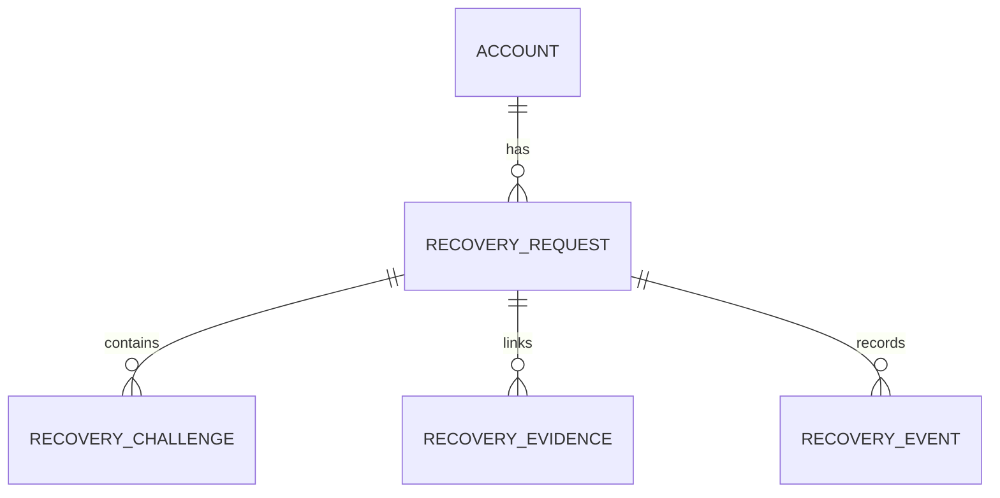

# Recovery request entity trong mô hình dữ liệu khôi phục tài khoản

## 1. Recovery request đại diện cho điều gì?

**Recovery request** là thực thể biểu diễn một giao dịch khôi phục có mục đích, tài khoản đích, trạng thái và thời hạn rõ ràng. Nó ghi nhận quá trình hệ thống xem xét rồi thực hiện một tác vụ như đặt lại mật khẩu, thay phương thức MFA hoặc đăng ký lại passkey theo chính sách.

Thực thể này giúp trả lời những câu hỏi mà một token đơn lẻ không thể trả lời đầy đủ:

- Giao dịch đang nhắm đến tài khoản nào và tác vụ nào?
- Những bằng chứng liên quan đã được kiểm tra tới đâu?
- Yêu cầu còn được tiếp tục hay đã hết hạn, bị hủy hoặc bị từ chối?
- Quyền thực hiện tác vụ đã được cấp chưa và còn hiệu lực không?
- Tác vụ thực tế đã hoàn tất hay người dùng mới chỉ vượt qua một bước xác minh?

Một request có thể có nhiều lần gửi mã, nhiều thử thách hoặc một nhánh xem xét thủ công. Vì vậy, không nên đồng nhất “request được tạo”, “mã đã gửi”, “mã đúng” và “tài khoản được khôi phục” thành cùng một trạng thái.

Ví dụ, người dùng mất thiết bị MFA nhưng vẫn truy cập được email. Hệ thống có thể tiếp nhận yêu cầu, kiểm tra bằng chứng qua email rồi yêu cầu thêm bằng chứng khác. Một lần xác minh thành công chưa mặc nhiên cho phép bỏ MFA hoặc cấp session đầy đủ.

## 2. Ranh giới của thực thể

Recovery request là đầu mối điều phối, không phải nơi chứa tất cả dữ liệu nhạy cảm của quy trình.

| Dữ liệu | Vị trí phù hợp |
| --- | --- |
| Tài khoản đích, mục đích, trạng thái, thời hạn tổng | Recovery request |
| Mã gửi qua email hoặc SMS, token xác minh và số lần thử riêng | Thực thể thử thách liên kết với request |
| Phương thức liên hệ đã xác minh | Thực thể liên hệ của tài khoản |
| Mã dự phòng và trạng thái đã dùng | Kho lưu trữ mã dự phòng hoặc bằng chứng tương ứng |
| Kết quả đánh giá hoặc phê duyệt có thẩm quyền | Bản ghi đánh giá, bằng chứng hoặc quyết định được liên kết |
| Lịch sử chuyển trạng thái | Sự kiện audit riêng |
| Công việc gửi thông báo | Bản ghi giao việc hoặc outbox phù hợp |

Không đặt token dạng rõ, OTP, mật khẩu mới, khóa riêng passkey hay toàn bộ hồ sơ xác minh vào một cột JSON dùng chung của request. Những dữ liệu có vòng đời và quyền truy cập khác nhau cần được tách để kiểm soát riêng.

Một mô hình quan hệ khái quát:



Các tên trong sơ đồ và SQL của bài là mô hình minh họa. Trọng tâm là hợp đồng của request và các quan hệ cần bảo toàn, không phải cấu trúc có sẵn của một ứng dụng cụ thể.

## 3. Các nhóm trường cần thiết

### 3.1. Định danh và phạm vi

| Trường | Ý nghĩa |
| --- | --- |
| `id` | Khóa duy nhất của request |
| `account_id` | Tài khoản thực sự là đối tượng của giao dịch |
| `purpose` | Tác vụ cụ thể được yêu cầu |
| Tham chiếu đối tượng hoặc đề xuất tác vụ | Ràng buộc phương thức cần thay, đề xuất đăng ký hoặc đối tượng liên quan khi tác vụ yêu cầu |
| `policy_version` | Phiên bản chính sách được ghi nhận để giải thích quyết định |

`purpose` cần cụ thể, ví dụ `RESET_PASSWORD`, `REPLACE_MFA` hoặc `REGISTER_PASSKEY`. Không dùng một cờ `recovered=true` để đại diện cho mọi quyền thay đổi tài khoản.

Trong mô hình tối giản của bài, một request có một tác vụ bất biến. Nếu hệ thống cho phép nhiều tác vụ trong cùng giao dịch, cần một mô hình scope và tiêu thụ quyền rõ ràng hơn; không mở rộng quyền chỉ bằng cách đổi nhãn giao diện.

Thay đổi tài khoản đích, mục đích hoặc đối tượng tác vụ sau khi đã có bằng chứng có thể làm bằng chứng không còn đúng ngữ cảnh. Cách an toàn là coi đó là giao dịch mới hoặc thực hiện một chuyển trạng thái được thiết kế riêng để thu hồi quyền cũ và đánh giá lại.

### 3.2. Trạng thái và thời gian

| Trường | Ý nghĩa |
| --- | --- |
| `status` | Trạng thái nghiệp vụ hiện tại |
| `created_at` | Thời điểm tạo request |
| `updated_at` | Thời điểm cập nhật gần nhất |
| `expires_at` | Hạn cuối của giao dịch |
| `authorized_at` | Thời điểm quyết định cho phép tác vụ được ghi nhận |
| `authorization_expires_at` | Hạn của quyền thực hiện tác vụ |
| `completed_at` | Thời điểm tác vụ được hoàn tất thành công |
| `closed_at` | Thời điểm request đi vào trạng thái kết thúc |

Thời gian cần có ngữ nghĩa thống nhất và được xử lý từ nguồn tin cậy phía server. Locale của người dùng chỉ phục vụ trình bày, không quyết định hiệu lực của request.

Không dùng `updated_at` làm thời hạn trượt ngầm. Việc gửi lại mã, thêm sự kiện hoặc mở lại trang không tự gia hạn giao dịch.

### 3.3. Hai loại phiên bản khác nhau

- `version` là phiên bản của chính bản ghi request, dùng phát hiện cập nhật đồng thời.
- `account_security_version` là ảnh chụp một thế hệ an toàn của tài khoản tại thời điểm gắn request, nếu hệ thống sử dụng cơ chế này để vô hiệu hóa giao dịch cũ.

Hai trường không thay thế nhau. Request chưa bị cập nhật bởi luồng khác vẫn có thể không còn hợp lệ vì trạng thái an toàn của tài khoản đã thay đổi.

`policy_version` cũng không phải cam kết rằng một chính sách cũ luôn được áp dụng tới cuối. Một thay đổi an toàn có thể buộc thu hồi hoặc đánh giá lại các request đang mở theo quy tắc chuyển tiếp được thiết kế rõ ràng.

## 4. Vòng đời: xác minh, cấp quyền và hoàn tất là các mốc riêng

Một bộ trạng thái minh họa:

| Trạng thái | Ý nghĩa |
| --- | --- |
| `PENDING` | Request đã được tạo, chưa bắt đầu hoặc chưa hoàn tất quá trình xác minh |
| `VERIFYING` | Đang thu thập và kiểm tra bằng chứng |
| `REVIEW_REQUIRED` | Cần một quyết định xem xét có thẩm quyền |
| `AUTHORIZED` | Đủ điều kiện thực hiện đúng tác vụ được yêu cầu trong thời hạn cho phép |
| `COMPLETED` | Tác vụ đã được ghi nhận thành công cùng việc tiêu thụ quyền |
| `REJECTED` | Hệ thống hoặc người có thẩm quyền từ chối tiếp tục |
| `CANCELLED` | Giao dịch bị hủy theo một hành động được phép |
| `EXPIRED` | Giao dịch đã được ghi nhận là hết hiệu lực do thời gian |

Các trạng thái kết thúc là `COMPLETED`, `REJECTED`, `CANCELLED` và `EXPIRED`. Chúng không tự quay lại trạng thái mở. Muốn bắt đầu lại, tạo giao dịch mới theo chính sách.

Không phải mọi request đều đi qua `REVIEW_REQUIRED`. Cũng không cho phép cập nhật `status` tùy ý chỉ vì giá trị mới thuộc danh sách enum. Một chuyển trạng thái còn cần trạng thái nguồn, bằng chứng, thời gian, actor và điều kiện chính sách phù hợp.

Ví dụ:

```text
PENDING → VERIFYING → AUTHORIZED → COMPLETED
                 ↘ REVIEW_REQUIRED → AUTHORIZED

Các trạng thái chưa kết thúc có thể đi tới
REJECTED, CANCELLED hoặc EXPIRED khi điều kiện tương ứng được đáp ứng.
```

Kết quả “một mã đúng” thuộc bằng chứng hoặc thử thách. Chỉ tầng quyết định chính sách mới xác định tập bằng chứng hiện tại có đủ để chuyển request sang `AUTHORIZED` hay không.

## 5. Những bất biến cần bảo toàn

Một mô hình dữ liệu hữu ích cần chỉ rõ những điều không được phá vỡ:

1. Request gắn với đúng tài khoản và một mục đích đã xác định.
2. Thử thách, bằng chứng, phê duyệt và đối tượng tác vụ phải thuộc đúng ngữ cảnh request đó.
3. Hạn request phải sau thời điểm tạo; hạn quyền tác vụ không vượt hạn request trong mô hình này.
4. Trạng thái `AUTHORIZED` phải có quyết định cấp quyền và thời hạn tương ứng.
5. `COMPLETED` chỉ được ghi khi tác vụ được bảo vệ thực sự thành công và quyền đã được tiêu thụ.
6. Trạng thái kết thúc không thể bị một yêu cầu đến chậm ghi đè thành trạng thái mở.
7. Mọi hành động nhạy cảm kiểm tra thời gian và điều kiện hiện tại, không chỉ đọc trường `status`.

Trong hệ thống nhiều tenant, quan hệ tài khoản và các thực thể liên quan cần giữ đúng tenant. Một khóa ngoại theo ID riêng lẻ không tự bảo đảm điều này nếu khóa và truy vấn của mô hình không ràng buộc tenant phù hợp.

Một request ID, kể cả ID khó đoán, chỉ xác định bản ghi. Nó không phải bằng chứng đủ để xem dữ liệu hoặc thực hiện khôi phục. Server vẫn cần kiểm tra ngữ cảnh hoặc credential hạn chế được thiết kế cho giao dịch đó.

## 6. Ví dụ khung bảng PostgreSQL

Ví dụ sau giả định có bảng `account(id)`. Các bảng thử thách, bằng chứng và đối tượng tác vụ được mô hình riêng; chúng phải ràng buộc với cùng tài khoản và request. SQL tập trung vào trạng thái tổng, thời gian và phiên bản.

```sql
CREATE TABLE recovery_request (
    id                          uuid PRIMARY KEY,
    account_id                  uuid NOT NULL REFERENCES account(id),
    purpose                     varchar(32) NOT NULL,
    status                      varchar(24) NOT NULL,
    policy_version              varchar(64) NOT NULL,
    account_security_version    bigint NOT NULL,
    version                     bigint NOT NULL DEFAULT 0,

    created_at                  timestamptz NOT NULL,
    updated_at                  timestamptz NOT NULL,
    expires_at                  timestamptz NOT NULL,
    authorized_at               timestamptz,
    authorization_expires_at    timestamptz,
    completed_at                timestamptz,
    closed_at                   timestamptz,

    CHECK (purpose IN (
        'RESET_PASSWORD', 'REPLACE_MFA', 'REGISTER_PASSKEY'
    )),
    CHECK (status IN (
        'PENDING', 'VERIFYING', 'REVIEW_REQUIRED', 'AUTHORIZED',
        'COMPLETED', 'REJECTED', 'CANCELLED', 'EXPIRED'
    )),
    CHECK (version >= 0 AND account_security_version >= 0),
    CHECK (expires_at > created_at),
    CHECK (updated_at >= created_at),

    CHECK (
        (authorized_at IS NULL AND authorization_expires_at IS NULL)
        OR
        (authorized_at IS NOT NULL
         AND authorization_expires_at IS NOT NULL
         AND authorized_at >= created_at
         AND authorization_expires_at > authorized_at
         AND authorization_expires_at <= expires_at)
    ),
    CHECK (
        status NOT IN ('AUTHORIZED', 'COMPLETED')
        OR authorized_at IS NOT NULL
    ),
    CHECK (
        (status IN ('COMPLETED', 'REJECTED', 'CANCELLED', 'EXPIRED')
         AND closed_at IS NOT NULL)
        OR
        (status IN ('PENDING', 'VERIFYING', 'REVIEW_REQUIRED', 'AUTHORIZED')
         AND closed_at IS NULL)
    ),
    CHECK (closed_at IS NULL OR closed_at >= created_at),
    CHECK (
        (status = 'COMPLETED'
         AND completed_at IS NOT NULL
         AND completed_at = closed_at
         AND completed_at >= authorized_at)
        OR
        (status <> 'COMPLETED' AND completed_at IS NULL)
    )
);
```

Các ràng buộc trên kiểm tra hình dạng và quan hệ tĩnh giữa các giá trị. Chúng không tự kiểm tra bằng chứng, actor được phép cập nhật hay toàn bộ đồ thị chuyển trạng thái.

Trong PostgreSQL, `CHECK` có thể được thỏa khi biểu thức trả về `NULL`; vì vậy, điều kiện bắt buộc có giá trị phải dùng `NOT NULL` hoặc kiểm tra `IS NOT NULL` rõ ràng. Xem [PostgreSQL — Constraints](https://www.postgresql.org/docs/current/ddl-constraints.html).

Không viết `CHECK (expires_at > now())` để kỳ vọng cơ sở dữ liệu tự đóng request khi thời gian trôi qua. Điều kiện hiệu lực theo thời gian phải được xét tại thao tác sử dụng; tác vụ nền chỉ giúp đồng bộ nhãn trạng thái và dọn dữ liệu.

## 7. Cập nhật đồng thời và yêu cầu đến chậm

Hai tab có thể cùng xác minh, một tác vụ nền có thể đóng request đúng lúc người dùng xác nhận, hoặc một yêu cầu cũ có thể được gửi lại sau khi request đã hoàn tất. Đọc trạng thái rồi ghi đè không điều kiện sẽ tạo nguy cơ mất cập nhật.

Một câu lệnh chuyển từ `PENDING` sang `VERIFYING` có thể dùng phiên bản kỳ vọng:

```sql
UPDATE recovery_request
SET status = 'VERIFYING',
    updated_at = :checked_at,
    version = version + 1
WHERE id = :request_id
  AND account_id = :account_id
  AND status = 'PENDING'
  AND version = :expected_version
  AND expires_at > :checked_at
RETURNING id, status, version;
```

Các tham số là giá trị bind, và `checked_at` phải đến từ nguồn thời gian tin cậy phía server gần thời điểm quyết định. Câu lệnh được gọi sau khi kiểm tra ngữ cảnh; `account_id` từ client không tự xác lập quyền.

Không nhận được hàng trả về có thể do xung đột phiên bản, sai trạng thái, hết hạn hoặc không khớp ngữ cảnh. Tầng xử lý phải đọc lại trong phạm vi được phép rồi quyết định phản hồi hoặc thử lại; không bỏ điều kiện `version` để ép thành công.

[PostgreSQL — Transaction Isolation](https://www.postgresql.org/docs/current/transaction-iso.html) mô tả việc điều kiện `WHERE` của cập nhật được đánh giá lại trên phiên bản hàng mới trong các tình huống cạnh tranh ở Read Committed. Một `UPDATE` có điều kiện giúp gắn kiểm tra và thay đổi của một hàng vào cùng thao tác.

Tuy nhiên, chỉ một phiên bản của request không bảo vệ mọi quan hệ liên bảng. Khi quyết định phụ thuộc tài khoản, thử thách hoặc phê duyệt, phải chọn cơ chế giao dịch, khóa và kiểm tra đồng thời phù hợp với toàn bộ tập dữ liệu liên quan.

## 8. Hoàn tất request cùng tác vụ được bảo vệ

Sai lầm nghiêm trọng là đánh dấu `COMPLETED`, commit, rồi mới đổi mật khẩu. Nếu bước đổi mật khẩu thất bại, request nói rằng đã hoàn tất dù tác vụ chưa xảy ra. Làm ngược lại bằng hai commit riêng cũng có thể cho phép tác vụ đã xảy ra nhưng quyền vẫn dùng lại được.

Trong mô hình dữ liệu cùng một cơ sở dữ liệu giao dịch, có thể tổ chức bước cuối theo mã giả:

```text
BEGIN TRANSACTION

  Khóa tài khoản và request theo thứ tự thống nhất trong hệ thống
  Đọc lại trạng thái và lấy mốc thời gian tin cậy sau khi chờ khóa

  Kiểm tra:
    - đúng tài khoản, purpose và đối tượng tác vụ
    - request đang AUTHORIZED
    - request và quyền tác vụ đều còn hạn
    - account_security_version còn khớp thế hệ hiện tại
    - bằng chứng, quyết định và các ràng buộc chưa bị thu hồi

  Thực hiện đúng tác vụ được cấp quyền
  Tiêu thụ quyền và xử lý các bằng chứng dùng một lần theo chính sách
  Cập nhật request thành COMPLETED, cùng completed_at và closed_at
  Tăng version của request
  Cập nhật thế hệ an toàn hoặc trạng thái session nếu chính sách yêu cầu
  Ghi sự kiện audit và ý định gửi thông báo trong cùng giao dịch

COMMIT
```

Nếu một thay đổi quan trọng thất bại, rollback cả nhóm thay đổi. Không giữ trạng thái hoàn tất chỉ để giao diện trông thành công.

`SELECT ... FOR UPDATE` là một công cụ khóa hàng có thể dùng trong kiểu xử lý này. Cần giữ giao dịch ngắn và thống nhất thứ tự khóa giữa các luồng. Xem [PostgreSQL — Explicit Locking](https://www.postgresql.org/docs/current/explicit-locking.html).

Không giữ khóa cơ sở dữ liệu trong khi chờ người dùng nhập mã hoặc chờ nhà cung cấp SMS trả kết quả. Việc gửi thông báo được giao sau commit qua cơ chế tin cậy phù hợp; lỗi chuyển phát không được đảo ngược một tác vụ đã hoàn tất rồi gửi lại tác vụ nhạy cảm tùy tiện.

Nếu tác vụ trải qua nhiều dịch vụ hoặc nhiều kho dữ liệu, một giao dịch local không thể bảo đảm nguyên tử cho tất cả. Khi đó cần mô hình điều phối và trạng thái thực hiện riêng; `COMPLETED` vẫn phải có định nghĩa dựa trên kết quả thực tế, không chỉ việc đã đẩy một message.

## 9. Hết hạn, hủy và vô hiệu hóa yêu cầu cũ

`expires_at` quyết định hiệu lực tại thời điểm dùng, kể cả khi hàng vẫn còn mang trạng thái `VERIFYING` do tác vụ nền chưa chạy. Tương tự, quyền tác vụ có thể hết hạn trước thời hạn tổng của request.

Một hệ thống có thể dùng `account_security_version` để vô hiệu hóa nhiều request cũ bằng cách tăng thế hệ an toàn của tài khoản. Muốn cơ chế có hiệu lực, tất cả đường cấp quyền và thực thi tác vụ liên quan phải so sánh thế hệ trong một cơ chế đồng thời phù hợp.

Tăng một số trên tài khoản không tự thu hồi session hay token nếu các nơi sử dụng chúng không kiểm tra thế hệ hoặc không được tích hợp với cơ chế thu hồi. Cần xác định rõ phạm vi của từng loại phiên bản.

Khi hủy hoặc từ chối, lưu trạng thái kết thúc và nguyên nhân nội bộ ở mức cần thiết. Không biến một tín hiệu rủi ro chi tiết thành thông báo công khai giúp người tấn công biết cách tránh kiểm soát.

Không tự gia hạn request bằng cách cập nhật `expires_at` mỗi lần gửi lại mã. Nếu sản phẩm cho gia hạn, phải có chính sách rõ ràng về giới hạn tổng, bằng chứng còn hiệu lực và thu hồi quyền đã cấp trước đó.

## 10. Tạo request, chống gửi lặp và tránh dò tài khoản

Bảng minh họa yêu cầu `account_id` không rỗng, nên nó đại diện cho giao dịch nội bộ đã gắn được tài khoản đích. Nó không bắt buộc mọi yêu cầu công khai nhập một email bất kỳ đều phải sinh một hàng request có tài khoản thật.

Lớp tiếp nhận có thể xử lý hạn mức, ghi nhận việc tiếp nhận ở mức cần thiết và trả phản hồi công khai nhất quán mà không tạo tài khoản giả hoặc khóa ngoại vô nghĩa. Việc có tạo request nội bộ cho tài khoản tồn tại không được làm lộ sự tồn tại qua dữ liệu trả về hoặc hành vi dễ phân biệt.

Một ID của request nội bộ cũng không nên tự động xuất hiện trong mọi phản hồi công khai nếu sự xuất hiện hoặc khả năng tra cứu ID đó làm lộ tài khoản. Nếu có handle công khai, hợp đồng của handle phải được thiết kế cho ngữ cảnh đó.

Gửi lại cùng một yêu cầu mạng cần được phân biệt với mở một giao dịch khôi phục mới. Có thể sử dụng khóa idempotency gắn với ngữ cảnh và fingerprint của thao tác, có thời hạn lưu rõ ràng. Khóa này giúp tránh tạo lặp, không chứng minh danh tính hoặc thay thế hạn mức.

Không đặt `UNIQUE(account_id, purpose)` rồi mặc định đó là chính sách đúng cho mọi hệ thống. Ràng buộc đó còn cấm cả lịch sử nhiều request đã đóng. Nếu chỉ cho một request đang hoạt động, cần mô hình trạng thái và điều phối đồng thời để thể hiện chính xác quy tắc này.

## 11. Truy vấn, chỉ mục và quyền truy cập dữ liệu

Hai nhu cầu truy vấn thường gặp là xem lịch sử theo tài khoản và tìm request đang mở cần xử lý thời hạn. Ví dụ chỉ mục minh họa:

```sql
CREATE INDEX recovery_request_account_created_idx
    ON recovery_request (account_id, created_at DESC);

CREATE INDEX recovery_request_open_expiry_idx
    ON recovery_request (expires_at)
    WHERE status IN (
        'PENDING', 'VERIFYING', 'REVIEW_REQUIRED', 'AUTHORIZED'
    );
```

Predicate của chỉ mục theo trạng thái không cần chứa thời điểm hiện tại. Truy vấn của tác vụ nền bổ sung điều kiện `expires_at <= :checked_at`, còn việc cấp quyền vẫn kiểm tra thời hạn trực tiếp.

Không coi số lượng request của một tài khoản là toàn bộ cơ chế chống lạm dụng. Yêu cầu cho định danh không tồn tại, nguồn gửi khác nhau hoặc giao dịch bị chặn trước khi tạo hàng vẫn cần được xử lý ở lớp thích hợp.

API không nên serialize trực tiếp toàn bộ entity. DTO công khai cần giới hạn trường theo quyền xem; trạng thái nội bộ, policy version, tín hiệu đánh giá và thông tin tài khoản không mặc nhiên được phép trả cho người yêu cầu.

Audit nên ghi được hành động, kết quả, actor hoặc thành phần thực hiện và ngữ cảnh liên kết cần thiết. Không ghi token, OTP, mật khẩu hay mã dự phòng dạng rõ. Thông tin nhận dạng và dữ liệu đánh giá cần phân quyền, thời hạn lưu và xử lý khi xóa tài khoản theo chính sách của hệ thống.

## 12. Tình huống vận dụng

Một request đặt lại mật khẩu đã được cấp quyền. Người dùng mở hai tab và cùng gửi mật khẩu mới. Cùng lúc, một thao tác an toàn trên tài khoản có thể làm request cũ không còn hợp lệ.

Với mô hình được ràng buộc đúng:

1. Mỗi lần gửi được kiểm tra lại ngữ cảnh, tác vụ, trạng thái, thời hạn và thế hệ an toàn.
2. Luồng hoàn tất khóa hoặc điều phối các hàng liên quan theo cùng một quy tắc.
3. Chỉ một lần thực thi hợp lệ có thể tiêu thụ quyền của request.
4. Thay đổi mật khẩu và đánh dấu `COMPLETED` được commit như một nhóm thay đổi nhất quán.
5. Tab còn lại không được dùng trạng thái đã đọc trước đó để ghi đè hoặc thực hiện tác vụ lần nữa.
6. Nếu thao tác an toàn khác đã vô hiệu hóa quyền trước khi bước cuối được quyết định, request không được tiếp tục chỉ vì trước đó từng mang trạng thái `AUTHORIZED`.

Recovery request entity cần thể hiện rõ **giao dịch nào, cho tài khoản nào, được phép làm gì, còn hiệu lực đến khi nào và tác vụ đã thực sự hoàn tất chưa**. Khi các ngữ nghĩa này được giữ nhất quán giữa dữ liệu, chuyển trạng thái và giao dịch ghi, hệ thống có nền tảng để khôi phục mật khẩu, MFA hoặc passkey mà không biến một dấu hiệu tiến độ thành quyền chiếm quyền truy cập tài khoản.
