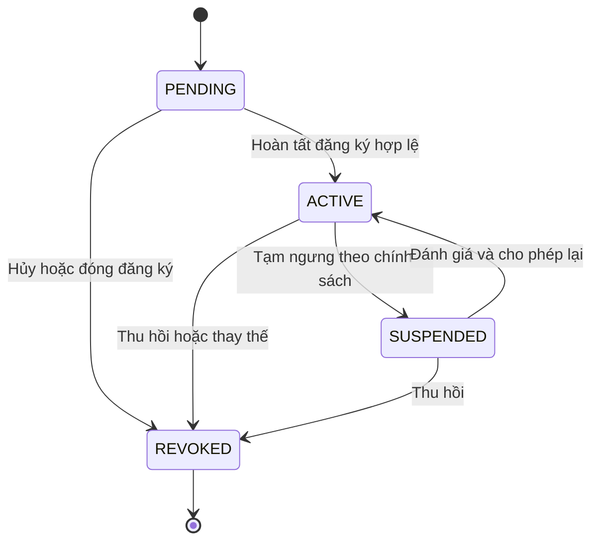

# Recovery factor entity: mô hình thực thể phương tiện khôi phục tài khoản

Một tài khoản có thể có email khôi phục, số điện thoại đã đăng ký, bộ mã dự phòng hoặc một credential còn sử dụng được trong một quy trình thay thế thông tin xác thực. Nếu hệ thống chỉ lưu một danh sách chuỗi như `["email", "sms", "backup-code"]`, nó không biết phương tiện nào đã được xác minh, phương tiện nào đang chờ đăng ký và phương tiện nào đã bị thu hồi.

**Recovery factor entity** là thực thể miền dùng để quản lý một phương tiện khôi phục được liên kết với một tài khoản, bao gồm loại phương tiện, trạng thái vòng đời, nguồn dữ liệu và các mốc cần thiết để áp dụng chính sách.

Trong SECURITY_AUTHENTICATION_ACCOUNT_RECOVERY, thực thể này hỗ trợ quyết định phương tiện nào có thể tham gia khôi phục khi người dùng mất mật khẩu, MFA, passkey hoặc thiết bị. Bản thân một bản ghi không chứng minh người đang gửi yêu cầu kiểm soát phương tiện đó.

## 1. Xác định đúng ý nghĩa của “factor”

Trong bài này, `RecoveryFactor` là tên thực thể của một mô hình ứng dụng. Nó không có nghĩa mọi phương tiện khôi phục đều là một yếu tố xác thực độc lập hoặc đều có cùng mức đảm bảo.

Ví dụ, hai địa chỉ email có thể cùng thuộc một hộp thư; SMS và email có thể cùng được truy cập từ một điện thoại. Có hai bản ghi không tự chứng minh có hai bằng chứng độc lập.

[NIST SP 800-63B-4 về quản lý sự kiện xác thực](https://pages.nist.gov/800-63-4/sp800-63b/events/) phân biệt các phương thức khôi phục như mã lưu sẵn, mã được phát hành, liên hệ khôi phục và xác minh danh tính lại. Tên thực thể trong ứng dụng cần diễn đạt phạm vi của sản phẩm, không được coi là một schema do NIST quy định.

Cũng cần phân biệt:

| Khái niệm | Vai trò |
| --- | --- |
| Recovery factor | Phương tiện đã đăng ký hoặc đang được đăng ký cho tài khoản |
| Recovery challenge | Một lần yêu cầu chứng minh quyền kiểm soát phương tiện |
| Recovery evidence | Kết quả xác minh trong một ngữ cảnh và thời hạn cụ thể |
| Recovery transaction | Lần khôi phục đang diễn ra, với các bước và chính sách |
| Recovery token | Bí mật hoặc tham chiếu dùng để thực hiện một hành động giới hạn |
| Recovery session | Phiên có quyền giới hạn sau một hoặc nhiều bước xác minh |

Email khôi phục có thể tồn tại nhiều tháng. Mã gửi đến email đó chỉ có hiệu lực cho một challenge cụ thể. Không đặt hai vòng đời này vào cùng một cột `expiresAt` rồi sử dụng chung.

## 2. Danh tính và phạm vi sở hữu

Một recovery factor cần được gắn rõ với:

- Tenant hoặc phạm vi tổ chức, nếu hệ thống có nhiều tenant.
- Tài khoản sở hữu.
- Định danh factor ổn định.
- Loại phương tiện.
- Trạng thái hiện tại và phiên bản dữ liệu.

Có thể hình dung danh tính như:

```text
tenantId + accountId + factorId
```

Ngay cả khi `factorId` là UUID khó đoán, API vẫn cần kiểm tra quyền trong đúng tenant và tài khoản. Định danh không thay thế phân quyền.

Các thao tác như kích hoạt, tạm ngưng hoặc thu hồi không nên chỉ tìm theo `factorId` lấy từ request rồi cập nhật. Phạm vi truy cập phải được xác định từ ngữ cảnh đã được máy chủ xác thực hoặc từ quyền của giao dịch khôi phục.

Ví dụ nguy hiểm:

```text
revokeFactor(request.factorId)
```

Chữ ký miền rõ hơn:

```text
revokeFactor(
    authorizedScope,
    accountId,
    factorId,
    expectedVersion,
    reason
)
```

Đây là cách diễn đạt trách nhiệm, không phải bằng chứng rằng một hàm có các tham số này đã thực hiện đầy đủ kiểm tra.

## 3. Các nhóm thuộc tính cốt lõi

| Nhóm | Thuộc tính minh họa | Mục đích |
| --- | --- | --- |
| Danh tính | `tenantId`, `accountId`, `factorId` | Gắn đúng chủ sở hữu |
| Phân loại | `kind` | Chọn cơ chế xử lý phù hợp |
| Vòng đời | `state`, `stateReason` | Xác định trạng thái hiện tại |
| Đăng ký | `createdAt`, `enrollmentExpiresAt` | Quản lý yêu cầu đăng ký chưa hoàn tất |
| Kích hoạt | `activatedAt`, `bindingEvidenceId` | Ghi nhận việc hoàn tất điều kiện đăng ký |
| Thu hồi | `revokedAt` | Ghi nhận điểm kết thúc sử dụng |
| Dữ liệu nền | `materialVersion` | Nhận biết thế hệ credential hoặc liên kết liên quan |
| Đồng thời | `rowVersion` | Ngăn cập nhật ghi đè từ trạng thái cũ |
| Trình bày | `displayLabel` | Nhãn cho giao diện trong phạm vi được phép |

`bindingEvidenceId` nên tham chiếu đến kết quả hoặc hồ sơ đăng ký được máy chủ quản lý, có phạm vi tài khoản và mục đích rõ ràng. Không nhận một chuỗi “đã xác minh” từ client rồi lưu như bằng chứng.

`activatedAt` không bảo đảm chủ tài khoản vẫn kiểm soát phương tiện mãi mãi. Một số điện thoại có thể được chuyển cho người khác; email có thể bị xâm nhập. Trạng thái hoạt động chỉ là một phần của quyết định sử dụng tại thời điểm hiện tại.

`displayLabel` như “Email cá nhân” không phải địa chỉ nhận và không phải định danh bảo mật. Không dùng nhãn để tra đích gửi hoặc xác định hai yếu tố có độc lập hay không.

## 4. Vòng đời cần có chuyển trạng thái rõ ràng

Một mô hình tối giản có thể dùng bốn trạng thái:

| Trạng thái | Ý nghĩa |
| --- | --- |
| `PENDING` | Đã tạo yêu cầu đăng ký nhưng chưa hoàn tất điều kiện |
| `ACTIVE` | Đã đăng ký thành công và có thể được chính sách xem xét sử dụng |
| `SUSPENDED` | Tạm dừng sử dụng để xử lý rủi ro hoặc chờ đánh giá |
| `REVOKED` | Đã thu hồi; bản ghi này không được sử dụng lại |



Các chuyển trạng thái là quyết định nghiệp vụ cần được kiểm tra, không phải một endpoint cho phép client gán tùy ý `state`.

### Đăng ký chờ không phải phương tiện dự phòng đang dùng được

Nếu người dùng nhập email mới nhưng chưa chứng minh quyền kiểm soát, factor phải ở trạng thái chờ. Nó không được xuất hiện như phương tiện có thể nhận mã khôi phục tài khoản ngay lập tức.

Đồng thời, chứng minh có thể đọc email mới chưa đủ để cấp quyền thay đổi factor của một tài khoản đang được bảo vệ. Hệ thống còn cần xác định người đang đăng ký có quyền thay đổi tài khoản đó.

### Thu hồi là trạng thái kết thúc

Không biến một factor đã thu hồi trở lại hoạt động chỉ vì người dùng nhập lại cùng địa chỉ. Có thể tạo một bản ghi mới và thực hiện lại quy trình đăng ký theo chính sách.

Cách này giữ được sự phân biệt giữa thế hệ cũ và thế hệ mới, giúp một challenge cũ không được gắn nhầm vào phương tiện vừa đăng ký lại.

### Hết hạn đăng ký có thể được kiểm tra theo thời gian

Một factor `PENDING` có thể đã vượt `enrollmentExpiresAt` nhưng tác vụ dọn dữ liệu chưa cập nhật trạng thái. Việc kích hoạt vẫn phải bị từ chối theo thời gian máy chủ.

Không phụ thuộc vào lịch cleanup để bảo đảm yêu cầu đăng ký hết hạn không được sử dụng.

## 5. Tách bản ghi chung khỏi dữ liệu theo loại

Không nên tạo một bảng có hàng chục cột như email, điện thoại, public key, mã dự phòng và khóa mã hóa, rồi để phần lớn cột luôn null.

Một hướng thiết kế là:

```text
RecoveryFactor
  ├── ContactBinding
  ├── BackupCodeSet
  │     └── BackupCodeItem
  └── AuthenticatorReference
```

Đây là quan hệ khái niệm: mỗi factor cần dữ liệu đúng loại của nó, không có nghĩa một factor đồng thời sở hữu tất cả các nhánh.

### 5.1. Liên kết email hoặc số điện thoại

Phần dữ liệu theo loại có thể chứa:

- Tham chiếu đến địa chỉ hoặc số điện thoại đã được xác minh.
- Bản mã của đích liên hệ nếu hệ thống lưu trực tiếp.
- Thông tin phiên bản khóa mã hóa.
- Thời điểm xác minh liên kết.
- Tham chiếu bằng chứng đăng ký.

Khi cần tra cứu trùng đích, có thể thiết kế chỉ mục tra cứu được bảo vệ, chẳng hạn giá trị HMAC với khóa quản lý riêng. Không mặc định một hash công khai của email hoặc số điện thoại ngăn được việc dò từ điển.

Quy tắc chuẩn hóa địa chỉ cần thống nhất với cơ chế nhận và xác minh. Không tự chuyển mọi phần của email thành chữ thường hoặc loại dấu chấm theo quy tắc của một nhà cung cấp rồi áp dụng cho tất cả nhà cung cấp.

Giá trị đã che như `m***@example.com` phục vụ trình bày. Nó không đủ để gửi thư và không phải nguồn dữ liệu chuẩn.

### 5.2. Bộ mã dự phòng

Factor có thể đại diện cho một bộ mã. Từng mã là bản ghi con với trạng thái tiêu thụ riêng:

```text
BackupCodeItem
  codeId
  tenantId
  accountId
  factorId
  verifier
  verifierMetadata
  createdAt
  consumedAt
```

Không lưu toàn bộ mã thô trong JSON của factor để có thể hiển thị lại tùy ý.

Thiết kế verifier phải phù hợp với cách sinh mã, entropy và yêu cầu lưu trữ. Không coi một hàm hash nhanh bất kỳ là đủ cho mọi mã, đặc biệt với mã ngắn dễ đoán. Việc thử mã còn cần giới hạn tần suất và số lần thử.

Số mã còn lại có thể được tính từ các bản ghi chưa tiêu thụ hoặc được duy trì bằng cơ chế nhất quán. Một bộ đếm cache không được là bằng chứng duy nhất rằng một mã cụ thể vẫn dùng được.

### 5.3. Tham chiếu authenticator

Nếu sản phẩm cho phép sử dụng một authenticator còn giữ được trong quy trình thay thế credential, factor có thể tham chiếu đến registry credential đã có.

Không sao chép private key vào thực thể. Với credential khóa công khai, dữ liệu kiểm chứng cần theo cơ chế của authenticator; factor chỉ tham chiếu và bổ sung chính sách phù hợp.

Nếu registry gốc cho biết credential đã bị thu hồi, bản sao `ACTIVE` trong recovery factor không được làm credential đó hợp lệ trở lại.

Không phải mọi trường hợp dùng credential còn hoạt động đều là account recovery theo cùng một định nghĩa. Cần phân loại luồng đúng, thay vì gộp việc đổi mật khẩu có xác thực sẵn và mất toàn bộ phương tiện vào một chính sách yếu hơn.

## 6. Ví dụ bảng dữ liệu quan hệ

Đoạn DDL dưới đây minh họa bảng chung theo cú pháp PostgreSQL. Nó không phải migration hoàn chỉnh. Giả sử bảng `account` có khóa ứng viên `(tenant_id, account_id)`.

```sql
CREATE TABLE recovery_factor (
    tenant_id UUID NOT NULL,
    account_id UUID NOT NULL,
    factor_id UUID NOT NULL,

    kind VARCHAR(32) NOT NULL,
    state VARCHAR(16) NOT NULL,
    state_reason VARCHAR(64),

    display_label VARCHAR(120) NOT NULL DEFAULT '',

    created_at TIMESTAMPTZ NOT NULL,
    enrollment_expires_at TIMESTAMPTZ,
    activated_at TIMESTAMPTZ,
    binding_evidence_id UUID,
    revoked_at TIMESTAMPTZ,

    material_version INTEGER NOT NULL DEFAULT 1,
    row_version BIGINT NOT NULL DEFAULT 0,

    PRIMARY KEY (tenant_id, factor_id),

    UNIQUE (tenant_id, account_id, factor_id),

    FOREIGN KEY (tenant_id, account_id)
        REFERENCES account (tenant_id, account_id),

    CHECK (kind IN (
        'RECOVERY_EMAIL',
        'RECOVERY_PHONE',
        'BACKUP_CODE_SET',
        'AUTHENTICATOR_REF'
    )),

    CHECK (state IN (
        'PENDING',
        'ACTIVE',
        'SUSPENDED',
        'REVOKED'
    )),

    CHECK (material_version > 0),
    CHECK (row_version >= 0),

    CHECK (
        state <> 'PENDING'
        OR (
            activated_at IS NULL
            AND enrollment_expires_at IS NOT NULL
        )
    ),

    CHECK (
        state NOT IN ('ACTIVE', 'SUSPENDED')
        OR (
            activated_at IS NOT NULL
            AND binding_evidence_id IS NOT NULL
        )
    ),

    CHECK (
        (state = 'REVOKED' AND revoked_at IS NOT NULL)
        OR
        (state <> 'REVOKED' AND revoked_at IS NULL)
    ),

    CHECK (
        enrollment_expires_at IS NULL
        OR enrollment_expires_at > created_at
    ),

    CHECK (
        activated_at IS NULL
        OR activated_at >= created_at
    ),

    CHECK (
        revoked_at IS NULL
        OR revoked_at >= created_at
    )
);

CREATE INDEX recovery_factor_account_state_idx
    ON recovery_factor (
        tenant_id,
        account_id,
        state,
        kind
    );
```

Các ràng buộc giúp loại dữ liệu có cấu trúc mâu thuẫn, nhưng chưa chứng minh việc kích hoạt được phép. Ví dụ, một `binding_evidence_id` khác null chưa chứng minh bằng chứng còn hạn, đúng tài khoản hoặc đúng mục đích.

[Tài liệu PostgreSQL về constraints](https://www.postgresql.org/docs/current/ddl-constraints.html) phân biệt vai trò của `CHECK`, `UNIQUE` và khóa ngoại. `CHECK` không phải cơ chế bảo đảm điều kiện liên bảng hoặc điều kiện thay đổi chỉ vì thời gian trôi qua.

Vì vậy:

- Quan hệ tài khoản dùng khóa ngoại theo phạm vi.
- Bằng chứng đăng ký cần quan hệ và kiểm tra phạm vi tương ứng trong thiết kế đầy đủ.
- Dữ liệu theo loại cần bảo đảm tương thích với `kind`.
- Giới hạn thời gian được kiểm tra tại thao tác sử dụng.
- Chuyển trạng thái và phân quyền được thực hiện trong dịch vụ miền.

Không dùng `CHECK (enrollment_expires_at > now())` để coi một hàng tự động hết hiệu lực theo thời gian. Cơ sở dữ liệu không tự chạy lại điều kiện đó mỗi giây.

## 7. Phiên bản dữ liệu và xử lý đồng thời

### 7.1. Phân biệt row version và material version

`rowVersion` thay đổi khi cập nhật bản ghi để phát hiện thao tác đang dựa trên dữ liệu cũ.

`materialVersion` diễn đạt thế hệ của liên kết hoặc vật liệu xác thực liên quan. Nó giúp nhận biết challenge được phát hành cho thế hệ nào.

Ví dụ, đổi nhãn “Email cá nhân” không làm người dùng kiểm soát một email khác. Ngược lại, thay đích khôi phục là thay đổi bảo mật cần đăng ký lại hoặc tạo factor mới, không phải sửa một nhãn.

Việc mã hóa lại cùng một địa chỉ bằng khóa lưu trữ mới cũng không nhất thiết tạo ra một credential mới. Phiên bản khóa mã hóa và phiên bản vật liệu miền cần được phân biệt.

### 7.2. Thu hồi có điều kiện

Một thao tác cập nhật minh họa:

```sql
UPDATE recovery_factor
SET state = 'REVOKED',
    state_reason = :reason,
    revoked_at = :server_now,
    row_version = row_version + 1
WHERE tenant_id = :tenant_id
  AND account_id = :account_id
  AND factor_id = :factor_id
  AND row_version = :expected_version
  AND state IN ('PENDING', 'ACTIVE', 'SUSPENDED')
RETURNING factor_id, row_version;
```

Phân quyền phải hoàn tất trước và trong phạm vi giao dịch thích hợp. Câu SQL không tự xác định người gọi có quyền thu hồi hay không.

Nếu không cập nhật hàng nào, cần phân biệt theo ngữ cảnh được phép: dữ liệu cũ, factor đã thu hồi hoặc không có tài nguyên trong phạm vi. Không retry bằng cách bỏ điều kiện phiên bản.

Idempotency có thể cho phép trả lại kết quả của một lần thu hồi đã hoàn tất, nhưng không được để người ngoài dùng phản hồi đó dò trạng thái factor của tài khoản khác.

### 7.3. Tiêu thụ mã dự phòng và thu hồi đồng thời

Nếu hai yêu cầu cùng dùng một mã dự phòng, chỉ một yêu cầu được tiêu thụ thành công.

Ngoài cập nhật có điều kiện cho bản ghi mã, hệ thống còn phải xử lý cuộc đua với việc thu hồi factor cha. Một hướng là các thao tác liên quan cùng khóa bản ghi factor trong giao dịch, kiểm tra trạng thái, rồi tiêu thụ mã hoặc thu hồi theo một thứ tự nhất quán.

Quy tắc kiểm tra một lần rồi cập nhật sau ở giao dịch khác là không đủ. Phạm vi khóa và thứ tự khóa cần được thiết kế cùng với thao tác hoàn tất khôi phục để tránh sử dụng bằng chứng đã bị vô hiệu hóa theo chính sách.

## 8. Quan hệ với challenge và bằng chứng khôi phục

Một recovery challenge nên tham chiếu đến đúng phạm vi factor, chẳng hạn:

```text
RecoveryChallenge
  tenantId
  accountId
  challengeId
  factorId
  factorMaterialVersion
  recoveryTransactionId
  purpose
  issuedAt
  expiresAt
  consumedAt
```

Khóa ngoại ghép theo `tenantId + accountId + factorId` có thể ngăn challenge trỏ đến factor thuộc tài khoản khác. Nó không tự bảo đảm factor đang `ACTIVE`.

Ở thời điểm xác nhận hoặc sử dụng kết quả xác minh, hệ thống cần áp dụng chính sách về:

- Trạng thái hiện tại của factor.
- Thế hệ vật liệu mà challenge đã gắn với.
- Trạng thái tài khoản và giao dịch.
- Thời hạn, mục đích và trạng thái dùng một lần.
- Các sự kiện thu hồi hoặc thay đổi bảo mật liên quan.

Không lấy một receipt “đã xác minh” cũ rồi cấp quyền khôi phục vĩnh viễn. Bằng chứng cần có phạm vi và thời hạn rõ ràng.

Nếu sau khi tiêu thụ challenge hệ thống tạo một phiên khôi phục giới hạn, cần xác định phiên đó còn phụ thuộc vào factor gốc theo cách nào. Khi factor bị thu hồi, chính sách phải quyết định có vô hiệu hóa các phiên và giao dịch liên quan hay không; quyết định đó không nên bị bỏ ngỏ trong mô hình.

Có thể dùng cơ chế phiên bản bảo mật tài khoản hoặc dấu mốc thu hồi để phát hiện bằng chứng cũ. Snapshot chính sách và trạng thái đã lưu phục vụ giải thích lịch sử, không tự thay thế kiểm tra hiệu lực hiện tại.

## 9. Đăng ký và thay thế factor là hành động rủi ro

Một API thêm email khôi phục mới có thể trở thành đường chiếm đoạt tài khoản nếu chỉ cần một session đã bị đánh cắp.

[OWASP Multifactor Authentication Cheat Sheet](https://cheatsheetseries.owasp.org/cheatsheets/Multifactor_Authentication_Cheat_Sheet.html) khuyến nghị bảo vệ việc thay đổi yếu tố xác thực bằng xác thực lại phù hợp, kiểm tra rủi ro và thông báo qua kênh khác; không chỉ dựa vào session đang hoạt động.

Trong mô hình thực thể, điều này dẫn đến một quy trình như:

1. Xác định người gọi có quyền bắt đầu thay đổi.
2. Tạo factor mới ở trạng thái `PENDING`.
3. Xác minh quyền kiểm soát phương tiện mới.
4. Áp dụng điều kiện bổ sung, thời gian chờ hoặc phê duyệt nếu chính sách yêu cầu.
5. Kích hoạt bản ghi mới và xử lý factor cũ theo một quyết định nhất quán.
6. Ghi sự kiện và gửi thông báo đến kênh phù hợp.

Đây là quy trình minh họa; không phải mọi hệ thống đều cho phép kích hoạt ngay sau bước chứng minh đọc email mới.

Một yêu cầu “Tôi mất toàn bộ MFA” cũng không được tự cấp quyền tạo factor hoạt động. Nó cần đi qua quy trình khôi phục được thiết kế cho mức rủi ro tương ứng.

Nếu thay thế factor yêu cầu một giao dịch gồm nhiều thay đổi, cần bảo đảm không xuất hiện trạng thái trung gian làm yếu chính sách, chẳng hạn factor mới đã hoạt động nhưng điều kiện phê duyệt chưa hoàn tất.

## 10. Audit, quyền truy cập và lưu giữ

Sự kiện liên quan có thể gồm:

```text
FACTOR_ENROLLMENT_STARTED
FACTOR_ACTIVATED
FACTOR_SUSPENDED
FACTOR_REACTIVATED
FACTOR_REVOKED
FACTOR_MATERIAL_REPLACED
```

Mỗi sự kiện nên gắn với định danh factor, phạm vi tài khoản, thời điểm máy chủ, chủ thể thực hiện, lý do và giao dịch liên quan khi cần.

Không ghi mã dự phòng thô, token, private key hoặc toàn bộ dữ liệu liên hệ vào log chỉ để có “bằng chứng đầy đủ”. Nhật ký cũng có quyền truy cập và thời gian lưu riêng.

Có thể ghi sự kiện thay đổi và thông báo cần phát vào cùng giao dịch bằng một cơ chế như outbox. Sau đó, hệ thống gửi thông báo theo cơ chế xử lý tin nhắn phù hợp, tránh tình trạng dữ liệu đã đổi nhưng không còn dấu vết thông báo cần gửi.

Khi xóa dữ liệu nhạy cảm của factor đã thu hồi, cần phối hợp chính sách lưu giữ, yêu cầu điều tra và quyền riêng tư. Giữ một bản ghi tối thiểu để không tái sử dụng nhầm định danh cũ không có nghĩa phải giữ bí mật hoặc địa chỉ liên hệ vô hạn.

API công khai trước xác minh không nên trả danh sách factor đầy đủ của tài khoản. Giao diện quản lý đã xác thực và luồng khôi phục trước đăng nhập có mức thông tin được phép hiển thị khác nhau.

## 11. Ví dụ diễn tiến

Một tài khoản có email khôi phục đang hoạt động và một bộ mã dự phòng. Người dùng báo mất quyền truy cập email.

Hệ thống tạm ngưng factor email theo quy trình phù hợp. Challenge gửi đến email đó không được tiếp tục như thể factor vẫn hoạt động nếu chính sách yêu cầu đình chỉ bằng chứng liên quan.

Người dùng sử dụng một mã dự phòng còn hiệu lực trong giao dịch được phép. Mã được tiêu thụ một lần, còn factor bộ mã không nhất thiết bị thu hồi chỉ vì một mã đã dùng.

Sau khi hoàn tất các điều kiện khôi phục, người dùng đăng ký email mới. Bản ghi mới bắt đầu ở `PENDING`, chỉ được kích hoạt khi đủ điều kiện. Factor email cũ bị thu hồi và không được tái sử dụng bằng cách sửa lại trạng thái từ client.

Lịch sử lúc này phân biệt được phương tiện cũ, bằng chứng đã sử dụng và phương tiện mới. Chính sự phân biệt đó giúp thực thể recovery factor trở thành một phần có thể kiểm soát của cơ chế khôi phục, thay vì một danh sách thông tin liên hệ dễ bị sử dụng sai.
