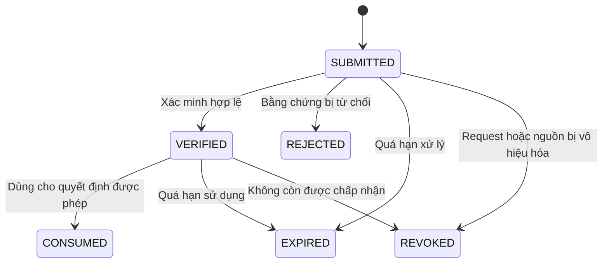

# Recovery evidence entity

## 1. Recovery evidence biểu diễn điều gì?

Recovery evidence là bản ghi về một bằng chứng được đưa vào một yêu cầu khôi phục tài khoản: bằng chứng thuộc loại nào, đến từ nguồn nào, đã được kiểm tra ra sao và có còn được phép sử dụng cho quyết định khôi phục hay không.

Ví dụ, khi người dùng mất điện thoại chứa MFA và nhập một mã dự phòng, hệ thống cần phân biệt ba đối tượng:

- **Recovery request:** yêu cầu khôi phục đang được xử lý.
- **Recovery code:** bí mật dự phòng đã được cấp trước đó và có bản ghi kiểm tra tương ứng.
- **Recovery evidence:** kết quả tiếp nhận, xác minh và sử dụng mã đó trong một yêu cầu cụ thể.

Entity evidence không nhất thiết chứa chính bí mật mà người dùng nhập. Nó chủ yếu lưu dữ liệu có cấu trúc để máy chủ đánh giá bằng chứng trong đúng ngữ cảnh.

Một trường `verified = true` là chưa đủ. Nếu không có liên kết tài khoản, yêu cầu, nguồn xác minh và thời hạn, kết quả xác minh có thể bị dùng nhầm cho một yêu cầu khác hoặc bị tái sử dụng sau khi đã hết hiệu lực.

## 2. Những loại bằng chứng cần phân biệt

[NIST SP 800-63B trong bộ Digital Identity Guidelines 800-63-4](https://pages.nist.gov/800-63-4/sp800-63b.html) phân biệt các nhóm phương thức khôi phục như mã đã lưu, mã được cấp khi khôi phục, liên hệ khôi phục và thực hiện lại quy trình chứng minh danh tính. Mô hình dữ liệu nên giữ được khác biệt về nguồn và cách xác minh của từng phương thức.

Một danh mục minh họa:

| Loại evidence | Nguồn liên quan | Điều phải xác minh |
| --- | --- | --- |
| `SAVED_RECOVERY_CODE` | Bản ghi mã dự phòng đã cấp | Mã phù hợp, đúng tài khoản, chưa bị sử dụng theo chính sách |
| `ISSUED_RECOVERY_CODE` | Challenge và mã được cấp cho bước khôi phục | Đúng challenge, đúng mục đích, còn hiệu lực |
| `EXISTING_AUTHENTICATOR` | Phương thức xác thực còn sử dụng được | Kết quả xác thực mới, ràng buộc với tài khoản và ngữ cảnh |
| `RECOVERY_CONTACT` | Liên hệ khôi phục đã thiết lập | Đúng quy trình và nguồn liên hệ được chấp nhận |
| `IDENTITY_REPROOFING` | Kết quả chứng minh danh tính lại | Kết quả từ bên xác minh tin cậy và gắn đúng chủ thể |

Đây là enum thiết kế cho bài học, không phải một schema chuẩn dùng chung cho mọi hệ thống.

Một địa chỉ email vừa được người dùng nhập không tự trở thành bằng chứng quyền sở hữu. Một thiết bị được mô tả là “quen thuộc” cũng không tự tương đương với một authenticator đã xác thực. Loại evidence cần phản ánh điều thực sự được chứng minh.

## 3. Quan hệ với request, nguồn bằng chứng và lịch sử thử

Mô hình logic có thể gồm:

```text
Account
  └── RecoveryRequest
        ├── RecoveryEvidence
        │     ├── EvidenceVerificationAttempt
        │     └── tham chiếu đến nguồn bằng chứng
        └── RecoveryDecision
```

Một request có nhiều evidence vì chính sách có thể yêu cầu kết hợp nhiều bằng chứng. Một evidence có thể có nhiều sự kiện xử lý hoặc lần gọi xác minh, nhưng phải định nghĩa rõ đâu là gửi lại cùng bằng chứng và đâu là một lần đưa bằng chứng mới.

Không đặt toàn bộ giới hạn thử trên từng evidence nếu việc tạo một evidence mới có thể làm bộ đếm trở về không. Ngân sách thử cần được quản lý ở những phạm vi mà chính sách bảo vệ, chẳng hạn challenge, request hoặc tài khoản, cùng các kiểm soát chống lạm dụng khác.

Nguồn bằng chứng có vòng đời riêng. Mã dự phòng có thể đã tồn tại từ trước request; một passkey có thể được dùng cho nhiều lần xác thực mới. Evidence chỉ ghi nhận một lần sử dụng hoặc một kết quả cụ thể, không thay thế bản ghi nguồn.

Nếu dùng `sourceReference` để trỏ đến nhiều loại nguồn, cần có cơ chế bảo đảm tham chiếu đúng loại và đúng chủ thể. Một cột chuỗi chứa ID bất kỳ không tự có tính toàn vẹn tham chiếu. Có thể dùng bảng nguồn thống nhất, bảng chi tiết theo loại hoặc cơ chế kiểm soát phù hợp với mô hình lưu trữ.

## 4. Các trường dữ liệu cốt lõi

Bảng dưới mô tả một thiết kế minh họa. Những giá trị liên quan đến quyền, kết quả và thời gian có thẩm quyền phải do máy chủ xác lập.

| Trường | Vai trò | Lưu ý |
| --- | --- | --- |
| `id` | Định danh bản ghi evidence | Không dùng việc biết ID làm bằng chứng quyền truy cập |
| `recoveryRequestId` | Request sở hữu evidence | Không đổi sau khi tiếp nhận |
| `accountId` | Tài khoản đích | Có thể dẫn xuất từ request; nếu lưu lặp phải ràng buộc nhất quán |
| `tenantId` | Phạm vi tổ chức nếu có | Phải nhất quán với request và nguồn |
| `evidenceType` | Loại bằng chứng | Danh mục được kiểm soát |
| `sourceReference` | Tham chiếu đến mã, challenge hoặc kết quả nguồn | Không chứa bí mật thô |
| `challengeReference` | Ngữ cảnh chống phát lại khi phương thức cần | Gắn với mục đích và request |
| `state` | Trạng thái xử lý | Chuyển theo quy tắc máy chủ |
| `submittedAt` | Thời điểm tiếp nhận | Không lấy thời gian client làm nguồn quyết định |
| `verifiedAt` | Thời điểm chấp nhận kết quả xác minh | Chỉ có sau bước xác minh hợp lệ |
| `expiresAt` | Hạn dùng evidence cho quyết định | Không tự gia hạn khi xem lại |
| `consumedAt` | Thời điểm evidence được dùng cho quyết định | Khác với thời điểm tiêu thụ bí mật nguồn |
| `verifiedBy` | Thành phần xác minh có thẩm quyền | Ví dụ định danh verifier hoặc quy trình được phê duyệt |
| `policyVersion` | Chính sách dùng khi đánh giá | Phục vụ giải thích và tái đánh giá khi cần |
| `verificationReference` | Tham chiếu kết quả xác minh hoặc sự kiện audit | Không sao chép toàn bộ phản hồi nhạy cảm |
| `reasonCode` | Nguyên nhân nội bộ có cấu trúc | Không mặc nhiên trả ra client |
| `version` | Phiên bản cho kiểm soát cập nhật cạnh tranh | Chỉ hữu ích khi thao tác ghi thực sự kiểm tra phiên bản |

Nếu lưu thuộc tính hỗ trợ đánh giá mức bảo đảm, chỉ lưu những thuộc tính có nguồn tin cậy. Client không được tự gửi `assuranceLevel`, `verifiedBy` hay `state = VERIFIED` để được hệ thống chấp nhận.

`policyVersion` cho biết cách đánh giá trước đó, nhưng không phải quyền bỏ qua một chính sách hiện tại đã thu hồi tính hợp lệ của bằng chứng. Cần định nghĩa rõ điều kiện vô hiệu hóa hoặc đánh giá lại.

## 5. Ví dụ bản ghi đã xác minh

Dữ liệu sau là biểu diễn nội bộ minh họa; thời hạn và các ID chỉ là ví dụ, không phải mặc định bảo mật:

```json
{
  "id": "ev_example_004",
  "recoveryRequestId": "rr_example_010",
  "accountId": "acct_example_021",
  "evidenceType": "SAVED_RECOVERY_CODE",
  "sourceReference": "rc_record_example_008",
  "state": "VERIFIED",
  "submittedAt": "2026-11-23T11:00:00Z",
  "verifiedAt": "2026-11-23T11:01:00Z",
  "expiresAt": "2026-11-23T11:06:00Z",
  "consumedAt": null,
  "verifiedBy": "saved-code-verifier",
  "policyVersion": "recovery-policy-v3",
  "verificationReference": "audit_event_example_031",
  "version": 2
}
```

Bản ghi này nói rằng một bằng chứng đã được xác minh cho request cụ thể. Nó chưa nói rằng toàn bộ yêu cầu khôi phục đã đủ điều kiện, chưa cấp phiên đăng nhập và chưa cho phép thay đổi mọi phương thức xác thực.

`sourceReference` trỏ đến bản ghi mã, không chứa giá trị mã. DTO công khai nên được thiết kế riêng, chỉ trả những thông tin người dùng được phép xem. Không đưa nguyên entity nội bộ vào phản hồi API vì entity có thể chứa liên kết tài khoản, chính sách và nguyên nhân không được phép tiết lộ.

## 6. Vòng đời của evidence

Có thể chọn các trạng thái sau cho một bản ghi:



Trong mô hình này, `REJECTED`, `EXPIRED`, `REVOKED` và `CONSUMED` là trạng thái kết thúc của bản ghi. Nếu người dùng đưa bằng chứng mới, tạo lần tiếp nhận mới theo hợp đồng thay vì sửa lịch sử để biến một evidence bị từ chối thành bằng chứng khác.

Đến thời điểm `expiresAt`, evidence không còn đủ điều kiện sử dụng dù tác vụ nền chưa đổi cột `state` thành `EXPIRED`. Khi ra quyết định, kiểm tra cả thời hạn và trạng thái hiện tại.

Một evidence đã `CONSUMED` là dấu vết lịch sử của quyết định trước đó. Không đổi ngược nó về `VERIFIED` khi request được mở lại hoặc khi có retry. Việc thu hồi nguồn sau đó có thể được ghi bằng sự kiện riêng và tác động đến quyền hiện tại theo chính sách, không biến evidence cũ thành quyền mới.

## 7. Hai ranh giới dùng một lần cần tách biệt

Cần phân biệt tiêu thụ **bí mật nguồn** và tiêu thụ **evidence trong request**.

Một thiết kế cụ thể cho mã dự phòng có thể thực hiện như sau:

1. Người dùng đưa mã vào một request đang hoạt động.
2. Máy chủ kiểm tra mã và chủ thể.
3. Trong một transaction phù hợp, đánh dấu mã nguồn đã được dùng cho request này và chuyển evidence sang `VERIFIED`.
4. Sau đó, khi đủ các điều kiện của quyết định, evidence chuyển sang `CONSUMED`.

Ở thiết kế này, mã dự phòng đã không còn dùng được cho request khác ngay sau bước xác minh thành công, dù evidence vẫn đang chờ kết hợp với bằng chứng còn lại. Nếu request bị hủy, không tự khôi phục mã về trạng thái chưa dùng.

[OWASP về token khôi phục](https://cheatsheetseries.owasp.org/cheatsheets/Forgot_Password_Cheat_Sheet.html) nhấn mạnh đặc tính dùng một lần và hết hạn. Mô hình phải thực thi được đặc tính đó ở bản ghi nguồn, không chỉ ở một hàng evidence có thể được tạo lại.

Nếu hai request cùng đưa một mã, khóa riêng hai evidence không đủ vì chúng là hai hàng khác nhau. Chúng phải tranh chấp trên cùng trạng thái sử dụng của mã nguồn hoặc một cơ chế tương đương có tính nguyên tử.

Ví dụ trình tự logic, không phải mã triển khai hoàn chỉnh:

```text
BEGIN
  Khóa request, evidence và bản ghi nguồn theo thứ tự thống nhất
  Đọc lại trạng thái và thời gian quyết định có thẩm quyền
  Kiểm tra chủ thể, mục đích, hạn dùng và ngân sách thử
  Kiểm tra nguồn chưa được tiêu thụ bởi một lần sử dụng khác
  Đánh dấu nguồn đã dùng cho request này
  Chuyển evidence SUBMITTED -> VERIFIED
  Ghi sự kiện xác minh tương ứng
COMMIT
```

[Tài liệu PostgreSQL về khóa hàng](https://www.postgresql.org/docs/current/explicit-locking.html) mô tả cách khóa cập nhật ngăn các transaction khác sửa cùng hàng cho đến khi transaction kết thúc. Khi dùng cách tiếp cận này, cần giữ transaction ngắn và có thứ tự khóa nhất quán.

Không giữ transaction cơ sở dữ liệu mở trong lúc chờ người dùng hoặc nhà cung cấp xác minh từ xa. Kết quả bên ngoài phải được kiểm tra và ràng buộc với ngữ cảnh trước khi áp dụng trong bước chuyển trạng thái có kiểm soát. Nếu nguồn ở hệ thống khác, không được giả định một transaction cục bộ có thể tự bảo đảm nguyên tử cho cả hai hệ thống.

## 8. Ràng buộc toàn vẹn và đánh giá tập bằng chứng

Các bất biến cần được phân bổ đúng giữa cơ sở dữ liệu và logic nghiệp vụ:

| Bất biến | Cơ chế phù hợp |
| --- | --- |
| Evidence thuộc một request tồn tại | Foreign key hoặc cơ chế toàn vẹn tương đương |
| Evidence, request và nguồn cùng chủ thể/phạm vi | Khóa ghép hoặc kiểm tra có tính nhất quán phù hợp |
| Trường bắt buộc không thiếu | `NOT NULL` và kiểm tra đầu vào máy chủ |
| `expiresAt` sau `submittedAt` | Ràng buộc trên dữ liệu trong hàng |
| Trạng thái xác minh có `verifiedAt` | Ràng buộc trạng thái và timestamp |
| Chỉ một bên thắng khi dùng mã nguồn một lần | Cập nhật có điều kiện, khóa hoặc ràng buộc nguyên tử |
| Tập evidence đáp ứng chính sách khôi phục | Bộ đánh giá chính sách trong ngữ cảnh request |
| Evidence chưa hết hạn tại lúc sử dụng | Kiểm tra thời gian khi quyết định |

[Tài liệu PostgreSQL về constraints](https://www.postgresql.org/docs/current/ddl-constraints.html) lưu ý rằng `CHECK` không dùng để bảo đảm điều kiện phụ thuộc các hàng khác và chỉ được đánh giá khi ghi dữ liệu. Vì vậy, không dùng một `CHECK` với thời gian hiện tại rồi cho rằng nó sẽ tự vô hiệu hóa evidence theo đồng hồ.

Không xét đủ điều kiện bằng `count(VERIFIED) >= 2` một cách chung chung. Hai hàng có thể là cùng bằng chứng gửi lặp, cùng challenge hoặc cùng nguồn kiểm soát. Bộ đánh giá cần biết loại phương thức, nguồn, độ mới và các yêu cầu kết hợp của chính sách thực tế.

Nếu dùng optimistic locking, cập nhật phải kèm điều kiện phiên bản và xử lý trường hợp không có hàng được cập nhật. Chỉ có cột `version` mà không dùng nó trong thao tác ghi không ngăn race condition.

## 9. Dữ liệu nhạy cảm, lưu giữ và truy vết

Evidence không nên trở thành kho chứa bí mật và hồ sơ danh tính không giới hạn.

- Không lưu OTP, mật khẩu, token hoặc recovery code thô trong entity hay log.
- Tham chiếu tới kho verifier được bảo vệ thay vì sao chép bí mật vào metadata.
- Với hồ sơ chứng minh danh tính, chỉ giữ dữ liệu cần thiết và áp dụng quyền truy cập, bảo vệ lưu trữ cùng thời hạn lưu giữ phù hợp.
- Dùng danh mục metadata theo từng loại; tránh một trường JSON nhận mọi dữ liệu client gửi.
- Phân quyền riêng cho tiếp nhận, xác minh, ra quyết định và xem audit khi phù hợp.
- Ghi lịch sử trạng thái bằng sự kiện có actor, thời gian và liên kết request; không ghi lại bí mật để phục vụ truy vết.

Cách bảo vệ dữ liệu verifier phải phù hợp với loại và độ khó đoán của bí mật. Việc không lưu bản rõ chưa đủ để kết luận an toàn nếu một mã ngắn vẫn dễ bị thử ngoại tuyến từ dữ liệu bị lộ.

Lưu giữ bản ghi audit lâu hơn bằng chứng có hiệu lực có thể phục vụ điều tra, nhưng không làm kéo dài quyền dùng bằng chứng. Sau khi hết hạn lưu giữ, xử lý cả bản ghi, tệp đính kèm, bản sao và tham chiếu liên quan theo chính sách.

## 10. Tình huống áp dụng

Trang mất điện thoại chứa MFA và đưa một mã dự phòng vào request R1. Verifier tìm đúng bản ghi mã thuộc tài khoản của Trang. Trong bước cập nhật có kiểm soát, mã nguồn được đánh dấu đã dùng cho R1 và evidence E1 chuyển sang `VERIFIED`.

Một request R2 gửi cùng mã không thể tạo thêm một bằng chứng hợp lệ chỉ bằng cách tạo entity mới. Nó phải đi qua trạng thái dùng một lần của cùng nguồn và bị xử lý theo kết quả hiện tại.

Nếu chính sách còn yêu cầu một phương thức khác, E1 vẫn chưa đủ để hoàn tất khôi phục. Khi tập bằng chứng đáp ứng chính sách và còn hiệu lực, hệ thống tiêu thụ các evidence được chọn trong cùng bước ra quyết định phù hợp. Nếu E1 hết hạn trước lúc đó, hệ thống không dùng nó dù hàng chưa được tác vụ nền cập nhật.

Recovery evidence entity giúp hệ thống giải thích “đã tin bằng chứng nào, trong request nào, do ai xác minh và còn dùng được đến khi nào”. Liên kết chủ thể, vòng đời rõ ràng và ranh giới dùng một lần là nền tảng để bản ghi đó hỗ trợ khôi phục an toàn.
