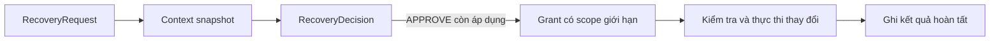

# Recovery decision entity — Thực thể quyết định khôi phục tài khoản

Một yêu cầu khôi phục có thể đi qua nhiều lần đánh giá: chưa đủ bằng chứng, cần nhân viên xem xét, được phép đặt lại mật khẩu hoặc bị từ chối. Nếu chỉ lưu một cờ `approved=true` trên tài khoản, hệ thống khó trả lời quyết định đó dành cho yêu cầu nào, dựa trên dữ liệu nào và còn áp dụng được hay không.

Trong module SECURITY_AUTHENTICATION_ACCOUNT_RECOVERY, **RecoveryDecision** biểu diễn kết luận của một lần đánh giá đã xác định rõ ngữ cảnh. Nó giúp giải thích và thực thi chính sách khi người dùng mất mật khẩu, MFA, passkey hoặc thiết bị xác thực.

Các tên bảng, outcome, action và quy tắc trong bài là một thiết kế minh họa. Chúng không phải schema được NIST hoặc OWASP quy định sẵn.

## 1. Quyết định khác yêu cầu, bằng chứng và quyền thực thi

| Thành phần | Câu hỏi chính |
| --- | --- |
| `RecoveryRequest` | Người dùng đang yêu cầu thay đổi gì cho tài khoản nào? |
| Bằng chứng và kết quả xác minh | Người dùng đã cung cấp gì, được kiểm tra ra sao? |
| `RecoveryContextSnapshot` | Tập dữ liệu cụ thể nào được dùng cho lần đánh giá? |
| `RecoveryDecision` | Theo chính sách nào, hệ thống kết luận gì? |
| `RecoveryGrant` | Quyền có giới hạn nào được cấp để thực hiện thay đổi? |
| Kết quả thực thi | Thay đổi có thật sự được ghi nhận hay chưa? |

Ví dụ:

1. Yêu cầu R1 muốn đăng ký lại MFA.
2. Một mã dự phòng được xác minh và kết quả được đưa vào snapshot S1.
3. Chính sách nhận thấy cần thêm bằng chứng độc lập.
4. Quyết định D1 có outcome `MORE_EVIDENCE_REQUIRED`.
5. Sau khi bổ sung bằng chứng, snapshot S2 được đánh giá.
6. Quyết định D2 cho phép đúng hành động đã được yêu cầu.
7. Hệ thống có thể cấp grant G1 theo D2, rồi xử lý đăng ký lại.

D1 và D2 đều là dữ liệu lịch sử có ý nghĩa. Không nên sửa D1 từ “cần thêm bằng chứng” thành “đã chấp thuận” rồi mất dấu diễn biến.

Một quyết định `APPROVE` cũng chưa đồng nghĩa thay đổi đã hoàn tất hoặc đã có session đăng nhập đầy đủ quyền.

NIST SP 800-63B mô tả các phương thức khôi phục và yêu cầu khác nhau theo bối cảnh bảo đảm của tài khoản. Điều này cho thấy một cờ chấp thuận chung không thể thay thế việc xác định phương thức và điều kiện áp dụng. [NIST SP 800-63B: Account Recovery](https://pages.nist.gov/800-63-4/sp800-63b.html#account-recovery)

## 2. Xác định outcome và phạm vi hành động

Trong mô hình này, outcome gồm:

| Outcome | Ý nghĩa | Có tự cấp quyền thay đổi không? |
| --- | --- | --- |
| `APPROVE` | Bằng chứng và điều kiện đáp ứng chính sách cho hành động đang xét | Có thể làm căn cứ cấp grant, còn phải kiểm tra ngữ cảnh hiện tại |
| `DENY` | Không chấp nhận theo chính sách của lần đánh giá | Không |
| `MORE_EVIDENCE_REQUIRED` | Cần bổ sung bằng chứng phù hợp | Không |
| `MANUAL_REVIEW_REQUIRED` | Cần đánh giá theo quy trình thủ công | Không |

Không dùng `PENDING` để biểu diễn kết luận của một lần đánh giá chưa chạy xong. Trạng thái thực thi tác vụ đánh giá nên nằm ở một đối tượng công việc riêng. Bản ghi decision trong thiết kế này là kết quả đã hình thành.

Mỗi request có một hành động cố định, chẳng hạn:

- `RESET_PASSWORD`.
- `REBIND_MFA`.
- `REGISTER_REPLACEMENT_PASSKEY`.
- `CHANGE_RECOVERY_CHANNEL`.

Một approval cho `RESET_PASSWORD` không tự cho phép tắt MFA, đổi địa chỉ recovery hoặc tạo session không giới hạn.

Nếu thay đổi mục đích yêu cầu, thiết kế này tạo request mới. Không sửa action của một request đã có lịch sử quyết định rồi diễn giải lại các approval cũ.

Lưu ý rằng khôi phục MFA có nhiều tình huống và cần tránh biến nhánh recovery thành đường bỏ qua bảo vệ đang có. [OWASP: Resetting MFA](https://cheatsheetseries.owasp.org/cheatsheets/Multifactor_Authentication_Cheat_Sheet.html#resetting-mfa)

## 3. Những thuộc tính cần có

Có thể nhóm thuộc tính theo trách nhiệm:

| Nhóm | Thuộc tính minh họa | Mục đích |
| --- | --- | --- |
| Định danh | `id`, `request_id` | Xác định quyết định và giao dịch |
| Ngữ cảnh | `context_revision`, `snapshot_id` | Ràng buộc đúng phiên bản dữ liệu |
| Kết luận | `outcome`, `requested_action` | Nêu rõ quyết định gì và cho hành động nào |
| Chính sách | `policy_key`, `policy_version` | Giải thích luật được áp dụng |
| Chủ thể đánh giá | `evaluator_kind`, `evaluator_id` | Phân biệt policy engine và người xét duyệt |
| Thời gian | `decided_at`, `valid_until` | Biết thời điểm kết luận và cửa sổ áp dụng approval |
| Giải thích | `reason_codes` | Lưu lý do có cấu trúc |
| Lịch sử | `supersedes_id` | Liên kết quyết định mới với quyết định trước |
| Chống trùng | `idempotency_key` | Nhận diện cùng thao tác ghi kết quả |

Một số nguyên tắc:

- `request_id` không thay thế kiểm tra quyền đọc hoặc thao tác.
- `policy_version` phải trỏ đến phiên bản chính sách có thể truy xuất theo chính sách lưu giữ, không chỉ là một nhãn tùy ý.
- `evaluator_id` lấy từ danh tính dịch vụ hoặc nhân viên đã được xác thực, không lấy nguyên từ trường client gửi.
- `reason_codes` là mã có kiểm soát, không phải nơi chứa token hoặc toàn bộ nội dung giấy tờ.
- `valid_until` chỉ có ở approval trong mô hình này. Nó không quyết định thời gian lưu lịch sử của các outcome khác.

Không cần sao chép `account_id` vào mọi bảng nếu request đã ràng buộc tài khoản và quan hệ đó bất biến. Nếu sao chép để tối ưu truy vấn, cần cơ chế bảo đảm không tạo hai giá trị mâu thuẫn.

## 4. Snapshot: quyết định dựa trên dữ liệu nào?

Decision cần tham chiếu tập dữ liệu đã được đánh giá, thay vì chỉ trỏ đến một object luôn thay đổi.

Một snapshot có thể chứa tham chiếu đến:

- Kết quả xác minh bằng chứng.
- Thời điểm xác minh và hạn sử dụng liên quan.
- Kết quả đánh giá rủi ro và phiên bản mô hình.
- Phiên bản trạng thái bảo mật của tài khoản.
- Dấu hiệu thay đổi kênh recovery hoặc authenticator.
- Nguồn và trạng thái kiểm tra của dữ liệu đầu vào.

Snapshot không nên là bản sao toàn bộ dữ liệu nhạy cảm. Ví dụ, tham chiếu đến kết quả “mã dự phòng đã được xác minh” không cần chứa lại raw mã.

### Hai loại phiên bản cần phân biệt

| Phiên bản | Khi nào thay đổi? |
| --- | --- |
| `context_revision` | Khi dữ liệu có ý nghĩa đối với đánh giá thay đổi |
| `row_version` | Khi bản ghi request được cập nhật để kiểm soát ghi đồng thời |

Ví dụ, thêm bằng chứng mới làm tăng `context_revision` và `row_version`. Chọn một decision hiện tại có thể chỉ tăng `row_version`, vì không thay đổi dữ liệu bằng chứng đã đánh giá.

Nếu không phân biệt, việc cập nhật con trỏ decision có thể vô tình làm decision vừa tạo trở nên “lỗi thời” ngay lập tức.

Trong thiết kế này:

- Mỗi snapshot gắn với đúng một request và một context revision.
- Snapshot đã được dùng để đánh giá không bị sửa tại chỗ.
- Khi có dữ liệu mới, tạo revision và snapshot mới.
- Decision cũ vẫn đọc được như lịch sử nhưng không tự áp dụng cho revision mới.

Một digest của dữ liệu chuẩn hóa có thể hỗ trợ đối chiếu nội dung snapshot. Digest không chứng minh nguồn dữ liệu đáng tin và không phải phương pháp che giấu an toàn cho bí mật có không gian giá trị nhỏ. Không băm raw OTP rồi coi đó là một snapshot vô hại.

## 5. Schema quan hệ minh họa

DDL dưới đây dùng PostgreSQL và tập trung vào quan hệ giữa request, snapshot và decision. Nó không bao gồm toàn bộ schema tài khoản, bằng chứng, grant, outbox hoặc phân quyền cơ sở dữ liệu.

```sql
CREATE TABLE recovery_request (
    id UUID PRIMARY KEY,
    account_id UUID NOT NULL,
    requested_action TEXT NOT NULL,
    state TEXT NOT NULL,
    context_revision BIGINT NOT NULL CHECK (context_revision > 0),
    row_version BIGINT NOT NULL DEFAULT 0 CHECK (row_version >= 0),
    expires_at TIMESTAMPTZ NOT NULL,
    current_decision_id UUID,

    CHECK (requested_action IN (
        'RESET_PASSWORD',
        'REBIND_MFA',
        'REGISTER_REPLACEMENT_PASSKEY',
        'CHANGE_RECOVERY_CHANNEL'
    )),
    CHECK (state IN (
        'OPEN', 'CANCELLED', 'COMPLETED', 'EXPIRED'
    )),
    UNIQUE (id, requested_action)
);

CREATE TABLE recovery_context_snapshot (
    id UUID PRIMARY KEY,
    request_id UUID NOT NULL REFERENCES recovery_request(id),
    context_revision BIGINT NOT NULL CHECK (context_revision > 0),
    evidence_bundle_ref UUID NOT NULL,
    risk_snapshot_ref UUID,
    account_security_revision BIGINT NOT NULL
        CHECK (account_security_revision >= 0),
    snapshot_schema_version TEXT NOT NULL,
    captured_at TIMESTAMPTZ NOT NULL,

    UNIQUE (request_id, context_revision),
    UNIQUE (id, request_id, context_revision),
    CHECK (length(btrim(snapshot_schema_version)) > 0)
);

CREATE TABLE recovery_decision (
    id UUID PRIMARY KEY,
    request_id UUID NOT NULL,
    requested_action TEXT NOT NULL,
    context_revision BIGINT NOT NULL CHECK (context_revision > 0),
    snapshot_id UUID NOT NULL,
    outcome TEXT NOT NULL,
    policy_key TEXT NOT NULL,
    policy_version TEXT NOT NULL,
    evaluator_kind TEXT NOT NULL,
    evaluator_id TEXT NOT NULL,
    decided_at TIMESTAMPTZ NOT NULL,
    valid_until TIMESTAMPTZ,
    reason_codes TEXT[] NOT NULL,
    supersedes_id UUID,
    idempotency_key UUID NOT NULL,

    CHECK (outcome IN (
        'APPROVE',
        'DENY',
        'MORE_EVIDENCE_REQUIRED',
        'MANUAL_REVIEW_REQUIRED'
    )),
    CHECK (evaluator_kind IN ('POLICY_ENGINE', 'HUMAN')),
    CHECK (length(btrim(policy_key)) > 0),
    CHECK (length(btrim(policy_version)) > 0),
    CHECK (length(btrim(evaluator_id)) > 0),
    CHECK (cardinality(reason_codes) > 0),

    CHECK (
        (
            outcome = 'APPROVE'
            AND valid_until IS NOT NULL
            AND valid_until > decided_at
        )
        OR
        (
            outcome <> 'APPROVE'
            AND valid_until IS NULL
        )
    ),

    UNIQUE (id, request_id),
    UNIQUE (request_id, idempotency_key),

    FOREIGN KEY (request_id, requested_action)
        REFERENCES recovery_request(id, requested_action),

    FOREIGN KEY (snapshot_id, request_id, context_revision)
        REFERENCES recovery_context_snapshot(
            id, request_id, context_revision
        ),

    FOREIGN KEY (supersedes_id, request_id)
        REFERENCES recovery_decision(id, request_id)
);

ALTER TABLE recovery_request
ADD CONSTRAINT fk_current_decision_same_request
FOREIGN KEY (current_decision_id, id)
REFERENCES recovery_decision(id, request_id);

CREATE INDEX idx_recovery_decision_history
ON recovery_decision (request_id, decided_at DESC, id);
```

Các foreign key ghép giúp tránh decision dùng snapshot của request khác hoặc thay thế decision thuộc một request khác.

Tuy nhiên, DDL chưa tự bảo đảm:

- Approval không vượt hạn request hoặc hạn bằng chứng.
- Snapshot phản ánh dữ liệu đã được kiểm tra.
- Decision đang trỏ tới phù hợp context revision hiện tại.
- Nhân viên có quyền duyệt hành động.
- Các mã lý do đều thuộc danh mục và không chứa phần tử rỗng.
- Decision và snapshot không bị sửa.
- Không có chu trình bất hợp lệ trong lịch sử thay thế.

Những điều đó cần tầng nghiệp vụ, phân quyền và cơ chế transaction phù hợp. `evidence_bundle_ref` và `risk_snapshot_ref` là tham chiếu đến kho dữ liệu ngoài phần DDL minh họa; hệ thống thực tế cần kiểm soát tính tồn tại và quyền truy cập tương ứng.

PostgreSQL phân biệt `NOT NULL`, `CHECK`, `UNIQUE` và foreign key; `CHECK` không phù hợp để giả định bảo đảm dữ liệu tùy ý ở bảng khác luôn đúng. [PostgreSQL: Constraints](https://www.postgresql.org/docs/current/ddl-constraints.html)

Nếu hệ thống nhiều tenant, cần đưa tenant vào các khóa, quan hệ và phạm vi truy vấn thích hợp. Thêm một điều kiện lọc ở một API không tự biến schema trên thành thiết kế cách ly tenant đầy đủ.

## 6. Decision nên được ghi theo kiểu bất biến

Trong mô hình này, decision đã ghi không đổi outcome. Một lần đánh giá mới tạo bản ghi mới.

Ví dụ:

| Decision | Revision | Outcome | Thay thế |
| --- | --- | --- | --- |
| D1 | 3 | `MORE_EVIDENCE_REQUIRED` | Không |
| D2 | 4 | `MANUAL_REVIEW_REQUIRED` | D1 |
| D3 | 4 | `APPROVE` | D2 |

D3 có thể dùng cùng context revision với D2 nếu nhân viên đánh giá chính snapshot hiện có theo một quy trình được phép. Nếu nhân viên thu thập thêm bằng chứng, phải tạo context revision mới.

`supersedes_id` thể hiện quan hệ lịch sử trong thiết kế này; không tự thu hồi grant đã cấp từ decision trước. Cơ chế sử dụng grant vẫn phải kiểm tra decision hiện hành và trạng thái request, hoặc được thu hồi nguyên tử theo chính sách tương ứng.

`current_decision_id` là con trỏ điều phối, không phải dữ liệu do client được quyền chọn. Không tìm decision có `decided_at` lớn nhất rồi mặc nhiên coi nó là quyết định hiệu lực: timestamp có thể trùng, kết quả có thể đến muộn và thứ tự ghi không tự nói lên tính phù hợp.

Append-only ở đây là quy tắc đối với luồng nghiệp vụ. Cần dùng quyền cơ sở dữ liệu hoặc biện pháp thực thi tương ứng; một dòng tài liệu “không sửa” không ngăn tài khoản ứng dụng có quyền UPDATE.

Cũng không hiểu bất biến là giữ mọi dữ liệu vô thời hạn. Chính sách lưu giữ hoặc xóa có kiểm soát là trách nhiệm riêng, không phải quyền sửa outcome trong API thông thường.

## 7. Ghi quyết định mà không nhận kết quả lỗi thời

Giả sử policy engine bắt đầu đánh giá revision 7. Trong lúc chạy, người dùng bổ sung bằng chứng khiến request lên revision 8. Kết quả revision 7 đến sau không được tự trở thành approval hiện tại.

Quy trình minh họa:

```text
1. Đọc request, context_revision và row_version.
2. Tạo hoặc lấy snapshot bất biến của đúng revision.
3. Đánh giá snapshot với phiên bản policy đã chọn.
4. Mở transaction ngắn để ghi kết quả:
   - kiểm tra lại quyền và nguồn kết quả;
   - khóa request hoặc kiểm soát ghi tương đương;
   - đối chiếu revision, row_version, state và hạn dùng;
   - kiểm tra idempotency;
   - insert decision;
   - cập nhật current_decision_id;
   - ghi sự kiện/outbox liên quan nếu cần.
5. Commit.
```

Không giữ một khóa cơ sở dữ liệu trong suốt thời gian gọi hệ thống chấm điểm từ xa hoặc chờ nhân viên thao tác.

Nếu context hoặc row version đã đổi, không tự “gắn lại” kết quả lên revision mới. Có thể yêu cầu đánh giá lại hoặc ghi một sự kiện tác vụ lỗi thời ngoài luồng decision có thể được kích hoạt.

Transaction chỉ là một phần giải pháp. Mức cô lập và cách khóa quyết định những gì có thể xảy ra khi ghi đồng thời; chẳng hạn các truy vấn trong Read Committed không mặc nhiên nhìn một snapshot duy nhất cho toàn transaction. [PostgreSQL: Transaction Isolation](https://www.postgresql.org/docs/current/transaction-iso.html)

### Gửi lại cùng thao tác

`UNIQUE(request_id, idempotency_key)` giúp nhận diện một thao tác ghi bị gửi lại. Khi trùng key:

- Đọc bản ghi đã có trong đúng phạm vi được phép.
- Đối chiếu action, snapshot, policy và dữ liệu ngữ nghĩa của thao tác.
- Nếu cùng thao tác, trả kết quả cũ phù hợp.
- Nếu khác nội dung, báo xung đột; không trả một approval không liên quan.

Không lấy idempotency key làm bằng chứng xác thực. Một key không được phép đổi request, nâng scope hoặc tái kích hoạt decision cũ.

Hai key khác nhau có thể cùng đánh giá một revision. Cơ chế khóa hoặc row version phải xác định việc chọn decision hiện tại; unique key chống trùng không tự giải quyết mọi tranh chấp.

## 8. Hiệu lực của approval không chỉ là một timestamp

Một approval có thể được dùng khi đồng thời thỏa các điều kiện của chính sách, ví dụ:

```text
outcome == APPROVE
AND decision thuộc đúng request và action
AND request vẫn ở trạng thái cho phép
AND decision là quyết định hiện hành
AND context_revision vẫn phù hợp
AND trạng thái bảo mật tài khoản chưa làm quyết định mất giá trị
AND decided_at <= now < valid_until
AND các điều kiện bằng chứng và grant vẫn được đáp ứng
```

Đây là các điều kiện minh họa cho việc kiểm tra, không phải một biểu thức client có thể gửi lên để tự xác nhận.

Cửa sổ approval thường phải nằm trong giới hạn của các dữ liệu liên quan:

```text
valid_until <= request.expires_at
valid_until <= mốc hết hiệu lực của bằng chứng bắt buộc
valid_until <= giới hạn approval theo policy
```

Không suy rằng mọi loại bằng chứng đều có cùng mô hình hết hạn. Ví dụ, kết quả xác minh giấy tờ, mã một lần và dấu hiệu thiết bị có ý nghĩa khác nhau; policy cần định nghĩa độ mới cần thiết.

Nếu dịch vụ risk không trả kết quả, `risk_snapshot_ref=NULL` không nên được hiểu là “rủi ro bằng 0”. Kết luận khi thiếu tín hiệu cần được policy quy định, chẳng hạn yêu cầu bổ sung hoặc chuyển review.

Khi request bị hủy hoặc tài khoản có thay đổi bảo mật quan trọng, approval trong lịch sử vẫn tồn tại nhưng không được mặc nhiên sử dụng. “Đã từng được duyệt” khác “được phép thực thi ngay bây giờ”.

## 9. Ví dụ mô hình Java rút gọn

Record sau minh họa ràng buộc nội bộ của một decision. Nó không chứa mọi trường persistence và không thực hiện kiểm tra liên bảng hoặc phân quyền.

```java
import java.time.Instant;
import java.util.Objects;
import java.util.Set;
import java.util.UUID;

public record RecoveryDecision(
        UUID id,
        UUID requestId,
        long contextRevision,
        Action action,
        Outcome outcome,
        String policyVersion,
        Instant decidedAt,
        Instant validUntil,
        Set<String> reasonCodes
) {
    public enum Action {
        RESET_PASSWORD,
        REBIND_MFA,
        REGISTER_REPLACEMENT_PASSKEY,
        CHANGE_RECOVERY_CHANNEL
    }

    public enum Outcome {
        APPROVE,
        DENY,
        MORE_EVIDENCE_REQUIRED,
        MANUAL_REVIEW_REQUIRED
    }

    public RecoveryDecision {
        Objects.requireNonNull(id);
        Objects.requireNonNull(requestId);
        Objects.requireNonNull(action);
        Objects.requireNonNull(outcome);
        Objects.requireNonNull(policyVersion);
        Objects.requireNonNull(decidedAt);
        Objects.requireNonNull(reasonCodes);

        if (contextRevision <= 0 || policyVersion.isBlank()) {
            throw new IllegalArgumentException("Invalid decision context");
        }

        reasonCodes = Set.copyOf(reasonCodes);
        if (reasonCodes.isEmpty()
                || reasonCodes.stream().anyMatch(String::isBlank)) {
            throw new IllegalArgumentException("Reason codes are required");
        }

        if (outcome == Outcome.APPROVE) {
            if (validUntil == null || !validUntil.isAfter(decidedAt)) {
                throw new IllegalArgumentException(
                        "Approval needs a positive validity window"
                );
            }
        } else if (validUntil != null) {
            throw new IllegalArgumentException(
                    "Only approval has a validity window in this model"
            );
        }
    }

    public boolean hasApprovalWindowAt(Instant now) {
        Objects.requireNonNull(now);
        return outcome == Outcome.APPROVE
                && !now.isBefore(decidedAt)
                && now.isBefore(validUntil);
    }
}
```

`hasApprovalWindowAt` chỉ kiểm tra outcome và khoảng thời gian. Không dùng nó làm toàn bộ quyết định authorize. Service còn phải kiểm tra request, action, snapshot, grant và trạng thái hiện tại trong cơ chế nhất quán.

`Set.copyOf` tạo tập giá trị không sửa được thông qua record; nó không làm dữ liệu trong cơ sở dữ liệu tự bất biến. Danh mục reason code và độ dài dữ liệu cần được xác thực ở ranh giới thích hợp.

Không nhận một object như trên từ request body rồi lưu nguyên vào bảng. `outcome`, `policyVersion`, `decidedAt` và người đánh giá phải đến từ các thành phần được hệ thống tin cậy theo quyền hạn cụ thể.

## 10. Decision, grant và thay đổi tài khoản

Sau approval, có thể tạo grant tham chiếu `decision_id` và giới hạn đúng action. Grant cần mô hình bí mật, thời hạn, sử dụng một lần hoặc thu hồi theo cơ chế riêng.

Mối quan hệ minh họa:



Các ranh giới quan trọng:

- ID decision không phải bearer token.
- Approval cho request này không được dùng với request khác.
- Một quyết định bị thay thế hoặc ngữ cảnh thay đổi phải được xử lý nhất quán với grant đã phát hành.
- Thực thi cần kiểm tra và tiêu thụ quyền theo cơ chế chống dùng đồng thời.
- Hủy request và hoàn tất phải cạnh tranh trên một ranh giới trạng thái rõ.
- Một sự kiện “decision approved” không chứng minh mọi thay đổi và thông báo đã hoàn tất.

Nếu hệ thống nhiều dịch vụ, cần định nghĩa độ nhất quán, việc giao lại sự kiện và cách xử lý grant lỗi thời. Không giả định rằng phát một message sẽ lập tức vô hiệu hóa mọi quyền ở các consumer.

## 11. Review thủ công và thay đổi chính sách

`MANUAL_REVIEW_REQUIRED` là kết luận rằng cần một quy trình khác tiếp tục xem xét, không phải quyết định chấp thuận đang bị trì hoãn ở giao diện.

Khi nhân viên quyết định:

1. Xác thực danh tính và quyền của người thao tác.
2. Kiểm tra request và snapshot còn phù hợp.
3. Xác định policy hoặc quy trình review đang áp dụng.
4. Ghi decision mới với `evaluator_kind=HUMAN`.
5. Lưu reason code và tham chiếu hồ sơ review theo phạm vi cần thiết.
6. Cập nhật con trỏ hiện hành một cách có kiểm soát.

Không dùng một ô ghi chú “đã kiểm tra qua điện thoại” để bỏ qua mọi điều kiện. Nếu có cơ chế override, quyền, bằng chứng và điều kiện dùng override phải được định nghĩa riêng.

Khi policy được cập nhật từ P1 lên P2, giữ lịch sử rằng D1 được đánh giá bằng P1. Nếu thay đổi cần làm approval cũ mất hiệu lực, thực hiện cơ chế vô hiệu hóa hoặc yêu cầu đánh giá lại rõ ràng.

Một nhãn version là chưa đủ cho khả năng giải thích nếu nội dung policy tương ứng đã bị ghi đè. Cần quản lý artifact policy và dữ liệu liên quan theo nhu cầu truy xuất của hệ thống.

Không thể luôn tái hiện kết quả bằng cách chạy lại: dịch vụ bên ngoài, dữ liệu risk hoặc mô hình có thể đã thay đổi. Lưu tham chiếu và provenance giúp giải thích, nhưng không nên hứa tái lập tuyệt đối khi chưa có thiết kế cho điều đó.

## 12. Lý do nội bộ, thông báo công khai và quyền riêng tư

Ví dụ reason code nội bộ:

| Mã minh họa | Ý nghĩa |
| --- | --- |
| `REQUIRED_EVIDENCE_MISSING` | Thiếu loại bằng chứng bắt buộc |
| `EVIDENCE_TOO_OLD` | Bằng chứng không đáp ứng yêu cầu về độ mới |
| `RECENT_RECOVERY_CHANNEL_CHANGE` | Có thay đổi kênh cần đánh giá theo policy |
| `POLICY_REQUIREMENTS_SATISFIED` | Đáp ứng điều kiện của policy cho action |
| `MANUAL_REVIEW_COMPLETED` | Đã hoàn thành quy trình review phù hợp |

Không trả toàn bộ reason code, điểm risk hoặc luật chống gian lận cho client công khai. Có thể ánh xạ sang thông điệp như “Cần thêm bước xác minh” trong ngữ cảnh người dùng được phép thấy.

Cũng không dùng một mã công khai khác nhau cho tài khoản tồn tại và không tồn tại ở giai đoạn tiếp nhận định danh. Decision nội bộ không phải hợp đồng tiết lộ tình trạng tài khoản.

Không lưu trực tiếp trong decision:

- Raw OTP, mã dự phòng hoặc token reset.
- Mật khẩu hoặc seed MFA.
- Toàn bộ URL chứa bí mật.
- Ảnh giấy tờ hoặc dữ liệu sinh trắc học.
- Payload risk không giới hạn chứa dữ liệu cá nhân ngoài nhu cầu.

OWASP khuyến nghị loại bỏ hoặc bảo vệ thông tin nhạy cảm trong logging và kiểm soát truy cập dữ liệu log. Lịch sử quyết định cũng cần kỷ luật tương tự về nội dung, quyền đọc và bảo vệ tính toàn vẹn. [OWASP: Logging](https://cheatsheetseries.owasp.org/cheatsheets/Logging_Cheat_Sheet.html)

Lưu một bản ghi trong bảng nghiệp vụ không tự làm nó an toàn hơn log. Cần xác định quyền của support, policy engine, dịch vụ thực thi và tác vụ lưu giữ. Các truy vấn phục vụ phân tích nên dùng dữ liệu đã giảm thiểu phù hợp.

## 13. Truy vấn và những lỗi mô hình thường gặp

Truy vấn lịch sử theo `request_id` có thể dùng index đã nêu. Để quyết định thực thi, bắt đầu từ request và con trỏ hiện hành rồi kiểm tra lại các điều kiện; đừng dùng truy vấn “tìm bất kỳ approval nào của account”.

| Cách làm | Nguy cơ | Hướng mô hình hóa |
| --- | --- | --- |
| Một cờ `approved` trên account | Không biết request, action hoặc căn cứ | Decision theo giao dịch và snapshot |
| Ghi đè outcome cũ | Mất diễn biến và khả năng giải thích | Bản ghi mới, liên kết lịch sử |
| Chọn dòng mới nhất bằng timestamp | Nhận kết quả lỗi thời hoặc không phù hợp | Con trỏ được cập nhật có kiểm soát |
| Lưu raw bằng chứng trong JSON tự do | Khó giới hạn truy cập và dữ liệu | Tham chiếu có schema và quyền rõ |
| Dùng điểm risk làm quyết định duy nhất | Không thể hiện yêu cầu bằng chứng hoặc scope | Policy kết hợp tín hiệu và điều kiện |
| Nhân viên sửa `APPROVE` trực tiếp | Không có actor, policy hoặc kiểm soát | Luồng review tạo decision mới |
| Grant chỉ kiểm tra chữ ký và expiry | Có thể bỏ qua hủy hoặc context mới | Kiểm tra trạng thái theo thiết kế nhất quán |
| Coi decision ID là bí mật cấp quyền | Lộ ID có thể trở thành chiếm quyền | Tách identifier và capability |

Các tình huống làm rõ yêu cầu gồm: hai lần đánh giá cùng chạy, request bị hủy lúc policy engine chưa trả kết quả, nhân viên review snapshot cũ, policy khẩn cấp thay đổi và grant đến từ decision đã bị thay thế.

Một RecoveryDecision hữu ích phải trả lời được: **Ai hoặc thành phần nào kết luận, cho hành động gì, dựa trên snapshot và policy nào, và điều kiện nào khiến kết luận đó còn được áp dụng?** Giữ rõ những thông tin này giúp hệ thống tránh biến một approval lịch sử thành quyền khôi phục vô thời hạn.