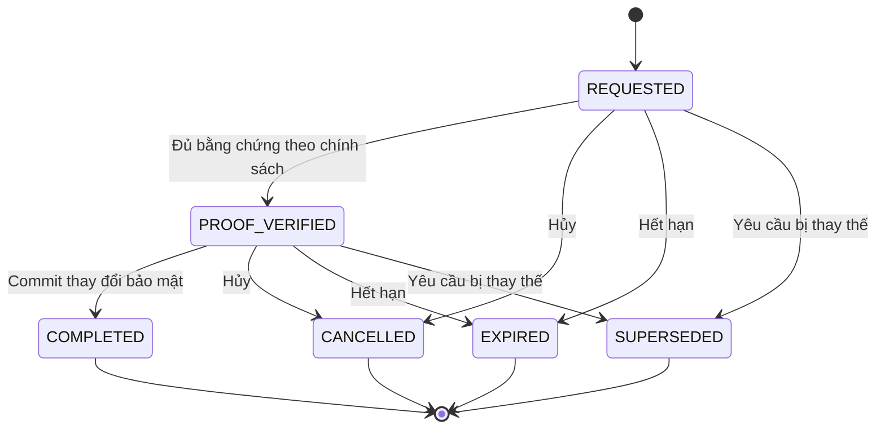
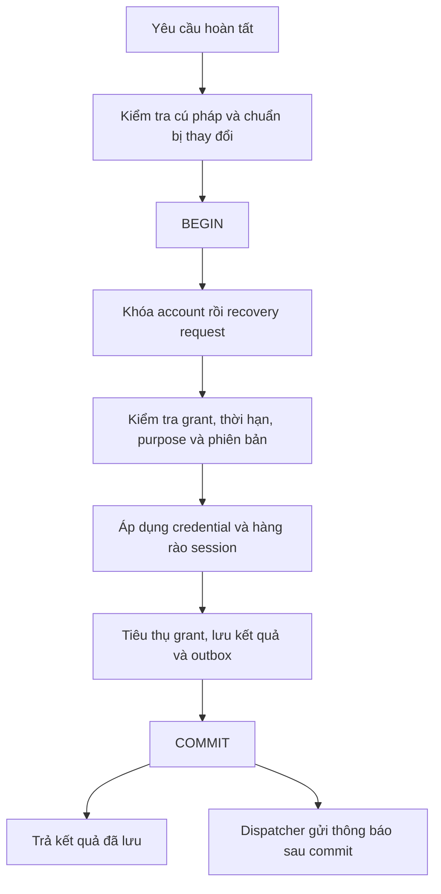

# Consistency of recovery state — Tính nhất quán của trạng thái khôi phục tài khoản

## 1. Vì sao trạng thái khôi phục phải nhất quán?

Một luồng khôi phục tài khoản có thể thay đổi mật khẩu, vô hiệu hóa thiết bị MFA bị mất, đăng ký passkey mới và thu hồi các phiên đăng nhập cũ. Mỗi thay đổi riêng lẻ có thể hợp lệ, nhưng tổ hợp của chúng vẫn có thể tạo ra lỗ hổng nếu được lưu vào những thời điểm khác nhau.

Ví dụ, hệ thống đã đổi mật khẩu nhưng chưa tiêu thụ token khôi phục. Một yêu cầu thứ hai sử dụng cùng token có thể ghi đè mật khẩu vừa đổi. Trong một tình huống khác, hệ thống thông báo khôi phục thành công nhưng phiên của kẻ chiếm đoạt vẫn tiếp tục được chấp nhận.

**Tính nhất quán của trạng thái khôi phục** là việc các dữ liệu quyết định quyền khôi phục và quyền truy cập luôn tuân theo những bất biến đã xác định, kể cả khi có yêu cầu đồng thời, retry, timeout hoặc tiến trình bị dừng đột ngột.

Bài học thuộc chương Persistence, tập trung vào cách lưu và chuyển trạng thái trong module `SECURITY_AUTHENTICATION_ACCOUNT_RECOVERY`. Phạm vi bao gồm khôi phục khi mất mật khẩu, MFA, passkey hoặc thiết bị xác thực. Các mô hình dữ liệu và thuật toán bên dưới là phương án thiết kế minh họa; điều kiện xác minh danh tính cụ thể phải được xác định theo mức rủi ro của sản phẩm.

## 2. Xác định các bất biến trước khi chọn cơ sở dữ liệu

Một bất biến diễn đạt điều luôn phải đúng, thay vì chỉ mô tả thứ tự gọi các hàm.

| Bất biến | Ý nghĩa đối với lưu trữ |
| --- | --- |
| Một quyền khôi phục chỉ tạo ra tối đa một lần thay đổi bảo mật thành công | Việc kiểm tra và tiêu thụ grant phải nằm trong cùng ranh giới nhất quán với thay đổi credential |
| Bằng chứng chỉ được dùng cho tài khoản, tenant và hành động đã xác minh | Không cho phép chuyển bằng chứng từ reset mật khẩu sang thay MFA hoặc sang tài khoản khác |
| Bằng chứng cũ không vượt qua thay đổi bảo mật mới | Phải kiểm tra phiên bản bảo mật hiện tại tại thời điểm commit |
| Trạng thái hoàn thành phản ánh thay đổi đã commit | Không ghi `COMPLETED` trước khi credential và hàng rào session đã được lưu |
| Yêu cầu bị hủy, hết hạn hoặc bị thay thế không được hồi sinh | Mọi đường chuyển trạng thái đều phải kiểm tra trạng thái nguồn và hạn dùng |
| Retry cùng thao tác không tạo thêm credential hoặc sự kiện nghiệp vụ mới | Kết quả được lưu bền vững và gắn với một định danh thao tác |
| Thu hồi quyền có một thời điểm bắt đầu có hiệu lực rõ ràng | Bộ xác thực session phải thực thi đúng hàng rào đã commit |

Trong ví dụ của bài, chính sách là: hoàn tất khôi phục làm mất hiệu lực mọi phiên cũ và mọi yêu cầu khôi phục dựa trên phiên bản bảo mật trước đó. Đây là một lựa chọn thiết kế cần được thực thi ở tất cả đường ghi liên quan.

Việc tạo yêu cầu khôi phục mới chưa đủ để thay đổi credential hoặc tăng phiên bản session. Nếu chỉ gửi yêu cầu “quên mật khẩu” đã làm người dùng mất phiên hiện tại, kẻ tấn công có thể lợi dụng luồng này để gây gián đoạn.

## 3. Phân biệt những lớp trạng thái khác nhau

Không nên gộp toàn bộ quy trình vào một cột boolean như `recovered = true`. Cần phân biệt ít nhất bốn lớp:

1. **Recovery request:** ý định khôi phục cho tài khoản, mục đích và phạm vi cụ thể.
2. **Challenge và bằng chứng:** email challenge, recovery code, kết quả xác minh bổ sung hoặc phê duyệt hỗ trợ; mỗi loại có vòng đời riêng.
3. **Recovery grant:** quyền hạn ngắn hạn cho phép thực hiện đúng thay đổi đã được phê duyệt.
4. **Account security state:** credential, thiết bị xác thực, phiên bản bảo mật và hàng rào thu hồi session.

Một email challenge đã được xác minh chỉ chứng minh một điều kiện của quy trình. Việc chuyển sang thay MFA hoặc đăng ký passkey mới còn phụ thuộc mức bảo đảm cần thiết, phạm vi được duyệt và các kiểm tra rủi ro khác.

Một máy trạng thái minh họa:



`PROOF_VERIFIED` có nghĩa là đủ bằng chứng cho hành động được duyệt trong bối cảnh đã lưu. Trước khi commit vẫn phải kiểm tra bối cảnh đó còn hiệu lực.

`EXPIRED` có thể là trạng thái được suy ra từ thời gian. Một job nền có thể cập nhật nhãn này để phục vụ vận hành, nhưng kiểm tra quyền không được phụ thuộc vào việc job đã chạy hay chưa.

## 4. Mô hình dữ liệu để ràng buộc bối cảnh

### 4.1. Trạng thái bảo mật của tài khoản

```sql
-- SQL minh họa theo PostgreSQL.
CREATE TABLE account_security (
    tenant_id         UUID NOT NULL,
    account_id        UUID NOT NULL,
    security_version  BIGINT NOT NULL DEFAULT 0,
    session_epoch     BIGINT NOT NULL DEFAULT 0,
    PRIMARY KEY (tenant_id, account_id),
    CHECK (security_version >= 0),
    CHECK (session_epoch >= 0)
);
```

- `security_version` tăng khi có thay đổi làm ảnh hưởng căn cứ cấp quyền khôi phục, chẳng hạn thay credential, thay phương thức recovery hoặc xử lý một sự cố chiếm đoạt.
- `session_epoch` tăng khi chính sách yêu cầu các session trước đó mất hiệu lực.

Hai cột có mục đích khác nhau. Một thay đổi có thể làm bằng chứng khôi phục cũ không còn đủ tin cậy mà không nhất thiết yêu cầu thu hồi mọi session. Riêng giao dịch hoàn tất trong ví dụ sẽ tăng cả hai.

Điều kiện quan trọng là **mọi writer có liên quan đều tuân theo cùng giao thức khóa và tăng phiên bản**. Một công cụ hỗ trợ sửa phương thức recovery trực tiếp nhưng bỏ qua `security_version` có thể làm mất tác dụng của thiết kế.

### 4.2. Yêu cầu khôi phục

```sql
CREATE TABLE recovery_request (
    tenant_id                 UUID NOT NULL,
    recovery_id               UUID NOT NULL,
    account_id                UUID NOT NULL,
    purpose                   TEXT NOT NULL,
    status                    TEXT NOT NULL,
    base_security_version     BIGINT NOT NULL,
    policy_version            TEXT NOT NULL,
    approved_change_ref       UUID,
    grant_digest              BYTEA,
    expires_at                TIMESTAMPTZ NOT NULL,
    proof_valid_until         TIMESTAMPTZ,
    grant_expires_at           TIMESTAMPTZ,
    consumed_at               TIMESTAMPTZ,
    completed_at              TIMESTAMPTZ,
    version                   BIGINT NOT NULL DEFAULT 0,
    PRIMARY KEY (tenant_id, recovery_id),
    FOREIGN KEY (tenant_id, account_id)
        REFERENCES account_security (tenant_id, account_id),
    UNIQUE (tenant_id, grant_digest),
    CHECK (purpose IN (
        'RESET_PASSWORD',
        'REPLACE_MFA',
        'ENROLL_PASSKEY'
    )),
    CHECK (status IN (
        'REQUESTED',
        'PROOF_VERIFIED',
        'COMPLETED',
        'CANCELLED',
        'EXPIRED',
        'SUPERSEDED'
    )),
    CHECK (status <> 'PROOF_VERIFIED' OR (
        grant_digest IS NOT NULL
        AND approved_change_ref IS NOT NULL
        AND proof_valid_until IS NOT NULL
        AND grant_expires_at IS NOT NULL
    )),
    CHECK (status <> 'COMPLETED' OR (
        consumed_at IS NOT NULL
        AND completed_at IS NOT NULL
    ))
);
```

Trong mô hình này, `grant_digest` thuộc **grant cuối cùng dùng để commit**, khác với token email hoặc mã xác minh ở các bước trước. Challenge riêng phải được tiêu thụ theo giao thức riêng. Nếu một challenge chỉ được đổi lấy một grant, việc tiêu thụ challenge và tạo grant cũng phải nguyên tử.

`approved_change_ref` trỏ đến một thay đổi đã chuẩn bị và được ràng buộc với chính yêu cầu này. Đối tượng đó phải bất biến hoặc có kiểm tra phiên bản. Ví dụ, nó có thể chứa password hash đã tạo, hoặc thông tin passkey mới đã qua xác minh đăng ký. Không lưu mật khẩu rõ trong đối tượng này.

Các ràng buộc SQL chỉ chặn được một phần trạng thái sai. Chúng không tự chứng minh rằng bằng chứng đủ mạnh, grant đúng mục đích hoặc credential mới đúng đối tượng đã được phê duyệt. Những điều đó thuộc giao thức ghi của ứng dụng.

## 5. Chọn ranh giới giao dịch cho thao tác hoàn tất

Với những dữ liệu cùng nằm trong một cơ sở dữ liệu hỗ trợ transaction, nên đưa các thay đổi sau vào cùng một giao dịch:

- Tiêu thụ recovery grant.
- Áp dụng đúng credential hoặc phương thức xác thực đã được duyệt.
- Tăng phiên bản bảo mật.
- Cập nhật hàng rào thu hồi session theo chính sách.
- Ghi trạng thái hoàn thành và biên nhận thao tác.
- Ghi sự kiện nghiệp vụ vào outbox.



**Commit là điểm quyết định của thao tác.** Trước commit, hệ thống chưa được công nhận quyền khôi phục đã hoàn tất. Sau commit, việc mất kết nối HTTP không được khiến server thực hiện lại thay đổi như một thao tác mới.

Không giữ khóa tài khoản trong lúc chờ email, SMS, bộ phận hỗ trợ hoặc nhà cung cấp xác minh bên ngoài. Hoàn thành các bước đó trước, lưu bằng chứng cần thiết, rồi kiểm tra lại tính hợp lệ của chúng trong giao dịch ngắn.

Nếu việc tính password hash tốn thời gian, có thể chuẩn bị hash trước khi mở giao dịch. Trước commit vẫn phải kiểm tra lại quyền và trạng thái; việc đã tính hash chưa tạo ra quyền thay đổi tài khoản.

## 6. Ngăn hai yêu cầu hoàn tất cùng thành công

### 6.1. Lỗi đọc rồi ghi tách rời

```text
A đọc grant: còn hiệu lực
B đọc grant: còn hiệu lực
A thay credential
B thay credential
A đánh dấu grant đã dùng
B đánh dấu grant đã dùng
```

Kết quả cuối cùng chỉ chứa một nhãn “đã dùng”, nhưng tài khoản đã bị thay đổi hai lần. Một cột trạng thái đúng ở cuối luồng không chứng minh rằng bất biến đã được giữ trong suốt luồng.

### 6.2. Khóa account và request theo thứ tự thống nhất

Đối với mô hình một cơ sở dữ liệu, có thể tuần tự hóa các thao tác bảo mật cùng tài khoản bằng cách:

1. Khóa hàng `account_security` theo tenant và account.
2. Khóa hàng `recovery_request` tương ứng.
3. Đọc lại các điều kiện cấp quyền dưới khóa.
4. Áp dụng thay đổi và commit.

Các thao tác hủy, thay thế request, đổi phương thức recovery và hoàn tất khôi phục phải dùng cùng thứ tự khóa. Nếu có nhiều credential hoặc nhiều tài khoản cần khóa, quy định thêm thứ tự ổn định cho chúng.

Khóa account giải quyết cả trường hợp **hai request khác nhau** cùng muốn thay đổi một tài khoản. Khi request thứ nhất commit và tăng `security_version`, request thứ hai sẽ thấy phiên bản hiện tại khác `base_security_version` và phải xác minh lại.

### 6.3. Cập nhật có điều kiện và kiểm tra số hàng

Một câu lệnh tiêu thụ grant có thể mang các điều kiện cần thiết vào chính thao tác ghi:

```sql
-- Thực hiện trong giao dịch đã khóa account và request.
-- trusted_now lấy từ nguồn thời gian phía server sau khi có khóa.
UPDATE recovery_request
SET status       = 'COMPLETED',
    consumed_at  = :trusted_now,
    completed_at = :trusted_now,
    version      = version + 1
WHERE tenant_id             = :tenant_id
  AND recovery_id           = :recovery_id
  AND account_id            = :account_id
  AND purpose               = :purpose
  AND status                = 'PROOF_VERIFIED'
  AND base_security_version = :locked_security_version
  AND grant_digest          = :presented_grant_digest
  AND expires_at            > :trusted_now
  AND proof_valid_until     > :trusted_now
  AND grant_expires_at      > :trusted_now
RETURNING recovery_id;
```

Ứng dụng yêu cầu đúng một hàng được cập nhật. Không có hàng trả về nghĩa là thao tác không có quyền đi tiếp; không được bỏ qua kết quả rồi vẫn cập nhật credential. Bất kỳ lỗi nào ở các bước còn lại đều phải rollback toàn bộ giao dịch.

Lấy thời gian kiểm tra sau khi đã có khóa giúp tránh việc yêu cầu chờ khóa lâu nhưng vẫn được xét bằng mốc thời gian cũ. Nguồn thời gian và cách đánh giá hạn dùng phải thống nhất giữa các instance.

Ở PostgreSQL, mức Read Committed cho phép hai câu SELECT liên tiếp nhìn thấy dữ liệu khác nhau nếu có giao dịch khác commit ở giữa. Khi một UPDATE phải chờ writer khác, điều kiện WHERE được xét lại trên phiên bản hàng mới. Vì vậy, chỉ đọc trạng thái bằng SELECT thông thường chưa đủ để bảo vệ quy tắc “một lần”; cần thiết kế khóa hoặc cập nhật có điều kiện phù hợp. Xem [tài liệu Transaction Isolation của PostgreSQL](https://www.postgresql.org/docs/current/transaction-iso.html).

`version` có thể hỗ trợ optimistic locking bằng điều kiện `WHERE version = :expected_version`. Nếu bất biến trải trên nhiều hàng, chỉ CAS một hàng request chưa đủ; vẫn phải bảo vệ phiên bản tài khoản và các dữ liệu liên quan.

## 7. Thuật toán hoàn tất minh họa

Đoạn mã sau là pseudocode để biểu diễn ranh giới nhất quán. Nó giả định account security, recovery request, credential, receipt và outbox cùng được quản lý trong một transaction.

```text
completeRecovery(command):
    validateInputShapeAndSize(command)
    presentedDigest = digestHighEntropyGrant(command.grant)

    return transaction:
        account = lockAccount(command.tenantId, command.accountId)
        request = lockRecoveryRequest(
            command.tenantId, command.recoveryId
        )

        require request.accountId == account.accountId
        require request.tenantId == account.tenantId

        if request.status == COMPLETED:
            return minimalSavedReceiptOnlyIfSameAuthorizedOperation(
                command, presentedDigest, request
            )

        require request.status == PROOF_VERIFIED
        require request.purpose == command.purpose
        require grantMatches(presentedDigest, request.grantDigest)
        require request.baseSecurityVersion == account.securityVersion

        now = authoritativeTimeAfterLocks()
        require now < request.expiresAt
        require now < request.proofValidUntil
        require now < request.grantExpiresAt

        change = loadImmutableApprovedChange(request.approvedChangeRef)
        require change.belongsTo(request)
        require change.matches(command.operationFingerprint)
        require proofAndChangeStillSatisfyCurrentPolicy(request, change)

        require acquireOperationIdentityOrMatchExisting(command, request)
        applyApprovedCredentialChange(account, request, change)

        account.securityVersion += 1
        account.sessionEpoch += 1
        saveAccountSecurity(account)

        require consumeGrantConditionally(request, presentedDigest, now) == 1
        saveCompletionReceipt(request, command.operationIdentity)
        insertOutboxEventOnce(
            eventId = eventIdFor(request.recoveryId, "COMPLETED"),
            accountId = account.accountId,
            securityVersion = account.securityVersion,
            sessionEpoch = account.sessionEpoch
        )

        return savedMinimalReceipt(request)
```

Tất cả kiểm tra `require` thất bại đều làm giao dịch dừng và rollback. Nhánh trả receipt của một thao tác đã hoàn tất chỉ được trả thông tin tối thiểu sau khi kiểm tra đúng bằng chứng và cùng thao tác; nhánh này không cấp session mới và không áp dụng credential lần nữa.

`operationFingerprint` phải ràng buộc hành động được duyệt với nội dung thực tế. Không đưa password rõ hoặc một hash nhanh có thể dò offline của password vào log, receipt hay idempotency store. Đối với dữ liệu nhạy cảm, có thể ràng buộc bằng đối tượng thay đổi nội bộ bất biến và cơ chế bảo vệ phù hợp.

Nếu chính sách được đọc từ một dịch vụ bên ngoài, việc gọi dịch vụ đó trước transaction chưa bảo đảm quyết định vẫn hiện hành lúc commit. Cần có hợp đồng phiên bản, lease hoặc cơ chế fencing được bên thực thi tôn trọng. Khi không chứng minh được quyết định còn hiệu lực, thao tác phải dừng để xác minh lại.

## 8. Retry an toàn và trạng thái commit không rõ

Timeout không đồng nghĩa với rollback. Server có thể đã commit nhưng phản hồi không đến được client.

Ví dụ:

```text
Client gửi thao tác K
Database commit thành công
Kết nối HTTP bị đứt
Client gửi lại thao tác K
Server tìm receipt và trả kết quả đã lưu
```

Một idempotency key chỉ giúp đạt kết quả này khi được thiết kế đúng:

- Định danh phải nằm trong phạm vi tenant, request và loại thao tác.
- Phải ràng buộc với nội dung thao tác hoặc đối tượng thay đổi đã chuẩn bị.
- Có unique constraint hoặc cơ chế nguyên tử để hai request đồng thời không cùng tạo kết quả riêng.
- Receipt và thay đổi bảo mật phải commit cùng nhau.
- Cùng key nhưng nội dung khác phải bị từ chối.
- Có thời hạn lưu receipt phù hợp với cửa sổ retry.

**Idempotency key không phải bằng chứng danh tính.** Chỉ biết key hoặc recovery ID không được phép xem thông tin tài khoản, thay credential hay lấy một session đăng nhập.

Khi kết nối database bị mất đúng lúc COMMIT, ứng dụng phải coi kết quả là chưa xác định cho đến khi đọc được receipt từ nguồn dữ liệu có thẩm quyền. Không tự động tạo một recovery request khác để “thử lại”.

Deadlock hoặc serialization failure có thể được xử lý bằng retry toàn bộ transaction với số lần giới hạn. Mỗi lần retry phải đọc lại trạng thái và thời hạn. Không retry vô hạn một grant đã hết hạn, một phiên bản bảo mật đã đổi hoặc một yêu cầu đã bị hủy.

Nếu idempotency record đã được dọn nhưng request vẫn còn trạng thái hoàn tất, server vẫn phải từ chối thực hiện lại thay đổi. Tính dùng một lần không được phụ thuộc riêng vào TTL của bảng idempotency.

## 9. Nhất quán giữa recovery và session

Thay credential chỉ giải quyết một phần quyền truy cập. Một session được cấp từ trước có thể vẫn tồn tại.

Với thiết kế `session_epoch`, session lưu epoch tại thời điểm cấp. Mỗi lần sử dụng, bộ kiểm tra quyền so sánh:

```text
session.accountId == currentAccount.accountId
AND session.tenantId == currentAccount.tenantId
AND session.epoch == currentAccount.sessionEpoch
AND các điều kiện session khác còn hợp lệ
```

Khi khôi phục hoàn tất, `session_epoch` mới được commit cùng credential và grant. Session có epoch cũ không còn đáp ứng điều kiện.

Đảm bảo này chỉ đúng nếu **mọi nơi chấp nhận session đều thực thi phép kiểm tra cần thiết**. Những trường hợp cần xử lý rõ gồm:

| Thành phần | Vấn đề có thể xảy ra | Điều kiện thiết kế |
| --- | --- | --- |
| Gateway dùng cache epoch | Giá trị cũ tiếp tục cho phép session cũ | Quy định độ trễ tối đa hoặc tra cứu nguồn mạnh hơn cho quyền nhạy cảm |
| Access token tự chứa | Chữ ký hợp lệ dù session đã bị thu hồi | Có kiểm tra phiên bản, introspection hoặc chấp nhận một cửa sổ tồn tại được định nghĩa rõ |
| Refresh token | Có thể tạo access token mới sau recovery | Kiểm tra hàng rào hiện tại khi refresh và vô hiệu hóa quyền refresh cũ |
| WebSocket hoặc kết nối dài | Không đi qua luồng kiểm tra HTTP thông thường | Tái kiểm tra, cắt kết nối hoặc kiểm tra quyền ở từng hành động quan trọng |
| Background job thay mặt người dùng | Quyền đã được chụp trước sự kiện recovery | Kiểm tra lại quyền khi thực thi thao tác nhạy cảm |

Nếu yêu cầu sản phẩm là phiên cũ mất hiệu lực ngay khi recovery commit, một cache cho phép dùng epoch cũ thêm vài phút không đáp ứng yêu cầu đó. Việc gửi sự kiện “invalidate cache” giúp giảm độ trễ, nhưng bản thân sự kiện bất đồng bộ không tạo ra bảo đảm thu hồi tức thời.

Một request đã được chấp nhận trước thời điểm thu hồi còn có thể đang chạy. Đối với thao tác nhạy cảm, cần quyết định có kiểm tra lại epoch tại thời điểm ghi dữ liệu hay không, rồi đồng bộ ranh giới đó với thay đổi epoch.

## 10. Outbox và các tác dụng phụ ngoài database

Gửi email và commit database là hai thao tác độc lập. Những thứ tự sau đều có điểm lỗi:

- Gửi email trước, rồi transaction rollback: người dùng nhận thông báo thành công sai.
- Commit trước, rồi tiến trình chết trước khi gửi email: thay đổi có thật nhưng thông báo bị bỏ sót.

Một phương án là ghi outbox trong cùng transaction với recovery. Dispatcher đọc các sự kiện đã commit rồi thực hiện thông báo sau đó.

```text
Transaction:
    thay credential
    tiêu thụ grant
    tăng security_version và session_epoch
    lưu receipt
    INSERT outbox với event_id ổn định
COMMIT

Dispatcher:
    đọc event đã commit
    gửi thông báo hoặc gọi consumer
    ghi nhận tiến độ xử lý
```

Outbox làm bền vững **ý định gửi**. Nó không tự bảo đảm email được gửi đúng một lần. Dispatcher có thể chết sau khi nhà cung cấp nhận email nhưng trước khi đánh dấu đã gửi.

Consumer nên dùng `event_id` để chống xử lý lặp nếu khả năng tích hợp cho phép. Một consumer cập nhật projection cần áp dụng sự kiện theo phiên bản tăng dần hoặc từ chối phiên bản cũ, để sự kiện đến muộn không khôi phục trạng thái đã bị thu hồi.

Payload không nên chứa password, recovery code rõ hoặc grant bí mật. Nếu quy trình phát hành challenge bắt buộc chuyển một bí mật qua hàng đợi, cần thiết kế bảo vệ bí mật riêng: giới hạn người đọc, mã hóa phù hợp và thời hạn lưu ngắn. Không mặc nhiên coi mọi outbox là nơi an toàn để chứa bearer token.

## 11. Dữ liệu phân tán và thời điểm được công bố hoàn tất

Nếu credential nằm ở một identity provider bên ngoài còn recovery request nằm ở database nội bộ, transaction nội bộ không thể bao trùm cả hai.

Khi đó cần thiết kế một quy trình nhiều giai đoạn, chẳng hạn:

1. Lưu ý định hoàn tất và định danh thao tác bền vững.
2. Hạn chế quyền truy cập liên quan trong giai đoạn chuyển tiếp theo mức rủi ro.
3. Gửi lệnh thay credential với cùng định danh thao tác khi retry.
4. Xác minh kết quả từ bên quản lý credential.
5. Xác nhận hàng rào session đã đạt điều kiện của hợp đồng.
6. Chuyển trạng thái cuối và phát thông báo.

Nếu cần trạng thái như `FINALIZING`, phải bổ sung nó vào schema và giao thức chuyển trạng thái một cách tường minh. Không dùng nhãn `COMPLETED` để che một bước quan trọng vẫn đang chờ.

Đối với lệnh bên ngoài, cần biết API có hỗ trợ idempotency hoặc truy vấn kết quả theo định danh thao tác hay không. Nếu không có, một timeout sau lệnh thay credential phải đi vào trạng thái cần đối soát; gửi lặp có thể tạo tác dụng phụ khác.

Không tự khôi phục mật khẩu cũ hoặc kích hoạt lại thiết bị bị nghi xâm phạm để “bù trừ” một bước thất bại. Hành động phục hồi phải hướng tới một trạng thái an toàn đã được định nghĩa và có thể yêu cầu xác minh lại.

Đọc replica cũng cần hợp đồng rõ ràng. Một replica trễ có thể chưa thấy grant đã bị dùng, request đã hủy hoặc epoch mới. Các quyết định cấp quyền cần đi qua nguồn dữ liệu có bảo đảm phù hợp. Replica có thể phục vụ hiển thị tiến độ nếu thông tin trễ không được dùng làm căn cứ cấp quyền.

Trong triển khai nhiều vùng, cần một cơ chế phân xử duy nhất hoặc phối hợp đủ mạnh cho cùng account. Hai vùng tự chấp nhận cùng token dựa trên bản sao riêng rồi giải quyết xung đột bằng last-write-wins vẫn có thể tạo hai lần thay đổi bảo mật.

## 12. Hủy, thay thế, hết hạn và thay đổi căn cứ xác minh

### Hủy chạy đồng thời với hoàn tất

Cả hai thao tác phải tranh chấp cùng account/request theo cùng giao thức khóa.

- Nếu hủy thắng và commit trước, thao tác hoàn tất đọc thấy trạng thái hủy và dừng.
- Nếu hoàn tất commit trước, thao tác hủy không được đổi nhãn của request đã hoàn tất thành “chưa từng xảy ra”.

Nếu người dùng báo khôi phục trái phép sau commit, đó là một sự kiện bảo mật mới, cần quy trình xử lý và bằng chứng riêng.

### Gửi lại challenge hoặc tạo request mới

Sản phẩm phải quyết định rõ challenge cũ còn hợp lệ hay bị thay thế. Nếu chính sách chỉ cho phép một request hoạt động trong một phạm vi, thao tác tạo mới cần khóa cùng account, xác định đúng phạm vi và vô hiệu hóa request cũ trong cùng transaction.

Phạm vi có thể là account cùng purpose, thay vì vô hiệu hóa mọi luồng một cách tùy tiện. Không để một yêu cầu reset password vô danh tự xóa các credential hoặc session hiện tại.

### Hết hạn trong khi chờ hoặc trong khi retry

Thời hạn được kiểm tra bằng thời gian server tại điểm quyết định. Job dọn dữ liệu và TTL index chỉ hỗ trợ lưu trữ; hàng còn tồn tại không có nghĩa là grant còn hiệu lực.

Giữ metadata hoàn tất đủ lâu để xử lý retry và điều tra. Có thể xóa digest hoặc bằng chứng nhạy cảm theo chính sách lưu giữ mà vẫn giữ một bản ghi tối thiểu chứng minh quyền đó đã được tiêu thụ.

### Phương thức recovery thay đổi sau khi xác minh

Ví dụ, request dựa vào địa chỉ recovery tại phiên bản 41. Trước lúc commit, tài khoản chuyển sang phiên bản 42 do phát hiện địa chỉ đó bị chiếm đoạt. Request có bằng chứng ở phiên bản 41 phải bị chặn để xác minh lại, dù token chưa hết hạn.

Tương tự, việc mất passkey hoặc thiết bị MFA có thể khiến bằng chứng trước đó không còn đủ để cấp một quyền mới. Lưu cả trạng thái request và phiên bản căn cứ giúp xử lý thay đổi này một cách rõ ràng.

## 13. Phân tích các điểm lỗi bằng một tình huống cụ thể

Giả sử tài khoản có `security_version = 41`, `session_epoch = 8`. Request R đã đủ bằng chứng cho thay MFA, lưu `base_security_version = 41` và một grant còn hạn.

| Thời điểm lỗi hoặc tranh chấp | Trạng thái cần đạt |
| --- | --- |
| Tiến trình chết trước khi mở transaction | Account và request chưa thay đổi |
| Tiến trình chết sau khi thay credential nhưng chưa commit | Transaction rollback; grant chưa bị tiêu thụ bền vững |
| Consume grant thành công nhưng ghi credential thất bại trong cùng transaction | Rollback cả hai |
| Commit xong nhưng HTTP timeout | Account ở phiên bản 42, epoch 9; receipt cho phép trả lại kết quả cùng thao tác |
| Hai instance cùng hoàn tất R | Tối đa một transaction áp dụng thay đổi; instance còn lại trả receipt hợp lệ hoặc từ chối replay |
| Request S khác cũng dựa vào phiên bản 41 | Sau khi R commit, S không được áp dụng bằng chứng cũ |
| Dispatcher chết sau khi gửi thông báo | Có thể gửi lặp; không thay credential lần nữa |
| Replica chưa nhận epoch 9 | Replica không được làm căn cứ chấp nhận session epoch 8 khi hợp đồng yêu cầu thu hồi tức thời |

Những tình huống này là công cụ lập luận về thiết kế. Một luồng chỉ đúng khi các bất biến vẫn được giữ ở mọi điểm dừng, không chỉ khi toàn bộ lời gọi đều trả thành công.

## 14. Nguyên tắc triển khai rút ra

Bắt đầu từ một ranh giới ghi đủ mạnh cho account, grant và credential. Ràng buộc bằng chứng với đúng tenant, tài khoản, mục đích, thay đổi được duyệt và phiên bản bảo mật. Dùng khóa hoặc kiểm tra phiên bản phù hợp để mọi đường hoàn tất, hủy và thay đổi bảo mật cùng tuân theo một giao thức.

Lưu receipt cùng transaction để retry không tạo tác dụng phụ mới. Đưa thông báo ra sau commit bằng cơ chế ghi ý định bền vững. Định nghĩa chính xác thời điểm session cũ mất hiệu lực và bảo đảm tất cả thành phần chấp nhận session đều thực thi điều kiện đó.

OWASP yêu cầu token khôi phục được tạo an toàn, có hạn dùng và chỉ sử dụng một lần; đồng thời lưu ý rằng khôi phục sau nghi ngờ chiếm đoạt còn cần xử lý session và các quyền recovery còn tồn tại. Những yêu cầu này đặt ra mục tiêu bảo mật; mô hình transaction, phiên bản và outbox trong bài là cách thiết kế để thực thi các mục tiêu ấy. Xem [OWASP Forgot Password Cheat Sheet](https://cheatsheetseries.owasp.org/cheatsheets/Forgot_Password_Cheat_Sheet.html).

Tính nhất quán được thể hiện ở một kết quả cụ thể: sau khi hệ thống công nhận khôi phục hoàn tất, đúng thay đổi đã được xác minh có hiệu lực, quyền khôi phục đó đã bị tiêu thụ, và quyền truy cập cũ bị xử lý theo hợp đồng đã công bố.
