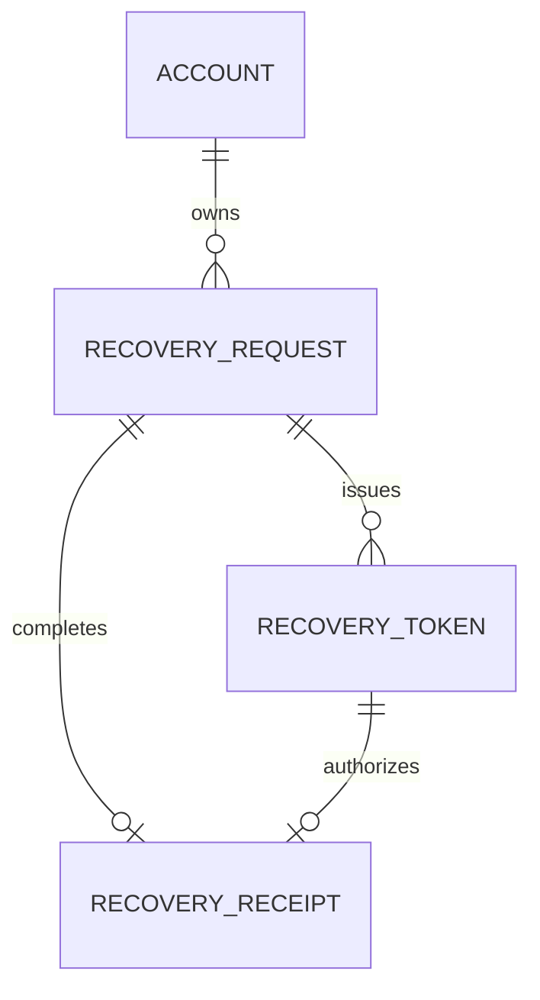
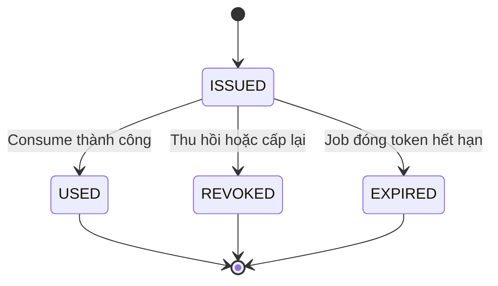

# Database constraint design

## 1. Vì sao luồng khôi phục cần ràng buộc ở cơ sở dữ liệu?

Trong module `SECURITY_AUTHENTICATION_ACCOUNT_RECOVERY`, một bản ghi khôi phục có thể cho phép đặt lại mật khẩu, thay MFA hoặc đăng ký passkey mới. Nếu dữ liệu này mâu thuẫn, hệ thống có thể cấp quyền cho sai tài khoản hoặc cho phép dùng lại một bằng chứng đã tiêu thụ.

Giả sử hai instance cùng nhận một recovery token. Cả hai đọc `used_at IS NULL`, cùng xác minh token và cùng thay thông tin xác thực. Đặt `@NotNull` trên DTO hay kiểm tra bằng câu lệnh `SELECT` trước khi ghi không loại bỏ được tình huống này. Cần phối hợp ràng buộc dữ liệu, thao tác ghi có điều kiện và transaction.

Database constraint design là việc biến những quy tắc dữ liệu bắt buộc thành điều kiện mà mọi đường ghi phải tuân thủ. Các đường ghi đó bao gồm API, job hết hạn, công cụ hỗ trợ và migration. Ràng buộc giúp chặn trạng thái không hợp lệ ngay tại nơi dữ liệu được lưu, nhưng không thay thế việc đánh giá rủi ro, xác minh danh tính hoặc phân quyền.

Bài học dùng PostgreSQL để minh họa. Các ví dụ hướng tới token ngẫu nhiên có entropy cao, phục vụ một mục đích khôi phục xác định. OTP ngắn, recovery code dự phòng và phê duyệt thủ công có thêm yêu cầu riêng; không nên sao chép nguyên mô hình token này cho mọi loại bằng chứng.

Sau bài học, người học có thể xác định bất biến dữ liệu, chọn đúng `NOT NULL`, `CHECK`, `UNIQUE`, khóa ngoại và partial unique index; đồng thời nhận ra những quy tắc phải được bảo vệ bằng transaction hoặc logic nghiệp vụ.

## 2. Viết bất biến trước khi viết DDL

Bất biến là điều phải đúng ở mọi trạng thái dữ liệu đã commit. Nên diễn đạt nó bằng câu có thể kiểm tra được, thay vì yêu cầu chung như “token phải an toàn”.

| Bất biến trong luồng khôi phục | Cơ chế chính | Giới hạn cần hiểu |
| --- | --- | --- |
| Mỗi tài khoản có định danh duy nhất trong tenant | Khóa chính ghép | Không tự kiểm tra quyền truy cập của người gọi |
| Yêu cầu khôi phục thuộc đúng tài khoản, tenant | Khóa ngoại ghép, `NOT NULL` | Một truy vấn thiếu điều kiện tenant vẫn có thể đọc sai dữ liệu |
| Token gắn với đúng yêu cầu, tài khoản và mục đích | Khóa ngoại ghép gồm đầy đủ các trường | Không chứng minh người cầm token đã đủ điều kiện đổi MFA |
| Thời điểm hết hạn lớn hơn thời điểm tạo | `CHECK` trên cùng một hàng | Không tự chuyển trạng thái khi đồng hồ chạy |
| Token `USED` có thời điểm sử dụng, không có thời điểm thu hồi | `CHECK` liên kết trạng thái và timestamp | Không tự cấm sửa `USED` trở lại `ISSUED` |
| Một yêu cầu chỉ có tối đa một token ở trạng thái `ISSUED` | Partial unique index | Hàng hết hạn theo thời gian vẫn chiếm chỗ nếu chưa đổi trạng thái |
| Một yêu cầu chỉ hoàn tất một lần | Khóa duy nhất của receipt và transaction có điều kiện | Cần gắn cùng transaction với thay đổi credential |
| Số lần thử không âm và không vượt ngân sách của hàng | `CHECK`, cập nhật nguyên tử | Không thay thế giới hạn theo IP, thiết bị hoặc toàn tài khoản |
| Khôi phục thành công làm mất hiệu lực các session theo chính sách | Transaction, phiên bản xác thực, cơ chế kiểm tra session | Constraint không tự thu hồi JWT đã phát hành |

Đối với chính sách “một yêu cầu đang mở cho mỗi tài khoản và mục đích”, cần chốt cả ý nghĩa sản phẩm. Nếu bất kỳ người chưa đăng nhập nào cũng có thể tạo một yêu cầu mới và hủy yêu cầu cũ, kẻ tấn công có thể liên tục phá luồng của nạn nhân. Unique index bảo đảm số lượng bản ghi; chính sách cấp lại và chống lạm dụng quyết định khi nào được thay thế bản ghi đó.

## 3. Chọn loại ràng buộc theo phạm vi quy tắc

### 3.1. `NOT NULL` bảo vệ dữ liệu bắt buộc

Các trường như `tenant_id`, `account_id`, `purpose`, `state`, `created_at` và `expires_at` phải có giá trị. Không dùng chuỗi rỗng thay cho định danh hoặc trạng thái chưa biết.

Trong SQL, biểu thức so sánh với `NULL` thường cho kết quả `UNKNOWN`. PostgreSQL không coi `UNKNOWN` là vi phạm `CHECK`. Vì vậy:

```sql
attempts integer CHECK (attempts >= 0)
```

vẫn cho phép `attempts = NULL`. Cách thể hiện ngân sách rõ ràng hơn là:

```sql
attempts integer NOT NULL DEFAULT 0,
max_attempts integer NOT NULL,
CONSTRAINT ck_attempt_budget
    CHECK (max_attempts > 0 AND attempts BETWEEN 0 AND max_attempts)
```

Ràng buộc trên bảo vệ hình dạng dữ liệu. Khi tăng bộ đếm, vẫn cần điều kiện `attempts < max_attempts` ngay trong câu `UPDATE` và kiểm tra số hàng bị cập nhật.

### 3.2. `CHECK` bảo vệ quan hệ giữa các cột của một hàng

Những quy tắc phù hợp gồm miền giá trị trạng thái, thứ tự timestamp và sự tương ứng giữa trạng thái với timestamp. Đặt tên constraint để log vận hành và mã xử lý lỗi có thể nhận diện quy tắc bị vi phạm.

Không dùng `CHECK` như một lời hứa rằng dữ liệu luôn hợp lệ theo thời gian thực. Ví dụ `CHECK (expires_at > now())` không làm hàng tự mất hiệu lực khi thời gian trôi qua; nó còn gây khó khăn cho cập nhật và phục hồi dữ liệu. Trong PostgreSQL, cũng không thể dùng subquery thông thường trong `CHECK` để kiểm tra một hàng cha.

Quy tắc “token còn hạn khi được sử dụng” phải xuất hiện trong điều kiện của thao tác tiêu thụ token. Quy tắc “token không sống lâu hơn yêu cầu cha” có thể được bảo đảm bằng đường ghi được kiểm soát hoặc mô hình dữ liệu khác, nhưng không nên giả vờ rằng một `CHECK` cục bộ đã giải quyết được quan hệ đó.

### 3.3. `UNIQUE` bảo vệ cạnh tranh giữa các transaction

Mẫu “đọc trước, nếu chưa có thì insert” có thể chạy đồng thời trên nhiều instance. `UNIQUE` mới là cơ chế phân xử cuối cùng khi hai transaction cùng tạo dữ liệu trùng.

Các cột thuộc định danh bảo mật nên `NOT NULL`. Trong PostgreSQL, một unique constraint thông thường cho phép nhiều hàng có giá trị `NULL` ở các vị trí tương ứng; không nên xây dựng quy tắc dùng một lần dựa trên việc so sánh các giá trị vắng mặt.

### 3.4. Khóa ngoại phải bao gồm ranh giới tenant

Nếu chỉ có `FOREIGN KEY (account_id) REFERENCES account(account_id)`, mô hình dễ cho phép dữ liệu con mang tenant A nhưng trỏ sang tài khoản tenant B, tùy cách định nghĩa khóa cha. Nên biểu diễn quan hệ bằng `(tenant_id, account_id)` và giữ cùng thứ tự cột ở hai phía.

Khóa ngoại bảo vệ tính nhất quán quan hệ. Nó không phải cơ chế phân quyền: dịch vụ vẫn phải lấy tenant từ ngữ cảnh tin cậy, kiểm tra quyền và áp dụng điều kiện tenant cho truy vấn. Có thể bổ sung row-level security khi phù hợp, nhưng không bỏ kiểm soát ở dịch vụ vì đã có khóa ngoại.

## 4. Một schema minh họa cho recovery token

Mô hình gồm tài khoản, yêu cầu khôi phục, token và receipt ghi nhận hoàn tất. `purpose` phân biệt thay mật khẩu với thay MFA hoặc đăng ký lại passkey; token cho một mục đích không được tự động cấp quyền cho mục đích khác.



DDL dưới đây có thể đọc tuần tự để thấy các ràng buộc liên kết nhau. Đây là mô hình học tập; cột mật khẩu chỉ xuất hiện để minh họa transaction đặt lại mật khẩu, không mô tả đầy đủ kho credential của một sản phẩm.

```sql
CREATE TABLE recovery_account (
    tenant_id uuid NOT NULL,
    account_id uuid NOT NULL,
    password_hash text,
    auth_version bigint NOT NULL DEFAULT 0,
    CONSTRAINT pk_recovery_account
        PRIMARY KEY (tenant_id, account_id),
    CONSTRAINT ck_account_auth_version
        CHECK (auth_version >= 0)
);

CREATE TABLE recovery_request (
    tenant_id uuid NOT NULL,
    request_id uuid NOT NULL,
    account_id uuid NOT NULL,
    purpose text NOT NULL,
    state text NOT NULL DEFAULT 'PENDING',
    created_at timestamptz NOT NULL,
    expires_at timestamptz NOT NULL,
    closed_at timestamptz,

    CONSTRAINT pk_recovery_request
        PRIMARY KEY (tenant_id, request_id),
    CONSTRAINT uq_request_binding
        UNIQUE (tenant_id, request_id, account_id, purpose),
    CONSTRAINT fk_request_account
        FOREIGN KEY (tenant_id, account_id)
        REFERENCES recovery_account (tenant_id, account_id)
        ON DELETE RESTRICT,
    CONSTRAINT ck_request_purpose
        CHECK (purpose IN (
            'PASSWORD_RESET', 'MFA_RESET', 'PASSKEY_REENROLL'
        )),
    CONSTRAINT ck_request_state
        CHECK (state IN (
            'PENDING', 'COMPLETED', 'CANCELLED', 'EXPIRED'
        )),
    CONSTRAINT ck_request_lifetime
        CHECK (expires_at > created_at),
    CONSTRAINT ck_request_close_time
        CHECK (closed_at IS NULL OR closed_at >= created_at),
    CONSTRAINT ck_request_state_time
        CHECK (
            (state = 'PENDING' AND closed_at IS NULL)
            OR
            (state IN ('COMPLETED', 'CANCELLED', 'EXPIRED')
                AND closed_at IS NOT NULL)
        )
);

CREATE UNIQUE INDEX uq_request_pending_scope
    ON recovery_request (tenant_id, account_id, purpose)
    WHERE state = 'PENDING';

CREATE TABLE recovery_token (
    tenant_id uuid NOT NULL,
    token_id uuid NOT NULL,
    request_id uuid NOT NULL,
    account_id uuid NOT NULL,
    purpose text NOT NULL,
    hash_key_id text NOT NULL,
    token_digest bytea NOT NULL,
    state text NOT NULL DEFAULT 'ISSUED',
    created_at timestamptz NOT NULL,
    expires_at timestamptz NOT NULL,
    used_at timestamptz,
    revoked_at timestamptz,

    CONSTRAINT pk_recovery_token
        PRIMARY KEY (tenant_id, token_id),
    CONSTRAINT uq_token_digest
        UNIQUE (tenant_id, hash_key_id, token_digest),
    CONSTRAINT uq_token_request_binding
        UNIQUE (tenant_id, request_id, token_id),
    CONSTRAINT fk_token_request_binding
        FOREIGN KEY (tenant_id, request_id, account_id, purpose)
        REFERENCES recovery_request
            (tenant_id, request_id, account_id, purpose)
        ON DELETE RESTRICT,
    CONSTRAINT ck_token_digest_length
        CHECK (octet_length(token_digest) = 32),
    CONSTRAINT ck_token_state
        CHECK (state IN ('ISSUED', 'USED', 'REVOKED', 'EXPIRED')),
    CONSTRAINT ck_token_lifetime
        CHECK (expires_at > created_at),
    CONSTRAINT ck_token_used_time
        CHECK (used_at IS NULL OR used_at >= created_at),
    CONSTRAINT ck_token_revoked_time
        CHECK (revoked_at IS NULL OR revoked_at >= created_at),
    CONSTRAINT ck_token_state_time
        CHECK (
            (state IN ('ISSUED', 'EXPIRED')
                AND used_at IS NULL AND revoked_at IS NULL)
            OR
            (state = 'USED'
                AND used_at IS NOT NULL AND revoked_at IS NULL)
            OR
            (state = 'REVOKED'
                AND used_at IS NULL AND revoked_at IS NOT NULL)
        )
);

CREATE UNIQUE INDEX uq_token_issued_per_request
    ON recovery_token (tenant_id, request_id)
    WHERE state = 'ISSUED';

CREATE TABLE recovery_receipt (
    tenant_id uuid NOT NULL,
    request_id uuid NOT NULL,
    token_id uuid NOT NULL,
    completed_at timestamptz NOT NULL,
    CONSTRAINT pk_recovery_receipt
        PRIMARY KEY (tenant_id, request_id),
    CONSTRAINT uq_receipt_token
        UNIQUE (tenant_id, token_id),
    CONSTRAINT fk_receipt_request
        FOREIGN KEY (tenant_id, request_id)
        REFERENCES recovery_request (tenant_id, request_id)
        ON DELETE RESTRICT,
    CONSTRAINT fk_receipt_token_binding
        FOREIGN KEY (tenant_id, request_id, token_id)
        REFERENCES recovery_token (tenant_id, request_id, token_id)
        ON DELETE RESTRICT
);
```

### 4.1. Vì sao lặp lại `account_id` và `purpose` ở token?

Trong ví dụ, các trường này giúp thao tác tiêu thụ đối chiếu rõ phạm vi. Sự lặp lại được bảo vệ bởi khóa ngoại ghép; không thể gắn token vào request đúng ID nhưng sai tài khoản hoặc sai purpose.

Có thể chuẩn hóa bằng cách chỉ lưu `request_id` ở token rồi luôn join sang request. Hai phương án đều có thể hợp lý. Vấn đề là tránh lưu dữ liệu lặp mà không có ràng buộc, sau đó tin rằng các cột chắc chắn khớp nhau.

`uq_token_request_binding` tạo khóa duy nhất đúng bộ cột mà receipt tham chiếu. Nếu receipt chỉ có hai khóa ngoại độc lập tới request và token, cả hai đối tượng có thể tồn tại nhưng thuộc hai yêu cầu khác nhau. Khóa ngoại ghép của receipt chặn việc ghép nhầm đó.

### 4.2. Digest không phải token gốc

Ví dụ giả định `token_digest` là kết quả HMAC-SHA-256 trên token ngẫu nhiên, với khóa được quản lý ngoài database. `hash_key_id` chỉ định danh khóa để hỗ trợ xoay khóa; nó không chứa bí mật. Độ dài 32 byte là đặc điểm của cách biểu diễn này, không phải quy tắc chung cho mọi thuật toán token.

Một lựa chọn khác cho token ngẫu nhiên đủ mạnh là lưu digest mật mã không có khóa, sau khi đánh giá mô hình đe dọa. HMAC giúp tách khả năng kiểm tra ứng viên khỏi người chỉ có bản sao database, miễn là khóa thực sự được bảo vệ riêng. Cả hai cách đều không bù được token sinh từ nguồn ngẫu nhiên yếu.

OTP ngắn có không gian giá trị nhỏ, nên không thể coi một digest thông thường là đủ bảo vệ trước dò offline. Nó còn cần thiết kế khóa bí mật phù hợp, ngân sách thử và thời hạn ngắn. Không lưu recovery token, OTP hoặc recovery code nguyên bản vào cột log, receipt hay thông báo lỗi.

Unique digest chủ yếu giúp tránh dữ liệu trùng và tạo lookup rõ ràng. Nó không chứng minh rằng token có entropy tốt hoặc chỉ được dùng một lần. Khi xoay khóa, cùng token nguyên bản có thể cho digest khác nhau; cơ chế phát hành phải sinh token mới và không dựa vào unique digest để phát hiện mọi trường hợp tái sử dụng bí mật.

## 5. Trạng thái đúng hình dạng chưa đồng nghĩa chuyển trạng thái đúng

Các `CHECK` của schema bảo đảm `USED` đi cùng `used_at`, `REVOKED` đi cùng `revoked_at`. Chúng không so sánh hàng mới với lịch sử hàng cũ. Một tài khoản database có quyền `UPDATE` tùy ý vẫn có thể đặt token `USED` về `ISSUED` bằng cách xóa timestamp tương ứng.

Luồng mong muốn là:



Có ba lớp thực thi bổ sung:

1. Repository hoặc stored procedure chỉ cho phép chuyển từ trạng thái nguồn được chỉ định bằng `WHERE state = 'ISSUED'`.
2. Quyền database giới hạn đường ghi; công cụ hỗ trợ không dùng tài khoản có thể tùy ý sửa mọi hàng.
3. Khi có nhiều đường ghi độc lập, trigger có thể kiểm tra `OLD` và `NEW` để chặn mở lại trạng thái kết thúc hoặc sửa các trường binding. Trigger phải được thiết kế và kiểm thử như logic nghiệp vụ thực sự.

Tương tự, foreign key không bắt buộc request đã `COMPLETED` phải có receipt, và receipt không tự buộc token chuyển sang `USED`. Trong mô hình này, transaction hoàn tất và quyền ghi được kiểm soát bảo vệ các quan hệ liên bảng đó. Nếu cần bảo vệ trước mọi câu SQL tùy ý của nhiều bên ghi, phải bổ sung cơ chế ở database thay vì tuyên bố các constraint hiện tại đã bao phủ hết.

## 6. Token dùng một lần cần một transaction tiêu thụ

### 6.1. Xác định điểm quyết định và thứ tự khóa

Một quy ước đơn giản cho mô hình minh họa là mọi thao tác cấp lại, hủy và hoàn tất đều khóa tài khoản trước, sau đó khóa request. Các thao tác trên token thực hiện sau khi có những khóa này. Thứ tự nhất quán giảm deadlock và làm các thay đổi credential của cùng tài khoản được tuần tự hóa.

Trước transaction ghi, dịch vụ xác minh token đầu vào, các bằng chứng danh tính cần thiết, đánh giá rủi ro và chuẩn bị password hash bằng thuật toán dành cho mật khẩu. Không giữ khóa database trong lúc gọi dịch vụ xác minh bên ngoài hoặc chờ người dùng nhập dữ liệu. Nếu kết quả xác minh có thể hết hiệu lực hoặc bị thu hồi, phải kiểm tra điều kiện quyết định còn hiệu lực trước khi áp dụng thay đổi.

Khi bắt đầu transaction, khóa đúng tài khoản và request đã xác định từ dữ liệu tin cậy:

```sql
BEGIN;

SELECT account_id
FROM recovery_account
WHERE tenant_id = :tenant_id
  AND account_id = :account_id
FOR UPDATE;

SELECT request_id
FROM recovery_request
WHERE tenant_id = :tenant_id
  AND request_id = :request_id
  AND account_id = :account_id
  AND purpose = 'PASSWORD_RESET'
FOR UPDATE;
```

Các dấu `:name` là bind parameter của lớp truy cập dữ liệu, không phải cú pháp chạy trực tiếp trong mọi SQL client. Mỗi truy vấn khóa phải tìm đúng một hàng; nếu không, dịch vụ rollback và trả thất bại theo hợp đồng API.

### 6.2. Tiêu thụ token và tạo receipt bằng thao tác có điều kiện

Câu lệnh tiếp theo chạy sau khi đã lấy khóa. Trong PostgreSQL, `statement_timestamp()` cung cấp mốc thời gian bắt đầu câu lệnh này, khác với `now()` vốn theo thời điểm bắt đầu transaction. Việc tách câu lệnh kiểm tra khỏi giai đoạn chờ lấy khóa giúp tránh dùng thời điểm transaction đã bắt đầu từ lâu.

```sql
WITH consumed AS (
    UPDATE recovery_token AS t
    SET state = 'USED',
        used_at = statement_timestamp()
    WHERE t.tenant_id = :tenant_id
      AND t.token_id = :token_id
      AND t.request_id = :request_id
      AND t.account_id = :account_id
      AND t.purpose = 'PASSWORD_RESET'
      AND t.hash_key_id = :hash_key_id
      AND t.token_digest = :token_digest
      AND t.state = 'ISSUED'
      AND t.expires_at > statement_timestamp()
      AND EXISTS (
          SELECT 1
          FROM recovery_request AS r
          WHERE r.tenant_id = t.tenant_id
            AND r.request_id = t.request_id
            AND r.account_id = t.account_id
            AND r.purpose = t.purpose
            AND r.state = 'PENDING'
            AND r.expires_at > statement_timestamp()
      )
    RETURNING t.tenant_id, t.request_id, t.token_id
), completed AS (
    UPDATE recovery_request AS r
    SET state = 'COMPLETED',
        closed_at = statement_timestamp()
    FROM consumed AS c
    WHERE r.tenant_id = c.tenant_id
      AND r.request_id = c.request_id
      AND r.state = 'PENDING'
      AND r.expires_at > statement_timestamp()
    RETURNING r.tenant_id, r.request_id
)
INSERT INTO recovery_receipt (
    tenant_id, request_id, token_id, completed_at
)
SELECT c.tenant_id, c.request_id, c.token_id,
       statement_timestamp()
FROM consumed AS c
JOIN completed AS r
  ON r.tenant_id = c.tenant_id
 AND r.request_id = c.request_id
RETURNING request_id;
```

Ứng dụng phải yêu cầu chính xác một hàng trả về. Không có hàng nghĩa là điều kiện sử dụng không đạt; phải rollback, không tiếp tục thay mật khẩu. Nếu có lỗi constraint hoặc lỗi ở bước sau, cũng rollback toàn transaction.

Sau khi có một receipt, áp dụng thay đổi mật khẩu trong cùng transaction:

```sql
UPDATE recovery_account
SET password_hash = :new_password_hash,
    auth_version = auth_version + 1
WHERE tenant_id = :tenant_id
  AND account_id = :account_id;

-- Dịch vụ yêu cầu UPDATE đúng một hàng.
-- Ghi sự kiện audit/outbox cần thiết trong cùng transaction.

COMMIT;
```

`new_password_hash` phải được tạo từ mật khẩu đã qua kiểm tra chính sách bằng hàm băm mật khẩu phù hợp, không dùng digest token thay cho password hashing. Nếu thao tác cập nhật không tác động đúng một hàng hoặc ghi audit bắt buộc bị lỗi, dịch vụ rollback trước khi commit.

Khi hai request tiêu thụ chạy đồng thời, request thứ hai chờ khóa tài khoản. Sau khi request đầu commit, câu lệnh có điều kiện của request sau không còn tìm được token `ISSUED` và request `PENDING`. Nếu request đầu rollback, lần thử sau có thể tiếp tục khi các điều kiện vẫn hợp lệ.

Quy tắc thời hạn ở ví dụ là “còn hạn tại thời điểm câu lệnh tiêu thụ bắt đầu sau giai đoạn lấy khóa”. Nó không hứa rằng thời gian commit luôn nằm trước `expires_at`. Cần giữ transaction ngắn, đặt timeout hợp lý và định nghĩa rõ điểm quyết định trong chính sách. Nếu có đường ghi token không tuân thủ thứ tự khóa, phải phân tích lại khả năng chờ khóa và mốc thời gian kiểm tra.

### 6.3. Session và các credential khác

Tăng `auth_version` chỉ có tác dụng nếu cơ chế xác thực thực sự so phiên bản trong session hoặc token với phiên bản hiện tại, với chính sách cache đáp ứng yêu cầu thu hồi. Một JWT chỉ được kiểm tra chữ ký và hạn dùng không tự mất hiệu lực vì database đổi phiên bản.

Với `MFA_RESET` hoặc `PASSKEY_REENROLL`, giữ nguyên nguyên tắc tiêu thụ nguyên tử nhưng thay bằng thao tác đúng mục đích. Khôi phục passkey thường là xác minh và đăng ký credential mới; không phải lấy lại private key đã mất từ database. Không biến token đặt lại mật khẩu thành quyền xóa MFA bằng cách thay tham số purpose trong API.

Nếu credential, session và recovery nằm ở các database khác nhau, transaction local không thể bao phủ toàn bộ thay đổi. Cần giao thức phối hợp rõ ràng, chẳng hạn một grant khôi phục có giới hạn, outbox, xử lý idempotent và trạng thái hoàn tất được xác nhận. Không đánh dấu hoàn tất rồi bỏ mặc việc thu hồi session như một tác vụ không được theo dõi.

## 7. Partial unique index và bài toán hết hạn

Index `uq_token_issued_per_request` bảo vệ “một token có trạng thái `ISSUED` cho mỗi request”. Nó không bảo vệ trực tiếp “một token chưa hết hạn theo đồng hồ”. Một token đã quá `expires_at` nhưng chưa được job cập nhật vẫn có thể mang trạng thái `ISSUED`.

Không thiết kế partial index dựa trên điều kiện động như:

```sql
-- Thiết kế sai cho PostgreSQL:
-- CREATE UNIQUE INDEX ... WHERE expires_at > now();
```

Predicate của index phải phù hợp với yêu cầu về tính bất biến của PostgreSQL; hơn nữa, việc thời gian trôi qua không tự gây ra thao tác cập nhật hàng để thay đổi thành viên của index.

Khi cấp lại token cho cùng request, transaction cần khóa cùng tài khoản và request, xác minh request còn mở và còn hạn, chuyển token `ISSUED` cũ sang `REVOKED`, rồi insert token mới. Thu hồi và insert nằm trong cùng transaction: nếu insert lỗi thì việc thu hồi cũng rollback. Không xóa lịch sử chỉ để tránh unique violation.

Nếu request đã hết hạn nhưng còn `PENDING`, trước khi mở request mới cần đóng request cũ theo chính sách và xử lý token cũ. Job dọn dẹp giúp hệ thống vận hành gọn hơn; quyết định chấp nhận token vẫn luôn kiểm tra `expires_at` của cả token lẫn request, nên job chậm không làm token hết hạn được dùng lại.

Không tự động kéo dài `expires_at` của request mỗi khi resend. Điều đó có thể biến một yêu cầu lẽ ra ngắn hạn thành quyền khôi phục tồn tại dai dẳng.

## 8. Constraint cho ngân sách thử và chống lạm dụng

Nếu bổ sung `attempts` và `max_attempts` cho challenge, dùng cập nhật nguyên tử:

```sql
UPDATE recovery_challenge
SET attempts = attempts + 1
WHERE tenant_id = :tenant_id
  AND challenge_id = :challenge_id
  AND state = 'OPEN'
  AND expires_at > statement_timestamp()
  AND attempts < max_attempts
RETURNING attempts, max_attempts;
```

`recovery_challenge` là bảng giả định riêng cho ví dụ này, không nằm trong DDL token phía trên. Hàng trả về thể hiện một lượt đã được dành trong ngân sách. Không có hàng thì không tiếp tục thử xác minh. Nếu xác minh thất bại nhưng transaction bị rollback hoàn toàn, phép tăng cũng mất; cần thiết kế ranh giới transaction để một lần thử sai thực sự được ghi nhận.

CHECK `attempts <= max_attempts` là hàng rào cuối để ngăn dữ liệu vượt giới hạn. Điều kiện trong `UPDATE` mới giúp xử lý cạnh tranh mà không dựa vào bộ đếm đã đọc trước đó.

Ngân sách theo một challenge chưa ngăn được việc tạo challenge mới liên tục. Chống lạm dụng còn cần giới hạn theo tài khoản, tenant, mạng, thiết bị hoặc tín hiệu rủi ro; chính sách không được tạo cơ hội khóa tài khoản nạn nhân chỉ bằng nhiều request không xác thực. Constraint cục bộ không thể thay thế toàn bộ các kiểm soát này.

## 9. Receipt, idempotency và retry không cùng một ý nghĩa

Khóa chính `(tenant_id, request_id)` của receipt ngăn ghi nhận hai lần hoàn tất cho một yêu cầu. Nó hữu ích khi retry hoặc khi nhiều instance cùng xử lý, nhưng không tự biến API thành idempotent và không tự ngăn gửi hai email nếu việc gửi nằm ngoài transaction.

Nếu client mất kết nối sau commit, token đã dùng vẫn phải được coi là đã tiêu thụ. Không chấp nhận lại token để thực hiện một thay đổi khác hoặc phát hành session mới. API có thể cung cấp kết quả của thao tác đã hoàn tất khi có cơ chế xác thực và binding idempotency phù hợp.

Với một idempotency key riêng, phạm vi unique thường phải gồm tenant, danh tính hoặc ngữ cảnh được xác thực và loại thao tác. Lưu fingerprint của nội dung hành động để phát hiện cùng key nhưng khác yêu cầu. Đối với dữ liệu bí mật hoặc có entropy thấp, fingerprint cũng cần cơ chế bảo vệ phù hợp; không log mật khẩu hoặc raw token để tiện so sánh.

Khi dùng outbox gửi thông báo khôi phục thành công, đặt định danh sự kiện duy nhất theo lần hoàn tất. Consumer vẫn phải xử lý lặp một cách an toàn. Unique event không bảo đảm bên nhận email chỉ thấy đúng một thư trong mọi kiểu lỗi mạng.

## 10. Ánh xạ lỗi constraint mà không lộ thông tin tài khoản

Đặt tên constraint giúp phân biệt xung đột nghiệp vụ dự kiến với sai sót lập trình. Ví dụ, vi phạm `uq_request_pending_scope` có thể là một request khác vừa mở cùng phạm vi; vi phạm `fk_token_request_binding` thường cho thấy dữ liệu binding sai hoặc một đường ghi không đúng thiết kế.

Trong PostgreSQL, các nhóm lỗi thường gặp gồm:

| SQLSTATE | Ý nghĩa | Cách xử lý trong dịch vụ |
| --- | --- | --- |
| `23505` | Unique violation | Xác định constraint, rollback, xử lý xung đột theo chính sách |
| `23503` | Foreign key violation | Rollback, ghi sự kiện nội bộ, kiểm tra binding hoặc vòng đời dữ liệu |
| `23514` | Check violation | Rollback, điều tra giá trị hoặc chuyển trạng thái không hợp lệ |
| `23502` | Not-null violation | Rollback, sửa đường ghi thiếu dữ liệu bắt buộc |
| `40001` | Serialization failure | Chạy lại toàn transaction khi hợp đồng retry cho phép |
| `40P01` | Deadlock detected | Rollback, retry có giới hạn và xem lại thứ tự khóa |

Sau một lỗi SQL làm transaction thất bại, không tiếp tục ghi như chưa có lỗi. Lớp transaction phải rollback hoặc dùng savepoint được thiết kế rõ ràng. Không retry mọi lỗi `23505` vô hạn và không hạ bỏ constraint để request chạy qua.

HTTP response không nên trả tên bảng, tên constraint hoặc khác biệt giúp suy ra tài khoản có tồn tại. Endpoint khởi tạo khôi phục thường trả thông báo thống nhất theo chính sách chống enumeration. Endpoint dùng token cũng cần hợp đồng lỗi nhất quán. Log nội bộ dùng correlation ID và mã lỗi đã phân loại, không ghi URL chứa token hay giá trị bind nhạy cảm.

## 11. Xóa dữ liệu, tính bất biến và lưu vết

Schema minh họa dùng `ON DELETE RESTRICT` để việc xóa tài khoản hoặc request không âm thầm kéo theo lịch sử liên quan. Điều này yêu cầu quy trình purge có thứ tự rõ ràng; nó không có nghĩa phải lưu bằng chứng danh tính hoặc dữ liệu cá nhân vô thời hạn.

Thiết kế retention cần phân biệt dữ liệu phục vụ quyết định đang hoạt động, receipt tối thiểu phục vụ chống lặp, và audit theo yêu cầu của hệ thống. Hết thời gian cần thiết thì xóa hoặc giảm dữ liệu theo chính sách. Bằng chứng danh tính nhạy cảm nên được tách khỏi bảng token, giới hạn truy cập và có thời hạn lưu riêng.

Các trường binding như tenant, account, request, purpose và digest thường không nên được sửa sau phát hành. Khóa ngoại chỉ yêu cầu giá trị mới còn trỏ tới đối tượng hợp lệ; nó không tự bảo vệ tính bất biến theo lịch sử. Có thể giới hạn quyền cột, dùng procedure hoặc trigger để bảo vệ yêu cầu này.

Không tái sử dụng request cũ bằng cách đặt lại trạng thái và ghi đè digest. Mỗi vòng khôi phục mới cần định danh mới, vừa giảm nhầm lẫn vừa giữ được dấu vết sự kiện.

## 12. Bổ sung constraint cho dữ liệu đang tồn tại

Khi hệ thống đã có dữ liệu, thêm constraint có thể thất bại vì lịch sử không hợp lệ hoặc gây chờ khóa lâu. Quy trình triển khai cần bắt đầu bằng truy vấn kiểm kê: request đang mở bị trùng, token không có cha, tenant không khớp, timestamp sai thứ tự và trạng thái thiếu timestamp tương ứng.

Sau khi xác định ý nghĩa từng nhóm dữ liệu, sửa có kiểm soát hoặc cách ly dữ liệu không hợp lệ. Không mặc định giữ token mới nhất rồi xóa phần còn lại, vì có thể vô hiệu hóa luồng hợp lệ hoặc mất bằng chứng cần thiết.

Một số `CHECK` và khóa ngoại trong PostgreSQL có thể được thêm bằng `NOT VALID`, rồi `VALIDATE CONSTRAINT` sau khi xử lý dữ liệu lịch sử. Đây là cách tách việc áp dụng ràng buộc cho thay đổi mới khỏi lượt xác minh dữ liệu cũ, không phải cơ chế bỏ qua lỗi vĩnh viễn.

Với unique index, cần có kế hoạch riêng. `CREATE UNIQUE INDEX CONCURRENTLY` có thể giảm ảnh hưởng lên ghi so với cách tạo thông thường, nhưng vẫn có chi phí, vẫn có thể thất bại và không chạy bên trong transaction block thông thường. Partial unique index được giữ dưới dạng index với predicate của nó; không áp dụng máy móc mọi cách gắn index thành unique constraint.

Triển khai nên phối hợp phiên bản ứng dụng với schema: xử lý các lỗi constraint dự kiến, chuyển đường ghi sang quy tắc mới, xác minh dữ liệu rồi mới loại bỏ logic tương thích cũ. Không thêm constraint thành công trên môi trường rỗng rồi coi đó là bằng chứng migration an toàn cho production.

## 13. Các tình huống dùng để đánh giá thiết kế

Bảng sau là những tình huống kiểm chứng khi triển khai mô hình vào ứng dụng. Việc đưa chúng vào bài học không có nghĩa các ví dụ SQL đã được chạy trên hệ thống thực tế.

| Tình huống | Kết quả mong đợi | Cơ chế chịu trách nhiệm |
| --- | --- | --- |
| Insert token tenant A trỏ tới request chỉ có ở tenant B | Bị từ chối | Khóa ngoại ghép |
| Token dùng request đúng ID nhưng purpose khác | Bị từ chối | Khóa ngoại chứa purpose |
| Insert token `USED` nhưng `used_at` rỗng | Bị từ chối | `ck_token_state_time` |
| Insert hai token `ISSUED` cho cùng request | Chỉ một hàng được commit | Partial unique index |
| Hai transaction cùng hoàn tất một request | Chỉ một thay đổi credential được commit | Thứ tự khóa, điều kiện update, receipt và transaction |
| Token còn `ISSUED` nhưng đã quá hạn | Không thể tiêu thụ | Điều kiện thời gian trên thao tác ghi |
| Token còn hạn nhưng request cha đã hết hạn | Không thể tiêu thụ | Kiểm tra thời hạn của request |
| Lỗi cập nhật credential sau khi tạo receipt | Token, request và receipt đều rollback | Cùng transaction local |
| Gửi lại token đã dùng với mật khẩu khác | Không thực hiện thay đổi mới | Điều kiện trạng thái và chính sách replay |
| SQL tùy ý mở lại token `USED` | Phải bị chặn nếu yêu cầu tính bất biến ở database | Quyền ghi, procedure hoặc trigger bổ sung |
| Tăng `auth_version` nhưng JWT không kiểm tra phiên bản | Session có thể còn dùng được | Thiếu cơ chế thực thi thu hồi ở lớp xác thực |

Các tình huống đồng thời cần nhiều connection thực sự và điểm đồng bộ rõ ràng. Kiểm thử chỉ chạy tuần tự không chứng minh được khả năng phân xử race condition. Ngoài happy path, cần có lỗi giữa các bước để kiểm tra việc rollback, đặc biệt là sau khi token đổi trạng thái nhưng trước commit.

## 14. Những lỗi thiết kế thường gặp

| Lỗi | Hệ quả trong khôi phục tài khoản | Hướng sửa |
| --- | --- | --- |
| Chỉ kiểm tra `exists` trong Java trước insert | Hai instance có thể cùng tạo hàng | Thêm unique constraint đúng phạm vi |
| Dùng khóa ngoại chỉ có ID, bỏ tenant | Dữ liệu có thể vượt ranh giới tenant | Dùng khóa ghép và kiểm soát truy vấn |
| Tưởng `CHECK` tự đánh giá lại khi thời gian trôi | Token quá hạn còn được chấp nhận | Kiểm tra thời hạn khi tiêu thụ |
| `SELECT` token rồi `UPDATE` không điều kiện | Hai request cùng thấy token chưa dùng | Dùng cập nhật có điều kiện và transaction |
| Commit token trước, đổi credential sau | Có thể mất token mà tài khoản chưa được khôi phục | Gộp transaction local hoặc giao thức phối hợp rõ ràng |
| Dùng `ON CONFLICT DO NOTHING` rồi vẫn trả thành công | Che mất việc receipt hoặc thao tác chưa được tạo | Kiểm tra số hàng và ý nghĩa xung đột |
| Coi unique digest là bảo đảm dùng một lần | Token vẫn có thể bị replay | Trạng thái, thao tác nguyên tử và binding mục đích |
| Xóa hàng cũ để vượt unique violation | Mất dấu vết, khó phân tích sự cố | Đóng hoặc thu hồi theo vòng đời |
| Bắt mọi lỗi constraint thành HTTP 500 kèm SQL | Lộ cấu trúc hoặc dữ liệu nhạy cảm | Phân loại lỗi nội bộ, trả thông báo có kiểm soát |

Một thiết kế tốt đặt các quy tắc về dữ liệu tồn tại và hình dạng dữ liệu vào constraint, đặt quyết định dùng quyền khôi phục vào thao tác có điều kiện, rồi gắn thay đổi credential và kiểm soát session bằng ranh giới nhất quán. Khi đọc schema, người học phải chỉ ra được bất biến nào database đã bảo vệ và bất biến nào còn phụ thuộc vào đường ghi, chính sách rủi ro hoặc cơ chế xác thực.
