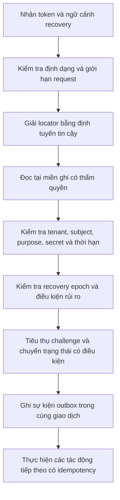

# Recovery data partitioning

## 1. Vì sao dữ liệu khôi phục tài khoản cần được phân vùng?

Phân vùng dữ liệu khôi phục tài khoản là tổ chức và định tuyến dữ liệu vào các miền lưu trữ có ranh giới rõ ràng. Ranh giới có thể dựa trên tenant, tài khoản, khu vực hoặc thời gian. Mục tiêu là phục vụ đúng luồng recovery, giới hạn phạm vi truy cập và vận hành được khi dữ liệu tăng lên.

Trong một hệ thống cho phép khôi phục mật khẩu, MFA, passkey hoặc thiết bị xác thực, dữ liệu recovery có nhiều loại khác nhau:

- Yêu cầu khôi phục và trạng thái xử lý.
- Token, challenge và bằng chứng xác minh.
- Quyết định rủi ro, thời gian chờ và phê duyệt thủ công.
- Trạng thái vô hiệu hóa quyền khôi phục và session liên quan.
- Sự kiện kiểm toán, thông báo và dữ liệu chống lạm dụng.

Những loại dữ liệu này không nhất thiết có cùng vòng đời, quyền truy cập hoặc yêu cầu nhất quán. Một token đang chờ dùng cần quyết định chính xác liệu nó còn hợp lệ; một sự kiện kiểm toán cũ có thể chỉ cần truy vấn phục vụ điều tra. Đặt tất cả vào cùng một cơ chế phân vùng dễ khiến yêu cầu vận hành của loại này làm suy yếu yêu cầu an toàn của loại khác.

Ví dụ xuyên suốt bài: một nền tảng có nhiều tenant. Người dùng mất điện thoại chứa ứng dụng MFA, tạo yêu cầu recovery và phải qua bước xác minh bổ sung trước khi đăng ký thiết bị mới. Hệ thống cần tìm đúng yêu cầu, ngăn yêu cầu của tenant khác được sử dụng và bảo đảm hai request đồng thời không cùng hoàn tất recovery.

## 2. Phân biệt các ranh giới

| Khái niệm | Vai trò | Điều không tự được bảo đảm |
| --- | --- | --- |
| Phân vùng logic | Tách dữ liệu bằng khóa, chính sách truy vấn hoặc bảng | Không tự tạo cách ly vật lý |
| Partition trong cơ sở dữ liệu | Chia một bảng thành các phần để quản lý, truy vấn, dọn dữ liệu | Không tự là ranh giới phân quyền |
| Shard | Phân phối dữ liệu lên các cụm hoặc nút lưu trữ khác nhau | Không tự ngăn đọc chéo tenant |
| Miền cư trú dữ liệu | Xác định nơi dữ liệu và các bản sao được phép tồn tại | Không chỉ phụ thuộc vị trí của bảng chính |
| Ranh giới mật mã | Tách quyền giải mã hoặc xác thực bằng các khóa khác nhau | Không thay thế kiểm tra trạng thái nghiệp vụ |

Một tenant có thể cùng tồn tại với tenant khác trên một shard nhưng vẫn cần cách ly logic chặt chẽ. Ngược lại, tách tenant sang cơ sở dữ liệu riêng vẫn không an toàn nếu endpoint nhận một recovery ID của tenant khác và bỏ qua kiểm tra ngữ cảnh.

**Phân vùng hỗ trợ cách ly; quyền thực hiện recovery vẫn phải được kiểm tra ở mỗi thao tác.**

## 3. Các bất biến cần giữ trước khi chọn khóa phân vùng

### 3.1. Một danh tính nội bộ ổn định

Dùng một định danh nội bộ bất biến cho tài khoản, chẳng hạn `subject_id`. Email hoặc số điện thoại là thuộc tính có thể thay đổi; chúng không nên là nguồn duy nhất để xác định chủ thể của một yêu cầu đã phát hành.

Trong hệ thống nhiều tenant, danh tính đầy đủ thường là:

```text
principal = (tenant_id, subject_id)
```

Nếu một người tham gia nhiều tenant, phải xác định rõ recovery khôi phục danh tính dùng chung hay chỉ danh tính thuộc một tenant. Chính sách đó quyết định khóa chuẩn; không tự đồng nhất hai phạm vi.

### 3.2. Recovery chỉ tác động đúng mục đích

Một yêu cầu cần ràng buộc với chủ thể, tenant và mục đích cụ thể:

```text
recovery_scope = (
    tenant_id,
    subject_id,
    recovery_id,
    purpose
)
```

Token đặt lại mật khẩu không mặc nhiên cho phép xóa MFA, thay passkey hoặc đổi email recovery. Những thao tác khác có thể cần bằng chứng và quyết định rủi ro khác.

### 3.3. Token chỉ có một lần chuyển trạng thái thành công

Phải tồn tại một nơi có thẩm quyền quyết định việc tiêu thụ token hoặc chuyển yêu cầu sang trạng thái hoàn tất. Hai replica đọc cùng giá trị `PENDING` không được trở thành hai nơi độc lập cùng chấp nhận token.

### 3.4. Hết hạn và thu hồi không phụ thuộc lịch dọn dữ liệu

Một bản ghi còn tồn tại trong partition cũ vẫn có thể đã hết hạn. Điều kiện chấp nhận phải kiểm tra `expires_at`, trạng thái và phiên bản thu hồi hiện hành. Tác vụ xóa dữ liệu chỉ phục vụ vòng đời lưu trữ.

### 3.5. Thất bại định tuyến không làm giảm yêu cầu xác minh

Nếu không tìm được shard có thẩm quyền hoặc không xác định được phiên bản định tuyến, hệ thống phải trả kết quả có thể thử lại hoặc dừng an toàn. Không thử chấp nhận token trên một bản sao khác chỉ vì shard chính không phản hồi.

## 4. Chọn khóa phân vùng theo thao tác có thẩm quyền

### 4.1. Tenant và tài khoản là điểm bắt đầu

Một phương án định tuyến về mặt khái niệm:

```text
bucket = stable_bucket(tenant_id, subject_id)
shard = routing_directory.resolve(bucket, routing_version)
```

`stable_bucket` tạo các nhóm logic ổn định. Directory ánh xạ nhóm logic sang shard vật lý. Cách này cho phép di chuyển một nhóm mà không buộc mọi bản ghi thay đổi danh tính.

Đưa tenant vào khóa định tuyến không thay thế kiểm tra tenant trong truy vấn. Một shard vẫn có thể chứa dữ liệu của nhiều tenant.

Khi dữ liệu vận hành của một tài khoản nằm cùng miền giao dịch, các thao tác sau dễ giữ tính nhất quán hơn:

- Tiêu thụ challenge và ghi nhận bằng chứng đã chấp nhận.
- Kiểm tra phiên bản thu hồi của tài khoản.
- Chuyển trạng thái yêu cầu recovery.
- Ghi ý định thực hiện thay đổi credential hoặc session.

Đây là lợi ích của việc bố trí dữ liệu gần nhau, không phải bảo đảm tự động. Nếu các bước nằm ở nhiều dịch vụ hoặc cơ sở dữ liệu, vẫn phải thiết kế giao thức phối hợp rõ ràng.

### 4.2. Vì sao không chỉ băm recovery ID?

Phân phối ngẫu nhiên theo `recovery_id` có thể cân bằng tải của từng yêu cầu, nhưng làm các yêu cầu cùng tài khoản rơi vào nhiều shard. Khi cần hủy toàn bộ yêu cầu của tài khoản, hệ thống có thể phải quét rộng hoặc phối hợp nhiều miền ghi.

Phương án này vẫn có thể dùng nếu có một dịch vụ trạng thái chủ thể có thẩm quyền và mọi lần chấp nhận token đều tham chiếu nó. Chi phí là thêm phụ thuộc, độ trễ và xử lý lỗi mạng.

Không đánh đổi kiểm tra thu hồi để giữ một sơ đồ shard đơn giản.

### 4.3. Vì sao không dùng email làm khóa chính?

Email có thể đổi, được chuẩn hóa không thống nhất hoặc được tái sử dụng theo chính sách của hệ thống. Nếu định tuyến recovery theo email hiện tại, một yêu cầu cũ có thể mất liên hệ với chủ thể lúc phát hành.

Nên tách hai bước:

1. Tra cứu danh tính từ thuộc tính liên hệ trong phạm vi được phép.
2. Gắn yêu cầu vào định danh nội bộ ổn định và lưu ràng buộc cần thiết.

Không đưa email hoặc số điện thoại nguyên văn vào URL định tuyến, tên partition hay log vận hành.

### 4.4. Phân vùng theo thời gian dùng cho việc gì?

Thời gian phù hợp với quản lý lịch sử, lưu trữ và xóa theo vòng đời. Tuy nhiên, nó thường không đủ để xác định miền giao dịch cho tài khoản.

Một thiết kế có thể kết hợp:

```text
Định tuyến vận hành: tenant + subject → shard
Quản lý trong shard: created_at → partition thời gian
```

Nếu token đang hoạt động có thể nằm trong nhiều partition thời gian, hệ thống vẫn cần tìm đúng bản ghi và thực thi điều kiện duy nhất theo phạm vi nghiệp vụ. Phải xem giới hạn của cơ sở dữ liệu đã chọn khi triển khai unique constraint trên bảng partition; không mặc định ràng buộc đó có phạm vi toàn hệ thống.

## 5. Tách miền dữ liệu theo chức năng

| Miền dữ liệu | Khóa truy cập chính | Yêu cầu nổi bật |
| --- | --- | --- |
| Recovery đang hoạt động | Tenant, subject, recovery ID | Quyết định trạng thái nhất quán |
| Token và challenge | Recovery ID, challenge ID | Bảo vệ bí mật, dùng một lần, hết hạn |
| Trạng thái thu hồi của chủ thể | Tenant, subject | Được kiểm tra trước khi cấp quyền tiếp theo |
| Bằng chứng xác minh | Recovery ID, evidence ID | Quyền đọc hẹp, vòng đời riêng |
| Audit | Recovery ID, thời điểm, actor | Truy vết, hạn chế sửa, tránh lộ bí mật |
| Dữ liệu chống lạm dụng | Chủ thể, thiết bị, nguồn mạng, chiến dịch | Nhìn được hành vi vượt ranh giới shard |

Tách bảng hoặc kho lưu trữ không đồng nghĩa phải tách mọi thứ thành microservice. Có thể bắt đầu bằng cùng một cơ sở dữ liệu với quyền và vòng đời được phân biệt, rồi mở rộng khi cần.

Dịch vụ gửi thông báo thường chỉ cần địa chỉ nhận đã được giải quyết, loại thông báo và nội dung được cho phép. Nó không cần quyền đọc toàn bộ bằng chứng định danh hay mọi challenge của tài khoản.

Dịch vụ audit không cần giữ token nguyên văn để chứng minh đã có một lần tiêu thụ token.

## 6. Mô hình dữ liệu minh họa

Mô hình sau diễn tả ý nghĩa nghiệp vụ, không phải DDL dành cho một hệ quản trị cụ thể.

```text
RecoverySubjectState
  tenant_id
  subject_id
  recovery_epoch
  credential_version
  updated_at
  primary_key = (tenant_id, subject_id)

RecoveryRequest
  tenant_id
  subject_id
  recovery_id
  purpose
  state
  issued_recovery_epoch
  created_at
  expires_at
  completed_at
  version
  primary_key = (tenant_id, subject_id, recovery_id)

RecoveryChallenge
  tenant_id
  subject_id
  recovery_id
  challenge_id
  verifier_digest
  verifier_key_version
  state
  expires_at
  consumed_at
  primary_key = (tenant_id, subject_id, recovery_id, challenge_id)

RecoveryOutbox
  event_id
  tenant_id
  subject_id
  recovery_id
  event_type
  payload_reference
  created_at
  delivery_state
```

Các tham chiếu từ challenge sang request cần giữ đầy đủ phạm vi tenant và subject. Chỉ kiểm tra rằng `recovery_id` tồn tại ở đâu đó là chưa đủ.

`recovery_epoch` là một bộ đếm hoặc phiên bản thu hồi thuộc chủ thể. Khi chính sách yêu cầu vô hiệu hóa mọi yêu cầu recovery cũ, hệ thống tăng phiên bản này. Yêu cầu đã phát hành với phiên bản cũ bị từ chối ngay cả khi chưa bị xóa.

`credential_version` và phiên bản thu hồi session phục vụ những mục đích khác. Không mặc định một biến duy nhất đủ biểu diễn mọi chính sách. Việc tăng phiên bản recovery cũng không tự hủy session nếu dịch vụ session không kiểm tra hoặc nhận quyết định thu hồi tương ứng.

## 7. Tìm đúng shard từ một token bên ngoài

Người dùng có thể mở liên kết recovery khi chưa đăng nhập. Backend cần tìm bản ghi tương ứng mà không dựa vào tenant hoặc shard do client tự khai báo.

Một cách tổ chức token:

```text
token = opaque_locator + random_secret
```

- Locator giúp backend tìm miền lưu trữ và bản ghi.
- Secret ngẫu nhiên đủ mạnh là bằng chứng sở hữu token.
- Locator không mang quyền khôi phục chỉ vì nó trỏ đúng chỗ.

Locator nên tránh chứa PII. Nếu thiết kế chứa gợi ý định tuyến hoặc phiên bản, backend phải coi dữ liệu nhận từ client là chưa đáng tin và kiểm tra ràng buộc với bản ghi chuẩn. Một locator được ký vẫn cần kiểm tra trạng thái, thời hạn và secret.

Có hai cách tra cứu thường gặp:

| Cách tra cứu | Lợi ích | Điểm phải giải quyết |
| --- | --- | --- |
| Locator tra qua directory | Đổi shard mà giữ liên kết cũ | Bảo vệ directory và xử lý dữ liệu định tuyến cũ |
| Locator mang gợi ý định tuyến được bảo vệ | Giảm một lượt tra cứu trong trường hợp thuận lợi | Di chuyển shard, xoay khóa, giới hạn tuổi thọ gợi ý |

Không quét mọi shard mỗi khi nhận token bất kỳ. Kẻ tấn công có thể biến một request giá rẻ thành nhiều truy vấn tốn tài nguyên.

Trong cơ sở dữ liệu, lưu verifier của secret thay vì token nguyên văn. Với secret ngẫu nhiên đủ mạnh, có thể dùng hàm băm mật mã hoặc HMAC theo thiết kế bảo vệ đã chọn. HMAC thêm phụ thuộc quản lý khóa; nó không thay thế entropy của secret. Mã xác minh ngắn vẫn cần giới hạn số lần thử và thời hạn chặt chẽ.

## 8. Luồng tiêu thụ challenge trong miền ghi có thẩm quyền



Pseudocode dưới đây giả định challenge, request, trạng thái chủ thể và outbox cùng nằm trong một miền giao dịch. Đây là mô tả thuật toán, không phải API cơ sở dữ liệu cụ thể.

```text
completeRecovery(command):
    route = trustedDirectory.resolve(command.opaqueLocator)
    if route is not authoritative:
        return RETRYABLE_UNAVAILABLE

    transaction(route.shard):
        subject = lockSubjectState(route.tenantId, route.subjectId)
        request = lockRecoveryRequest(route.recoveryId)
        challenge = lockRecoveryChallenge(route.challengeId)

        requireSameScope(subject, request, challenge, route)
        require request.purpose == command.expectedPurpose
        require request.state == READY_TO_COMPLETE
        require request.issuedRecoveryEpoch == subject.recoveryEpoch
        require authoritativeNow() < request.expiresAt
        require authoritativeNow() < challenge.expiresAt
        require challenge.state == PENDING
        require verifySecret(command.secret, challenge.verifierDigest)
        require recoveryPolicySatisfied(request)

        mark challenge as CONSUMED
        mark request as COMPLETED
        advance subject.recoveryEpoch according to policy

        insertOutboxOnce(
            eventId = completionEventId(request),
            type = RECOVERY_COMPLETED,
            scope = request.scope
        )

    return COMPLETED
```

Mọi đường ghi thay đổi `recovery_epoch` phải cùng tuân thủ cơ chế đồng bộ của trạng thái chủ thể. Chỉ khóa challenge trong khi tác vụ khác có thể thay đổi epoch ngoài giao thức sẽ để lại khoảng tranh chấp.

Có thể thay khóa bằng cập nhật có điều kiện hoặc cơ chế kiểm soát đồng thời khác, miễn bảo đảm chỉ một lần chuyển trạng thái hợp lệ. Đọc replica rồi gửi hai lệnh ghi không ràng buộc không đạt yêu cầu này.

Nếu mục tiêu của challenge chỉ là chứng minh quyền kiểm soát một kênh, trạng thái sau bước đó nên phản ánh đúng mức bằng chứng đã đạt, chẳng hạn `CHANNEL_VERIFIED`. Không gọi là recovery hoàn tất khi còn thiếu phê duyệt hoặc thời gian chờ.

## 9. Recovery hoàn tất và tác động liên dịch vụ

Tiêu thụ token thành công chưa đồng nghĩa mọi credential hoặc session đã được thay đổi thành công.

Ví dụ, cơ sở dữ liệu recovery đã commit nhưng lời gọi sang dịch vụ session bị timeout. Nếu ứng dụng chỉ ghi log rồi bỏ qua, session của thiết bị bị mất có thể vẫn còn hiệu lực.

Một cách phối hợp là ghi sự kiện outbox cùng giao dịch hoàn tất recovery, sau đó xử lý tác động bằng consumer có idempotency:

```text
RECOVERY_COMPLETED
  → áp dụng quyết định đổi credential
  → thu hồi session theo chính sách
  → thu hồi quyền recovery tạm thời
  → thông báo cho các kênh phù hợp
```

Outbox giúp tránh mất ý định gửi sự kiện; nó không khiến tác động bên ngoài xảy ra tức thì. Trong khoảng chờ, hệ thống phải xác định rõ quyền nào đã có hiệu lực.

Với thao tác nhạy cảm, có thể giữ trạng thái trung gian và chỉ cấp quyền sử dụng tài khoản sau khi các tác động bắt buộc đã được xác nhận. Với session đang tồn tại, có thể cần một điểm kiểm tra phiên bản thu hồi có thẩm quyền. Chọn cơ chế theo mô hình session thực tế.

Retry cần trả về kết quả gắn với chính thao tác đã xử lý. Không diễn giải token đã dùng thành một lần xác thực mới, cũng không phát hành thêm quyền recovery chỉ vì client gửi lại cùng request.

## 10. Di chuyển shard mà không tạo hai nơi cùng chấp nhận token

Di chuyển dữ liệu recovery đang hoạt động khó hơn di chuyển audit, vì dữ liệu cũ và mới có thể đồng thời tồn tại trong lúc sao chép.

Một chuỗi di chuyển về mặt khái niệm:

1. Xác định bucket hoặc tập chủ thể cần di chuyển và phiên bản định tuyến hiện tại.
2. Sao chép snapshot cùng các thay đổi phát sinh theo cơ chế được kiểm soát.
3. Thiết lập hàng rào ghi để writer cũ không tiếp tục có thẩm quyền sau chuyển giao.
4. Xác nhận đích đã nhận đủ trạng thái cần thiết, bao gồm các lần tiêu thụ và thu hồi.
5. Chuyển directory sang đích bằng một phiên bản định tuyến mới.
6. Cho client định tuyến cũ tra cứu lại hoặc chuyển hướng nội bộ có kiểm tra.
7. Giữ dấu vết chuyển giao theo thời hạn cần thiết rồi mới dọn nguồn.

Điều cần bảo đảm là tại một thời điểm chỉ có một chủ thể ghi có thẩm quyền cho cùng phạm vi recovery. Khóa chuyển giao, lease có fencing token hoặc cơ chế tương đương phải được thực thi ở nơi nhận ghi; một cờ chỉ tồn tại trong bộ nhớ của router không đủ chống writer cũ.

Nếu xóa ngay bản ghi token đã tiêu thụ tại nguồn, một bản sao cũ có thể làm nó xuất hiện lại như chưa dùng sau rollback hoặc restore. Dấu vết tiêu thụ, phiên bản thu hồi và kế hoạch phục hồi phải được xem như dữ liệu an toàn, không chỉ dữ liệu phụ.

Không dùng dual write không kiểm soát rồi chấp nhận token ở bất kỳ bên nào trả lời nhanh hơn.

## 11. Chống lạm dụng vượt ranh giới partition

Giới hạn theo shard riêng lẻ có thể bị vượt qua nếu một chiến dịch phân tán yêu cầu qua nhiều tenant hoặc nhiều tài khoản.

Nên phân biệt các lớp tín hiệu:

- Theo subject: số yêu cầu và lần xác minh thất bại cho một tài khoản.
- Theo tenant: đột biến trên một tổ chức.
- Theo nguồn: hành vi từ thiết bị, mạng hoặc hạ tầng có liên quan.
- Toàn hệ thống: chiến dịch trải rộng qua nhiều shard.
- Theo bước: gửi thông báo, thử mã ngắn, nộp bằng chứng và liên hệ hỗ trợ.

Không gom mọi người sau cùng một IP thành một danh tính. Mạng dùng chung có thể chứa nhiều người hợp lệ; cần kết hợp tín hiệu và có biện pháp giảm tải phù hợp.

Hệ thống tín hiệu chống lạm dụng có thể chấp nhận độ trễ trong một số phép tổng hợp. Quyết định tiêu thụ token vẫn cần tính nhất quán của miền ghi. Nếu một giới hạn là cứng, phải chọn cơ chế đếm hoặc cấp quota đáp ứng giới hạn đó, thay vì dựa vào tổng hợp trễ rồi gọi là giới hạn cứng.

Phản hồi công khai cũng cần tránh bộc lộ tenant, shard hoặc việc một tài khoản tồn tại thông qua thông báo lỗi chi tiết.

## 12. Vòng đời, bản sao và khôi phục từ backup

### 12.1. Hết hạn không đồng nghĩa xóa ngay

Phân biệt:

```text
expires_at       = thời điểm ngừng chấp nhận
consumed_at      = thời điểm đã sử dụng thành công
retention_until  = mốc giữ dữ liệu phục vụ mục đích được xác định
```

Không đặt cùng một thời hạn cho token, bằng chứng định danh và audit chỉ vì chúng được tạo trong cùng yêu cầu. Bằng chứng nhạy cảm có thể cần vòng đời ngắn hơn dữ liệu kiểm toán tối thiểu.

Chỉ xóa cả partition khi mọi bản ghi trong đó đều đáp ứng điều kiện xóa theo chính sách. Nếu partition chứa yêu cầu đang hoạt động hoặc dữ liệu phải giữ, cần tách cách tổ chức dữ liệu hoặc xử lý riêng.

### 12.2. Tính cả bản sao ngoài bảng chính

Phạm vi dữ liệu còn bao gồm replica, backup, CDC, kho phân tích, log, hàng đợi và file xuất hỗ trợ. Một bảng được đặt đúng khu vực không đủ nếu bằng chứng xác minh bị sao chép sang một kho không cùng chính sách.

Cần tách quyền vận hành thông thường khỏi quyền truy cập bằng chứng nhạy cảm. Mã hóa backup không thay thế kiểm soát ai được phép phục hồi và sử dụng dữ liệu đó.

### 12.3. Backup cũ có thể hồi sinh quyền cũ

Một backup được chụp trước lúc token bị tiêu thụ có thể chứa trạng thái `PENDING`. Sau restore, không được lập tức mở lại endpoint recovery và tin rằng mọi trạng thái cũ còn hợp lệ.

Kế hoạch phục hồi cần một cách tái lập trạng thái thu hồi đáng tin cậy, hoặc vô hiệu hóa các quyền recovery có thể bị hồi sinh trước khi phục vụ trở lại. Nếu toàn bộ trạng thái epoch cũng bị phục hồi về bản cũ, chỉ so sánh epoch trong cùng backup không giải quyết được vấn đề.

Với khóa verifier hoặc khóa mã hóa bị thay đổi, phải xác định rõ token cũ còn được kiểm tra trong thời gian nào và khi nào cần vô hiệu hóa toàn bộ tập token liên quan. Không kéo dài quyền dùng token chỉ để tránh lỗi sau khôi phục hệ thống.

## 13. Ví dụ quyết định thiết kế

Giả sử tenant A và tenant B nằm trên cùng shard. Tài khoản `subject-42` của tenant A tạo yêu cầu bỏ MFA cũ. Cùng lúc đó có một yêu cầu đổi mật khẩu và một liên kết recovery đã phát hành trước khi tài khoản bị đánh dấu rủi ro.

Thiết kế phù hợp cần xử lý từng ranh giới:

| Tình huống | Cách xử lý cần có |
| --- | --- |
| Client đổi tenant ID trong request | Đối chiếu phạm vi với locator và bản ghi chuẩn; từ chối nếu không khớp |
| Hai request dùng cùng một challenge | Chỉ một chuyển trạng thái có điều kiện được commit |
| Token cũ còn trong partition | Từ chối theo trạng thái, thời hạn hoặc epoch hiện hành |
| Token đổi mật khẩu được đưa vào bước xóa MFA | Từ chối vì sai purpose hoặc thiếu bằng chứng theo chính sách |
| Shard bị di chuyển giữa lúc xác minh | Chỉ miền ghi có thẩm quyền xử lý; định tuyến lại có kiểm soát |
| Dịch vụ session chưa nhận sự kiện | Giữ giới hạn quyền theo giao thức đã chọn và tiếp tục xử lý có idempotency |
| Khôi phục backup trước lần tiêu thụ | Tái lập thu hồi hoặc vô hiệu hóa quyền cũ trước khi mở phục vụ |

Ví dụ này cho thấy cân bằng số bản ghi giữa các shard chỉ là một phần của bài toán. Thiết kế phải trả lời được ai có thẩm quyền quyết định và bằng cách nào quyết định đó không bị đảo ngược bởi bản sao cũ.

## 14. Những lỗi thiết kế thường gặp

**Coi shard ID do client gửi là bằng chứng tenant.** Shard là vị trí lưu trữ; tenant và quyền recovery phải được xác minh riêng.

**Cho rằng token có ID duy nhất thì không thể dùng hai lần.** Tính duy nhất của định danh không ngăn hai request đồng thời cùng nhìn thấy trạng thái chưa dùng.

**Đặt recovery vào partition theo tháng rồi dựa vào tác vụ dọn để hết hạn.** Bản ghi chưa bị xóa vẫn phải bị từ chối ngay khi hết hiệu lực.

**Tăng recovery epoch nhưng xác minh bằng replica trễ.** Quyết định có thể tiếp tục chấp nhận quyền đã bị thu hồi.

**Dùng audit làm nguồn trạng thái vận hành duy nhất.** Log phục vụ điều tra không tự có cơ chế khóa, điều kiện chuyển trạng thái hoặc độ trễ phù hợp với việc tiêu thụ token.

**Lưu cùng một secret trong database, log và thông báo nội bộ.** Tách partition không giảm được rủi ro nếu mọi miền đều giữ bản sao bí mật.

**Di chuyển shard mà không có hàng rào writer cũ.** Hai bản dữ liệu có thể trở thành hai nơi độc lập chấp nhận cùng một quyền.

**Cho rằng recovery hoàn tất đã tự thu hồi mọi session.** Hiệu lực session phụ thuộc cơ chế thực thi thu hồi và trạng thái của dịch vụ session.

Một thiết kế phân vùng dữ liệu recovery tốt giữ được ranh giới tenant và chủ thể, tìm đúng miền ghi có thẩm quyền, bảo vệ tính dùng một lần và thu hồi, đồng thời cho phép dọn dữ liệu và di chuyển hạ tầng mà không hồi sinh quyền đã mất hiệu lực.
