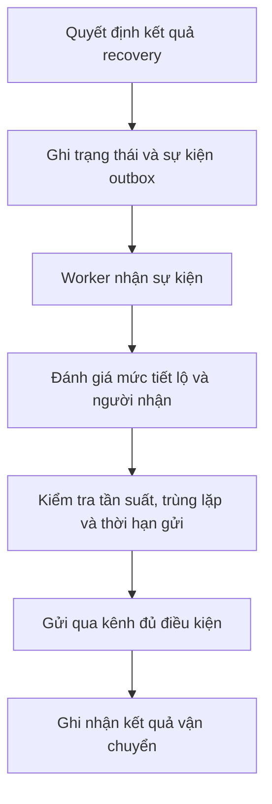

# Recovery failure notification

## 1. Thông báo khôi phục thất bại nhằm mục đích gì?

Thông báo khôi phục tài khoản thất bại giúp người dùng hiểu rằng một bước hoặc một yêu cầu recovery chưa đạt điều kiện hoàn tất, biết hành động tiếp theo phù hợp và nhận ra hoạt động đáng ngờ liên quan đến tài khoản.

Trong luồng khôi phục mật khẩu, MFA, passkey hoặc thiết bị xác thực, “thất bại” có thể mang nhiều ý nghĩa:

- Một mã xác minh không được chấp nhận.
- Challenge đã hết hạn hoặc đã được sử dụng.
- Người dùng chưa cung cấp đủ bằng chứng.
- Yêu cầu không đáp ứng chính sách rủi ro.
- Một bước xác minh thủ công không được phê duyệt.
- Hệ thống tạm thời không thể xử lý.

Những tình huống này không nên dùng chung một thông điệp, cùng mức độ khẩn cấp hoặc cùng cách gửi. Một lỗi mạng tạm thời không phải kết luận rằng người dùng không có quyền khôi phục. Một token bất kỳ không hợp lệ cũng chưa đủ căn cứ để gửi cảnh báo tới chủ tài khoản.

Bài học sử dụng ví dụ: người dùng mất điện thoại chứa ứng dụng MFA, bắt đầu khôi phục tài khoản và gặp thất bại ở bước xác minh bổ sung. Hệ thống phải hướng dẫn được người dùng hợp lệ mà vẫn ngăn kẻ tấn công dò tài khoản, thu thập lý do từ chối hoặc gây ngập thông báo.

## 2. Phân biệt ba lớp thông tin

| Lớp | Người nhận | Mục đích | Mức chi tiết |
| --- | --- | --- | --- |
| Phản hồi trực tiếp | Client đang thực hiện thao tác | Cho biết thao tác hiện tại có tiếp tục được không | Phù hợp mức tin cậy của phiên recovery |
| Thông báo ngoài luồng | Chủ thể qua kênh liên hệ đủ tin cậy | Hướng dẫn hoặc cảnh báo hoạt động liên quan | Giới hạn dữ liệu và không mang quyền khôi phục mới |
| Sự kiện nội bộ | Vận hành, hỗ trợ, điều tra theo phân quyền | Ghi nguyên nhân và diễn biến để xử lý | Chi tiết kỹ thuật được kiểm soát, không chứa secret |

Không chuyển nguyên lỗi nội bộ sang email hoặc giao diện. Các mã như `RISK_DEVICE_REPUTATION_LOW` hay mô tả ngưỡng chống gian lận có thể giúp đối thủ điều chỉnh lần thử tiếp theo.

Ngược lại, không nên chỉ ghi một chuỗi “Có lỗi xảy ra” cho mọi sự kiện nội bộ. Hệ thống cần biết đó là hết hạn, sai bằng chứng, từ chối theo chính sách hay lỗi phụ thuộc để xử lý đúng.

**Nguyên nhân nội bộ, thông điệp công khai và quyết định gửi cảnh báo là ba đầu ra khác nhau của cùng một sự kiện.**

## 3. Xác định rõ thất bại ở cấp nào

### 3.1. Thất bại của một lần thử

Một lần nhập mã sai có thể chỉ làm tăng bộ đếm thất bại. Yêu cầu recovery vẫn đang chờ và còn cách tiếp tục hợp lệ.

Thông điệp phù hợp có thể là:

> Không thể xác minh bằng mã vừa nhập. Hãy kiểm tra mã và làm theo hướng dẫn trên màn hình.

Không gọi yêu cầu là đã bị đóng nếu người dùng vẫn còn được phép tiếp tục. Cũng không hứa rằng người dùng luôn còn lần thử khi chính sách đã có thể giới hạn hoặc tạm dừng bước đó.

### 3.2. Thất bại của một challenge

Một liên kết hết hạn hoặc đã dùng không còn được chấp nhận, nhưng chưa chắc toàn bộ quy trình recovery đã kết thúc. Người dùng có thể được tạo challenge mới theo chính sách.

Không tự phát hành challenge mới chỉ vì hệ thống vừa gửi email thông báo thất bại. Phát hành lại phải đi qua endpoint và biện pháp chống lạm dụng tương ứng.

### 3.3. Yêu cầu recovery bị từ chối hoặc đóng

Đây là kết luận ở cấp yêu cầu. Ví dụ, hồ sơ xác minh không đáp ứng chính sách và không còn bước được phép thực hiện trong yêu cầu đó.

Cần mô tả hành động tiếp theo có thật: bắt đầu lại qua ứng dụng, chờ tới thời điểm được phép hoặc dùng quy trình hỗ trợ đã được công bố. Không dựng một lối hỗ trợ “đặc biệt” có thể bỏ qua các điều kiện xác minh.

### 3.4. Không thể xử lý do lỗi kỹ thuật

Timeout, hệ thống xác minh tạm ngừng hoặc lỗi truyền dữ liệu không tự chứng minh rằng yêu cầu không hợp lệ.

Giao diện có thể cho biết việc xử lý đang gián đoạn và khi nào nên thử lại nếu hệ thống có thông tin đó. Không gửi thư “Khôi phục bị từ chối” cho một quyết định chưa được tạo ra.

## 4. Chống lộ sự tồn tại của tài khoản

Endpoint công khai có thể nhận email hoặc số điện thoại từ bất kỳ ai. Nếu phản hồi hoặc thông báo khác nhau rõ rệt giữa tài khoản tồn tại và không tồn tại, đối thủ có thể dùng luồng recovery để dò danh tính.

Ở giai đoạn chưa chứng minh được quyền đối với tài khoản:

- Dùng thông điệp công khai phù hợp cho các trường hợp cần che giấu sự tồn tại.
- Tránh trả chi tiết về MFA, passkey, kênh liên hệ hoặc trạng thái hồ sơ.
- Tránh khác biệt rõ rệt về mã HTTP, cấu trúc payload, chuyển trang hoặc thời gian xử lý do nhánh tra cứu tài khoản.
- Không hiển thị địa chỉ liên hệ che một phần chỉ vì client đã nhập một username.
- Không cung cấp API công khai để tra cứu trạng thái gửi thông báo theo email.

Ví dụ phản hồi khi bắt đầu recovery:

> Nếu thông tin phù hợp với một tài khoản đủ điều kiện, hướng dẫn sẽ được gửi qua kênh liên hệ đã thiết lập.

Câu này không bảo đảm email chắc chắn được gửi. Chính sách có thể tạm giữ hoặc không gửi do rủi ro, giới hạn tần suất hoặc kênh không còn khả dụng.

Với một phiên recovery đã đạt mức xác minh nhất định, giao diện có thể cung cấp thông tin cụ thể hơn trong phạm vi được phép. Mức tiết lộ phải dựa trên bằng chứng đã có; chỉ biết một recovery ID không mặc nhiên đủ quyền đọc trạng thái tài khoản.

## 5. Khi nào nên gửi thông báo ngoài luồng?

Không cần gửi một cảnh báo cho từng lỗi. Cần đánh giá sự kiện đã được gắn đáng tin cậy với tài khoản chưa, có ý nghĩa với chủ tài khoản không và liệu gửi thông báo có tạo thêm rủi ro không.

| Tình huống | Phản hồi trực tiếp | Thông báo ngoài luồng |
| --- | --- | --- |
| Thông tin nhập không gắn được với tài khoản | Thông điệp công khai phù hợp | Không tự chọn người nhận từ dữ liệu client |
| Token sai định dạng hoặc không tra được | Từ chối chung | Thường chỉ ghi nhận chống lạm dụng |
| Một lần nhập mã sai trong phiên hợp lệ | Hướng dẫn tại bước hiện tại | Thường chưa cần cảnh báo riêng |
| Nhiều lần xác minh thất bại trong yêu cầu đã gắn với tài khoản | Cho biết bước đang bị giới hạn theo chính sách | Có thể cảnh báo hoặc gom nhóm nếu đủ ý nghĩa |
| Yêu cầu hợp lệ đã hết hạn | Hướng dẫn cách bắt đầu lại nếu được phép | Chỉ gửi nếu hữu ích, tránh thư đã lỗi thời |
| Yêu cầu bị từ chối ở cấp hồ sơ | Trạng thái phù hợp với mức xác minh | Có thể gửi kết quả theo chính sách |
| Phụ thuộc kỹ thuật không khả dụng | Thông báo gián đoạn | Không dùng mẫu từ chối quyền khôi phục |

Đây là cách phân loại thiết kế, không phải quy tắc gửi thư cứng cho mọi hệ thống.

Một recovery ID bị giả mạo hoặc một yêu cầu chưa có bằng chứng sở hữu kênh liên hệ không nên trở thành cách gửi email tùy ý tới người khác.

Cảnh báo cho chủ tài khoản có thể cần thiết ngay cả khi người khởi tạo chưa được xác minh. Khi đó, tài khoản phải được xác định từ dữ liệu nội bộ đáng tin cậy, và đường gửi vẫn cần giới hạn chống lạm dụng.

## 6. Chọn kênh và người nhận đáng tin cậy

Người nhận phải được giải quyết từ dữ liệu tài khoản và chính sách hiện hành. Không gửi kết quả recovery nhạy cảm tới một địa chỉ chỉ được người yêu cầu nhập trong chính luồng chưa xác minh.

Cần xem xét từng kênh:

- Email đã xác minh: có thể phù hợp, nhưng chính email đó cũng có thể bị nghi chiếm đoạt.
- Số điện thoại đã đăng ký: có thể không còn khả dụng hoặc đang thuộc tình huống mất thiết bị.
- Push trên thiết bị đã đăng ký: cần cân nhắc thiết bị nào đang bị khai mất hoặc nghi bị chiếm quyền.
- Hộp thông báo trong ứng dụng: phù hợp khi người dùng còn một phiên đáng tin cậy hoặc đã đăng nhập lại an toàn.
- Kênh hỗ trợ: chỉ dùng theo quy trình, không tự trở thành người nhận thay thế.

“Đã xác minh trước đây” là một thuộc tính có ích, không phải bảo đảm kênh hiện tại còn an toàn.

Nếu người dùng đang khôi phục vì mất điện thoại, đừng thiết kế mọi hướng dẫn tiếp theo chỉ xuất hiện trên chiếc điện thoại đó. Tuy nhiên, tính tiện dụng cũng không cho phép đổi sang bất kỳ địa chỉ mới nào mà không xác minh.

Khi thông tin liên hệ thay đổi trong lúc thông báo đang chờ gửi, cần giải quyết lại theo chính sách: gửi tới kênh trước thay đổi, kênh mới đã đủ điều kiện hoặc tạm giữ. Không để notification worker tự chọn “địa chỉ mới nhất” mà không biết ý nghĩa an toàn của thay đổi đó.

## 7. Nội dung tối thiểu và hành động tiếp theo

Một thông báo tốt trả lời được các câu hỏi:

1. Sự kiện nào đã xảy ra?
2. Đây là kết quả tại thời điểm nào?
3. Người nhận cần làm gì nếu chính họ khởi tạo?
4. Người nhận cần làm gì nếu không nhận ra hoạt động?

Có thể bao gồm thời điểm kèm múi giờ hoặc cách hiển thị thời gian rõ ràng, loại yêu cầu và mã tham chiếu hỗ trợ không mang quyền truy cập.

Không đưa vào thông báo:

- Token, OTP, recovery code hoặc URL chứa secret.
- Ảnh giấy tờ, dữ liệu nhận dạng đầy đủ hoặc đáp án xác minh.
- Điểm rủi ro, ngưỡng quyết định hoặc tín hiệu nội bộ chi tiết.
- IP và vị trí được diễn đạt như bằng chứng chắc chắn về người thực hiện.
- Tuyên bố rằng tài khoản đã bị chiếm đoạt chỉ vì một bước recovery thất bại.

Nếu dùng vị trí hoặc thiết bị làm thông tin bổ sung, cần thừa nhận mức chính xác của tín hiệu và tránh nội dung gây hiểu nhầm. Thường thời gian, loại hoạt động và hướng dẫn truy cập ứng dụng chính thức đã đủ hữu ích.

### Mẫu cho yêu cầu đã được gắn với tài khoản

> **Một yêu cầu khôi phục tài khoản chưa được hoàn tất**
>
> Yêu cầu khôi phục MFA vào 09:40 ngày 24/11/2026, giờ Việt Nam, đã không hoàn tất ở bước xác minh.
>
> Nếu bạn thực hiện yêu cầu này, hãy mở ứng dụng hoặc truy cập trang chính thức để xem trạng thái và các bước tiếp theo.
>
> Nếu bạn không nhận ra hoạt động, hãy mở mục Bảo mật từ ứng dụng chính thức để xem hoạt động tài khoản và làm theo hướng dẫn bảo vệ tài khoản.
>
> Bộ phận hỗ trợ không yêu cầu bạn gửi mật khẩu, mã OTP hoặc recovery code qua email.
>
> Mã tham chiếu: RF-7K2M9.

Mẫu này chỉ phù hợp khi hệ thống đã xác định được tài khoản và có các màn hình được nhắc tới. Sản phẩm phải cung cấp đúng hành động mà thông báo hướng dẫn.

Không thêm lời khẳng định “mọi thông tin đăng nhập vẫn an toàn” nếu hệ thống không có căn cứ. Có thể nêu rằng yêu cầu cụ thể chưa hoàn tất, nhưng không suy rộng thành kết luận về mọi hoạt động khác.

## 8. Thông báo không phải một yếu tố xác minh

Nhận được email báo recovery thất bại không chứng minh người nhận có quyền thay MFA hoặc lấy lại session. Nhấp vào mã tham chiếu cũng không được tự đổi trạng thái từ thất bại sang được phê duyệt.

Nếu cần nút hành động:

- Dẫn tới miền chính thức hoặc ứng dụng được nhận diện rõ.
- Bắt đầu từ màn hình yêu cầu mức xác minh phù hợp.
- Không nhúng quyền quản trị recovery vào một URL chỉ dùng cho thông báo.
- Không dùng yêu cầu GET để tạo thay đổi nhạy cảm.
- Không cho phép hỗ trợ bỏ qua xác minh chỉ vì người yêu cầu đọc được nội dung thư.

Một nút “Không phải tôi” cũng là một thao tác cần thiết kế rõ. Không để trình quét liên kết của nhà cung cấp email tự kích hoạt khóa tài khoản hoặc hủy yêu cầu hợp lệ chỉ bằng việc mở URL. Thay đổi trạng thái cần bước xác nhận và bảo vệ phù hợp.

Thông báo và bằng chứng xác minh nên là hai khái niệm tách biệt ngay cả khi cùng sử dụng email làm kênh vận chuyển.

## 9. Tách kết quả recovery khỏi kết quả gửi thông báo

Hai trạng thái sau không tương đương:

```text
recovery_outcome = FAILED
notification_delivery = RETRY_PENDING
```

Thất bại gửi thư không được làm yêu cầu recovery tự chuyển thành thành công, cũng không được đảo ngược một quyết định từ chối đã commit.

Mô hình dữ liệu khái niệm:

```text
RecoveryOutcomeEvent
  event_id
  tenant_id
  subject_id
  recovery_id
  outcome_kind
  occurred_at
  state_version
  internal_reason_code
  public_message_category

NotificationIntent
  intent_id
  event_id
  recipient_policy
  channel_policy
  template_id
  template_version
  locale
  not_after
  delivery_state
  attempt_count
```

Dữ liệu vận chuyển chỉ chứa những trường cần thiết. Worker gửi email không cần quyền đọc hồ sơ bằng chứng xác minh hoặc mọi chi tiết rủi ro.

Không dùng địa chỉ người nhận làm định danh công khai của job. Nếu phải giữ thông tin liên hệ trong hàng đợi để bảo đảm ý nghĩa tại thời điểm phát hành, cần giới hạn quyền đọc, bảo vệ dữ liệu và áp dụng vòng đời rõ ràng.

## 10. Ghi nhận sự kiện và gửi bằng outbox

Một tình huống thường gặp:

```text
Giao dịch recovery đã commit kết quả thất bại
→ tiến trình dừng trước khi gọi dịch vụ email
→ người dùng không nhận được thông báo dự kiến
```

Có thể dùng transactional outbox để lưu ý định xử lý thông báo cùng giao dịch thay đổi trạng thái. Sau đó một worker giải quyết chính sách và chuyển thông báo sang hệ thống gửi.



Pseudocode minh họa:

```text
recordRecoveryFailure(recovery, failure):
    transaction:
        persistAppropriateOutcome(recovery, failure)
        appendOutboxOnce(
            eventId = newStableEventId(),
            scope = recovery.trustedScope,
            outcome = failure.category,
            stateVersion = recovery.version
        )

handleFailureEvent(event):
    require trustedEventSource(event)

    decision = notificationPolicy.evaluate(event)
    if decision == SUPPRESS:
        recordSuppression(event, decision.reason)
        return

    recipient = resolveEligibleRecipient(event.scope, decision)
    if recipient is unavailable:
        recordUndeliverableIntent(event)
        return

    intent = getOrCreateIntent(
        eventId = event.id,
        channel = decision.channel,
        recipientBinding = recipient.binding
    )

    if intent already reached terminal handling:
        return

    if event is obsolete or now exceeds intent.notAfter:
        markSuppressed(intent, OBSOLETE)
        return

    scheduleOrSendAccordingToQuota(intent)
```

Mỗi sự kiện phải có ID ổn định khi retry. Không tạo ID mới ở mỗi lần đọc lại cùng một outbox event.

Outbox bảo vệ việc lưu ý định; nó không tự bảo đảm người dùng đã nhận hoặc đọc thông báo. Gửi tới nhà cung cấp thành công cũng chỉ chứng minh được mức chấp nhận mà nhà cung cấp thực sự báo cáo.

## 11. Chống gửi trùng, gửi quá nhiều và cảnh báo lỗi thời

### 11.1. Idempotency không thay thế giới hạn tần suất

Idempotency ngăn xử lý lặp một sự kiện. Nhưng một kẻ tấn công có thể tạo nhiều sự kiện khác nhau cho cùng tài khoản.

Cần hai lớp độc lập:

- Khóa chống trùng theo sự kiện, kênh và ràng buộc người nhận.
- Chính sách tần suất theo tài khoản, tenant, nguồn phát sinh và loại cảnh báo.

Với nhiều lỗi nhỏ gần nhau, có thể gom thành một cảnh báo có cửa sổ thời gian thay vì gửi từng lần. Cảnh báo có ý nghĩa an toàn cao hơn cần chính sách ưu tiên riêng; không để thư ít giá trị chiếm hết quota.

Thông báo thất bại cũng không được trở thành cách khóa người dùng khỏi việc nhận một hướng dẫn hợp lệ bằng cách cố ý làm đầy hạn mức.

### 11.2. Retry có giới hạn

Phân biệt lỗi tạm thời, lỗi vĩnh viễn và kết quả chưa xác định. Retry lỗi tạm thời có backoff, độ lệch ngẫu nhiên và hạn chót. Với địa chỉ không thể nhận, không lặp vô hạn hoặc tự đổi sang một địa chỉ chưa xác minh.

Nếu nhà cung cấp đã nhận thư nhưng phản hồi bị mất, gửi lại có thể gây trùng. Idempotency key của nhà cung cấp, nếu có, hỗ trợ giảm rủi ro; vẫn cần mô hình kết quả chưa xác định và nội dung chịu được việc nhận lặp.

Không khẳng định “exactly once tới hộp thư” chỉ từ một unique constraint trong cơ sở dữ liệu nội bộ.

### 11.3. Thông báo phải phù hợp thời điểm

Yêu cầu có thể đã thành công hoặc được thay thế trước khi một thư thất bại được retry. Cần quy tắc bỏ, gộp hoặc diễn đạt lại các thông báo lỗi thời.

Kiểm tra trạng thái ngay trước gửi giúp giảm thư sai ngữ cảnh nhưng không loại bỏ mọi race với thay đổi vừa xảy ra. Nội dung nên mô tả sự kiện tại thời điểm cụ thể và dẫn người dùng tới trạng thái hiện tại trong ứng dụng.

Không gửi nhiều giờ sau một câu như “Tài khoản hiện đang bị khóa” nếu chỉ biết rằng nó từng bị giới hạn khi sự kiện được tạo.

## 12. Hướng dẫn khi người dùng không nhận ra hoạt động

Cảnh báo cần hữu ích nhưng không gây hoảng loạn. Một lần recovery thất bại có thể xuất phát từ lỗi nhập, thiết bị cũ hoặc nỗ lực dò tài khoản.

Hướng dẫn nên gắn với khả năng thực tế:

- Nếu còn đăng nhập trên thiết bị đáng tin cậy, xem hoạt động và session trong mục Bảo mật.
- Nếu nghi email bị chiếm quyền, bảo vệ kênh email theo quy trình của nhà cung cấp trước khi dựa vào nó để recovery.
- Nếu đã mất mọi yếu tố xác thực, dùng quy trình recovery hoặc hỗ trợ chính thức.
- Không trả lời email kèm mật khẩu, OTP, passkey hoặc recovery code.
- Không gọi số điện thoại lạ hay chuyển tiền theo nội dung một thông báo tự xưng là hỗ trợ.

Đổi mật khẩu có thể là một bước phù hợp trong một số tình huống, nhưng không giải quyết mọi rủi ro MFA, passkey và session. Thông báo không nên hứa rằng chỉ đổi mật khẩu sẽ vô hiệu hóa mọi quyền truy cập trước đó.

Việc khóa tài khoản hay thu hồi session phải do chính sách an toàn quyết định. Không tự thực hiện các thay đổi đó chỉ vì một email báo lỗi đã được tạo.

## 13. Quan sát vận hành mà không lộ dữ liệu

Các chỉ số hữu ích gồm:

| Chỉ số | Câu hỏi được trả lời |
| --- | --- |
| Số sự kiện thất bại theo nhóm nguyên nhân | Có tăng bất thường ở một bước recovery không? |
| Số thông báo bị gom hoặc chặn theo chính sách | Có chiến dịch gây ngập cảnh báo không? |
| Độ trễ từ sự kiện tới lần gửi đầu | Cảnh báo còn kịp thời không? |
| Số lỗi gửi theo loại kênh | Kênh nào đang gặp sự cố? |
| Số retry và ý định quá hạn | Hàng đợi có đang tích tụ không? |
| Số thông báo bị loại do lỗi thời | Nội dung có theo kịp thay đổi trạng thái không? |

Không đưa email, số điện thoại hoặc recovery ID vào nhãn metric có số lượng giá trị lớn. Dùng mã tương quan nội bộ có phân quyền khi cần điều tra một trường hợp cụ thể.

Log không chứa token, mã xác minh, nội dung giấy tờ hoặc toàn bộ payload nhạy cảm. Webhook của nhà cung cấp phải được xác thực, xử lý lặp an toàn và chỉ cập nhật trạng thái vận chuyển; nó không có quyền thay kết quả recovery.

Hỗ trợ nên tra được sự kiện từ mã tham chiếu theo quyền được cấp. Mã đó không phải bằng chứng danh tính và không cho phép tra cứu hồ sơ trên endpoint công khai.

## 14. Ví dụ xuyên suốt

Người dùng mất điện thoại chứa MFA, bắt đầu recovery và nhập sai mã xác minh bổ sung.

1. Lần nhập sai đầu tiên được phản hồi tại giao diện. Hệ thống ghi nhận số lần thử nhưng không lập tức gửi thư cảnh báo riêng.
2. Các lần thử tiếp theo khiến bước xác minh bị tạm giới hạn theo chính sách. Yêu cầu đã gắn với tài khoản từ dữ liệu tin cậy.
3. Hệ thống ghi sự kiện tương ứng và đánh giá cần gửi một cảnh báo đã gom nhóm.
4. Kênh nhận được chọn theo trạng thái tin cậy hiện hành, không dùng địa chỉ mới do người yêu cầu tự nhập.
5. Nội dung nêu rằng một bước xác minh đã không hoàn tất, kèm thời điểm và cách mở ứng dụng chính thức.
6. Nhà cung cấp email tạm thời lỗi. Recovery vẫn giữ kết quả của nó; ý định thông báo được retry có hạn.
7. Trước lần retry, người dùng hoàn tất một yêu cầu thay thế hợp lệ. Hệ thống áp dụng quy tắc loại hoặc điều chỉnh thông báo cũ.
8. Người nhận xem trạng thái hiện tại trong ứng dụng. Nội dung thư không cho phép bỏ qua xác minh hoặc tạo session mới.

Ví dụ cho thấy quyết định recovery, quyết định cảnh báo và kết quả gửi là ba tiến trình liên quan nhưng có trạng thái riêng.

## 15. Những sai lầm thường gặp

**Gửi thư cho mọi token sai.** Token không gắn được với tài khoản không tạo căn cứ chọn người nhận; các lần thử có thể được dùng để gây ngập cảnh báo.

**Hiển thị lý do rủi ro chi tiết.** Người dùng cần hành động tiếp theo phù hợp, còn quy tắc chống gian lận cần được giữ trong hệ thống có phân quyền.

**Gửi tới email mới chưa xác minh.** Điều này có thể làm lộ trạng thái hoặc bằng chứng của tài khoản cho chính người đang tìm cách chiếm đoạt.

**Dùng trạng thái gửi thư làm trạng thái recovery.** Email lỗi không chứng minh recovery thất bại về mặt xác minh; email gửi thành công cũng không chứng minh người nhận có quyền khôi phục.

**Coi nhấp liên kết là xác nhận hành động nhạy cảm.** Trình quét liên kết có thể truy cập URL trước người dùng; hành động cần có bước và quyền phù hợp.

**Retry không xét tuổi sự kiện.** Một cảnh báo từng đúng có thể gây hiểu nhầm khi đến muộn.

**Hứa rằng tài khoản chắc chắn an toàn.** Kết quả của một yêu cầu recovery không đủ để kết luận về mọi session, credential và kênh liên hệ.

Thông báo khôi phục thất bại cần cung cấp đúng lượng thông tin cho đúng người nhận, hướng dẫn được bước tiếp theo có thật và giữ nguyên các ranh giới xác minh của luồng recovery.
