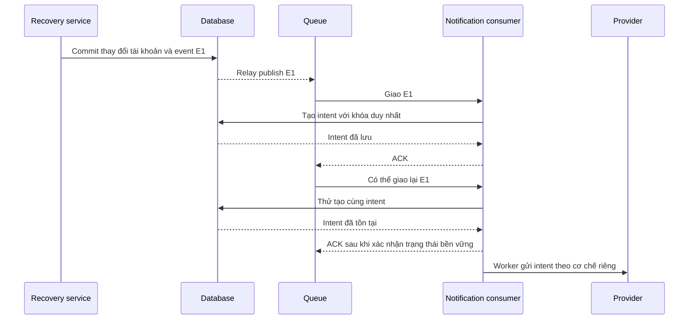

# Notification deduplication — Chống gửi trùng thông báo khôi phục tài khoản

Một yêu cầu khôi phục tài khoản có thể tạo email chứa liên kết đặt lại mật khẩu, SMS xác minh, thông báo thay đổi MFA hoặc cảnh báo passkey mới được đăng ký. Trên đường từ transaction nghiệp vụ đến hộp thư người dùng, cùng một sự kiện có thể bị chuyển nhiều lần do retry, lỗi mạng, consumer khởi động lại hoặc tác vụ được giao cho nhiều worker.

**Notification deduplication là nhận diện những lần xử lý thuộc cùng một ý định gửi, rồi ngăn chúng tạo thêm tác dụng gửi ngoài chủ đích.** Cơ chế này phải giữ được các cảnh báo an ninh độc lập và các yêu cầu recovery mới hợp lệ.

Bài học trình bày một thiết kế minh họa cho account recovery. Các khóa, trạng thái và bảng SQL bên dưới là lựa chọn kiến trúc cần điều chỉnh theo hợp đồng queue, nhà cung cấp và chính sách recovery của hệ thống; chúng không phải một tiêu chuẩn bắt buộc chung.

## 1. Một bản tin có thể bị lặp ở đâu?

Xét sự kiện `PASSWORD_RESET_COMPLETED` đã được ghi nhận sau khi đổi mật khẩu thành công:

```text
Transaction recovery
    → outbox
    → queue
    → notification consumer
    → email/SMS provider
    → người nhận
```

Một số tình huống tạo xử lý lặp:

| Điểm phát sinh | Tình huống | Điều cần nhận diện |
| --- | --- | --- |
| API recovery | Client retry vì không nhận được phản hồi | Có phải cùng một lệnh nghiệp vụ đã thực hiện? |
| Outbox relay | Đã publish nhưng chưa ghi nhận publish thành công | Có phải cùng một domain event? |
| Queue | Consumer chưa ACK trước khi ngừng hoạt động | Có phải cùng một bản tin được giao lại? |
| Notification worker | Lease hết hạn khi worker cũ vẫn đang chạy | Có phải hai tiến trình cùng gửi một notification? |
| Provider API | Provider đã nhận, nhưng phản hồi bị mất | Có phải retry của cùng một lần gửi logic? |
| Webhook provider | Callback trạng thái được chuyển nhiều lần | Có phải cùng một sự kiện giao nhận? |

Không có một khóa duy nhất tự giải quyết mọi lớp. Cần phân biệt định danh lệnh nghiệp vụ, sự kiện, ý định gửi, lần thử gửi và callback.

Ví dụ, hai message queue khác nhau cùng mang `event_id=E1` vẫn có thể là bản sao của cùng sự kiện. Nếu dùng message ID do queue gán làm khóa chống trùng nghiệp vụ, hệ thống có thể gửi hai email.

## 2. Xác định chính xác “cùng một thông báo”

Một **notification intent** là ý định gửi một nội dung phục vụ một mục đích, đến một người nhận đã xác định, qua một kênh đã được chính sách cho phép.

Trong thiết kế minh họa, danh tính của intent gồm:

```text
tenant_id
+ event_id
+ notification_kind
+ recipient_snapshot_id
+ channel
```

Ý nghĩa của các thành phần:

- `tenant_id`: phân tách phạm vi tổ chức.
- `event_id`: định danh ổn định của sự kiện nghiệp vụ đã phát sinh.
- `notification_kind`: phân biệt mục đích như gửi liên kết recovery hay cảnh báo thay đổi credential.
- `recipient_snapshot_id`: định danh nội bộ của đích nhận và vai trò người nhận đã được chốt.
- `channel`: email, SMS hoặc push theo chính sách.

`recipient_snapshot_id` không phải một UUID được tạo lại tùy ý ở mỗi lần consumer nhận message. Snapshot hoặc phép ánh xạ đến snapshot phải được xác định một lần, lưu bền vững và dùng lại khi xử lý lặp.

### Những trường hợp cần tách riêng

| Tình huống | Xử lý phù hợp |
| --- | --- |
| Queue giao lại cùng event, cùng mục đích, cùng đích và kênh | Dùng lại intent hiện có |
| Một event được phép cảnh báo cả email và push | Hai intent riêng theo kênh |
| Chính sách yêu cầu cảnh báo địa chỉ cũ và địa chỉ mới | Hai intent riêng theo người nhận/vai trò |
| Người dùng tạo yêu cầu recovery mới đã được cho phép | Event mới; không bị khóa cũ chặn nhầm |
| Một quy trình vừa đổi mật khẩu vừa thay MFA | Các mục đích cảnh báo riêng theo sự kiện thực tế |
| Deploy phiên bản template mới khi intent cũ đang retry | Không tự tạo thêm một intent |

Khóa chỉ gồm `account_id + ngày` thường quá rộng: một email đầu ngày có thể làm mất cảnh báo thay MFA cuối ngày. Khóa ngẫu nhiên cho từng retry lại quá hẹp: mọi retry đều được coi là thông báo mới.

## 3. Phân biệt deduplication, idempotency và giới hạn tần suất

| Cơ chế | Câu hỏi được giải quyết | Ví dụ |
| --- | --- | --- |
| Deduplication | Những lần nhận này có cùng danh tính logic không? | Hai message cùng event E1 |
| Idempotent processing | Xử lý lại có tạo thêm tác dụng nghiệp vụ ngoài dự kiến không? | Chỉ có một intent cho E1 và cùng đích |
| Rate limiting | Có cho phép phát sinh thêm yêu cầu trong cửa sổ này không? | Hạn chế số lần yêu cầu gửi recovery |
| Coalescing | Có chủ đích gộp nhiều sự kiện khác nhau không? | Tổng hợp một số cảnh báo ít nghiêm trọng |
| Debouncing | Có trì hoãn để đợi một chuỗi thay đổi lắng xuống không? | Chỉ gửi sau khi kết thúc một đợt thay đổi được phép |

Deduplication không ngăn được kẻ tấn công tạo hàng trăm yêu cầu có event ID khác nhau. Chống lạm dụng cần nằm ở bước nhận yêu cầu, cấp challenge và quyết định gửi.

Ngược lại, giới hạn tần suất không chứng minh một retry là bản sao. Hai yêu cầu giống nhau trong một phút có thể là hai sự kiện nghiệp vụ khác nhau.

OWASP khuyến nghị chống gửi yêu cầu quên mật khẩu tự động quá mức, đồng thời giữ phản hồi nhất quán để tránh dò tìm tài khoản. Việc thông báo bị dedup, bị hạn chế hay được xếp hàng không nên trở thành một tín hiệu công khai về tài khoản có tồn tại hay không. [OWASP Forgot Password Cheat Sheet](https://cheatsheetseries.owasp.org/cheatsheets/Forgot_Password_Cheat_Sheet.html)

Với cảnh báo nhạy cảm như đổi mật khẩu, xóa MFA hoặc thay phương thức recovery, chỉ gộp sự kiện khi có chính sách rõ ràng. Không tự áp dụng cơ chế gộp dành cho thông báo quảng bá vào cảnh báo an ninh.

## 4. Giữ định danh ổn định từ nguồn phát sinh

Nếu cùng một lệnh API được thực hiện lại và mỗi lần đều tạo một event ID mới, notification consumer không thể biết đó là bản sao bằng cách chỉ nhìn event ID.

Cần xử lý theo thứ tự:

1. Xác định phạm vi idempotency của lệnh recovery nếu endpoint hỗ trợ.
2. Ghi nhận kết quả nghiệp vụ và domain event ổn định.
3. Từ event đó tạo các notification intent theo chính sách.
4. Khi gửi lại cùng intent, giữ nguyên danh tính và dữ liệu gửi.

Client có thể cung cấp khóa idempotency ở một API được thiết kế cho việc đó, nhưng backend phải ràng buộc khóa với phạm vi caller, thao tác và nội dung lệnh. Không cho một khóa tùy ý từ client trực tiếp chiếm chỗ khóa cảnh báo của tài khoản khác.

Không dùng các giá trị sau làm danh tính intent:

- Thời gian hiện tại được tính lại trong consumer.
- Trace ID thay đổi theo từng request.
- Số lần retry hoặc worker ID.
- Nội dung HTML sau khi render.
- Token recovery, OTP hoặc URL chứa token.
- Địa chỉ email nguyên bản ghép vào khóa công khai.

Nếu cần mã hóa khóa thành một chuỗi ngắn, có thể dùng định danh notification đã lưu bền vững hoặc giá trị dẫn xuất từ cấu trúc chuẩn hóa. HMAC có thể hỗ trợ che giấu các thành phần nhạy cảm, nhưng phải có quy tắc phiên bản và quản lý khóa; thay khóa HMAC không được làm mọi intent cũ biến thành thông báo mới.

## 5. Outbox giữ ý định gửi cùng transaction nghiệp vụ

Có hai lỗi đối xứng khi cập nhật tài khoản và gửi thông báo bằng hai thao tác độc lập:

```text
Đổi mật khẩu đã commit → tiến trình dừng trước khi tạo thông báo
Thông báo đã gửi      → transaction đổi mật khẩu rollback
```

Transactional outbox giải quyết khoảng trống ghi vào hai hệ thống bằng cách lưu thay đổi nghiệp vụ và sự kiện outbox trong cùng transaction cơ sở dữ liệu. Relay xử lý các sự kiện đã commit sau đó. Relay vẫn có thể publish lặp, nên consumer cần xử lý idempotent. [AWS Prescriptive Guidance: Transactional outbox pattern](https://docs.aws.amazon.com/prescriptive-guidance/latest/cloud-design-patterns/transactional-outbox.html)

Một luồng minh họa:



ACK sau khi intent đã được lưu bền vững. Nếu transaction tạo intent thất bại, không ACK như thể công việc đã hoàn tất.

Consumer nhận event và worker gửi ra provider có thể là hai thành phần khác nhau. Bản tin giao lặp không được gọi provider trực tiếp chỉ vì consumer không vừa tạo được một hàng mới.

Không đánh dấu event đã xử lý trong một transaction rồi tạo intent ở transaction khác mà không có cơ chế bảo đảm phần sau sẽ được thực hiện. Cách đó có thể làm mất thông báo sau một lần dừng giữa chừng.

## 6. Ràng buộc duy nhất là điểm phân xử khi có cạnh tranh

Một phép kiểm tra trong bộ nhớ hoặc `SELECT` trước `INSERT` không đủ nếu hai consumer chạy đồng thời.

```text
Consumer A: chưa thấy intent
Consumer B: chưa thấy intent
Consumer A: tạo intent
Consumer B: cũng tạo intent
```

Bảng PostgreSQL dưới đây minh họa phần lưu intent. Thông tin đích nhận và payload được tham chiếu đến kho dữ liệu được bảo vệ riêng.

```sql
CREATE TABLE recovery_notification (
    tenant_id             uuid        NOT NULL,
    id                    uuid        NOT NULL,
    event_id              uuid        NOT NULL,
    notification_kind     text        NOT NULL,
    recipient_snapshot_id uuid        NOT NULL,
    channel               text        NOT NULL
                                      CHECK (channel IN ('EMAIL', 'SMS', 'PUSH')),
    payload_ref           uuid        NOT NULL,
    payload_fingerprint   bytea       NOT NULL,
    status                text        NOT NULL DEFAULT 'QUEUED'
                                      CHECK (status IN (
                                          'QUEUED', 'SENDING', 'RETRY_WAIT',
                                          'UNKNOWN', 'ACCEPTED',
                                          'CANCELLED', 'FAILED'
                                      )),
    send_before           timestamptz NOT NULL,
    next_attempt_at       timestamptz NOT NULL,
    lease_owner           uuid,
    lease_until           timestamptz,
    fence                 bigint      NOT NULL DEFAULT 0,
    provider_message_id   text,
    created_at            timestamptz NOT NULL DEFAULT CURRENT_TIMESTAMP,
    dedupe_retain_until   timestamptz NOT NULL,

    PRIMARY KEY (tenant_id, id),

    UNIQUE (
        tenant_id,
        event_id,
        notification_kind,
        recipient_snapshot_id,
        channel
    )
);
```

Lệnh tạo intent:

```sql
INSERT INTO recovery_notification (
    tenant_id, id, event_id, notification_kind,
    recipient_snapshot_id, channel,
    payload_ref, payload_fingerprint,
    send_before, next_attempt_at, dedupe_retain_until
)
VALUES (
    :tenant_id, :notification_id, :event_id, :notification_kind,
    :recipient_snapshot_id, :channel,
    :payload_ref, :payload_fingerprint,
    :send_before, :next_attempt_at, :dedupe_retain_until
)
ON CONFLICT (
    tenant_id, event_id, notification_kind,
    recipient_snapshot_id, channel
)
DO NOTHING
RETURNING id;
```

Các tham số `:` là giá trị bind. `ON CONFLICT ... DO NOTHING` xử lý xung đột của ràng buộc được chỉ rõ; `RETURNING` trả về hàng đã thực sự được thêm. [PostgreSQL: INSERT](https://www.postgresql.org/docs/16/sql-insert.html)

Nếu không nhận được ID mới, consumer đọc intent hiện có theo cùng khóa nghiệp vụ và đối chiếu dữ liệu bất biến. Trong mức cô lập READ COMMITTED, có thể thực hiện phép đọc ở câu lệnh kế tiếp để có snapshot mới; nếu vẫn không tìm thấy hàng, cần xử lý cạnh tranh hoặc lỗi dữ liệu, không giả định thông báo đã được gửi.

`payload_fingerprint` hỗ trợ phát hiện cùng khóa nhưng payload khác. Nó không thay thế khóa nghiệp vụ. Fingerprint phải được tính trên biểu diễn ổn định của dữ liệu cần giữ nguyên, không bao gồm trường ngẫu nhiên của từng retry. Không đưa OTP ít entropy vào một hash công khai có thể bị dò ngược.

Khi cùng khóa nhưng đích nhận, nội dung hoặc ý nghĩa sự kiện mâu thuẫn, đưa công việc vào luồng xử lý lỗi và phát tín hiệu vận hành. Không âm thầm sửa payload của intent đã gửi, cũng không đổi khóa chỉ để bỏ qua xung đột.

## 7. Tách intent, attempt và kết quả giao nhận

Một intent có thể có nhiều lần thử gửi:

```text
Notification N1
    attempt A1: timeout, chưa biết provider đã nhận chưa
    attempt A2: truy vấn/ retry cùng khóa theo hợp đồng provider
    kết quả: provider chấp nhận, message ID P1
```

`attempt_id` dùng để theo dõi từng lần gọi. Nó không được thay thế notification ID trong khóa idempotency gửi ra provider.

Các trạng thái trong bảng minh họa:

| Trạng thái | Ý nghĩa |
| --- | --- |
| QUEUED | Ý định gửi đã lưu, chưa được worker nhận |
| SENDING | Một worker đang giữ quyền xử lý có thời hạn |
| RETRY_WAIT | Được phép thử lại sau một lỗi đã phân loại |
| UNKNOWN | Chưa biết lần gọi trước đã tạo tác dụng ở provider hay chưa |
| ACCEPTED | Provider đã chấp nhận yêu cầu theo hợp đồng API |
| CANCELLED | Chính sách không còn cho phép gửi intent này |
| FAILED | Đã kết thúc xử lý thất bại theo chính sách |

`ACCEPTED` không có nghĩa người nhận đã nhận, đã đọc hay đã chứng minh danh tính. Kết quả delivered, bounced hoặc complained nên được lưu riêng theo mô hình callback của provider.

Một notification bị dedup cũng không có nghĩa event nghiệp vụ bị hủy. Việc đặt lại mật khẩu, thu hồi session hoặc đăng ký passkey phải được quyết định bởi transaction recovery và bằng chứng xác thực phù hợp.

## 8. Khoảng trống khó nhất: provider đã nhận nhưng worker không biết

Tình huống:

```text
Worker → provider: gửi email N1
Provider: chấp nhận và tạo P1
Mạng: làm mất phản hồi
Worker: timeout
```

Nếu gửi lại bằng khóa mới, người dùng có thể nhận thêm email. Nếu coi timeout là đã thành công, hệ thống có thể bỏ mất thông báo trong trường hợp provider chưa nhận được gì.

Không thể giải quyết khoảng trống này chỉ bằng một cột `sent=true`:

- Ghi `sent=true` trước khi gọi có nguy cơ mất thông báo.
- Ghi sau khi gọi có nguy cơ gọi lại khi tiến trình dừng trước khi ghi.
- Giữ transaction cơ sở dữ liệu mở trong lúc gọi mạng không làm hai hệ thống có chung một transaction nguyên tử.

Cách xử lý cần dựa trên khả năng của provider:

1. Lưu khóa idempotency của intent trước lần gọi đầu tiên.
2. Giữ nguyên phạm vi tài khoản provider, khóa và payload khi retry.
3. Nếu provider hỗ trợ tra cứu kết quả, thực hiện đối soát theo hợp đồng của API.
4. Khi chưa kết luận được, lưu trạng thái UNKNOWN cùng dấu vết attempt.
5. Áp dụng chính sách retry, đối soát hoặc chuyển xử lý theo mức quan trọng của thông báo.

Một kết quả “không tìm thấy” từ API tra cứu chưa chắc chứng minh provider chưa nhận nếu API có độ trễ nhất quán. Cần hiểu rõ ý nghĩa của phản hồi đó.

Ví dụ cụ thể, tài liệu Resend mô tả khóa idempotency được giữ trong 24 giờ và việc gửi lại cùng yêu cầu trong cửa sổ này có thể nhận lại phản hồi mà không gửi thêm email. Đây là hợp đồng của nhà cung cấp đó tại tài liệu tham chiếu, không phải bảo đảm áp dụng cho mọi dịch vụ email/SMS. [Resend: Idempotency Keys](https://resend.com/docs/dashboard/emails/idempotency-keys)

Khi cửa sổ của provider đã hết, retry không còn được bảo vệ bằng cùng bảo đảm cũ. Không đổi khóa hoặc chuyển provider một cách tự động rồi vẫn tuyên bố chỉ có một lần gửi.

## 9. Lease và fencing bảo vệ worker trong phạm vi nào?

Ràng buộc duy nhất ngăn tạo hai intent, nhưng một intent vẫn có thể bị hai worker gửi đồng thời nếu cơ chế nhận việc không đúng.

Một quy trình nhận việc có thể là:

```text
Transaction ngắn:
    chọn một intent được phép gửi
    lấy khóa dòng
    đặt status = SENDING
    gán lease_owner và lease_until
    tăng fence
    commit

Ngoài transaction:
    kiểm tra quyền xử lý còn hiệu lực
    kiểm tra điều kiện gửi
    gọi provider bằng khóa idempotency đã lưu

Transaction ngắn:
    cập nhật kết quả
    chỉ khi lease_owner và fence còn khớp
```

Ví dụ điều kiện ghi nhận kết quả:

```sql
UPDATE recovery_notification
SET status = 'ACCEPTED',
    provider_message_id = :provider_message_id,
    lease_owner = NULL,
    lease_until = NULL
WHERE tenant_id = :tenant_id
  AND id = :notification_id
  AND status = 'SENDING'
  AND lease_owner = :worker_id
  AND fence = :claimed_fence;
```

Nếu không cập nhật được dòng nào, worker cũ đã mất quyền ghi trạng thái. Không được ghi đè kết quả của worker đang sở hữu công việc.

Tuy nhiên, fencing ở cơ sở dữ liệu không ngăn tuyệt đối worker cũ gọi provider: tiến trình có thể bị tạm dừng sau khi kiểm tra lease rồi tiếp tục gửi khi lease đã hết. Khóa idempotency ở provider và chính sách xử lý kết quả không rõ vẫn cần thiết.

Khi một lease hết hạn, cần xem xét attempt trước đó. Không mặc định “hết lease nghĩa là chưa gửi”, cũng không coi mọi intent SENDING cũ là được retry ngay bằng một khóa mới.

## 10. Retry không được thay đổi nội dung quyền recovery

Thông báo chứa liên kết hoặc OTP mang dữ liệu nhạy cảm và có giới hạn thời gian. Retry việc vận chuyển không phải là một lệnh cấp thêm quyền khôi phục tài khoản.

Trước khi gửi một intent chứa bằng chứng recovery, cần kiểm tra theo thiết kế:

- Challenge còn được phép sử dụng.
- Generation của challenge vẫn là generation hiện hành.
- Phiên hoặc quy trình recovery chưa bị hủy hay hoàn tất theo cách làm thông báo trở nên không còn phù hợp.
- Chưa quá `send_before`.
- Người nhận và kênh vẫn được chính sách cho phép đối với mục đích đó.

Không gia hạn token, tạo OTP mới hoặc tạo recovery session mới trong notification worker chỉ để retry gửi. Nếu cần cấp một challenge mới, đó là một quyết định nghiệp vụ riêng, có kiểm soát lạm dụng và event mới.

Giả sử yêu cầu R1 tạo challenge C1, sau đó người dùng yêu cầu lại và chính sách thay thế C1 bằng C2. Bản tin C1 bị chậm trong queue phải được xử lý theo trạng thái/generation của C1. Deduplication không tự biết C1 đã bị thay thế.

Đối với cảnh báo “MFA vừa bị thay đổi”, một yêu cầu recovery mới không nhất thiết làm cảnh báo cũ mất giá trị. Quy tắc hủy thông báo chứa token không nên được áp dụng máy móc cho cảnh báo về sự kiện an ninh đã xảy ra.

Nếu payload cần giữ một token để gửi bất đồng bộ, bảo vệ payload bằng mã hóa và kiểm soát truy cập phù hợp, hạn chế thời gian lưu và xóa phần bí mật khi không còn cần. Chỉ lưu hash kiểm chứng trong bảng challenge không làm mọi bản sao token trong outbox hay payload trở nên an toàn.

## 11. Người nhận, template và failover phải có quy tắc ổn định

### Người nhận là một quyết định có ngữ cảnh

Không tra lại “email hiện tại của tài khoản” một cách tùy tiện ở mỗi retry. Trong thời gian đó, địa chỉ có thể đã thay đổi, thậm chí do kẻ tấn công.

Intent cần tham chiếu đến đích nhận được chọn theo sự kiện và vai trò. Tuy vậy, lưu snapshot không có nghĩa luôn gửi bất chấp mọi thay đổi sau đó: chính sách có thể yêu cầu hủy khi phát hiện đích nhận bị thu hồi hoặc không còn được tin cậy.

Nếu đích phải thay đổi, ghi nhận quyết định điều hướng mới. Không dùng cùng một khóa provider cho hai payload/người nhận khác nhau.

### Template không được làm retry biến thành bản tin mới

Chốt template, locale và dữ liệu render cần thiết cho intent theo thiết kế. Dữ liệu gửi cần ổn định khi retry với cùng khóa provider.

Không tự thêm `template_version` vào danh tính intent rồi gửi lại toàn bộ sự kiện cũ sau mỗi lần deploy. Nếu có nhu cầu gửi một thông báo đính chính, tạo một loại thông báo hoặc sự kiện nghiệp vụ rõ ràng.

Tránh chèn thời điểm render hiện tại vào payload khiến các lần retry cùng khóa có nội dung khác nhau. Thời gian hiển thị thường nên lấy từ sự kiện hoặc dữ liệu đã chốt.

### Failover có thể làm mất phạm vi chống trùng

Provider B thường không biết provider A đã nhận N1 hay chưa. Chuyển nhà cung cấp sau timeout có thể tạo hai lần gửi thực tế.

Việc chuyển kênh cũng cần chính sách: gửi email rồi push theo kế hoạch là hai intent hợp lệ; tạo SMS sau một kết quả email UNKNOWN là một quyết định escalation có rủi ro khác.

Cần ghi nhận tuyến gửi, lý do chuyển, kết quả đã biết và khả năng trùng. Không coi cùng một chuỗi khóa ở hai nhà cung cấp là một bảo đảm chống trùng chung.

## 12. Callback cũng cần được xử lý idempotent

Provider có thể gửi lại webhook `delivered` hoặc `bounced`. Nếu mỗi callback đều tăng bộ đếm, gửi cảnh báo mới hoặc kích hoạt failover, trùng lặp lại xuất hiện ở đầu ra.

Một danh tính callback có thể gồm:

```text
provider_account
+ provider_webhook_event_id
```

Nếu hệ thống có nhiều tenant hoặc tuyến provider, ánh xạ callback đến phạm vi nội bộ bằng dữ liệu đã được xác thực, không tin tenant ID do nội dung không tin cậy tự khai báo.

Quy trình minh họa:

1. Xác minh tính xác thực và các điều kiện chống phát lại của webhook theo hợp đồng provider.
2. Lưu định danh callback với ràng buộc duy nhất.
3. Cập nhật trạng thái giao nhận và side effect trong cùng transaction nội bộ phù hợp.
4. Khi callback được giao lại, trả kết quả xử lý tương đương mà không lặp side effect.

Callback giao lặp khác với callback đến không đúng thứ tự. Không đơn giản coi “callback mới nhận sau cùng là trạng thái đúng cuối cùng”. Dùng mô hình trạng thái, loại sự kiện và các thông tin thứ tự/thời gian mà provider thực sự bảo đảm.

Đừng đổi trạng thái notification sang “chưa gửi” chỉ vì nhận một callback cũ. Và dù callback báo delivered, điều đó vẫn không thay thế xác minh token hoặc chứng minh danh tính của người dùng.

## 13. Giữ dấu chống trùng đủ lâu, xóa bí mật sớm

Sau khi intent đã gửi, bản ghi hoặc tombstone của nó vẫn có thể cần để nhận ra event cũ được replay.

```text
Thời gian giữ dấu dedup
    phải bao phủ cửa sổ event còn được phép replay
    cùng các khoảng retry và xử lý trễ liên quan
```

Cần xác định cụ thể:

- Thời gian lưu và giao lại của queue.
- Chính sách retry của outbox relay.
- Thời gian giữ dead-letter queue.
- Khoảng thời gian được phép replay thủ công.
- Khả năng khôi phục backup hoặc chạy lại sự kiện lịch sử.
- Cửa sổ idempotency của provider đối với lần gọi chưa rõ kết quả.

Nếu dead-letter queue được giữ vô thời hạn và có thể replay mọi lúc, không thể chọn một TTL ngắn rồi khẳng định event cũ luôn được chống trùng. Phải giới hạn replay, giữ dấu tối thiểu lâu hơn hoặc có quy trình replay riêng kiểm tra trạng thái đã xử lý.

Không nhất thiết giữ payload chứa liên kết recovery lâu bằng dấu dedup. Có thể xóa phần bí mật sớm, giữ lại danh tính intent và trạng thái tối thiểu theo chính sách dữ liệu.

Khi event cũ xuất hiện sau khi payload đã hết hạn, không tự tái tạo token hoặc dựng một email recovery mới. Xử lý theo quy tắc hết hạn, đối soát hoặc loại bỏ có ghi nhận.

## 14. Tín hiệu vận hành và tình huống minh họa

Các số liệu hữu ích gồm:

| Tín hiệu | Điều cần quan sát |
| --- | --- |
| Số intent tạo mới và số xung đột khóa nghiệp vụ | Tỷ lệ xử lý lặp ở đầu vào |
| Số trường hợp cùng khóa nhưng khác fingerprint | Lỗi producer, snapshot hoặc payload |
| Số intent UNKNOWN và độ tuổi lớn nhất | Kết quả gửi chưa được đối soát |
| Số lease hết hạn và cập nhật bị fence từ chối | Worker chạy chồng hoặc xử lý quá lâu |
| Số retry cho mỗi intent | Khả năng phục hồi và chi phí vận chuyển |
| Số thông báo hủy vì token/generation hết hiệu lực | Độ trễ ảnh hưởng thông báo recovery |
| Số callback bị dedup | Đặc tính giao lại từ provider |
| Số lần failover khi kết quả cũ chưa rõ | Nguy cơ gửi trùng ở ranh giới provider |

Không đưa token, OTP, URL chứa token, nội dung payload hay địa chỉ người nhận nguyên bản vào log chống trùng. Các định danh nội bộ dùng để đối soát cũng cần quyền truy cập và thời gian lưu phù hợp. Không dùng notification ID làm label metrics có số lượng giá trị không giới hạn.

Xét sự kiện E42 thông báo thay MFA, được phép gửi đến email tin cậy và push:

| Diễn biến | Kết quả thiết kế |
| --- | --- |
| E42 được publish hai lần | Cùng danh tính nghiệp vụ |
| Hai consumer tạo intent EMAIL đồng thời | Ràng buộc duy nhất giữ một intent EMAIL |
| Chính sách cũng yêu cầu PUSH | Có thêm một intent PUSH hợp lệ |
| EMAIL được provider nhận nhưng worker timeout | Lưu UNKNOWN; đối soát hoặc retry cùng khóa trong phạm vi bảo đảm |
| Template mới được deploy | Không phát sinh thêm intent cho E42 |
| Sau đó xuất hiện sự kiện E43 xóa passkey | Tạo cảnh báo riêng; khóa E42 không chặn E43 |
| Callback delivered của EMAIL được gửi lại | Không lặp cập nhật hoặc side effect |
| Một event chứa OTP cũ được replay quá hạn | Không cấp lại OTP trong notification worker |

## 15. Những lỗi thiết kế cần nhận ra

| Lựa chọn | Hậu quả |
| --- | --- |
| Khóa chỉ là account ID hoặc email | Làm mất các cảnh báo độc lập |
| Khóa chứa thời gian hiện tại hoặc attempt ID | Mỗi retry lại tạo lần gửi mới |
| Chỉ kiểm tra cache trước khi gửi | Hai worker vẫn có thể cùng vượt qua kiểm tra |
| ACK trước khi lưu intent bền vững | Mất thông báo khi tiến trình dừng |
| Đánh dấu đã gửi trước khi gọi provider | Có thể ghi thành công khi chưa hề gửi |
| Coi mọi timeout là chưa gửi | Gửi trùng sau lần provider đã nhận |
| Cho worker mới bỏ qua attempt đang UNKNOWN | Lặp tác dụng khi lease cũ hết hạn |
| Failover tự động và coi khóa chống trùng là dùng chung | Không nhận diện được lần gửi ở provider khác |
| Xóa dấu dedup trước khi hết cửa sổ replay | Event cũ tạo lại thông báo |
| Retry tự tạo token recovery mới | Notification worker vượt quyền nghiệp vụ |
| Dùng dedup để thay giới hạn tần suất | Không ngăn được spam bằng các yêu cầu mới |

Một thiết kế tốt duy trì danh tính ổn định của ý định gửi, ghi nhận bền vững tại từng ranh giới và thừa nhận kết quả chưa rõ khi hệ thống bên ngoài chưa thể được đối soát. Mục tiêu là giảm gửi lặp có căn cứ, giữ đầy đủ cảnh báo cần thiết và bảo toàn vòng đời quyền khôi phục tài khoản.