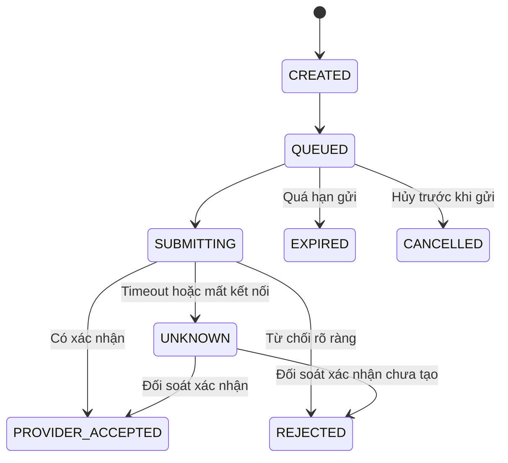

# Notification delivery status — Trạng thái chuyển phát thông báo khôi phục tài khoản

## 1. Trạng thái chuyển phát cho biết điều gì?

Trong khôi phục tài khoản, hệ thống có thể gửi mã xác minh, đường dẫn khôi phục, cảnh báo thay đổi MFA, thông báo đăng ký passkey mới hoặc xác nhận thu hồi thiết bị bị mất. Mỗi loại thông báo có mục đích và thời hạn khác nhau.

Một lời gọi gửi email trả thành công chỉ cho biết một mốc trong quá trình chuyển phát. Nó chưa chứng minh rằng thư đã đến hộp thư người dùng, người dùng đã đọc hoặc chủ tài khoản đã chấp thuận hành động.

**Notification delivery status** là tập hợp trạng thái và bằng chứng giúp hệ thống trả lời: đã tạo ý định gửi chưa, đã gửi cho nhà cung cấp chưa, nhà cung cấp đã nhận chưa, có bằng chứng chuyển phát nào và còn cần xử lý gì?

Đối với khôi phục khi mất mật khẩu, MFA, passkey hoặc thiết bị xác thực, cần giữ ba ranh giới:

- Trạng thái chuyển phát mô tả hành trình của thông báo.
- Trạng thái xác minh mô tả bằng chứng danh tính hoặc quyền kiểm soát phương thức.
- Trạng thái recovery mô tả quyền và tiến độ thay đổi bảo mật.

Không được dùng một callback `DELIVERED` để tự chuyển recovery sang `VERIFIED` hoặc `COMPLETED`. Kênh nhận thông báo có thể bị chiếm đoạt, và một thông báo đã đến vẫn có thể chưa được người dùng nhận biết.

## 2. Các mức bằng chứng trong quá trình gửi

Một từ như “đã gửi” thường bị dùng cho nhiều ý nghĩa. Cần định nghĩa chính xác trước khi thiết kế API và màn hình.

| Mốc | Điều đã biết | Điều chưa thể kết luận |
| --- | --- | --- |
| `CREATED` | Ý định gửi đã được lưu bền vững | Đã có worker xử lý |
| `QUEUED` | Công việc đang chờ xử lý | Nhà cung cấp đã nhận |
| `SUBMITTING` | Worker đang gọi dịch vụ gửi | Lời gọi đã tạo một thông báo bên ngoài |
| `PROVIDER_ACCEPTED` | Nhà cung cấp xác nhận nhận yêu cầu | Đã chuyển phát tới đích |
| `DELIVERY_REPORTED` | Có bằng chứng chuyển phát theo định nghĩa của kênh | Đúng chủ tài khoản đã đọc |
| `DELIVERY_FAILED` | Có bằng chứng thất bại của lần gửi tương ứng | Mọi kênh khác đều thất bại |
| `UNKNOWN` | Chưa xác định được kết quả | Chắc chắn chưa gửi hoặc chắc chắn đã gửi |
| `EXPIRED` | Hết thời gian được phép tiếp tục gửi | Một bản đã giao cho nhà cung cấp không thể đến muộn |
| `SUPPRESSED` | Việc gửi bị chặn theo chính sách hoặc hạn chế của nhà cung cấp | Có thể bỏ qua kiểm soát và gửi bằng kênh tùy ý |

Những tên trên là mô hình nội bộ minh họa, không phải bộ trạng thái dùng chung của mọi nhà cung cấp.

Amazon SES định nghĩa sự kiện Delivery tại thời điểm email được chuyển đến mail server của người nhận. Do đó, một màn hình dựa trên bằng chứng này nên diễn đạt “máy chủ email đã nhận”, thay vì khẳng định người dùng đã xem thư. Xem [cấu trúc sự kiện Amazon SES](https://docs.aws.amazon.com/ses/latest/dg/event-publishing-retrieving-sns-contents.html#event-publishing-retrieving-sns-contents-delivery).

Twilio phân biệt các mốc gửi và chuyển phát; một số kênh còn hỗ trợ read receipt. Trạng thái khởi tạo cũng có thể nằm trong phản hồi API mà chưa tạo callback riêng. Adapter phải lưu phản hồi ban đầu và diễn giải callback theo đúng kênh. Xem [Outbound Message Status in Status Callbacks](https://www.twilio.com/docs/messaging/guides/outbound-message-status-in-status-callbacks).

## 3. Tách thông báo, đích nhận, lần gửi và sự kiện quan sát

Một cột `notification.status` thường không đủ khi một thông báo được gửi qua nhiều kênh hoặc được retry.

Nên phân biệt bốn đối tượng:

1. **Notification:** thông báo nghiệp vụ, chẳng hạn “MFA đã được thay đổi sau recovery R”.
2. **Delivery target:** một đích nhận và một kênh đã được chính sách cho phép.
3. **Delivery attempt:** một lần thử gửi có định danh riêng.
4. **Delivery observation:** một sự kiện quan sát từ phản hồi API, callback hoặc tác vụ đối soát.

Ví dụ:

```text
Notification N1: cảnh báo thay MFA
  Target T1: email đã đăng ký
    Attempt A1: nhà cung cấp nhận, sau đó báo chuyển phát
  Target T2: push tới thiết bị tin cậy khác
    Attempt A2: endpoint không còn hợp lệ
```

Thông báo N1 có kết quả một phần. Không được ghi đè toàn bộ thành `FAILED` chỉ vì push lỗi, hoặc thành “tất cả đã nhận” chỉ vì email có báo cáo chuyển phát.

Đích nhận cần gắn với phiên bản thông tin liên hệ. Nếu người dùng thay email trong lúc một cảnh báo đang nằm trong hàng đợi, worker không nên tự lấy email mới nhất rồi vô tình gửi cảnh báo thay đổi cho chính địa chỉ vừa được kẻ tấn công thêm.

Một phương án là lưu tham chiếu tới snapshot đích nhận đã được quyết định khi tạo thông báo. Trước khi gửi vẫn kiểm tra xem đích đó có bị đánh dấu mất an toàn, bị thu hồi hoặc bị cấm sử dụng hay không. Không tự khôi phục một địa chỉ cũ đã bị xác định là bị chiếm đoạt.

## 4. Mô hình dữ liệu minh họa

```json
{
  "notificationId": "n-701",
  "tenantId": "tenant-demo",
  "accountRef": "account-internal-42",
  "securityEventId": "factor-change-903",
  "purpose": "FACTOR_CHANGED_ALERT",
  "createdAt": "2026-11-24T03:00:00Z",
  "recipientPolicyVersion": "policy-7",
  "targets": [
    {
      "targetId": "target-email-1",
      "channel": "EMAIL",
      "contactVersion": 12,
      "destinationRef": "protected-contact-snapshot-12",
      "sendNotAfter": "2026-11-24T03:10:00Z",
      "attempts": [
        {
          "attemptId": "attempt-1",
          "submissionState": "PROVIDER_ACCEPTED",
          "providerAccountRef": "provider-account-a",
          "providerMessageId": "provider-message-88",
          "submittedAt": "2026-11-24T03:00:02Z",
          "acceptedAt": "2026-11-24T03:00:03Z",
          "lastObservationAt": null
        }
      ],
      "deliveryEvidence": "PENDING",
      "attentionState": "NONE"
    }
  ]
}
```

Các định danh và thời hạn trong ví dụ chỉ minh họa cấu trúc. Thời gian gửi thực tế phụ thuộc loại thông báo và chính sách rủi ro.

Một số field có ý nghĩa đặc biệt:

| Field | Mục đích |
| --- | --- |
| `securityEventId` | Liên kết thông báo với đúng sự kiện bảo mật đã được ghi nhận |
| `contactVersion` | Biết đích nhận thuộc phiên bản thông tin liên hệ nào |
| `attemptId` | Phân biệt retry và các lần gửi khác nhau |
| `providerAccountRef` | Tránh nhầm message ID giữa tài khoản nhà cung cấp hoặc tenant |
| `sendNotAfter` | Chặn khởi tạo lần gửi quá muộn |
| `deliveryEvidence` | Diễn đạt bằng chứng chuyển phát đang có |
| `attentionState` | Cho biết có cần đối soát, chuyển kênh hoặc xử lý vận hành |

Không nhúng password, OTP rõ, recovery token, khóa bí mật TOTP hoặc toàn bộ URL chứa bearer token vào bảng trạng thái, log hay metadata chuyển cho nhà cung cấp. Dữ liệu bí mật phục vụ việc tạo nội dung cần được bảo vệ và lưu theo vòng đời riêng.

## 5. Trạng thái xử lý và bằng chứng chuyển phát là hai trục khác nhau

Một lần gửi có thể đã hết hạn xử lý nội bộ nhưng sau đó vẫn nhận callback chuyển phát thành công. Nếu mô hình chỉ cho một nhãn cuối duy nhất, hệ thống dễ đánh mất thông tin.

Có thể tách:

- **Submission state:** công việc đã được gửi cho nhà cung cấp tới đâu.
- **Delivery evidence:** nhà cung cấp đã báo điều gì về kết quả.
- **Attention state:** hệ thống còn cần hành động gì.

Ví dụ:

```text
submissionState = PROVIDER_ACCEPTED
deliveryEvidence = UNKNOWN
attentionState = RECONCILE_REQUIRED
```

Điều này có nghĩa là nhà cung cấp đã nhận nhưng hệ thống chưa có đủ thông tin về chuyển phát. Nó không đồng nghĩa với một lần gửi thất bại có thể retry ngay.

Một luồng xử lý nội bộ đơn giản:



Đây là máy trạng thái của bước nộp yêu cầu, chưa bao gồm mọi trạng thái vận chuyển của từng nhà cung cấp. Sau `PROVIDER_ACCEPTED`, một chuỗi sự kiện chuyển phát riêng sẽ được ghi nhận.

Hủy một công việc còn trong hàng đợi có thể ngăn việc gửi. Hủy sau khi nhà cung cấp đã nhận không bảo đảm có thể thu hồi email hoặc SMS. Dù thông báo đến muộn, token hoặc quyền recovery bên trong vẫn phải được server kiểm tra bằng trạng thái hiện tại.

## 6. Lưu ý định gửi bền vững cùng sự kiện bảo mật

Giả sử hệ thống đã thay MFA thành công nhưng tiến trình dừng trước lúc đưa cảnh báo vào hàng đợi. Nếu không có bản ghi bền vững, chủ tài khoản có thể không bao giờ được thông báo.

Một cách triển khai là ghi sự kiện và ý định gửi trong cùng transaction:

```text
BEGIN
    áp dụng thay đổi bảo mật đã được xác minh
    ghi security event
    ghi notification intent với định danh ổn định
    ghi outbox job
COMMIT

Worker sau commit:
    lấy job với lease phù hợp
    kiểm tra purpose, đích nhận và hạn gửi
    tạo hoặc lấy delivery attempt
    gọi nhà cung cấp
    lưu phản hồi và provider message ID
```

Outbox làm bền vững ý định gửi, nhưng không tự tạo ra bảo đảm gửi đúng một lần tới nhà cung cấp. Worker có thể chết sau khi bên ngoài nhận yêu cầu nhưng trước khi lưu phản hồi.

Lease giúp tránh nhiều worker đồng thời xử lý cùng job trong điều kiện bình thường. Khi lease hết hạn, worker mới vẫn phải xét khả năng lần gọi trước đã tạo thông báo. Một lease mới không phải bằng chứng rằng chưa có email hoặc SMS nào được gửi.

Nếu provider có idempotency key phù hợp, dùng định danh ổn định cho cùng một lần gửi và kiểm tra phạm vi bảo đảm của API. Không mặc nhiên cho rằng mọi dịch vụ email hoặc SMS đều hỗ trợ idempotency.

## 7. Timeout và retry: không suy diễn “chưa gửi”

Tình huống dễ gây gửi trùng:

```text
1. Worker gọi API gửi SMS.
2. Nhà cung cấp tạo message.
3. Phản hồi bị mất.
4. Worker ghi timeout.
5. Worker tạo attempt khác và gửi thêm SMS.
```

Ở bước 4, kết quả đúng là `UNKNOWN`. Chuyển ngay sang “chắc chắn thất bại” sẽ che mất nguy cơ gửi trùng.

Các hướng xử lý phụ thuộc khả năng tích hợp:

| Điều kiện đã biết | Cách xử lý |
| --- | --- |
| Nhà cung cấp từ chối rõ ràng trước khi tạo message | Có thể xét retry theo loại lỗi |
| Có message ID nhưng chưa có kết quả cuối | Truy vấn hoặc chờ sự kiện cho chính message đó |
| Timeout nhưng API hỗ trợ idempotency | Retry cùng định danh theo hợp đồng của provider |
| Timeout, không có message ID và không có idempotency | Đối soát bằng cơ chế được hỗ trợ; nếu vẫn mơ hồ thì giữ UNKNOWN và áp dụng chính sách có giới hạn |
| Có bằng chứng lỗi vĩnh viễn của đích | Dừng gửi lại cùng đích cho đến khi có thay đổi hợp lệ |
| Hết hạn token hoặc hạn gửi | Dừng gửi challenge cũ; không kéo dài quyền để phù hợp với hàng đợi |

Retry nên có backoff, jitter, giới hạn số lần và hạn chót tuyệt đối. Với lỗi có hướng dẫn `Retry-After`, cần diễn giải theo hợp đồng API.

Thông báo mã xác minh và cảnh báo bảo mật có hành vi khác nhau. Một challenge hết hạn không nên được gửi lại như còn hiệu lực. Một cảnh báo “MFA đã thay đổi” có thể vẫn cần chuyển phát muộn với thời điểm sự kiện chính xác, tùy chính sách. Không dùng cùng một TTL cho mọi loại nội dung.

Nếu người dùng yêu cầu gửi lại mã, việc tái sử dụng hay thay thế challenge là quyết định của giao thức recovery. Tạo thêm một lần gửi không được ngầm sinh một mã mới, kéo dài hạn dùng hoặc làm sống lại mã đã tiêu thụ.

## 8. Callback là dữ liệu đầu vào cần được xác thực

Một endpoint callback công khai có thể bị gọi bởi kẻ tấn công. Nếu chỉ đọc JSON rồi cập nhật `DELIVERED`, hệ thống đang cho người ngoài sửa bằng chứng chuyển phát.

Trình tự xử lý nên bao gồm:

1. Giới hạn kích thước và định dạng request.
2. Xác minh tính xác thực theo đúng cơ chế của nhà cung cấp.
3. Kiểm tra môi trường, tài khoản nhà cung cấp, subscription hoặc topic mong đợi.
4. Chuẩn hóa sự kiện và xác định attempt qua message ID đã lưu.
5. Ghi sự kiện bền vững theo cơ chế chống trùng.
6. Cập nhật projection trạng thái trong transaction.
7. Trả phản hồi theo hợp đồng callback sau khi đã bảo đảm lưu trữ.

Với Amazon SNS, tài liệu yêu cầu xác minh chữ ký trước khi xử lý, kiểm tra nguồn chứng thư và từ chối `TopicArn` ngoài dự kiến. Không tự tải một URL chứng thư tùy ý từ payload rồi coi đó là nguồn tin cậy. Xem [Verifying the signatures of Amazon SNS messages](https://docs.aws.amazon.com/sns/latest/dg/sns-verify-signature-of-message.html).

Không lấy `tenantId`, `accountId` hoặc quyền sửa trạng thái từ một field mà client có thể tùy ý đặt trong metadata gửi ban đầu. Phải ánh xạ callback tới attempt do server tạo, trong đúng phạm vi tài khoản nhà cung cấp và môi trường.

Callback có thể đến trước khi worker lưu xong phản hồi API. Khi đó có thể lưu vào inbox sự kiện đã được xác thực rồi đối soát sau. Không bỏ sự kiện chỉ vì chưa tìm thấy attempt; đồng thời không tự tạo một tài khoản hoặc recovery request mới từ callback.

```text
onCallback(httpRequest):
    verifiedEnvelope = providerAdapter.verify(httpRequest)
    event = providerAdapter.normalize(verifiedEnvelope)

    transaction:
        inserted = insertInboxEventIfAbsent(
            providerScope = event.providerScope,
            eventIdentity = event.stableIdentity,
            payload = event.safeFields
        )

        if not inserted:
            return ALREADY_RECORDED

        attempt = findOwnedAttempt(
            event.providerScope,
            event.providerMessageId,
            event.recipientIdentity
        )

        if attempt is missing:
            markInboxForReconciliation(event)
        else:
            appendObservation(attempt, event)
            recomputeDeliveryEvidence(attempt)
            scheduleRequiredFollowUpOnce(attempt)

    return CALLBACK_ACCEPTED
```

`CALLBACK_ACCEPTED` chỉ xác nhận đã nhận và lưu callback. Nó không có nghĩa thông báo đã được chuyển phát.

## 9. Sự kiện trùng, đảo thứ tự và mâu thuẫn

Không nên thiết kế reducer dựa trên giả định callback chỉ đến một lần và đúng thứ tự.

### Sự kiện trùng

Ưu tiên dùng event ID ổn định trong phạm vi được nhà cung cấp định nghĩa. Nếu không có ID, cần xây dựng khóa chống trùng từ những field có ý nghĩa theo hợp đồng provider. Chỉ dùng timestamp thường không đủ vì nhiều sự kiện hợp lệ có thể cùng thời điểm.

Ngoài chống trùng inbox, các tác dụng phụ như tạo cảnh báo vận hành hoặc lên lịch fallback cũng cần định danh ổn định. Hai callback tương đương không được tạo hai chuỗi gửi mới.

Amazon SES lưu ý rằng khi cấu hình nhiều cách nhận bounce hoặc complaint, cùng sự kiện có thể được nhận qua nhiều đường. Đây là một lý do thực tế để thiết kế tiếp nhận idempotent. Xem [Setting up event notifications for Amazon SES](https://docs.aws.amazon.com/ses/latest/dg/monitor-sending-activity-using-notifications.html).

### Sự kiện đảo thứ tự

Nếu đã có bằng chứng chuyển phát, một callback cũ chỉ báo `QUEUED` không được làm trạng thái lùi về “đang chờ gửi”.

Cần lưu thời điểm provider ghi nhận sự kiện và thời điểm hệ thống tiếp nhận. Hai thời điểm này phục vụ các mục đích khác nhau; không chỉ sắp xếp theo thời gian callback đến server.

### Sự kiện mâu thuẫn

Không nên dùng một bảng thứ hạng toàn cục như:

```text
QUEUED < SENT < DELIVERED < FAILED
```

`FAILED` không phải lúc nào cũng là “mức cao hơn” `DELIVERED`. Nó có thể thuộc attempt khác, recipient khác hoặc một ý nghĩa riêng của adapter.

Giữ lịch sử quan sát và áp dụng quy tắc theo provider, kênh, recipient và attempt. Nếu hai bằng chứng không thể giải thích bằng hợp đồng tích hợp, đánh dấu cần đối soát thay vì âm thầm chọn nhãn đến sau.

Complaint, open hoặc click cũng không nên bị ép thành một kết quả chuyển phát duy nhất. Đó là những loại quan sát khác nhau, có thể cần hành động riêng.

## 10. Tổng hợp trạng thái và quyết định chuyển kênh

Trạng thái cấp notification là kết quả của một chính sách tổng hợp, không phải phép lấy nhãn của attempt cuối cùng.

Ví dụ:

```text
N1:
    email: DELIVERY_REPORTED
    push: DELIVERY_FAILED

summary:
    coverage = PARTIAL
    requiredTargetCoverage = NOT_MET
    attention = ALTERNATE_CHANNEL_REVIEW
```

Chính sách có thể yêu cầu ít nhất một kênh tin cậy có bằng chứng chuyển phát, hoặc yêu cầu xử lý tất cả đích nhận được chỉ định. Điều kiện phải được lưu hoặc version hóa để kết quả có thể giải thích sau này.

Chuyển kênh cần giữ nguyên các giới hạn an toàn:

- Chỉ dùng đích nhận đã được thiết lập và đủ tin cậy cho mục đích đó.
- Không gửi recovery code tới số điện thoại mới nhập chỉ vì email cũ bounce.
- Không cho lỗi delivery tự làm giảm mức xác minh danh tính.
- Không cho từng kênh lỗi kích hoạt lẫn nhau thành vòng lặp gửi.
- Duy trì ngân sách gửi và thời hạn cho toàn bộ notification, không chỉ từng attempt.
- Cân nhắc trạng thái đích bị mất an toàn, suppression và giới hạn của nhà cung cấp trước khi gửi.

Nếu không còn kênh hợp lệ, hệ thống cần ghi nhận yêu cầu can thiệp hoặc đưa người dùng vào một nhánh recovery đã được phê duyệt. Một hệ thống gửi tin gặp sự cố không tạo ra quyền bỏ qua MFA.

Đối với cảnh báo sau một thay đổi bảo mật đã commit, lỗi delivery không tự động khôi phục credential cũ hoặc bật lại thiết bị đã bị thu hồi. Phản ứng phải được quy định trong chính sách xử lý sự cố, thay vì biến một lỗi gửi email thành một lần thay đổi bảo mật ngược.

## 11. Thời hạn của thông báo và thời hạn của quyền khôi phục

Ít nhất ba loại thời gian có thể cùng tồn tại:

| Thời gian | Điều khiển |
| --- | --- |
| `sendNotAfter` | Hệ thống còn được khởi tạo việc gửi nội dung này hay không |
| Thời hạn challenge hoặc recovery grant | Người nhận còn được sử dụng mã hoặc quyền đó hay không |
| Thời hạn chờ bằng chứng delivery | Khi nào cần đối soát hoặc báo tình trạng chưa xác định |

Ví dụ, một token hết hạn lúc 10:10, provider nhận thư lúc 10:09 và chuyển phát lúc 10:12. Hệ thống có thể ghi nhận đúng bằng chứng chuyển phát lúc 10:12, nhưng token vẫn hết hạn từ 10:10.

Không tăng hạn token vì thư đến muộn. Không tạo grant mới vì callback thành công. Không coi `DELIVERY_REPORTED` là bằng chứng rằng recovery đang ở đúng generation.

Khi một challenge mới thay thế challenge cũ, callback của lần gửi cũ vẫn hữu ích cho lịch sử delivery. Nó không được sửa trạng thái hiệu lực của challenge mới hoặc mở lại challenge cũ.

Tương tự, khi recovery đã bị hủy, một email đã gửi trước đó vẫn có thể đến. Server phải kiểm tra trạng thái recovery khi người dùng thực sự thực hiện hành động.

## 12. Hiển thị trạng thái mà không làm lộ tài khoản

Một API công khai cho bước “quên mật khẩu” cần tránh tiết lộ tài khoản có tồn tại hoặc đang dùng kênh nào. Trạng thái chi tiết của nhà cung cấp không nên được trả trực tiếp cho người chỉ biết một email hoặc username.

Ví dụ thông điệp công khai:

> Nếu thông tin phù hợp với một tài khoản, hệ thống sẽ xử lý yêu cầu và gửi hướng dẫn qua phương thức đã đăng ký.

Với một phiên đã có quyền xem tiến độ phù hợp, có thể hiển thị:

- “Yêu cầu đang chờ gửi.”
- “Nhà cung cấp đã nhận yêu cầu.”
- “Chưa xác định được kết quả chuyển phát.”
- “Không thể chuyển phát tới phương thức này. Hãy chọn phương thức khôi phục đã đăng ký khác.”

Chỉ hiển thị đích đã che bớt thông tin và cần thiết cho thao tác. Không để polling endpoint trở thành công cụ kiểm tra hàng loạt email, số điện thoại hoặc trạng thái MFA của người khác.

Không diễn đạt “chủ tài khoản đã xác nhận” dựa trên read receipt, open hoặc click. Chỉ luồng xác minh đã được thiết kế mới được tạo bằng chứng tương ứng.

Màn hình vận hành cần phân quyền theo tenant, ghi audit truy cập và che thông tin nhạy cảm. Provider response hoặc callback thô có thể chứa địa chỉ nhận, thông tin thiết bị hay dữ liệu cá nhân; không đưa toàn bộ vào thông báo lỗi cho người dùng.

## 13. Theo dõi vận hành và lưu giữ dữ liệu

Các chỉ số hữu ích gồm:

- Tuổi của notification còn trong hàng đợi.
- Số attempt đang `UNKNOWN` quá thời gian đối soát.
- Tỷ lệ từ chối ở bước nộp yêu cầu.
- Tỷ lệ có bằng chứng chuyển phát theo từng kênh.
- Tỷ lệ bounce, suppression và endpoint không hợp lệ.
- Độ trễ callback và số sự kiện trùng.
- Số notification chưa đạt điều kiện kênh nhận theo chính sách.

Mỗi tỷ lệ cần mẫu số rõ ràng. “Tỷ lệ chuyển phát của các attempt đã được provider nhận” khác với “tỷ lệ thông báo nghiệp vụ đạt điều kiện trên mọi đích bắt buộc”. Gộp chúng dễ tạo một dashboard có vẻ tốt trong khi cảnh báo quan trọng vẫn bị bỏ sót.

Phân tích theo cohort thời gian tạo thông báo giúp tránh so sánh một tập đã có đủ thời gian nhận callback với một tập vừa được gửi. Không biến các attempt chưa có kết quả thành thất bại chắc chắn chỉ để làm báo cáo đơn giản.

Log nên ưu tiên notification ID, attempt ID, provider scope, mã lỗi đã chuẩn hóa và mốc thời gian. Giới hạn thời gian lưu và quyền đọc dữ liệu địa chỉ nhận. Không dùng email đầy đủ hoặc recovery token làm label metric.

Thông báo vào dead-letter queue vẫn là công việc chưa được giải quyết. Cần có người hoặc quy trình đối soát phù hợp; việc chuyển hàng đợi không tạo ra kết quả delivery thành công.

## 14. Tình huống xuyên suốt

Một người dùng mất thiết bị MFA và hoàn tất quy trình recovery hợp lệ. Hệ thống thay phương thức MFA rồi tạo cảnh báo N1 tới email đã đăng ký và một thiết bị tin cậy khác.

```text
10:00:00  Thay MFA và lưu notification intent cùng commit.
10:00:02  Attempt email A1 gọi provider, phản hồi bị mất.
10:00:03  A1 được ghi UNKNOWN; chưa gửi trùng ngay.
10:00:04  Push A2 báo endpoint không hợp lệ.
10:00:06  Callback email đã xác thực báo chuyển phát.
10:00:07  Inbox đối soát A1, lưu bằng chứng DELIVERY_REPORTED.
10:00:08  Summary ghi PARTIAL; push cần xử lý theo chính sách.
```

Những kết luận hợp lệ:

1. Sự kiện thay MFA đã xảy ra theo giao dịch bảo mật ban đầu.
2. A1 từng có kết quả nộp yêu cầu mơ hồ, sau đó có bằng chứng chuyển phát.
3. A2 thất bại ở một đích riêng.
4. Không cần thay MFA thêm một lần khi callback đến.
5. Không thể khẳng định chủ tài khoản đã đọc hoặc đồng ý chỉ từ báo cáo delivery.
6. Nếu người dùng báo thay đổi trái phép, cần quy trình xử lý sự cố với xác minh và kiểm soát session riêng.

Thiết kế trạng thái chuyển phát tốt giúp hệ thống biết chính xác đã có bằng chứng gì, còn điều gì chưa rõ và phải xử lý bước nào tiếp theo. Trong khôi phục tài khoản, sự chính xác đó bảo vệ cả tính sẵn sàng lẫn ranh giới cấp quyền.
