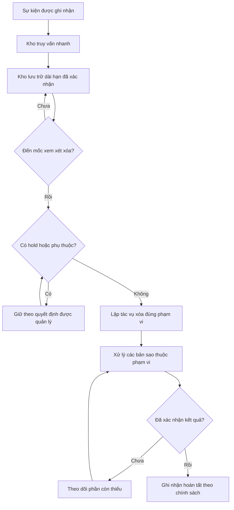

# Audit event retention — Lưu giữ sự kiện kiểm toán trong khôi phục tài khoản

Một sự cố chiếm đoạt tài khoản thường chỉ được phát hiện sau khi luồng khôi phục đã kết thúc. Lúc đó, token có thể đã hết hạn, phiên recovery đã bị xóa và dữ liệu vận hành ngắn hạn không còn. Sự kiện kiểm toán giúp xác định ai đã thực hiện thao tác nào, hệ thống đã chấp nhận bằng chứng ra sao và những thay đổi nào đã được áp dụng lên tài khoản.

**Audit event retention là chính sách và cơ chế giữ sự kiện kiểm toán đủ lâu, đủ nguyên vẹn, có thể truy xuất khi cần, rồi xử lý dữ liệu khi không còn căn cứ lưu giữ.** Đặt TTL cho một bảng chỉ giải quyết một phần nhỏ của bài toán này.

Bài học tập trung vào account recovery khi người dùng mất mật khẩu, MFA, passkey hoặc thiết bị xác thực. Các mô hình và thời lượng bên dưới là thiết kế minh họa; thời hạn thực tế phải xuất phát từ chính sách đã được tổ chức xác định cho loại dữ liệu và phạm vi áp dụng.

## 1. Retention phục vụ những câu hỏi nào?

Một chuỗi audit hữu ích cần hỗ trợ việc dựng lại diễn biến như:

- Yêu cầu recovery được tiếp nhận ở thời điểm nào?
- Hệ thống chọn phương thức xác minh nào và vì sao?
- Bằng chứng được chấp nhận, bị từ chối hay cần xử lý thủ công?
- Nhân viên hỗ trợ nào phê duyệt ngoại lệ và theo quyền nào?
- Mật khẩu, MFA, passkey hoặc thông tin recovery đã thay đổi ra sao?
- Việc thu hồi session mới được yêu cầu hay đã thực sự hoàn tất?
- Cảnh báo an ninh đã được tạo và chuyển đến tuyến gửi nào?

Nếu chỉ giữ dòng “recovery thành công”, người điều tra khó biết bước xác minh nào đã bị lạm dụng. Nếu giữ nguyên mọi request và response, kho audit lại có thể trở thành nơi tập trung token, OTP và dữ liệu định danh nhạy cảm.

Thiết kế retention phải cân bằng ba mục tiêu:

| Mục tiêu | Điều cần bảo đảm |
| --- | --- |
| Khả năng giải trình | Có đủ diễn biến để giải thích quyết định và thay đổi tài khoản |
| Tính toàn vẹn và khả dụng | Sự kiện được bảo vệ, đọc được và truy xuất được trong thời gian cần giữ |
| Giới hạn dữ liệu | Không thu thập hoặc giữ lâu những nội dung không cần thiết |

NIST AU-11 mô tả việc lưu giữ audit theo thời hạn do tổ chức xác định, phù hợp chính sách hồ sơ và nhu cầu điều tra cùng các yêu cầu áp dụng. Không thể suy từ tên control này ra một số ngày chung cho mọi hệ thống recovery. [NIST SP 800-53: AU-11](https://csrc.nist.gov/CSRC/media/Projects/risk-management/800-53%20Downloads/800-53r5/SP_800-53_v5_1-derived-OSCAL.pdf)

## 2. Không dùng chung vòng đời cho mọi dữ liệu recovery

Sự kiện audit khác với bằng chứng cho phép thực hiện recovery.

| Nhóm dữ liệu | Vai trò | Điểm cần chú ý về vòng đời |
| --- | --- | --- |
| Token hoặc challenge | Cho phép xác minh một yêu cầu trong thời gian ngắn | Hết hạn và dùng một lần theo chính sách xác thực |
| Phiên recovery | Giới hạn quyền trong quá trình khôi phục | Có thể bị thu hồi trước khi hết hạn tự nhiên |
| Audit event | Ghi lại sự kiện hoặc quyết định đã xảy ra | Có thể cần giữ sau khi challenge và phiên đã biến mất |
| Hồ sơ xác minh danh tính | Cung cấp bằng chứng phục vụ quy trình xác minh | Nội dung nhạy cảm có chính sách riêng |
| Dấu chặn token/session | Duy trì một quyết định từ chối còn hiệu lực | Không được mất hiệu lực chỉ vì audit đã hết hạn lưu |
| Log debug và trace | Hỗ trợ chẩn đoán kỹ thuật | Không mặc định là bản audit chuẩn |

Xóa challenge hết hạn không được cascade xóa mất audit của lần thay MFA đã hoàn tất. Ngược lại, giữ audit không được kéo dài thời hạn token hay làm một phiên recovery cũ sống lại.

Nếu hệ thống đang đọc bảng audit để quyết định token nào bị thu hồi, cần xem lại ranh giới dữ liệu. Trạng thái thu hồi có hiệu lực phải được duy trì như dữ liệu xác thực có vòng đời riêng, thay vì phụ thuộc vào việc kho audit còn giữ lịch sử hay không.

Tương tự, một `evidence_ref` trong audit không bắt buộc hồ sơ giấy tờ được giữ lâu bằng audit. Có thể giữ kết luận, loại quy trình và dấu vết xử lý tối thiểu sau khi nội dung bằng chứng đã được xử lý theo chính sách của nó.

## 3. Xây dựng ma trận chính sách trước khi cấu hình TTL

Đơn vị chính sách có thể là loại sự kiện, tenant, phạm vi triển khai hoặc nhóm hồ sơ. Cần tránh một mặc định không có căn cứ áp cho toàn bộ log.

Một ma trận phục vụ thiết kế:

| Nhóm sự kiện | Mục đích giữ | Dữ liệu cần hạn chế | Chủ thể xác định chính sách |
| --- | --- | --- | --- |
| Tiếp nhận và từ chối recovery | Điều tra dò tài khoản, spam, lạm dụng | IP, địa chỉ liên hệ, nội dung client gửi | Security và chủ sản phẩm |
| Kết quả xác minh challenge | Giải thích quyết định chấp nhận/từ chối | OTP, token và bằng chứng gốc | Security và chủ quy trình xác minh |
| Thay mật khẩu/MFA/passkey | Dựng lại thay đổi nhạy cảm | Bí mật credential, khóa riêng | Chủ hệ thống xác thực |
| Phê duyệt hỗ trợ thủ công | Giải trình ngoại lệ | Tài liệu định danh và ghi chú tự do | Chủ vận hành hỗ trợ và quản trị dữ liệu |
| Thu hồi session | Đối chiếu hành động bảo vệ sau recovery | Session bearer và token truy cập | Chủ hệ thống session |
| Đọc, xuất và xóa audit | Giám sát việc sử dụng kho bằng chứng | Nội dung sự kiện được xuất | Chủ nền tảng audit |

Mỗi chính sách cần ghi rõ:

1. Mục đích và phạm vi dữ liệu.
2. Mốc bắt đầu tính thời gian.
3. Khoảng thời gian truy vấn nhanh.
4. Tổng thời gian giữ và các trường hợp kéo dài.
5. Thời gian dự kiến hoàn tất xử lý sau khi đủ điều kiện xóa.
6. Quy tắc giữ phục vụ điều tra hoặc yêu cầu lưu giữ đặc biệt.
7. Các kho và bản sao phải chịu cùng quyết định.
8. Vai trò được thay đổi chính sách, phê duyệt giữ thêm và giải phóng giữ.

Các ràng buộc pháp lý, hợp đồng và tổ chức phải được xác định cho đúng phạm vi; scheduler không tự suy diễn nghĩa vụ từ tên sự kiện.

## 4. Ví dụ chính sách có phiên bản

Cấu hình dưới đây chỉ minh họa ý nghĩa các trường. Các con số 30 ngày, 180 ngày và 24 giờ không phải khuyến nghị tuân thủ chung.

```yaml
policyId: account-recovery-audit
version: 3

scope:
  eventClass: RECOVERY_SECURITY_EVENT

retention:
  anchor: RECORDED_AT
  hotSearchDays: 30
  totalRetentionDays: 180
  deletionCompletionTargetHours: 24

preservation:
  blockDeletionWhileHoldPending: true
  blockDeletionWhileHoldActive: true

data:
  rawRecoveryTokenAllowed: false
  rawOtpAllowed: false
  rawSessionBearerAllowed: false
  identityDocumentContentAllowed: false

owner: SECURITY_OPERATIONS
```

Trong ví dụ:

```text
recorded_at            = thời điểm sự kiện được ghi nhận bền vững
hot_until              = recorded_at + 30 ngày
base_retain_until      = recorded_at + 180 ngày
earliest_delete_at     = mốc cuối cùng cần giữ theo các ràng buộc hữu hạn
```

Tổng thời gian giữ là 180 ngày, đã bao gồm 30 ngày ở kho truy vấn nhanh. Không cộng thành 210 ngày nếu chính sách không quy định như vậy.

Đến `hot_until`, dữ liệu có thể rời chỉ mục nóng nhưng vẫn phải truy xuất được từ kho lưu trữ phù hợp. Đến `earliest_delete_at`, dữ liệu mới có thể đủ điều kiện xóa; còn phải kiểm tra hold và các phụ thuộc khác.

Mục tiêu hoàn tất xóa trong 24 giờ là một mục tiêu vận hành được đặt ra trong ví dụ. Nó không tự cho phép trì hoãn khi có một thời hạn bắt buộc khác.

Phiên bản chính sách giúp giải thích vì sao một sự kiện có mốc lưu giữ nhất định. Khi chính sách thay đổi, phải xác định phạm vi áp dụng cho dữ liệu cũ, ghi nhận quyết định và thực hiện một thay đổi có kiểm soát; không để một lần deploy tự tính lại rồi xóa toàn bộ lịch sử theo mặc định mới.

## 5. Giữ sự kiện gọn nhưng đủ ngữ cảnh

Ví dụ một sự kiện audit về việc thay MFA:

```json
{
  "event_id": "evt-7f36a2",
  "schema_version": 2,
  "event_type": "recovery.mfa.replaced",
  "occurred_at": "2026-11-24T08:20:01Z",
  "recorded_at": "2026-11-24T08:20:02Z",
  "tenant_ref": "tenant-17",
  "subject_ref": "subject-82",
  "actor": {
    "type": "USER",
    "ref": "actor-82"
  },
  "recovery_flow_ref": "flow-519",
  "verification_method": "RECOVERY_CODE",
  "decision": "ALLOWED",
  "reason_code": "RECOVERY_POLICY_SATISFIED",
  "credential_change_ref": "change-90",
  "policy_ref": "recovery-policy-v8",
  "retention_policy_ref": "account-recovery-audit-v3"
}
```

Các giá trị trên là định danh giả lập, không phải dữ liệu người dùng.

Phân biệt hai mốc:

- `occurred_at`: khi sự kiện nghiệp vụ xảy ra theo nguồn đã xác định.
- `recorded_at`: khi pipeline ghi nhận bền vững sự kiện.

Nếu chỉ có yêu cầu thu hồi session, ghi sự kiện thể hiện “requested”. Chỉ ghi “completed” khi có kết quả tương ứng. Giữ một khẳng định sai trong thời gian dài không tạo ra bằng chứng chính xác.

Metadata thực thi retention như hold, nơi lưu và trạng thái xóa có thể nằm trong catalog riêng. Nội dung sự kiện gốc được bảo vệ khỏi sửa đổi; các thay đổi quyết định lưu giữ có lịch sử riêng, thay vì âm thầm viết lại sự kiện.

OWASP khuyến nghị tránh ghi trực tiếp bí mật xác thực và dữ liệu nhạy cảm không cần thiết, đồng thời bảo vệ log khỏi đọc, sửa hoặc xóa trái phép. Retention dài không sửa được lỗi đã đưa token hay giấy tờ vào log. [OWASP Logging Cheat Sheet](https://cheatsheetseries.owasp.org/cheatsheets/Logging_Cheat_Sheet.html)

## 6. Chọn mốc thời gian và xử lý sự kiện đến trễ

Một sự kiện xảy ra ngày D0 nhưng đến collector ngày D5 có thể bị xóa ngay nếu hệ thống áp một khoảng giữ ngắn từ `occurred_at` mà không xét độ trễ.

Trong mô hình minh họa, `recorded_at` được dùng làm mốc tính retention để bảo đảm khoảng lưu kể từ lần ghi nhận đầu tiên. Đây là một lựa chọn thiết kế, không phải mốc bắt buộc cho mọi loại hồ sơ.

Cần quy định:

- Nguồn nào được phép gán từng timestamp.
- Cách xử lý đồng hồ lệch hoặc thời điểm nằm xa trong tương lai.
- Sự kiện đến trễ được giữ, cách ly hay xử lý theo quy trình nào.
- Cách bảo đảm bản tin replay giữ nguyên danh tính và mốc ghi nhận ban đầu.
- Cách đối chiếu thứ tự trong cùng luồng recovery.

Không tin thời gian do trình duyệt gửi lên để quyết định ngày xóa audit. Kẻ tấn công có thể khai báo thời điểm rất cũ hoặc rất xa trong tương lai.

Một lần queue giao lại cùng event không nên tự đặt lại `recorded_at`, kéo dài retention mãi mãi. Pipeline cần nhận diện event đã có. Nếu có sự kiện mới về việc replay hay phục hồi dữ liệu, ghi riêng sự kiện đó theo mục đích của nó.

Sử dụng thời điểm tuyệt đối và quy ước thời gian nhất quán. Thứ tự xử lý còn có thể cần sequence hoặc phiên bản nghiệp vụ; timestamp đơn lẻ không chứng minh toàn bộ quan hệ nhân quả.

## 7. Vòng đời từ kho nóng đến xử lý cuối cùng

Có thể mô tả vòng đời như sau:



Chuyển sang archive là thay đổi tầng lưu trữ, không phải xóa cuối cùng. Khi bỏ bản ở kho nóng, hệ thống phải biết bản ở archive đã được ghi bền vững và có thể đọc.

Một biên nhận archive có thể chứa:

```text
archive_batch_id
phạm vi tenant và thời gian
số lượng sự kiện
schema và định dạng
định danh đối tượng cùng phiên bản
checksum hoặc manifest được bảo vệ
mốc lưu giữ
vị trí catalog và thông tin khóa giải mã
```

Không chỉ kiểm tra “upload API trả thành công” rồi bỏ nguồn. Cần có cách đối chiếu tính đầy đủ và khả năng truy xuất theo đặc tính của kho.

Archive không có index tìm kiếm vẫn có thể phù hợp nếu thời gian lấy lại dữ liệu đáp ứng nhu cầu đã xác định. Một tập tin còn tồn tại nhưng không biết nằm ở đâu, không có khóa giải mã hoặc không còn trình đọc định dạng thì không đáp ứng mục đích lưu giữ.

## 8. Bảo vệ tính toàn vẹn trong suốt thời gian giữ

Retention phải bảo vệ cả nội dung lẫn thông tin giúp giải thích nội dung đó.

Các lớp bảo vệ có thể gồm:

- Phân tách quyền ghi sự kiện, đọc phục vụ điều tra và xóa theo retention.
- Hạn chế quyền quản trị có thể thay đổi cả log lẫn chính sách của log.
- Manifest, checksum, chữ ký hoặc cơ chế phát hiện sửa đổi phù hợp.
- Kho chỉ ghi thêm hoặc cơ chế lưu trữ chống ghi đè theo nhu cầu.
- Theo dõi việc đọc, xuất dữ liệu và thay đổi cấu hình lưu giữ.
- Giữ schema, từ điển reason code và thông tin phiên bản cần thiết để diễn giải.

Một hash nằm cùng chỗ và cùng quyền sửa với dữ liệu không đủ chống một đối tượng có thể thay đổi cả hai. Chữ ký cũng chỉ hỗ trợ xác minh điều được ký; nó không tự chứng minh sự kiện mô tả đúng người hay đúng hành động thực tế.

Nếu dùng chuỗi hash, cần thiết kế trước cách chia segment và giữ điểm neo. Xóa một segment đã hết thời gian lưu không nên làm toàn bộ phần lịch sử còn lại không thể kiểm chứng. Manifest của segment bị xóa cũng có chính sách riêng; nó vẫn có thể chứa dữ liệu liên kết được với cá nhân.

Khóa giải mã phải còn khả dụng trong thời gian dữ liệu còn cần đọc. Thông tin kiểm chứng chữ ký cũ và lịch sử phiên bản khóa cần được quản lý theo mục đích tương ứng. Không nhầm việc rotate khóa với việc được phép hủy khả năng đọc toàn bộ archive cũ.

## 9. Hold giữ bằng chứng khi có điều tra hoặc yêu cầu đặc biệt

Một hold là quyết định chặn xóa một phạm vi dữ liệu, chẳng hạn audit của một tài khoản hoặc một chuỗi recovery đang được điều tra.

Một bản ghi quản lý hold nên thể hiện:

```text
hold_id
phạm vi được xác định rõ
lý do và hồ sơ tham chiếu
người yêu cầu và người có quyền quyết định
thời điểm yêu cầu
trạng thái: PENDING / ACTIVE / RELEASED / FAILED
các kho và phiên bản đã được áp dụng
mốc cần xem xét lại
lịch sử thay đổi
```

Mốc xem xét lại không mặc định là mốc tự động hết hold. Việc giải phóng hold phải là một quyết định hợp lệ, có bằng chứng và quyền phù hợp.

### Phân biệt hold với thời hạn giữ thông thường

```text
Nếu còn hold chặn xóa:
    chưa đủ điều kiện xóa
Nếu không còn hold:
    đánh giá lại các mốc và phụ thuộc đang có hiệu lực
```

Giải phóng hold không đặt lại thời gian lưu từ đầu nếu chính sách không quy định. Dữ liệu có thể đã qua mốc lưu thông thường; sau khi hold được giải phóng, hệ thống xem xét xóa theo quy trình hiện hành.

Ví dụ về một cơ chế cụ thể, S3 Object Lock áp dụng bảo vệ theo object version. Legal hold không có ngày tự hết và độc lập với retention period; hết một điều kiện không làm mất bảo vệ nếu điều kiện kia vẫn còn hiệu lực. Cần quản lý đúng phiên bản đối tượng. [Amazon S3: Object Lock](https://docs.aws.amazon.com/AmazonS3/latest/userguide/object-lock.html)

### Xử lý cuộc đua giữa đặt hold và xóa

Việc scheduler đọc “không có hold” rồi xóa sau vài phút tạo ra khoảng trống: một hold có thể được yêu cầu ở giữa hai thao tác.

Thiết kế cần có giao thức phân xử dùng chung cho bộ phận đặt hold và bộ phận xóa:

1. Yêu cầu hold được ghi bền vững ở trạng thái PENDING và chặn các tác vụ xóa mới trong phạm vi.
2. Kiểm kê các tác vụ đã được cấp quyền và thao tác ngoài hệ thống còn đang thực hiện.
3. Áp bảo vệ ở các kho có liên quan theo khả năng thực tế.
4. Xác nhận phạm vi đã được bảo vệ trước khi báo hold ACTIVE.

Một lệnh xóa bên ngoài đã thực hiện không thể bị đảo ngược chỉ bằng cập nhật cờ trong cơ sở dữ liệu. Nếu dữ liệu đã mất hoặc một tác vụ đang chạy không thể dừng, phải ghi nhận kết quả thực tế; không báo hold đã bảo vệ đầy đủ.

Đặt hold ở một catalog trung tâm cũng không tự bảo vệ bản xuất trước đó hoặc backup nằm ở hệ thống khác. Phạm vi hold phải đi cùng bản đồ dữ liệu.

## 10. Xóa là một quy trình nhiều kho có trạng thái

Ví dụ các nơi có thể chứa cùng sự kiện:

```text
cơ sở dữ liệu audit
chỉ mục tìm kiếm
object archive và các phiên bản
replica
hệ thống phân tích
bản xuất phục vụ điều tra
cache
snapshot và backup
```

Xóa khỏi chỉ mục tìm kiếm không chứng minh bản archive đã bị xử lý. Ngược lại, xóa đối tượng archive không làm bản xuất trong một công cụ phân tích tự biến mất.

Một quy trình minh họa:

```text
1. Xác định cohort hoặc tập sự kiện theo catalog.
2. Chốt phiên bản chính sách và phạm vi dữ liệu.
3. Kiểm tra mốc lưu giữ, hold và phụ thuộc.
4. Cấp quyền thực hiện theo giao thức phân xử đã định.
5. Lập manifest xóa với định danh tài nguyên cụ thể.
6. Gửi tác vụ đến từng kho.
7. Ghi nhận kết quả theo từng kho và từng phần.
8. Đối chiếu phần còn thiếu.
9. Chỉ ghi hoàn tất cho phạm vi đã được xác nhận.
```

Tác vụ cần chạy lặp lại an toàn. Nếu mất phản hồi sau một thao tác xóa, lần xử lý sau xác minh tài nguyên đúng phiên bản còn hay không và tiếp tục phần chưa hoàn tất.

Không dùng một tên đường dẫn cũ để xóa đối tượng mới đã thay thế nó. Manifest cần đủ thông tin định danh phiên bản hoặc điều kiện tương ứng với kho dữ liệu.

Nếu dùng partition theo thời gian, chỉ xóa cả partition khi toàn bộ dữ liệu bên trong đều đủ điều kiện. Một partition chứa nhiều tenant, nhiều thời hạn hoặc một hold riêng không thể bị drop chỉ vì nhãn tháng đã cũ. Có thể phải bố trí dữ liệu hoặc tách phạm vi giữ theo một quy trình được bảo vệ trước đó.

Một phản hồi “delete thành công” cũng cần được hiểu theo hợp đồng kho. Trong kho có versioning, thao tác có thể chỉ tạo delete marker; trạng thái phiên bản bên dưới phải được kiểm tra nếu mục tiêu là xử lý chính dữ liệu đó.

## 11. Bảo vệ dữ liệu cá nhân mà vẫn giữ khả năng giải trình

Kho audit không nên chứa toàn bộ dữ liệu mà ứng dụng đã xử lý.

Một số lựa chọn thiết kế:

| Dữ liệu | Cách cân nhắc |
| --- | --- |
| Token recovery, OTP, session bearer | Không đưa giá trị dùng để cấp quyền vào audit |
| Ảnh giấy tờ và dữ liệu sinh trắc | Tách sang kho bằng chứng có chính sách riêng nếu quy trình cần |
| Địa chỉ email/số điện thoại | Dùng tham chiếu hoặc dạng giảm thiểu phù hợp mục đích |
| IP và thông tin thiết bị | Xác định nhu cầu, mức chi tiết và thời gian giữ riêng |
| Ghi chú của nhân viên hỗ trợ | Giới hạn trường và tránh nội dung tự do chứa bí mật |
| Danh tính người phê duyệt | Giữ liên kết cần thiết để giải trình theo quyền truy cập được quản lý |

Hash email không tự biến dữ liệu thành vô danh; tập giá trị có thể bị suy đoán và đối chiếu. Định danh giả cũng có thể liên kết lại với cá nhân qua bảng ánh xạ hoặc dữ liệu khác.

Nếu một nhóm trường có thời hạn ngắn hơn phần sự kiện lõi, có thể tách chúng sang vùng dữ liệu được bảo vệ riêng ngay từ thiết kế. Không dựa vào việc sửa trực tiếp các đối tượng bất biến đã khóa mà chưa xác định khả năng thực hiện.

Khi có yêu cầu xử lý dữ liệu cá nhân, phải đối chiếu chính sách và căn cứ đang áp dụng, bao gồm yêu cầu giữ bằng chứng hợp lệ. Nhân viên vận hành không tự xóa toàn bộ audit theo một nút “xóa tài khoản”, cũng không giữ vô hạn chỉ vì dữ liệu được đặt tên là audit.

Xóa khóa mã hóa có thể là một phần của thiết kế xử lý dữ liệu, nhưng cần xét bản sao khóa, plaintext, cache và các dữ liệu dùng chung khóa. Hủy một khóa chung có thể làm mất cả những sự kiện vẫn còn nghĩa vụ lưu. Không coi crypto-erasure là phép thay thế tự động cho việc kiểm kê dữ liệu.

## 12. Backup, bản xuất và khôi phục dữ liệu

Chính sách phải bao phủ cả backup và dữ liệu được trích xuất, thay vì chỉ kho audit chính. OWASP nêu rằng vòng đời log cần xét cả bản sao, bản xuất và backup, với các yêu cầu lưu giữ áp dụng. [OWASP: Disposal of logs](https://cheatsheetseries.owasp.org/cheatsheets/Logging_Cheat_Sheet.html#disposal-of-logs)

Nếu một hệ thống backup không hỗ trợ xóa từng sự kiện, cần xác định cách quản lý vòng đời, hạn chế truy cập và xử lý sau restore trong thiết kế được tổ chức chấp nhận. Không tuyên bố “đã xóa mọi bản sao” khi vẫn biết còn dữ liệu trong backup.

Quy trình restore có thể gồm:

1. Khôi phục vào vùng cô lập.
2. Nạp trạng thái chính sách, hold và các quyết định xử lý dữ liệu cần thiết từ nguồn đã xác định.
3. Đối chiếu các mốc thời gian và các tác vụ đã hoàn tất sau thời điểm backup.
4. Thực hiện lại phần xử lý còn cần thiết trước khi cho phép truy cập phục vụ thông thường.
5. Ghi dấu vết của lần restore và kết quả đối chiếu.

Nếu backup cũ khôi phục lại một bản audit đã được xử lý, không tự đặt lại retention từ ngày restore rồi giữ thêm toàn bộ thời lượng. Phải dùng danh tính và lịch sử chính sách phù hợp.

Bản đồ hoặc sổ theo dõi dùng để tái áp dụng quyết định xóa cũng là dữ liệu cần được bảo vệ và có vòng đời. Tránh tạo một sổ lưu vĩnh viễn toàn bộ nội dung mà hệ thống vừa xóa.

Đối với ứng dụng recovery, phục hồi archive audit phải tách khỏi việc tái kích hoạt token, session hay credential. Audit là bằng chứng về lịch sử, không phải nguồn cho phép đăng nhập trở lại.

## 13. Độ tin cậy vận hành và kiểm soát dung lượng

Một kẻ tấn công có thể tạo rất nhiều yêu cầu recovery thất bại để làm tăng số audit event. Nếu kho audit đầy, hệ thống vừa có nguy cơ mất bằng chứng vừa bị ảnh hưởng đường xử lý chính.

Các biện pháp cần được quyết định theo kiến trúc:

- Hạn chế lạm dụng ở đầu vào recovery.
- Giới hạn tài nguyên theo tenant hoặc nguồn theo chính sách.
- Duy trì dung lượng dự phòng và cảnh báo trước khi đầy.
- Có cơ chế ghi bền vững hoặc spool được bảo vệ khi đích tạm thời không khả dụng.
- Chọn rõ hành vi với thao tác nhạy cảm khi không thể ghi audit bền vững.
- Không âm thầm lấy mẫu hoặc bỏ các sự kiện quan trọng chỉ để giảm tải.
- Giới hạn retry và tách lỗi tạm thời khỏi lỗi chính sách, hold hoặc quyền truy cập.

Không áp một hành vi chặn mọi request chỉ vì collector bị chậm mà chưa đánh giá nguy cơ từ chối dịch vụ. Với thao tác thay MFA hoặc thay phương thức recovery, ranh giới cho phép khi thiếu audit phải được xác định rõ và có tín hiệu giám sát.

Lưu trữ dài hạn còn cần duy trì khả năng đọc: schema cũ, mã hóa, công cụ giải nén, catalog và quyền truy xuất. Di chuyển định dạng phải giữ provenance và khả năng đối chiếu; không biến quá trình chuyển đổi thành một lần sửa lịch sử không có dấu vết.

## 14. Theo dõi retention bằng kết quả thực tế

Các tín hiệu vận hành nên phân biệt dữ liệu còn phải giữ với dữ liệu đã quá hạn nhưng chưa được xử lý:

| Tín hiệu | Ý nghĩa |
| --- | --- |
| Event đã ghi nhận so với event đã có trong kho chuẩn | Phát hiện thiếu hoặc trễ trong pipeline |
| Số lượng/độ tuổi dữ liệu ở kho nóng | Theo dõi việc chuyển tầng |
| Archive chưa có biên nhận đầy đủ | Dữ liệu chưa đủ điều kiện bỏ bản nguồn |
| Số đối tượng đã đến hạn nhưng không có hold | Backlog xử lý cần theo dõi |
| Độ trễ so với mốc xóa hiệu lực | Mức đáp ứng mục tiêu xử lý |
| Hold PENDING quá lâu hoặc phạm vi chưa đủ | Nguy cơ giữ bằng chứng chưa hoàn chỉnh |
| Tác vụ xóa hoàn tất một phần | Bản sao hoặc kho còn tồn đọng |
| Lần truy xuất archive và lỗi giải mã | Khả năng sử dụng dữ liệu còn trong thời gian giữ |
| Thay đổi chính sách/quyền quản trị | Hoạt động có thể ảnh hưởng toàn bộ vòng đời |

Số lượng đối tượng đã xóa trong một lượt không đủ để chứng minh chính sách được thực thi. Cần biết đã xử lý phạm vi nào và phần nào chưa hoàn tất.

Biên nhận xử lý dữ liệu có thể giữ job ID, phiên bản chính sách, phạm vi thời gian, số lượng và kết quả theo kho. Không chép lại payload nhạy cảm vào biên nhận, khiến quy trình xóa chỉ di chuyển dữ liệu sang log của chính nó.

Log truy cập audit, lịch sử hold và biên nhận xóa đều có chính sách riêng. Việc ghi nhận hoạt động quản trị cần một pipeline được thiết kế có giới hạn, tránh vòng lặp tự sinh log vô tận.

## 15. Diễn biến minh họa

Giả sử một sự kiện thay passkey được ghi nhận ở ngày D0 theo chính sách ví dụ: kho nóng 30 ngày, tổng thời gian giữ 180 ngày.

| Thời điểm | Diễn biến | Kết quả |
| --- | --- | --- |
| D0 | Sự kiện được ghi bền vững | Chốt danh tính, phiên bản schema và chính sách |
| D30 | Archive được xác nhận đầy đủ | Có thể bỏ bản truy vấn nóng theo chính sách |
| D150 | Có yêu cầu giữ phục vụ điều tra | Hold PENDING chặn tác vụ xóa mới trong phạm vi |
| Sau khi áp dụng đủ | Các kho được xác nhận bảo vệ | Hold chuyển ACTIVE |
| D180 | Mốc lưu thông thường đã đến | Vẫn giữ vì hold còn hiệu lực |
| D220 | Hold được giải phóng hợp lệ | Đánh giá lại điều kiện xóa; không tự đặt lại 180 ngày |
| Sau đó | Các kho xử lý xong và được đối chiếu | Ghi nhận hoàn tất đúng phạm vi thực tế |

Nếu một bản xuất điều tra còn tồn tại, tiến độ của bản xuất phải được phản ánh riêng. Không lấy kết quả xóa ở cơ sở dữ liệu để kết luận mọi nơi đã hoàn tất.

Nếu sự kiện được replay ở D225, pipeline cần nhận ra danh tính và quyết định xử lý trước đó theo thiết kế. Không tái tạo một bản lịch sử mới với toàn bộ dữ liệu nhạy cảm rồi kéo dài retention từ đầu.

## 16. Những sai lầm thường gặp

| Lựa chọn | Hậu quả | Hướng thiết kế |
| --- | --- | --- |
| Giữ audit mãi mãi | Tăng dữ liệu nhạy cảm, chi phí và khó thực thi chính sách | Có mục đích, thời hạn và quy trình xử lý rõ |
| Xóa audit cùng challenge hết hạn | Mất dấu vết trước khi sự cố được phát hiện | Tách vòng đời audit và dữ liệu cấp quyền |
| Dùng thời gian client để tính ngày xóa | Có thể xóa sớm hoặc giữ quá lâu | Dùng nguồn thời gian và mốc tính đã được xác định |
| Queue replay làm mới recorded_at | Retention kéo dài không kiểm soát | Giữ danh tính và mốc ghi nhận đầu tiên |
| Chuyển archive xong coi như không cần catalog | Có dữ liệu nhưng không tìm hoặc đọc được | Giữ khả năng truy xuất và diễn giải |
| Một cờ hold ở DB được coi là bảo vệ mọi bản sao | Bản ngoài DB vẫn có thể bị xóa | Phân xử và áp dụng hold theo bản đồ dữ liệu |
| Xóa cả partition dù có dữ liệu được giữ riêng | Mất bằng chứng đang cần | Xác minh toàn bộ phạm vi trước khi xóa nhóm |
| Xóa khỏi search index rồi báo đã xóa hết | Archive, export hoặc backup còn dữ liệu | Theo dõi kết quả theo từng kho |
| Hủy khóa chung để xử lý một nhóm sự kiện | Làm mất dữ liệu còn phải giữ | Thiết kế miền khóa và vòng đời từ trước |
| Restore backup rồi mở truy cập ngay | Dữ liệu đã xử lý có thể xuất hiện trở lại | Cô lập, đối chiếu và tái áp dụng quyết định cần thiết |

Retention có giá trị khi audit còn được phép lưu thì vẫn đầy đủ, được bảo vệ và có thể dùng để giải thích diễn biến recovery. Khi dữ liệu đủ điều kiện xử lý, hệ thống cần thực hiện trên đúng phạm vi và ghi nhận kết quả thực tế, đồng thời giữ riêng các trạng thái xác thực vẫn còn hiệu lực.