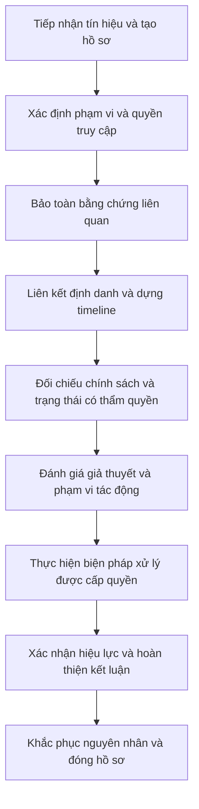

# Audit investigation workflow

## 1. Điều tra audit trong khôi phục tài khoản nhằm trả lời gì?

Điều tra audit là quá trình đối chiếu sự kiện, trạng thái có thẩm quyền và bằng chứng liên quan để giải thích một luồng khôi phục tài khoản. Trong recovery mật khẩu, MFA, passkey hoặc thiết bị xác thực, mục tiêu không chỉ là tìm dòng log báo thành công hay thất bại.

Một cuộc điều tra cần trả lời được:

- Ai hoặc thành phần nào đã khởi tạo, phê duyệt và thực thi các hành động?
- Người yêu cầu đã có bằng chứng gì tại từng bước?
- Quyền recovery nào được phát hành, sử dụng, hết hạn hoặc thu hồi?
- Credential và session nào thực sự bị thay đổi?
- Quyết định có tuân theo chính sách tại thời điểm đó không?
- Điều gì đã được xác nhận, điều gì mới là giả thuyết và điều gì chưa đủ dữ liệu?

Ví dụ xuyên suốt: chủ tài khoản báo rằng họ bị đăng xuất sau một yêu cầu khôi phục MFA mà họ không nhận ra. Audit có sự kiện phê duyệt, thay đổi yếu tố xác thực và yêu cầu thu hồi session. Điều tra phải xác định tác động thực tế và các ranh giới bị vượt qua, đồng thời tránh tự kết luận rằng người tạo yêu cầu chắc chắn là kẻ tấn công.

**Audit là bằng chứng về những gì hệ thống ghi nhận; nó cần được đối chiếu với nguồn có thẩm quyền để kết luận về tác động và danh tính.**

## 2. Tách ba luồng công việc

| Luồng | Mục tiêu | Đầu ra |
| --- | --- | --- |
| Điều tra | Xác định sự kiện, nguyên nhân và mức độ chắc chắn | Timeline, bằng chứng, giả thuyết và kết luận |
| Xử lý sự cố | Giảm tác động đang diễn ra, bảo vệ tài khoản | Các hành động được cấp quyền và kết quả đã xác nhận |
| Khắc phục hệ thống | Loại bỏ nguyên nhân hoặc giảm khả năng tái diễn | Thay đổi chính sách, kỹ thuật hoặc vận hành |

Ba luồng có thể tiến hành song song theo vai trò được phân công. Không cần chờ đủ mọi chi tiết mới thực hiện một biện pháp bảo vệ cần thiết đã được cho phép. Tuy nhiên, hành động bảo vệ cũng phải được ghi lại để không bị nhầm với hoạt động ban đầu.

Người điều tra có quyền đọc audit không mặc nhiên có quyền tắt MFA, đăng ký passkey hoặc phát hành token recovery. Mọi thay đổi nhạy cảm phải đi qua đúng cơ chế phân quyền và quy trình tương ứng.

## 3. Tổng thể quy trình



Đây không phải chuỗi một chiều cứng nhắc. Một thông tin mới có thể yêu cầu mở rộng khoảng thời gian, bổ sung nguồn dữ liệu hoặc sửa giả thuyết. Khi mở rộng phạm vi, cần ghi lý do và giữ ranh giới truy cập.

## 4. Bước 1 — Tiếp nhận và xác định câu hỏi điều tra

Tín hiệu có thể đến từ phản ánh của người dùng, cảnh báo chống lạm dụng, hành vi session bất thường, thao tác hỗ trợ đáng ngờ hoặc chênh lệch giữa trạng thái recovery và credential.

Tạo hồ sơ với một case ID riêng. Hồ sơ ban đầu nên có:

```text
case_id
opened_at
trigger_type
reported_scope
assigned_owner
investigation_questions
initial_severity
access_scope
known_unknowns
```

Không dùng nguyên nội dung email hoặc lời khai làm sự thật đã xác nhận. Ví dụ, “người dùng báo không thực hiện recovery” là một lời báo cần xem xét; “yêu cầu recovery do kẻ tấn công thực hiện” là kết luận đòi hỏi thêm bằng chứng.

Các câu hỏi khởi đầu có thể là:

1. Yêu cầu recovery nào liên quan tới tài khoản được báo?
2. Yếu tố xác thực nào đã thay đổi, vào lúc nào?
3. Yêu cầu có phê duyệt thủ công hay quyết định tự động?
4. Session cũ đã hết hiệu lực theo chính sách chưa?
5. Có dấu hiệu hoạt động còn đang tiếp diễn không?

Mức ưu tiên phụ thuộc tác động và khả năng tiếp diễn, không chỉ số lượng dòng log. Một lần thay passkey trái phép có thể nghiêm trọng hơn nhiều lần nhập sai mã không gây thay đổi trạng thái.

## 5. Bước 2 — Xác định phạm vi bằng định danh tin cậy

Recovery có nhiều loại ID. Cần phân biệt ý nghĩa trước khi tra cứu:

| Định danh | Dùng để liên kết |
| --- | --- |
| Tenant và subject ID | Tài khoản trong đúng miền danh tính |
| Recovery ID | Một yêu cầu khôi phục |
| Attempt ID | Một lần thử ở một bước |
| Operation ID | Một tác động nghiệp vụ có thể được retry |
| Event ID | Một sự kiện audit |
| Session hoặc credential reference | Đối tượng bị tác động, không phải secret |
| Case ID | Hồ sơ điều tra |

Email và số điện thoại có thể thay đổi. Chuyển từ thông tin người báo cung cấp sang định danh nội bộ bằng nguồn tra cứu được phép, rồi giữ ràng buộc tenant và chủ thể trong toàn bộ điều tra.

Một người có thể tồn tại trong nhiều tenant. Không nối dữ liệu chỉ vì tên hiển thị hoặc email trùng nhau nếu mô hình danh tính không khẳng định đó là cùng một chủ thể.

Phạm vi thời gian nên bao gồm phần trước khi recovery bắt đầu và phần sau khi kết thúc, đủ để xem thay đổi kênh liên hệ, phát hành challenge và các tác động tiếp theo. Không chọn một khoảng quá ngắn chỉ vì cảnh báo xuất hiện tại một thời điểm.

Mở rộng sang tài khoản khác chỉ khi có căn cứ và quyền phù hợp. Ví dụ, một actor hỗ trợ có thao tác tương tự trên nhiều tài khoản có thể tạo lý do mở rộng; cùng một IP dùng chung chưa đủ để kết luận mọi người thuộc cùng một chiến dịch.

## 6. Bước 3 — Bảo toàn bằng chứng trước khi thay đổi làm mất dấu

Nguồn dữ liệu có thể có vòng đời ngắn, bị xoay log hoặc thay đổi bởi tác vụ nền. Cần bảo toàn tập dữ liệu liên quan theo quyền và chính sách lưu giữ.

Ưu tiên các nguồn sau:

- Lịch sử trạng thái và audit của yêu cầu recovery.
- Dấu vết phát hành, tiêu thụ, hết hạn và thu hồi challenge.
- Quyết định xác minh danh tính, rủi ro và phê duyệt.
- Thay đổi credential từ dịch vụ quản lý credential.
- Trạng thái và quyết định thu hồi từ dịch vụ session.
- Hoạt động quản trị hoặc hỗ trợ liên quan.
- Sự kiện thông báo và kết quả vận chuyển.
- Outbox, hàng đợi lỗi và dữ liệu định tuyến cần giải thích khoảng trống.

Lưu tham chiếu, phiên bản nguồn, tiêu chí truy vấn, thời điểm thu thập và người thu thập. Nếu tạo bản xuất, ghi phạm vi và dấu kiểm tra toàn vẹn của bản đó.

Một bản ghi nguồn chứng cứ có thể gồm:

```text
artifact_id
case_id
source_system
source_reference
collection_query_reference
collected_at
collected_by
covered_time_range
content_digest
storage_reference
access_policy
```

Dấu băm giúp phát hiện bản đã thu thập bị thay đổi về sau khi có điểm đối chiếu đáng tin cậy. Nó không tự chứng minh rằng nguồn ban đầu trung thực hoặc rằng tập truy vấn đã thu đủ mọi sự kiện.

Không sửa bản gốc để làm timeline dễ đọc. Giữ dữ liệu nguồn được bảo vệ và tạo bản phân tích hoặc bản đã che thông tin riêng, có liên kết tới nguồn.

Không sao chép token, OTP, recovery code, cookie, secret MFA hay ảnh giấy tờ vào ticket thông thường. Dùng tham chiếu tới kho được phân quyền. Nếu phát hiện audit đã chứa secret, vừa bảo vệ bằng chứng vừa xử lý sự cố lộ dữ liệu theo quyền; không phát tán thêm trong quá trình điều tra.

## 7. Bước 4 — Kiểm tra nguồn, độ trễ và độ đầy đủ

Trước khi diễn giải lịch sử, cần biết dữ liệu đến từ đâu và có thể thiếu gì.

### 7.1. Nguồn nào xác nhận được điều gì?

| Nguồn | Điều có thể xác nhận | Điều không tự chứng minh |
| --- | --- | --- |
| Recovery Service | Trạng thái và quyết định trong luồng recovery | Mọi tác động ở dịch vụ khác đã có hiệu lực |
| Credential Service | Thay đổi credential mà dịch vụ đã commit | Actor ngoài đời là chủ tài khoản hợp lệ |
| Session Service | Trạng thái hoặc phiên bản thu hồi thuộc miền session | Mọi điểm thực thi đã áp dụng nếu thiết kế còn độ trễ |
| Dịch vụ thông báo | Ý định gửi và kết quả vận chuyển được báo | Người nhận thực tế đã đọc hoặc đồng ý |
| Hệ thống hỗ trợ | Người thao tác và quyết định được ghi nhận | Tài khoản nhân viên không bị chiếm quyền |
| Client hoặc lời báo | Góc nhìn và dữ liệu phía người báo | Trạng thái có thẩm quyền của backend |

Nếu nguồn tạo sự kiện hoặc tài khoản ghi log bị nghi xâm phạm, cần hạ mức tin cậy và đối chiếu nguồn độc lập. Không chỉ nhìn thấy chữ ký hợp lệ rồi kết luận nội dung nghiệp vụ chắc chắn đúng; khóa ký cũng có thể nằm trong phạm vi bị ảnh hưởng.

### 7.2. Vắng sự kiện không chứng minh vắng hành động

Một sự kiện có thể chưa tới kho tập trung vì outbox chậm, hàng đợi lỗi, mất dữ liệu hoặc khác chính sách lưu giữ. Tìm trạng thái có thẩm quyền và dấu vết tại nguồn trước khi kết luận thao tác chưa xảy ra.

Ghi rõ khoảng trống:

```text
Chưa thấy xác nhận thu hồi trong tập dữ liệu đã thu thập.
Đang đối chiếu operation ID với dịch vụ session.
Chưa đủ căn cứ kết luận session vẫn được chấp nhận.
```

Cách diễn đạt này giữ khác biệt giữa “không có bằng chứng trong tập hiện tại” và “đã chứng minh không xảy ra”.

## 8. Bước 5 — Dựng timeline theo quan hệ nhân quả

Mỗi sự kiện nên có thời gian xảy ra, thời gian ghi nhận, nguồn và liên kết tới yêu cầu hoặc thao tác. Giữ thời gian gốc, đồng thời chuẩn hóa cách hiển thị để tránh nhầm múi giờ.

Không chỉ sắp xếp theo thời gian nhận log. Sự kiện xảy ra trước có thể được vận chuyển sau. Đồng hồ giữa các máy cũng có thể lệch.

Dùng phối hợp:

- Phiên bản chuyển trạng thái trong cùng recovery aggregate.
- Operation ID và các sự kiện yêu cầu, thực thi, xác nhận.
- Causal event ID hoặc tham chiếu nguồn phát sinh.
- Thời gian phía server và thông tin độ lệch nếu có.
- Kết quả tra cứu từ nguồn có thẩm quyền.

Phiên bản của hai dịch vụ khác nhau không tự tạo thứ tự toàn cục. Chỉ so sánh chúng theo quy tắc của từng nguồn.

Ví dụ timeline giả lập:

| Thời gian nguồn | Sự kiện | Diễn giải ban đầu |
| --- | --- | --- |
| 08:01 | RECOVERY_REQUEST_CREATED | Có yêu cầu khôi phục MFA |
| 08:04 | CHANNEL_VERIFIED | Một kênh đạt bước xác minh tương ứng |
| 08:10 | RECOVERY_APPROVED | Có quyết định cho phép tiếp tục |
| 08:11 | CREDENTIAL_CHANGE_CONFIRMED | Dịch vụ credential xác nhận thay đổi |
| 08:11 | SESSION_REVOCATION_REQUESTED | Đã yêu cầu thu hồi, chưa đủ kết luận hiệu lực |
| 08:12 | RECOVERY_COMPLETED | Recovery Service ghi hoàn tất |
| 08:15 | Chủ tài khoản báo bất thường | Có phản ánh cần xác minh |
| 08:18 | SESSION_REVOCATION_CONFIRMED | Nhận xác nhận liên quan thao tác thu hồi |

Timeline này đặt ra câu hỏi về hợp đồng hoàn tất: recovery có được phép hoàn tất trước xác nhận session không? Xác nhận lúc 08:18 mô tả thời điểm hiệu lực nào? Có thể sự kiện đến muộn, hoặc tác động thực sự xảy ra muộn.

Không vội kết luận có lỗi chỉ từ thứ tự hiển thị. Cần đối chiếu thời gian nguồn, trạng thái, phiên bản và chính sách.

Đánh dấu các khoảng chưa xác định thay vì tự điền diễn biến hợp lý nhưng không có chứng cứ.

## 9. Bước 6 — Kiểm tra các ranh giới xác minh và quyền hạn

### 9.1. Danh tính được tuyên bố và danh tính đã xác minh

Người nhập email hoặc recovery ID là một claimant. Chỉ gán actor đã xác thực khi có bằng chứng tương ứng.

Việc một kênh nhận được OTP không tự chứng minh đầy đủ quyền thay MFA, passkey hoặc thiết bị xác thực. Xem chính sách yêu cầu loại bằng chứng nào và bước nào đã thực sự hoàn thành.

Cần đối chiếu:

- Bằng chứng được dùng thuộc tài khoản và tenant nào.
- Kênh liên hệ có vừa thay đổi trước recovery không.
- Kênh hoặc thiết bị đó có nằm trong tình huống bị mất hay nghi chiếm đoạt không.
- Quyết định rủi ro có dùng đúng phiên bản và đúng phạm vi không.
- Phê duyệt có đáp ứng yêu cầu vai trò, thời gian chờ và phân tách trách nhiệm không.

Không yêu cầu người báo gửi lại mật khẩu hoặc recovery code để “đối chiếu điều tra”. Điều tra không được tạo một đường thu thập secret mới.

### 9.2. Quyền dùng một lần và mục đích

Kiểm tra quyền recovery đã được dùng cho đúng mục đích chưa. Token đặt lại mật khẩu không mặc nhiên cho phép bỏ MFA hoặc đăng ký passkey mới.

Tìm dấu vết chuyển trạng thái của challenge, không chỉ sự kiện “token hợp lệ”. Với nghi vấn dùng lặp, đối chiếu các lần thử, phiên bản và kết quả commit tại miền ghi có thẩm quyền.

Hai log kiểm tra token thành công không tự chứng minh hai lần tiêu thụ thành công. Cần biết những tác động nào đã commit và thao tác nào bị từ chối do tranh chấp.

### 9.3. Hoạt động hỗ trợ và dịch vụ

Nếu nhân viên hỗ trợ tham gia, phân biệt người đề nghị, người phê duyệt và dịch vụ thực thi. Xem lịch sử phân quyền và ngữ cảnh thao tác được phép, không chỉ tên tài khoản nhân viên.

Một actor dịch vụ có thể thực thi đúng yêu cầu nhưng yêu cầu được cấp quyền sai từ trước. Điều tra cần lần theo chuỗi ủy quyền thay vì quy mọi hành vi cho worker cuối cùng.

## 10. Bước 7 — Đối soát credential, session và tác động phụ

Một yêu cầu recovery có thể chạm nhiều dịch vụ. Audit điều phối cần được đối chiếu với trạng thái của từng miền.

| Tác động | Điều cần xác minh |
| --- | --- |
| Thay mật khẩu | Thay đổi nào đã commit, thuộc operation nào, phiên bản nào |
| Xóa hoặc thay MFA | Yếu tố cũ và mới được xử lý theo quyết định nào |
| Đăng ký passkey | Credential reference nào được thêm, actor và luồng nào cho phép |
| Thu hồi session | Phạm vi session, phiên bản thu hồi và điều kiện hiệu lực |
| Thu hồi quyền recovery | Challenge hoặc quyền tạm nào còn có thể được sử dụng |
| Thay kênh liên hệ | Thay đổi nào xảy ra trước, trong hoặc sau recovery |
| Gửi cảnh báo | Thông báo nào được tạo, gửi tới kênh nào theo chính sách |

Không truy xuất hoặc thử đăng nhập bằng credential của người dùng để “kiểm tra”. Dùng trạng thái, phiên bản và cơ chế quan sát được cấp quyền.

Nếu API trước đó timeout, tra cứu bằng operation ID hoặc cơ chế đối soát tương ứng. Không phát lại một thay đổi nhạy cảm trong khi chưa biết lần đầu đã có tác động chưa.

Với session, “dịch vụ đã tiếp nhận yêu cầu thu hồi” và “mọi điểm truy cập liên quan đã từ chối session” có thể là hai điều kiện khác nhau. Kết luận phải phù hợp với thiết kế thực thi thực tế.

Nếu audit ghi hoàn tất nhưng tác động bắt buộc chưa đạt, ghi chênh lệch đó như một phát hiện. Không sửa log cũ để nó khớp với trạng thái hiện tại.

## 11. Bước 8 — Xây dựng giả thuyết và tìm bằng chứng phản bác

Một cuộc điều tra dễ lệch hướng nếu chỉ tìm dữ kiện phù hợp nhận định đầu tiên.

Có thể lập bảng:

| Giả thuyết | Bằng chứng cần tìm | Điều có thể phản bác |
| --- | --- | --- |
| Người dùng hợp lệ khôi phục nhưng không nhận ra thông báo | Lịch sử bước xác minh và thiết bị phù hợp, xác nhận qua kênh tin cậy | Bằng chứng cho thấy kênh hoặc thao tác không thuộc họ |
| Kênh recovery bị chiếm quyền | Thay đổi kênh, truy cập bất thường, sử dụng bằng chứng liên quan | Dữ liệu độc lập cho thấy kênh vẫn do người dùng kiểm soát |
| Quy trình hỗ trợ bị lạm dụng | Chuỗi phê duyệt, actor, phạm vi quyền và hồ sơ hỗ trợ | Phê duyệt hợp lệ và bằng chứng đầy đủ được đối chiếu độc lập |
| Race hoặc dùng lại quyền recovery | Nhiều tác động commit liên quan cùng quyền dùng một lần | Chỉ một tác động commit, các log khác là retry hoặc kiểm tra |
| Log tới trễ gây hiểu nhầm | Chênh thời gian nguồn và ghi nhận, outbox tồn đọng | Nguồn có thẩm quyền xác nhận tác động thực sự xảy ra muộn |

Mức kết luận có thể dùng các nhãn nội bộ như:

```text
CONFIRMED
SUPPORTED_BUT_INCOMPLETE
NOT_SUPPORTED_BY_CURRENT_EVIDENCE
UNRESOLVED
```

Đây là nhãn diễn tả mức chắc chắn, không phải xác suất chuẩn hóa. Gắn mỗi nhận định với artifact hoặc sự kiện cụ thể.

IP, vị trí gần đúng và user agent là tín hiệu hỗ trợ. NAT, VPN, mạng dùng chung hoặc dữ liệu client giả mạo có thể làm sai suy luận. Không gán danh tính con người chỉ từ một địa chỉ mạng.

Dữ liệu trong log cũng là dữ liệu đầu vào chưa chắc đáng tin. Ghi chú, URL hoặc trường do claimant cung cấp có thể chứa nội dung đánh lừa người đọc. Không chạy lệnh, mở đường dẫn hoặc làm theo chỉ dẫn chỉ vì chúng xuất hiện trong một artifact.

## 12. Bước 9 — Mở rộng phạm vi có kiểm soát

Nếu đã có căn cứ cho một mẫu lạm dụng, mở rộng theo mối liên kết có ý nghĩa:

- Các recovery dùng cùng quyết định hoặc cùng actor hỗ trợ đáng ngờ.
- Các yêu cầu cùng bị ảnh hưởng bởi một phiên bản chính sách lỗi.
- Các thao tác credential liên quan cùng phạm vi ủy quyền.
- Những tài khoản có cùng dấu hiệu sử dụng quyền recovery sai mục đích.
- Cùng một khoảng sự cố hạ tầng gây mất hoặc trễ xác nhận.

Giữ điều kiện tenant trong truy vấn và chỉ mở rộng chéo tenant khi được phép. Tài khoản điều tra phải có quyền phù hợp; một màn hình hỗ trợ thuận tiện không nên cho phép tra cứu mọi tenant.

Truy vấn cần có giới hạn thời gian và phạm vi. Dùng tham số được kiểm soát, tránh ghép trực tiếp dữ liệu người báo vào ngôn ngữ truy vấn.

Kết quả mở rộng cần tách rõ:

```text
Affected confirmed   = đã có bằng chứng tác động
Potentially affected = nằm trong phạm vi có khả năng liên quan
Reviewed unaffected = đã đối chiếu và không thấy tác động được xét
Unknown             = chưa đủ dữ liệu
```

Không báo mọi tài khoản nằm trong cùng truy vấn là đã bị chiếm đoạt. Phạm vi rà soát và phạm vi ảnh hưởng là hai tập khác nhau.

## 13. Bước 10 — Xử lý sự cố và xác nhận hiệu lực

Biện pháp có thể gồm tạm giữ một yêu cầu recovery đáng ngờ, vô hiệu hóa quyền recovery còn hiệu lực, xử lý credential mới bị nghi trái phép hoặc thu hồi session theo phạm vi được duyệt.

Mỗi hành động cần có:

- Người hoặc vai trò cấp quyền.
- Phạm vi tài khoản, yêu cầu và đối tượng chịu tác động.
- Lý do, thời điểm và operation ID.
- Kết quả thực thi có thẩm quyền.
- Điều còn chờ xác nhận và phương án tiếp theo.

Không để một báo cáo chưa xác minh trở thành cách ép hệ thống khóa tài khoản nạn nhân tùy ý. Cân nhắc bằng chứng, mức khẩn cấp và tác động tới người dùng hợp lệ.

Nếu người dùng đã mất MFA, không giải quyết sự cố bằng cách tắt mọi xác minh rồi gửi quyền truy cập tới email mới chưa xác minh. Quy trình phục hồi sau sự cố vẫn phải giữ ranh giới danh tính.

Nếu cần liên hệ người dùng, chọn kênh theo chính sách hiện hành và tình trạng nghi chiếm quyền. Thông báo không nên tiết lộ secret, hồ sơ bằng chứng hoặc chi tiết giúp đối thủ điều chỉnh lần thử.

Một lệnh thu hồi được trả mã thành công chưa chắc chứng minh hiệu lực cuối cùng nếu API chỉ nhận công việc. Đóng bước xử lý sau khi đã kiểm tra điều kiện cần thiết theo hợp đồng dịch vụ.

Ghi mọi hành động điều tra và xử lý vào timeline riêng có liên kết. Nhờ vậy, một thay đổi credential do đội xử lý thực hiện không bị nhầm thành tác động của recovery ban đầu.

## 14. Bước 11 — Hoàn thiện kết luận và báo cáo

Báo cáo nên cho người chưa tham gia điều tra hiểu được kết luận và giới hạn của nó.

Một cấu trúc hữu ích:

```text
Case summary
  Câu hỏi điều tra và phạm vi

Confirmed facts
  Dữ kiện đã xác nhận, tham chiếu bằng chứng

Timeline
  Quan hệ nhân quả, thời gian và khoảng chưa xác định

Identity and authorization findings
  Bằng chứng, chính sách, actor và chuỗi phê duyệt

Actual impact
  Credential, session, quyền recovery và tài khoản liên quan

Containment
  Hành động đã thực hiện, kết quả và phần còn chờ

Root cause and contributing conditions
  Nguyên nhân đã có căn cứ và điều kiện góp phần

Uncertainties
  Dữ liệu thiếu và giới hạn kết luận

Follow-up
  Chủ sở hữu, hành động khắc phục và điều kiện hoàn tất
```

Tách rõ dữ kiện khỏi suy luận. Ví dụ:

> Đã xác nhận credential mới được tạo bởi operation op-73. Bằng chứng hiện có chưa đủ xác định người ngoài đời điều khiển phiên recovery tại thời điểm đó.

Câu này hữu ích hơn việc viết “kẻ tấn công đã đăng ký passkey” khi chỉ có ID phiên.

Kết quả có thể là hoạt động hợp lệ, lạm dụng được xác nhận, lỗi quy trình, lỗi kỹ thuật hoặc chưa đủ kết luận. Không ép mọi hồ sơ vào hai nhãn “an toàn” và “bị tấn công”.

Báo cáo chia sẻ rộng nên là bản đã giảm dữ liệu. Bằng chứng gốc và thông tin nhạy cảm vẫn nằm ở kho có phân quyền, với thời hạn truy cập và lưu giữ phù hợp.

## 15. Ví dụ kết luận từ timeline ban đầu

Giả sử đối soát bổ sung cho thấy:

1. Credential Service xác nhận yếu tố mới được tạo lúc 08:11.
2. Session Service xác nhận phiên bản thu hồi đã có hiệu lực lúc 08:11:30.
3. Sự kiện xác nhận thu hồi tới kho audit lúc 08:18 vì hàng đợi bị chậm.
4. Chính sách áp dụng yêu cầu phiên bản thu hồi có hiệu lực trước khi recovery hoàn tất.
5. Recovery hoàn tất lúc 08:12, sau thời điểm hiệu lực được xác nhận tại nguồn.

Có thể kết luận thứ tự hiển thị trong kho audit tập trung đã gây hiểu nhầm. Chưa có căn cứ từ những dữ kiện này để nói recovery hoàn tất trước thu hồi.

Tuy nhiên, câu hỏi “người yêu cầu có phải chủ tài khoản hợp lệ không?” vẫn cần đối chiếu bằng chứng xác minh và chuỗi phê duyệt. Tính đúng của thứ tự kỹ thuật không tự chứng minh tính đúng của danh tính.

Nếu nguồn session chỉ xác nhận đã nhận yêu cầu lúc 08:11 và hiệu lực thực sự bắt đầu lúc 08:18, kết luận về hợp đồng hoàn tất sẽ khác. Cùng một tên sự kiện có thể dẫn tới diễn giải sai nếu không hiểu điều nguồn đó xác nhận.

## 16. Đóng hồ sơ và cải thiện khả năng điều tra

Chỉ đóng hồ sơ theo tiêu chí đã xác định: phạm vi đã được đánh giá, tác động cần xử lý đã được xác nhận, phần chưa rõ được ghi minh bạch và công việc tiếp theo có người chịu trách nhiệm.

Các cải thiện có thể phát sinh:

| Khoảng trống phát hiện | Hướng cải thiện |
| --- | --- |
| Không liên kết được thay đổi credential với recovery | Bổ sung operation ID và tham chiếu nhân quả |
| Không biết chính sách tại lúc quyết định | Lưu phiên bản và decision reference |
| Lẫn “đã yêu cầu” với “đã có hiệu lực” | Tách sự kiện và định nghĩa kết quả rõ ràng |
| Kho audit chậm nhưng không có tín hiệu | Theo dõi độ trễ, tồn đọng và khoảng trống vận chuyển |
| Actor chưa xác minh bị ghi như chủ tài khoản | Tách claimant, authenticated actor và subject |
| Hỗ trợ đọc được quá nhiều bằng chứng | Thu hẹp quyền và cung cấp bản hiển thị giảm dữ liệu |
| Bản xuất điều tra bị lưu rải rác | Quản lý artifact, truy cập, thời hạn và việc xóa bản sao |

Không tự xóa bằng chứng chỉ vì hồ sơ được đóng. Áp dụng vòng đời lưu giữ, hạn chế truy cập và cơ chế giữ lại được cấp quyền nếu có. Cũng không giữ mọi dữ liệu vô thời hạn chỉ vì có thể hữu ích về sau.

Một quy trình điều tra audit tốt giúp truy ra tác động thực tế, giữ rõ mức chắc chắn của từng kết luận và bảo vệ người dùng trong suốt quá trình xử lý. Giá trị của nó nằm ở khả năng nối các quyết định và bằng chứng thành một lịch sử có thể kiểm chứng, thay vì chỉ tập hợp nhiều dòng log.
