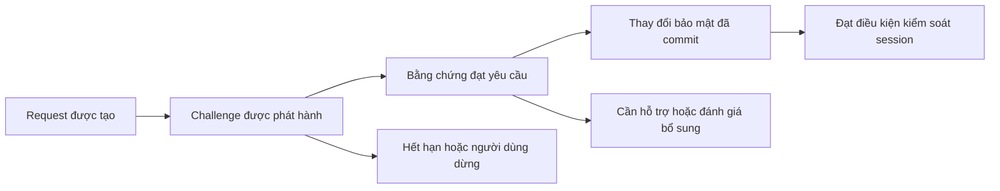
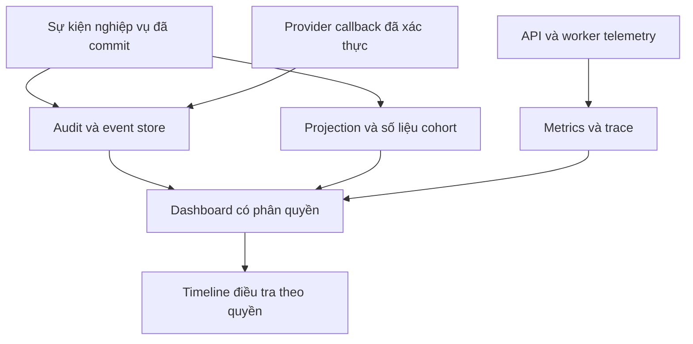

# Recovery dashboard design — Thiết kế dashboard cho luồng khôi phục tài khoản

## 1. Dashboard cần hỗ trợ quyết định gì?

Một dashboard khôi phục tài khoản cần giúp người vận hành phát hiện và khoanh vùng những vấn đề ảnh hưởng đến khả năng lấy lại quyền truy cập một cách an toàn. Chỉ hiển thị số yêu cầu và tỷ lệ thành công sẽ không đủ.

Một hệ thống có thể trả HTTP 200 đều đặn nhưng không gửi được mã xác minh. Tỷ lệ hoàn tất cũng có thể tăng vì một chính sách xác minh bị vô hiệu hóa, hoặc giảm vì hệ thống đang chặn đúng một đợt lạm dụng.

Trong phạm vi khôi phục khi mất mật khẩu, MFA, passkey hoặc thiết bị xác thực, dashboard nên trả lời bốn câu hỏi:

1. **Dịch vụ có hoạt động không?** API, hàng đợi, dữ liệu và các phụ thuộc có đáp ứng đúng hợp đồng?
2. **Người dùng đang mắc ở đâu?** Tạo yêu cầu, nhận hướng dẫn, chứng minh danh tính, đăng ký phương thức mới hay hoàn tất?
3. **Các kiểm soát an toàn có biểu hiện bất thường không?** Chặn lạm dụng, sử dụng token một lần, thay factor và thu hồi session đang diễn ra thế nào?
4. **Dữ liệu trên màn hình có đáng tin không?** Có thiếu sự kiện, mất scrape, callback trễ hoặc thay đổi định nghĩa chỉ số?

Dashboard phục vụ quan sát và điều tra. Quyết định cấp quyền recovery vẫn do hệ thống giao dịch và chính sách bảo mật thực thi; một biểu đồ màu xanh không tạo ra quyền bỏ qua xác minh.

## 2. Chọn đối tượng sử dụng và phạm vi dữ liệu

Các nhóm khác nhau cần những mức chi tiết khác nhau.

| Người dùng dashboard | Câu hỏi chính | Mức dữ liệu phù hợp |
| --- | --- | --- |
| SRE hoặc người trực vận hành | Có sự cố đang ảnh hưởng recovery không? | Chỉ số tổng hợp, độ trễ, lỗi, hàng đợi và phụ thuộc |
| Nhóm an ninh hoặc chống gian lận | Lưu lượng có dấu hiệu lạm dụng hoặc vượt kiểm soát không? | Sự kiện và kết quả chính sách đã chuẩn hóa, truy cập điều tra có kiểm soát |
| Nhóm hỗ trợ | Một trường hợp được phân quyền đang ở bước nào? | Timeline tối thiểu của đúng trường hợp được giao |
| Nhóm sản phẩm | Người dùng hợp lệ gặp khó khăn ở bước nào? | Funnel theo cohort, phương thức recovery và thời gian chờ |
| Người quản lý dịch vụ | Mức độ đáp ứng cam kết thay đổi ra sao? | SLI, xu hướng và ảnh hưởng đã được tổng hợp |

Không cần đưa tất cả vào một trang. Có thể có một trang tổng quan chung và các trang chuyên sâu với quyền truy cập riêng.

Phạm vi mặc định phải rõ ràng: môi trường, vùng, dịch vụ, khoảng thời gian và loại recovery. Dashboard production không nên tự trộn dữ liệu staging hoặc các request tổng hợp dùng để theo dõi hệ thống.

Với hệ thống nhiều tenant, lọc hiển thị chưa đủ để bảo vệ dữ liệu. API truy vấn, nguồn dữ liệu và đường dẫn drill-down cũng phải thực thi phân quyền tenant. Không dựa vào việc người dùng “không thấy nút chọn tenant khác”.

## 3. Định nghĩa đơn vị đo trước khi vẽ biểu đồ

Một lần người dùng nhấn nút, một HTTP request, một recovery request và một lần gửi SMS là những đơn vị khác nhau.

Ví dụ:

```text
Một recovery request R:
    3 HTTP request do retry phía client
    2 lần gửi email
    4 lần thử nhập mã
    1 lần xác minh thành công
    1 lần commit thay đổi bảo mật
```

Nếu cộng tất cả thành “11 recovery”, dashboard sẽ không còn phản ánh đúng hành trình.

Nên thống nhất từ điển chỉ số:

| Khái niệm | Đơn vị | Quy tắc đếm |
| --- | --- | --- |
| API attempt | Một lần xử lý HTTP hoặc RPC | Đếm mỗi lần xử lý theo thời điểm kết thúc đã định nghĩa |
| Recovery request | Một ý định recovery có ID bền vững | Đếm một lần khi tạo thành công |
| Challenge attempt | Một lần thử đáp ứng challenge | Phân biệt đúng, sai, hết hạn và bị giới hạn |
| Notification attempt | Một lần nộp yêu cầu gửi | Phân biệt với notification nghiệp vụ và kết quả chuyển phát |
| Recovery completion | Một thay đổi bảo mật đã commit | Đếm theo thao tác nghiệp vụ, không đếm lại khi trả receipt cho retry |
| Session revocation work | Một yêu cầu thực thi hàng rào thu hồi | Phân biệt thời điểm ghi quyết định và thời điểm các bên thực thi đạt điều kiện |

Phản hồi chung cho một định danh tài khoản không tồn tại có thể vẫn là xử lý API đúng. Nó không nhất thiết tạo một recovery request thật. Cần tách số lượt gọi công khai khỏi số workflow thực sự được tạo trong hệ thống, đồng thời bảo vệ dữ liệu phân biệt này khỏi người dùng không có quyền.

Mỗi metric quan trọng cần ghi rõ nguồn, đơn vị, thời điểm ghi nhận, các trường hợp loại trừ và người chịu trách nhiệm. Đổi ý nghĩa metric phải được quản lý như một thay đổi hợp đồng dữ liệu.

## 4. Bố cục dashboard theo thứ tự điều tra

Một bố cục thực dụng đi từ ảnh hưởng tổng thể tới nguyên nhân có thể kiểm chứng:

```text
+------------------------------------------------------------------+
| Phạm vi: production / vùng / loại recovery / thời gian / data age  |
+------------------------------------------------------------------+
| API system error | p95 server latency | pending recovery | dữ liệu |
+------------------------------------------------------------------+
| Lưu lượng và kết quả chính sách | Chú thích deploy/policy/incident |
+------------------------------------------------------------------+
| Funnel theo cohort và nhánh recovery | Tuổi request đang chờ       |
+------------------------------------------------------------------+
| Gửi hướng dẫn | Xác minh bằng chứng | Commit | Thu hồi session      |
+------------------------------------------------------------------+
| Tín hiệu lạm dụng và an toàn | Hàng đợi hỗ trợ/đối soát              |
+------------------------------------------------------------------+
| Database / worker / provider | Telemetry lag và sự kiện bị loại    |
+------------------------------------------------------------------+
```

Mỗi panel nên có:

- Tên phản ánh chính xác điều đang đo.
- Đơn vị và cửa sổ thời gian.
- Bộ lọc đang áp dụng.
- Số lượng mẫu hoặc mức bao phủ khi cần.
- Trạng thái không có dữ liệu.
- Đường dẫn điều tra hoặc runbook tương ứng.

Không dùng một ô “Recovery health: 99%” nếu người xem không biết mẫu số, loại request và ý nghĩa của phần trăm đó. Một tổng điểm tùy ý có thể che lỗi nghiêm trọng của một bước ít lưu lượng.

Màu sắc cần đi kèm nhãn hoặc ký hiệu. Trạng thái `UNKNOWN`, thiếu dữ liệu và bình thường phải khác nhau; không biến tất cả thành màu xanh vì chưa ghi nhận lỗi.

## 5. Lớp sức khỏe dịch vụ: tốc độ, tải, lỗi và giới hạn

Google SRE đề xuất theo dõi bốn nhóm tín hiệu: latency, traffic, errors và saturation. Với recovery, có thể dùng chúng làm nền rồi bổ sung trạng thái nghiệp vụ và an toàn. Xem [Monitoring Distributed Systems](https://sre.google/sre-book/monitoring-distributed-systems/).

| Nhóm panel | Ví dụ trong recovery | Cách đọc |
| --- | --- | --- |
| Traffic | API attempt theo bước và phương thức | Nhu cầu đang tăng ở điểm nào |
| Latency | p50, p95 và p99 thời gian xử lý phía server | Một nhóm request có đang chậm bất thường |
| Errors | Timeout, lỗi lưu trữ, lỗi gọi provider và lỗi commit | Dịch vụ có thực hiện được trách nhiệm kỹ thuật |
| Saturation | Worker bận, pool kết nối, backlog và tuổi job cũ nhất | Nút thắt có đang tích tụ |

Phân biệt lỗi hệ thống với kết quả chính sách:

```text
system_error:
    không đọc được trạng thái recovery
    provider timeout
    transaction không thể hoàn tất do sự cố hạ tầng

policy_outcome:
    challenge không đúng
    token hết hạn
    yêu cầu bị rate limit
    bằng chứng chưa đủ
    cần đánh giá bổ sung
```

Các kết quả chính sách vẫn có thể gây trải nghiệm xấu hoặc phản ánh cấu hình sai, nhưng gộp chúng vào lỗi hạ tầng sẽ làm mất khả năng chẩn đoán.

Cũng không dùng HTTP status làm nguồn duy nhất. Một endpoint trả 200 để tránh lộ sự tồn tại tài khoản vẫn có thể gặp lỗi nội bộ cần được ghi nhận an toàn. Ngược lại, một phản hồi từ chối có chủ đích không nhất thiết là dịch vụ bị hỏng.

Phân tích latency theo kết quả. Nếu các request lỗi trả về rất nhanh, trung bình chung có thể giảm trong lúc trải nghiệm thực tế xấu đi. Số mẫu thấp cũng cần được hiển thị cạnh percentile.

## 6. Funnel theo cohort thay vì chia hai tổng không cùng tập

Một funnel recovery có thể gồm:



Đây là mô hình minh họa. Một số nhánh dùng recovery code lưu sẵn không cần gửi email; nhánh identity proofing có thể cần chờ đánh giá. Không ép mọi hành trình qua cùng một chuỗi bước rồi coi bước không áp dụng là thất bại.

Lỗi tính phổ biến:

```text
completion_rate = số completion trong 1 giờ / số request tạo trong 1 giờ
```

Tử số có thể thuộc các request tạo từ giờ trước. Khi lưu lượng biến động, kết quả có thể sai lệch hoặc vượt 100%.

Một chỉ số cohort rõ ràng hơn:

```text
C = tập recovery request được tạo trong khoảng [t0, t1)

completion_within_H =
    số request thuộc C hoàn tất trong H kể từ lúc tạo
    ------------------------------------------------
    số request thuộc C đã có đủ H thời gian quan sát
```

Phải xác định rõ chính sách đối với request chưa có đủ thời gian theo dõi. Có thể chỉ công bố cohort đã trưởng thành, hoặc hiển thị riêng kết quả tạm thời với số lượng còn đang chờ. Không coi request mới tạo vài giây là “đã bỏ cuộc”.

Ví dụ minh họa, với H bằng 30 phút:

| Cohort | Đủ thời gian quan sát | Hoàn tất trong H | Còn thiếu thời gian quan sát |
| --- | --- | --- | --- |
| 09:00–09:10 | 100 | 76 | 0 |
| 10:00–10:10 tại thời điểm 10:15 | Chưa đủ cho toàn bộ cohort | Chưa kết luận | Có request đang chờ |

Ba mươi phút chỉ là tham số minh họa, không phải thời hạn phù hợp cho mọi quy trình. Nhánh hỗ trợ thủ công có thể cần cửa sổ khác.

Ngoài tỷ lệ hoàn tất, hiển thị số tuyệt đối, request hết hạn, request bị hủy, request chờ hỗ trợ và phân bố thời gian ở từng bước.

## 7. Những panel đặc thù cho khôi phục tài khoản

### 7.1. Token và challenge

Theo dõi số lần phát hành, thử dùng, dùng thành công, hết hạn, bị thay thế và bị từ chối do đã tiêu thụ.

Một đợt tăng lỗi “đã dùng” có thể do người dùng nhấn lặp, client retry hoặc replay có chủ đích. Dashboard cần liên kết tới dữ liệu điều tra có phân quyền, thay vì tự khẳng định đó là tấn công.

Một tỷ lệ token đúng cao cũng chưa chứng minh an toàn. Nó có thể xuất phát từ một chiến dịch phishing, rò rỉ kênh nhận hoặc thay đổi chính sách làm giảm điều kiện kiểm tra.

### 7.2. Notification

Tách những mốc sau:

- Ý định gửi đã được ghi bền vững.
- Provider đã nhận.
- Provider báo chuyển phát.
- Chuyển phát thất bại.
- Kết quả chưa xác định.
- Còn yêu cầu đối soát hoặc fallback.

Không dùng “đã chuyển phát” để suy ra “người dùng đã xác minh”. Theo dõi tuổi các notification chưa có kết quả và thời gian còn lại trước khi challenge hết hạn.

### 7.3. Identity proofing và hỗ trợ

Hiển thị backlog theo loại công việc, tuổi hồ sơ cũ nhất, thời gian phản hồi và kết quả đã chuẩn hóa. Phân biệt thời gian xử lý tự động, thời gian chờ nhân sự và thời gian chờ người dùng.

Các hồ sơ đang chờ thường gây ảnh hưởng lớn nhưng chưa tạo một observation “đã hoàn tất”. Vì vậy, chỉ dùng histogram thời gian xử lý của hồ sơ đã xong có thể che backlog đang tăng.

### 7.4. Commit thay đổi bảo mật

Theo dõi kết quả commit, xung đột phiên bản, thao tác bị từ chối vì trạng thái thay đổi và các kết quả commit chưa xác định đang cần đối soát.

Đếm completion từ kết quả nghiệp vụ đã commit, không đếm từ lúc bắt đầu method hoặc lúc trả HTTP thành công. Retry nhận lại cùng một receipt không tạo thêm completion.

### 7.5. Session sau recovery

Hiển thị các công việc thu hồi còn chờ, độ trễ thực thi và sự kiện một thành phần chưa đạt hàng rào phiên bản theo hợp đồng.

Nếu gateway dùng cache trạng thái session, độ trễ invalidation là một tín hiệu quan trọng. Có sự kiện “đã phát lệnh thu hồi” chưa đủ để kết luận mọi nơi đã từ chối session cũ.

Dashboard phản ánh mức bao phủ của cơ chế đo. Không thấy sự kiện chấp nhận session cũ không tự chứng minh bất biến luôn được giữ, nhất là khi telemetry chỉ lấy mẫu.

## 8. Thiết kế metric và truy vấn có thể giải thích

Một bộ tên metric minh họa:

| Metric | Loại | Ý nghĩa |
| --- | --- | --- |
| `recovery_api_attempts_total` | Counter | API attempt theo bước và kết quả kỹ thuật |
| `recovery_api_duration_seconds` | Histogram | Thời gian xử lý API phía server |
| `recovery_transition_total` | Counter | Chuyển trạng thái nghiệp vụ đã được ghi nhận |
| `recovery_pending_requests` | Gauge | Request đang chờ theo bước |
| `recovery_oldest_pending_created_timestamp_seconds` | Gauge | Thời điểm tạo request chờ lâu nhất trong nhóm |
| `recovery_notification_attempts_total` | Counter | Lần gửi theo kênh và kết quả nộp yêu cầu |
| `recovery_reconciliation_pending` | Gauge | Công việc chưa xác định cần đối soát |
| `recovery_telemetry_lag_seconds` | Gauge | Độ trễ của pipeline quan sát theo định nghĩa đã công bố |

Counter đo số sự kiện tích lũy; gauge đo trạng thái có thể tăng hoặc giảm. Khi vẽ tốc độ counter, phải xử lý reset do tiến trình khởi động lại. Không dùng tốc độ thay đổi của gauge như thể đó là số request phát sinh.

Prometheus lưu ý rằng mỗi tổ hợp label tạo thêm time series và chi phí tài nguyên. Vì vậy, cần kiểm soát cardinality thay vì đưa mọi ID vào metric. Xem [Instrumentation](https://prometheus.io/docs/practices/instrumentation/).

Các chiều phân tích có thể phù hợp nếu tập giá trị được kiểm soát:

```text
environment
region
recovery_purpose
factor_class
step
outcome_class
channel
```

Tránh dùng account ID, recovery ID, email, số điện thoại, địa chỉ IP hoặc token làm label. Một ID đã hash vẫn có thể tạo cardinality không giới hạn và vẫn có khả năng liên kết hành vi.

Phân tích theo tenant hoặc policy version có nhiều giá trị có thể phù hợp hơn với kho sự kiện hoặc hệ thống phân tích chuyên dụng, có lọc quyền và giới hạn chi phí truy vấn.

Ví dụ truy vấn SQL phân loại kết quả kỹ thuật từ một bảng đã chuẩn hóa:

```sql
SELECT
    step,
    COUNT(*) AS attempts,
    COUNT(*) FILTER (
        WHERE technical_outcome = 'SYSTEM_ERROR'
    ) AS system_errors,
    COUNT(*) FILTER (
        WHERE technical_outcome = 'SYSTEM_ERROR'
    )::numeric / NULLIF(COUNT(*), 0) AS system_error_ratio
FROM recovery_api_observation
WHERE observed_at >= :from_time
  AND observed_at < :to_time
  AND environment = :environment
  AND region = :region
GROUP BY step;
```

Truy vấn minh họa đếm API attempt, không tính tỷ lệ hoàn tất recovery. Nếu không có mẫu, kết quả tỷ lệ phải là không xác định hoặc không có dữ liệu; không tự gán thành 0% lỗi.

Để tính tuổi request cũ nhất, có thể lấy thời gian hiện tại trừ timestamp tạo của request còn chờ lâu nhất. Khi không còn request, hiển thị “không có request chờ”; khi exporter mất dữ liệu, hiển thị “không biết”. Hai trường hợp này khác nhau.

## 9. SLI và SLO: đo đúng trách nhiệm của hệ thống

Một SLI chỉ có ý nghĩa khi good event và eligible event được định nghĩa rõ.

Ví dụ SLI xử lý kỹ thuật của một bước:

```text
eligible:
    các API attempt hợp lệ thuộc phạm vi đã công bố

good:
    attempt kết thúc bằng kết quả kỹ thuật đúng hợp đồng,
    gồm nhận yêu cầu bền vững hoặc quyết định chính sách hợp lệ

bad:
    lỗi hệ thống hoặc vi phạm điều kiện thời gian theo hợp đồng
```

Kết quả chính sách từ chối có thể là good event về độ tin cậy kỹ thuật, nhưng vẫn được phân tích riêng về an toàn và trải nghiệm. Không dùng cách phân loại này để che một chính sách sai đang chặn người dùng hợp lệ.

Một SLI khác có thể đo thời gian từ khi server nhận lệnh hoàn tất có đủ quyền tới khi có kết quả commit bền vững. Không đưa thời gian người dùng đi tìm thiết bị hoặc chờ bộ phận hỗ trợ vào cùng histogram xử lý server.

Với pipeline bất đồng bộ, cần đo cả kết quả hoàn tất lẫn công việc quá hạn đang chờ. Chỉ đếm những job đã kết thúc có thể khiến hệ thống trông bình thường khi job đang bị kẹt.

Mỗi SLO cần:

- Cửa sổ đánh giá.
- Mục tiêu và phạm vi áp dụng.
- Nguồn sự kiện.
- Cách xử lý dữ liệu thiếu.
- Các ngoại lệ được phê duyệt.
- Người chịu trách nhiệm và hành động khi vi phạm.

Không lấy một con số như 99,9% từ dịch vụ khác rồi mặc định áp dụng cho mọi bước recovery. Các nhánh tự động và thủ công có trách nhiệm thời gian khác nhau.

## 10. Tín hiệu an toàn và giới hạn của việc diễn giải

Panel an toàn có thể bao gồm:

| Tín hiệu | Điều cần tìm hiểu thêm |
| --- | --- |
| Request tăng đột biến | Chiến dịch lạm dụng, sự cố đăng nhập hay một thay đổi sản phẩm |
| Rate-limit denial tăng | Đang chặn đúng hành vi hay cấu hình quá chặt |
| Thử dùng token hết hạn tăng | Chuyển phát chậm, giao diện gây nhầm lẫn hay hành vi tự động |
| Đổi MFA hoặc passkey tăng sau recovery | Nhu cầu thực tế, thay đổi flow hay hoạt động đáng ngờ |
| Khiếu nại “không phải tôi” tăng | Mức độ xác nhận sự cố, tác động và độ trễ tiếp nhận |
| Chênh lệch trước/sau policy | Cùng cohort và loại request có thật sự so sánh được |

Chú thích thời điểm deploy, đổi provider, đổi policy và incident lên trục thời gian. Sự trùng thời điểm hỗ trợ khoanh vùng, nhưng chưa chứng minh quan hệ nhân quả.

Các chỉ số an toàn cũng có độ trễ. Một tài khoản bị chiếm đoạt có thể chỉ được báo cáo nhiều giờ hoặc nhiều ngày sau. Tỷ lệ “chưa có khiếu nại” không đồng nghĩa với tỷ lệ “khôi phục an toàn”.

Không tối ưu dashboard chỉ để tăng completion. Nếu giảm điều kiện xác minh làm completion tăng nhưng nguy cơ chiếm đoạt cao hơn, đó không phải cải thiện.

Tương tự, “chặn nhiều hơn” chưa chứng minh chống lạm dụng tốt hơn nếu người dùng hợp lệ bị đẩy vào nhánh mất quyền truy cập. Cần kết hợp kết quả điều tra và phản hồi hỗ trợ đã có căn cứ.

## 11. Liên kết metrics, log, trace và audit mà không lộ bí mật

Mỗi nguồn có vai trò riêng:



Metrics giúp nhận biết xu hướng. Trace giúp theo dõi một lần xử lý qua các thành phần. Audit mô tả sự kiện bảo mật bền vững và ai đã thực hiện hành động.

Không dùng một trace được lấy mẫu làm nguồn chuẩn để đếm đầy đủ completion. Một counter tăng sau commit cũng có thể bị thiếu nếu tiến trình dừng trước khi xuất metric. Với báo cáo cần độ chính xác nghiệp vụ, dùng sự kiện bền vững có chống trùng và cơ chế đối soát.

Drill-down nên mang theo phạm vi và khoảng thời gian, rồi chỉ cho người có quyền tra cứu ID cần thiết. Không đặt token hoặc URL khôi phục đầy đủ trong liên kết dashboard.

OWASP khuyến nghị loại bỏ hoặc bảo vệ dữ liệu nhạy cảm như password, access token và giá trị định danh session trong log, đồng thời kiểm soát quyền truy cập dữ liệu ghi nhận. Nguyên tắc này cũng áp dụng cho dữ liệu phía sau dashboard. Xem [OWASP Logging Cheat Sheet](https://cheatsheetseries.owasp.org/cheatsheets/Logging_Cheat_Sheet.html#data-to-exclude).

Thông tin danh tính, tài liệu xác minh và địa chỉ liên hệ chỉ nên xuất hiện khi thật sự cần, trong một chế độ điều tra có quyền riêng. Tránh bảng tổng quan liệt kê hàng loạt người đang gặp sự cố recovery.

Dashboard mặc định nên chỉ đọc. Các hành động thay MFA, thu hồi session hoặc phê duyệt recovery cần một luồng riêng có xác minh quyền, lý do thao tác và audit; không gắn hành động nhạy cảm vào một ô biểu đồ chỉ vì tiện vận hành.

## 12. Quan sát chính pipeline quan sát

Một dashboard không có lỗi có thể do collector đã ngừng nhận dữ liệu.

Cần hiển thị:

- Thời điểm dữ liệu được cập nhật thành công gần nhất.
- Độ trễ giữa sự kiện và lúc có thể truy vấn.
- Số sự kiện bị loại vì schema không hợp lệ.
- Sự kiện trùng được nhận và xử lý.
- Độ trễ callback và các sự kiện chờ ánh xạ.
- Tình trạng scraper, exporter và worker tổng hợp.
- Phiên bản định nghĩa metric hoặc projection đang áp dụng.

Nếu biểu đồ không có mẫu, giữ khoảng trống hoặc nhãn “No data”. Không nội suy thành hoạt động bình thường hoặc tự thay bằng số 0.

Đối với thời gian, ghi nhận rõ thời điểm nghiệp vụ và thời điểm tiếp nhận. Callback đến muộn cần được gán đúng cửa sổ phân tích theo định nghĩa metric; không tùy ý dùng thời gian đến để sửa các cohort đã báo cáo.

Nếu dùng synthetic monitoring, phân biệt request tổng hợp với người dùng thật. Nó cần tài khoản và đích nhận được kiểm soát, giới hạn tần suất, đồng thời không làm tăng tải hoặc gửi thông báo tới khách hàng ngoài ý muốn. Synthetic thành công ở một nhánh cũng chưa đại diện cho mọi phương thức recovery.

Thời hạn lưu của dữ liệu chi tiết và dữ liệu tổng hợp có thể khác nhau. Xóa một bản ghi khỏi màn hình không đồng nghĩa dữ liệu đã được xóa khỏi cache, bản export hoặc kho log; chính sách lưu giữ cần bao phủ các nơi đó.

## 13. Một tình huống đọc dashboard

Giả sử trong một vùng, số request recovery tăng 40% so với khoảng thời gian tương đương. API latency và lỗi hệ thống chưa thay đổi nhiều, nhưng số challenge hết hạn bắt đầu tăng.

Một cách điều tra:

1. Kiểm tra dữ liệu có còn cập nhật và phạm vi đang chọn có đúng không.
2. Xem request tăng ở phương thức nào, có tách lưu lượng tổng hợp và retry chưa.
3. Mở panel notification: provider acceptance bình thường nhưng delivery chưa xác định đang tăng.
4. Xem tuổi notification và callback lag để phân biệt chậm gửi với chậm ghi nhận kết quả.
5. So sánh cohort đã đủ thời gian quan sát; không kết luận từ cohort vừa tạo.
6. Đối chiếu thời điểm đổi provider, policy và deploy.
7. Kiểm tra mức ảnh hưởng và runbook phù hợp trước khi đề xuất biện pháp.

Tăng 40% trong ví dụ chỉ là dữ liệu tình huống. Nó không phải ngưỡng cảnh báo chung.

Nếu callback pipeline bị chậm nhưng thư vẫn đến, tác động khác với tình huống provider không chuyển phát. Nếu worker queue bị kẹt trước khi gửi, độ tuổi công việc sẽ giúp tìm nút thắt. Không nên xử lý cả ba bằng cách nới thời hạn token hoặc tắt kiểm soát chống lạm dụng.

## 14. Đặc tả tối thiểu cho một panel

Trước khi triển khai, có thể mô tả panel bằng một hợp đồng ngắn:

```yaml
panel:
  title: Request đang chờ xác minh quá thời gian quan sát
  purpose: Phát hiện tích tụ ở bước xác minh
  unit: recovery_request
  source: durable_recovery_projection
  population:
    environment: production
    step: awaiting_proof
  time_basis: request_entered_step_at
  aggregation: count_and_oldest_age
  breakdown:
    - region
    - recovery_purpose
  no_data_behavior: unknown
  empty_population_behavior: no_pending_requests
  freshness:
    show_last_successful_refresh: true
  access:
    mode: aggregate_only
  owner: account_recovery_operations
  drilldown: authorized_recovery_timeline
```

Đây là ví dụ đặc tả nội dung, không phải cấu hình của một sản phẩm dashboard cụ thể.

Một panel có giá trị khi người xem hiểu dữ liệu đại diện cho điều gì, những giới hạn nào còn tồn tại và cần kiểm tra bước nào tiếp theo. Khi các panel cùng dùng đơn vị đo, phạm vi và định nghĩa nhất quán, dashboard mới có thể hỗ trợ recovery an toàn mà không đánh đổi bảo mật để đạt một tỷ lệ đẹp.
