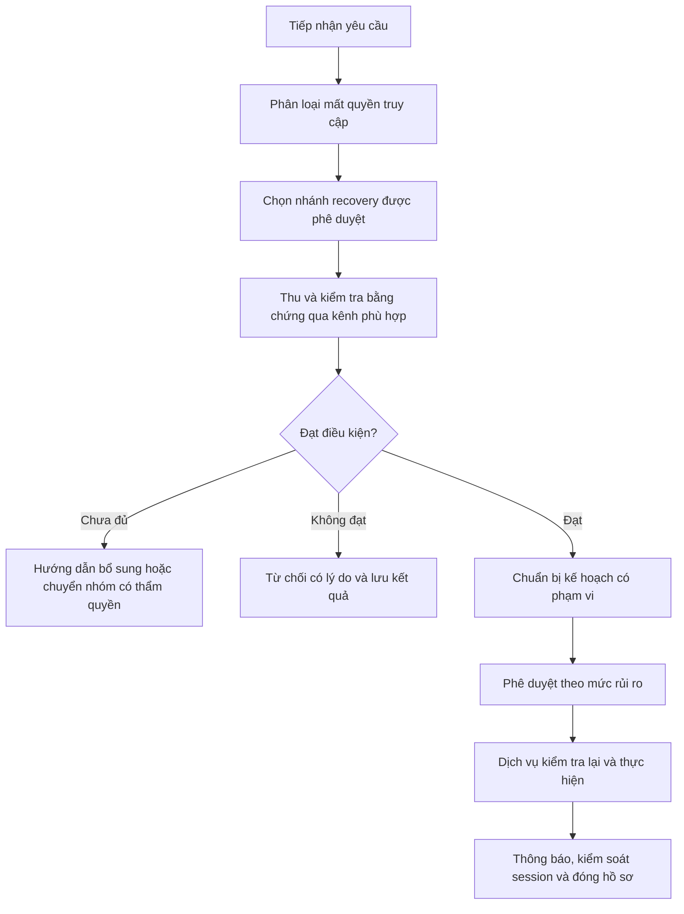

# Support agent boundaries — Ranh giới quyền của nhân viên hỗ trợ trong khôi phục tài khoản

## 1. Vì sao hỗ trợ khách hàng là một ranh giới bảo mật?

Khi mất mật khẩu, MFA, passkey hoặc thiết bị xác thực, người dùng có thể không còn đi qua được luồng đăng nhập thông thường. Nhân viên hỗ trợ cần giúp họ tìm phương án khôi phục phù hợp, nhưng cũng có thể trở thành mục tiêu của người muốn chiếm đoạt tài khoản.

Một người gọi điện biết tên, chức danh, giao dịch gần đây hoặc số ticket cũ chưa chắc là chủ tài khoản. Tương tự, một nhân viên đã đăng nhập vào hệ thống hỗ trợ chưa chắc có quyền thay MFA cho mọi tài khoản.

**Support agent boundaries** là các giới hạn về dữ liệu được xem, hành động được làm, điều kiện được quyết định và trách nhiệm phải chuyển tiếp của nhân viên hỗ trợ. Trong bài này, support agent là nhân viên hỗ trợ con người.

Mục tiêu thiết kế là cho phép hỗ trợ người dùng mà vẫn giữ được các bất biến:

- Không có thay đổi bảo mật chỉ dựa trên lời kể hoặc áp lực của người liên hệ.
- Mỗi quyền thao tác gắn với đúng tenant, tài khoản, hồ sơ và mục đích.
- Bằng chứng danh tính và quyết định cho phép được kiểm tra bởi quy trình đã được phê duyệt.
- Hành động nhạy cảm có phạm vi, thời hạn và người chịu trách nhiệm rõ ràng.
- Nhân viên không cần biết bí mật xác thực để hỗ trợ khôi phục.
- Việc thiếu bằng chứng không được giải quyết bằng cách tự hạ mức xác minh.

Một ranh giới chỉ tồn tại trong tài liệu nhưng không được backend thực thi sẽ không đủ để bảo vệ tài khoản.

## 2. Tách ba câu hỏi thường bị nhầm lẫn

### 2.1. Ai đang thao tác trong hệ thống hỗ trợ?

Đây là danh tính của nhân viên hoặc dịch vụ nội bộ. Hệ thống cần biết người thao tác, vai trò, phiên đăng nhập, quyền được cấp và phạm vi được phân công.

Việc xác thực nhân viên chỉ trả lời ai đang dùng công cụ. Nó không chứng minh người đang gọi điện là chủ tài khoản.

### 2.2. Người yêu cầu có đủ căn cứ khôi phục tài khoản không?

Đây là câu hỏi về claimant, tức người đang yêu cầu lấy lại quyền truy cập.

Căn cứ có thể đến từ phương thức khôi phục đã thiết lập, authenticator còn dùng được, recovery code hoặc quy trình identity proofing được áp dụng đúng bối cảnh. Sự thuyết phục trong cuộc trò chuyện không thay thế việc kiểm tra này.

Một giấy tờ mới cung cấp cũng không tự chứng minh quyền đối với một tài khoản vốn chỉ có tên giả và chưa từng được gắn với danh tính pháp lý đó.

### 2.3. Ai có quyền cho phép và thực hiện thay đổi cụ thể?

Đây là câu hỏi về authorization.

Ngay cả khi bằng chứng đạt yêu cầu, nhân viên tiếp nhận chưa chắc được phép phê duyệt việc thay passkey hoặc vô hiệu hóa MFA. Quyền có thể thuộc một nhóm riêng hoặc được hệ thống quyết định dựa trên chính sách.

OWASP phân biệt xác thực với phân quyền, đồng thời khuyến nghị quyền tối thiểu, mặc định từ chối và kiểm tra quyền ở từng request. Những nguyên tắc này cần được áp dụng cho cả công cụ hỗ trợ. Xem [OWASP Authorization Cheat Sheet](https://cheatsheetseries.owasp.org/cheatsheets/Authorization_Cheat_Sheet.html).

## 3. Xác định quyền theo hành động, không chỉ theo chức danh

Một role chung như `SUPPORT_ADMIN` dễ trở thành quyền quá rộng. Nên mô tả các capability cụ thể và điều kiện đi kèm.

| Nhóm hoặc vai trò | Phạm vi có thể được cấp | Giới hạn cần giữ |
| --- | --- | --- |
| Nhân viên tiếp nhận | Tạo hồ sơ, giải thích luồng, xem trạng thái đã che thông tin | Không tự ghi nhận “đã xác minh” từ cuộc trò chuyện |
| Nhóm xác minh chuyên trách | Xử lý bằng chứng theo quy trình được giao | Không tự sửa credential để hoàn tất hồ sơ |
| Người phê duyệt | Phê duyệt đúng kế hoạch trong phạm vi thẩm quyền | Không phê duyệt mọi thay đổi tương lai của tài khoản |
| Dịch vụ recovery | Thực hiện kế hoạch hợp lệ và còn hiệu lực | Không chấp nhận lệnh tùy ý chỉ vì đến từ mạng nội bộ |
| Nhóm ứng phó sự cố | Hạn chế quyền hoặc thu hồi theo quy trình sự cố | Không mặc nhiên có quyền đọc toàn bộ bí mật hoặc dữ liệu người dùng |
| Người kiểm tra audit | Xem bằng chứng thao tác theo quyền | Không sử dụng quyền đọc audit để thực hiện recovery |

Đây là mô hình phân vai minh họa. Một tổ chức nhỏ có thể có ít nhóm hơn, nhưng vẫn cần tách quyền và áp dụng kiểm soát độc lập phù hợp với mức rủi ro.

Với thay đổi có ảnh hưởng cao, có thể yêu cầu người chuẩn bị và người phê duyệt khác nhau. Hai tài khoản của cùng một người không tạo ra tính độc lập. Việc tách vai trò cũng không có ích nếu người phê duyệt chỉ nhấn đồng ý mà không xem đúng bằng chứng và kế hoạch.

Không bắt mọi hồ sơ phải qua cùng số lượng người theo một quy tắc tùy ý. Chính sách cần xác định các trường hợp yêu cầu kiểm soát bổ sung, chẳng hạn tài khoản đặc quyền, thay toàn bộ phương thức xác thực hoặc có dấu hiệu chiếm đoạt.

## 4. Nhân viên được xem gì và không cần biết gì?

Công cụ nên hiển thị đủ để hỗ trợ đúng hồ sơ, nhưng không tạo một kho bí mật xác thực cho nhân viên.

### Dữ liệu có thể cần hiển thị

- Mã hồ sơ và trạng thái workflow.
- Tài khoản tham chiếu trong đúng tenant được phép.
- Phương thức liên hệ đã che thông tin.
- Loại authenticator đang được đăng ký, nếu cần cho bước hỗ trợ.
- Kết quả kiểm tra bằng chứng và hạn hiệu lực của kết quả.
- Kế hoạch thay đổi, phiên bản và phạm vi đang chờ phê duyệt.
- Lý do từ chối hoặc chuyển tiếp đã chuẩn hóa.
- Timeline các hành động liên quan trong phạm vi được cấp.

### Dữ liệu không nên được nhân viên yêu cầu hoặc sao chép

- Mật khẩu hiện tại hoặc mật khẩu mới.
- OTP đang có hiệu lực.
- Recovery code chưa sử dụng.
- TOTP seed và QR code đăng ký authenticator.
- Private key hoặc bí mật của passkey.
- Cookie, session token hoặc access token.
- Đường dẫn recovery chứa bearer token.

Người dùng nhập recovery code hoặc OTP vào endpoint chính thức được thiết kế để xác minh. Nhân viên có thể thấy kết quả kiểm tra khi được phép, thay vì đọc mã rồi nhập thay người dùng.

Nếu bí mật bị gửi nhầm vào chat, ticket hoặc cuộc gọi được ghi âm, cần xử lý theo quy trình lộ bí mật: giới hạn truy cập, bảo vệ hoặc loại bỏ bản sao theo chính sách, và vô hiệu hóa quyền bị ảnh hưởng khi phù hợp. Không tiếp tục dùng mã đã bị lộ như thể chỉ chủ tài khoản biết nó.

Tài liệu identity proofing, nếu cần, phải được thu qua kênh chuyên dụng với quyền truy cập và thời hạn lưu phù hợp. Không yêu cầu mọi khách hàng gửi giấy tờ qua email chỉ vì đó là cách tiện cho nhân viên.

## 5. Phạm vi quyền phải gắn với hồ sơ đang được xử lý

Quyền hỗ trợ nên phụ thuộc cả thuộc tính của người thao tác và quan hệ của họ với hồ sơ.

Một quyết định cho phép có thể yêu cầu đồng thời:

```text
nhân viên đang hoạt động
AND phiên nhân viên đáp ứng yêu cầu xác thực
AND capability phù hợp với hành động
AND tenant nằm trong phạm vi được cấp
AND hồ sơ đã được phân công hợp lệ
AND hồ sơ đang ở trạng thái cho phép hành động
AND tài khoản đích đúng với hồ sơ
AND bằng chứng còn hiệu lực
AND kế hoạch chưa bị thay đổi hoặc hết hạn
AND có phê duyệt độc lập nếu chính sách yêu cầu
```

Biết case ID không tạo ra quyền đọc hồ sơ. Trường `accountId` trong request của trình duyệt cũng không được tự quyết định tài khoản đích. Backend cần kiểm tra quan hệ giữa hồ sơ, tenant và tài khoản.

Ví dụ, nhân viên được phép chuẩn bị thay MFA cho tài khoản A trong hồ sơ C không có nghĩa họ được:

- Chuyển sang tài khoản B bằng cách đổi ID trong URL.
- Xem tài liệu của một hồ sơ khác.
- Thay email recovery trước để gửi mã tới một địa chỉ mới.
- Tạo session đăng nhập đầy đủ thay mặt người dùng.
- Gỡ mọi authenticator thay vì đúng thiết bị được phê duyệt.

Các API nội bộ, tác vụ hàng loạt và công cụ dòng lệnh cũng phải giữ những điều kiện tương tự. Một giao diện đã ẩn nút không bảo vệ được endpoint còn cho phép hành động.

## 6. Quy trình hỗ trợ có giới hạn rõ ràng

Một workflow minh họa:



### Tiếp nhận và phân loại

Làm rõ người dùng mất mật khẩu, mất một thiết bị hay mất mọi phương thức xác thực. Những trường hợp này có thể cần các nhánh khác nhau.

Nếu authenticator cũ không còn khả dụng, không yêu cầu người dùng hoàn thành một bước bất khả thi rồi dùng “ngoại lệ thủ công” không có quy trình. Chuyển sang phương án recovery được phê duyệt cho tình huống đó.

### Kiểm tra bằng chứng

Nhân viên không tự sáng tạo một bộ câu hỏi chỉ vì khách hàng không làm được bước chuẩn. Những thông tin có thể lấy từ mạng xã hội, hóa đơn bị lộ hoặc email cũ cần được đánh giá đúng giới hạn.

NIST cho phép phương pháp recovery đặc thù của ứng dụng khi được đánh giá rủi ro và ghi nhận thành quy trình. Điều này không đồng nghĩa mỗi nhân viên được tự chọn một phương pháp khác nhau cho từng cuộc gọi. Xem [NIST SP 800-63B-4 — Account Recovery](https://pages.nist.gov/800-63-4/sp800-63b/events/#account-recovery).

### Chuẩn bị và phê duyệt

Nhân viên có quyền chuẩn bị chỉ mô tả đúng thay đổi cần thiết. Phê duyệt gắn với kế hoạch đó, không phải một nhãn “khách này đáng tin” dùng vô thời hạn.

### Thực hiện và đóng hồ sơ

Dịch vụ recovery kiểm tra lại điều kiện tại thời điểm thay đổi. Đóng ticket hỗ trợ không được tự coi là bằng chứng recovery đã commit thành công.

Nếu việc thực hiện đang có kết quả chưa xác định, hồ sơ phải thể hiện cần đối soát. Không để nhân viên gửi lệnh lặp chỉ để làm trạng thái ticket chuyển sang hoàn tất.

## 7. Phê duyệt một kế hoạch cụ thể và có hạn dùng

Một kế hoạch thay đổi cần đủ chi tiết để không bị mở rộng sau khi phê duyệt.

```json
{
  "caseId": "case-203",
  "tenantId": "tenant-demo",
  "accountRef": "account-42",
  "planId": "plan-8",
  "planVersion": 3,
  "purpose": "REPLACE_LOST_MFA",
  "targetAuthenticatorRef": "authenticator-old-5",
  "approvedActions": [
    "REVOKE_TARGET_AUTHENTICATOR",
    "ALLOW_SCOPED_ENROLLMENT"
  ],
  "evidenceDecisionRef": "proof-decision-61",
  "policyVersion": "support-recovery-policy-4",
  "expectedAccountSecurityVersion": 17,
  "expiresAt": "2026-11-24T04:00:00Z",
  "requiresIndependentApproval": true
}
```

Ví dụ chỉ biểu diễn kế hoạch nội bộ. Nó không phải recovery token và không được dùng riêng như một bearer grant.

Các điều kiện cần giữ:

- Thay account, purpose, authenticator đích hoặc tập hành động làm mất hiệu lực phê duyệt cũ.
- Hết hạn thì phải đánh giá lại theo chính sách, không cho nhân viên tự sửa timestamp.
- Thay đổi bảo mật của tài khoản sau khi duyệt có thể làm bằng chứng cũ không còn phù hợp.
- Kết quả xác minh phải gắn với đúng hồ sơ, tài khoản và mức bảo đảm cần thiết.
- Không dùng một phê duyệt để cấp nhiều quyền khác nhau ngoài kế hoạch.

Ví dụ, được duyệt thay một thiết bị TOTP bị mất không đồng nghĩa được đổi email recovery, gỡ passkey đang hoạt động hoặc cấp quyền quản trị mới.

Bản kế hoạch có thể tham chiếu một đối tượng đăng ký mới đã được kiểm tra. Việc liên kết passkey hoặc thiết bị mới phải đi qua giao thức đăng ký phù hợp, thay vì nhân viên sao chép một giá trị từ ticket vào database.

## 8. Backend thực thi ranh giới như thế nào?

Pseudocode sau minh họa hành động gửi một kế hoạch đã được duyệt sang dịch vụ recovery:

```text
submitApprovedPlan(staffSession, caseId, planId, expectedPlanVersion):
    staff = authenticateStaff(staffSession)

    require staff.isActive
    require staff.sessionMeetsRequiredAssurance
    require staff.hasCapability("SUBMIT_APPROVED_RECOVERY_PLAN")

    transaction:
        case = lockSupportCase(caseId)
        plan = lockRecoveryPlan(planId)

        require staff.mayWorkOn(case)
        require staff.tenantScopeContains(case.tenantId)
        require plan.belongsTo(case)
        require plan.version == expectedPlanVersion
        require plan.state == APPROVED
        require plan.approvalIsValidNow()
        require plan.evidenceDecisionIsStillValid()
        require plan.accountBindingIsUnchanged()

        if plan.requiresIndependentApproval:
            require plan.approverIsIndependentOfPreparer()
            require plan.approverAuthorityIsStillValid()

        require noConflictingExecutionExists(plan)

        enqueueRecoveryCommandOnce(
            planId = plan.id,
            planVersion = plan.version,
            initiatedBy = staff.id
        )

        appendAuditEvent(
            actor = staff.id,
            action = "SUBMIT_APPROVED_RECOVERY_PLAN",
            caseId = case.id,
            planId = plan.id,
            result = "QUEUED"
        )

    return operationReceipt
```

Dịch vụ thực hiện vẫn phải kiểm tra lại kế hoạch, tài khoản và phiên bản bảo mật tại thời điểm commit. Lệnh hợp lệ lúc xếp hàng chưa chắc còn hợp lệ sau khi chờ.

Nhân viên gửi lệnh không được chọn một service account tùy ý để mượn quyền. Danh tính người khởi tạo, người phê duyệt và dịch vụ thực hiện phải được giữ riêng trong audit.

Nếu cần quyền tạm thời, quyền đó nên giới hạn theo hành động, hồ sơ, tenant và thời hạn. Nhãn “đang xử lý sự cố” không nên mở quyền thay credential của mọi khách hàng.

Đặc biệt, hỗ trợ không cần quyền SQL tùy ý để sửa `mfa_enabled`, xóa authenticator hoặc tạo session. Các đường sửa trực tiếp như vậy có thể bỏ qua kiểm tra bằng chứng, token dùng một lần, session revocation và thông báo cho chủ tài khoản.

## 9. Chống social engineering và việc tìm nhân viên dễ chấp nhận

Các tình huống thường gây áp lực lên ranh giới:

| Lời yêu cầu hoặc dấu hiệu | Phản ứng đúng phạm vi |
| --- | --- |
| “Tôi là lãnh đạo, phải làm ngay” | Giữ yêu cầu bằng chứng; ưu tiên xử lý nếu chính sách cho phép nhưng không giảm điều kiện |
| “Nhân viên trước đã đồng ý” | Kiểm tra quyết định và hồ sơ bền vững; không dựa vào lời thuật lại |
| “Hãy gửi mã tới email mới vì email cũ hỏng” | Chuyển sang nhánh đổi kênh/recovery đã được phê duyệt |
| “Tôi biết giao dịch gần nhất và địa chỉ cũ” | Xem đây là thông tin cần đánh giá, không tự coi là bằng chứng đủ |
| “Hãy tắt MFA vài phút” | Xử lý như một thay đổi bảo mật có rủi ro, không như thao tác tiện ích |
| “Tôi sẽ đọc OTP cho anh/chị” | Hướng người dùng tới endpoint chính thức; không nhận mã để thao tác thay |
| Tạo nhiều ticket với các câu chuyện khác nhau | Liên kết và chuyển đánh giá theo quyền, giữ lịch sử quyết định |

Caller ID, logo trong email, tên hiển thị hoặc việc gọi từ số mới tự khai báo không tự tạo độ tin cậy. Nếu cần liên hệ lại, dùng phương thức đã được xác định qua quy trình phù hợp, không chỉ dùng số mà người gọi vừa cung cấp.

“Agent shopping” xảy ra khi người yêu cầu thử nhiều nhân viên để tìm người chấp nhận bằng chứng yếu hơn. Có thể giảm rủi ro bằng hồ sơ liên kết, lịch sử quyết định và giới hạn theo tài khoản hoặc workflow, có kiểm soát quyền riêng tư.

Tuy nhiên, không khóa tài khoản chỉ vì một người chưa xác minh tạo nhiều ticket. Cần tránh biến chính quy trình chống lạm dụng thành công cụ gây mất quyền truy cập cho chủ tài khoản.

Nhân viên cũng phải có cơ chế chuyển tiếp khi nghi ngờ bị gây áp lực. Mục tiêu đánh giá công việc không nên khiến họ phải đánh đổi kiểm soát bảo mật để đóng ticket nhanh hơn.

## 10. Chuyển tiếp và ngoại lệ có kiểm soát

Chuyển tiếp khi bằng chứng thiếu hoặc có rủi ro không phải là từ bỏ người dùng. Đó là chuyển quyết định tới nơi có đúng thẩm quyền và công cụ.

Một gói handoff nên có:

- Mã hồ sơ và phạm vi tài khoản đã xác định theo quyền.
- Nhánh recovery đang áp dụng.
- Các kiểm tra đã thực hiện và kết quả.
- Tham chiếu bằng chứng, không sao chép bí mật.
- Điểm mâu thuẫn hoặc lý do cần đánh giá thêm.
- Hành động đã làm và việc chưa được phép làm.
- Owner hiện tại và người nhận tiếp theo.

Bàn giao hồ sơ không làm reset số lần thử hoặc xóa quyết định từ chối trước đó. Người nhận cần hiểu điều gì đã được xác minh, điều gì chỉ là lời khai và điều gì vẫn chưa biết.

Nếu tổ chức có cơ chế ngoại lệ hoặc break-glass, cơ chế đó cần có điều kiện sử dụng được xác định trước, người có thẩm quyền, phạm vi tối thiểu, thời hạn và audit. Nó không nên trở thành nút “bỏ qua xác minh” cho mọi tình huống khẩn cấp.

Sự chấp thuận của quản lý nội bộ không tự chứng minh danh tính người yêu cầu bên ngoài. Với trường hợp không thể đạt yêu cầu chứng minh, có thể phải tiếp tục chờ bằng chứng, chuyển nhánh phù hợp hoặc từ chối thay đổi.

Không có phương án nào trong chính sách hiện tại thì nhân viên không tự thiết kế một quy trình mới trong cuộc gọi. Cần đưa vấn đề tới người sở hữu chính sách để đánh giá, thay vì để mỗi ca trực tạo một chuẩn bảo mật riêng.

## 11. Trường hợp tài khoản đặc quyền và recovery sau nghi ngờ chiếm đoạt

Tài khoản quản trị, tài khoản có quyền thay đổi nhiều người dùng hoặc tài khoản có dữ liệu nhạy cảm cần được đánh giá theo phạm vi ảnh hưởng.

Các kiểm soát bổ sung có thể gồm:

- Người phê duyệt độc lập.
- Bằng chứng mạnh hơn hoặc xác minh bổ sung.
- Quyền tạm thời có mục đích hẹp.
- Khoảng chờ có thông báo và phương án báo thay đổi trái phép.
- Giám sát sau recovery.
- Quy trình ứng phó sự cố riêng.

Khoảng chờ không thay thế chứng minh danh tính. Không nhận được phản đối cũng không có nghĩa chủ tài khoản đồng ý, vì họ có thể đã mất quyền vào kênh nhận cảnh báo.

Sau nghi ngờ chiếm đoạt, cần đánh giá cả session hiện có, authenticator mới được thêm và thông tin recovery đã thay đổi. Chỉ đặt lại password có thể không loại bỏ quyền truy cập của kẻ tấn công.

Nhân viên chỉ yêu cầu hoặc thực hiện các biện pháp nằm trong quyền được cấp. Dịch vụ bảo mật phải bảo đảm việc thu hồi authenticator, vô hiệu hóa grant và kiểm soát session được thực thi theo chính sách, có thể kiểm chứng và có kết quả bền vững.

OWASP coi thay MFA là hành động có rủi ro cao, khuyến nghị kiểm tra lại xác thực, không dựa riêng vào session hiện có và gửi thông báo ngoài giao dịch khi factor thay đổi. Khi người dùng đã mất factor cũ, cần đi qua quy trình recovery phù hợp thay vì tự bỏ bước kiểm tra. Xem [OWASP — Changing MFA Factors](https://cheatsheetseries.owasp.org/cheatsheets/Multifactor_Authentication_Cheat_Sheet.html#changing-mfa-factors).

## 12. Audit, trách nhiệm giải trình và bảo vệ nhân viên

Audit cần cho phép trả lời ai đã xem, ai đã quyết định và hành động nào thực sự xảy ra.

```json
{
  "eventType": "SUPPORT_RECOVERY_PLAN_SUBMITTED",
  "caseId": "case-203",
  "planId": "plan-8",
  "planVersion": 3,
  "tenantRef": "tenant-demo",
  "accountRef": "account-42",
  "actorStaffId": "staff-17",
  "approverStaffId": "staff-29",
  "executorService": "account-recovery",
  "purpose": "REPLACE_LOST_MFA",
  "evidenceDecisionRef": "proof-decision-61",
  "policyVersion": "support-recovery-policy-4",
  "result": "QUEUED"
}
```

`QUEUED` không có nghĩa thay đổi đã hoàn tất. Sự kiện thực thi và kết quả commit phải được ghi nhận riêng, cùng một chuỗi liên kết có thể điều tra.

Cần lưu cả các lần từ chối quan trọng, truy cập hồ sơ và thay đổi phân công. Nội dung audit phải được giới hạn, bảo vệ khỏi sửa trái phép và phân quyền đọc. Không ghi password, OTP hoặc toàn bộ hồ sơ giấy tờ vào event chỉ để “đủ bằng chứng”.

Nhân viên không được xóa lịch sử từ chối để mở một ticket mới có vẻ sạch. Ghi chú bổ sung nên có người tạo và thời điểm, không âm thầm sửa kết quả xác minh đã được sử dụng.

Hệ thống audit cũng bảo vệ nhân viên: nó chứng minh họ đã tuân thủ phạm vi và đã chuyển tiếp đúng chỗ, thay vì phải dựa vào trí nhớ sau một cuộc gọi căng thẳng.

Các dấu hiệu như truy cập hàng loạt hồ sơ không được phân công, liên tục xin quyền tạm thời hoặc bỏ qua tuyến phê duyệt cần được điều tra theo quy trình nội bộ. Chỉ số bất thường là căn cứ để xem xét, chưa phải kết luận cá nhân có hành vi xấu.

## 13. Một tình huống áp dụng ranh giới

Một người gọi tự nhận là quản lý doanh nghiệp, báo mất điện thoại và yêu cầu thay MFA ngay. Người đó cung cấp đúng tên tổ chức, số hóa đơn và một email mới để nhận mã.

Cách xử lý có giới hạn:

1. Nhân viên tạo hoặc tiếp nhận hồ sơ theo quy trình, tránh tiết lộ thông tin tài khoản chưa được phép.
2. Phân loại mất factor, không coi sự khẩn cấp là bằng chứng.
3. Hướng người yêu cầu tới nhánh recovery được phê duyệt, ưu tiên phương thức đã thiết lập còn dùng được.
4. Không đổi email recovery rồi gửi mã tới email mới chỉ từ lời khai.
5. Nếu cần identity proofing, chuyển sang kênh chuyên trách và chỉ sử dụng kết quả phù hợp với tài khoản.
6. Khi đủ bằng chứng, chuẩn bị kế hoạch thay đúng authenticator, với hạn dùng và phiên bản tài khoản.
7. Thực hiện phê duyệt độc lập nếu chính sách tài khoản yêu cầu.
8. Dịch vụ kiểm tra lại và commit thay đổi, kiểm soát session, phát thông báo qua các kênh còn an toàn.
9. Nhân viên xác nhận kết quả thực tế, hướng dẫn người dùng tiếp tục qua giao diện chính thức và đóng hồ sơ.

Nếu không có đủ bằng chứng, kết quả đúng có thể là chờ bổ sung hoặc từ chối thay đổi. Nhân viên vẫn có thể giải thích bước tiếp theo và cách báo mất thiết bị mà không cấp quyền vượt phạm vi.

Ranh giới hỗ trợ tốt làm cho sự trợ giúp nhất quán và có thể kiểm chứng: nhân viên giúp người dùng đi đúng quy trình, còn việc cấp lại quyền luôn dựa trên bằng chứng, chính sách và một thay đổi bảo mật có phạm vi rõ ràng.
