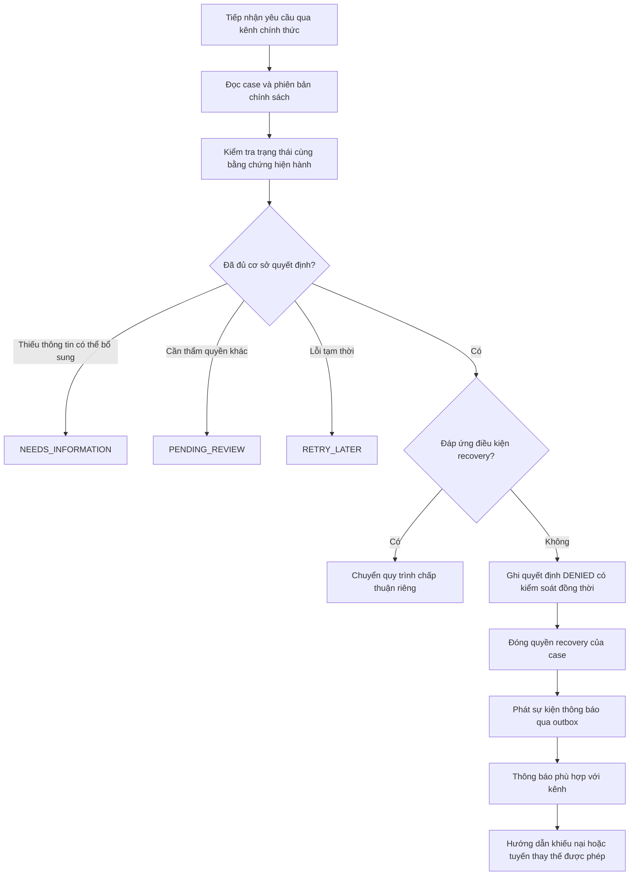

# Support denial workflow

## 1. Vì sao từ chối recovery cần một quy trình riêng?

Trong hệ thống khôi phục tài khoản, bộ phận hỗ trợ có thể nhận yêu cầu từ người dùng mất mật khẩu, điện thoại chứa MFA, passkey hoặc thiết bị xác thực cuối cùng. Một số yêu cầu không đủ bằng chứng; một số có dấu hiệu giả mạo; số khác nằm ngoài phạm vi mà kênh hỗ trợ được phép xử lý. Khi đó, quyết định đúng có thể là **không cho phép khôi phục qua yêu cầu hiện tại**.

Tuy nhiên, chỉ bấm nút “Reject” là chưa đủ. Hệ thống còn phải bảo đảm quyết định không vô tình khóa tài khoản của nạn nhân, không tiết lộ tài khoản có tồn tại hay không, không để một token đã phát hành tiếp tục sử dụng và không biến kênh khiếu nại thành đường vòng bỏ qua xác minh.

**Support denial workflow** là chuỗi bước tiếp nhận, phân loại, quyết định, kết thúc quyền của case, thông báo và cung cấp lối tiếp tục phù hợp khi một yêu cầu recovery không được chấp thuận.

Trong phạm vi `SECURITY_AUTHENTICATION_ACCOUNT_RECOVERY`, workflow này phải giữ đồng thời hai mục tiêu:

- Không trao quyền kiểm soát tài khoản cho người chưa chứng minh đủ thẩm quyền.
- Giúp chủ tài khoản hợp lệ hiểu giới hạn của yêu cầu hiện tại và biết họ còn lựa chọn nào.

Một nguyên tắc quan trọng: **từ chối một yêu cầu khôi phục không đồng nghĩa với xác nhận người yêu cầu là kẻ tấn công**. Bằng chứng có thể không đủ vì người dùng thật đã mất nhiều yếu tố xác thực. Cách diễn đạt, dữ liệu kiểm toán và hành động bảo vệ tài khoản phải phản ánh đúng mức độ chắc chắn đó.

## 2. Xác định chính xác đối tượng bị từ chối

Hãy tách bốn đối tượng thường bị nhầm lẫn:

| Đối tượng | Ý nghĩa | Tác động khi case bị từ chối |
|---|---|---|
| Người liên hệ | Người đang trò chuyện với hỗ trợ | Chưa chắc đã là chủ tài khoản |
| Recovery case | Hồ sơ xử lý một yêu cầu cụ thể | Có thể chuyển sang trạng thái kết thúc `DENIED` |
| Recovery artifact | Token, link hoặc phiên thao tác giới hạn gắn với case | Không còn được phép dùng để hoàn tất recovery của case đã kết thúc |
| Tài khoản gốc | Tài khoản mà người liên hệ muốn lấy lại quyền truy cập | Không tự động bị khóa, xóa hoặc đổi yếu tố xác thực |

Nếu một người lạ chỉ cần biết địa chỉ email là có thể tạo yêu cầu và khiến tài khoản tương ứng bị khóa khi bị từ chối, workflow đã trở thành công cụ gây từ chối dịch vụ cho nạn nhân.

Tương tự, không được thu hồi toàn bộ phiên đăng nhập đang hoạt động chỉ vì một case không đạt xác minh. Việc thu hồi phiên trên toàn tài khoản thuộc quy trình ứng phó rủi ro riêng và cần tín hiệu, thẩm quyền cùng chính sách phù hợp. Một case bị từ chối có thể cung cấp dữ liệu cho quy trình đó, nhưng không tự cấp quyền thực hiện.

## 3. Phân biệt từ chối với chờ xử lý

Không phải mọi tình huống chưa thể cấp quyền khôi phục đều nên trở thành `DENIED`.

| Kết quả | Khi sử dụng | Hướng tiếp theo |
|---|---|---|
| `NEEDS_INFORMATION` | Có bước xác minh bổ sung hợp lệ mà người dùng còn có thể thực hiện | Nêu rõ loại thông tin được phép bổ sung và thời hạn của case |
| `PENDING_REVIEW` | Cần người có thẩm quyền hoặc nhóm chuyên trách đánh giá | Chuyển tuyến, giữ nguyên giới hạn quyền |
| `RETRY_LATER` | Dịch vụ xác minh tạm thời không hoạt động | Cho phép thử lại theo chính sách, không gắn nhãn gian lận |
| `DENIED` | Yêu cầu hiện tại không đạt điều kiện hoặc không được phép tiếp tục | Kết thúc case, vô hiệu hóa quyền recovery của case, thông báo phù hợp |
| `EXPIRED` | Case hoặc bằng chứng đã hết hạn mà chưa được hoàn tất | Yêu cầu bắt đầu lại bằng quy trình hiện hành nếu được phép |
| `CANCELLED` | Yêu cầu bị hủy theo điều kiện hợp lệ | Kết thúc case, không suy diễn thành quyết định từ chối |

Các tên trên là mô hình minh họa. Hệ thống thực tế có thể dùng tập trạng thái khác, nhưng phải giữ được sự khác biệt về ngữ nghĩa.

Ví dụ: hệ thống kiểm tra bằng chứng bị lỗi kết nối. Đó là vấn đề vận hành, không phải bằng chứng rằng người dùng không đủ điều kiện. Chuyển ngay sang `DENIED` sẽ khiến người dùng chịu hậu quả từ lỗi hạ tầng và làm sai dữ liệu đánh giá chất lượng hỗ trợ.

Một trường hợp khác: chính sách chỉ chấp nhận loại bằng chứng mà người yêu cầu không còn giữ. Nếu không có tuyến xác minh thay thế được phê duyệt, hỗ trợ phải từ chối case hiện tại. Không được tự nghĩ ra câu hỏi dễ đoán như tên đồng nghiệp, lịch sử mua hàng công khai hoặc số điện thoại mới để thay thế điều kiện bắt buộc.

## 4. Phân loại lý do: nội bộ chi tiết, bên ngoài phù hợp

Quyết định cần lý do đủ cụ thể để kiểm toán, nhưng không phải mọi lý do nội bộ đều được tiết lộ cho người liên hệ.

Ví dụ về mã lý do nội bộ:

| Mã minh họa | Ý nghĩa nội bộ | Cách phản hồi bên ngoài |
|---|---|---|
| `EVIDENCE_REQUIREMENTS_NOT_MET` | Bằng chứng đã được đánh giá nhưng chưa đáp ứng chính sách | Chưa thể xác minh quyền khôi phục qua yêu cầu này |
| `REQUIRED_FACTOR_UNAVAILABLE` | Thiếu yếu tố bắt buộc và không có tuyến thay thế được phép | Hướng dẫn các phương thức đã được phê duyệt, nếu có |
| `UNSUPPORTED_RECOVERY_ROUTE` | Kênh đang dùng không có thẩm quyền xử lý loại yêu cầu | Chỉ dẫn tới kênh chính thức phù hợp mà không hứa hẹn kết quả |
| `CONFIRMED_POLICY_PROHIBITION` | Có điều kiện cấm xử lý đã được xác lập theo chính sách | Thông báo giới hạn xử lý theo mẫu được phép |
| `CONFIRMED_ABUSE` | Có kết luận lạm dụng từ nguồn đánh giá được tin cậy | Phản hồi khái quát; chi tiết phát hiện chỉ dùng nội bộ |

“Thiếu bằng chứng” và “xác nhận lạm dụng” là hai kết luận khác nhau. Không gán mã gian lận chỉ để đóng ticket nhanh hơn.

Phản hồi không nên tiết lộ:

- Địa chỉ email, số điện thoại hoặc thiết bị đã đăng ký của tài khoản chưa được xác minh.
- Tài khoản có passkey, MFA hay phiên đăng nhập nào đang hoạt động.
- Ngưỡng rủi ro, trọng số tín hiệu hoặc kiểm tra chống gian lận đã thất bại.
- Một phần bằng chứng nào là đúng để người thử có thể sửa phần còn lại.
- Thông tin cá nhân của chủ tài khoản hoặc nhân viên đã đưa ra quyết định.

Mức chi tiết được hiển thị phụ thuộc mức xác thực của kênh. Một hộp thư mà người liên hệ vừa cung cấp không mặc nhiên là kênh liên hệ đã được tài khoản tin cậy.

## 5. Luồng xử lý từ tiếp nhận đến kết thúc



### Bước 1 — Gắn liên hệ với đúng case

Hỗ trợ phải xác định đang xử lý case nào, thuộc hệ thống nào và đang ở trạng thái gì. Mã tham chiếu case chỉ dùng để định tuyến; biết mã đó không chứng minh quyền đối với tài khoản.

Không trộn bằng chứng từ hai case khác nhau chỉ vì người liên hệ nói rằng chúng cùng thuộc một người. Việc liên kết hồ sơ cần căn cứ và quyền truy cập được hệ thống cho phép.

### Bước 2 — Kiểm tra dữ liệu dùng để quyết định

Đọc kết quả đánh giá từ nguồn đáng tin cậy, gồm phiên bản chính sách, hiệu lực của bằng chứng và trạng thái rủi ro. Phân biệt dữ liệu do người liên hệ khai với kết luận của hệ thống xác minh.

Một tệp đính kèm mang tên “verification-passed.pdf” hoặc một trường `verified=true` trong biểu mẫu không phải kết quả xác minh đáng tin cậy. Nhân viên cũng không được bỏ qua cảnh báo chỉ vì người liên hệ kể câu chuyện khẩn cấp hoặc tự nhận là lãnh đạo.

### Bước 3 — Chọn đúng loại kết quả

Nếu còn bước thu thập thông tin hợp lệ, dùng trạng thái chờ thông tin. Nếu cần đánh giá chuyên trách, chuyển tuyến. Nếu không thể tiếp tục theo chính sách và dữ liệu đã đủ để kết luận, đề xuất từ chối.

Trong các case nhạy cảm, chính sách có thể yêu cầu người thứ hai kiểm tra quyết định. Đây là cơ chế kiểm soát thẩm quyền; nó không cho phép hai người cùng đồng ý rồi bỏ qua yêu cầu chứng minh quyền sở hữu.

### Bước 4 — Ghi quyết định và đóng khả năng hoàn tất recovery

Quyết định cần được lưu bền vững, có phiên bản và chống xung đột. Sau khi `DENIED` có hiệu lực, mọi thao tác hoàn tất recovery phải kiểm tra lại trạng thái case hiện hành và bị từ chối.

Chỉ xóa token ở một bảng hoặc chỉ gửi lệnh thu hồi qua hàng đợi là chưa đủ: token có thể đang nằm trong cache hoặc một request khác đã đọc dữ liệu cũ. Điểm thay đổi mật khẩu, bỏ MFA hoặc gắn passkey mới phải kiểm tra điều kiện case ngay trong ranh giới cập nhật bảo mật tương ứng.

### Bước 5 — Thông báo qua kênh phù hợp

Phản hồi cho người liên hệ bằng nội dung được phép công bố. Nếu cần cảnh báo chủ tài khoản, dùng kênh đã được tin cậy trước đó và áp dụng giới hạn tần suất; không lấy kênh mới do người liên hệ cung cấp làm nơi nhận chi tiết nhạy cảm.

### Bước 6 — Mở lối tiếp tục có kiểm soát

Giải thích các lựa chọn còn lại: thử phương thức tự phục vụ đã được đăng ký, bổ sung bằng chứng theo tuyến được phép hoặc gửi khiếu nại. Nếu không còn lựa chọn hợp lệ, nói rõ giới hạn thay vì hứa một lần liên hệ tiếp theo sẽ được cấp quyền.

## 6. Mô hình trạng thái và các bất biến bảo mật

Một mô hình tối thiểu có thể cho phép các chuyển trạng thái:

```text
OPEN -> NEEDS_INFORMATION -> UNDER_REVIEW
OPEN -> UNDER_REVIEW
UNDER_REVIEW -> PENDING_REVIEW -> UNDER_REVIEW
UNDER_REVIEW -> DENIED
UNDER_REVIEW -> APPROVED
OPEN / NEEDS_INFORMATION / UNDER_REVIEW -> EXPIRED
```

Trong mô hình này, `DENIED` là trạng thái kết thúc của một lần xét duyệt. Khiếu nại tạo hồ sơ xét lại có liên kết với quyết định trước, thay vì âm thầm đổi case cũ thành `APPROVED`. Thiết kế khác có thể dùng cùng case với lịch sử phiên bản, nhưng phải bảo toàn quyết định cũ và buộc một lần xét duyệt mới rõ ràng.

Các bất biến cần giữ:

1. Một case có hiệu lực cuối cùng chỉ mang một quyết định kết thúc tại một phiên bản.
2. Case `DENIED` không thể được dùng để đổi mật khẩu, gỡ MFA hoặc đăng ký yếu tố xác thực mới.
3. Người liên hệ không thể tự cung cấp mã lý do nội bộ hoặc kết quả xác minh để điều khiển quyết định.
4. Quyết định từ chối không thay đổi email, số điện thoại, passkey hay phiên của tài khoản gốc.
5. Khiếu nại không biến token cũ thành hợp lệ trở lại.
6. Việc gửi thông báo thất bại không làm đảo ngược quyết định đã lưu.
7. Mỗi quyết định có dấu vết về người hoặc dịch vụ thực hiện, chính sách áp dụng và các tham chiếu bằng chứng cần thiết.

Việc “cấm dùng token của case đã từ chối” phải được thực thi ở backend. Ẩn nút trên giao diện hoặc đóng cuộc trò chuyện không tạo ra ranh giới bảo mật.

## 7. Minh họa bộ phân loại kết quả bằng Java

Ví dụ sau minh họa sự khác nhau giữa thiếu thông tin, lỗi tạm thời, cần chuyển tuyến và từ chối. Đây là phần mô hình quyết định; nó chưa thực hiện phân quyền, giao dịch dữ liệu, kiểm tra phiên bản hoặc cập nhật yếu tố xác thực.

```java
public final class SupportDenialPolicy {
    public enum EvidenceResult {
        SUFFICIENT, INSUFFICIENT, INCOMPLETE, UNAVAILABLE
    }

    public enum RiskResult {
        CLEAR, REVIEW_REQUIRED, CONFIRMED_ABUSE, UNAVAILABLE
    }

    public enum Outcome {
        CONTINUE_APPROVAL_FLOW,
        NEEDS_INFORMATION,
        PENDING_REVIEW,
        RETRY_LATER,
        DENIED
    }

    public enum Reason {
        REQUIREMENTS_MET,
        EVIDENCE_INCOMPLETE,
        EVIDENCE_REQUIREMENTS_NOT_MET,
        SPECIALIST_REVIEW_REQUIRED,
        VERIFICATION_TEMPORARILY_UNAVAILABLE,
        CONFIRMED_POLICY_PROHIBITION,
        CONFIRMED_ABUSE
    }

    public record TrustedAssessment(
        EvidenceResult evidence,
        RiskResult risk,
        boolean confirmedPolicyProhibition
    ) {}

    public record Decision(Outcome outcome, Reason internalReason) {}

    public Decision decide(TrustedAssessment assessment) {
        if (assessment == null
                || assessment.evidence() == null
                || assessment.risk() == null) {
            throw new IllegalArgumentException("Missing trusted assessment");
        }

        if (assessment.confirmedPolicyProhibition()) {
            return new Decision(
                Outcome.DENIED,
                Reason.CONFIRMED_POLICY_PROHIBITION
            );
        }

        if (assessment.risk() == RiskResult.CONFIRMED_ABUSE) {
            return new Decision(Outcome.DENIED, Reason.CONFIRMED_ABUSE);
        }

        if (assessment.risk() == RiskResult.REVIEW_REQUIRED) {
            return new Decision(
                Outcome.PENDING_REVIEW,
                Reason.SPECIALIST_REVIEW_REQUIRED
            );
        }

        if (assessment.evidence() == EvidenceResult.UNAVAILABLE
                || assessment.risk() == RiskResult.UNAVAILABLE) {
            return new Decision(
                Outcome.RETRY_LATER,
                Reason.VERIFICATION_TEMPORARILY_UNAVAILABLE
            );
        }

        if (assessment.evidence() == EvidenceResult.INCOMPLETE) {
            return new Decision(
                Outcome.NEEDS_INFORMATION,
                Reason.EVIDENCE_INCOMPLETE
            );
        }

        if (assessment.evidence() == EvidenceResult.INSUFFICIENT) {
            return new Decision(
                Outcome.DENIED,
                Reason.EVIDENCE_REQUIREMENTS_NOT_MET
            );
        }

        return new Decision(
            Outcome.CONTINUE_APPROVAL_FLOW,
            Reason.REQUIREMENTS_MET
        );
    }
}
```

`TrustedAssessment` phải được tạo từ pipeline đánh giá do backend kiểm soát, không nhận nguyên record này từ JSON của người dùng. Tên kiểu chỉ biểu đạt ý định; bản thân tên không làm dữ liệu trở nên đáng tin cậy.

Thứ tự ưu tiên trong ví dụ là một lựa chọn chính sách: một lệnh cấm đã được xác lập hoặc kết luận lạm dụng đã được xác nhận có thể đủ để từ chối ngay; yêu cầu review chuyên trách được giữ lại để xử lý; lỗi tạm thời không bị diễn giải thành thiếu điều kiện. Hệ thống cần định nghĩa rõ thứ tự phù hợp với chính sách thực tế.

`CONTINUE_APPROVAL_FLOW` cũng chưa có nghĩa là được phép đổi thông tin xác thực. Luồng chấp thuận còn phải kiểm tra thẩm quyền, độ mới của đánh giá và mọi điều kiện bắt buộc trước thao tác có tác động tới tài khoản.

## 8. Chống xung đột giữa từ chối và hoàn tất recovery

Giả sử nhân viên A mở case ở phiên bản 12. Cùng lúc đó, nhân viên B hoặc luồng tự động đang xử lý case. Nếu A ghi quyết định mà không kiểm tra phiên bản, quyết định có thể ghi đè trạng thái đã thay đổi.

Một cách triển khai là dùng cập nhật có điều kiện:

```sql
UPDATE recovery_case
SET state = 'DENIED',
    decision_id = :decision_id,
    denial_reason = :internal_reason,
    policy_version = :policy_version,
    decided_by = :actor_id,
    decided_at = CURRENT_TIMESTAMP,
    version = version + 1
WHERE id = :case_id
  AND state = 'UNDER_REVIEW'
  AND version = :expected_version;
```

Nếu số hàng cập nhật là 0, hệ thống phải đọc lại trạng thái. Có thể case đã hoàn tất, đã bị từ chối bởi cùng thao tác hoặc đã chuyển sang trạng thái khác. Không tự động coi mọi trường hợp là thành công và không ghi đè bằng một câu lệnh bỏ điều kiện.

Một giao dịch từ chối thông thường gồm:

1. Kiểm tra quyền của tác nhân và phạm vi case.
2. Xác minh trạng thái, phiên bản cùng đánh giá đang được sử dụng.
3. Ghi quyết định `DENIED` bằng cập nhật có điều kiện hoặc khóa phù hợp.
4. Đánh dấu các artifact thuộc case không còn dùng được cho recovery.
5. Ghi sự kiện audit tối thiểu và sự kiện thông báo vào outbox.
6. Commit giao dịch rồi mới thực hiện gửi thông báo bên ngoài.

Nếu có token recovery dùng chung với một luồng khác, phải xác định rõ quyền sở hữu trước khi thu hồi; không dùng điều kiện rộng chỉ dựa trên email để thu hồi cả tài khoản.

Luồng hoàn tất recovery cũng phải đồng bộ với cùng trạng thái có thẩm quyền. Ví dụ, cả hai luồng cùng khóa bản ghi case, và chỉ luồng thắng mới được chuyển trạng thái hoặc thay đổi yếu tố xác thực trong giao dịch phù hợp. Nếu quyết định từ chối đã commit trước, luồng hoàn tất phải thất bại. Nếu recovery đã hoàn tất trước, không thể giả vờ từ chối ngược để xóa sự kiện đã xảy ra; cần ghi nhận trạng thái hiện hành và xử lý hậu quả bằng quy trình riêng.

Khi dữ liệu nằm ở nhiều dịch vụ, cần thiết kế một cổng cấp quyền cuối cùng và cơ chế phối hợp rõ ràng. Không dựa vào giả định rằng sự kiện thu hồi bất đồng bộ luôn đến trước request đổi mật khẩu.

## 9. Idempotency và gửi thông báo đáng tin cậy

Nhân viên có thể bấm lại nút vì giao diện chậm; request có thể được gửi lại sau timeout. Một thao tác từ chối lặp lại không nên sinh nhiều quyết định hay nhiều email.

Có thể sử dụng khóa idempotency gắn với tác nhân, case và loại thao tác, cùng ràng buộc duy nhất tại nơi lưu. Payload của lần gửi lại phải khớp thao tác gốc. Cùng một khóa nhưng khác case hoặc khác nội dung quyết định phải bị phát hiện, không được coi như yêu cầu hợp lệ mới.

Sau khi giao dịch thành công, outbox chứa sự kiện như:

```json
{
  "eventType": "RECOVERY_CASE_DENIED",
  "decisionId": "dec_example_814",
  "caseId": "rc_example_392",
  "templateKey": "RECOVERY_UNABLE_TO_VERIFY",
  "notificationPolicyVersion": "notify-policy-example-v3"
}
```

Ví dụ cố ý không mang token, giấy tờ hoặc lý do phát hiện gian lận. Dịch vụ thông báo lấy danh sách đích nhận theo chính sách và ngữ cảnh tin cậy, không từ một địa chỉ tùy ý trong sự kiện.

Hệ thống gửi thường phải chấp nhận giao nhận lặp, nên phía nhận cần chống trùng theo khóa như `(decisionId, recipientReference, templateKey)`. Khi gửi lỗi, giữ quyết định và thử lại theo giới hạn vận hành. Không mở case trở lại, không tạo token recovery mới chỉ để sửa lỗi gửi email.

Một sự kiện được giao thành công không chứng minh email đã tới hộp thư hoặc người dùng đã đọc. Trạng thái quyết định, trạng thái gửi và trạng thái tương tác là các dữ liệu khác nhau.

## 10. Thiết kế thông báo từ chối

Một phản hồi tốt có thể gồm bốn phần:

1. Kết quả đối với yêu cầu hiện tại.
2. Giới hạn giải thích có thể công bố.
3. Những bước tiếp theo được phép.
4. Cảnh báo không chia sẻ bí mật xác thực với hỗ trợ.

Ví dụ cho cuộc trao đổi chưa chứng minh được quyền sở hữu:

> Chúng tôi chưa thể xác minh quyền khôi phục qua yêu cầu này nên không thể tiếp tục thay đổi thông tin đăng nhập. Bạn có thể sử dụng các phương thức khôi phục đã đăng ký còn truy cập được hoặc gửi yêu cầu xem xét qua kênh chính thức. Mã tham chiếu chỉ dùng để theo dõi yêu cầu. Bộ phận hỗ trợ không yêu cầu bạn gửi mật khẩu, mã OTP hoặc mã khôi phục qua cuộc trò chuyện.

Nếu case đủ điều kiện khiếu nại, bổ sung đường dẫn chính thức và thông tin về quy trình theo chính sách thực tế. Không tự hứa thời gian hoặc kết quả mà dịch vụ không cam kết.

Tránh những câu như:

- “Email này không có tài khoản trong hệ thống.”
- “Bạn chỉ sai ngày sinh, còn số điện thoại đã đúng.”
- “Địa chỉ IP của bạn vượt ngưỡng 7 lần nên bị chặn.”
- “Hãy gửi OTP cho nhân viên cấp cao để được mở ngoại lệ.”
- “Tài khoản đã bị khóa vĩnh viễn” khi thực tế chỉ có một case bị từ chối.

Thông điệp khái quát không tự giải quyết toàn bộ account enumeration. Mã phản hồi, hành vi giao diện, thời gian xử lý, khả năng tra cứu mã case và thông báo tiếp theo cũng không được trở thành dấu hiệu tiết lộ trạng thái tài khoản. Điều đó cần được thiết kế nhất quán trên toàn kênh hỗ trợ.

Với thông báo gửi tới kênh tin cậy của chủ tài khoản, có thể cung cấp hướng dẫn bảo vệ tài khoản phù hợp với ngữ cảnh. Tuy nhiên, cần chống việc kẻ xấu tạo hàng loạt case để gây bão email hoặc khiến người dùng làm theo một link nguy hiểm. Link trong thông báo từ chối không được tự mang quyền đổi mật khẩu hay bỏ MFA.

## 11. Khiếu nại và yêu cầu mới

Khiếu nại là cơ hội xem xét quyết định hoặc tiếp nhận bằng chứng mới theo chính sách, không phải phần thưởng cho việc liên hệ nhiều lần.

Một hồ sơ khiếu nại nên ghi:

- Tham chiếu tới case và quyết định trước đó.
- Lý do xin xem xét, ở mức dữ liệu được phép thu thập.
- Bằng chứng mới hoặc sai sót quy trình được nêu ra.
- Người có thẩm quyền xem xét và điều kiện độc lập nếu chính sách yêu cầu.
- Phiên bản chính sách cùng kết quả xét lại.

Người liên hệ không được truy cập toàn bộ hồ sơ chỉ vì biết `caseId` hoặc `decisionId`. Cổng khiếu nại phải có kiểm soát truy cập riêng, và mã tham chiếu không được dùng làm bearer credential cho dữ liệu nhạy cảm.

Nếu quyết định được thay đổi, cần cấp một quyền recovery mới, có phạm vi và hạn dùng riêng sau khi đáp ứng đầy đủ điều kiện hiện hành. Không kích hoạt lại token cũ của case đã từ chối, vì token có thể đã bị lộ hoặc đã hết độ mới cần thiết.

Nếu không có bằng chứng mới và quyết định vẫn đúng, nhân viên có thể giữ nguyên kết quả và chỉ dẫn rõ ràng. Việc thay đổi ca trực, người xử lý hoặc giọng điệu khẩn cấp của người liên hệ không làm giảm tiêu chuẩn xác minh.

Tránh lối thoát giả như “hãy tạo tài khoản mới” nếu tài khoản cũ chứa dữ liệu, quyền sở hữu hoặc tài sản không thể tự chuyển. Chỉ đề xuất phương án thay thế khi nó được sản phẩm hỗ trợ và không hàm ý rằng dữ liệu hay quyền truy cập sẽ được chuyển tự động.

## 12. Chống lạm dụng mà không gây hại cho chủ tài khoản

Support denial workflow có thể bị khai thác theo nhiều cách:

| Cách lạm dụng | Nguy cơ | Kiểm soát phù hợp |
|---|---|---|
| Tạo nhiều case nhắm vào một tài khoản | Khóa hoặc làm phiền nạn nhân | Giới hạn theo nhiều tín hiệu; không tự khóa tài khoản chỉ theo số case |
| Thử lại với nhiều nhân viên | Tìm người chấp thuận dễ hơn | Lịch sử quyết định dùng chung và chính sách nhất quán |
| Giả danh quản lý để yêu cầu ngoại lệ | Bỏ qua xác minh | Phân quyền trên hệ thống, không theo lời tự nhận |
| Gửi giấy tờ nhạy cảm vào chat | Lộ dữ liệu và tăng gánh nặng lưu trữ | Chỉ thu thập qua kênh được phê duyệt, theo nhu cầu tối thiểu |
| Khiếu nại liên tục | Chiếm tài nguyên hỗ trợ | Hạn mức và điều kiện xét lại minh bạch, có tuyến hỗ trợ phù hợp |
| Lợi dụng thông báo từ chối | Bão email hoặc phishing | Chống trùng, giới hạn gửi và nội dung không mang quyền recovery |

Không chỉ giới hạn theo một IP: nhiều người dùng hợp lệ có thể dùng chung mạng, còn kẻ tấn công có thể đổi mạng. Cũng không chỉ giới hạn theo định danh tài khoản: điều đó cho phép người ngoài tiêu hết hạn mức của nạn nhân. Cần kết hợp tín hiệu với hành động hạn chế đúng phạm vi và duy trì tuyến hỗ trợ cho người dùng hợp lệ.

Sự khác biệt về ngôn ngữ, khả năng tiếp cận hoặc cách diễn đạt không phải bằng chứng gian lận. Có thể cung cấp bản giải thích dễ hiểu hoặc hỗ trợ tiếp cận, trong khi vẫn giữ nguyên yêu cầu chứng minh quyền khôi phục.

## 13. Audit, quyền truy cập và dữ liệu nhạy cảm

Một bản ghi quyết định nên đủ để trả lời: ai đã làm gì, đối với case nào, dựa trên kết luận nào, theo chính sách nào và ở phiên bản trạng thái nào.

Các trường thường hữu ích:

```text
decision_id
case_id
previous_state / resulting_state
expected_case_version / resulting_case_version
actor_reference / actor_role
internal_reason_code
policy_version
assessment_reference
evidence_reference_list
decided_at
correlation_id
notification_event_reference
```

Tham chiếu bằng chứng không đồng nghĩa với sao chép giấy tờ vào audit log. Log không được chứa mật khẩu, OTP, recovery code, token đầy đủ hoặc ảnh giấy tờ. Ghi chú tự do cũng cần giới hạn và hướng dẫn vì nhân viên có thể vô tình dán dữ liệu nhạy cảm.

Quyền đọc lý do nội bộ, quyền đọc bằng chứng và quyền quyết định là các quyền riêng. Nhân viên xử lý trao đổi không nhất thiết cần xem toàn bộ giấy tờ; người kiểm toán không nhất thiết có quyền phê duyệt recovery.

Thời hạn lưu case, bằng chứng, sự kiện và log phải theo chính sách dữ liệu được áp dụng cho từng loại. Không chọn một số ngày chung chỉ vì tiện triển khai. Khi cần giữ lại vì điều tra, việc giữ phải có căn cứ và phạm vi, thay vì mặc định lưu mọi thứ vô thời hạn.

## 14. Tình huống xuyên suốt

Lan mất điện thoại chứa ứng dụng MFA và không còn truy cập thiết bị có passkey. Một người liên hệ hỗ trợ bằng email mới, tự nhận là Lan, đưa ảnh chụp hồ sơ công khai và yêu cầu gỡ MFA ngay vì có cuộc họp quan trọng.

Nhân viên thực hiện các bước:

1. Tạo case qua kênh chính thức và giải thích rằng việc mở case chưa cấp quyền truy cập tài khoản.
2. Hướng dẫn các lựa chọn recovery đã được sản phẩm phê duyệt, tránh tiết lộ yếu tố mà tài khoản thực tế đang đăng ký.
3. Xử lý bằng chứng theo pipeline được phép. Ảnh công khai và câu chuyện khẩn cấp không đủ đáp ứng điều kiện.
4. Xác định không còn bước bổ sung hợp lệ trong case này, ghi lý do nội bộ `EVIDENCE_REQUIREMENTS_NOT_MET` và quyết định `DENIED`.
5. Kết thúc mọi quyền recovery thuộc case. Email, MFA, passkey và các phiên hợp lệ của tài khoản không tự thay đổi.
6. Gửi phản hồi khái quát cho người liên hệ; nếu chính sách yêu cầu cảnh báo tới kênh tin cậy của tài khoản, thực hiện riêng với chống trùng và giới hạn tần suất.
7. Cung cấp tuyến khiếu nại phù hợp, không hứa rằng nhân viên khác sẽ bỏ qua điều kiện.

Sau đó, Lan thật tìm lại được một phương thức xác thực đã đăng ký. Cô có thể dùng phương thức đó qua luồng chính thức nếu vẫn còn hợp lệ. Case bị từ chối trước đó không tự cấm một chủ tài khoản xác thực thành công bằng bằng chứng hợp lệ khác.

Nếu Lan gửi khiếu nại có bằng chứng mới, hệ thống mở lần xét lại có liên kết với quyết định cũ. Mọi quyền recovery mới chỉ xuất hiện sau đánh giá mới; token cũ vẫn không dùng lại được.

## 15. Những sai lầm thiết kế cần nhận diện

- **Dùng từ chối để xử lý lỗi hạ tầng:** làm sai bản chất quyết định và cản trở người dùng hợp lệ.
- **Gắn từ chối với khóa toàn tài khoản:** cho phép người ngoài gây hại chỉ bằng cách tạo yêu cầu thất bại.
- **Đóng ticket nhưng giữ link recovery hoạt động:** giao diện đã kết thúc nhưng quyền backend vẫn tồn tại.
- **Chỉ thu hồi token bất đồng bộ:** để lại khoảng thời gian có thể hoàn tất recovery bằng trạng thái cũ.
- **Tiết lộ phần bằng chứng nào đúng:** biến hỗ trợ thành công cụ thử thông tin cá nhân.
- **Cho nhân viên tự thêm câu hỏi xác minh:** tạo đường vòng yếu hơn chính sách đã được phê duyệt.
- **Khôi phục token cũ khi chấp nhận khiếu nại:** phá giới hạn thời gian và phạm vi của lần xét duyệt mới.
- **Lưu toàn bộ giấy tờ vào log:** mở rộng số người và hệ thống có thể tiếp cận dữ liệu nhạy cảm.
- **Bỏ qua idempotency:** tạo quyết định lặp, email lặp và lịch sử khó giải thích.
- **Coi phản hồi chung chung là đủ chống enumeration:** bỏ sót API tra cứu, mã trạng thái và các tín hiệu phụ.

Support denial workflow hoàn chỉnh kết thúc quyền recovery của đúng case, ghi lại quyết định có thể truy vết và cung cấp thông tin vừa đủ để người dùng đi tiếp theo các tuyến được phép. Độ an toàn của nó phụ thuộc vào ranh giới giữa case và tài khoản gốc, vào việc thực thi trạng thái tại backend và vào khả năng giữ nguyên tiêu chuẩn xác minh qua mọi lần liên hệ hỗ trợ.
