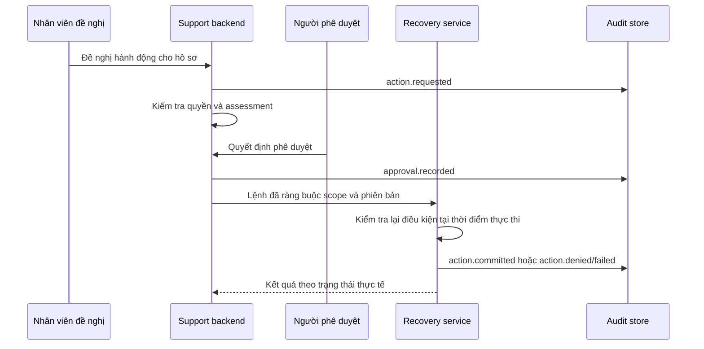

# Support action audit — Kiểm toán hành động hỗ trợ khôi phục tài khoản

Khi người dùng mất mật khẩu, MFA, passkey hoặc thiết bị xác thực, đội hỗ trợ có thể tham gia đánh giá hồ sơ, phê duyệt một bước recovery hoặc yêu cầu thu hồi phiên. Những thao tác này có khả năng thay đổi quyền kiểm soát tài khoản, nên phải để lại dấu vết đáng tin cậy về người thực hiện, căn cứ quyết định và kết quả thực tế.

**Support action audit là ghi nhận có cấu trúc các hành động của nhân viên hỗ trợ và hệ thống thực thi trong quá trình recovery, để có thể giải trình, phát hiện lạm dụng và dựng lại diễn biến khi xảy ra sự cố.**

Một ticket ghi “đã hỗ trợ khách hàng” không đủ thay cho audit. Một dòng audit cũng không tự chứng minh người yêu cầu là chủ tài khoản hoặc thao tác đã được phép thực hiện. Xác minh danh tính, phân quyền và ghi nhận bằng chứng phải phối hợp nhưng có trách nhiệm riêng.

Các sự kiện, trường dữ liệu và luồng xử lý dưới đây là thiết kế minh họa, cần được điều chỉnh theo chính sách recovery và kiến trúc của hệ thống.

## 1. Những câu hỏi audit phải trả lời được

Khi kiểm tra một lần thay MFA có hỗ trợ, cần trả lời:

- Người nào khởi tạo hành động và đang sử dụng quyền hỗ trợ nào?
- Thao tác nhắm đến tenant, tài khoản và hồ sơ recovery nào?
- Căn cứ xác minh nào đã được hệ thống chấp nhận cho đúng hành động?
- Ai phê duyệt, phê duyệt phạm vi gì và trong thời gian nào?
- Backend đã cho phép hay từ chối theo phiên bản chính sách nào?
- Thao tác thực sự thay đổi gì?
- Công việc phụ thuộc như thu hồi session đã hoàn tất hay còn đang chờ?
- Có retry, thay đổi phạm vi, ngoại lệ hoặc kết quả chưa rõ nào không?
- Ai đã đọc hoặc xuất bằng chứng sau đó?

OWASP khuyến nghị ghi nhận hoạt động dùng quyền quản trị và thiết kế log đủ thông tin về thời điểm, nơi xảy ra, chủ thể và hành động. Interaction identifier giúp liên kết các sự kiện thuộc cùng một tương tác. [OWASP Logging Cheat Sheet](https://cheatsheetseries.owasp.org/cheatsheets/Logging_Cheat_Sheet.html)

Trong recovery, cần bổ sung ngữ nghĩa nghiệp vụ: “nhân viên đã bấm nút” khác với “backend cho phép” và khác với “thay đổi đã được áp dụng”.

## 2. Audit hỗ trợ khác với ghi chú ticket và log kỹ thuật

| Nguồn | Vai trò chính | Giới hạn |
| --- | --- | --- |
| Ticket hỗ trợ | Trao đổi, theo dõi hồ sơ và xử lý công việc | Nội dung có thể được sửa; trạng thái ticket không chứng minh thay đổi credential |
| Audit nghiệp vụ | Ghi quyết định và thay đổi có ý nghĩa bảo mật | Cần nguồn sinh đáng tin và cơ chế bảo vệ |
| Access log HTTP | Ghi việc truy cập endpoint | HTTP 200 có thể chỉ là tiếp nhận yêu cầu |
| Trace/log kỹ thuật | Giải thích đường xử lý và lỗi | Có thể sampling, thiếu hoặc thay đổi theo cấu hình |
| Kho bằng chứng xác minh | Giữ tài liệu hoặc kết quả phục vụ xác minh | Chứa dữ liệu nhạy cảm, có quyền và vòng đời riêng |

Một trường hợp điển hình:

```text
Ticket: "khách hàng báo mất điện thoại"
Audit: support.recovery.action.requested
Audit: support.recovery.action.denied
Reason: IDENTITY_ASSESSMENT_INSUFFICIENT
```

Việc ticket được đóng sau cuộc trao đổi không được biến sự kiện DENIED thành một lần reset thành công.

Ticket ID là liên kết ngữ cảnh. Nó không phải bằng chứng xác minh danh tính, approval token hoặc quyền truy cập tài khoản.

## 3. Xác định các hành động cần ghi nhận

Không chỉ ghi những thao tác thành công.

| Nhóm hành động | Ví dụ sự kiện có ích |
| --- | --- |
| Truy cập hồ sơ | Mở chi tiết tài khoản, xem lịch sử recovery, xem bằng chứng |
| Đánh giá xác minh | Ghi nhận kết quả đánh giá, yêu cầu bổ sung, chuyển chuyên viên |
| Quản lý phê duyệt | Đề nghị, phê duyệt, từ chối, thu hồi hoặc hết hạn approval |
| Thực hiện recovery | Cấp quyền recovery giới hạn, yêu cầu thay factor, hủy quy trình |
| Kiểm soát session | Yêu cầu thu hồi, hoàn tất, thất bại hoặc chưa rõ kết quả |
| Quản lý ngoại lệ | Yêu cầu quyền khẩn cấp, sử dụng hoặc kết thúc quyền đã cấp |
| Xuất và sử dụng dữ liệu | Tải báo cáo, xuất hồ sơ, chia sẻ theo tuyến được phép |
| Hành động không được phép | Sai tenant, thiếu quyền, tự phê duyệt, dùng approval cũ |
| Thay đổi quy trình | Đổi scope, đổi đích recovery, sửa đánh giá có ảnh hưởng quyết định |

Việc “xem dữ liệu” có thể nhạy cảm dù không làm thay đổi tài khoản. Nhân viên xem hàng loạt hồ sơ ngoài công việc được giao cũng cần được phát hiện.

Không ghi mọi lần render giao diện như một hành động nghiệp vụ mới. Chọn ranh giới sự kiện sao cho phản ánh truy cập hoặc quyết định thực tế, có khả năng đối chiếu với backend.

## 4. Tách người yêu cầu, người phê duyệt, người thực thi và tài khoản đích

Một sự kiện chỉ có `user_id` rất dễ gây nhầm lẫn.

Ví dụ:

```text
Nhân viên A đề nghị hành động.
Nhân viên B phê duyệt.
Recovery service C thực thi.
Tài khoản U chịu tác động.
```

Các vai trò cần được phân biệt:

| Vai trò | Nội dung cần thể hiện |
| --- | --- |
| Initiator | Người hoặc workload đã khởi tạo lệnh |
| Approver | Chủ thể đã ra quyết định phê duyệt trong quy trình tương ứng |
| Executor | Dịch vụ hoặc tiến trình áp dụng thay đổi |
| Subject/target | Tài khoản, tenant hoặc tài nguyên chịu tác động |
| Reviewer | Người kiểm tra hồ sơ hoặc audit sau hành động |

Không ghi service account C là người phê duyệt chỉ vì nó gọi API thay đổi credential. Cũng không ghi U là người thực hiện nếu thao tác được khởi tạo từ công cụ hỗ trợ.

Với cơ chế delegated access hoặc giao diện “xem như người dùng”, audit vẫn phải giữ được danh tính nhân viên thật, ngữ cảnh ủy quyền và subject đích. Không được xóa dấu vết nguồn hỗ trợ bằng cách chỉ lưu effective user.

Các định danh được backend lấy từ ngữ cảnh xác thực đáng tin cậy. Client không được tự gửi `actor_id`, `approver_id` hoặc `is_admin=true` rồi được ghi nhận như sự thật.

## 5. Ghi căn cứ quyền tại thời điểm hành động

Vai trò hiện tại của nhân viên không đủ để giải thích một hành động trong quá khứ. Người đó có thể đã đổi nhóm, hết ca, bị thu hồi quyền hoặc nghỉ việc.

Audit có thể tham chiếu đến:

- Danh tính nhân viên ổn định và tenant/phạm vi hỗ trợ.
- Phiên hỗ trợ hoặc phiên làm việc được xác thực.
- Kết quả xác thực lại cần thiết cho thao tác nhạy cảm.
- Privilege grant có giới hạn thời gian và scope.
- Chính sách phân quyền cùng phiên bản áp dụng.
- Ticket/hồ sơ đang được phép xử lý.
- Quyết định kiểm soát xung đột vai trò.

Không lưu cookie hay access token của phiên hỗ trợ vào audit. Một `support_session_ref` phải là tham chiếu nội bộ không có khả năng cấp quyền như bearer token.

Khi xem lại sự kiện cũ, không dùng vai trò hiện tại để viết lại câu trả lời “người này có quyền lúc đó hay không”. Cần có dấu vết của grant, policy và quyết định tại thời điểm liên quan.

Nếu metadata tham chiếu đã bị xử lý theo chính sách lưu giữ, hệ thống cần giải thích được giới hạn đó. Không lấp chỗ trống bằng thông tin hiện tại như thể nó là snapshot lịch sử.

## 6. Ghi nhận xác minh danh tính mà không ghi bí mật

Hỗ trợ recovery thường phải đối mặt với social engineering: người yêu cầu tạo áp lực khẩn cấp, biết nhiều thông tin cá nhân hoặc tự nhận có quan hệ với lãnh đạo.

OWASP nêu rằng recovery MFA phải tránh trở thành đường bypass; khi dùng đội hỗ trợ, cần quy trình xác minh danh tính chặt chẽ theo bối cảnh ứng dụng. Audit của quy trình là công cụ giải trình cho việc áp dụng quy trình đó. [OWASP: Resetting MFA](https://cheatsheetseries.owasp.org/cheatsheets/Multifactor_Authentication_Cheat_Sheet.html#resetting-mfa)

Một phần audit về đánh giá có thể ghi:

```text
assessment_ref
assessment_version
method_class
result
scope_of_assurance
assessor_ref
policy_version
assessed_at
valid_until, nếu quy trình có quy định
```

Không chép OTP, mã recovery, câu trả lời bí mật, token hoặc ảnh giấy tờ vào sự kiện.

Phân biệt:

```text
result = SUFFICIENT_FOR_REQUESTED_ACTION
```

với một khẳng định rộng:

```text
identity_verified_forever = true
```

Một đánh giá đủ cho việc xem xét hồ sơ chưa chắc đủ để thay địa chỉ recovery hay gỡ MFA. Audit cần thể hiện scope mà quyết định xác minh thực sự hỗ trợ.

Ghi chú “khách nói đúng họ tên” không tự trở thành kết quả xác minh hợp lệ. Nếu policy không cho phép dựa vào thông tin đó, việc ghi log không hợp thức hóa hành động.

## 7. Approval phải ràng buộc với hành động cụ thể

Một sự kiện “B đã phê duyệt ticket T” quá mơ hồ nếu T còn có thể đổi tài khoản đích hoặc loại thao tác.

Một approval nên gắn với một tập dữ liệu bất biến hoặc được kiểm tra phiên bản:

```text
approval_request_id
tenant và tài khoản đích
action_type
scope của quyền được đề nghị
command hoặc action specification
account_version / recovery_flow_version liên quan
assessment_ref và version
requester_ref
approver_ref
decision
policy_version
issued_at và expires_at
```

Nếu dùng fingerprint cho bản mô tả hành động, cần biểu diễn chuẩn hóa và cách đối chiếu rõ ràng. Một hash đơn lẻ không chứng minh ai đã phê duyệt hoặc người đó có quyền.

Khi thay đổi scope, đích nhận, assessment hoặc trạng thái tài khoản theo cách làm approval cũ không còn phù hợp, backend phải đánh giá lại theo policy. Không chỉ cập nhật ticket rồi tiếp tục dùng quyết định cũ.

Nếu chính sách yêu cầu phân tách người đề nghị và người phê duyệt, kiểm tra bằng định danh con người ổn định, không chỉ hai phiên đăng nhập khác nhau.

Audit cần ghi cả việc từ chối:

```text
reason_code = SELF_APPROVAL_NOT_ALLOWED
reason_code = APPROVAL_EXPIRED
reason_code = ACTION_SPECIFICATION_CHANGED
reason_code = ACCOUNT_VERSION_CHANGED
```

Hai người đồng ý không tự thay thế các bằng chứng bắt buộc của người dùng. Approval hỗ trợ kiểm soát hành động nhân viên, không tự tạo bằng chứng sở hữu tài khoản.

## 8. Thiết kế vòng đời sự kiện theo sự thật đã biết

Một chuỗi sự kiện minh họa:



Tên trạng thái phải có hợp đồng:

| Sự kiện/trạng thái | Khẳng định được phép |
| --- | --- |
| REQUESTED | Hệ thống đã nhận yêu cầu |
| AUTHORIZED | Quyết định phân quyền cho scope tương ứng đã được ghi nhận |
| COMMITTED | Thay đổi nội bộ được mô tả đã commit |
| DISPATCHED | Công việc đã được chuyển theo cơ chế được định nghĩa |
| COMPLETED | Điều kiện hoàn tất cụ thể đã được xác nhận |
| DENIED | Yêu cầu không được phép theo quyết định đã ghi |
| FAILED | Một bước đã thất bại với kết quả được xác định |
| UNKNOWN/PENDING | Chưa đủ dữ liệu để kết luận kết quả cuối |

Không dùng “completed” cho mọi endpoint trả 202 hoặc mọi transaction tạo outbox thành công.

Với thu hồi session ở dịch vụ khác, sự kiện cục bộ có thể là `session_revocation.requested`. Chỉ có `session_revocation.completed` khi kết quả theo mô hình thu hồi đã được xác nhận.

## 9. Ví dụ sự kiện audit có cấu trúc

Ví dụ dưới đây ghi việc cấp quyền recovery giới hạn sau phê duyệt hỗ trợ. Nó chưa khẳng định MFA mới đã được đăng ký.

```json
{
  "event_id": "event-example-901",
  "schema_version": 1,
  "event_type": "support.recovery.action.committed",
  "occurred_at": "2026-11-24T09:15:31Z",
  "recorded_at": "2026-11-24T09:15:32Z",
  "initiator": {
    "type": "SUPPORT_AGENT",
    "ref": "agent-21",
    "support_session_ref": "support-session-87",
    "privilege_grant_ref": "grant-56"
  },
  "executor": {
    "service": "recovery-service",
    "workload_ref": "workload-4"
  },
  "subject": {
    "tenant_ref": "tenant-7",
    "account_ref": "account-315"
  },
  "case_ref": "case-204",
  "recovery_flow_ref": "flow-639",
  "command_ref": "command-118",
  "action": {
    "type": "RESTRICTED_RECOVERY_GRANT_ISSUED",
    "scope": "ENROLL_REPLACEMENT_MFA",
    "recovery_grant_ref": "recovery-grant-73"
  },
  "verification": {
    "assessment_ref": "assessment-92",
    "assessment_version": 3,
    "result": "SUFFICIENT_FOR_REQUESTED_ACTION"
  },
  "approval": {
    "request_ref": "approval-request-14",
    "decision_ref": "approval-decision-18",
    "approver_ref": "agent-48"
  },
  "authorization": {
    "decision": "ALLOW",
    "policy_version": "support-recovery-policy-9",
    "reason_code": "SCOPED_APPROVAL_AND_ASSESSMENT_VALID"
  },
  "outcome": {
    "local_change_committed": true,
    "user_enrollment": "REQUIRED",
    "session_revocation": "REQUESTED"
  }
}
```

Tất cả định danh là giả lập. `recovery_grant_ref` là tham chiếu không có khả năng dùng để thực hiện recovery.

Sự kiện đủ để lần theo chủ thể, căn cứ và kết quả cục bộ. Các hồ sơ được tham chiếu vẫn cần được lưu và bảo vệ theo mục đích của chúng; không mặc định việc có một ID làm bằng chứng trở nên đầy đủ.

Đối với trước/sau, chỉ ghi thay đổi đã được xác nhận ở mức cần thiết, chẳng hạn loại phương thức bị thu hồi hoặc phiên bản trạng thái. Không ghi toàn bộ object credential, khóa riêng, secret TOTP hay giá trị bearer.

## 10. Gắn thay đổi nhạy cảm với audit bền vững

Nếu thay đổi tài khoản commit nhưng audit chỉ được ghi bằng một lời gọi mạng sau đó, tiến trình có thể dừng ở giữa và để lại hành động không có dấu vết tương ứng.

Trong một thiết kế dùng chung cơ sở dữ liệu, có thể lưu thay đổi nghiệp vụ và bản ghi audit/outbox cần thiết trong cùng transaction. Relay chuyển sự kiện đã commit đến kho audit độc lập sau đó.

Transactional outbox xử lý khoảng trống ghi hai hệ thống bằng một bước lưu cục bộ nguyên tử. Relay vẫn có thể chuyển event lặp, nên phía nhận cần idempotency theo danh tính sự kiện. [AWS Prescriptive Guidance: Transactional outbox pattern](https://docs.aws.amazon.com/prescriptive-guidance/latest/cloud-design-patterns/transactional-outbox.html)

Mã giả minh họa:

```text
nhận command và ngữ cảnh nhân viên từ backend đáng tin

kiểm tra quyền tiếp cận hồ sơ
nếu không được phép:
    ghi sự kiện từ chối theo tuyến bền vững phù hợp
    kết thúc

mở transaction:
    khóa trạng thái nghiệp vụ liên quan
    kiểm tra lại account/recovery version
    kiểm tra assessment, approval, scope và thời hạn
    xác định command đã được thực hiện hay chưa

    nếu command đã hoàn tất:
        trả kết quả đã có theo hợp đồng idempotency

    áp dụng thay đổi nội bộ được phép
    lưu kết quả command
    ghi sự kiện action.committed và outbox cần thiết

commit
trả kết quả phản ánh phần đã commit
```

Đây là mô hình khái niệm, không phải mã triển khai hoàn chỉnh.

Những điểm cần giữ rõ:

- Kiểm tra tại giao diện không thay thế kiểm tra backend.
- Approval có thể hết hạn hoặc trạng thái tài khoản thay đổi trước khi thực thi.
- Sự kiện từ chối bên trong một transaction bị rollback cần đường ghi nhận phù hợp; không mong nó tự tồn tại sau rollback.
- Nếu không lưu được dấu vết bền vững bắt buộc cho một thao tác nhạy cảm, thiết kế minh họa không cho commit thao tác đó.
- Collector tạm thời chậm khác với việc không còn nơi ghi bền vững. Có thể dùng outbox/spool được bảo vệ theo kiến trúc.
- Không tắt audit rồi thực hiện lại thao tác chỉ để vượt lỗi ghi nhận.

Với lời gọi ngoài hệ thống, transaction cục bộ không chứng minh tác dụng bên ngoài chưa hoặc đã xảy ra. Cần trạng thái command, idempotency và đối soát kết quả tương ứng.

## 11. Retry, thao tác trùng và kết quả chưa rõ

Nhân viên có thể bấm lại vì trình duyệt mất phản hồi. Backend có thể retry vì queue hoặc dịch vụ đích bị lỗi.

Phân biệt:

```text
command_ref: danh tính ổn định của lệnh nghiệp vụ
attempt_ref: danh tính từng lần thử xử lý
event_id: danh tính một sự kiện audit cụ thể
```

Không dùng command ID mới cho mỗi retry của cùng một yêu cầu rồi vô tình cấp nhiều quyền recovery.

Một bản tin audit bị giao lại giữ nguyên event ID. Kho nhận không nên tạo thêm một hành động thành công logic chỉ vì nhận hai bản sao của cùng event.

Nếu một attempt mới có ý nghĩa cần ghi nhận, nó có event ID riêng và cùng command reference. Ví dụ:

```text
command-118 / attempt-1 → kết quả ngoài hệ thống chưa rõ
command-118 / attempt-2 → đối soát thấy đã thực hiện
command-118            → hoàn tất theo kết quả được xác nhận
```

Không sửa sự kiện UNKNOWN cũ thành SUCCESS như thể hệ thống đã biết kết quả ngay từ đầu. Ghi một sự kiện bổ sung hoặc kết quả đối soát để giữ được diễn biến.

Nếu phải thực hiện hành động khắc phục, đó là lệnh mới liên kết đến lệnh cũ, có kiểm tra quyền và audit riêng. “Rollback” về mặt nghiệp vụ không có nghĩa xóa dấu vết hành động đã xảy ra.

## 12. Quyền khẩn cấp và hành vi ngoại lệ

Một quy trình khẩn cấp đã được tổ chức cho phép có thể cấp quyền ngắn hạn để xử lý sự cố. Audit cần ghi đủ để giải thích việc sử dụng quyền này.

Có thể gồm:

- Lý do kích hoạt và hồ sơ sự cố.
- Ai đề nghị, ai cho phép và scope được cấp.
- Thời điểm bắt đầu, thời hạn và việc thu hồi quyền.
- Những hành động thực hiện dưới grant đó.
- Các điều kiện xác minh vẫn phải đáp ứng.
- Người và kết quả xem xét sau sử dụng.

Không cho nhân viên nhập một reason code “khẩn cấp” rồi tự vượt mọi kiểm soát. Reason code là mô tả quyết định, không phải quyền.

Ghi `exception_used=true` cũng quá ít. Cần biết ngoại lệ nào, được cấp theo policy nào và ràng buộc gì.

Audit ngoại lệ phải được gửi đến tuyến bảo vệ mà người sử dụng quyền đó không thể tự xóa hoặc làm mất dấu vết bằng quyền hỗ trợ thông thường.

## 13. Bảo vệ kho audit và dữ liệu nhạy cảm

Audit có thể chứa thông tin về tài khoản, nhân viên và cách hệ thống quyết định recovery. Quyền đọc rộng cũng có thể tạo rủi ro.

Phân tách trách nhiệm theo thiết kế:

| Vai trò | Quyền điển hình cần xem xét |
| --- | --- |
| Support agent | Xem phần cần cho hồ sơ được giao |
| Recovery backend | Ghi sự kiện theo schema, không tùy ý sửa lịch sử |
| Bộ phận điều tra | Truy xuất bằng chứng trong phạm vi được phép |
| Quản trị lưu trữ | Vận hành kho theo quyền được kiểm soát |
| Retention worker | Xử lý dữ liệu đủ điều kiện theo chính sách riêng |

Không trao quyền sửa/xóa audit cho nhân viên chỉ vì họ có quyền thao tác recovery.

Các biện pháp có thể gồm lưu chỉ ghi thêm, bản sao độc lập, kiểm tra toàn vẹn, phân tách khóa và giám sát thay đổi quyền. Hash do cùng một chủ thể có quyền sửa dữ liệu tự thay lại không tự bảo đảm toàn vẹn.

Giới hạn dữ liệu đầu vào:

- Dùng field và enum được định nghĩa, tránh object metadata tùy ý chứa mọi request.
- Chuẩn hóa độ dài, mã hóa và ký tự điều khiển trong ghi chú.
- Render nội dung không tin cậy an toàn trên giao diện audit.
- Không để nội dung ticket chèn thêm dòng log hoặc giả một sự kiện thành công.
- Không đưa thông báo lỗi chứa token hay dữ liệu người dùng vào trường reason.
- Tách tài liệu xác minh và bản ghi âm nếu quy trình có sử dụng sang kho riêng có chính sách phù hợp.

Việc xem, xuất, thay đổi quyền và xử lý dữ liệu audit cũng cần dấu vết. Thiết kế pipeline tránh tự sinh một chuỗi log vô hạn từ chính việc ghi log.

## 14. Phát hiện lạm dụng từ chuỗi sự kiện

Một sự kiện riêng lẻ có thể hợp lệ nhưng chuỗi hành động lại bất thường.

| Mẫu quan sát | Điều cần xem xét |
| --- | --- |
| Một nhân viên reset nhiều tài khoản trong thời gian ngắn | Lạm dụng quyền, tự động hóa lỗi hoặc ca xử lý đặc biệt |
| Nhiều lần xem tài khoản ngoài phạm vi ticket | Truy cập không phục vụ công việc |
| Approval liên tục bị từ chối rồi hành động vẫn xuất hiện | Đường thực thi bỏ qua kiểm soát hoặc sai liên kết |
| Đổi email recovery rồi thay MFA ngay sau đó | Chuỗi thay đổi có thể làm chuyển quyền kiểm soát |
| Cùng nhân viên xuất hiện ở vai trò đề nghị và phê duyệt | Vi phạm phân tách vai trò nếu policy yêu cầu |
| Dùng quyền khẩn cấp thường xuyên | Scope quá rộng hoặc quy trình bị lạm dụng |
| Một case được chuyển qua nhiều agent sau các lần từ chối | Có thể là tìm người chấp nhận yêu cầu |
| Thay đổi credential được ghi nhưng không có căn cứ liên quan | Thiếu audit, sai schema hoặc thao tác ngoài quy trình |

Những mẫu này là tín hiệu cần xem xét, không phải kết luận tự động rằng nhân viên có hành vi sai. Ca làm việc, sự cố diện rộng và loại tài khoản có thể tạo baseline khác nhau.

Cần theo dõi cả chất lượng audit:

```text
sự kiện đến trễ
outbox hoặc collector tồn đọng
event thiếu reference bắt buộc
command hoàn tất không tìm thấy sự kiện tương ứng
event trùng có payload mâu thuẫn
nguồn ghi không được tin cậy
chuỗi request–approval–execution bị đứt
```

Nếu cảnh báo dựa vào event đến không đúng thứ tự, nên xét thời gian xảy ra, thời gian tiếp nhận và trạng thái đối soát. Không kết luận thiếu approval chỉ vì callback thực thi đến kho audit trước event approval.

## 15. Dựng lại một trường hợp hỗ trợ

Giả sử người yêu cầu báo mất thiết bị MFA. Một chuỗi được ghi nhận:

| Mốc | Sự kiện | Ý nghĩa |
| --- | --- | --- |
| T0 | Nhân viên A mở hồ sơ được giao | Có truy cập hỗ trợ có liên kết case |
| T1 | Assessment phiên bản 1 không đủ | Chưa đủ căn cứ cho hành động đề nghị |
| T2 | Đề nghị reset bị từ chối | Không có thay đổi tài khoản theo lệnh đó |
| T3 | Hồ sơ được bổ sung, assessment phiên bản 2 đạt scope | Có kết quả mới, không sửa lịch sử T1 |
| T4 | A đề nghị cấp quyền enrollment giới hạn | Scope cụ thể, gắn tài khoản và phiên bản |
| T5 | B phê duyệt theo policy | Quyết định hỗ trợ được ghi riêng |
| T6 | Backend kiểm tra lại và commit grant | Chỉ xác nhận grant được cấp |
| T7 | Người dùng hoàn tất enrollment | Sự kiện người dùng thực hiện, khác hành động hỗ trợ |
| T8 | Session service xác nhận thu hồi theo yêu cầu | Có kết quả bảo vệ hậu recovery |
| T9 | Hệ thống tạo cảnh báo an ninh | Có tham chiếu notification; chưa mặc định đã giao |

Một báo cáo dựng lại cần chỉ ra được dữ liệu đến từ nguồn nào, reference nào chưa truy xuất được và bước nào còn chưa rõ. Không làm phẳng toàn bộ chuỗi thành “A reset MFA thành công” nếu người dùng và nhiều dịch vụ đã thực hiện các bước khác nhau.

Nếu T8 thất bại, ticket đóng ở T9 không được làm mất trạng thái thu hồi chưa hoàn tất. Nếu T5 dùng approval hết hạn, cần thể hiện quyết định kiểm tra tại T6 và việc backend thực sự đã làm.

## 16. Những sai lầm cần tránh

| Lựa chọn | Hậu quả |
| --- | --- |
| Chỉ ghi “agent đã xử lý ticket” | Không biết hành động và tác động bảo mật |
| Dùng một user_id cho cả agent và tài khoản đích | Mất khả năng quy trách nhiệm |
| Tin actor/approver do client khai báo | Có thể giả danh trong audit |
| Approval không gắn scope và phiên bản | Quyết định cũ có thể bị dùng cho hành động mới |
| Audit chỉ ghi khi thành công | Mất dấu vết thử vượt quyền và hành vi bị từ chối |
| Ghi success trước khi transaction hoặc công việc hoàn tất | Bằng chứng không phản ánh kết quả thực tế |
| Retry tạo command mới tùy ý | Có thể thực hiện cùng tác dụng nhiều lần |
| Ghi token, OTP, secret credential vào sự kiện | Kho audit trở thành nguồn làm lộ quyền |
| Nhân viên có thể sửa/xóa audit của chính mình | Dễ che giấu sai phạm hoặc nhầm lẫn |
| Ticket CLOSED được coi là recovery COMPLETED | Công việc xác thực hoặc thu hồi session có thể còn thiếu |
| Giữ audit vô hạn theo mặc định | Tăng dữ liệu nhạy cảm và khó quản trị vòng đời |
| Có audit rồi coi là đã xác minh danh tính | Ghi nhận không thay thế kiểm soát recovery |

Dấu vết hỗ trợ có giá trị khi liên kết đúng con người, quyền, hồ sơ, quyết định và kết quả mà backend thực sự xác nhận. Nó giúp giải thích và kiểm soát hành động đặc quyền, đồng thời giữ riêng trách nhiệm xác minh danh tính và cấp quyền khôi phục tài khoản.