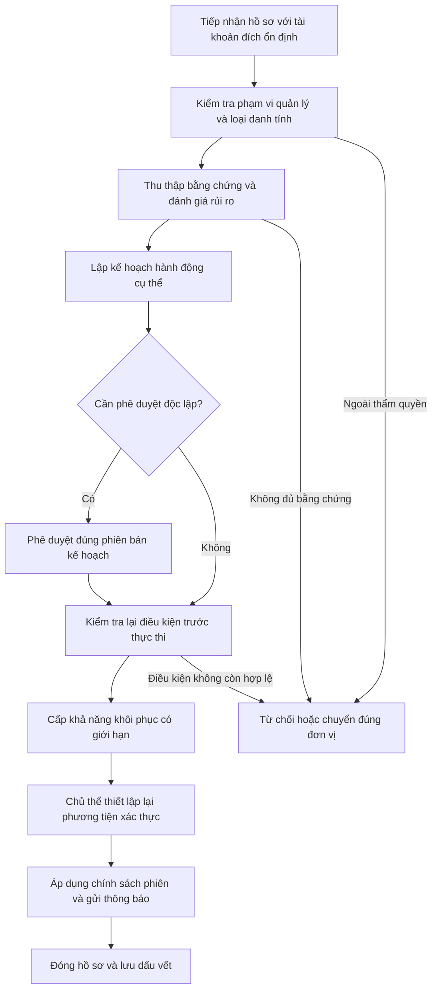

# Administrator recovery scope — Phạm vi khôi phục tài khoản của quản trị viên

## 1. Vì sao phải xác định phạm vi trước khi cấp công cụ khôi phục?

Trong một hệ thống xác thực, người dùng có thể mất mật khẩu, thiết bị MFA, passkey hoặc quyền truy cập kênh khôi phục. Nếu tự phục vụ không còn khả thi, hệ thống có thể cho phép quản trị viên hỗ trợ. Từ thời điểm đó, quy trình khôi phục trở thành một đường có khả năng thay đổi người đang kiểm soát tài khoản.

Một quản trị viên có quyền quản lý thành viên không có nghĩa là được quyền thay thế mọi yếu tố xác thực của họ. Một nhân viên hỗ trợ nhìn thấy hồ sơ khách hàng cũng không mặc nhiên được phép tạo phiên đăng nhập cho khách hàng đó. Nếu không tách bạch những quyền này, kẻ tấn công chỉ cần thuyết phục hoặc chiếm tài khoản của một người có công cụ hỗ trợ là có thể vượt qua cơ chế xác thực vốn được thiết kế rất chặt.

Trong phạm vi `SECURITY_AUTHENTICATION_ACCOUNT_RECOVERY`, administrative recovery là khả năng can thiệp được giới hạn để giúp chủ thể hợp lệ thiết lập lại quyền truy cập sau khi mất phương tiện xác thực. Nó phải gắn với đánh giá rủi ro, bằng chứng sở hữu, token dùng một lần, chống lạm dụng và kiểm soát phiên.

Phạm vi khôi phục cần trả lời rõ năm câu hỏi:

1. Ai được thực hiện từng hành động?
2. Hành động đó áp dụng cho tài khoản, tenant và loại danh tính nào?
3. Những điều kiện, bằng chứng và phê duyệt nào phải có trước khi thực thi?
4. Sau can thiệp, người dùng nhận được quyền gì và trong bao lâu?
5. Điều gì vẫn bị cấm dù quản trị viên đã đăng nhập thành công?

Một định nghĩa hữu ích là:

> Quyền khôi phục là quyền thực hiện một chuyển trạng thái cụ thể trên một danh tính cụ thể, trong một phạm vi quản lý cụ thể, khi các điều kiện của chính sách đang còn đúng.

Định nghĩa này chặt hơn nhiều so với một quyền tổng quát như `admin = true`.

## 2. Phân biệt những nghiệp vụ dễ bị gom nhầm

### 2.1. Khôi phục có quản trị viên hỗ trợ

Người dùng mất yếu tố xác thực và cần hỗ trợ. Người quản trị có thể mở hồ sơ, tiếp nhận bằng chứng hoặc cho phép người dùng đi vào một quy trình đăng ký lại yếu tố xác thực đã được kiểm soát.

Đích cuối cùng vẫn là chủ thể hợp lệ tự thiết lập lại phương tiện xác thực. Quản trị viên không nên biết mật khẩu mới, giữ bí mật MFA hay lấy passkey của người dùng.

### 2.2. Khôi phục tài khoản quản trị viên

Đây là khôi phục mà tài khoản đích có đặc quyền cao. Nó cần chính sách riêng vì chiếm được tài khoản này có thể mở rộng tác động sang nhiều người dùng, cấu hình xác thực hoặc toàn tenant.

Không được suy ra rằng một người có quyền hỗ trợ tài khoản thông thường cũng có quyền khôi phục tài khoản của quản trị viên cấp cao. Quyền của người thực hiện và mức bảo vệ của tài khoản đích là hai đầu vào độc lập.

### 2.3. Quản lý vòng đời tài khoản

Tạo tài khoản, khóa nhân viên đã nghỉ việc, chuyển quyền sở hữu tài nguyên hoặc thay đổi vai trò là nghiệp vụ quản trị danh tính. Chúng có thể liên quan đến một hồ sơ khôi phục nhưng không phải là cùng một quyền.

Ví dụ, người mới tiếp quản một dự án không vì thế trở thành chủ thể của tài khoản người cũ. Cách phù hợp có thể là chuyển tài nguyên qua quy trình quản trị riêng, thay vì khôi phục tài khoản cũ cho người mới.

### 2.4. Điều tra sự cố và truy cập khẩn cấp

Khôi phục giúp chủ thể lấy lại khả năng xác thực. Điều tra sự cố giúp tổ chức tìm hiểu và xử lý xâm nhập. Truy cập khẩn cấp giúp duy trì hoạt động khi các đường quản trị thông thường không sử dụng được.

Các quy trình này có thể phối hợp nhưng không nên dùng chung một quyền bỏ qua mọi kiểm soát. Một nhân viên điều tra được phép đọc nhật ký không nhất thiết được phép thay đổi kênh khôi phục. Một cơ chế truy cập khẩn cấp cũng không tự động cho phép giả danh người dùng.

## 3. Danh tính nào thuộc phạm vi quản lý?

Trước khi xét hành động, phải xác định hệ thống có thẩm quyền đối với phương tiện xác thực nào của tài khoản đích.

| Loại danh tính | Can thiệp có thể nằm trong phạm vi | Giới hạn cần giữ |
|---|---|---|
| Người dùng nội bộ có thông tin xác thực do hệ thống quản lý | Khởi tạo quy trình đặt lại mật khẩu, vô hiệu yếu tố bị mất, cấp khả năng đăng ký lại có giới hạn | Phải xác minh chủ thể và áp dụng chính sách theo rủi ro |
| Người dùng liên kết qua nhà cung cấp danh tính bên ngoài | Hỗ trợ xác định nguồn đăng nhập, hướng dẫn về quy trình của bên quản lý thông tin xác thực | Không tự đặt lại mật khẩu hoặc MFA nằm ở nhà cung cấp bên ngoài |
| Khách mời của tenant | Xử lý tư cách thành viên thuộc tenant nếu có quyền riêng | Không coi quyền quản lý khách mời là quyền sở hữu danh tính gốc |
| Tài khoản đặc quyền | Chỉ theo quy trình bảo vệ danh tính đặc quyền được cho phép | Không sử dụng quyền hỗ trợ thông thường để hạ mức kiểm soát |
| Tài khoản dịch vụ hoặc workload | Chuyển sang quy trình quản lý bí mật, khóa và danh tính máy | Không dùng bằng chứng nhận diện con người để thay cho quyền quản lý credential của máy |

Với danh tính liên kết, cần phân biệt hai lớp: tài khoản có thể tồn tại trong ứng dụng, nhưng mật khẩu và MFA thực sự nằm tại hệ thống khác. Cho phép đặt một mật khẩu cục bộ mới để vượt qua nhà cung cấp danh tính sẽ tạo một đường đăng nhập mới. Đó là thay đổi kiến trúc tin cậy, không phải thao tác khôi phục thông thường.

Trong hệ thống nhiều tenant, ranh giới còn phải được mô tả theo mô hình dữ liệu. Nếu một danh tính toàn cục có thể tham gia nhiều tenant, quản trị viên của một tenant thường chỉ quản lý tư cách thành viên trong tenant đó. Việc thay đổi credential toàn cục có thể ảnh hưởng các tenant khác và phải thuộc thẩm quyền của bên quản lý danh tính toàn cục.

## 4. Tách quyền theo hành động thay vì một nút “Reset account”

Một chức năng khôi phục tổng hợp có thể chứa nhiều hành động với hậu quả rất khác nhau. Nên mô hình hóa chúng thành các quyền độc lập.

### 4.1. Tiếp nhận và xem hồ sơ

Người tiếp nhận có thể tạo hồ sơ khôi phục, xem trạng thái xử lý và thu thập thông tin tối thiểu theo nhiệm vụ. Quyền này không tự bao gồm quyền xem toàn bộ bằng chứng nhạy cảm hoặc thay đổi tài khoản.

Hồ sơ cần gắn với định danh tài khoản ổn định. Email người yêu cầu nhập vào chỉ là một dữ liệu tìm kiếm hoặc liên hệ; không nên là căn cứ duy nhất để quyết định tài khoản đích.

### 4.2. Đề xuất hành động

Nhân viên hỗ trợ có thể đề xuất vô hiệu một yếu tố bị mất hoặc mở quy trình đăng ký lại. Đề xuất ghi lại lý do, bằng chứng đã kiểm tra và hành động mong muốn, nhưng chưa tạo ra tác động lên thông tin xác thực.

Tách đề xuất khỏi thực thi giúp chính sách yêu cầu người phê duyệt độc lập khi cần. Người đề xuất không nên đạt được cùng kết quả bằng một endpoint phụ ít được bảo vệ hơn.

### 4.3. Cho phép một bước khôi phục có giới hạn

Hệ thống có thể cấp cho người dùng một token dùng một lần để đăng ký lại một yếu tố xác thực. Token này không nên trở thành một phiên sử dụng toàn bộ ứng dụng.

Khả năng được cấp cần bị ràng buộc vào hồ sơ, tài khoản đích, hành động cho phép, thời hạn và trạng thái chưa sử dụng. Nếu mục đích là đăng ký lại MFA, token không được dùng để thay đổi email chính hoặc xem dữ liệu nghiệp vụ.

### 4.4. Vô hiệu yếu tố xác thực hoặc phiên

Vô hiệu yếu tố bị mất và thu hồi phiên có thể là các hành động cần thiết sau mất thiết bị hoặc nghi ngờ xâm nhập. Chúng cần quyền riêng vì có thể gây gián đoạn và bị lạm dụng để khóa người dùng hợp lệ.

Một hồ sơ chỉ liên quan đến mất thiết bị MFA không mặc nhiên cho phép đổi mật khẩu, đổi email và xóa mọi passkey còn lại. Mỗi thay đổi phải có lý do nằm trong mục tiêu khôi phục đã được duyệt.

### 4.5. Thay đổi kênh khôi phục

Thay email, số điện thoại hoặc kênh nhận thông báo có thể quyết định ai nhận các lần khôi phục tiếp theo. Vì vậy, quyền này thường cần được bảo vệ riêng, thay vì đi kèm mặc định với quyền hỗ trợ đăng nhập.

Không dùng kênh vừa được người yêu cầu cung cấp làm bằng chứng rằng người đó sở hữu tài khoản. “Tôi đã gửi mã tới email mới và họ đọc đúng mã” chỉ chứng minh họ kiểm soát email mới.

## 5. Ma trận phạm vi tham khảo

Ma trận dưới đây là một ví dụ thiết kế để làm rõ cách phân chia quyền. Các tên vai trò không phải là tiêu chuẩn bắt buộc cho mọi tổ chức.

| Vai trò | Có thể được cấp | Không tự động được cấp |
|---|---|---|
| Nhân viên tiếp nhận | Mở hồ sơ, ghi nhận lý do, xem trạng thái đã che dữ liệu nhạy cảm | Vô hiệu MFA, đổi kênh khôi phục, cấp phiên |
| Chuyên viên khôi phục | Kiểm tra bằng chứng trong phạm vi được giao, đề xuất hành động cho tài khoản thông thường | Tự phê duyệt hồ sơ của mình, khôi phục tài khoản đặc quyền |
| Người phê duyệt | Phê duyệt một tập hành động xác định khi đáp ứng chính sách | Phê duyệt chung cho mọi thay đổi phát sinh sau đó |
| Dịch vụ thực thi khôi phục | Áp dụng đúng hành động đã được phê duyệt sau khi kiểm tra lại điều kiện | Thực hiện hành động tùy ý theo dữ liệu từ giao diện |
| Quản trị viên tenant | Quản lý các thao tác được chính sách giao trong tenant của mình | Can thiệp tenant khác hoặc credential toàn cục không thuộc thẩm quyền |
| Nhóm bảo vệ danh tính đặc quyền | Xử lý hồ sơ đặc quyền theo quy trình riêng | Bỏ qua bằng chứng và kiểm soát chỉ vì chức danh cao |

Quyền thực tế là giao của nhiều giới hạn:

```text
Phạm vi được phép =
    quyền hành động của người thực hiện
  ∩ tập tài khoản họ được quản lý
  ∩ tenant hoặc miền quản trị được giao
  ∩ giới hạn theo loại danh tính
  ∩ hành động của hồ sơ đã được duyệt
  ∩ điều kiện rủi ro và trạng thái hiện tại
```

Nếu một trong các điều kiện không thỏa mãn, hành động không được thực thi. Việc người thực hiện có vai trò quản trị chỉ giải quyết một phần của quyết định.

## 6. Các điều kiện phải kiểm tra trước mỗi can thiệp

### 6.1. Xác thực chính người quản trị

Phiên quản trị đã tồn tại nhiều giờ không nhất thiết đủ để thực hiện hành động nhạy cảm. Chính sách có thể yêu cầu xác thực lại gần thời điểm thao tác, sử dụng yếu tố có mức bảo vệ phù hợp và xác nhận phiên không bị hạn chế vì rủi ro.

Xác thực lại quản trị viên trả lời “ai đang vận hành công cụ”. Nó không trả lời “người yêu cầu có phải chủ tài khoản đích hay không”. Hai câu hỏi này cần được kiểm tra riêng.

### 6.2. Thẩm quyền đối với đối tượng đích

Máy chủ phải kiểm tra tài khoản đích có thuộc phạm vi quản lý hiện tại của người thực hiện hay không. Không tin `tenantId`, loại tài khoản hoặc vai trò do trình duyệt gửi lên mà chưa đối chiếu dữ liệu có thẩm quyền.

Không nên chỉ ẩn nút trên giao diện. Quyền phải được kiểm tra ở dịch vụ thực hiện thay đổi, kể cả khi yêu cầu đến từ công cụ nội bộ hoặc một API tự động hóa.

### 6.3. Bằng chứng và rủi ro của hồ sơ

Người yêu cầu biết tên nhân viên, email công ty hoặc ngày sinh không có nghĩa là đã chứng minh quyền kiểm soát tài khoản. Lựa chọn bằng chứng phải dựa trên chính sách và bối cảnh danh tính, tránh chỉ dựa vào thông tin có thể công khai hoặc dễ bị lộ.

Các dấu hiệu như vừa thay kênh liên hệ, nhiều hồ sơ liên tiếp, yêu cầu từ môi trường bất thường hoặc đòi bỏ qua quy trình vì khẩn cấp có thể làm tăng mức kiểm soát. Mức khẩn cấp không thay thế cho bằng chứng.

Không phải mọi hồ sơ đều cần cùng một số lượng người phê duyệt hay một thời gian chờ cố định. Chính sách nên quy định điều kiện tương ứng với mức tác động và rủi ro, đồng thời có đường chuyển xử lý khi không đủ bằng chứng.

### 6.4. Tránh tự phê duyệt và xung đột lợi ích

Khôi phục tài khoản của chính người vận hành là trường hợp cần phân luồng riêng. Người đó không được dùng đặc quyền sẵn có để tự tạo bằng chứng, tự phê duyệt rồi tự thực thi một chuỗi thay đổi cho mình.

Với hồ sơ yêu cầu phê duyệt độc lập, người đề xuất và người phê duyệt phải là các chủ thể khác nhau theo chính sách. Việc tạo hai tài khoản quản trị cùng do một người sử dụng không đạt mục đích phân tách trách nhiệm.

## 7. Phê duyệt phải gắn với nội dung cụ thể

Một quyết định “đồng ý khôi phục” quá chung sẽ cho phép thay đổi phạm vi sau khi đã được duyệt. Nên gắn phê duyệt với một bản mô tả bất biến hoặc có phiên bản của kế hoạch thực thi.

Ví dụ kế hoạch gồm:

```text
caseId: REC-2041
caseRevision: 7
targetIdentityId: user-482
tenantId: tenant-A
allowedActions:
  - INVALIDATE_FACTOR: factor-19
  - ISSUE_MFA_ENROLLMENT_GRANT
evidenceRevision: 3
policyVersion: recovery-policy-12
expiresAt: thời điểm hết hiệu lực của phê duyệt
```

Phê duyệt này không cho phép đổi email chính, đặt mật khẩu do nhân viên hỗ trợ biết, hoặc xóa passkey khác. Nếu kế hoạch thay đổi, hệ thống phải đánh giá lại và yêu cầu phê duyệt mới khi chính sách quy định.

Trước thực thi, dịch vụ vẫn cần kiểm tra tài khoản chưa bị chuyển sang nhóm đặc quyền, quyền của người thực hiện chưa bị thu hồi, bằng chứng và phê duyệt chưa hết hiệu lực, hồ sơ chưa bị hủy hoặc đã hoàn tất.

Đây là kiểm soát đối với thay đổi xảy ra giữa thời điểm duyệt và thời điểm thực hiện. Một ảnh chụp quyền hợp lệ hôm qua không đủ để chứng minh hành động còn hợp lệ hôm nay.

## 8. Luồng xử lý có ranh giới rõ ràng



Trạng thái “đã phê duyệt” không đồng nghĩa với “đã khôi phục thành công”. Người dùng có thể chưa nhận được khả năng khôi phục, token có thể hết hạn hoặc quá trình đăng ký yếu tố mới có thể thất bại.

Cần giữ riêng kết quả phê duyệt, kết quả thực thi thay đổi và kết quả người dùng hoàn thành bước khôi phục. Nếu thực thi thất bại một phần, hồ sơ phải phản ánh đúng các thay đổi đã xảy ra để tránh một lần thử lại làm rộng tác động.

Một yêu cầu lặp lại có cùng định danh thực thi không nên tạo thêm nhiều token độc lập hoặc vô hiệu thêm yếu tố ngoài kế hoạch. Cơ chế chống lặp phải kiểm soát tác động thực tế, không chỉ chống người dùng bấm nút hai lần.

## 9. Minh họa quyết định phạm vi tại phía máy chủ

Đoạn Java dưới đây minh họa phần kiểm tra phạm vi cho một thao tác hỗ trợ tài khoản thông thường. Đây là mã mô tả chính sách, chưa phải một dịch vụ khôi phục hoàn chỉnh.

```java
enum RecoveryAction {
    OPEN_CASE,
    INVALIDATE_LOST_FACTOR,
    ISSUE_MFA_ENROLLMENT_GRANT
}

enum Decision {
    ALLOW,
    DENY_OUT_OF_SCOPE,
    REQUIRE_PRIVILEGED_RECOVERY,
    REQUIRE_REAUTHENTICATION,
    REQUIRE_EVIDENCE,
    REQUIRE_APPROVAL
}

record OperatorContext(
        String identityId,
        java.util.Set<String> managedTenantIds,
        java.util.Set<RecoveryAction> allowedActions,
        boolean recentStrongAuthentication) {
}

record TargetIdentity(
        String identityId,
        String credentialAuthorityTenantId,
        boolean locallyManagedCredentials,
        boolean privileged) {
}

record RecoveryPlan(
        String targetIdentityId,
        String tenantId,
        java.util.Set<RecoveryAction> actions,
        boolean evidenceAccepted,
        boolean independentApprovalRequired,
        boolean matchingApprovalValid) {
}

final class AdministrativeRecoveryPolicy {
    Decision evaluate(
            OperatorContext operator,
            TargetIdentity target,
            RecoveryPlan plan,
            RecoveryAction requestedAction) {

        boolean scopeMatches =
                operator.managedTenantIds().contains(plan.tenantId())
                && plan.tenantId().equals(
                        target.credentialAuthorityTenantId())
                && plan.targetIdentityId().equals(target.identityId())
                && operator.allowedActions().contains(requestedAction)
                && plan.actions().contains(requestedAction);

        if (!scopeMatches
                || !target.locallyManagedCredentials()
                || operator.identityId().equals(target.identityId())) {
            return Decision.DENY_OUT_OF_SCOPE;
        }
        if (target.privileged()) {
            return Decision.REQUIRE_PRIVILEGED_RECOVERY;
        }
        if (!operator.recentStrongAuthentication()) {
            return Decision.REQUIRE_REAUTHENTICATION;
        }
        if (!plan.evidenceAccepted()) {
            return Decision.REQUIRE_EVIDENCE;
        }
        if (plan.independentApprovalRequired()
                && !plan.matchingApprovalValid()) {
            return Decision.REQUIRE_APPROVAL;
        }
        return Decision.ALLOW;
    }
}
```

Các đối tượng trong ví dụ phải được dựng từ nguồn đáng tin cậy của máy chủ. Đặc biệt, `evidenceAccepted` và `matchingApprovalValid` không phải cờ mà phía trình duyệt có quyền tự đặt. Chúng đại diện cho kết quả kiểm tra bằng chứng và phê duyệt đúng đối tượng, hành động, phiên bản, thời hạn, người duyệt và chính sách.

Ví dụ còn giả định một tenant có thẩm quyền quản lý credential cục bộ của tài khoản. Với danh tính toàn cục hoặc danh tính liên kết, cần đường xử lý phù hợp với mô hình thẩm quyền đó; không sửa giá trị tenant để ép yêu cầu đi qua.

Sau quyết định `ALLOW`, dịch vụ thực thi vẫn phải áp dụng kiểm tra trạng thái hồ sơ, thời hạn, phiên bản kế hoạch, tính dùng một lần và khả năng chống xử lý lặp. Các kiểm tra có thể bị thay đổi đồng thời cần được ràng buộc với lần cập nhật trạng thái bằng cơ chế giao dịch hoặc kiểm soát phiên bản thích hợp. Giá trị `ALLOW` là kết quả đánh giá tại một thời điểm, không phải giấy phép sử dụng vô hạn.

## 10. Giới hạn quyền sau khi mở đường khôi phục

Cho phép người dùng bắt đầu đăng ký lại MFA không nên đồng nghĩa với cho phép họ truy cập toàn bộ tài khoản ngay lập tức. Một trạng thái hoặc phiên khôi phục có giới hạn có thể chỉ được gọi các chức năng cần cho bước đã duyệt.

Những giới hạn cần mô tả rõ gồm:

- Tài khoản và hồ sơ duy nhất mà khả năng khôi phục áp dụng.
- Chức năng được phép, chẳng hạn đăng ký một yếu tố MFA mới.
- Thời hạn sử dụng và điều kiện chỉ được dùng một lần.
- Những thao tác bị chặn như xuất dữ liệu, đổi quyền, thêm quản trị viên hoặc thay kênh liên hệ.
- Điều kiện chuyển sang phiên đăng nhập thông thường sau khi hoàn thành xác thực.

Token khôi phục cần được bảo vệ như một bí mật. Nhân viên hỗ trợ không nên đọc và lưu token vào ghi chú hồ sơ. Nhật ký nên ghi định danh hoặc dấu vết phù hợp để điều tra, tránh ghi nguyên giá trị có thể dùng để chiếm quyền.

Đối với phiên đang tồn tại, phải có chính sách rõ ràng theo tình huống. Mất thiết bị nhưng chưa có dấu hiệu xâm nhập có thể dẫn đến xử lý khác với xác nhận thiết bị đã bị đánh cắp và phiên đang bị lạm dụng. Phạm vi thu hồi phiên cần bao gồm các cơ chế duy trì truy cập liên quan của hệ thống, không chỉ cookie của trình duyệt đang mở.

Không nên tuyên bố “đã đăng xuất mọi nơi” nếu hạ tầng chưa thực sự chặn được mọi loại phiên hoặc token thuộc phạm vi cam kết. Mức kiểm soát sau khôi phục phải phản ánh đúng khả năng thực tế của hệ thống.

## 11. Những hành động không nên thuộc quyền hỗ trợ khôi phục thông thường

Phạm vi nên được mô tả bằng cả quyền được cấp và các ranh giới cứng. Một số ví dụ:

| Yêu cầu | Vì sao vượt phạm vi thông thường | Hướng xử lý phù hợp |
|---|---|---|
| “Đặt mật khẩu mới rồi gửi cho tôi qua chat” | Làm nhân viên hỗ trợ biết bí mật đăng nhập và tạo rủi ro lộ qua kênh chat | Dẫn chủ thể vào bước tự thiết lập qua khả năng khôi phục được bảo vệ |
| “Tắt toàn bộ MFA để tài khoản đăng nhập mãi về sau” | Biến hỗ trợ tạm thời thành hạ chính sách xác thực lâu dài | Cấp khả năng đăng ký lại có giới hạn theo chính sách |
| “Đổi email trước rồi gửi mã xác minh tới email mới” | Dùng thay đổi chưa được chứng minh làm căn cứ xác minh | Kiểm tra chủ thể theo nguồn bằng chứng phù hợp trước khi duyệt đổi kênh |
| “Đăng nhập hộ để tải dữ liệu giúp tôi” | Chuyển từ khôi phục sang sử dụng dữ liệu với danh nghĩa người khác | Dùng quy trình truy cập dữ liệu hoặc hỗ trợ riêng nếu được tổ chức cho phép |
| “Tôi quản lý tenant A nên khôi phục tài khoản ở tenant B” | Vượt miền quản trị | Chuyển đơn vị có thẩm quyền với tenant B |
| “Khôi phục tài khoản người đã nghỉ việc cho người thay thế” | Đánh đồng quyền đối với tài nguyên với danh tính của một người khác | Dùng quy trình chuyển giao tài nguyên và quản trị vòng đời |

Nếu sản phẩm có một nghiệp vụ đặc biệt tương tự, nghiệp vụ đó cần quyền và chính sách riêng. Không nên âm thầm giấu nó bên trong quyền khôi phục để tránh các kiểm soát của miền nghiệp vụ liên quan.

## 12. Dấu vết kiểm toán và thông báo cũng có phạm vi

Một thao tác khôi phục cần có đủ dấu vết để trả lời ai đã yêu cầu, ai đã xử lý, vì sao được cho phép và tài khoản đã thay đổi điều gì. Nhật ký nên liên kết được hồ sơ, kế hoạch, quyết định chính sách, phê duyệt và kết quả thực thi.

Các trường có ích gồm định danh người thực hiện, tài khoản đích, tenant, hành động, định danh yếu tố bị tác động, phiên bản chính sách, thời điểm, mã lý do và kết quả. Bằng chứng nhạy cảm nên được quản lý riêng với phân quyền và thời hạn lưu giữ phù hợp, thay vì chép toàn bộ vào log vận hành.

Thông báo nên dùng các kênh đã được thiết lập và đánh giá theo chính sách trước đó. Một kênh vừa thay đổi không nên là nơi duy nhất nhận cảnh báo về chính thay đổi đó. Khi có nghi ngờ kênh cũ đã bị chiếm, cách thông báo cần xét rủi ro để tránh làm lộ bí mật khôi phục hoặc thông tin không cần thiết.

Nhân viên có quyền xử lý hồ sơ không nên có quyền xóa dấu vết của chính thao tác mình đã thực hiện. Quyền xem bằng chứng, quyền thực thi và quyền quản lý lưu trữ kiểm toán cần được phân tách phù hợp.

## 13. Ví dụ xuyên suốt: mất điện thoại chứa MFA

Lan có tài khoản nội bộ của tenant A. Lan còn nhớ mật khẩu nhưng mất điện thoại chứa ứng dụng MFA. Người tiếp nhận mở một hồ sơ gắn với định danh tài khoản của Lan, ghi nhận yếu tố bị mất và xác định credential thuộc thẩm quyền của tenant A.

Chuyên viên khôi phục kiểm tra bằng chứng theo chính sách, đánh giá rủi ro và đề xuất hai hành động: vô hiệu đúng yếu tố trên điện thoại bị mất, cấp khả năng đăng ký một yếu tố MFA mới. Kế hoạch không bao gồm đổi mật khẩu, đổi email hay thay vai trò.

Nếu hồ sơ cần phê duyệt độc lập, người có thẩm quyền duyệt đúng phiên bản kế hoạch đó. Khi thực thi, dịch vụ kiểm tra lại người vận hành còn quyền trong tenant A, phiên quản trị đủ điều kiện, tài khoản của Lan chưa chuyển thành tài khoản đặc quyền và phê duyệt còn hiệu lực.

Lan nhận khả năng khôi phục qua cơ chế đã được chính sách chấp nhận, sử dụng nó để đăng ký yếu tố mới rồi hoàn tất các bước xác thực cần thiết. Chính sách phiên được áp dụng theo rủi ro của việc mất thiết bị; hồ sơ ghi lại các thay đổi đã thực hiện và kết quả.

Trong cùng hồ sơ, Lan yêu cầu thêm “đổi email sang địa chỉ cá nhân mới”. Chuyên viên không tự thêm hành động đó vào lần thực thi đã duyệt. Yêu cầu mới cần được đánh giá theo phạm vi thay kênh khôi phục và có phê duyệt tương ứng nếu chính sách yêu cầu.

Nếu tài khoản của Lan thực ra đăng nhập bằng nhà cung cấp danh tính của một tổ chức khác, người hỗ trợ tenant A không thể thực hiện các bước thay MFA tại hệ thống đó bằng quyền cục bộ. Hồ sơ phải chuyển về đúng bên có thẩm quyền hoặc theo một tích hợp đã được ủy quyền rõ ràng.

## 14. Các nguyên tắc cần giữ khi thiết kế phạm vi

Phạm vi khôi phục tốt giúp người dùng hợp lệ lấy lại quyền truy cập mà không biến công cụ hỗ trợ thành một phương thức đăng nhập thay thế có kiểm soát yếu hơn.

Thiết kế cần bắt đầu từ thẩm quyền quản lý danh tính, sau đó tách quyền theo từng hành động và đối tượng đích. Bằng chứng về người yêu cầu, xác thực của người vận hành và phê duyệt kế hoạch là những điều kiện khác nhau; điều kiện này không tự thay thế điều kiện kia.

Khi thực thi, hệ thống chỉ áp dụng tập thay đổi đã được duyệt, kiểm tra lại trạng thái hiện tại và cấp khả năng khôi phục tối thiểu cần thiết. Sau thực thi, quyền truy cập, phiên, thông báo và dấu vết phải phản ánh đúng điều đã xảy ra.

Một câu hỏi thiết kế hữu ích cho mọi nút hỗ trợ là: “Nếu tài khoản người vận hành bị chiếm, hành động này có thể giúp kẻ tấn công làm gì đối với tài khoản đích?” Câu trả lời cho biết ranh giới quyền, bằng chứng, phê duyệt và giới hạn sau khôi phục cần chặt đến mức nào.
