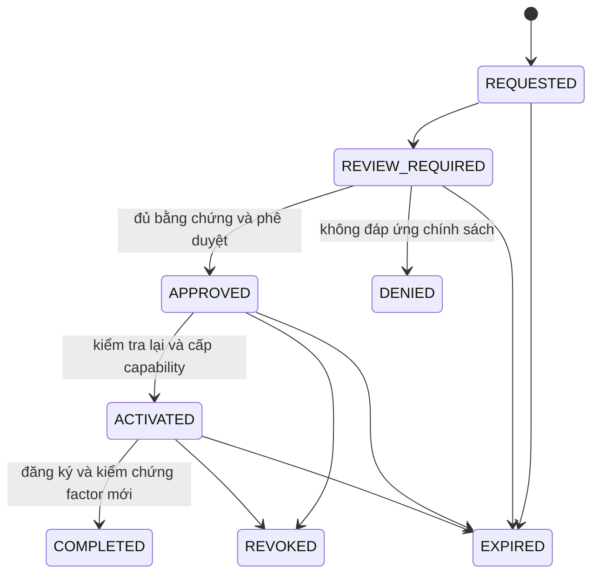

# Administrator factor override: ghi đè yếu tố xác thực có kiểm soát

## 1. Ghi đè yếu tố xác thực là quyết định gì?

Trong khôi phục tài khoản, người dùng có thể còn biết mật khẩu nhưng mất điện thoại chứa TOTP, mất khóa bảo mật hoặc không còn thiết bị lưu passkey. Nếu tất cả đường khôi phục tự phục vụ đã hết, bộ phận hỗ trợ đôi khi cần can thiệp. **Administrator factor override** là một ngoại lệ được cấp có chủ đích để thay đổi yêu cầu đối với một yếu tố xác thực cụ thể, nhằm đưa chủ tài khoản hợp lệ vào quy trình đăng ký lại yếu tố đó.

Đây là quyền có thể dẫn đến chiếm tài khoản nếu cấp sai người. Trong dịch vụ `SECURITY_AUTHENTICATION_ACCOUNT_RECOVERY`, override phải thuộc cùng một chuỗi kiểm soát với xác minh danh tính, đánh giá rủi ro, token dùng một lần, chống lạm dụng và quản lý phiên. Một nút “Reset MFA” không thể thay thế chuỗi kiểm soát này.

Ví dụ: tài khoản có mật khẩu và TOTP, người dùng mất thiết bị TOTP và không còn mã dự phòng. Sau khi hoàn thành bằng chứng được chính sách chấp nhận, quản trị viên có thể cho phép người dùng **đăng ký lại TOTP trong một phiên khôi phục hạn chế**. Quyết định đó không có nghĩa người dùng vừa vượt qua TOTP, cũng không tự cấp quyền truy cập toàn bộ ứng dụng.

Cần phân biệt ba thao tác thường bị gộp chung:

| Thao tác | Thay đổi thực sự | Điều không được suy diễn |
| --- | --- | --- |
| Vô hiệu hóa một factor bị mất | Factor cũ không còn được chấp nhận theo chính sách | Danh tính người yêu cầu đã được xác minh |
| Cho phép đăng ký factor thay thế | Mở một khả năng hạn chế, có thời hạn | Mọi API đã có thể bỏ kiểm tra xác thực |
| Hoàn tất recovery | Factor mới đã được kiểm chứng, trạng thái tài khoản đã được cập nhật | Mọi quyền nhạy cảm lập tức được khôi phục |

Override nên là một đối tượng nghiệp vụ có trạng thái và lịch sử, thay vì một cờ `mfaDisabled=true` tồn tại không giới hạn.

## 2. Xác định chính xác đối tượng và phạm vi

Trước khi phê duyệt, hệ thống phải biết đang thay đổi **factor nào, thuộc tài khoản nào, trong tenant nào, cho mục đích gì**. Một tài khoản có thể có nhiều factor: hai khóa bảo mật, một TOTP và một nhóm recovery code. Mất một factor không mặc nhiên cho phép xóa tất cả factor còn lại.

Một yêu cầu override có thể chứa:

```yaml
overrideId: ovr_example_42
tenantId: tenant_example
accountId: account_example
factorId: factor_totp_example
action: REPLACE_FACTOR
allowedCapability: ENROLL_REPLACEMENT_FACTOR
caseId: recovery_case_example
reasonCode: LOST_AUTHENTICATOR
state: REQUESTED
expiresAt: 2030-01-10T10:30:00Z
```

Thời điểm trong ví dụ chỉ minh họa cấu trúc. Thời hạn thực tế do chính sách của hệ thống quy định. Các ID phải được máy chủ phân giải và kiểm tra; không tin `tenantId` hoặc `accountId` chỉ vì chúng xuất hiện trong request của giao diện quản trị.

Các bất biến quan trọng:

- Override thuộc đúng một tài khoản và một phạm vi tenant đã xác minh.
- Override xác định factor hoặc tập factor cụ thể, không dùng mặc định “tất cả”.
- Khả năng được cấp chỉ đủ để hoàn thành bước recovery được cho phép.
- Override có hạn sử dụng, có thể bị thu hồi và có giới hạn sử dụng.
- Override không được dùng để tự nâng quyền quản trị hoặc tự phê duyệt recovery của chính người vận hành.
- Không sửa lịch sử để biểu diễn rằng factor cũ đã được sử dụng thành công.

Đối với passkey, cần phân biệt credential đã đăng ký tại máy chủ với khóa riêng trên authenticator. Quản trị viên có thể thu hồi credential hoặc cho đăng ký credential mới theo quy trình; họ không thể khôi phục khóa riêng đã mất bằng một thao tác trong cơ sở dữ liệu.

## 3. Điều kiện cho phép: bằng chứng phải đứng trước quyền can thiệp

Khả năng đăng nhập vào trang quản trị chỉ chứng minh quyền của nhân viên vận hành. Nó không chứng minh người đang yêu cầu recovery là chủ tài khoản. Quy trình phải giải quyết hai câu hỏi độc lập:

1. Nhân viên này có quyền đề xuất, phê duyệt hoặc thực thi override đối với tài khoản đích không?
2. Hồ sơ recovery có đủ bằng chứng và điều kiện để cho phép thay factor không?

Một cuộc gọi có giọng nói quen thuộc, số điện thoại hiển thị, email gửi từ địa chỉ có tên giống người dùng hoặc thông tin tìm được trên mạng xã hội không nên tự nó trở thành bằng chứng đủ mạnh. Người vận hành cần dùng các phương thức được chính sách quy định, đồng thời xem xét khả năng kênh liên lạc đã bị chiếm quyền.

Các nhóm thông tin có thể được đưa vào hồ sơ gồm factor còn hoạt động, bằng chứng danh tính theo chính sách, liên kết với hồ sơ doanh nghiệp đã xác minh và tín hiệu rủi ro của yêu cầu. Không có một tổ hợp cố định phù hợp mọi sản phẩm. Tài khoản quản trị tenant, tài khoản tài chính và tài khoản người dùng thông thường có thể cần các mức kiểm soát khác nhau.

Một kết quả xác minh cần ghi rõ:

- Phương pháp và chính sách đã áp dụng, cùng phiên bản chính sách.
- Chủ thể được xác minh và tài khoản mà kết quả có hiệu lực.
- Thời điểm hoàn thành và thời điểm hết hiệu lực của kết quả.
- Trạng thái kết luận: đủ điều kiện, không đủ hoặc cần đánh giá tiếp.
- Tham chiếu đến bằng chứng được lưu tại nơi có kiểm soát truy cập.

Không đưa ảnh giấy tờ, câu trả lời bí mật hoặc dữ liệu cá nhân đầy đủ vào log của override. Hồ sơ nên tham chiếu kho bằng chứng chuyên biệt và áp dụng chính sách lưu trữ phù hợp.

Đánh giá rủi ro phải có khả năng **chặn** yêu cầu, không chỉ tạo một điểm số để người vận hành bỏ qua. Ví dụ, tài khoản vừa đổi email và số điện thoại, sau đó yêu cầu thay factor từ một ngữ cảnh mới có thể cần đánh giá bổ sung. Lý do “người dùng đang rất gấp” không phải bằng chứng làm giảm rủi ro.

## 4. Phân tách đề xuất, phê duyệt và thực thi

Một mô hình thường dùng là maker–checker: người lập yêu cầu không tự phê duyệt yêu cầu đó. Với tài khoản nhạy cảm, hệ thống có thể yêu cầu thêm người phê duyệt hoặc phân tách cả người thực thi. Số lượng và vai trò là quyết định của chính sách, nhưng các điều kiện đó phải được máy chủ cưỡng chế.

| Vai trò | Quyền điển hình | Giới hạn |
| --- | --- | --- |
| Nhân viên hỗ trợ | Mở hồ sơ, thu thập bằng chứng, đề xuất override | Không tự đổi trạng thái xác thực |
| Người phê duyệt | Kiểm tra hồ sơ và chấp nhận đúng phạm vi | Không phê duyệt yêu cầu do chính mình lập |
| Dịch vụ thực thi | Kiểm tra lại điều kiện và tạo quyền recovery hạn chế | Không tự mở rộng factor hoặc thời hạn đã duyệt |
| Bộ phận kiểm toán | Xem quyết định và lịch sử | Không cấp hoặc sử dụng token recovery |

Quyền vận hành nên kết hợp RBAC với điều kiện theo tài nguyên: role cho biết được thực hiện loại hành động nào; tenant, nhóm tài khoản và mức nhạy cảm quyết định được hành động trên tài khoản nào. Một người có role `RECOVERY_APPROVER` ở tenant A không có quyền tương ứng ở tenant B.

Các hành động phê duyệt và thực thi cần xác thực quản trị đủ mạnh, có thể yêu cầu step-up và giới hạn độ mới của lần xác thực. Chỉ kiểm tra cookie đăng nhập từ nhiều giờ trước là không đủ cho một quyết định có tác động như thay yếu tố xác thực.

Quyền tạm thời theo hồ sơ, hết hạn sau nhiệm vụ và ghi nhận đầy đủ thường dễ kiểm soát hơn quyền reset thường trực cho toàn bộ nhân viên hỗ trợ. Các trường hợp break-glass cần một đường kiểm soát riêng được định nghĩa trước, không phải một tham số `force=true` để bỏ tất cả cổng kiểm tra.

## 5. Vòng đời của một override

Một vòng đời minh họa:



Mỗi chuyển trạng thái cần điều kiện rõ ràng. `APPROVED` không đồng nghĩa đã cấp token; `ACTIVATED` không đồng nghĩa người dùng đã chứng minh quyền kiểm soát factor mới; `COMPLETED` chỉ được ghi sau khi mọi thay đổi bắt buộc đã thành công.

Phê duyệt phải ràng buộc với nội dung quyết định. Nếu thay `factorId`, tài khoản đích, capability, bằng chứng hoặc thời hạn, hệ thống phải vô hiệu hóa phê duyệt cũ hoặc buộc đánh giá lại. Có thể dùng phiên bản hồ sơ và một digest của các trường đã duyệt để phát hiện thay đổi.

Ví dụ:

```text
approval binds to:
  tenantId + accountId + factorId + action
  caseVersion + evidenceVersion + policyVersion
  requestedCapability + maximumExpiry
```

Digest giúp phát hiện sai khác nội dung, không tự thay thế xác thực người phê duyệt hoặc chữ ký của hệ thống. Quyết định hợp lệ còn phụ thuộc trạng thái hiện tại, thời gian và quyền hiện hành của các chủ thể liên quan.

Tại thời điểm thực thi cần kiểm tra lại vì sau phê duyệt có thể xuất hiện sự kiện mới: hồ sơ bị thu hồi, tài khoản bị khóa do nghi ngờ xâm nhập, người phê duyệt bị gỡ quyền hoặc factor đích đã thay đổi. Không sử dụng một kết quả `allowed=true` cũ để thực thi vô thời hạn.

Nếu hệ thống phụ thuộc để xác minh điều kiện không sẵn sàng, yêu cầu nên chờ hoặc bị từ chối có thể thử lại theo chính sách, thay vì tự mặc định là đủ điều kiện.

## 6. Luồng thực thi từ hỗ trợ đến đăng ký factor mới

Một luồng đầy đủ có thể diễn ra như sau:

1. Nhân viên mở recovery case cho tài khoản đã được định vị bằng nguồn tin cậy.
2. Dịch vụ đánh giá các đường tự phục vụ và thu thập bằng chứng theo chính sách.
3. Nhân viên đề xuất thay đúng factor bị mất; hệ thống lưu phạm vi và phiên bản hồ sơ.
4. Người phê duyệt độc lập kiểm tra hồ sơ, thực hiện step-up nếu được yêu cầu và ghi quyết định.
5. Khi kích hoạt, máy chủ kiểm tra lại quyền, bằng chứng, rủi ro, factor và thời hạn trong một cơ chế kiểm soát đồng thời.
6. Hệ thống cấp token dùng một lần hoặc capability tương đương cho phiên recovery hạn chế.
7. Người dùng đăng ký factor mới và hoàn thành kiểm chứng phù hợp với loại factor đó.
8. Hệ thống tiêu thụ quyền recovery, thu hồi factor cũ theo quyết định, cập nhật trạng thái phiên và ghi hoàn tất.
9. Thông báo được gửi đến các kênh phù hợp; các hạn chế sau recovery tiếp tục có hiệu lực theo chính sách.

Luồng này không nên tạo một mật khẩu tạm để nhân viên đăng nhập thay người dùng. Nhân viên cũng không nên nhìn thấy secret TOTP mới, recovery code mới hoặc token của người dùng trong giao diện quản trị thông thường.

Nếu factor cũ bị nghi lộ, việc đình chỉ hoặc thu hồi factor đó có thể phải diễn ra ngay khi đánh giá sự cố, trước khi hoàn tất đăng ký thay thế. Đây là quyết định bảo vệ tài khoản riêng cần ghi rõ, bởi thu hồi sớm có thể khiến người dùng mất thêm đường truy cập. Không để thao tác thay thế thất bại làm khôi phục lại một factor đã được xác định là bị xâm phạm.

## 7. Capability hạn chế thay cho bỏ qua xác thực toàn hệ thống

Sau override, người yêu cầu chỉ nên có khả năng truy cập các hành động phục vụ recovery. Có thể mô hình hóa một principal riêng:

```json
{
  "principalType": "RECOVERY",
  "accountId": "account_example",
  "tenantId": "tenant_example",
  "overrideId": "ovr_example_42",
  "capabilities": ["factor:replacement:enroll", "recovery:status:read"],
  "expiresAt": "2030-01-10T10:30:00Z"
}
```

Các trường trên biểu diễn ý nghĩa quyền hạn, không phải một token mà client được tự tạo. Máy chủ phải xác thực credential thật của phiên và lấy phạm vi từ trạng thái có thẩm quyền.

Principal recovery không được vượt qua kiểm tra “đã xác thực đầy đủ” chỉ vì có `accountId`. Mọi API nhạy cảm cần phân biệt phiên recovery với phiên ứng dụng thông thường. Capability đăng ký lại factor không bao gồm quyền xem dữ liệu riêng tư, đổi email, tạo API key, thêm quản trị viên hoặc thực hiện giao dịch.

Sau khi đăng ký mới, yếu tố đó phải được kiểm chứng. Với TOTP, việc tạo secret chưa đủ; cần hoàn thành bước chứng minh phù hợp rằng người dùng có authenticator tương ứng. Với khóa công khai, máy chủ cần hoàn tất xác minh ceremony đăng ký và các ràng buộc của giao thức đang dùng. Không đánh dấu factor là hoạt động chỉ vì giao diện báo “đã quét mã”.

Các thuộc tính về phương thức và độ mới của xác thực phải phản ánh sự kiện thực tế. Ví dụ, không tự thêm `amr=otp` vào phiên chỉ vì quản trị viên đã phê duyệt reset TOTP. Factor mới được đăng ký cũng không biến bằng chứng recovery yếu thành một lần xác thực trước đó có độ bảo đảm cao hơn.

## 8. Ví dụ Java: cổng quyết định trước khi kích hoạt

Ví dụ dưới tách kiểm tra chính sách thành một hàm quyết định thuần. Nó minh họa cách từ chối khi thiếu điều kiện, không thực hiện transaction, cấp token hay gọi dịch vụ định danh. Các giá trị đầu vào phải được máy chủ lấy từ nguồn có thẩm quyền; không ánh xạ trực tiếp các boolean từ request của client.

Chính sách ví dụ yêu cầu một người phê duyệt độc lập với người đề xuất, người thực thi có quyền hiện hành, xác thực quản trị còn mới và phê duyệt khớp phiên bản hồ sơ. Các hệ thống nhạy cảm có thể áp dụng điều kiện nghiêm ngặt hơn.

```java
import java.time.Duration;
import java.time.Instant;
import java.util.Objects;

public final class OverrideActivationPolicy {
    public record Request(
            String tenantId,
            String accountId,
            String requestedBy,
            long caseVersion,
            Instant expiresAt) {}

    public record Approval(
            String tenantId,
            String accountId,
            String approvedBy,
            long approvedCaseVersion,
            Instant expiresAt,
            boolean currentlyAuthorized,
            boolean approvedScopeMatches) {}

    public record Executor(
            String actorId,
            String tenantId,
            Instant authenticatedAt,
            boolean authorizedForTarget,
            boolean requiredStepUpSatisfied) {}

    public record Evidence(
            boolean validForTarget,
            boolean fresh,
            boolean riskGatePassed,
            boolean factorStillEligible,
            boolean caseStillApproved) {}

    public record Decision(boolean allowed, String reason) {
        static Decision deny(String reason) {
            return new Decision(false, reason);
        }

        static Decision allow() {
            return new Decision(true, "ELIGIBLE_FOR_ATOMIC_ACTIVATION");
        }
    }

    public static Decision evaluate(
            Request request,
            Approval approval,
            Executor executor,
            Evidence evidence,
            Instant now,
            Duration maxAuthAge) {
        Objects.requireNonNull(request);
        Objects.requireNonNull(approval);
        Objects.requireNonNull(executor);
        Objects.requireNonNull(evidence);
        Objects.requireNonNull(now);
        Objects.requireNonNull(maxAuthAge);

        if (maxAuthAge.isZero() || maxAuthAge.isNegative()) {
            return Decision.deny("INVALID_AUTH_POLICY");
        }
        if (!Objects.equals(request.tenantId(), approval.tenantId())
                || !Objects.equals(request.tenantId(), executor.tenantId())
                || !Objects.equals(request.accountId(), approval.accountId())) {
            return Decision.deny("TARGET_SCOPE_MISMATCH");
        }
        if (Objects.equals(request.requestedBy(), approval.approvedBy())
                || Objects.equals(request.accountId(), executor.actorId())
                || Objects.equals(request.accountId(), approval.approvedBy())) {
            return Decision.deny("SEPARATION_OF_DUTIES_REQUIRED");
        }
        if (!executor.authorizedForTarget()
                || !executor.requiredStepUpSatisfied()
                || !approval.currentlyAuthorized()) {
            return Decision.deny("ADMIN_AUTHORIZATION_REQUIRED");
        }
        if (executor.authenticatedAt() == null
                || executor.authenticatedAt().isAfter(now)
                || executor.authenticatedAt().plus(maxAuthAge).isBefore(now)) {
            return Decision.deny("ADMIN_AUTH_TOO_OLD_OR_INVALID");
        }
        if (request.expiresAt() == null || approval.expiresAt() == null
                || !now.isBefore(request.expiresAt())
                || !now.isBefore(approval.expiresAt())) {
            return Decision.deny("OVERRIDE_OR_APPROVAL_EXPIRED");
        }
        if (request.caseVersion() != approval.approvedCaseVersion()
                || !approval.approvedScopeMatches()) {
            return Decision.deny("APPROVAL_IS_STALE");
        }
        if (!evidence.validForTarget() || !evidence.fresh()
                || !evidence.riskGatePassed() || !evidence.factorStillEligible()
                || !evidence.caseStillApproved()) {
            return Decision.deny("RECOVERY_GATE_NOT_SATISFIED");
        }
        return Decision.allow();
    }
}
```

Ví dụ giả định các ID bắt buộc đã được kiểm tra không rỗng và cùng không gian định danh. Trong hệ thống tách định danh nhân viên với định danh khách hàng, kiểm tra tự recovery phải dùng liên kết chủ thể chuẩn hóa, không so sánh hai chuỗi ID không liên quan.

Một kết quả cho phép chỉ là đầu vào cho bước kích hoạt có tính nguyên tử. Nếu đọc trạng thái, gọi hàm trên rồi cập nhật không có khóa hoặc kiểm tra phiên bản, yêu cầu vẫn có thể bị thực thi sau khi hồ sơ đã đổi. Hàm chính sách cũng không thay thế kiểm soát CSRF, kiểm tra quyền ở API, rate limit hoặc cơ chế bảo vệ credential quản trị.

## 9. Transaction, cạnh tranh và tính dùng một lần

Hai lần bấm nút, retry từ mạng hoặc hai người vận hành có thể kích hoạt cùng một yêu cầu. Hệ thống cần bảo đảm chỉ có một lần chuyển hợp lệ từ `APPROVED` sang `ACTIVATED`.

Một cách tổ chức ở tầng dữ liệu:

```text
BEGIN TRANSACTION
  khóa override và trạng thái recovery của tài khoản theo thứ tự cố định
  đọc lại caseVersion, phê duyệt, factor và trạng thái tài khoản
  kiểm tra thời hạn bằng thời gian máy chủ có thẩm quyền
  kiểm tra lại chính sách và điều kiện thu hồi
  chuyển APPROVED -> ACTIVATED với expectedVersion
  tạo bản ghi capability và lưu verifier của token
  ghi audit event và outbox event trong cùng transaction
COMMIT
```

Nếu dùng optimistic locking, một cập nhật có điều kiện có thể trông như sau:

```sql
UPDATE recovery_override
SET state = 'ACTIVATED',
    version = version + 1,
    activated_at = :server_now
WHERE tenant_id = :tenant_id
  AND override_id = :override_id
  AND state = 'APPROVED'
  AND version = :expected_version
  AND expires_at > :server_now;
```

Số hàng bị thay đổi phải bằng một. Câu SQL chỉ minh họa điều kiện chuyển trạng thái; các bản ghi phê duyệt, factor và tài khoản liên quan vẫn cần được khóa, kiểm tra phiên bản hoặc bảo vệ bằng cơ chế nhất quán tương ứng. Khóa riêng bản ghi override không ngăn một giao dịch khác thay đổi factor ngoài luồng.

Khi người dùng sử dụng capability để đăng ký factor, kiểm tra chưa tiêu thụ và ghi nhận tiêu thụ cũng phải nguyên tử. Không làm theo mô hình “đọc `used=false`, xử lý, rồi ghi `used=true`” mà không chống cạnh tranh.

Idempotency hỗ trợ xử lý retry, nhưng không cho phép dùng lại quyền đã tiêu thụ. Một khóa idempotency phải gắn với actor, tài khoản đích và fingerprint của thao tác. Gửi cùng khóa với payload khác phải bị từ chối. Nếu token chỉ được hiển thị một lần và phản hồi bị mất, hệ thống cần chính sách cấp lại có kiểm soát, thu hồi token trước đó; không lưu token dạng rõ lâu dài chỉ để phục vụ retry.

Trong kiến trúc nhiều dịch vụ, một transaction cơ sở dữ liệu không thể tự bảo đảm mọi tác động bên ngoài cùng thành công. Có thể dùng transactional outbox và consumer idempotent để phát sự kiện thu hồi phiên, thông báo hoặc cập nhật hệ thống liên quan. Các cổng cấp quyền nhạy cảm phải kiểm tra trạng thái bảo vệ tài khoản trong thời gian các tác động đó còn đang xử lý.

## 10. Token đăng ký lại factor

Token là một bí mật có quyền hạn, không phải mã hồ sơ hỗ trợ. Nó cần được sinh bằng nguồn ngẫu nhiên mật mã, đủ khó đoán, có thời hạn ngắn theo chính sách và chỉ dùng cho đúng bước được cấp.

Các thuộc tính máy chủ cần quản lý gồm:

- Liên kết với `overrideId`, tài khoản, tenant và factor đích.
- Mục đích, thời điểm hết hạn và trạng thái thu hồi.
- Số lần sử dụng cho phép, thường là một lần hoàn tất hợp lệ.
- Phiên bản recovery để vô hiệu hóa khi hồ sơ thay đổi.
- Verifier hoặc dạng bảo vệ phù hợp thay cho lưu bí mật dạng rõ.

Không gửi token qua kênh vừa được thêm trong cùng yêu cầu chỉ vì kênh đó do người yêu cầu cung cấp. Kênh bàn giao phải được lựa chọn theo chính sách và kết quả xác minh. Nếu kênh cũ cũng bị nghi chiếm quyền, cần quy trình thay thế được phê duyệt, không tự chuyển sang email mới nhập.

Nếu token nằm trong liên kết, tránh để URL xuất hiện trong log, analytics, lịch sử chuyển hướng hoặc tài nguyên bên thứ ba. Một lần GET do công cụ kiểm tra liên kết của email không nên tự hoàn tất recovery. Việc tiêu thụ quyền phải gắn với hành động xác nhận có bảo vệ thích hợp và kiểm chứng đăng ký factor ở máy chủ.

Nếu dùng token tự chứa, chữ ký hợp lệ chưa giải quyết yêu cầu dùng một lần và thu hồi trước hạn. Máy chủ vẫn cần trạng thái hoặc cơ chế tương đương để biết capability còn được phép sử dụng. TTL dài không phải cách xử lý khi gửi thông báo chậm.

## 11. Factor cũ, phiên cũ và quyền sau recovery

Khôi phục thành công mà giữ nguyên mọi phiên và credential cũ có thể để kẻ đang chiếm tài khoản tiếp tục hoạt động. Tuy nhiên, “logout tất cả” cũng cần được định nghĩa bằng tài nguyên cụ thể, không chỉ xóa một cookie trên trình duyệt hiện tại.

| Tài nguyên | Quyết định cần xem xét |
| --- | --- |
| Factor bị mất hoặc nghi lộ | Đình chỉ hoặc thu hồi; không chấp nhận challenge mới từ factor đó |
| Phiên ứng dụng | Hủy hoặc yêu cầu xác thực lại theo phạm vi rủi ro |
| Refresh token, phiên thiết bị tin cậy | Thu hồi family hoặc tăng phiên bản xác thực theo thiết kế |
| Recovery code | Vô hiệu hóa bộ cũ và phát bộ mới nếu chính sách yêu cầu |
| API key hoặc credential độc lập | Đánh giá riêng; không mặc định bị thu hồi bởi thao tác MFA |
| Phiên recovery | Kết thúc sau hoàn tất, hết hạn hoặc thu hồi |

Một thiết kế có thể tăng `authenticationVersion` hoặc `recoveryEpoch` của tài khoản, rồi buộc các verifier từ chối phiên mang phiên bản cũ. Để có hiệu lực tức thời, các thành phần chấp nhận token cần kiểm tra nguồn trạng thái phù hợp hoặc có cơ chế phân phối thu hồi với độ trễ được kiểm soát. Access token tự chứa chỉ được kiểm tra chữ ký sẽ không tự mất hiệu lực vì một bản ghi ở cơ sở dữ liệu đã đổi.

Nếu hệ thống có liên kết SSO, thu hồi phiên tại ứng dụng không mặc nhiên chấm dứt phiên ở nhà cung cấp danh tính. Luồng đăng nhập sau recovery phải được thiết kế để một phiên upstream cũ không lập tức tạo lại quyền truy cập ngoài ý muốn.

Sau khi đăng ký factor mới, có thể cần khoảng chờ hoặc kiểm chứng bổ sung trước khi cho phép thay email, thêm quản trị viên, xuất dữ liệu hay chuyển tiền. Phạm vi hạn chế dựa trên rủi ro và chính sách; đừng giải quyết bằng cách gắn nhãn rằng tài khoản đã “MFA verified” rồi bỏ toàn bộ kiểm tra.

## 12. Audit và thông báo phải giải thích được quyết định

Một bản ghi audit hữu ích cần trả lời được ai yêu cầu, ai phê duyệt, ai thực thi, cho tài khoản nào, thay factor nào, dựa trên chính sách nào và kết quả ra sao. Chỉ lưu chuỗi “admin reset MFA” khiến việc điều tra gần như không đủ dữ kiện.

Các trường có thể gồm:

```text
eventId, occurredAt, correlationId
tenantId, accountId, overrideId, caseId
requesterActorId, approverActorIds, executorActorId
factorReference, action, capabilityScope
caseVersion, evidenceReference, policyVersion
previousState, nextState, decisionCode
authenticationContextReference
```

Không ghi token recovery, secret TOTP, mã dự phòng, session cookie hay toàn bộ nội dung bằng chứng vào audit. Quyền đọc audit phải được kiểm soát; một người có quyền reset không mặc nhiên cần quyền xem dữ liệu định danh đầy đủ.

Ghi thay đổi nghiệp vụ cùng sự kiện audit trong cùng transaction hoặc cơ chế bền vững tương đương giúp tránh trạng thái “reset thành công nhưng không có dấu vết”. Các yêu cầu bị từ chối cũng cần được ghi nhận với mức thông tin phù hợp, đồng thời chống việc kẻ tấn công tạo vô hạn log.

Thông báo cho chủ tài khoản nên nêu đã có yêu cầu hoặc thay đổi factor, thời điểm, cách phản đối và kênh hỗ trợ chính thức. Không gửi bí mật trong thông báo an ninh. Kênh cũ, kênh mới và kênh tổ chức có thể có vai trò khác nhau theo chính sách; việc thông báo không được coi là bằng chứng người nhận đã đồng ý.

Nếu gửi thông báo thất bại, hệ thống cần retry và cảnh báo theo quy trình. Không xóa audit hoặc tự đảo ngược một thao tác đã hoàn tất chỉ vì email không đến được ngay. Nếu chính sách yêu cầu thông báo thành công trước một bước nào đó, điều kiện này phải xuất hiện rõ trong state machine.

## 13. Các tình huống lạm dụng và cách chặn

| Tình huống | Điểm kiểm soát trực tiếp |
| --- | --- |
| Kẻ tấn công giả làm người dùng cần hỗ trợ gấp | Bằng chứng theo chính sách, đánh giá rủi ro và phê duyệt độc lập |
| Nhân viên hỗ trợ đổi ID trong request để reset tài khoản khác | Kiểm tra tài nguyên và tenant ở máy chủ trên từng thao tác |
| Người lập yêu cầu tự phê duyệt | Kiểm tra phân tách nhiệm vụ bằng định danh chủ thể chuẩn hóa |
| Hồ sơ đổi factor sau khi đã duyệt | Phê duyệt gắn với phiên bản và phạm vi; bắt buộc duyệt lại |
| Hai request đồng thời dùng một override | Khóa hoặc kiểm tra phiên bản cùng cập nhật nguyên tử |
| Link recovery bị dùng lại | Capability dùng một lần, kiểm tra trạng thái và thu hồi |
| Kẻ tấn công vẫn giữ refresh token | Thu hồi credential phù hợp và cưỡng chế phiên bản xác thực |
| Quản trị viên bị chiếm phiên | Step-up, quyền tạm thời, giới hạn phạm vi và cảnh báo bất thường |
| Thông đồng giữa người có quyền | Phân tách trách nhiệm, kiểm toán độc lập và phát hiện mẫu hành vi |

Ngoài số lần người dùng nhập sai, hệ thống nên giới hạn việc tạo yêu cầu, gửi thông báo, phê duyệt và cấp lại token. Phạm vi rate limit có thể kết hợp tài khoản đích, actor vận hành, tenant và ngữ cảnh mạng. Chỉ giới hạn theo IP không đủ, còn khóa cứng tài khoản đích theo mọi request chưa xác thực có thể bị lợi dụng để gây từ chối dịch vụ.

Giám sát nên phát hiện một nhân viên reset số lượng lớn bất thường, nhiều yêu cầu cho tài khoản đặc quyền, nhiều case bị từ chối rồi được mở lại, hoặc phê duyệt diễn ra quá nhanh so với quy trình. Những tín hiệu này giúp điều tra, không tự chứng minh mọi yêu cầu trong nhóm đó là gian lận.

## 14. Ví dụ xuyên suốt: mất thiết bị TOTP

Mai thuộc tenant A, còn mật khẩu nhưng mất điện thoại TOTP và không còn mã dự phòng. Nhân viên hỗ trợ mở case chỉ cho tài khoản của Mai. Kết quả xác minh danh tính được ghi nhận theo chính sách áp dụng, có hạn hiệu lực; thông tin nhạy cảm nằm trong kho bằng chứng, không nằm trong ticket công khai.

Nhân viên đề xuất `REPLACE_FACTOR` cho đúng factor TOTP. Một người đủ quyền khác xem hồ sơ, xác nhận phạm vi và phê duyệt phiên bản hiện tại. Nếu tài khoản của Mai thuộc nhóm đặc quyền, hệ thống chuyển sang chính sách bổ sung thay vì dùng quyền reset thông thường.

Khi kích hoạt, dịch vụ kiểm tra tenant, quyền quản trị, độ mới của xác thực, phiên bản hồ sơ, thời hạn và rủi ro. Thành công chỉ tạo một phiên recovery được đăng ký TOTP mới. Phiên này chưa thể đọc dữ liệu ứng dụng, đổi email hoặc tạo API key.

Mai nhận quyền recovery qua kênh phù hợp với hồ sơ đã xác minh, đăng ký TOTP mới và hoàn tất kiểm chứng. Trong thao tác hoàn tất được bảo vệ chống cạnh tranh, hệ thống tiêu thụ capability, cập nhật factor mới, thu hồi factor cũ theo quyết định và ghi trạng thái hoàn tất. Những phiên hoặc credential thuộc diện thu hồi bị vô hiệu hóa theo thiết kế.

Nếu Mai không hoàn tất trước hạn, capability hết hiệu lực và phiên recovery không thể tiếp tục. Hệ thống giữ audit, xử lý trạng thái factor đã đình chỉ theo chính sách và yêu cầu đánh giá lại trước khi cấp quyền mới. Nhân viên không “gia hạn cho tiện” bằng cách đổi trực tiếp `expiresAt` của một phê duyệt cũ.

Nếu sau đó phát hiện người yêu cầu là kẻ giả mạo, quy trình ứng phó có thể thu hồi capability còn sống, đình chỉ credential vừa đăng ký và bảo vệ tài khoản. Không xóa case hoặc ghi đè lịch sử để che thao tác sai; các sự kiện bù trừ phải thể hiện rõ điều đã xảy ra.

## 15. Những điểm cần ghi nhớ

Administrator factor override là một ngoại lệ có phạm vi, bằng chứng, người chịu trách nhiệm và thời hạn. Nó đưa người dùng vào một đường đăng ký lại factor được kiểm soát, không thay thế bằng chứng xác thực hoặc tạo quyền truy cập ứng dụng mặc định.

Thiết kế vững bắt đầu từ việc định vị đúng tài khoản và factor, đánh giá danh tính độc lập với quyền quản trị, ràng buộc phê duyệt với nội dung hồ sơ và thực thi chuyển trạng thái một cách nguyên tử. Token dùng một lần, phiên recovery hạn chế, kiểm chứng factor mới, thu hồi phiên phù hợp và audit bền vững hoàn thành chuỗi kiểm soát đó.

Nếu một chức năng “Reset MFA” không giải thích được ai đã cho phép, điều gì được thay đổi, người nhận được làm gì, quyền đó hết hạn khi nào và những credential cũ nào còn hiệu lực, chức năng đó còn thiếu mô hình bảo mật của một quy trình account recovery hoàn chỉnh.
