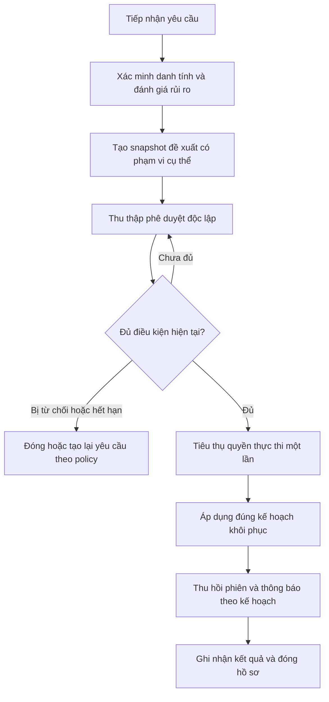

# Administrator dual control trong khôi phục tài khoản

## 1. Vì sao một quản trị viên không nên tự hoàn tất khôi phục?

Khôi phục tài khoản có thể thay đổi người nắm quyền truy cập mà không cần trình bày đủ yếu tố xác thực cũ. Khi người dùng mất mật khẩu, MFA, passkey hoặc thiết bị xác thực, quản trị viên có thể được phép mở một con đường khôi phục thay thế. Quyền này cần được kiểm soát chặt chẽ vì nó có thể trở thành đường vòng để chiếm tài khoản.

Một nhân viên hỗ trợ bị lừa có thể chấp nhận bằng chứng yếu. Một phiên quản trị bị đánh cắp có thể được dùng để xóa MFA. Một quản trị viên nội bộ có thể tự đổi địa chỉ nhận mã rồi chiếm tài khoản. Nếu cùng một người được tiếp nhận yêu cầu, đánh giá bằng chứng, phê duyệt và thực thi, mọi lớp kiểm tra đều nằm trong một điểm thất bại.

**Administrator dual control** yêu cầu ít nhất hai chủ thể quản trị độc lập cùng tham gia quyết định đối với một thao tác nhạy cảm. Với khôi phục tài khoản, mục tiêu là ngăn một người hoặc một danh tính quản trị đơn lẻ tự tạo ra toàn bộ quyền khôi phục.

Trong module `SECURITY_AUTHENTICATION_ACCOUNT_RECOVERY`, cơ chế này bổ sung cho đánh giá rủi ro, xác minh danh tính, token dùng một lần, chống lạm dụng và kiểm soát phiên. Nó không thay thế những cơ chế đó. Hai người cùng phê duyệt một yêu cầu có bằng chứng giả vẫn có thể tạo ra một vụ chiếm tài khoản.

Một điều kiện thực thi điển hình là:

```text
Được thực thi =
    bằng chứng danh tính còn hợp lệ
    AND đánh giá rủi ro cho phép
    AND đủ người phê duyệt độc lập theo policy
    AND mọi phê duyệt gắn đúng phiên bản yêu cầu
    AND quyền quản trị vẫn hợp lệ tại thời điểm thực thi
    AND chưa hết hạn, chưa bị hủy và chưa từng được tiêu thụ
```

## 2. Dual control và phân tách nhiệm vụ

Hai khái niệm có liên quan nhưng không hoàn toàn giống nhau:

- **Dual control** đặt điều kiện nhiều chủ thể phải cùng cho phép một hành động.
- **Separation of duties** chia các nhiệm vụ để một chủ thể không kiểm soát trọn chuỗi xử lý.

Một mô hình đơn giản là **maker–checker**: một người lập đề xuất khôi phục, người khác kiểm tra và phê duyệt đề xuất đó. Tuy nhiên, việc người thứ nhất có được tính vào số phiếu phê duyệt hay không phải được quy định rõ. “Có hai người tham gia” không đồng nghĩa “có hai phê duyệt độc lập”.

Ví dụ, một policy có thể yêu cầu:

| Vai trò | Trách nhiệm | Giới hạn |
| --- | --- | --- |
| Người lập yêu cầu | Tạo hồ sơ, thu thập bằng chứng, đề xuất phạm vi | Không phê duyệt chính đề xuất của mình |
| Người phê duyệt A | Kiểm tra bằng chứng và quyết định đề xuất có hợp lý không | Phải khác người lập yêu cầu và chủ tài khoản đích |
| Người phê duyệt B | Kiểm tra độc lập rủi ro, phạm vi và điều kiện khôi phục | Phải khác A; có thể thuộc nhóm kiểm soát khác theo policy |
| Dịch vụ thực thi | Áp dụng đúng hành động đã được cho phép | Không tự thêm hành động hoặc thay tài khoản đích |

Mô hình trên có người lập yêu cầu cộng hai người phê duyệt, vì vậy cần ba người. Một tổ chức khác có thể dùng maker–checker chỉ với hai người cho một thao tác ít rủi ro hơn. Không nên dùng chung một nhãn “dual control” rồi để mỗi giao diện tự hiểu số người cần có.

Policy cần mô tả cụ thể số người, quan hệ giữa các vai trò, quyền được tính phiếu và điều kiện độc lập. Ví dụ:

```text
Policy minh họa: RESET_LOST_MFA
  requester không được là approver
  target account owner không được là approver
  cần 2 approver khác nhau theo person_id
  một approver thuộc Recovery Operations
  một approver thuộc Security Operations
  cả hai phải có quyền trên đúng tenant và loại tài khoản đích
  thực thi bằng dịch vụ, không thực thi tùy ý từ trình duyệt quản trị
```

Các ngưỡng này là ví dụ thiết kế, không phải giá trị bắt buộc cho mọi hệ thống. Tài khoản đặc quyền hoặc tài khoản có khả năng quản lý nhiều tenant có thể cần quy trình chặt hơn.

## 3. Độc lập phải dựa trên con người, không chỉ tài khoản đăng nhập

Kiểm tra `approverA.userId != approverB.userId` chưa đủ. Một người có thể sở hữu tài khoản hỗ trợ thông thường và tài khoản quản trị đặc quyền. Hai tài khoản dịch vụ cũng có thể dùng chung một bí mật hoặc nằm dưới quyền điều khiển của cùng một người.

Hệ thống nên sử dụng định danh con người ổn định từ hệ thống quản trị danh tính, chẳng hạn `person_id`, bên cạnh định danh principal đăng nhập. Không dùng email làm khóa duy nhất vì email có thể thay đổi hoặc được cấp lại. Dữ liệu về người sở hữu, vai trò và miền quản trị phải được bảo vệ khỏi việc chỉnh sửa bởi chính người đang xin phê duyệt.

Các điều kiện độc lập có thể gồm:

- Hai phiếu thuộc hai `person_id` khác nhau.
- Người lập yêu cầu không được đổi sang tài khoản khác của mình để phê duyệt.
- Chủ tài khoản đích không được tự phê duyệt việc khôi phục tài khoản đó.
- Người phê duyệt không được tự cấp quyền để đáp ứng policy của cùng yêu cầu.
- Một số thao tác cần người phê duyệt từ hai nhóm hoặc miền quản trị khác nhau.
- Tài khoản dùng chung không được tính là một phiếu cá nhân có thể truy trách nhiệm.

Không thể chứng minh hai người độc lập chỉ vì họ dùng hai địa chỉ IP. Hai người trong cùng văn phòng có thể dùng chung IP hợp lệ; kẻ tấn công cũng có thể dùng nhiều IP. Tín hiệu thiết bị, phiên và mạng phục vụ đánh giá rủi ro, không thay thế định danh và phân quyền.

Dual control làm tăng chi phí của lạm dụng đơn lẻ nhưng không loại bỏ thông đồng hoặc việc đồng thời chiếm hai danh tính quản trị. Vì vậy vẫn cần giám sát, quyền tối thiểu, quản trị quyền độc lập và nhật ký có khả năng phát hiện sửa đổi.

## 4. Phê duyệt một đề xuất bất biến, không phê duyệt một ticket chung chung

Một nút “Approve recovery” gắn với ticket có nội dung thay đổi tự do là nguy hiểm. Người phê duyệt có thể nhìn thấy đề xuất xóa một MFA đã mất, nhưng sau đó người lập yêu cầu đổi thành xóa toàn bộ MFA và chuyển email chính.

Hãy tạo một **snapshot đề xuất khôi phục** gồm ít nhất:

| Nhóm dữ liệu | Ví dụ |
| --- | --- |
| Đích | Tenant, account ID ổn định, loại tài khoản |
| Hành động | Thu hồi yếu tố đã mất; cấp phiên chỉ dùng đăng ký lại MFA |
| Giới hạn | Không đổi email; không cấp quyền quản trị; không tạo phiên truy cập đầy đủ |
| Bằng chứng | Tham chiếu hồ sơ xác minh, kết quả, thời điểm và hạn hiệu lực |
| Rủi ro | Kết quả đánh giá, phiên bản và điều kiện cần xử lý |
| Policy | ID, phiên bản và yêu cầu về người phê duyệt |
| Vòng đời | Request ID, proposal version, thời điểm hết hạn |
| Hậu xử lý | Thu hồi phiên nào, gửi thông báo qua kênh nào |

Phê duyệt phải gắn với `request_id`, phiên bản snapshot và dấu vân tay nội dung được tạo bằng cách tuần tự hóa nhất quán. Hash giúp phát hiện nội dung thay đổi khi được lưu và kiểm tra đúng cách; hash tự nó không chứng minh ai đã phê duyệt. Danh tính người phê duyệt, xác thực, phân quyền và bản ghi phía máy chủ vẫn là nền tảng.

Khi có thay đổi có ý nghĩa bảo mật — tài khoản đích, hành động, kênh khôi phục, phạm vi, bằng chứng, rủi ro hoặc policy được áp dụng — tạo snapshot mới và yêu cầu phê duyệt lại. Ghi chú hành chính không ảnh hưởng quyết định có thể được quản lý riêng để không vô tình sửa snapshot.

Mỗi bản ghi quyết định nên thể hiện người phê duyệt, danh tính con người, snapshot đã duyệt, kết quả, thời gian, hạn hiệu lực và tham chiếu đến sự kiện xác thực tăng cường. Không nhận một cờ `approved=true` do trình duyệt tự khai báo làm bằng chứng phê duyệt.

## 5. Luồng xử lý từ tiếp nhận đến thực thi



### Bước 1: Tiếp nhận và phân loại

Gắn yêu cầu với tài khoản đích và tenant bằng định danh phía máy chủ. Phân loại mất mật khẩu, mất MFA, mất passkey, mất thiết bị hay mất nhiều yếu tố cùng lúc. Xác định mức đặc quyền của tài khoản và các hoạt động bất thường liên quan.

Người liên hệ qua tổng đài chưa được coi là chủ tài khoản chỉ vì cung cấp đúng tên, email hoặc mã nhân viên. Những dữ liệu này thường có thể bị thu thập từ nguồn công khai hoặc vụ rò rỉ khác.

### Bước 2: Xác minh và lập đề xuất

Thu thập bằng chứng qua kênh được policy cho phép. Ghi kết quả và nguồn gốc thay vì sao chép bí mật vào ticket. Nếu cần gọi lại, sử dụng kênh đã được xác minh độc lập, không mặc nhiên sử dụng số điện thoại do người gọi vừa cung cấp.

Đề xuất nên cấp khả năng nhỏ nhất đủ để khôi phục. Ví dụ: thu hồi yếu tố MFA bị mất và cấp một phiên hạn chế để đăng ký yếu tố mới. Không gộp đổi email, xóa tất cả passkey và bỏ qua mọi kiểm tra chỉ để thao tác nhanh hơn.

### Bước 3: Kiểm tra độc lập và phê duyệt

Mỗi người phê duyệt xem cùng một snapshot từ hệ thống chính thức. Giao diện cần hiển thị rõ tài khoản đích, mức đặc quyền, hành động, hậu quả, bằng chứng đã được kiểm tra và tín hiệu rủi ro chưa được giải quyết.

Yêu cầu xác thực tăng cường phù hợp trước quyết định nhạy cảm. Một phiên đăng nhập quản trị kéo dài nhiều giờ không tự động là bằng chứng hiện diện hiện tại. Máy chủ kiểm tra độ mới của xác thực và ràng buộc sự kiện xác thực với quyết định, thay vì tin một timestamp gửi từ client.

Người phê duyệt cần quyền từ chối hoặc yêu cầu bổ sung bằng chứng. Policy phải nêu rõ cách xử lý từ chối, rút phiếu và thay đổi người phê duyệt. Một thiết kế đơn giản là từ chối kết thúc snapshot hiện tại; muốn xem xét lại thì tạo đề xuất mới có liên kết đến hồ sơ cũ.

### Bước 4: Kiểm tra lại ngay trước thực thi

Đủ phiếu ở thời điểm trước không đảm bảo hiện tại còn đủ điều kiện. Người phê duyệt có thể bị thu hồi quyền, yêu cầu có thể hết hạn hoặc hệ thống có thể phát hiện dấu hiệu chiếm tài khoản.

Tại điểm thực thi, kiểm tra lại trạng thái yêu cầu, snapshot, phiên bản policy được chấp nhận hiện hành, hiệu lực bằng chứng, rủi ro và quyền của những người được tính phiếu. Nếu policy đổi theo hướng làm đề xuất không còn đáp ứng, chuyển lại quy trình xem xét; không dùng phiên bản cũ để lách yêu cầu mới.

### Bước 5: Thực thi và hậu xử lý

Dịch vụ thực thi chỉ nhận kế hoạch đã được cố định và quyền thực thi do máy chủ phát hành. Nó không nhận thêm lệnh tùy ý như `disableAllSecurity=true` từ trang quản trị sau khi phê duyệt xong.

Sau khi áp dụng thay đổi, xử lý thu hồi phiên, vô hiệu hóa token khôi phục cũ và thông báo theo policy. Phân biệt rõ “thao tác khôi phục đã áp dụng” với “mọi thông báo đã gửi thành công” để lỗi nhà cung cấp email không khiến hệ thống chạy lại việc đặt lại yếu tố xác thực.

## 6. Mô hình dữ liệu và các bất biến

Một thiết kế có thể sử dụng các thực thể sau:

```text
RecoveryRequest
  request_id, tenant_id, target_account_id
  requester_principal_id, requester_person_id
  proposal_version, proposal_digest, policy_version
  evidence_reference, risk_reference, expires_at, state

RecoveryApproval
  request_id, proposal_version, proposal_digest
  approver_principal_id, approver_person_id
  decision, decided_at, expires_at, authentication_event_id

RecoveryExecution
  execution_id, request_id, proposal_version, proposal_digest
  idempotency_key, state, started_at, completed_at

RecoveryAuditEvent
  event_id, request_id, actor_id, action, outcome, occurred_at
  proposal_version, execution_id, reason_code
```

Các tham chiếu bằng chứng không nên cho mọi người đọc tùy ý toàn bộ giấy tờ hay dữ liệu cá nhân. Tách quyền xem bằng chứng, quyền phê duyệt và quyền thực thi theo nhu cầu công việc.

Những bất biến cần được giữ ở máy chủ:

1. Chỉ phiếu khớp chính xác snapshot hiện tại mới được tính.
2. Một người chỉ đóng góp tối đa một phiếu cho một snapshot, kể cả khi dùng nhiều principal.
3. Người bị loại trừ bởi policy không thể đóng góp phiếu.
4. Người phê duyệt vẫn phải có quyền trên đúng tenant, tài khoản và hành động khi thực thi.
5. Đủ phiếu không thể bù cho bằng chứng hết hạn hoặc rủi ro không được chấp nhận.
6. Mỗi đề xuất được chấp nhận chỉ tạo một kết quả thực thi có hiệu lực theo contract.
7. Quyết định cũ được lưu lại để truy vết, không chỉnh trực tiếp thành quyết định mới.

Ràng buộc duy nhất theo `(request_id, proposal_version, approver_person_id)` giúp chống đếm trùng. Tuy nhiên, ràng buộc cơ sở dữ liệu này không tự kiểm tra quyền, tính độc lập hay thời hạn; các điều kiện đó vẫn cần được đánh giá.

Nếu cho phép thay đổi quyết định, dùng các sự kiện quyết định và thu hồi riêng, rồi suy ra quyết định còn hiệu lực theo quy tắc rõ ràng. Không cộng tất cả các dòng `APPROVE` trong lịch sử.

## 7. Tránh khoảng trống giữa kiểm tra và thực thi

Một lỗi phổ biến là kiểm tra đủ hai phiếu ở API A, trả `canExecute=true` cho client, rồi API B thực thi dựa trên cờ đó. Giữa hai lời gọi, snapshot có thể đã thay đổi hoặc một phiếu đã bị rút. Đây là vấn đề **time of check to time of use**, thường viết tắt là TOCTOU.

Với dữ liệu cùng một cơ sở dữ liệu giao dịch, luồng khái niệm có thể là:

```text
BEGIN TRANSACTION
  khóa bản ghi yêu cầu và snapshot đang được xem xét
  đọc các quyết định còn hiệu lực theo cùng quy ước đồng bộ
  kiểm tra lại policy, bằng chứng, rủi ro, quyền và tính độc lập
  nếu không đủ điều kiện: từ chối
  tiêu thụ quyền thực thi cho đúng request + snapshot
  ghi kế hoạch thực thi cố định với khóa chống trùng
  ghi sự kiện outbox để dịch vụ thực thi nhận kế hoạch
COMMIT
```

Mọi đường ghi quyết định, hủy yêu cầu hoặc đổi snapshot phải tuân thủ cùng cơ chế đồng bộ để không chèn thay đổi trái với kết quả kiểm tra. Khóa hàng của yêu cầu chỉ có tác dụng nếu các thao tác liên quan thực sự phối hợp với khóa đó. Có thể dùng khóa, kiểm tra phiên bản hoặc mức cô lập phù hợp; không mặc định một lần `SELECT` đã giải quyết mọi cạnh tranh.

Nếu quyền quản trị đến từ hệ thống bên ngoài, một giao dịch cơ sở dữ liệu cục bộ không khóa được trạng thái bên ngoài đó. Thiết kế cần quy định rõ độ mới của dữ liệu quyền, thời điểm hiệu lực thu hồi và cách xử lý khi nguồn quyền không sẵn sàng. Nếu không xác minh được điều kiện bắt buộc, không phát hành quyền thực thi mới.

Với dịch vụ thực thi tách biệt, outbox hỗ trợ giao kế hoạch đáng tin cậy nhưng sự kiện có thể được giao lại nhiều lần. Bên nhận phải có cơ chế chống trùng và chỉ chấp nhận kế hoạch đúng snapshot. Không tuyên bố có “exactly once” xuyên nhiều hệ thống chỉ vì đã dùng một hàng outbox.

Khi thực thi gặp timeout, dùng `execution_id` để hỏi lại kết quả hoặc tiếp tục kế hoạch đã được chấp nhận. Không tạo một quyền khôi phục mới chỉ vì phía gọi chưa nhận phản hồi. Nếu một phần kế hoạch đã áp dụng, ghi rõ phần đã hoàn thành và thực hiện bước phục hồi có kiểm soát; không tự đảo ngược bảo mật hoặc bỏ qua phê duyệt.

## 8. Ví dụ kiểm tra tính độc lập bằng Java

Đoạn mã dưới minh họa riêng việc kiểm tra hai người được chọn có độc lập hay không trong policy yêu cầu hai approver. Nó không phải toàn bộ bộ máy phê duyệt. Các bản ghi phải được nạp từ nguồn phía máy chủ, không được dựng trực tiếp từ JSON mà client gửi.

```java
import java.util.Set;
import java.util.UUID;

record RecoveryProposal(
        UUID requesterPersonId,
        UUID targetOwnerPersonId) {
}

record ApprovalActor(
        UUID principalId,
        UUID personId,
        Set<String> approvalDomains) {
}

final class IndependentApprovers {
    static boolean eligiblePair(
            RecoveryProposal proposal,
            ApprovalActor first,
            ApprovalActor second) {

        if (proposal == null || first == null || second == null
                || proposal.requesterPersonId() == null
                || proposal.targetOwnerPersonId() == null
                || first.principalId() == null
                || second.principalId() == null
                || first.personId() == null
                || second.personId() == null
                || first.approvalDomains() == null
                || second.approvalDomains() == null) {
            return false;
        }

        if (first.principalId().equals(second.principalId())
                || first.personId().equals(second.personId())) {
            return false;
        }

        Set<UUID> excludedPeople = Set.copyOf(
                java.util.List.of(
                        proposal.requesterPersonId(),
                        proposal.targetOwnerPersonId()));

        if (excludedPeople.contains(first.personId())
                || excludedPeople.contains(second.personId())) {
            return false;
        }

        return coversRequiredDomains(first, second)
                || coversRequiredDomains(second, first);
    }

    private static boolean coversRequiredDomains(
            ApprovalActor operations,
            ApprovalActor security) {
        return operations.approvalDomains().contains("RECOVERY_OPERATIONS")
                && security.approvalDomains().contains("SECURITY_OPERATIONS");
    }
}
```

Điểm đáng chú ý là so sánh cả principal lẫn con người, đồng thời loại trừ người lập đề xuất và chủ tài khoản đích. Các miền được lấy từ nguồn phân quyền đáng tin cậy. Với tài khoản phi cá nhân hoặc tài khoản có nhiều người chịu trách nhiệm, cần policy định danh và loại trừ riêng; không bỏ kiểm tra chỉ vì thiếu một `person_id` đơn giản.

Kết quả `true` ở ví dụ trên chỉ nói cặp người đáp ứng một phần điều kiện độc lập. Trước thực thi vẫn phải kiểm tra quyết định là chấp thuận, chữ ký hoặc bản ghi quyết định hợp lệ theo kiến trúc, snapshot khớp, thời hạn, xác thực tăng cường, quyền hiện tại, bằng chứng và rủi ro. Không dùng riêng phương thức này để mở khóa tài khoản.

## 9. Phạm vi khôi phục và kiểm soát phiên

Một phê duyệt tốt cho phép một hành động cụ thể, có thời hạn và không thể tái sử dụng cho mục đích khác. Có thể thiết kế một recovery grant gắn với:

```text
request_id + proposal_version + target_account_id
allowed_actions + audience + expires_at + single_use_identifier
```

Nếu grant là token tự chứa, xác minh tính toàn vẹn của token chưa đủ để bảo đảm dùng một lần. Cần trạng thái phía máy chủ hoặc cơ chế tiêu thụ tương đương để từ chối phát lại, đồng thời hỗ trợ hủy grant theo policy.

Người phê duyệt không cần nhìn thấy mật khẩu mới, mã MFA hoặc token khôi phục của người dùng. Nếu nhân viên có thể đọc token rồi dùng nó đăng nhập thay người dùng, dual control ở khâu phê duyệt sẽ không ngăn được sự lạm dụng sau đó.

Một phiên khôi phục hạn chế có thể chỉ được phép đăng ký yếu tố xác thực thay thế đã được duyệt. Nó không nên tự động cho phép đọc dữ liệu nhạy cảm, đổi email, tạo API key hoặc cấp quyền. Sau khi người dùng hoàn tất, vô hiệu hóa phiên khôi phục và yêu cầu xác thực theo chính sách để mở phiên thông thường.

Thu hồi phiên cần bao phủ cả phiên web, refresh token và các thông tin truy cập liên quan theo phạm vi sự cố. Access token đã phát hành có thể chưa mất hiệu lực ngay nếu dịch vụ chỉ kiểm tra chữ ký và thời hạn. Kiến trúc phải có cách thực thi yêu cầu thu hồi, chẳng hạn kiểm tra phiên bản phiên hoặc trạng thái tập trung khi cần; nút “revoke all” trên giao diện không tự chứng minh điều đó đã xảy ra.

## 10. Thông báo, bằng chứng và nhật ký

Thông báo giúp chủ tài khoản phát hiện khôi phục trái phép nhưng không tự là bằng chứng danh tính. Gửi thông báo qua kênh đã đăng ký và được policy cho phép, có cân nhắc khả năng kênh đó đã bị chiếm. Không đổi kênh thông báo sang địa chỉ người gọi vừa cung cấp rồi coi thông báo thành công là dấu hiệu an toàn.

Nhật ký cần đủ để trả lời:

- Ai tạo yêu cầu, ai xác minh và ai phê duyệt?
- Các danh tính đó thuộc những con người nào tại thời điểm quyết định?
- Họ đã nhìn thấy và phê duyệt snapshot nào?
- Dựa trên bằng chứng, mức rủi ro và policy nào?
- Dịch vụ thực thi hành động gì, với kết quả nào?
- Khi nào phiên hoặc token bị vô hiệu hóa, thông báo được gửi hay gửi lại?

Ghi cả sự kiện bị từ chối: tự phê duyệt, phiếu trùng người, snapshot sai, quyền hết hiệu lực và thực thi lặp. Dùng mã lý do có cấu trúc để điều tra, không chỉ ghi một dòng “recovery failed”.

Không ghi mật khẩu, OTP, token đầy đủ hoặc tài liệu định danh thô vào log vận hành. Tách hồ sơ bằng chứng có kiểm soát truy cập khỏi sự kiện audit; dùng tham chiếu phù hợp. Nhật ký nên được chuyển tới nơi người thực hiện khôi phục không thể tự ý sửa hoặc xóa, có thời hạn lưu giữ theo chính sách dữ liệu.

## 11. Khi khẩn cấp hoặc thiếu người phê duyệt

Khẩn cấp không nên được biểu diễn bằng một checkbox bỏ qua mọi kiểm tra. Nếu cùng một quản trị viên có thể chọn `emergency=true` để tự hoàn tất, hệ thống vẫn có một đường đơn kiểm soát.

Quy trình ngoại lệ cần được thiết kế trước: trường hợp được kích hoạt, người có quyền, hành động tối đa, thời hạn, kênh liên hệ dự phòng và cơ chế ghi nhận. Có thể duy trì nhóm phê duyệt trực ca hoặc một quy trình hai người qua kênh dự phòng đã xác minh. Việc xem xét sau sự kiện là lớp bổ sung, không tương đương với phê duyệt độc lập trước khi thực thi.

Nếu tổ chức chấp nhận một ngoại lệ chỉ có một người trong tình huống đặc biệt, phải gọi đúng đó là ngoại lệ làm giảm bảo đảm của dual control. Không mô tả nó là vẫn giữ nguyên mô hình hai người. Giới hạn tài khoản, quyền, thời gian và khả năng tái sử dụng theo quyết định quản trị rủi ro đã được phê duyệt trước.

Khi không có quy trình ngoại lệ hợp lệ, giữ yêu cầu chờ hoặc từ chối an toàn. Không tự hạ ngưỡng phiếu vì hết ca trực, mất kết nối hệ thống danh tính hoặc áp lực từ người tự xưng là lãnh đạo.

## 12. Những thiết kế dễ tạo cảm giác an toàn giả

| Thiết kế | Vấn đề | Hướng xử lý |
| --- | --- | --- |
| Hai tài khoản của cùng một nhân viên cùng duyệt | Chỉ có một người kiểm soát quyết định | Kiểm tra `person_id` và quan hệ sở hữu |
| Người lập yêu cầu tự duyệt bằng vai trò khác | Phân vai trên giao diện nhưng không phân tách thực tế | Loại trừ ở máy chủ theo danh tính con người |
| Duyệt ticket rồi sửa hành động | Quyết định không còn gắn với nội dung đã xem | Snapshot bất biến và phê duyệt lại khi thay đổi |
| Chỉ đếm số dòng APPROVE | Đếm cả phiếu trùng, cũ hoặc đã rút | Tính quyết định hiệu lực theo snapshot và người |
| Giữ phiếu của quản trị viên đã bị thu hồi quyền | Quyền không còn hợp lệ lúc dùng | Kiểm tra lại quyền trước thực thi |
| Hai phiếu bỏ qua bằng chứng yếu | Nhiều người cùng hợp thức hóa sai lầm | Giữ cổng xác minh danh tính và rủi ro riêng |
| Kiểm tra rồi cho client gọi reset tùy ý | Có khoảng trống TOCTOU và mở rộng phạm vi | Tiêu thụ quyền cho kế hoạch cố định ở máy chủ |
| Retry tạo một lượt reset mới | Tác dụng phụ bị áp dụng nhiều lần | Execution ID, khóa chống trùng và truy vấn kết quả |
| Nhân viên nhìn thấy token khôi phục | Có thể chiếm tài khoản sau phê duyệt | Giao bí mật qua kênh cho người dùng phù hợp |
| Ngoại lệ khẩn cấp không giới hạn | Đường tắt trở thành quy trình mặc định | Policy ngoại lệ riêng, phạm vi hẹp và truy vết |

## 13. Tình huống xuyên suốt

Một nhân viên mất điện thoại chứa MFA và báo không thể đăng nhập. Nhân viên hỗ trợ Lan tạo yêu cầu khôi phục. Tài khoản đích không có quyền quản trị nhưng truy cập dữ liệu nội bộ quan trọng.

Lan hoàn tất quy trình thu thập bằng chứng được phép và tạo snapshot phiên bản 1: thu hồi đúng yếu tố bị mất, cấp phiên ngắn hạn chỉ để đăng ký MFA thay thế, xử lý các phiên liên quan theo policy và gửi thông báo qua kênh đã xác minh. Lan không được tự phê duyệt snapshot do mình tạo.

Minh thuộc Recovery Operations và Hà thuộc Security Operations xem snapshot, kiểm tra bằng chứng, xác thực tăng cường và phê duyệt độc lập. Máy chủ xác minh họ là hai người khác nhau và có quyền trong đúng phạm vi.

Trước khi thực thi, người liên hệ đề nghị chuyển token sang email cá nhân mới vì không truy cập được email cũ. Đây là thay đổi kênh và có ảnh hưởng trực tiếp đến rủi ro. Hệ thống không dùng hai phiếu cũ để thực hiện. Nếu việc đổi kênh được policy cho phép, cần xác minh bổ sung, snapshot mới và các quyết định mới.

Khi snapshot hợp lệ cuối cùng đủ điều kiện, dịch vụ tiêu thụ quyền thực thi một lần. Nếu kết nối bị ngắt sau khi thu hồi MFA, lần gọi lại tra cứu hoặc tiếp tục execution cũ, không tạo lượt khôi phục thứ hai. Người dùng hoàn tất đăng ký yếu tố thay thế qua phiên hạn chế; nhật ký liên kết mọi quyết định và tác dụng phụ với cùng hồ sơ.

Giá trị của dual control nằm ở việc các quyết định độc lập được ràng buộc với đúng hành động và vẫn được kiểm tra tại lúc thực thi. Chỉ thêm hai nút phê duyệt lên giao diện mà không có các ràng buộc đó sẽ không bảo vệ được đường khôi phục tài khoản.
