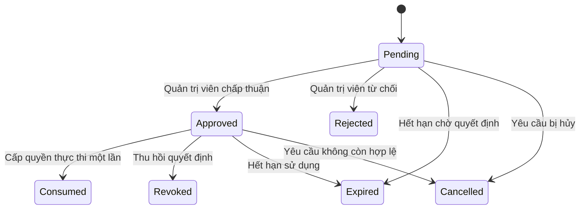

# Administrator approval expiry — Thời hạn hiệu lực của phê duyệt quản trị viên

## 1. Vì sao phê duyệt khôi phục tài khoản phải hết hạn?

Trong quy trình khôi phục tài khoản có quản trị viên tham gia, một người có thẩm quyền có thể xác nhận rằng một yêu cầu được phép đi tiếp. Ví dụ, người dùng mất điện thoại chứa MFA và không còn passkey dự phòng; bộ phận hỗ trợ thu thập bằng chứng, sau đó quản trị viên phê duyệt việc cấp một quyền đăng ký lại yếu tố xác thực.

Phê duyệt đó được đưa ra dựa trên thông tin tại một thời điểm: danh tính người yêu cầu, bằng chứng đã kiểm tra, tình trạng tài khoản, quyền của người phê duyệt và mức rủi ro được quan sát. Nếu hệ thống cho phép sử dụng phê duyệt nhiều ngày sau mà không kiểm tra lại, những điều kiện này có thể đã thay đổi. Tài khoản có thể đang bị tấn công, quản trị viên có thể đã mất quyền, hoặc yêu cầu khôi phục đã đổi địa chỉ nhận kết quả.

**Administrator approval expiry** là cơ chế đặt giới hạn thời gian cho việc sử dụng một quyết định phê duyệt. Sau giới hạn đó, quyết định vẫn tồn tại như bằng chứng kiểm toán nhưng không còn cấp quyền thực hiện hành động khôi phục mới.

Đối với dịch vụ `SECURITY_AUTHENTICATION_ACCOUNT_RECOVERY`, phê duyệt cần được xem là một thành phần của quyết định khôi phục an toàn, kết hợp với xác minh danh tính, đánh giá rủi ro, token dùng một lần, chống lạm dụng và kiểm soát phiên. Nó không phải một đặc quyền bỏ qua mọi kiểm tra còn lại.

### Tình huống mở đầu

Một yêu cầu khôi phục có các mốc sau:

| Mốc | Sự kiện |
|---|---|
| 09:00 | Người dùng mở yêu cầu khôi phục MFA |
| 09:12 | Bằng chứng danh tính được kiểm tra |
| 09:20 | Quản trị viên phê duyệt, hiệu lực đến 09:35 |
| 09:25 | Hệ thống phát hiện dấu hiệu chiếm đoạt phiên |
| 09:40 | Một worker lấy được công việc khôi phục từ hàng đợi |

Nếu worker chỉ kiểm tra `approved = true`, nó có thể thực hiện một hành động vừa quá hạn vừa không còn phù hợp với rủi ro hiện tại. Kiểm tra đúng phải bao gồm thời hạn, phạm vi, trạng thái yêu cầu và các điều kiện bảo mật còn hiệu lực tại thời điểm quyết định thực thi.

## 2. Phân biệt những thời hạn liên quan

Một luồng khôi phục thường có nhiều thời hạn. Chúng phục vụ các mục đích khác nhau và không được gộp thành một trường `expiresAt` không rõ nghĩa.

| Thời hạn | Giới hạn điều gì? | Khi hết hạn |
|---|---|---|
| Thời hạn yêu cầu khôi phục | Khoảng thời gian xử lý một yêu cầu cụ thể | Không tiếp tục xử lý yêu cầu cũ theo luồng thông thường |
| Hạn chờ quản trị viên quyết định | Khoảng thời gian người phê duyệt được phép trả lời một lời mời duyệt | Lời mời hết hiệu lực, chưa có quyết định được cấp |
| Thời hạn phê duyệt | Khoảng thời gian được phép sử dụng quyết định đã duyệt | Quyết định không thể cấp quyền mới |
| Độ mới của bằng chứng | Khoảng thời gian bằng chứng được coi là còn phù hợp | Cần thu thập hoặc xác minh lại theo chính sách |
| Thời hạn quyền khôi phục | Khoảng thời gian sử dụng một quyền hạn chế được phát hành sau phê duyệt | Không thể dùng quyền đó để hoàn tất khôi phục |
| Thời hạn token giao cho người dùng | Khoảng thời gian token dùng một lần có thể được đổi | Token bị từ chối dù bản ghi phê duyệt có thể còn tồn tại |
| Thời hạn phiên sau khôi phục | Khoảng thời gian phiên đã cấp được phép hoạt động | Phiên cần được làm mới hoặc chấm dứt theo chính sách phiên |

Ví dụ: lời mời duyệt hết hạn lúc 10:30, quản trị viên duyệt lúc 10:10 và quyết định được sử dụng đến 10:20. Hạn 10:30 của lời mời không làm cho quyết định có hiệu lực đến 10:30.

Tương tự, token khôi phục chưa hết hạn không chứng minh rằng phê duyệt, tài khoản hay mức rủi ro vẫn hợp lệ. Nếu hệ thống yêu cầu phê duyệt còn hiệu lực khi đổi token, backend phải kiểm tra điều kiện đó ở thao tác đổi token.

## 3. Định nghĩa chính xác một phê duyệt còn hiệu lực

Một quyết định nên gắn với một yêu cầu và một hành động cụ thể. Tập thuộc tính minh họa:

```text
approvalId
tenantId
accountId
recoveryRequestId
requestVersion
action
actionPayloadDigest
evidenceVersion
policyVersion
approvedBy
approvedAt
expiresAt
state
revokedAt
consumedByOperationId
```

Ý nghĩa quan trọng của từng nhóm:

- `tenantId`, `accountId`, `recoveryRequestId`: ngăn sử dụng chéo tổ chức, tài khoản hoặc yêu cầu.
- `requestVersion`, `action`, `actionPayloadDigest`: buộc phê duyệt vào đúng phiên bản và nội dung hành động. Phê duyệt đăng ký lại MFA không tự cho phép đổi email chính hoặc nâng quyền quản trị.
- `evidenceVersion`, `policyVersion`: ghi nhận căn cứ ra quyết định và chính sách đã áp dụng. Cách xử lý khi những phiên bản này thay đổi phải được định nghĩa rõ.
- `approvedBy`: phục vụ kiểm tra người phê duyệt, phân tách nhiệm vụ và kiểm toán.
- `approvedAt`, `expiresAt`: mô tả khoảng thời gian có thể sử dụng quyết định.
- `state`, `revokedAt`, `consumedByOperationId`: kiểm soát thu hồi, dùng một lần và thử lại an toàn.

Không lưu toàn bộ giấy tờ hoặc bí mật xác thực vào bản ghi phê duyệt chỉ để chứng minh đã duyệt. Tham chiếu bằng chứng cần có kiểm soát truy cập và chính sách lưu trữ riêng. Giá trị băm của nội dung hành động cũng không thay thế việc kiểm soát các trường dữ liệu nhạy cảm.

Với `t` là thời điểm quyết định do phía máy chủ xác định, điều kiện thời gian nên dùng khoảng nửa mở:

```text
approvedAt <= t < expiresAt
```

Tại đúng `t = expiresAt`, phê duyệt đã hết hiệu lực. Quy ước này tránh trường hợp một thành phần dùng `<=` còn thành phần khác dùng `<` ở cùng biên thời gian.

Một kiểm tra đầy đủ có thể được diễn đạt:

```text
usable(approval, request, operation, t) =
    approval.state == APPROVED
    AND approval.approvedAt <= t
    AND t < approval.expiresAt
    AND approval.revokedAt is absent
    AND approval has not been consumed
    AND approval belongs to request.tenantId and request.accountId
    AND approval.recoveryRequestId == request.id
    AND approval.requestVersion == request.version
    AND approval.action == operation.action
    AND approval.actionPayloadDigest == digest(operation.payload)
    AND request is still eligible for recovery
    AND current policy accepts the approval and its evidence
    AND current risk checks permit the operation
```

Đây là mô tả các bất biến thiết kế, không phải biểu thức cho phép bỏ qua bước kiểm tra quyền truy cập của người gọi API. Người gọi vẫn phải được xác thực và được phép thực hiện đúng thao tác trên đúng tài nguyên.

## 4. Chọn thời hạn theo rủi ro và căn cứ phê duyệt

Không có một TTL phù hợp cho mọi loại khôi phục. Việc cấp lại quyền truy cập tài khoản quản trị sản xuất khác với việc hỗ trợ tài khoản thông thường đang còn một yếu tố xác thực đáng tin cậy.

Các yếu tố cần xem xét gồm mức nhạy cảm của tài khoản, loại hành động được cấp, chất lượng bằng chứng, tốc độ biến động rủi ro và thời gian thực tế để người dùng hoàn tất bước tiếp theo. TTL ngắn giúp giảm cửa sổ sử dụng quyết định cũ, nhưng nếu quá ngắn sẽ gây nhiều lần duyệt lại và tăng tải hỗ trợ. Cần điều chỉnh bằng dữ liệu vận hành, thay vì kéo dài tự động mỗi khi có yêu cầu chậm.

Một cách tính hạn cuối tại thời điểm phê duyệt:

```text
expiresAt = min(
    approvedAt + approvalTtlForThisAction,
    recoveryRequest.expiresAt,
    evidenceUsableUntil,
    applicableHardDeadline
)
```

Chỉ đưa vào phép `min` các giới hạn thực sự được chính sách định nghĩa cho quyết định đó. Nếu hạn cuối tính được không nằm sau `approvedAt`, hệ thống không được tạo một phê duyệt có thể sử dụng; cần yêu cầu kiểm tra lại hoặc đóng yêu cầu theo nguyên nhân tương ứng.

Ví dụ minh họa, không phải giá trị chuẩn cho triển khai: lúc 14:00, chính sách cho phép phê duyệt hiệu lực 20 phút; yêu cầu khôi phục hết hạn lúc 14:12; bằng chứng được chấp nhận đến 14:30. Hạn sử dụng quyết định là 14:12, không phải 14:20.

### Không gia hạn bằng cách sửa timestamp

Một người hỗ trợ không nên sửa `expiresAt` trên quyết định cũ để “cho khách thêm thời gian”. Cách đó thay đổi ý nghĩa của một sự kiện đã được phê duyệt và làm khó việc xác định quản trị viên thực sự đã chấp thuận điều gì.

Khi cần thêm thời gian, tạo một lượt quyết định mới sau khi kiểm tra lại điều kiện cần thiết. Bản ghi mới tham chiếu quyết định trước nếu cần, có người phê duyệt, căn cứ và hạn mới. Quyết định trước được giữ nguyên trong lịch sử.

Thao tác xem trang, nhấn gửi lại thông báo, retry mạng hoặc chạy lại job không được tự động kéo dài thời hạn phê duyệt. Đây không phải phiên hoạt động có cơ chế gia hạn theo tương tác.

## 5. Vòng đời và trạng thái hiệu lực

Một mô hình đơn giản cho mỗi lượt phê duyệt:



Trạng thái `Expired` có thể được ghi vật lý bởi một tác vụ nền hoặc được suy ra từ thời gian. Bất kể cách lưu trữ, đường thực thi phải tự kiểm tra thời hạn. Bản ghi còn mang `state = APPROVED` không có nghĩa nó còn hiệu lực nếu `expiresAt` đã qua.

Phân biệt hai khái niệm giúp tránh nhầm lẫn:

- **Trạng thái lưu trữ** phục vụ theo dõi vòng đời, tìm kiếm và báo cáo.
- **Hiệu lực tại thời điểm sử dụng** là kết quả kiểm tra đầy đủ thời gian, phạm vi, thu hồi, tiêu thụ và điều kiện yêu cầu.

Job hết hạn chỉ giúp làm sạch trạng thái vận hành và phát thông báo. Nếu job ngừng chạy, quyền khôi phục vẫn phải hết hiệu lực đúng hạn nhờ kiểm tra ở backend.

Không chuyển `Consumed` trở lại `Approved` khi việc gửi email gặp lỗi. Quyền đã cấp cần được quản lý bằng bản ghi thao tác và cơ chế retry riêng; hoàn nguyên quyết định có thể tạo thêm một lần cấp quyền ngoài ý muốn.

## 6. Kiểm tra ở đâu trong luồng xử lý?

Kiểm tra khi hiển thị màn hình quản trị giúp người vận hành biết quyết định còn dùng được hay không. Tuy nhiên, kiểm tra quyết định nằm ở phía backend, tại nơi hệ thống thật sự cấp quyền hoặc thay đổi thông tin xác thực.

```text
Mở yêu cầu
    → xác minh danh tính và đánh giá rủi ro
    → quản trị viên phê duyệt có thời hạn
    → backend kiểm tra điều kiện hiện tại
    → tiêu thụ phê duyệt và cấp một quyền khôi phục hạn chế
    → người dùng thực hiện bước khôi phục được cho phép
    → áp dụng chính sách phiên và thông báo bảo mật
```

Trước khi cấp quyền, backend cần đọc nguồn dữ liệu có thẩm quyền. Kết quả lấy từ cache, email phê duyệt hoặc bản chụp thông tin trong job không đủ để chứng minh quyền vẫn còn hiệu lực. Các kiểm tra nhanh ở API gateway hay giao diện chỉ là hỗ trợ, không thay thế kiểm tra cuối.

### Hai thiết kế hợp lệ nhưng có ngữ nghĩa khác nhau

**Thiết kế A: phê duyệt phải còn hiệu lực tại thao tác cuối.** Khi người dùng đổi token để đăng ký lại MFA, hệ thống kiểm tra lại phê duyệt. Hạn token phải được giới hạn cho phù hợp; token chưa hết hạn vẫn bị từ chối nếu phê duyệt đã hết hạn hoặc bị thu hồi.

**Thiết kế B: phê duyệt cấp một quyền khôi phục riêng.** Khi phê duyệt còn hiệu lực, hệ thống tiêu thụ nó một lần để tạo một quyền có phạm vi hẹp và hạn riêng. Sau đó quyền này được xác minh ở thao tác cuối. Quyết định phê duyệt đã được sử dụng trước hạn, nên việc thời gian của phê duyệt trôi qua không mặc nhiên xóa quyền đã cấp. Chính sách phải quy định quyền mới được sống bao lâu và những sự kiện nào sẽ thu hồi nó.

Không trộn hai thiết kế một cách ngầm định. Nếu yêu cầu nghiệp vụ đòi hỏi tất cả các bước đều hoàn tất trước hạn phê duyệt, hạn quyền phát sinh phải bị chặn bởi hạn đó và đường thực thi cuối phải bảo đảm ràng buộc tương ứng. Nếu cho phép quyền phát sinh tồn tại lâu hơn, cần ghi nhận đây là một chuyển giao quyền có chủ đích, không phải hệ quả tình cờ của hàng đợi.

## 7. Thực thi nguyên tử để tránh sử dụng sau hạn và dùng hai lần

Sai lầm phổ biến là tách thao tác đọc và cập nhật:

```text
1. Đọc approval: còn hiệu lực.
2. Chờ gọi một dịch vụ khác.
3. Tạo token khôi phục.
4. Đánh dấu approval đã dùng.
```

Giữa bước 1 và bước 3, phê duyệt có thể hết hạn hoặc bị thu hồi. Hai worker cũng có thể cùng đọc thấy “chưa dùng” và cùng cấp quyền. Đây là lỗi kiểm tra trước rồi sử dụng sau khi điều kiện đã thay đổi.

Một đơn vị thực thi an toàn cần có một điểm quyết định rõ ràng. Ví dụ, trong một transaction cùng cơ sở dữ liệu:

1. Khóa hoặc kiểm soát phiên bản yêu cầu và phê duyệt theo thứ tự nhất quán.
2. Xác định thời điểm quyết định sau khi đã chờ khóa, bằng nguồn thời gian phía máy chủ được thống nhất.
3. Kiểm tra thời hạn, phiên bản yêu cầu, phạm vi hành động, thu hồi và điều kiện liên quan.
4. Chuyển phê duyệt từ chưa dùng sang đã dùng bằng cập nhật có điều kiện.
5. Tạo một quyền khôi phục hạn chế, bản ghi thao tác và sự kiện outbox trong cùng transaction.
6. Commit, sau đó mới giao thông báo cho hệ thống vận chuyển.

Việc giữ khóa và kiểm tra điều kiện trên cùng đường ghi ngăn hai worker tiêu thụ cùng một quyết định. Những cập nhật làm mất hiệu lực yêu cầu cũng phải tham gia cùng cơ chế khóa hoặc kiểm soát phiên bản; chỉ khóa phê duyệt trong khi cho phép yêu cầu bị sửa tự do ở nơi khác thì chưa đủ.

SQL dưới đây minh họa một cập nhật có điều kiện, không phải một giao dịch hoàn chỉnh:

```sql
UPDATE recovery_approval
SET state = 'CONSUMED',
    consumed_at = :decision_time,
    consumed_by_operation_id = :operation_id
WHERE approval_id = :approval_id
  AND tenant_id = :tenant_id
  AND account_id = :account_id
  AND recovery_request_id = :request_id
  AND request_version = :request_version
  AND action = :action
  AND action_payload_digest = :payload_digest
  AND state = 'APPROVED'
  AND revoked_at IS NULL
  AND consumed_by_operation_id IS NULL
  AND approved_at <= :decision_time
  AND expires_at > :decision_time;
```

`:decision_time` phải do phía backend lấy từ nguồn thời gian có thẩm quyền tại điểm quyết định; không lấy từ request người dùng hoặc timestamp của job. Các tham số phạm vi phải xuất phát từ yêu cầu đã được xác minh, không chỉ tin vào chuỗi ID do client gửi.

Nếu số hàng cập nhật bằng 0, hệ thống không được tiếp tục cấp quyền dựa trên kết quả đọc cũ. Nếu đã có thao tác thành công với cùng idempotency key và cùng nội dung, hệ thống có thể trả lại trạng thái thao tác đó theo chính sách retry. Trường hợp còn lại cần đọc trạng thái hiện tại để phân loại nguyên nhân từ chối.

Sau cập nhật này, việc chèn quyền khôi phục phải thành công trong cùng transaction hoặc toàn bộ thay đổi phải rollback. Nếu cập nhật phê duyệt và tạo quyền nằm ở hai cơ sở dữ liệu độc lập, một transaction cục bộ không giải quyết được tính nguyên tử giữa chúng; cần một giao thức cấp quyền và xử lý retry được thiết kế riêng.

### Thời điểm quyết định khác thời điểm commit

Một transaction có thể quyết định tiêu thụ lúc 09:34:59 và commit lúc 09:35:01, trong khi hạn là 09:35:00. Nếu chính sách định nghĩa hiệu lực tại điểm quyết định nguyên tử, việc commit sau đó không tự làm quyết định trước hạn trở thành sai. Cần ghi rõ ngữ nghĩa này và giới hạn thời gian xử lý transaction.

Nếu chính sách đòi hỏi hiệu lực tại thời điểm đổi yếu tố xác thực, không được dùng thời điểm kiểm tra sớm ở bước cấp quyền như bằng chứng thay thế. Hệ thống phải đặt kiểm tra quyết định tại thao tác cuối hoặc áp dụng một cơ chế thực thi tương đương có ràng buộc thời gian rõ ràng.

## 8. Minh họa kiểm tra thời gian trong Java

Đoạn mã sau minh họa phần kiểm tra thuần túy. Nó không tự cung cấp transaction, khóa, đánh giá rủi ro hay phân quyền API.

```java
import java.time.Instant;
import java.util.Objects;

enum ApprovalState {
    APPROVED, CONSUMED, REVOKED, EXPIRED, CANCELLED
}

record ApprovalWindow(
        Instant approvedAt,
        Instant expiresAt,
        ApprovalState state,
        Instant revokedAt,
        String consumedByOperationId) {
}

final class ApprovalTimePolicy {
    static boolean isUsableAt(ApprovalWindow approval, Instant decisionTime) {
        Objects.requireNonNull(approval);
        Objects.requireNonNull(decisionTime);

        Instant start = approval.approvedAt();
        Instant end = approval.expiresAt();

        if (start == null || end == null || !end.isAfter(start)) {
            return false;
        }
        if (approval.state() != ApprovalState.APPROVED
                || approval.revokedAt() != null
                || approval.consumedByOperationId() != null) {
            return false;
        }

        return !decisionTime.isBefore(start) && decisionTime.isBefore(end);
    }
}
```

Ở tầng ứng dụng, một luồng minh họa có thể có dạng:

```text
consumeApproval(command):
    xác thực người gọi và phạm vi tenant
    tìm thao tác cũ bằng idempotency key
    nếu có thao tác khớp nội dung:
        trả trạng thái đã ghi nhận, không cấp thêm quyền

    bắt đầu transaction:
        khóa yêu cầu và phê duyệt theo thứ tự chuẩn
        đọc decisionTime từ nguồn thời gian có thẩm quyền
        kiểm tra trạng thái, thời hạn và phiên bản yêu cầu
        kiểm tra phạm vi, bằng chứng, quyền duyệt và chính sách hiện tại
        từ chối nếu rủi ro hoặc trạng thái tài khoản không cho phép
        cập nhật có điều kiện: APPROVED → CONSUMED
        tạo recoveryGrant với scope và expiresAt được tính theo chính sách
        ghi operation + outbox event
    commit

    trả trạng thái operation
```

Nếu dùng `Clock` được inject vào Java để hỗ trợ kiểm thử, cần bảo đảm nguồn đó phù hợp với nơi quyết định được thực hiện. Không kiểm tra bằng đồng hồ ứng dụng rồi ghi bằng một điều kiện khác dùng đồng hồ cơ sở dữ liệu mà không có thiết kế nhất quán. Một abstraction thời gian thuận tiện không tự giải quyết độ lệch giữa các máy.

## 9. Nhiều quản trị viên và hạn của từng quyết định

Một hành động nhạy cảm có thể yêu cầu hai người phê duyệt độc lập. Khi đó, không đủ để đếm “đã từng có hai phiếu đồng ý”. Tại thời điểm sử dụng phải có đủ số phê duyệt đang còn hiệu lực, đúng vai trò, khác người theo yêu cầu và cùng chấp thuận một nội dung.

Ví dụ, chính sách cần hai phê duyệt cho việc cấp quyền đăng ký lại MFA của tài khoản đặc quyền:

| Người duyệt | Thời điểm duyệt | Hạn sử dụng |
|---|---|---|
| A | 10:00 | 10:15 |
| B | 10:10 | 10:25 |

Nếu chỉ có hai phê duyệt này, khoảng đủ điều kiện là từ 10:10 đến trước 10:15. B duyệt muộn không kéo dài phiếu của A đến 10:25.

Khi có nhiều hơn số phê duyệt tối thiểu, hệ thống chọn một tập hợp đáp ứng chính sách tại điểm quyết định, ghi lại chính xác các phê duyệt đã được sử dụng và tiêu thụ chúng nguyên tử cùng thao tác. Không nhất thiết lấy hạn sớm nhất của tất cả phiếu đã tồn tại nếu chính sách chỉ cần một tập hợp con; ngược lại, nếu bắt buộc một vai trò cụ thể thì không được thay phiếu đã hết hạn của vai trò đó bằng một phiếu không đủ thẩm quyền.

Các quy tắc như người mở yêu cầu không được tự phê duyệt, người phê duyệt không được trùng nhau và quyền của quản trị viên phải còn phù hợp vẫn phải được kiểm tra riêng. TTL không thay thế phân tách nhiệm vụ.

## 10. Thu hồi và thay đổi yêu cầu trong thời gian còn hiệu lực

Chưa đến `expiresAt` không đồng nghĩa quyết định phải được chấp nhận. Một số thay đổi có thể làm quyết định mất hiệu lực sớm:

- Yêu cầu bị hủy, bị từ chối hoặc tài khoản chuyển sang trạng thái cần điều tra.
- Đích nhận kết quả, loại hành động hoặc bằng chứng trọng yếu của yêu cầu thay đổi.
- Phát hiện bằng chứng giả, token bị lộ hoặc phiên của người yêu cầu có dấu hiệu bị chiếm đoạt.
- Người phê duyệt bị thu hồi thẩm quyền theo chính sách áp dụng cho quyết định đang chờ sử dụng.
- Chính sách mới yêu cầu mức bằng chứng hoặc số người duyệt cao hơn cho hành động đó.

Không phải mọi thay đổi văn bản đều phải làm mất hiệu lực. Ví dụ, sửa lỗi chính tả trong ghi chú vận hành có thể không ảnh hưởng tới nội dung được phê duyệt. Hệ thống cần định nghĩa trường nào làm tăng `requestVersion` có ý nghĩa bảo mật hoặc thay đổi digest của hành động.

Đối với thay đổi chính sách và quyền quản trị viên, cần chỉ rõ quyết định cũ được tiếp tục chấp nhận hay phải duyệt lại. Không tự mặc định mọi quyết định cũ đều được giữ nguyên chỉ vì đã lưu `policyVersion`; trường phiên bản giúp truy vết, còn quy tắc chấp nhận phải được thực thi.

Nếu một phê duyệt đã tạo quyền khôi phục theo thiết kế B, việc thu hồi phải xét cả quyền phát sinh. Chỉ đổi bản ghi phê duyệt sang `REVOKED` nhưng để token hoặc quyền đã cấp tiếp tục dùng được có thể không đáp ứng mục tiêu thu hồi.

## 11. Hàng đợi, retry và tính dùng một lần

Hàng đợi có thể chậm, giao lại hoặc giao trùng. Job được tạo trong thời hạn không được xem là đã giữ chỗ cho quyền thực thi vô thời hạn.

Nội dung job nên tham chiếu yêu cầu, phê duyệt hoặc operation cần xử lý. Khi nhận job, worker đọc trạng thái có thẩm quyền và xác minh rằng bước mà nó định làm vẫn được phép. Không đưa `approved = true` vào payload rồi dùng giá trị đó như một quyết định cuối cùng.

Có hai trường hợp retry cần tách biệt:

**Chưa từng cấp quyền thành công:** nếu phê duyệt đã hết hạn, retry phải bị từ chối hoặc chuyển sang luồng duyệt lại. Không cấp quyền mới chỉ vì lần gửi trước đã bắt đầu trước hạn.

**Đã cấp quyền thành công nhưng client mất phản hồi:** retry cùng idempotency key có thể đọc lại operation đã commit. Đây là trả lại kết quả của một thao tác cũ, không phải tiêu thụ phê duyệt lần thứ hai. Key cần bị ràng buộc với tenant, người gọi và digest của nội dung; cùng key nhưng khác nội dung phải bị từ chối.

Quyền đã cấp vẫn phải chịu hạn và trạng thái thu hồi của chính nó. Việc trả lại operation thành công không cho phép khôi phục một token đã hết hạn, phát thêm token tự động hoặc bỏ qua xác thực khi đọc kết quả. Không ghi token thô vào log hoặc sự kiện outbox; cơ chế giao bí mật cần được thiết kế với bảo vệ phù hợp.

Nếu thông báo bị chậm đến sau khi quyền hết hạn, hệ thống không nên gửi một liên kết được trình bày như còn sử dụng được. Luồng thông báo có thể kiểm tra trạng thái hiện tại để chọn nội dung phù hợp, nhưng backend vẫn là nơi quyết định liên kết có hiệu lực hay không.

## 12. Thời gian, múi giờ và giao diện vận hành

Lưu thời điểm tuyệt đối, thống nhất biểu diễn giữa các thành phần và chuyển sang múi giờ của người vận hành khi hiển thị. Một chuỗi như `09:30` không có ngày và múi giờ không đủ để xác định thời hạn phê duyệt.

Giao diện nên hiển thị cả thời điểm hết hạn và trạng thái hiện tại. Đồng hồ đếm ngược giúp thao tác thuận tiện nhưng chỉ mang tính hướng dẫn vì đồng hồ trình duyệt có thể sai và trạng thái có thể thay đổi sau khi trang được tải.

Các nguyên tắc vận hành:

- Không lấy `expiresAt` hoặc thời gian hiện tại do trình duyệt tự khai làm căn cứ cấp quyền.
- Theo dõi đồng bộ thời gian của hạ tầng tham gia quyết định. Độ lệch đồng hồ có thể tạo ra những quyết định không nhất quán ở sát biên.
- Xác định độ chính xác của timestamp và quy tắc so sánh dùng chung. Tránh giao diện làm tròn phút trong khi người vận hành tưởng còn cả phút để thực hiện.
- Không thêm khoảng dung sai sau hạn một cách ngầm định. Nếu có một quy tắc dung sai được phê duyệt, nó phải là một phần minh bạch của chính sách thời gian và được áp dụng nhất quán.
- Khi không đọc được dữ liệu cần thiết để xác minh hiệu lực, không tự suy ra rằng phê duyệt còn hợp lệ từ bản sao cũ.

Thông báo cho người dùng nên giải thích hành động tiếp theo mà không tiết lộ chi tiết nhạy cảm về đánh giá rủi ro hoặc sự tồn tại của tài khoản cho người chưa được xác minh. Ví dụ trong một phiên hỗ trợ đã xác thực: “Quyết định phê duyệt đã hết thời hạn sử dụng. Yêu cầu cần được kiểm tra lại trước khi tiếp tục.”

## 13. Kiểm toán và chỉ số vận hành

Lịch sử phê duyệt cần cho phép trả lời: ai đã duyệt, duyệt hành động nào, dựa trên phiên bản yêu cầu nào, hiệu lực từ lúc nào đến lúc nào, và quyết định có được sử dụng trước hạn hay không.

Các sự kiện minh họa:

```text
ADMIN_APPROVAL_GRANTED
ADMIN_APPROVAL_REJECTED
ADMIN_APPROVAL_REVOKED
ADMIN_APPROVAL_CONSUMED
ADMIN_APPROVAL_EXPIRED
ADMIN_APPROVAL_USE_DENIED
```

Mỗi sự kiện có thể chứa ID yêu cầu, ID phê duyệt, operation ID, người thực hiện, thời điểm sự kiện và mã nguyên nhân. Phân biệt `occurredAt` với thời điểm hệ thống nhận hoặc ghi sự kiện, vì sự kiện qua hàng đợi có thể đến trễ. Khi tác vụ nền phát hiện quá hạn sau nhiều phút, nó không được ghi như thể quyền chỉ hết hiệu lực tại thời điểm job chạy; hạn thực tế vẫn là `expiresAt`.

Không đưa mã OTP, token khôi phục thô, bí mật MFA hoặc bản chụp giấy tờ vào log. Phân quyền truy cập lịch sử vì dữ liệu về quy trình khôi phục cũng có thể nhạy cảm.

Những chỉ số hữu ích gồm tỷ lệ phê duyệt hết hạn trước khi sử dụng, thời gian từ duyệt đến tiêu thụ, độ trễ hàng đợi, số lần xin duyệt lại và số lần cố sử dụng quyết định đã hết hạn hoặc bị thu hồi. Tỷ lệ hết hạn cao có thể phản ánh quy trình quá chậm, TTL chưa phù hợp hoặc hành vi lạm dụng; cần phân tích nguyên nhân trước khi thay đổi chính sách.

## 14. Các tình huống cần được thiết kế rõ

Bảng sau mô tả hành vi mong muốn để người triển khai hiểu các biên của cơ chế. Đây là các tình huống minh họa cho bài học, không phải báo cáo đã chạy kiểm thử hệ thống.

| Tình huống | Hành vi mong muốn |
|---|---|
| Sử dụng ngay trước hạn, mọi điều kiện còn hợp lệ | Có thể tiêu thụ phê duyệt một lần |
| Sử dụng đúng tại `expiresAt` | Từ chối do hết hạn |
| Job vào hàng đợi trước hạn nhưng chạy sau hạn | Kiểm tra lại và từ chối cấp quyền mới |
| Hai worker tiêu thụ đồng thời | Chỉ một operation được cấp quyền từ quyết định đó |
| Một quyết định bị thu hồi trước khi dùng | Từ chối dù timestamp chưa hết hạn |
| Yêu cầu đổi đích nhận kết quả sau khi được duyệt | Bắt buộc áp dụng quy tắc thay đổi phiên bản và duyệt lại nếu cần |
| Đủ số phiếu đã từng duyệt nhưng một phiếu bắt buộc đã hết hạn | Không coi là đủ điều kiện tại thời điểm sử dụng |
| Job hết hạn ngừng chạy | Đường cấp quyền vẫn từ chối quyết định quá hạn |
| Retry sau một operation đã commit | Trả trạng thái operation phù hợp, không cấp quyền lần hai |
| Retry cùng key nhưng khác tài khoản hoặc hành động | Từ chối xung đột phạm vi hoặc nội dung |
| Gửi lại email phê duyệt | Không kéo dài hạn hoặc tạo thêm quyền ngoài chính sách |
| Không xác định được thời gian hoặc trạng thái có thẩm quyền | Không cấp quyền dựa trên phỏng đoán |

## 15. Những lỗi thiết kế thường gặp

**Chỉ lưu cờ `approved`.** Cờ này không mô tả thời điểm, phạm vi hay trạng thái đã tiêu thụ. Cần mô hình hóa một quyết định có căn cứ và vòng đời rõ ràng.

**Chỉ ẩn nút trên giao diện khi hết hạn.** Người gọi vẫn có thể gửi request trực tiếp hoặc sử dụng trang cũ. Backend phải kiểm tra tại điểm cấp quyền.

**Tin vào thời điểm tạo job.** Một công việc chờ xử lý không phải quyền khôi phục đã được cấp. Nếu muốn giữ kết quả của một quyết định trước hạn, phải tạo một quyền hoặc operation bền vững có ngữ nghĩa rõ ràng.

**Cho rằng OTP chưa hết hạn thì mọi điều kiện đều hợp lệ.** OTP chỉ chứng minh điều kiện mà nó được thiết kế để chứng minh. Nó không tự làm mới phê duyệt quản trị viên hay bằng chứng danh tính.

**Gia hạn bằng retry hoặc chỉnh trực tiếp bản ghi cũ.** Cách này làm mờ quyết định gốc và có thể tạo cửa sổ khôi phục không giới hạn. Cần một lượt quyết định mới có truy vết.

**Dùng nhiều kiểm tra riêng rẽ rồi ghi sau.** Kết quả kiểm tra có thể lỗi thời trước khi hành động xảy ra. Cần một cơ chế nguyên tử hoặc giao thức thực thi được chứng minh phù hợp với nơi lưu trạng thái.

**Xem hết hạn phê duyệt là thu hồi mọi phiên.** Phê duyệt đã tiêu thụ và phiên đã cấp là những đối tượng khác nhau. Việc vô hiệu hóa phiên, quyền khôi phục hoặc yếu tố mới phải tuân theo chính sách riêng và liên kết được với sự kiện bảo mật cần xử lý.

Thời hạn phê duyệt làm cho quyền khôi phục có giới hạn theo thời gian; nó chỉ phát huy tác dụng khi được gắn với đúng yêu cầu, đúng hành động và một lần thực thi được kiểm soát. Điểm quyết định của backend phải kiểm tra các điều kiện hiện tại, còn lịch sử quyết định được giữ lại để giải thích vì sao hệ thống đã cho phép hoặc từ chối thao tác.
