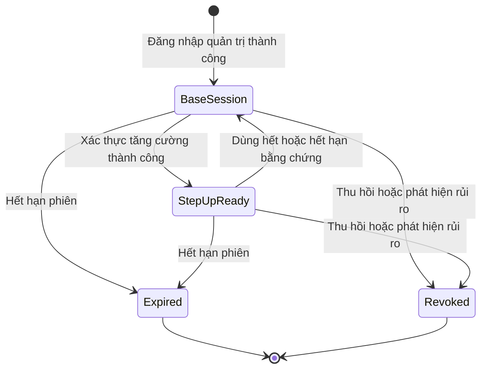
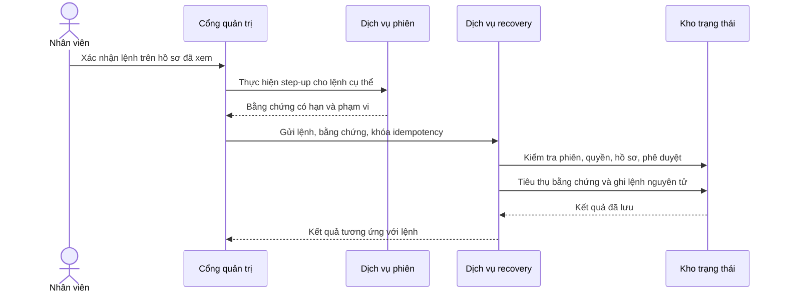

# Administrator session security

## 1. Vì sao phiên quản trị là một phần của an toàn khôi phục tài khoản?

Trong hệ thống khôi phục tài khoản, nhân viên hỗ trợ hoặc quản trị viên có thể được cấp quyền xem hồ sơ yêu cầu, đánh giá bằng chứng, phê duyệt ngoại lệ, khóa một quy trình có dấu hiệu gian lận hoặc cho phép người dùng đăng ký lại yếu tố xác thực. Nếu kẻ tấn công chiếm được phiên của người thực hiện những công việc này, chúng có thể bỏ qua nhiều lớp bảo vệ được thiết kế cho người dùng cuối.

Vì vậy, bảo vệ tài khoản quản trị lúc đăng nhập là chưa đủ. Hệ thống phải kiểm soát toàn bộ vòng đời **phiên quản trị**: tạo phiên, sử dụng, nâng mức xác thực, thay đổi quyền, hết hạn và thu hồi. Mỗi quyết định nhạy cảm phải trả lời đồng thời:

- Ai đang thực hiện thao tác và phiên này còn hợp lệ không?
- Người đó hiện có quyền đối với hồ sơ, tổ chức và thao tác cụ thể hay không?
- Mức xác thực gần nhất có đáp ứng yêu cầu của thao tác không?
- Thao tác có cần phê duyệt độc lập, và phê duyệt đó có đúng với nội dung sắp thực hiện không?

Mục tiêu không phải làm phiên quản trị bất tiện ở mọi bước. Mục tiêu là ngăn một phiên bị đánh cắp, một quyền đã bị thu hồi hoặc một xác nhận cũ trở thành công cụ chiếm đoạt tài khoản người dùng.

Trong bài này, **administrator** bao gồm cả các vai trò hỗ trợ được ủy quyền xử lý recovery. Tên vai trò không quyết định mức rủi ro; khả năng thay đổi đường truy cập tài khoản mới là yếu tố quan trọng.

## 2. Phân biệt những loại bằng chứng thường bị trộn lẫn

Một hồ sơ recovery thường chứa nhiều tín hiệu có vẻ đều là “đã xác minh”, nhưng chúng phục vụ những câu hỏi khác nhau.

| Thành phần | Chứng minh hoặc quyết định điều gì? | Không thay thế được điều gì? |
|---|---|---|
| Phiên quản trị | Máy chủ đã thiết lập một ngữ cảnh đăng nhập cho nhân viên | Quyền hiện tại trên từng hồ sơ |
| Xác thực tăng cường của nhân viên | Nhân viên vừa đáp ứng yêu cầu xác thực cho thao tác nhạy cảm | Bằng chứng người yêu cầu recovery là chủ tài khoản |
| Bằng chứng danh tính người dùng | Hỗ trợ đánh giá quyền khôi phục tài khoản đích | Quyền của nhân viên vận hành |
| Phê duyệt độc lập | Một người có thẩm quyền khác chấp nhận đề xuất cụ thể | Phiên hợp lệ và quyền thực thi của người thao tác |
| Token recovery dùng một lần | Cho phép thực hiện một bước recovery được giới hạn | Phiên quản trị hoặc quyền quản trị lâu dài |

Ví dụ, khách hàng cung cấp đủ bằng chứng để được cấp lại phương thức xác thực. Điều đó không làm một phiên hỗ trợ đã hết hạn trở nên hợp lệ. Ngược lại, quản trị viên vừa xác thực bằng yếu tố mạnh vẫn phải từ chối nếu bằng chứng của khách hàng không đáp ứng chính sách.

Một sai lầm nguy hiểm khác là suy luận rằng “đăng nhập vào cổng quản trị thành công” đồng nghĩa với “được phép reset MFA cho bất kỳ tài khoản nào”. Xác thực và phân quyền cần được đánh giá riêng, rồi kết hợp tại thời điểm thực hiện hành động.

## 3. Mô hình đe dọa cho phiên quản trị

### 3.1. Những tài sản cần bảo vệ

Các tài sản chính gồm quyền quyết định recovery, bằng chứng định danh của khách hàng, thông tin liên hệ đã xác minh, lịch sử thao tác và khả năng vô hiệu hóa hoặc thay thế các yếu tố xác thực. Bản thân một phiên chưa có quyền reset ngay vẫn có thể gây hại nếu cho phép thu thập đủ thông tin để thực hiện social engineering ở kênh khác.

### 3.2. Những đường tấn công điển hình

- **Đánh cắp phiên:** mã độc, tiện ích trình duyệt độc hại, lỗi XSS hoặc rò rỉ token làm lộ thông tin xác thực phiên.
- **Session fixation:** kẻ tấn công tìm cách khiến nhân viên tiếp tục dùng một định danh phiên đã bị chúng biết trước sau đăng nhập hoặc sau khi nâng quyền.
- **CSRF:** trình duyệt đang có phiên hợp lệ bị dụ gửi yêu cầu thay đổi trạng thái ngoài ý muốn.
- **Lạm dụng phiên không giám sát:** nhân viên rời máy nhưng phiên vẫn hoạt động, hoặc cửa sổ trình duyệt được dùng chung.
- **Quyền cũ còn hiệu lực:** nhân viên đã đổi nhóm, bị đình chỉ hoặc bị thu hồi quyền nhưng phiên vẫn sử dụng quyền đã lưu từ trước.
- **Phát lại xác nhận:** một bằng chứng step-up hoặc phê duyệt cho hồ sơ A bị dùng lại cho hồ sơ B, hoặc cho nội dung khác trong cùng hồ sơ.
- **Vượt kiểm soát qua đường phụ:** giao diện chính kiểm tra đầy đủ nhưng API cũ, endpoint nội bộ hoặc tác vụ nền lại chỉ kiểm tra có đăng nhập.

Không có một thuộc tính cookie hay một loại MFA nào giải quyết toàn bộ danh sách này. Cần kiểm soát ở trình duyệt, máy chủ phiên, dịch vụ phân quyền và nơi thực thi thay đổi recovery.

## 4. Tách phiên quản trị khỏi phiên người dùng thông thường

Một người vừa là khách hàng vừa là nhân viên vận hành có thể có hai ngữ cảnh đăng nhập khác nhau. Hệ thống không nên nâng phiên người dùng thông thường thành phiên quản trị chỉ vì hồ sơ tài khoản có thêm một cờ `admin=true`.

Thiết kế tách biệt thường bao gồm:

1. Điểm vào quản trị và luồng xác thực có chính sách riêng.
2. Ngữ cảnh phiên có loại, audience và phạm vi sử dụng rõ ràng.
3. Cookie hoặc thông tin xác thực riêng, với phạm vi host và đường dẫn phù hợp.
4. Kiểm tra tại máy chủ rằng endpoint quản trị chỉ chấp nhận phiên quản trị.
5. Quy trình thu hồi có thể vô hiệu hóa toàn bộ quyền quản trị mà không phụ thuộc vào việc người dùng có đóng trình duyệt hay không.

Một dịch vụ backend nhận phiên hợp lệ cho cổng khách hàng phải từ chối nếu phiên đó được đưa vào endpoint quản trị. Không dựa vào việc “người dùng bình thường không thấy nút” hoặc “URL quản trị khó đoán”.

Nếu dùng đăng nhập liên kết qua nhà cung cấp danh tính, cần phân biệt **phiên tại nhà cung cấp danh tính** và **phiên tại ứng dụng quản trị**. Đăng xuất khỏi một nơi không tự bảo đảm nơi còn lại đã thu hồi phiên. Ứng dụng cần có quy tắc rõ về thời điểm chấp nhận lại đăng nhập liên kết, yêu cầu xác thực mới và xử lý tín hiệu thu hồi.

Đặc biệt, một tài khoản nhân viên vừa đi qua quy trình recovery không nên tự động lấy lại toàn bộ quyền nhạy cảm chỉ vì đã đăng nhập trở lại. Chính sách có thể yêu cầu kiểm tra bổ sung, hạn chế tạm thời hoặc phê duyệt trước khi tái kích hoạt quyền quản trị. Đây là quyết định riêng với việc khôi phục khả năng đăng nhập.

## 5. Trạng thái phiên và vòng đời quyền

Một mô hình đơn giản có thể phân biệt phiên cơ sở, bằng chứng step-up và trạng thái kết thúc:



`StepUpReady` không nhất thiết là một cờ trên toàn phiên. Trong thiết kế chặt hơn, phiên vẫn là phiên cơ sở, còn máy chủ phát hành một bằng chứng riêng chỉ dùng cho một lệnh. Cách này làm rõ rằng một lần xác thực không mở khóa mọi hành động quản trị trong thời gian dài.

Một bản ghi phiên có thể mang các dữ liệu sau:

| Dữ liệu | Mục đích |
|---|---|
| Định danh phiên mờ, khó đoán | Tra cứu phiên mà không đưa dữ liệu nghiệp vụ vào trình duyệt |
| Định danh nhân viên và loại phiên | Xác định actor và ngữ cảnh quản trị |
| Thời điểm tạo, lần hoạt động được chấp nhận gần nhất | Áp dụng hạn phiên tuyệt đối và hạn không hoạt động |
| Thời điểm, phương thức và mức xác thực | Đánh giá yêu cầu xác thực theo từng thao tác |
| Trạng thái thu hồi | Chặn sử dụng phiên đã bị vô hiệu hóa |
| Phiên bản bảo mật hoặc mốc thu hồi của nhân viên | Vô hiệu hóa hàng loạt các phiên cũ |
| Dữ liệu thiết bị và tín hiệu rủi ro có giới hạn | Hỗ trợ phát hiện bất thường, không thay danh tính |

Máy chủ cần kiểm tra thời gian bằng nguồn thời gian đáng tin cậy phía mình. Dữ liệu như `lastActivity` do trình duyệt tự gửi không đủ để quyết định gia hạn phiên.

## 6. Thiết lập và lưu giữ phiên an toàn

### 6.1. Tạo mới định danh tại các ranh giới xác thực

Sau khi đăng nhập thành công, ứng dụng nên thiết lập một định danh phiên mới và vô hiệu hóa định danh trước đăng nhập. Nếu việc nâng quyền tạo một ngữ cảnh phiên mới, định danh cũ cũng cần được xử lý để không giữ nguyên khả năng truy cập không mong muốn.

Định danh phiên phải được tạo bằng nguồn ngẫu nhiên mật mã phù hợp, có đủ độ khó đoán và không chứa email, số hồ sơ, quyền quản trị hay dữ liệu cá nhân. Không chấp nhận một định danh phiên tùy ý do client chọn làm phiên đã xác thực.

### 6.2. Cookie và trình duyệt

Đối với cổng quản trị trên trình duyệt, một cấu hình cookie minh họa là:

```http
Set-Cookie: __Host-admin_session=<opaque-value>; Path=/; Secure; HttpOnly; SameSite=Strict
Cache-Control: no-store
```

Ví dụ này giả định triển khai trên một host quản trị chuyên dụng qua HTTPS, cookie không có thuộc tính `Domain`, và luồng đăng nhập phù hợp với lựa chọn `SameSite`. Không sao chép cấu hình mà bỏ qua luồng đăng nhập liên kết, điều hướng chéo site và cách hệ thống thực sự vận hành.

- `Secure` giới hạn việc gửi cookie qua kết nối HTTPS.
- `HttpOnly` ngăn JavaScript thông thường đọc trực tiếp giá trị cookie, nhưng không ngăn mã XSS gửi yêu cầu từ chính trang đang bị kiểm soát.
- `SameSite` giảm một số tình huống gửi cookie từ ngữ cảnh chéo site; các thao tác thay đổi trạng thái vẫn cần cơ chế chống CSRF phù hợp.
- Phạm vi cookie hẹp giúp giảm việc gửi thông tin xác thực tới những nơi không cần thiết. Thuộc tính đường dẫn không phải ranh giới phân quyền giữa các ứng dụng không tin cậy trên cùng host.

Không đưa định danh phiên vào URL, thông báo lỗi, công cụ phân tích hoặc log truy cập. Những vị trí này có thể bị lưu trong lịch sử trình duyệt, ảnh chụp, hệ thống giám sát hay đường dẫn giới thiệu.

### 6.3. XSS và rò rỉ dữ liệu recovery

Hồ sơ recovery có thể chứa nội dung do khách hàng gửi: tên tệp, ghi chú, mô tả sự cố hoặc bằng chứng. Khi hiển thị nội dung này trong cổng quản trị, phải xử lý theo ngữ cảnh đầu ra và giới hạn khả năng thực thi nội dung chủ động. Nếu một ghi chú độc hại chạy được mã trong trình duyệt quản trị, việc cookie có `HttpOnly` không đủ bảo vệ các hành động mà trình duyệt có thể gửi.

Trang và phản hồi chứa dữ liệu nhạy cảm cần chính sách cache phù hợp. Tuy nhiên, `no-store` không xóa ảnh chụp màn hình, bản tải xuống hoặc mọi bản sao ngoài ứng dụng. Hạn chế quyền xem, che dữ liệu không cần thiết và kiểm soát tải xuống vẫn là những lớp bảo vệ riêng.

## 7. Hết hạn phiên: không chỉ có một đồng hồ

Nên phân biệt ít nhất ba mốc thời gian:

1. **Idle timeout:** phiên hết hiệu lực sau khoảng không có hoạt động được tính là hợp lệ.
2. **Absolute timeout:** phiên hết hiệu lực sau một tổng thời gian kể từ khi tạo, dù vẫn có hoạt động.
3. **Step-up freshness:** bằng chứng xác thực tăng cường chỉ được chấp nhận trong một khoảng ngắn cho thao tác nhạy cảm.

Ví dụ thiết kế nội bộ có thể dùng idle timeout 10 phút, absolute timeout 4 giờ và bằng chứng step-up 2 phút cho việc thực thi một thay đổi recovery. Đây chỉ là số để minh họa ba loại hạn khác nhau, không phải bộ giá trị mặc định áp dụng cho mọi tổ chức. Giá trị thực tế cần dựa trên mức rủi ro, loại thao tác và điều kiện làm việc.

Không nên để một request polling, một tab ẩn hoặc một heartbeat tự động liên tục kéo dài phiên như thể nhân viên vẫn đang tương tác. Hệ thống cần xác định loại sự kiện nào được tính là hoạt động và thực thi quy tắc đó tại máy chủ.

Khi phiên hoặc bằng chứng hết hạn trong lúc nhân viên điền biểu mẫu, ứng dụng có thể giữ bản nháp không nhạy cảm để giảm thao tác lặp lại. Nhưng sau xác thực lại phải đọc lại trạng thái hồ sơ và xác nhận nội dung cuối cùng, vì một người khác có thể đã khóa hoặc thay đổi hồ sơ trong thời gian chờ.

Gia hạn phiên cơ sở không được vô tình gia hạn bằng chứng step-up cũ. Tương tự, refresh token hoặc cơ chế “ghi nhớ đăng nhập” không được làm vô hiệu ý nghĩa của hạn tuyệt đối đã đặt ra cho phiên quản trị.

## 8. Step-up phải gắn với hành động recovery cụ thể

### 8.1. Chọn ranh giới yêu cầu xác thực mới

Không phải mọi màn hình đều cần cùng mức bảo đảm. Việc đọc thông tin đã che có thể có yêu cầu khác với việc mở toàn bộ bằng chứng, thay đổi kênh liên lạc hoặc cho phép đăng ký lại MFA.

Những hành động nên được xem xét kiểm soát mạnh hơn gồm:

- Chấp nhận ngoại lệ khi người dùng mất nhiều yếu tố xác thực.
- Cho phép thay thế hoặc đăng ký lại MFA/passkey sau recovery.
- Thay đổi kênh nhận liên kết recovery.
- Bỏ một biện pháp hạn chế đang bảo vệ tài khoản.
- Thực thi quyết định trên tài khoản đặc quyền hoặc hồ sơ có rủi ro cao.

Yêu cầu phương thức xác thực phải tương ứng với rủi ro và khả năng của hệ thống. Việc chỉ yêu cầu nhập lại cùng một bí mật trên một trang giả mạo không tự giải quyết nguy cơ phishing. Dù phương thức xác thực mạnh, thiết bị hoặc trình duyệt bị chiếm quyền vẫn cần các biện pháp giảm thiểu riêng.

### 8.2. Không dùng một cờ toàn cục như `recentlyVerified=true`

Giả sử quản trị viên xác thực lại để phê duyệt hồ sơ `RC-2041`. Nếu máy chủ chỉ đặt một cờ “đã xác minh gần đây”, cùng phiên có thể dùng cờ đó cho một hồ sơ khác hoặc đổi từ “gửi lại thông báo” sang “thay thế MFA”.

Một bằng chứng step-up có phạm vi rõ có thể chứa hoặc tham chiếu tới:

```text
proofId
administratorId
sessionBinding
tenantId
caseId
targetAccountId
action
commandDigest
expectedCaseVersion
issuedAt
expiresAt
usedAt
```

`commandDigest` đại diện cho nội dung lệnh đã được chuẩn hóa và trình bày cho nhân viên xác nhận. Nội dung đó phải bao gồm các trường ảnh hưởng đến quyền truy cập tài khoản, không chỉ tiêu đề nút bấm. Digest do máy chủ tính từ dữ liệu đã kiểm tra, không phải giá trị tùy ý do client cung cấp rồi được máy chủ tin tưởng.

Nếu một trường quan trọng thay đổi, bằng chứng cũ không còn phù hợp. Nếu hồ sơ thay đổi phiên bản, hệ thống nên buộc đọc lại và xác nhận theo chính sách thay vì áp dụng quyết định lên trạng thái mới mà nhân viên chưa thấy.

Liên kết với phiên cần dùng định danh nội bộ hoặc cơ chế binding do máy chủ quản lý. Không đưa giá trị cookie phiên bí mật vào HTML hoặc bằng chứng có thể quan sát chỉ để đạt mục tiêu ràng buộc này.

## 9. Phân quyền lại ở thời điểm thực thi

Quyền đã hợp lệ lúc mở trang có thể không còn hợp lệ lúc nhấn nút. Mỗi endpoint nhạy cảm cần kiểm tra lại trạng thái nhân viên, phiên, tổ chức, phạm vi hồ sơ và quyền thao tác.

Ví dụ các quyền nên tách theo năng lực nghiệp vụ thay vì gom vào một quyền “recovery admin” duy nhất:

| Năng lực | Giới hạn cần thể hiện |
|---|---|
| Xem hồ sơ | Đúng tenant, phạm vi công việc, mức che dữ liệu |
| Đánh giá bằng chứng | Đúng hồ sơ được giao, không tự mở rộng quyền thực thi |
| Đề xuất ngoại lệ | Ghi lý do và nội dung đề xuất, chưa thay đổi yếu tố xác thực |
| Phê duyệt ngoại lệ | Độc lập với người đề xuất khi chính sách yêu cầu |
| Thực thi quyết định | Đúng đề xuất đã duyệt, phiên và step-up còn hợp lệ |

Nếu dùng cache quyền hoặc token tự chứa có role, cần làm rõ độ trễ thu hồi chấp nhận được. Một token còn hạn có thể vẫn mang quyền cũ. Các thao tác recovery rủi ro cao thường cần kiểm tra bổ sung tới trạng thái thu hồi hoặc phiên bản quyền hiện tại, thay vì chỉ kiểm tra chữ ký và ngày hết hạn.

Đối với endpoint xác nhận quyền nhạy cảm, không nhận `administratorId`, tenant hoặc role từ request rồi dùng trực tiếp như danh tính đã tin cậy. Máy chủ lấy actor từ phiên đã xác thực và kiểm tra các đối tượng đích trong phạm vi được phép.

## 10. Chống phát lại và giải quyết yêu cầu đồng thời

Một lần nhấn nút có thể tạo nhiều request do retry, mất kết nối hoặc hai tab cùng hoạt động. Kiểm tra `usedAt == null` rồi cập nhật ở một bước tách rời không đủ ngăn hai request cùng vượt qua.

Hệ thống cần bảo đảm rằng việc tiêu thụ bằng chứng dùng một lần và ghi nhận thay đổi nghiệp vụ được phối hợp an toàn. Trong một cơ sở dữ liệu, có thể dùng transaction, khóa hoặc cập nhật có điều kiện cùng các ràng buộc duy nhất phù hợp. Nếu tác động trải qua nhiều dịch vụ, cần thiết kế lệnh bền vững, idempotency và cơ chế truyền tin đáng tin cậy, thay vì giả định một transaction bao phủ mọi nơi.

Luồng minh họa:



Pseudocode sau thể hiện các điều kiện kiểm soát, không phải mã triển khai có thể đưa thẳng vào production:

```java
RecoveryResult executeRecovery(AuthenticatedRequest request,
                               RecoveryCommand input) {
    csrfProtection.verify(request);
    CanonicalCommand command = commandValidator.validateAndNormalize(input);

    return transaction.run(() -> {
        AdminSession session = sessions.loadForAuthorization(request);
        Administrator admin = administrators.loadSecurityState(session.actorId());
        require(session.isActiveAt(clock.now()));
        require(admin.isEnabled());
        require(session.securityEpoch() == admin.securityEpoch());

        RecoveryCase recoveryCase = cases.lock(command.caseId());
        permissions.requireCurrentPermission(admin, recoveryCase, command.action());

        // Retry hợp lệ phải khớp cùng actor, khóa và digest lệnh đã lưu.
        var previous = executions.findBoundResult(
            admin.id(), command.idempotencyKey(), command.digest());
        if (previous.isPresent()) {
            return previous.get();
        }

        require(recoveryCase.version() == command.expectedCaseVersion());
        require(recoveryCase.allows(command.action()));

        StepUpProof proof = proofs.lock(command.proofId());
        proof.requireUnusedAndUnexpired(clock.now());
        proof.requireBinding(admin, session, recoveryCase, command);
        approvals.requireValidIndependentApprovalIfNeeded(
            admin, recoveryCase, command);

        proof.consume(clock.now());
        RecoveryResult result = recoveryCase.recordAuthorizedTransition(command);
        executions.saveBoundResult(admin.id(), command, result);
        outbox.appendAuditAndRequiredEffects(admin, session, command, result);
        return result;
    });
}
```

Trong triển khai thực, việc đọc trạng thái bảo mật ở đầu transaction không tự giải quyết mọi cuộc đua với thao tác thu hồi. Cần xác định điểm mà quyền được coi là đã quyết định: chẳng hạn phối hợp qua một phiên bản bảo mật được kiểm tra có điều kiện khi ghi, hoặc qua cơ chế tuần tự hóa phù hợp. Nếu thu hồi đã có hiệu lực trước điểm đó, lệnh phải bị từ chối.

`idempotencyKey` không phải quyền truy cập. Request lặp lại vẫn phải đáp ứng điều kiện về phiên và phân quyền để nhận kết quả. Nếu cùng khóa được gửi với digest khác, hệ thống từ chối thay vì diễn giải thành một lệnh mới. Bản ghi kết quả phải được lưu đủ lâu theo mô hình retry đã công bố.

Nếu thay đổi yếu tố xác thực diễn ra ở dịch vụ khác, transaction trên nên ghi một lệnh đã ủy quyền bền vững. Dịch vụ nhận cần xử lý lệnh trùng an toàn và nhận biết việc hủy hoặc thu hồi trước khi thực thi theo chính sách đã định. Không ghi log “đã reset thành công” ngay khi mới xếp hàng yêu cầu.

## 11. Phê duyệt hai người không thay thế bảo vệ phiên

Với recovery đặc biệt nhạy cảm, một nhân viên đề xuất và một người khác phê duyệt có thể giảm nguy cơ lạm dụng. Nhưng hai tài khoản đăng nhập không tự động tạo ra hai quyết định độc lập.

Phê duyệt cần ràng buộc với hồ sơ, tài khoản đích, hành động, nội dung lệnh, phiên bản và thời hạn. Người đề xuất không được tự phê duyệt bằng một vai trò khác nếu chính sách yêu cầu độc lập theo danh tính con người. Nếu cùng một người có nhiều tài khoản, quy tắc độc lập phải xét mối quan hệ đó theo dữ liệu tổ chức đáng tin cậy.

Người phê duyệt cũng cần phiên quản trị hợp lệ và mức xác thực thích hợp. Sau khi phê duyệt, người thực thi vẫn phải có quyền hiện tại. Một phê duyệt cũ không nên vượt qua việc nhân viên thực thi đã bị đình chỉ hoặc hồ sơ đã bị khóa vì gian lận.

Ví dụ: đề xuất ban đầu cho phép gửi liên kết recovery tới địa chỉ liên hệ đã xác minh. Sau đó địa chỉ bị thay bằng một địa chỉ mới. Vì nội dung quan trọng đã thay đổi, phê duyệt trước đó không còn áp dụng. Chỉ kiểm tra `case.approved == true` sẽ bỏ sót sự thay đổi này.

## 12. Thu hồi phiên, đăng xuất và ứng phó sự cố

### 12.1. Những sự kiện cần xem xét thu hồi

- Nhân viên bị vô hiệu hóa, rời tổ chức hoặc thay đổi nhiệm vụ.
- Có bằng chứng phiên hoặc thiết bị quản trị bị chiếm quyền.
- Nhân viên đổi yếu tố xác thực hoặc hoàn tất recovery tài khoản của chính mình theo chính sách yêu cầu thu hồi.
- Phát hiện hành vi bất thường đủ mức để dừng phiên.
- Quản trị viên chủ động đăng xuất phiên hiện tại hoặc tất cả phiên.

Đăng xuất phía ứng dụng phải vô hiệu hóa trạng thái phía máy chủ và xóa cookie ở client với phạm vi phù hợp. Chỉ xóa cookie không ngăn kẻ đã sao chép giá trị phiên tiếp tục sử dụng nó.

### 12.2. Thu hồi toàn bộ và độ trễ lan truyền

Một mốc thu hồi hoặc `securityEpoch` trên hồ sơ nhân viên giúp vô hiệu hóa nhiều phiên được tạo trước một lần thay đổi. Tuy nhiên, mọi thành phần thực thi phải thực sự kiểm tra dữ liệu này. Nếu cache trong nhiều phút, cần công bố và đánh giá cửa sổ trễ tương ứng.

Với hệ thống phân tán, tín hiệu thu hồi có thể đến không đồng thời. Các endpoint có rủi ro cao cần cơ chế kiểm tra phù hợp với mức trễ cho phép. Khi không xác minh được trạng thái cần thiết, từ chối hoặc tạm dừng thao tác nhạy cảm thường an toàn hơn việc mặc định cho phép.

Thu hồi phiên cũng cần xét đến kết nối dài, công việc đang chờ và lệnh đã được ủy quyền. Đóng một WebSocket không hủy một job đã ghi xuống hàng đợi. Hệ thống phải xác định riêng lệnh nào có thể hủy và kiểm tra gì trước khi thực thi.

### 12.3. Điều tra sau chiếm đoạt phiên

Khi nghi ngờ một phiên quản trị bị đánh cắp, việc ứng phó có thể bao gồm thu hồi các phiên liên quan, dừng quyền nhạy cảm, xác minh lại thiết bị và rà soát các quyết định recovery trong khoảng thời gian bị ảnh hưởng. Cần đánh giá cả tài khoản người dùng đã bị tác động, không chỉ việc nhân viên đã đăng nhập lại thành công.

Không tự động hoàn tác mọi thay đổi một cách mù quáng. Có thao tác không thể đảo ngược hoàn toàn, có trường hợp việc thông báo hoặc khóa tài khoản cần được phối hợp để không gây thêm tổn hại. Cơ chế audit phải đủ để xác định chính xác hành động, đối tượng và kết quả thực tế.

## 13. Ghi nhận audit mà không làm lộ bí mật

Một sự kiện quản trị có ích nên cho biết actor, thời gian, loại hành động, hồ sơ, tài khoản đích dưới dạng tham chiếu phù hợp, quyết định phân quyền, kết quả và mã lý do. Có thể thêm định danh tương quan của phiên, phương thức xác thực ở mức phân loại, tham chiếu bằng chứng step-up và phê duyệt.

Không ghi cookie phiên, token bearer, mã OTP, liên kết recovery còn hiệu lực hoặc toàn bộ bằng chứng định danh vào log. Định danh tương quan dùng cho audit phải không thể sử dụng như một thông tin xác thực.

Nên phân biệt các sự kiện:

```text
ADMIN_SESSION_CREATED
ADMIN_STEP_UP_SUCCEEDED
RECOVERY_COMMAND_AUTHORIZED
RECOVERY_COMMAND_EXECUTED
RECOVERY_COMMAND_REJECTED
ADMIN_SESSION_REVOKED
```

`AUTHORIZED` và `EXECUTED` thể hiện hai thời điểm khác nhau nếu xử lý bất đồng bộ. Một sự kiện từ trình duyệt “người dùng đã nhấn nút” cũng không chứng minh thay đổi phía máy chủ đã thành công.

Nếu audit là điều kiện bắt buộc của thao tác, cần thiết kế ghi nhận bền vững cùng thay đổi nghiệp vụ hoặc một cơ chế tương đương. Chỉ gửi log qua mạng sau khi thay đổi thành công có thể làm mất dấu vết khi tiến trình gặp sự cố. Đồng thời, lỗi của hệ thống phân tích từ xa không nên được xử lý bằng cách bỏ toàn bộ điều kiện kiểm soát ở ứng dụng.

## 14. Tín hiệu rủi ro và giới hạn của việc ràng buộc thiết bị

Địa chỉ IP, vị trí tương đối, user agent, trạng thái thiết bị được quản lý và mẫu hành vi có thể hỗ trợ phát hiện phiên bị lạm dụng. Chúng không phải bằng chứng danh tính độc lập.

Ví dụ, thay đổi IP có thể do chuyển mạng hợp lệ; nhiều nhân viên có thể dùng chung một địa chỉ mạng ra ngoài. Nếu chỉ buộc phiên vào IP, hệ thống vừa có thể gây gián đoạn cho nhân viên thật vừa không chặn được kẻ tấn công trong cùng mạng.

Một phản ứng theo mức rủi ro có thể là yêu cầu xác thực lại, giới hạn đọc dữ liệu nhạy cảm, tạm dừng thực thi recovery hoặc thu hồi phiên. Quyết định cần dựa trên tín hiệu kết hợp và mức nhạy cảm của thao tác. Không hiển thị thông tin quá chi tiết về luật phát hiện cho phía không đáng tin cậy.

Thiết bị được quản lý và trình duyệt dành riêng cho công việc có thể giảm bề mặt tấn công. Chúng vẫn không thay thế kiểm tra quyền từng request. Nếu thiết bị đã bị kiểm soát hoàn toàn, một số thao tác hợp lệ từ phiên thật cũng có thể do kẻ tấn công điều khiển; hạn chế quyền, phê duyệt độc lập và giám sát giúp giảm phạm vi thiệt hại.

## 15. Tình huống tổng hợp

Một nhân viên hỗ trợ đang xử lý hồ sơ người dùng mất điện thoại và không còn truy cập passkey dự phòng. Nhân viên được phép đánh giá hồ sơ nhưng chưa được tự thực thi ngoại lệ thay thế MFA.

Quy trình an toàn có thể diễn ra như sau:

1. Nhân viên đăng nhập vào cổng quản trị bằng phiên riêng và chỉ thấy hồ sơ thuộc phạm vi được phân công.
2. Máy chủ kiểm tra quyền khi mở bằng chứng; dữ liệu không cần thiết được che.
3. Nhân viên đề xuất một hành động recovery có nội dung rõ ràng và ghi lý do. Việc đề xuất chưa làm thay đổi MFA.
4. Người phê duyệt độc lập đọc đúng đề xuất, thực hiện xác thực theo yêu cầu và phê duyệt nội dung đã được ràng buộc.
5. Người có quyền thực thi đọc trạng thái hiện tại, xác nhận lệnh cuối cùng và thực hiện step-up gắn với lệnh đó.
6. Máy chủ kiểm tra lại phiên, quyền, phê duyệt, phiên bản hồ sơ và bằng chứng dùng một lần, rồi ghi nhận thay đổi hoặc lệnh bền vững.
7. Hệ thống ghi audit theo kết quả thật, gửi thông báo phù hợp và áp dụng chính sách phiên của tài khoản người dùng bị tác động.

Giả sử sau bước 5, quyền của người thực thi bị thu hồi trước khi lệnh đạt điểm quyết định tại máy chủ. Lệnh phải bị từ chối theo cơ chế thu hồi đã thiết kế, dù giao diện vẫn còn nút “Thực thi” và bằng chứng step-up chưa hết hạn.

Giả sử thay vào đó kết nối bị mất sau khi lệnh đã thực hiện. Khi gửi lại cùng khóa idempotency và nội dung, request hợp lệ nhận kết quả đã lưu thay vì tạo lần thay đổi thứ hai. Nếu nội dung bị thay đổi nhưng khóa vẫn giữ nguyên, máy chủ từ chối yêu cầu xung đột.

## 16. Các lỗi thiết kế dễ gặp

| Lỗi | Hệ quả trong account recovery | Hướng thiết kế phù hợp |
|---|---|---|
| Chỉ kiểm tra quyền ở giao diện | Có thể gọi API trực tiếp để reset yếu tố xác thực | Kiểm tra phiên và quyền tại endpoint thực thi |
| Dùng chung phiên khách hàng và quản trị | Rò rỉ phiên thông thường có thể mở rộng sang quyền quản trị | Tách loại phiên, audience và điểm kiểm tra |
| Một lần step-up mở mọi quyền | Bằng chứng bị dùng cho hồ sơ hoặc hành động khác | Ràng buộc với actor, phiên, đối tượng và nội dung lệnh |
| Lưu role trong phiên đến khi hết hạn | Nhân viên bị thu hồi quyền vẫn tiếp tục thao tác | Đánh giá quyền hiện tại hoặc cơ chế phiên bản và thu hồi phù hợp |
| Kiểm tra token dùng một lần không nguyên tử | Hai request cùng thực thi một quyết định | Tiêu thụ có điều kiện và phối hợp với thay đổi nghiệp vụ |
| Đăng xuất chỉ xóa cookie | Bản sao phiên vẫn dùng được | Vô hiệu hóa phía máy chủ và xử lý các thông tin xác thực liên quan |
| Tin rằng HttpOnly chặn mọi XSS | Mã độc vẫn gửi lệnh bằng trình duyệt của quản trị viên | Ngăn thực thi nội dung không tin cậy và bảo vệ hành động nhạy cảm |
| Ghi token vào audit để tiện điều tra | Hệ thống log trở thành nguồn đánh cắp quyền | Dùng tham chiếu không phải bí mật và giảm dữ liệu |
| Coi phê duyệt là một cờ của hồ sơ | Đề xuất đã thay đổi vẫn được thực thi | Gắn phê duyệt với phiên bản và digest lệnh |
| Coi thu hồi phiên là hủy mọi job | Tác vụ chờ vẫn thay đổi tài khoản sau thu hồi | Định nghĩa điểm ủy quyền, khả năng hủy và kiểm tra trước thực thi |

Phiên quản trị an toàn là sự phối hợp của xác thực, phân quyền, phạm vi lệnh và khả năng thu hồi. Trong account recovery, mỗi phiên là một đường có thể dẫn tới việc thay đổi quyền truy cập của người khác; vì vậy, hệ thống phải kiểm soát quyết định cụ thể tại thời điểm thực thi, đồng thời giữ đủ dấu vết để biết ai đã làm gì và điều gì thực sự xảy ra.
