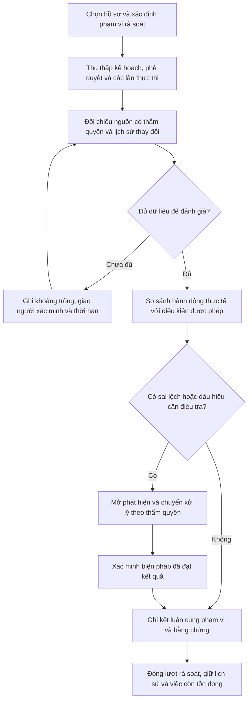

# Administrator action review — Rà soát hành động khôi phục của quản trị viên

## 1. Mục đích của việc rà soát hành động

Trong quy trình khôi phục tài khoản, quản trị viên có thể vô hiệu yếu tố MFA bị mất, khởi tạo một bước đăng ký lại passkey, cho phép đặt lại mật khẩu hoặc thực hiện thay đổi liên quan đến phiên. Những thao tác này giúp người dùng hợp lệ lấy lại quyền truy cập, nhưng cũng có thể trở thành đường chiếm tài khoản nếu bị thực hiện sai hoặc bị lạm dụng.

Administrator action review là hoạt động xem xét các hành động quản trị đã được yêu cầu, được cho phép và thực sự được thực hiện trong một hồ sơ khôi phục. Người rà soát phải đối chiếu chúng với phạm vi quản lý, bằng chứng, chính sách và phê duyệt có hiệu lực tại thời điểm hành động xảy ra.

Trong `SECURITY_AUTHENTICATION_ACCOUNT_RECOVERY`, việc rà soát cần bao quát cả quá trình lấy lại quyền truy cập sau khi mất mật khẩu, MFA, passkey hoặc thiết bị xác thực. Nó không dừng ở câu hỏi “quản trị viên đã bấm nút nào”, mà phải xác định tài khoản nào bị tác động, bí mật hoặc khả năng khôi phục nào được cấp, rủi ro nào còn tồn tại và phiên nào vẫn có thể sử dụng.

Kết quả mong muốn là một kết luận có căn cứ về hành động cụ thể và các điểm chưa thể xác định, kèm biện pháp xử lý có người chịu trách nhiệm. Một bản ghi “đã xem log” không chứng minh hồ sơ đã được rà soát đầy đủ.

## 2. Phân biệt phê duyệt, rà soát và điều tra

Ba hoạt động này liên quan nhưng không thay thế nhau.

| Hoạt động | Câu hỏi chính | Thời điểm điển hình | Giới hạn |
|---|---|---|---|
| Phê duyệt hành động | Kế hoạch này có được phép thực hiện với bằng chứng và điều kiện hiện tại không? | Trước khi thực thi nếu chính sách yêu cầu | Không chứng minh hệ thống đã thực hiện đúng kế hoạch |
| Rà soát hành động | Điều thực sự xảy ra có đúng đối tượng, phạm vi và điều kiện đã được cho phép không? | Trong hoặc sau quá trình xử lý | Không tự chứng minh danh tính người yêu cầu nếu thiếu bằng chứng gốc |
| Điều tra sự cố | Có xâm nhập hoặc lạm dụng không, phạm vi ảnh hưởng là gì và cần xử lý thế nào? | Khi có dấu hiệu hoặc kết luận cần chuyển điều tra | Cần thẩm quyền và phương pháp điều tra phù hợp |

Phê duyệt trước không làm mất nhu cầu rà soát sau. Một kế hoạch đúng vẫn có thể bị thực thi sai vì lỗi chọn tài khoản đích, thay đổi dữ liệu giữa hai thời điểm, quyền được cấp quá rộng hoặc sai sót trong tích hợp với hệ thống xác thực.

Ngược lại, việc một hành động đã được rà soát sau khi xảy ra không làm nó trở thành hợp lệ từ trước. Nếu chính sách bắt buộc phê duyệt trước mà hành động đã thực hiện khi chưa có phê duyệt, kết luận cần ghi nhận đúng sai lệch đó. Không tạo một phê duyệt lùi thời gian để che khoảng trống.

Một cảnh báo bất thường cũng chưa đủ để kết luận quản trị viên có hành vi gian lận. Rà soát cần phân biệt hành động được cho phép, lỗi thao tác, lỗi kiểm soát kỹ thuật, thiếu bằng chứng và dấu hiệu cần điều tra.

## 3. Xác định đơn vị rà soát và người chịu trách nhiệm

### 3.1. Rà soát theo hồ sơ, nhưng không bỏ qua từng lần thực thi

Hồ sơ khôi phục là điểm tập hợp thông tin thuận tiện: tài khoản đích, lý do, bằng chứng, kế hoạch, phê duyệt và kết quả. Tuy nhiên, một hồ sơ có thể có nhiều lần thử, hành động lặp lại hoặc thay đổi kế hoạch.

Vì vậy, người rà soát cần nhìn được cả chuỗi hồ sơ và từng lần thực thi. Ví dụ, ba lần gọi API cấp token không nhất thiết là ba lần cấp thành công; nhưng cũng không thể mặc định rằng chúng chỉ là một lần vì giao diện hiển thị cùng một yêu cầu.

Mỗi lần thực thi nên có định danh ổn định để liên kết với lần thử lại và kết quả thực tế. Nếu một lần thử hết thời gian chờ, cần xác minh tại bên thực thi thay vì tự suy ra rằng thay đổi chưa xảy ra.

### 3.2. Tách người thực hiện và người kết luận khi cần độc lập

Người vận hành có thể bổ sung diễn giải hoặc tài liệu cho hồ sơ của mình. Với hành động cần rà soát độc lập, người đó không nên tự đưa ra kết luận cuối cùng rằng thao tác của chính mình là phù hợp.

Người rà soát cần đủ quyền để xem các bằng chứng liên quan nhưng không nhất thiết cần quyền đổi credential hay tạo phiên cho tài khoản đích. Quyền đọc hồ sơ rà soát và quyền thực thi khôi phục là các quyền riêng.

Nếu người rà soát có xung đột lợi ích, đã trực tiếp tham gia hành động hoặc thiếu phạm vi quản lý đối với tenant liên quan, hồ sơ cần được phân công lại theo chính sách. Có thêm một chữ ký không tự tạo ra tính độc lập nếu cả hai tài khoản đều do cùng một người kiểm soát.

### 3.3. Chỉ định người xử lý phát hiện

Mỗi phát hiện cần có người chịu trách nhiệm, mức ưu tiên, việc cần làm và điều kiện xác minh kết thúc. Không nên đóng rà soát chỉ vì đã gửi một thông báo cho nhóm khác mà chưa xác định ai tiếp nhận và kết quả cần đạt.

## 4. Nguồn dữ liệu để tái dựng hành động

Rà soát đáng tin cậy cần đối chiếu nhiều lớp dữ liệu, không chỉ dựa vào ghi chú tự do của người thực hiện.

| Nguồn | Điều có thể xác nhận | Điều không được tự suy ra |
|---|---|---|
| Hồ sơ yêu cầu | Tài khoản đích, lý do đã khai báo, diễn biến xử lý | Người yêu cầu chắc chắn là chủ tài khoản |
| Kết quả kiểm tra bằng chứng | Bằng chứng nào đã được đánh giá theo chính sách nào | Bằng chứng còn hiệu lực mãi hoặc đủ cho mọi hành động khác |
| Kế hoạch và phê duyệt | Những hành động cụ thể đã được cho phép, phiên bản và thời hạn | Mọi thay đổi thực tế đều nằm trong phê duyệt |
| Sự kiện quyết định chính sách | Người thực hiện được đánh giá quyền như thế nào tại thời điểm kiểm tra | Hành động chắc chắn đã xảy ra thành công |
| Nhật ký của dịch vụ thực thi | Lệnh được nhận, trạng thái xử lý, lỗi và định danh thao tác | Trạng thái ở mọi hệ thống phụ thuộc đã đồng bộ hoàn toàn |
| Trạng thái hoặc lịch sử phía quản lý credential | Yếu tố nào bị vô hiệu, yếu tố nào được đăng ký, phiên nào bị thu hồi | Ai là người đang giữ yếu tố mới nếu không có bằng chứng liên kết |
| Sự kiện sử dụng khả năng khôi phục | Token hoặc quyền giới hạn đã được tiêu thụ cho bước nào | Người sử dụng chắc chắn hợp lệ chỉ vì token đúng |
| Kết quả gửi thông báo | Thông báo được tạo, gửi hoặc được nhà cung cấp chấp nhận | Chủ tài khoản đã đọc, hiểu hoặc đồng ý với thay đổi |

Các nguồn phải được liên kết bằng định danh hồ sơ, tài khoản ổn định, tenant, kế hoạch và lần thực thi. Không chỉ ghép bằng tên hiển thị hoặc địa chỉ email vì các giá trị này có thể thay đổi hoặc trùng nhau trong những phạm vi khác nhau.

Khi tài khoản ứng dụng dùng danh tính từ nhà cung cấp bên ngoài, nhật ký cục bộ có thể chỉ ghi việc gọi API của bên đó. Nếu không có kết quả xác nhận tương ứng, cần ghi rõ giới hạn quan sát thay vì kết luận credential bên ngoài đã đổi đúng.

## 5. Sự kiện kiểm toán cần mô tả điều gì?

Một sự kiện hành động nên phân biệt người khởi xướng, người phê duyệt, dịch vụ thực thi và chủ thể hiệu lực. Nếu dịch vụ chạy bằng tài khoản kỹ thuật, chỉ ghi tên dịch vụ sẽ làm mất dấu người quản trị đã yêu cầu hành động.

Ví dụ sự kiện tối giản:

```json
{
  "eventId": "evt-9851",
  "eventType": "RECOVERY_ACTION_EXECUTED",
  "caseId": "rec-274",
  "caseRevision": 5,
  "executionId": "exec-620",
  "correlationId": "corr-902",
  "tenantId": "tenant-A",
  "targetIdentityId": "identity-482",
  "initiatorIdentityId": "operator-31",
  "executorService": "recovery-executor",
  "approvalId": "approval-77",
  "policyVersion": "recovery-policy-12",
  "action": "INVALIDATE_LOST_FACTOR",
  "targetFactorId": "factor-19",
  "outcome": "CONFIRMED",
  "occurredAt": "2026-11-24T02:10:20Z",
  "recordedAt": "2026-11-24T02:10:21Z"
}
```

Ví dụ này không chứa token, mật khẩu, mã OTP, khóa riêng hoặc bản sao giấy tờ định danh. Các định danh vẫn là dữ liệu cần được bảo vệ theo chính sách truy cập và lưu giữ phù hợp.

`occurredAt` thể hiện thời điểm được nguồn sự kiện báo cáo; `recordedAt` thể hiện thời điểm hệ thống ghi nhận. Sự chậm trễ truyền tải hoặc sai lệch đồng hồ có thể khiến thứ tự nhận khác thứ tự nghiệp vụ. Khi cần quyết định một phê duyệt có tồn tại trước thực thi hay không, nên đối chiếu thêm phiên bản trạng thái và lịch sử có thẩm quyền, không chỉ sắp xếp theo một cột thời gian.

Kết quả cần đủ cụ thể để phân biệt đã yêu cầu, đang xử lý, thành công được xác nhận, thất bại và chưa biết kết quả. Không gom mọi phản hồi không lỗi của giao diện thành “đã khôi phục thành công”.

## 6. Đối chiếu hành động với phạm vi đã được phép

Người rà soát cần kiểm tra sự khớp nhau của đối tượng, hành động và điều kiện, thay vì chỉ tìm một bản phê duyệt có cùng số hồ sơ.

### 6.1. Đúng người thực hiện và miền quản lý

Xác định người khởi xướng có quyền đối với tài khoản đích tại thời điểm hành động hay không. Một quản trị viên hiện đã có quyền không chứng minh họ đã có quyền lúc thực hiện. Tương tự, việc quyền đã bị thu hồi sau đó không tự chứng minh hành động trước đó là trái phép.

Trong hệ thống nhiều tenant, phải đối chiếu miền có thẩm quyền quản lý credential. Quyền quản lý thành viên của tenant A không mặc nhiên cho phép thay đổi một danh tính toàn cục đang dùng ở cả tenant A và tenant B.

### 6.2. Đúng tài khoản, yếu tố và hành động

Nếu kế hoạch duyệt vô hiệu `factor-19`, kết quả vô hiệu `factor-20` là sai lệch ngay cả khi cả hai cùng thuộc một tài khoản. Nếu phê duyệt chỉ cho phép đăng ký lại MFA, việc đổi email khôi phục là một hành động khác cần được đánh giá riêng.

Phải xem cả hành động phụ do hệ thống tự kích hoạt. Một nút hỗ trợ có thể gọi nhiều dịch vụ, làm thay đổi credential, phiên và kênh liên hệ. Phạm vi rà soát nên bao gồm các tác động thực tế đó, không chỉ nhãn trên nút.

### 6.3. Đúng bằng chứng và phê duyệt

Kiểm tra bằng chứng được chấp nhận cho đúng chủ thể, đúng loại yêu cầu và đúng phiên bản kế hoạch. Một bằng chứng đã được dùng để mở hồ sơ chưa chắc đủ để thay đổi kênh khôi phục hoặc tác động tài khoản đặc quyền.

Khi cần phê duyệt độc lập, đối chiếu người duyệt, phạm vi phê duyệt, thời hạn và phiên bản kế hoạch. Phê duyệt đã hết hạn hoặc được cấp cho kế hoạch cũ không nên được coi là cho phép mọi thay đổi sau đó.

### 6.4. Đúng điều kiện thực thi

Xác nhận các điều kiện bắt buộc như xác thực lại quản trị viên, trạng thái hồ sơ, giới hạn rủi ro hoặc thời gian chờ đã được đánh giá đúng lúc. Nếu tài khoản được nâng thành tài khoản đặc quyền sau khi duyệt nhưng trước khi thực thi, hệ thống cần áp dụng chính sách hiện hành tương ứng.

Một kết quả “policy allow” đơn lẻ chưa đủ nếu hành động thực tế dùng đối tượng hoặc tham số khác với đối tượng đã được kiểm tra. Dữ liệu kiểm toán phải cho phép nối quyết định chính sách với đúng lần thực thi.

## 7. Rà soát kết quả khôi phục và quyền truy cập còn lại

Một hành động đúng quy trình vẫn có thể để lại trạng thái cần xử lý. Vì vậy, cần xem kết quả sau can thiệp, đặc biệt với credential và phiên.

Các câu hỏi chính gồm:

- Yếu tố bị mất đã thực sự bị vô hiệu ở nơi có thẩm quyền chưa?
- Khả năng khôi phục được cấp có đúng tài khoản, mục đích, thời hạn và tính dùng một lần không?
- Có thêm một đường đăng nhập cục bộ để vượt qua nhà cung cấp danh tính bên ngoài không?
- Yếu tố mới được đăng ký có gắn với bước khôi phục hợp lệ không?
- Phiên hoặc refresh token thuộc phạm vi cần thu hồi đã bị xử lý đến đâu?
- Phiên khôi phục có bị sử dụng để truy cập dữ liệu hoặc đổi quyền ngoài mục đích không?
- Thông báo bắt buộc có được gửi theo đúng chính sách và có lỗi cần xử lý không?

Không cần sao chép bí mật khôi phục vào hệ thống rà soát để trả lời những câu hỏi này. Có thể dùng định danh token hoặc grant, thông tin mục đích, thời điểm phát hành, hết hạn, tiêu thụ và kết quả xử lý.

Trong hệ thống phân tán, thu hồi có thể mất thời gian lan truyền. Kết luận cần phản ánh khả năng thực tế: đã ghi nhận yêu cầu thu hồi, đã xác nhận tại nguồn có thẩm quyền hoặc còn phần chưa đối chiếu được. Không ghi “mọi phiên đã bị chặn” khi chỉ mới gửi một lệnh thu hồi.

Trạng thái hiện tại chỉ cho biết điều đang tồn tại. Nếu một yếu tố đã được thêm rồi xóa trước lúc rà soát, ảnh chụp hiện tại có thể không cho thấy khoảng thời gian yếu tố đó từng có hiệu lực. Muốn đánh giá giai đoạn đó phải dùng lịch sử sự kiện phù hợp.

## 8. Thiếu log là một kết quả cần xử lý

Không tìm thấy sự kiện thực thi có thể có nhiều nguyên nhân: thao tác chưa xảy ra, log chưa đến, dịch vụ mất kết nối, dữ liệu bị xóa hoặc đường thực thi không phát log. Không nên chọn một cách giải thích thuận tiện rồi đóng hồ sơ.

Cần phân biệt ít nhất các tình huống:

| Tình huống quan sát | Kết luận phù hợp tại thời điểm rà soát | Việc tiếp theo |
|---|---|---|
| Có yêu cầu nhưng chưa có kết quả, vẫn trong khoảng chờ hợp lệ | Đang chờ đối chiếu | Theo dõi đến hạn và hỏi nguồn thực thi |
| Hết hạn đối chiếu nhưng không có bằng chứng đủ | Chưa xác định được kết quả | Mở phát hiện thiếu dấu vết, xác minh trạng thái tại nguồn |
| Nguồn quản lý credential xác nhận thay đổi nhưng thiếu sự kiện kiểm toán bắt buộc | Đã có thay đổi và có sai lệch kiểm soát kiểm toán | Đánh giá tác động, phục hồi khả năng quan sát và chuyển xử lý phù hợp |
| Sự kiện nói thành công nhưng trạng thái nguồn mâu thuẫn | Dữ liệu chưa nhất quán | Đối chiếu phiên bản, độ trễ, lịch sử và lỗi tích hợp |

Về thiết kế, có thể dùng cơ chế ghi bền vững ý định thực thi cùng thay đổi trạng thái nội bộ, sau đó chuyển sự kiện qua outbox. Tuy nhiên, giao dịch cục bộ không tự làm cho lời gọi sang nhà cung cấp danh tính bên ngoài trở thành một giao dịch nguyên tử. Vẫn cần định danh thao tác, xử lý lặp và đối chiếu kết quả bên ngoài.

Rà soát chỉ có thể dựa trên dữ liệu còn tồn tại và có thể tin cậy ở mức nào đó. Log được bảo vệ khỏi sửa đổi giúp tăng độ tin cậy, nhưng không chứng minh rằng mọi hành động đều đã được ghi hoặc nội dung ban đầu luôn đúng.

## 9. Tín hiệu bất thường và cách diễn giải

Một số mẫu hành vi đáng được ưu tiên xem xét:

- Một người vận hành khôi phục nhiều tài khoản trong thời gian ngắn, nhất là nhiều tài khoản đặc quyền.
- Cùng một người yêu cầu xuất hiện trong nhiều hồ sơ với tài khoản đích khác nhau.
- Đổi kênh liên hệ rồi ngay sau đó cấp khả năng khôi phục tới chính kênh mới.
- Hành động nằm ngoài tenant thường được người vận hành quản lý.
- Cặp người đề xuất và phê duyệt lặp lại nhiều bất thường hoặc tự duyệt qua các tài khoản khác nhau.
- Token khôi phục được tiêu thụ nhiều lần, sai mục đích hoặc có nhiều grant còn hoạt động ngoài kế hoạch.
- Sử dụng quyền khẩn cấp nhưng không có sự kiện kích hoạt và diễn giải tương ứng.

Các tín hiệu này giúp sắp xếp ưu tiên, không phải bản án tự động. Khối lượng lớn có thể xuất phát từ một sự cố diện rộng; hoạt động ngoài giờ có thể phù hợp với ca trực. Người rà soát cần xem bối cảnh và đối chiếu bằng chứng.

Ngược lại, không có tín hiệu bất thường cũng không chứng minh hồ sơ hợp lệ. Một hành động duy nhất vào giờ làm việc vẫn có thể gây chiếm tài khoản nếu sai tài khoản đích hoặc bỏ qua bằng chứng.

Ngưỡng phát hiện nên gắn với quy mô, loại tài khoản và đặc điểm vận hành. Không có một con số cố định phù hợp cho mọi tổ chức. Cần theo dõi cảnh báo sai, các trường hợp bị bỏ sót đã được phát hiện và khả năng người vận hành thay đổi hành vi để né quy tắc đơn giản.

## 10. Phân loại kết quả và quản lý phát hiện

Một mô hình kết quả có thể tách việc đánh giá hành động khỏi tiến độ xử lý phát hiện.

### 10.1. Kết luận đối với hành động

| Kết luận | Ý nghĩa |
|---|---|
| Phù hợp với bằng chứng đã đối chiếu | Đủ dữ liệu cần thiết và không tìm thấy sai lệch trong phạm vi rà soát đã nêu |
| Có sai lệch được xác nhận | Đã xác định một điều kiện, phạm vi hoặc kết quả không đúng yêu cầu |
| Chưa đủ dữ liệu để kết luận | Thiếu hoặc mâu thuẫn bằng chứng khiến chưa thể xác nhận |
| Cần chuyển điều tra | Có dấu hiệu cần xử lý theo quy trình điều tra hoặc ứng phó sự cố |

“Phù hợp” phải kèm phạm vi và thời điểm đánh giá. Nó không có nghĩa là người rà soát bảo đảm mọi rủi ro đã biến mất hoặc mọi hành động trong tương lai đều an toàn.

Ngoại lệ được phép cần có căn cứ về người cho phép, điều kiện, thời hạn và biện pháp bù. Một giải thích hợp lý sau sự kiện không tự biến một hành động trái chính sách thành ngoại lệ đã được cho phép.

### 10.2. Tiến độ xử lý phát hiện

Một phát hiện có thể đi qua các trạng thái: mới ghi nhận, đã tiếp nhận, đang khắc phục, chờ xác minh và đã đóng. Kết luận “có sai lệch” vẫn được lưu ngay cả khi biện pháp khắc phục sau đó đã hoàn tất.

Không nên đổi lịch sử thành “không có vấn đề” chỉ vì đã sửa lỗi. Việc giữ nguyên kết luận ban đầu giúp phân tích nguyên nhân, nhận diện tái diễn và đánh giá hiệu quả kiểm soát.

## 11. Khắc phục theo tác động, không theo cảm tính

Khi phát hiện sai lệch, bước đầu là xác định rủi ro hiện tại và thẩm quyền xử lý. Người rà soát có thể đề xuất hoặc chuyển yêu cầu; quyền đọc hồ sơ không tự cho phép họ thay đổi tài khoản.

Ví dụ các hướng xử lý:

| Phát hiện | Hành động cần cân nhắc theo chính sách |
|---|---|
| Grant khôi phục cấp sai người nhận và còn hiệu lực | Vô hiệu grant, xác minh đã bị tiêu thụ chưa, đánh giá thay đổi phát sinh |
| Yếu tố mới được thêm ngoài kế hoạch | Kiểm tra nguồn gốc, giới hạn hoặc vô hiệu khi có thẩm quyền, xác minh lại chủ thể |
| Phiên thuộc phạm vi bắt buộc thu hồi vẫn hoạt động | Thực hiện thu hồi còn thiếu và xác minh mức hiệu lực thực tế |
| Có thay đổi credential nhưng thiếu log bắt buộc | Bảo toàn dữ liệu còn lại, đối chiếu nguồn và xử lý lỗi ghi nhận |
| Quản trị viên vượt tenant hoặc tự duyệt trái quy định | Chuyển điều tra và xem xét giới hạn quyền vận hành theo thẩm quyền |

Không nên tự động khóa hàng loạt tài khoản chỉ vì xuất hiện một tín hiệu thống kê. Biện pháp hạn chế có thể gây gián đoạn lớn và cần tương xứng với chứng cứ, mức tác động và chính sách ứng phó.

Khắc phục credential thường không phải phép đảo ngược đơn giản. Nếu kẻ tấn công đã đọc dữ liệu hoặc tạo một đường truy cập khác, xóa yếu tố vừa thêm không xóa tác động đã xảy ra. Cần xem xét cả khoảng thời gian truy cập, phiên phát sinh và hành động liên quan.

Không khôi phục một credential cũ đã bị coi là mất hoặc bị lộ chỉ để đưa tài khoản về trạng thái trước hành động sai. Một quy trình khôi phục mới có kiểm soát thường cần thiết hơn việc “undo” mù quáng.

## 12. Quy trình rà soát thực hành



Trong thực tế, một lượt rà soát có thể kết thúc với kết luận chưa đủ dữ liệu hoặc đã chuyển điều tra, trong khi phát hiện vẫn mở. Không cần giữ mọi hồ sơ ở cùng một trạng thái chung; điều quan trọng là các phần chưa giải quyết có người sở hữu và không bị biểu diễn thành đã đạt yêu cầu.

Biên bản nên nêu tài khoản đích, các định danh thực thi đã xem, khoảng thời gian, nguồn bằng chứng, chính sách đối chiếu, kết luận, phần chưa xác minh và các phát hiện liên kết. Không sao chép toàn bộ dữ liệu nhạy cảm vào biên bản nếu chỉ cần tham chiếu tới kho bằng chứng được bảo vệ.

## 13. Ví dụ: vượt phạm vi khi hỗ trợ mất MFA

Minh mất điện thoại chứa MFA của tài khoản `identity-482` thuộc tenant A. Kế hoạch phiên bản 5 được phê duyệt cho hai việc: vô hiệu `factor-19` và cấp một grant chỉ cho phép đăng ký lại MFA. Kế hoạch không cho phép đổi email khôi phục.

Khi rà soát, chuyên viên thấy ba nhóm sự kiện:

1. `factor-19` bị vô hiệu đúng tài khoản và đúng lần thực thi được duyệt.
2. Grant đăng ký lại MFA được cấp, tiêu thụ một lần và dẫn tới việc thêm một yếu tố mới.
3. Email khôi phục được đổi sau đó trong cùng hồ sơ nhưng không có kế hoạch mới hoặc căn cứ phê duyệt tương ứng.

Hai nhóm đầu phù hợp với tập hành động được duyệt không làm nhóm thứ ba trở nên hợp lệ. Người rà soát ghi một phát hiện riêng về thay kênh khôi phục ngoài phạm vi và kiểm tra kênh mới đã được sử dụng để phát hành thêm khả năng khôi phục hay chưa.

Giả sử sự kiện gửi thông báo về việc đổi email có trạng thái đã được nhà cung cấp chấp nhận. Điều đó không chứng minh Minh đã đọc hoặc chấp thuận thay đổi. Cũng không thể dùng việc người yêu cầu đọc đúng mã gửi tới email mới để chứng minh họ vốn sở hữu tài khoản.

Nếu người vận hành giải thích rằng Minh yêu cầu thêm qua điện thoại, lời giải thích được lưu làm thông tin bổ sung. Người rà soát vẫn phải đối chiếu chính sách đổi kênh, bằng chứng về chủ thể và thẩm quyền cho hành động đó. Không sửa kế hoạch cũ để làm nó có vẻ đã bao gồm yêu cầu từ đầu.

Sau khi bên có thẩm quyền xử lý kênh mới và các grant liên quan, người xác minh kiểm tra kết quả thực tế rồi đóng phát hiện nếu đã đạt điều kiện. Lịch sử vẫn cho thấy hành động ngoài phạm vi từng xảy ra và đã được khắc phục như thế nào.

## 14. Rà soát có chọn mẫu và theo dõi hiệu quả

Một tổ chức có thể kết hợp rà soát bắt buộc cho hành động tác động cao, rà soát theo tín hiệu rủi ro và chọn mẫu các hồ sơ thông thường. Chính sách cần nêu rõ loại nào phải được kiểm tra toàn bộ và loại nào được chọn mẫu.

Chỉ xem các hồ sơ có cảnh báo sẽ bỏ qua sai lệch chưa có quy tắc phát hiện. Chỉ chọn các hồ sơ đã thành công cũng có thể bỏ qua những lần thử thất bại thể hiện hành vi dò quyền hoặc lạm dụng công cụ hỗ trợ.

Các chỉ số hữu ích gồm tỷ lệ hành động có đủ dấu vết bắt buộc, số phát hiện quá hạn, thời gian từ thực thi đến rà soát, tỷ lệ thiếu dữ liệu đối chiếu và số sai lệch tái diễn theo nguyên nhân. Khi báo cáo tỷ lệ, cần định nghĩa rõ mẫu số là hành động, hồ sơ hay lần thực thi và phạm vi nào đã được quan sát.

Không nên dùng số lượng hồ sơ đóng làm thước đo duy nhất. Nó có thể thúc đẩy kết luận vội khi dữ liệu còn thiếu. Một chương trình rà soát tốt tạo được phát hiện có thể xử lý, làm rõ giới hạn bằng chứng và giúp sửa các điểm yếu lặp lại trong quy trình.

## 15. Những điểm cần ghi nhớ

Rà soát hành động quản trị là đối chiếu điều thực sự xảy ra với điều đã được cho phép, dựa trên bằng chứng có thể liên kết và nguồn có thẩm quyền. Quyền của người thực hiện, bằng chứng về người yêu cầu, phê duyệt kế hoạch và kết quả thực thi phải được xem riêng rồi nối lại thành một chuỗi nhất quán.

Thiếu dữ liệu cần được ghi thành khoảng trống phải xử lý; bất thường cần được xem trong bối cảnh; sai lệch đã xác nhận cần người chịu trách nhiệm và điều kiện xác minh khắc phục. Không yếu tố nào trong số đó nên bị thay thế bằng một ô đánh dấu “đã xem”.

Đối với khôi phục tài khoản, kết luận còn phải xét credential mới, khả năng khôi phục dùng một lần và phiên còn hoạt động. Người dùng đăng nhập lại được là một kết quả chức năng; việc tài khoản đã trở về trạng thái kiểm soát phù hợp cần được chứng minh bằng các thay đổi và bằng chứng tương ứng.
