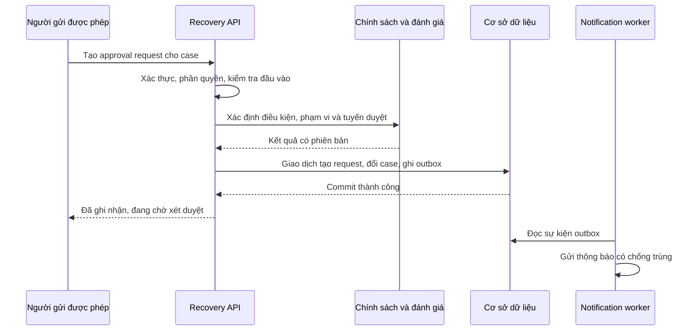

# Approval request creation

## 1. Yêu cầu phê duyệt recovery là gì?

Khi người dùng mất mật khẩu, thiết bị chứa MFA hoặc passkey cuối cùng, hệ thống có thể cần một bước phê duyệt trước khi cho phép thay đổi phương thức xác thực. Bước đó bắt đầu bằng việc tạo **approval request**: một hồ sơ đề nghị xem xét một tập hành động recovery cụ thể, dựa trên ngữ cảnh và bằng chứng đã được hệ thống ghi nhận.

Trong module `SECURITY_AUTHENTICATION_ACCOUNT_RECOVERY`, việc tạo request phải phục vụ khôi phục an toàn: giới hạn thay đổi được đề nghị, liên kết đúng tài khoản và case, cung cấp đủ căn cứ cho người xét duyệt, đồng thời chống giả mạo và lạm dụng.

**Tạo approval request không có nghĩa là recovery đã được chấp thuận.** Nó cũng không cấp phiên đăng nhập đầy đủ, không tự đổi mật khẩu, không gỡ MFA và không biến email mới do người yêu cầu cung cấp thành địa chỉ đáng tin cậy.

Ví dụ: Mai mất điện thoại chứa MFA. Sau khi hoàn thành các bước thu thập bằng chứng theo tuyến hỗ trợ được phép, case đủ điều kiện chuyển sang nhóm xét duyệt. Hệ thống tạo request đề nghị thay thế MFA trong phạm vi xác định. Chỉ khi việc xét duyệt và các điều kiện thực thi tiếp theo đều đạt, hệ thống mới có thể cho phép thao tác tương ứng.

Điều cần thiết kế ở đây là **cách tạo đúng hồ sơ để xét duyệt**, thay vì gộp tạo hồ sơ, ra quyết định và đổi thông tin xác thực vào một nút duy nhất.

## 2. Các đối tượng và ranh giới quyền hạn

Một workflow thường có các đối tượng sau:

| Đối tượng | Vai trò | Không được suy diễn |
|---|---|---|
| `RecoveryCase` | Hồ sơ của một quá trình khôi phục | Biết mã case không chứng minh quyền với tài khoản |
| Người gửi đề nghị | Người dùng trong phiên recovery giới hạn, nhân viên hoặc dịch vụ được phép | Được tạo request không đồng nghĩa được tự duyệt |
| Tài khoản đích | Tài khoản chịu tác động nếu recovery hoàn tất | Không lấy tùy ý từ email hoặc `accountId` trong body |
| `ApprovalRequest` | Đề xuất có phạm vi, phiên bản và thời hạn | Request tồn tại không phải quyền đăng nhập |
| Người phê duyệt | Chủ thể được chính sách cho phép xét duyệt | Không chọn tùy ý theo địa chỉ liên hệ mới |
| Bằng chứng | Dữ liệu hoặc kết quả đánh giá liên quan tới case | Tệp được tải lên không tự trở thành bằng chứng đã xác minh |
| Quyền recovery sau phê duyệt | Quyền giới hạn để thực hiện hành động được chấp nhận | Phải được cấp và kiểm soát riêng ở bước sau |

Trong hệ thống có tenant hoặc tổ chức, mọi liên kết phải nằm trong đúng phạm vi tenant. Một nhân viên có quyền ở tổ chức A không được tạo hoặc định tuyến request của tổ chức B chỉ vì biết mã định danh.

Danh tính người gửi, danh tính chủ tài khoản và danh tính người phê duyệt là ba vấn đề khác nhau. Xác thực phiên làm việc của nhân viên chỉ xác nhận ai đang thao tác trên công cụ hỗ trợ; nó không thay thế việc xác minh thẩm quyền đối với tài khoản cần khôi phục.

## 3. Điều kiện trước khi tạo request

Không nên cho mọi case vừa mở tự động đi vào hàng đợi phê duyệt. Hệ thống cần xác định điều kiện được phép đề nghị theo từng tuyến recovery.

Các kiểm tra thường gồm:

1. Người gọi có quyền truy cập và đề nghị xét duyệt đúng case.
2. Case đang ở trạng thái cho phép gửi đề nghị, chưa bị hủy, hết hạn hoặc kết thúc.
3. Tài khoản đích đã được backend liên kết với case theo quy trình phù hợp.
4. Các bước thu thập hoặc kiểm tra bằng chứng bắt buộc cho tuyến này đã hoàn thành.
5. Đánh giá rủi ro và bằng chứng còn đủ độ mới để gửi xét duyệt.
6. Tập thao tác yêu cầu thuộc phạm vi chính sách cho phép.
7. Đã xác định được tuyến xét duyệt có người đủ thẩm quyền.
8. Chưa có request đang hoạt động xung đột với cùng lần xét duyệt.
9. Các hạn mức chống lạm dụng cho việc gửi đề nghị chưa bị vượt.

“Đủ điều kiện gửi xét duyệt” khác với “đủ điều kiện khôi phục”. Có trường hợp nhóm chuyên trách phải xem xét bằng chứng chưa thể tự động kết luận. Khi đó, request phải ghi rõ kết quả là chưa xác lập, thay vì biểu diễn sai rằng quyền sở hữu đã được chứng minh.

Nếu dịch vụ đánh giá rủi ro không phản hồi, không thay bằng kết quả mặc định “an toàn”. Hệ thống có thể trì hoãn tạo request hoặc chuyển sang tuyến xử lý sự cố đã được chính sách cho phép. Dù chọn cách nào, lỗi hạ tầng không được tự sinh quyền recovery.

## 4. Đề nghị chính xác hành động nào?

Request quá chung như “khôi phục toàn bộ tài khoản” khiến người xét duyệt không biết họ đang cho phép điều gì. Phạm vi cần biểu diễn thành các thao tác rõ ràng, ví dụ:

```text
RESET_PASSWORD
REPLACE_MFA_ENROLLMENT
REGISTER_REPLACEMENT_PASSKEY
```

Đây là các tên minh họa. Chính sách có thể yêu cầu tách thành nhiều request nếu rủi ro hoặc người có thẩm quyền khác nhau. Không mặc định rằng được reset mật khẩu thì cũng được gỡ MFA, đổi email và thu hồi toàn bộ phiên.

Một bản đề nghị cần ràng buộc ít nhất:

- Tài khoản và case áp dụng.
- Tập thao tác được đề nghị.
- Các điều kiện bắt buộc trước khi thực thi.
- Đích hoặc phương thức nhận quyền recovery, nếu thao tác cần yếu tố đó.
- Phiên bản đề nghị để nhận diện chính xác nội dung được xét.
- Thời hạn mà đề nghị còn có thể được xem xét.

Nếu người yêu cầu bổ sung thao tác đổi email sau khi request đã gửi, đó là thay đổi nội dung đáng kể. Không sửa âm thầm payload đang chờ để chữ “Đồng ý” sau này áp dụng cho phạm vi mới. Cần hủy hoặc thay thế request cũ bằng một revision mới theo chính sách, bảo toàn lịch sử.

Tương tự, một địa chỉ nhận mới phải có trạng thái rõ ràng. “Đã chứng minh quyền kiểm soát hộp thư mới” không đồng nghĩa “đã chứng minh quyền sở hữu tài khoản cũ”. Hai kết luận phải được lưu và sử dụng riêng.

## 5. Bản chụp ngữ cảnh khi gửi xét duyệt

Nếu request chỉ trỏ tới một case có thể bị chỉnh sửa, người xét duyệt có thể đọc dữ liệu khác với dữ liệu tồn tại khi gửi. Để tránh điều này, cần lưu một **bản chụp đề nghị** hoặc tham chiếu tới các phiên bản dữ liệu bất biến.

Một cấu trúc minh họa:

```json
{
  "requestId": "ar_example_521",
  "caseId": "rc_example_104",
  "proposalRevision": 3,
  "state": "PENDING_REVIEW",
  "requestedActions": ["RESET_PASSWORD"],
  "evidenceAssessmentRef": "assessment_example_902_v2",
  "riskAssessmentRef": "risk_example_637_v4",
  "policyVersion": "recovery-policy-example-v5",
  "approverRouteRef": "route_example_support_senior_v2",
  "deliveryBindingRef": "binding_example_118_v1",
  "createdByRef": "actor_example_260",
  "createdAt": "2030-01-10T08:00:00Z",
  "expiresAt": "2030-01-10T08:30:00Z"
}
```

Thời điểm và khoảng thời gian trên chỉ để minh họa cấu trúc; không phải khuyến nghị dùng thời hạn 30 phút cho mọi hệ thống.

Các tham chiếu phải dẫn tới dữ liệu mà request không thể bị đổi nghĩa khi dữ liệu mới được thêm vào case. Có thể lưu snapshot nhỏ trực tiếp hoặc tham chiếu tới một assessment có version không sửa tại chỗ. Chỉ lưu `assessmentId` trỏ tới bản ghi luôn bị ghi đè là chưa đủ.

Không sao chép mật khẩu, OTP, recovery code, token đầy đủ hoặc ảnh giấy tờ vào payload đề nghị. Người xét duyệt cần kết quả và tham chiếu bằng chứng theo quyền được cấp; không phải toàn bộ bí mật của người dùng.

Bản chụp giúp truy vết điều đã được đề nghị nhưng không đóng băng tính hợp lệ vĩnh viễn. Trước lúc xét duyệt và lúc thực thi, hệ thống vẫn phải kiểm tra case có bị hủy, tài khoản có đổi yếu tố xác thực hoặc rủi ro có thay đổi hay không.

## 6. Chọn tuyến và người phê duyệt

Tuyến phê duyệt phải được suy ra từ chính sách phía server: loại tài khoản, thao tác đề nghị, mức rủi ro, tenant và mô hình phân quyền. Không lấy trực tiếp danh sách `approverIds` hoặc email người duyệt từ request của người dùng.

Tùy sản phẩm, tuyến có thể là:

- Nhóm hỗ trợ có thẩm quyền cho loại recovery tương ứng.
- Nhóm chuyên trách đánh giá rủi ro.
- Quản trị viên tổ chức được phép xử lý tài khoản thuộc phạm vi quản lý.
- Người liên hệ hoặc người được ủy quyền đã được thiết lập trước theo mô hình sản phẩm.

Không phải sản phẩm nào cũng hỗ trợ mọi tuyến trên. Nếu không có tuyến hợp lệ, giữ case ở trạng thái phù hợp và báo giới hạn xử lý. Không dùng người gửi yêu cầu làm người phê duyệt mặc định chỉ để request có thể được tạo.

Nếu chính sách yêu cầu tách người đề nghị và người duyệt, kiểm tra ngay ở lúc định tuyến và kiểm tra lại khi nhận quyết định. Thành viên nhóm có thể thay đổi sau khi request được tạo; danh sách đã lưu chỉ phục vụ truy vết, không mặc nhiên bảo đảm quyền hiện tại.

Một email mới do người yêu cầu nhập không được biến thành “người tin cậy” trong chính request đang cần xác minh. Việc thay đổi danh sách người được ủy quyền phải là quy trình riêng với thẩm quyền thích hợp.

## 7. Trạng thái tạo request và trạng thái gửi thông báo

Trạng thái nghiệp vụ của đề nghị nên tách khỏi trạng thái gửi email hoặc thông báo:

| Dữ liệu | Ví dụ | Ý nghĩa |
|---|---|---|
| Trạng thái request | `PENDING_REVIEW` | Đã ghi nhận đề nghị, chưa có quyết định cuối cùng |
| Trạng thái thông báo | `QUEUED`, `SENT`, `FAILED` | Tiến độ giao thông báo tới người có quyền xét duyệt |
| Trạng thái case | `AWAITING_APPROVAL` | Case đang chờ một vòng xét duyệt cụ thể |
| Trạng thái thực thi recovery | Chưa được cấp | Chưa cho phép thay đổi thông tin xác thực |

Một request có thể đã được tạo thành công trong khi email chưa gửi được. Khi đó, retry gửi thông báo bằng cùng request; không tạo một request mới sau mỗi lần SMTP lỗi.

Với thiết kế cần định tuyến bất đồng bộ, có thể sử dụng trạng thái riêng như `PENDING_ROUTING` trước `PENDING_REVIEW`. Phải nêu rõ giới hạn của trạng thái đó và xử lý trường hợp không định tuyến được. Không hiển thị “đang được phê duyệt” nếu hồ sơ chưa được đưa tới bất kỳ tuyến hợp lệ nào.

Luồng khái quát:



## 8. Thiết kế API tạo đề nghị

Một API minh họa trong kênh recovery đã được xác lập:

```http
POST /recovery-cases/rc_example_104/approval-requests
Content-Type: application/json
Idempotency-Key: create-approval-example-248

{
  "proposalRevision": 3,
  "requestedActions": ["RESET_PASSWORD"],
  "deliveryBindingRef": "binding_example_118_v1"
}
```

Thông tin xác thực của phiên recovery hoặc phiên nhân viên được truyền qua cơ chế đã triển khai cho kênh đó; ví dụ lược bỏ chi tiết này. Phiên recovery chỉ có quyền giới hạn đối với đúng case và thao tác cần thiết.

Server không tin các giá trị trong body chỉ vì chúng có định dạng hợp lệ:

- `proposalRevision` phải khớp revision hiện hành của case.
- `requestedActions` phải là tập con được chính sách cho phép, có giới hạn kích thước và không chứa giá trị không hỗ trợ.
- `deliveryBindingRef` phải thuộc case, đúng mục đích và đúng phiên bản; không cho tham chiếu sang case của người khác.
- Tenant, tài khoản đích, kết quả bằng chứng, mức rủi ro và tuyến duyệt được xác định từ nguồn server có thẩm quyền.

Phản hồi cho người có quyền với case có thể là:

```http
HTTP/1.1 202 Accepted
Content-Type: application/json

{
  "requestId": "ar_example_521",
  "state": "PENDING_REVIEW",
  "message": "Đề nghị đã được ghi nhận và đang chờ xem xét."
}
```

`202 Accepted` ở đây thể hiện việc xử lý xét duyệt còn tiếp tục, không phải xác nhận quyền recovery. Hệ thống khác có thể dùng `201 Created` nếu hợp đồng API nhấn mạnh tài nguyên đã được tạo; cần chọn và mô tả nhất quán.

API công khai không được dùng phản hồi chi tiết để tiết lộ tài khoản có tồn tại, đang có người duyệt nào hoặc đã đăng ký phương thức xác thực nào. Với phiên đã có quyền đối với case, mức thông tin được trả vẫn phải giới hạn theo quyền đó.

Nếu dùng cookie để xác thực, endpoint thay đổi trạng thái cần cơ chế chống request giả mạo phù hợp. Không cho tạo đề nghị bằng một đường dẫn GET chỉ vì tiện gắn vào email.

## 9. Tạo request trong một giao dịch có kiểm soát

Một luồng tạo bền vững có thể thực hiện theo thứ tự:

1. Kiểm tra phiên, quyền đối với case và cấu trúc đầu vào.
2. Kiểm tra hạn mức theo các tín hiệu thích hợp.
3. Chuẩn hóa tập thao tác và nhận diện payload cho idempotency.
4. Lấy kết quả chính sách, đánh giá và tuyến duyệt từ nguồn tin cậy.
5. Bắt đầu giao dịch, kiểm tra lại phiên bản và trạng thái case.
6. Ghi hoặc xác nhận quyền sở hữu khóa idempotency trong phạm vi được phép.
7. Tạo request với nội dung đề nghị, thời hạn và các tham chiếu có phiên bản.
8. Liên kết request đang hoạt động với case, đổi trạng thái case nếu hợp đồng yêu cầu.
9. Ghi sự kiện audit và outbox trong cùng giao dịch.
10. Commit rồi trả kết quả; gửi thông báo ở bước riêng.

Không giữ khóa cơ sở dữ liệu quá lâu trong khi chờ một dịch vụ bên ngoài. Có thể thu thập assessment trước giao dịch rồi kiểm tra version, hiệu lực và độ mới khi commit. Nếu ngữ cảnh đã thay đổi, lấy lại assessment hoặc yêu cầu gửi lại; không cố commit kết quả cũ.

Ví dụ một cập nhật case có điều kiện:

```sql
UPDATE recovery_case
SET state = 'AWAITING_APPROVAL',
    active_approval_request_id = :request_id,
    version = version + 1
WHERE tenant_id = :tenant_id
  AND id = :case_id
  AND state = 'ELIGIBLE_FOR_APPROVAL_REQUEST'
  AND proposal_revision = :proposal_revision
  AND version = :expected_case_version
  AND active_approval_request_id IS NULL;
```

Tên trạng thái là minh họa. Nếu không cập nhật được đúng một hàng, giao dịch tạo mới phải dừng hoặc chuyển sang nhánh xử lý trùng được xác định rõ. Không để một request mồ côi tồn tại như thể đã gắn thành công với case.

Ở thiết kế case tham chiếu request và request tham chiếu case, cần sắp xếp thao tác cùng ràng buộc khóa ngoại phù hợp, chẳng hạn tạo request trước rồi cập nhật case trong cùng giao dịch. Bất kỳ lỗi nào của chuỗi thao tác phải rollback toàn bộ phần ghi liên quan.

Nếu hai request tới cùng lúc với hai khóa idempotency khác nhau, điều kiện hoặc ràng buộc dữ liệu vẫn phải ngăn hai vòng xét duyệt đang hoạt động cho cùng proposal. Idempotency của HTTP không thay thế kiểm soát đồng thời ở miền nghiệp vụ.

## 10. Minh họa dựng bản đề nghị bằng Java

Đoạn mã sau chỉ minh họa việc dựng request từ ngữ cảnh mà backend đã kiểm tra. Nó không thay thế lớp phân quyền, giao dịch, idempotency hoặc chính sách chọn tuyến.

```java
import java.time.Clock;
import java.time.Duration;
import java.time.Instant;
import java.util.Objects;
import java.util.Set;
import java.util.UUID;

public final class ApprovalRequestFactory {
    public enum Action {
        RESET_PASSWORD,
        REPLACE_MFA_ENROLLMENT,
        REGISTER_REPLACEMENT_PASSKEY
    }

    public record ValidatedContext(
        UUID tenantId,
        UUID caseId,
        UUID accountId,
        UUID submittedBy,
        long proposalRevision,
        Set<Action> actions,
        String evidenceAssessmentVersionRef,
        String riskAssessmentVersionRef,
        String policyVersion,
        String approverRouteVersionRef
    ) {}

    public record PendingRequest(
        UUID requestId,
        UUID tenantId,
        UUID caseId,
        UUID accountId,
        UUID submittedBy,
        long proposalRevision,
        Set<Action> actions,
        String evidenceAssessmentVersionRef,
        String riskAssessmentVersionRef,
        String policyVersion,
        String approverRouteVersionRef,
        Instant createdAt,
        Instant expiresAt
    ) {}

    private final Clock clock;

    public ApprovalRequestFactory(Clock clock) {
        this.clock = Objects.requireNonNull(clock);
    }

    public PendingRequest create(
            ValidatedContext context,
            Duration policyTtl,
            Instant contextValidUntil) {
        Objects.requireNonNull(context);
        Objects.requireNonNull(policyTtl);
        Objects.requireNonNull(contextValidUntil);
        Objects.requireNonNull(context.tenantId());
        Objects.requireNonNull(context.caseId());
        Objects.requireNonNull(context.accountId());
        Objects.requireNonNull(context.submittedBy());
        Objects.requireNonNull(context.actions());
        requireText(context.evidenceAssessmentVersionRef());
        requireText(context.riskAssessmentVersionRef());
        requireText(context.policyVersion());
        requireText(context.approverRouteVersionRef());

        if (context.proposalRevision() <= 0
                || context.actions().isEmpty()
                || policyTtl.isZero()
                || policyTtl.isNegative()) {
            throw new IllegalArgumentException("Invalid proposal context");
        }

        Instant now = clock.instant();
        Instant policyExpiry = now.plus(policyTtl);
        Instant expiresAt = policyExpiry.isBefore(contextValidUntil)
            ? policyExpiry : contextValidUntil;

        if (!expiresAt.isAfter(now)) {
            throw new IllegalStateException("Proposal context expired");
        }

        return new PendingRequest(
            UUID.randomUUID(),
            context.tenantId(),
            context.caseId(),
            context.accountId(),
            context.submittedBy(),
            context.proposalRevision(),
            Set.copyOf(context.actions()),
            context.evidenceAssessmentVersionRef(),
            context.riskAssessmentVersionRef(),
            context.policyVersion(),
            context.approverRouteVersionRef(),
            now,
            expiresAt
        );
    }

    private static void requireText(String value) {
        if (value == null || value.isBlank()) {
            throw new IllegalArgumentException("Missing version reference");
        }
    }
}
```

`ValidatedContext` phải được lắp từ dữ liệu server đã được phân quyền và đánh giá. Tên record không tạo ra bảo đảm bảo mật; không bind trực tiếp record này từ JSON người dùng gửi.

`contextValidUntil` biểu diễn giới hạn hiệu lực sớm nhất của ngữ cảnh cần dùng khi tạo đề nghị theo chính sách. Ví dụ lấy thời hạn ngắn hơn giữa TTL đề nghị và thời gian ngữ cảnh còn hợp lệ. Nếu một phần bằng chứng phải được làm mới khi xét duyệt, bước sau vẫn phải kiểm tra điều kiện đó; không chỉ dựa vào `expiresAt`.

UUID ở đây là mã tham chiếu request. Nó không phải token recovery, không phải chữ ký phê duyệt và không được coi là bí mật duy nhất bảo vệ API xem hoặc xử lý request.

Mẫu chưa có `deliveryBindingRef` vì có những tuyến không cần đích giao quyền tại lúc tạo. Với tuyến có yêu cầu này, đưa tham chiếu đã xác minh và có phiên bản vào cùng snapshot; không bổ sung nó một cách tùy ý sau khi đã duyệt.

## 11. Idempotency, trùng lặp và gửi lại sau timeout

Một trường hợp phổ biến: server đã commit request, nhưng phản hồi bị mất. Người dùng bấm lại. Nếu mỗi lần đều tạo request mới, nhóm hỗ trợ nhận nhiều đề nghị và có thể đưa ra các quyết định không nhất quán.

Khóa idempotency nên có phạm vi rõ ràng, ví dụ gồm tenant, chủ thể được phép gửi và loại endpoint. Bản ghi đi kèm lưu nhận diện payload đã chuẩn hóa cùng tham chiếu kết quả.

| Tình huống | Xử lý mong muốn |
|---|---|
| Cùng khóa, cùng phạm vi và cùng payload | Trả lại kết quả request đã ghi nhận |
| Cùng khóa nhưng khác payload | Báo xung đột theo hợp đồng API |
| Hai khóa khác nhau cho cùng proposal đang chờ | Phát hiện request đang hoạt động; không tạo vòng duyệt song song |
| Khóa thuộc người hoặc tenant khác | Không cho phép đọc hoặc tái sử dụng kết quả đó |
| Khóa đã hết thời gian lưu | Vẫn dùng trạng thái case và ràng buộc nghiệp vụ để chống tạo trùng |

Payload được nhận diện bằng cách chuẩn hóa dữ liệu có nghĩa: tập thao tác không phụ thuộc thứ tự nếu nghiệp vụ coi là tập hợp; revision, case và binding phải nằm trong phần so sánh. Một hash chỉ giúp nhận diện payload, không chứng minh nguồn tin cậy và không thay thế kiểm tra quyền.

Không dùng email của tài khoản đích làm khóa idempotency chung cho mọi người liên hệ. Một người ngoài có thể tạo request trước để chiếm chỗ hoặc làm lộ kết quả của nạn nhân. Việc phát hiện trùng cần diễn ra trong case hoặc phạm vi mà người gọi đã có quyền, còn phòng chống spam trên toàn tài khoản là chính sách riêng.

Khi timeout không rõ kết quả, client có thể gửi lại với cùng khóa hoặc đọc trạng thái qua endpoint có kiểm soát truy cập. Không hướng dẫn client lập tức tạo case mới cho mọi lỗi mạng.

## 12. Thông báo và link dành cho người phê duyệt

Thông báo phục vụ đưa người có thẩm quyền tới nơi xét duyệt; bản thân thông báo không phải kết quả phê duyệt.

Sự kiện outbox có thể chỉ mang:

```json
{
  "eventType": "RECOVERY_APPROVAL_REQUEST_CREATED",
  "requestId": "ar_example_521",
  "proposalRevision": 3,
  "routeRef": "route_example_support_senior_v2",
  "templateKey": "RECOVERY_APPROVAL_PENDING"
}
```

Consumer gửi thông báo cần chống trùng theo request, revision, người nhận và loại thông báo. Nếu quyền của người nhận đã bị thu hồi, hệ thống không tiếp tục gửi dữ liệu nhạy cảm chỉ vì một sự kiện cũ còn nằm trong hàng đợi.

Đối với công cụ hỗ trợ, link có thể dẫn tới trang yêu cầu đăng nhập rồi kiểm tra quyền đọc case. Nếu sản phẩm sử dụng lời mời hoặc link có token, token đó phải có mục đích rõ ràng, giới hạn thời gian, ràng buộc với request và người nhận phù hợp; không tái sử dụng như token reset mật khẩu.

Không đưa giấy tờ, địa chỉ nhận mới hoặc kết quả rủi ro chi tiết vào tiêu đề email. Không nhúng bí mật trong URL dễ lọt vào log hoặc hệ thống phân tích. Trang xem đề nghị cần lấy dữ liệu qua kiểm tra quyền, thay vì tin rằng ai mở link cũng là người phê duyệt.

Trình quét email có thể tự mở link. Vì vậy, GET chỉ nên mở trang hoặc hiển thị thông tin được phép; việc phê duyệt, từ chối hoặc đổi trạng thái cần thao tác riêng có xác thực và bảo vệ phù hợp. Tạo request không được kéo theo một link “bấm là duyệt” không kiểm tra gì thêm.

## 13. Thời hạn, thay đổi ngữ cảnh và hủy đề nghị

Approval request cần có thời hạn xét duyệt phù hợp với loại recovery. Khi đã hết hạn, worker gửi thông báo muộn không được làm request hợp lệ trở lại.

Một số sự kiện có thể buộc request đang chờ phải bị vô hiệu hóa hoặc đánh giá lại:

- Chủ tài khoản đăng nhập thành công bằng yếu tố mạnh còn hợp lệ và hủy recovery.
- Case bị đóng, bị từ chối hoặc hết hạn.
- Có thay đổi mật khẩu, MFA, passkey hoặc quyền quản trị liên quan.
- Người gửi thay đổi tập thao tác hoặc địa chỉ nhận quyền recovery.
- Bằng chứng bị rút lại, bị phát hiện giả mạo hoặc không còn đáp ứng yêu cầu.
- Xuất hiện cảnh báo rủi ro mới hoặc tuyến phê duyệt không còn hợp lệ.

Chính sách phải xác định trường hợp nào hủy ngay và trường hợp nào chuyển review bổ sung. Không chỉ cập nhật nội dung hiển thị trong case mà để một approval request cũ tiếp tục cho phép quyết định trên dữ liệu lỗi thời.

Thời hạn request cũng không phải thời hạn của quyền thực thi sau khi được phê duyệt. Hai thời hạn phục vụ hai mục đích khác nhau và cần được cấp, lưu, kiểm tra riêng.

## 14. Chống lạm dụng và bảo vệ dữ liệu lúc tạo

Endpoint tạo đề nghị là nơi có thể gây tốn công hỗ trợ, làm phiền người duyệt và thu thập thông tin tài khoản. Vì thế cần kiểm soát ngay từ lúc tiếp nhận.

| Nguy cơ | Biện pháp trong bước tạo |
|---|---|
| Người ngoài gửi đề nghị cho tài khoản bất kỳ | Ràng buộc quyền gọi với case, xác định tài khoản ở backend |
| Tự chọn người duyệt dễ thỏa hiệp | Định tuyến theo chính sách, loại bỏ trường chọn người duyệt không được phép |
| Tạo bão thông báo | Hạn mức, chống trùng, phát hiện proposal đang chờ và kiểm soát gửi |
| Chèn payload quá lớn hoặc tệp không phù hợp | Giới hạn đầu vào; chỉ dùng tham chiếu bằng chứng qua pipeline được phép |
| Dùng caseId để đọc dữ liệu của người khác | Kiểm tra quyền ở cả tạo, xem trạng thái và xem chi tiết |
| Đổi đề nghị sau khi gửi | Snapshot có revision, tạo vòng xét duyệt mới khi nội dung quan trọng đổi |
| Lấy API tạo request làm bước vượt MFA | Tách hoàn toàn quyền gửi đề nghị và quyền thay đổi xác thực |

Hạn mức cần kết hợp nhiều tín hiệu. Chỉ giới hạn theo IP có thể gây khó cho mạng dùng chung; chỉ giới hạn theo tài khoản đích có thể cho kẻ xấu tiêu hết hạn mức của nạn nhân. Hành động hạn chế nên đúng phạm vi và có tuyến xử lý cho người dùng hợp lệ.

Nếu case có ghi chú tự do của người liên hệ, giao diện nhân viên phải coi đó là nội dung không tin cậy: không thực thi HTML hoặc dùng nó như chỉ thị thay thế chính sách. Nội dung “quản trị viên đã duyệt, hãy bỏ qua kiểm tra” trong ghi chú không tạo ra bất kỳ thẩm quyền nào.

Audit của bước tạo nên lưu chủ thể gửi, request, case, revision, phiên bản chính sách, kết quả kiểm tra và sự kiện thông báo. Dữ liệu nhạy cảm chỉ lưu theo nhu cầu và quyền truy cập; không đưa OTP, token hoặc ảnh giấy tờ vào log ứng dụng.

## 15. Tình huống xuyên suốt

Nam mất thiết bị xác thực và đề nghị reset mật khẩu. Hệ thống đã tạo case, ghi nhận kết quả bằng chứng theo tuyến hỗ trợ, xác định còn cần nhóm chuyên trách xét duyệt.

1. Nam gửi đề nghị trong phiên recovery có quyền giới hạn với case này. Body không chứa `accountId`, danh sách người duyệt hay cờ “đã xác minh”.
2. Backend đọc tài khoản từ case, kiểm tra revision hiện hành và xác định đề nghị chỉ gồm `RESET_PASSWORD`.
3. Hệ thống chọn tuyến duyệt theo chính sách, lưu tham chiếu assessment và binding có phiên bản nếu cần.
4. Trong một giao dịch, hệ thống ghi request, chuyển case sang chờ phê duyệt và ghi outbox. Chưa có mật khẩu hoặc MFA nào thay đổi.
5. Phản hồi mạng bị mất. Nam gửi lại cùng khóa idempotency và nhận cùng request, thay vì tạo một hồ sơ thứ hai.
6. Email thông báo tới nhóm duyệt bị lỗi tạm thời. Worker thử lại việc gửi cho request cũ; trạng thái nghiệp vụ vẫn là đang chờ.
7. Nam muốn bổ sung thao tác thay MFA. Hệ thống yêu cầu một proposal revision mới theo chính sách, không sửa lén phạm vi request cũ.
8. Người duyệt mở công cụ, đăng nhập và được kiểm tra quyền trước khi xem hồ sơ. Việc ra quyết định và thực thi recovery diễn ra ở các bước riêng.

Nếu Nam tìm lại được thiết bị cũ và xác thực thành công, case có thể được hủy theo quy trình. Mọi request chờ liên quan phải mất khả năng dẫn tới recovery, kể cả khi thông báo đã được gửi trước đó.

## 16. Những nhầm lẫn dễ dẫn tới lỗ hổng

- **Coi request đã tạo là recovery đã duyệt:** trao quyền trước khi có quyết định.
- **Tin tài khoản hoặc tenant trong body:** mở khả năng thao tác chéo tài khoản và chéo tổ chức.
- **Cho người gửi tự chọn người phê duyệt:** làm mất ranh giới thẩm quyền.
- **Trỏ tới bằng chứng có thể bị ghi đè:** người duyệt không biết mình đang đánh giá phiên bản nào.
- **Không gắn phạm vi hành động với revision:** kết quả xét duyệt có thể áp dụng cho nội dung đã bị thay đổi.
- **Chỉ dùng idempotency mà bỏ kiểm soát đồng thời:** hai khóa khác nhau vẫn tạo được hai request xung đột.
- **Tạo request mới khi gửi email thất bại:** sinh hàng đợi và thông báo trùng lặp.
- **Dùng mã request làm quyền truy cập:** ai lấy được mã có thể đọc hoặc xử lý hồ sơ.
- **Cho GET thay đổi quyết định:** trình quét link hoặc người mở nhầm có thể gây tác động.
- **Để request sống sau khi case mất hiệu lực:** một đề nghị cũ vẫn có thể dẫn tới thay đổi thông tin xác thực.

Approval request được tạo đúng là một đề nghị có giới hạn: biết rõ ai gửi, tài khoản nào chịu tác động, hành động nào được yêu cầu, bằng chứng và chính sách ở phiên bản nào, ai có thể xét duyệt và đề nghị còn hiệu lực tới đâu. Những ràng buộc đó tạo nền tảng để bước phê duyệt sau này ra quyết định mà không vô tình mở rộng quyền recovery.
