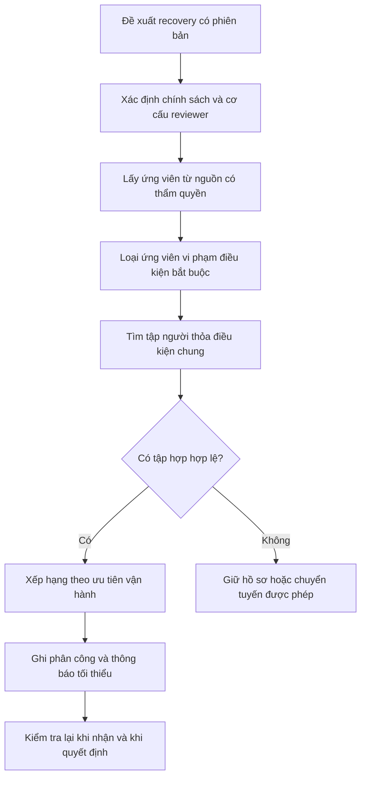

# Approval reviewer selection

## 1. Chọn người duyệt là một quyết định bảo mật

Trong account recovery, người duyệt có thể quyết định cho phép một người lấy lại quyền truy cập khi đã mất mật khẩu, MFA, passkey hoặc thiết bị xác thực. Nếu hệ thống giao hồ sơ cho sai người, một quy trình thu thập bằng chứng tốt vẫn có thể kết thúc bằng việc cấp quyền truy cập cho kẻ tấn công.

**Approval reviewer selection** là quá trình xác định ai đủ điều kiện được xem và đưa ra quyết định trên một đề xuất recovery cụ thể. Quá trình này cần xét quyền hiện tại, phạm vi tổ chức, năng lực, tính độc lập và xung đột lợi ích. Nó không chỉ là tìm một tài khoản đang có trạng thái trực tuyến hoặc có role chứa chữ `approver`.

Một lựa chọn hợp lệ phải giải quyết được ba câu hỏi:

1. Người này có thẩm quyền duyệt loại recovery đang được đề xuất không?
2. Người này có độc lập với các bên và các bước mà chính sách yêu cầu tách biệt không?
3. Người này có thể thực hiện việc duyệt trong điều kiện an toàn và đúng phạm vi dữ liệu không?

Mục tiêu của việc chọn reviewer không phải bảo đảm luôn có một người bấm đồng ý. Mục tiêu là tìm một tập người đủ điều kiện để đưa ra quyết định có trách nhiệm; nếu không tìm được, hồ sơ phải được giữ lại hoặc chuyển theo một đường xử lý được cho phép.

## 2. Tách lựa chọn reviewer khỏi các bước khác

Một quy trình có thể gồm thu thập bằng chứng, đánh giá rủi ro, tạo đề xuất, chọn người duyệt, ghi nhận quyết định và thực thi thay đổi. Các bước có liên quan nhưng không đồng nghĩa với nhau.

| Bước | Câu hỏi chính | Điều không được suy diễn |
|---|---|---|
| Xác minh danh tính người yêu cầu | Người yêu cầu có đủ bằng chứng để recovery không? | Người cung cấp bằng chứng được tự chọn người phê duyệt |
| Tạo đề xuất | Thay đổi nào sẽ được thực hiện trên tài khoản đích? | Người tạo đề xuất tự có quyền duyệt |
| Chọn reviewer | Ai đủ điều kiện xem và quyết định trên đề xuất này? | Được giao hồ sơ đồng nghĩa với đã chấp thuận |
| Quyết định | Reviewer chấp thuận, từ chối hay yêu cầu bổ sung gì? | Một quyết định áp dụng cho mọi thay đổi sau này |
| Thực thi | Có được thực hiện đúng thay đổi đã duyệt ở thời điểm hiện tại không? | Phê duyệt cũ bỏ qua kiểm tra quyền và trạng thái mới |

Ví dụ, một nhân viên hỗ trợ kiểm tra bằng chứng và đề xuất cho người dùng đăng ký lại MFA. Người đó có thể được quyền tạo đề xuất nhưng bị loại khỏi tập reviewer để bảo đảm kiểm tra độc lập. Khi reviewer được chọn, máy chủ mới cấp quyền truy cập hồ sơ ở mức cần thiết; lựa chọn này chưa tạo ra bất kỳ token recovery nào.

Phê duyệt nội bộ cũng không thay thế bằng chứng danh tính. Hai nhân viên đồng ý rằng khách hàng có vẻ đáng tin vẫn không đủ nếu chính sách yêu cầu những bằng chứng cụ thể mà hồ sơ còn thiếu.

## 3. Đầu vào cần có trước khi chọn người duyệt

Chọn reviewer cần dựa trên một đề xuất đủ rõ. Nếu chưa biết sẽ thay đổi điều gì, hệ thống không thể xác định thẩm quyền cần thiết.

Một ngữ cảnh lựa chọn có thể gồm:

```text
caseId
tenantId
targetAccountId
targetAccountSensitivity
requesterIdentityReference
initiatorPersonId
evidenceCollectorPersonIds
proposedAction
proposalDigest
proposalVersion
riskClassification
policyVersion
```

`proposedAction` cần diễn đạt hành động cụ thể, chẳng hạn cho phép đăng ký lại yếu tố xác thực, thay đổi kênh nhận thông báo hoặc áp dụng ngoại lệ cho một quy trình proofing. Những hành động này có thể yêu cầu các tập reviewer khác nhau dù cùng nằm trong một hồ sơ.

`proposalDigest` tham chiếu nội dung đề xuất đã được chuẩn hóa. Nó giúp liên kết lựa chọn, phân công và quyết định với đúng nội dung. Digest không chứng minh nội dung đúng; hệ thống vẫn phải kiểm tra dữ liệu và cho reviewer xem nội dung dễ hiểu.

Phân loại rủi ro phải được xác định từ quy tắc và dữ liệu đáng tin cậy phía máy chủ. Không để người yêu cầu hoặc người khởi tạo tự gắn nhãn `lowRisk` nhằm đi vào nhóm reviewer có ít kiểm soát hơn. Nếu một trường bắt buộc còn thiếu hoặc mâu thuẫn, hồ sơ cần được làm rõ trước khi phân công duyệt.

## 4. Lấy danh sách ứng viên từ nguồn có thẩm quyền

Danh sách reviewer phải đến từ hệ thống phân quyền, danh bạ tổ chức hoặc sổ đăng ký reviewer do tổ chức quản lý. Những nguồn này cần thể hiện ai đang hoạt động, thuộc tenant hoặc đơn vị nào, có năng lực duyệt loại hành động nào và quyền có thời hạn hay không.

Không lấy địa chỉ email do khách hàng cung cấp rồi coi chủ địa chỉ đó là reviewer chỉ vì khách hàng nói “đây là quản lý của tôi”. Thông tin như vậy có thể là một đầu mối để kiểm tra qua kênh độc lập, không phải bằng chứng về thẩm quyền.

Tương tự, một tham số request như `reviewerId=...` chỉ là dữ liệu được đề xuất. Máy chủ phải tự xác minh người được nêu có đủ điều kiện. Một giao diện cho phép nhân viên chọn từ danh sách không cho phép backend bỏ qua kiểm tra.

Các thuộc tính quan trọng của ứng viên có thể gồm:

- Định danh nhân viên và định danh con người dùng cho kiểm tra độc lập.
- Trạng thái tài khoản, trạng thái nhân sự và thời hạn ủy quyền.
- Các tenant, nhóm tài khoản và loại thao tác được phép duyệt.
- Năng lực hoặc đào tạo bắt buộc theo chính sách nội bộ.
- Đơn vị hoặc chức năng phục vụ quy tắc tách biệt.
- Các xung đột đã khai báo và các vai trò đã tham gia trong hồ sơ.
- Trạng thái an toàn như bị đình chỉ quyền hoặc đang cần kiểm tra sau sự cố.
- Lịch trực, khả năng tiếp nhận và tải công việc.

Các thuộc tính cuối giúp điều phối nhưng không thể bù cho việc thiếu quyền ở các thuộc tính đầu. Người rảnh nhất không trở thành người đủ điều kiện chỉ vì hàng đợi đang dài.

## 5. Dùng điều kiện bắt buộc trước, ưu tiên vận hành sau

Một thiết kế dễ kiểm soát tách **hard constraints** và **soft preferences**.

Hard constraints là những điều kiện không được vi phạm, ví dụ đúng tenant, có quyền cho hành động, không tự duyệt hoặc đủ số người độc lập. Soft preferences là những ưu tiên trong tập hợp đã hợp lệ, ví dụ chia đều tải, phù hợp múi giờ, cùng ngôn ngữ làm việc hoặc có kinh nghiệm với loại tài khoản.

| Loại điều kiện | Ví dụ | Khi không thỏa mãn |
|---|---|---|
| Quyền | Có quyền duyệt thay thế MFA cho nhóm tài khoản đích | Loại khỏi ứng viên |
| Phạm vi | Đúng tenant hoặc có ủy quyền xuyên tenant rõ ràng | Loại khỏi ứng viên |
| Trạng thái | Tài khoản hoạt động, quyền chưa hết hạn | Loại hoặc tạm ngừng tham gia |
| Độc lập | Không phải người tạo đề xuất khi chính sách yêu cầu | Loại khỏi vai trò reviewer tương ứng |
| Cơ cấu tập người duyệt | Có đại diện từ hai chức năng độc lập | Không chọn một tập thiếu cơ cấu |
| Điều phối | Ít hồ sơ đang xử lý, đang trong ca | Dùng để xếp hạng tập hợp hợp lệ |

Không nên gom mọi điều kiện thành một điểm số chung. Nếu có quyền sai tenant nhưng điểm kinh nghiệm rất cao, người đó vẫn không hợp lệ. Cộng nhiều điểm tốt không thể bù cho một điều kiện bắt buộc bị vi phạm.

Quy tắc cũng cần phân biệt “không đạt” và “chưa biết”. Khi không xác minh được một điều kiện bắt buộc, không tự coi nó là đạt. Ví dụ, dịch vụ phân quyền đang lỗi không phải lý do để lấy role đã lưu lâu từ trước rồi tiếp tục phê duyệt nhạy cảm.

## 6. Kiểm tra độc lập theo con người và theo vai trò

### 6.1. Một người có thể có nhiều tài khoản

Nếu chính sách yêu cầu hai người duyệt độc lập, đếm hai `userId` là chưa đủ. Cùng một người có thể sở hữu tài khoản hỗ trợ và tài khoản quản trị. Hệ thống cần định danh con người hoặc một cơ chế đối chiếu do tổ chức quản lý để tránh đếm hai lần.

Không suy luận cùng người chỉ từ tên hiển thị giống nhau; cũng không suy luận khác người chỉ từ email khác nhau. Kiểm tra độc lập phải dựa trên dữ liệu định danh phù hợp và có quy trình xử lý những trường hợp chưa rõ.

Tài khoản dùng chung làm mất khả năng xác định ai chịu trách nhiệm và không phù hợp để chứng minh hai quyết định độc lập. Một tài khoản dịch vụ thực hiện kiểm tra tự động cũng không được tính thành một người duyệt thứ hai nếu chính sách yêu cầu quyết định của hai con người.

### 6.2. Những quan hệ cần xem xét

Tùy mức rủi ro, chính sách có thể loại hoặc giới hạn:

- Chính chủ tài khoản đích đang yêu cầu recovery.
- Người tạo đề xuất hoặc người sẽ thực thi thay đổi.
- Người thu thập bằng chứng nếu cần tách bước thu thập và đánh giá.
- Người đã tham gia một bước mà chính sách yêu cầu kiểm tra độc lập.
- Người có xung đột lợi ích được xác định với hồ sơ hoặc tài khoản đích.
- Người đang bị điều tra hoặc bị giới hạn thẩm quyền liên quan.

Không phải tổ chức nào cũng cần tách tất cả các vai trò này trong mọi hồ sơ. Điều cần thiết là quy tắc phải rõ cho từng mức rủi ro, được máy chủ thực thi và không bị thay đổi tùy tiện bởi người muốn hồ sơ được duyệt nhanh hơn.

### 6.3. Độc lập về chức năng

Với tài khoản đặc quyền, chỉ có hai người khác nhau đôi khi vẫn chưa đáp ứng mục tiêu kiểm soát. Chính sách có thể yêu cầu một người từ nhóm vận hành và một người từ nhóm an ninh, hoặc người thứ hai thuộc một tuyến kiểm soát độc lập.

Đây là yêu cầu đối với **cả tập người duyệt**, không chỉ đối với từng người. Hai ứng viên đều hợp lệ cá nhân nhưng cùng một chức năng có thể tạo thành một tập không hợp lệ.

Quy tắc tách chức năng làm tăng khả năng phát hiện sai sót hoặc lạm dụng, nhưng không chứng minh không có thông đồng. Nó cần đi cùng bằng chứng, audit và giám sát các mẫu quyết định bất thường.

## 7. Xây dựng chính sách theo mức rủi ro

Một chính sách minh họa có thể được biểu diễn như sau:

| Ngữ cảnh | Tập người duyệt minh họa | Ràng buộc bổ sung |
|---|---|---|
| Recovery hành chính trong phạm vi thông thường | Một reviewer có quyền phù hợp | Không tự duyệt đề xuất của mình |
| Mất nhiều yếu tố và cần ngoại lệ | Hai người độc lập | Ít nhất một người có thẩm quyền ngoại lệ |
| Tài khoản có quyền quản trị quan trọng | Hai người thuộc hai chức năng được chỉ định | Không có người là chủ tài khoản đích |
| Hồ sơ có dấu hiệu chiếm đoạt | Tạm giữ và chuyển nhóm xử lý rủi ro | Không dùng phê duyệt để bỏ qua cảnh báo chưa giải quyết |

Đây là ví dụ để thể hiện cách mô hình hóa, không phải mức quorum mặc định cho mọi hệ thống. Số lượng reviewer và điều kiện cụ thể cần tương ứng với chính sách recovery, khả năng vận hành và tác động nếu quyết định sai.

Một chính sách cần mô tả cả hành động khi không đủ người. Chỉ ghi “cần hai người” nhưng cho phép nút “duyệt khẩn” không có giới hạn sẽ làm yêu cầu đó mất ý nghĩa.

Các phiên bản chính sách giúp giải thích vì sao hồ sơ được phân công theo một tập điều kiện tại một thời điểm. Tuy nhiên, lưu phiên bản cũ không cho phép giữ quyền đã bị thu hồi. Cần quy tắc riêng để xác định thay đổi nào làm hết hiệu lực phân công hoặc buộc đánh giá lại phê duyệt.

## 8. Quy trình lựa chọn có thể giải thích được

Một luồng lựa chọn phù hợp thường gồm các bước sau:



Ở bước lấy ứng viên, phạm vi truy vấn nên được thu hẹp theo tenant và quyền cần thiết. Điều này giảm dữ liệu không liên quan và tránh một bộ lọc bị bỏ sót làm lộ hồ sơ cho toàn bộ nhân viên.

Ở bước loại ứng viên, hệ thống nên lưu mã lý do có cấu trúc cho audit nội bộ, chẳng hạn sai phạm vi, hết quyền hoặc xung đột vai trò. Người yêu cầu recovery không cần được biết chi tiết ai bị loại và vì sao.

Ở bước chọn tập hợp, cần kiểm tra đầy đủ ràng buộc chung. Một thuật toán tham lam luôn lấy người ít việc nhất trước có thể chọn một người chiếm vai trò khiến không còn cách hoàn thành cơ cấu, dù tồn tại một tập hợp khác hợp lệ. Với tập nhỏ, có thể tìm các tổ hợp phù hợp; với tập lớn, có thể dùng một phương pháp giải ràng buộc phù hợp với hệ thống.

Nếu dùng lựa chọn ngẫu nhiên để phân tán phân công, chỉ ngẫu nhiên trong các tập hợp đã hợp lệ. Ngẫu nhiên không thay quyền, không giải quyết xung đột lợi ích và không bảo đảm không có thông đồng. Nếu mục tiêu là hạn chế đoán trước reviewer, cơ chế ngẫu nhiên và thông tin được công bố cần được thiết kế tương ứng.

## 9. Ví dụ: đủ số tài khoản nhưng chưa đủ người độc lập

Giả sử một hồ sơ thay thế MFA cho tài khoản đặc quyền yêu cầu hai reviewer: một thuộc chức năng vận hành và một thuộc chức năng an ninh. Hai reviewer phải là hai người khác nhau, không phải người tạo đề xuất, và đều có quyền trên tenant hiện tại.

| Ứng viên | Con người | Chức năng | Quyền và phạm vi | Quan hệ với hồ sơ | Kết quả |
|---|---|---|---|---|---|
| R1 | P1 | Vận hành | Phù hợp | Là người tạo đề xuất | Loại do tự duyệt |
| R2 | P2 | Vận hành | Phù hợp | Không có xung đột đã xác định | Hợp lệ |
| R3 | P3 | An ninh | Chỉ có quyền ở tenant khác | Không có xung đột đã xác định | Loại do phạm vi |
| R4 | P4 | An ninh | Phù hợp | Không có xung đột đã xác định | Hợp lệ |
| R5 | P2 | An ninh | Phù hợp | Tài khoản thứ hai của P2 | Hợp lệ cá nhân, không ghép với R2 |
| R6 | P6 | An ninh | Quyền đã hết hạn | Không có xung đột đã xác định | Loại do hết quyền |

Tập `{R2, R4}` đáp ứng cả cơ cấu chức năng và yêu cầu hai người. Tập `{R2, R5}` có hai tài khoản và hai nhãn chức năng nhưng chỉ có một người, nên phải bị từ chối.

Nếu R4 không nhận việc và chỉ còn R2, R5 có thể tiếp nhận, hệ thống vẫn không có tập hợp hợp lệ. Không được hạ yêu cầu độc lập chỉ vì đang thiếu nhân sự. Hồ sơ cần chờ, tìm ứng viên khác từ nguồn có thẩm quyền hoặc chuyển theo một quy trình ngoại lệ riêng đã được cho phép.

## 10. Pseudocode cho lựa chọn và ghi phân công

Pseudocode sau mô tả ranh giới kiểm soát; các repository, kiểu dữ liệu và transaction là minh họa, không phải thư viện cụ thể:

```java
SelectionResult assignReviewers(CaseId caseId, AuthenticatedActor actor) {
    return transaction.run(() -> {
        RecoveryProposal proposal = proposals.lockCurrent(caseId);
        permissions.requireCanRequestReview(actor, proposal);
        require(proposal.isReadyForReview());

        ReviewPolicy policy = policies.resolveFor(proposal);
        DirectorySnapshot directory = reviewers.loadAuthoritativeCandidates(
            proposal.tenantId(), policy.requiredCapabilities());
        require(directory.isUsableForSecurityDecision());

        List<Candidate> eligible = directory.candidates().stream()
            .filter(c -> c.isActive())
            .filter(c -> c.hasRequiredScope(proposal, policy))
            .filter(c -> c.hasRequiredCapabilities(policy))
            .filter(c -> !conflicts.hasDisqualifyingConflict(c, proposal, policy))
            .toList();

        // Tìm tập hợp theo mọi ràng buộc chung, không chỉ lấy N người đầu.
        List<ReviewerSet> feasible = constraints.findValidSets(
            eligible, proposal, policy);

        if (feasible.isEmpty()) {
            selectionEvents.recordNoEligibleSet(proposal, policy);
            return SelectionResult.waitingForEligibleReviewers();
        }

        ReviewerSet chosen = ranking.choose(feasible, workload.currentView());
        AssignmentSet assignments = assignmentFactory.bind(
            chosen,
            proposal.id(),
            proposal.version(),
            proposal.digest(),
            policy.version());

        // Ràng buộc duy nhất ngăn tạo hai bộ phân công đang hoạt động
        // cho cùng đề xuất và cùng vòng duyệt khi request bị gửi lặp.
        assignmentsRepository.insertForCurrentRound(assignments);
        outbox.recordAssignmentsAndNotifications(assignments);
        return SelectionResult.assigned(assignments.publicReference());
    });
}
```

Transaction trên minh họa việc phối hợp trạng thái hồ sơ và phân công, không có nghĩa mọi nguồn danh bạ hoặc dịch vụ phân quyền đều nằm trong cùng một transaction cơ sở dữ liệu. Khi các nguồn nằm ở dịch vụ khác, cần xác định thời hạn dữ liệu, phiên bản và cách xử lý thay đổi đồng thời.

Một kiểm tra được thực hiện lúc chọn không đủ để cấp quyền trong toàn bộ vòng đời. Reviewer phải được kiểm tra lại khi nhận việc và khi ghi quyết định. Nếu quyền bị thu hồi giữa lúc đọc và lúc ghi, cơ chế cập nhật có điều kiện, phiên bản quyền hoặc ranh giới ủy quyền tương đương phải ngăn quyết định không còn hợp lệ được chấp nhận.

Khóa hồ sơ cũng không tự ngăn hai tài khoản của cùng một người tạo hai quyết định. Kho quyết định cần bảo đảm tính duy nhất theo con người, đề xuất và vòng duyệt tại nơi thực sự ghi nhận quyết định.

## 11. Phân công, tiếp nhận và quyết định là các trạng thái khác nhau

Phân công có thể bắt đầu ở trạng thái chờ nhận, sau đó được nhận, hoàn thành, từ chối tiếp nhận, hết hạn hoặc bị thu hồi. Một reviewer không được tự đổi đề xuất hay chuyển quyền duyệt sang người khác bằng cách gửi tiếp email.

Khi reviewer mở hồ sơ từ thông báo, máy chủ cần kiểm tra:

1. Phiên hiện tại là của đúng người và đáp ứng yêu cầu an toàn.
2. Phân công còn hiệu lực, đúng tenant, hồ sơ và vòng duyệt.
3. Người đó vẫn có quyền và không xuất hiện xung đột loại trừ.
4. Nội dung đề xuất vẫn đúng phiên bản được phân công.
5. Quyền xem bằng chứng được giới hạn theo nhu cầu của vai trò này.

Một liên kết trong email chỉ nên điều hướng tới ứng dụng. Nếu hệ thống dùng token để truy cập một bước cụ thể, token đó phải có phạm vi và thời hạn phù hợp; việc sở hữu liên kết không tự biến một người thành reviewer có thẩm quyền. Không thiết kế nút duyệt thực hiện thay đổi trạng thái qua một request GET đơn giản.

Nếu reviewer phát hiện xung đột mà dữ liệu tổ chức chưa phản ánh, họ cần có đường từ chối tiếp nhận hoặc khai báo xung đột. Trạng thái này không phải là “từ chối recovery vì khách hàng không đủ bằng chứng”; hai lý do có ý nghĩa khác nhau và cần được ghi nhận riêng.

## 12. Quorum phải gắn với đúng đề xuất và đúng tập điều kiện

Quorum là điều kiện tổng hợp các quyết định cần có trước khi đề xuất được coi là đủ phê duyệt. Nó không nên chỉ là `approvalCount >= 2`.

Một phép đánh giá quorum có thể cần đồng thời xác nhận:

- Mọi quyết định được tính đều thuộc đề xuất, digest và vòng duyệt hiện tại.
- Những người được tính là các con người khác nhau theo quy tắc độc lập.
- Có đủ các chức năng hoặc năng lực bắt buộc.
- Các quyết định còn hiệu lực theo thời hạn và chính sách thay đổi.
- Không có quyết định phủ quyết hoặc trạng thái tạm giữ mà chính sách yêu cầu xử lý.
- Người duyệt có thẩm quyền tại điểm quyết định theo cơ chế của hệ thống.

Chính sách cần nêu rõ tác động khi một reviewer bị thu hồi quyền sau khi đã quyết định. Có thể có trường hợp cần vô hiệu hóa quyết định chưa được thực thi; cũng có trường hợp quyết định quá khứ vẫn được lưu như sự kiện hợp lệ nhưng không đủ để tiếp tục thao tác trong hoàn cảnh mới. Không áp dụng một giả định ngầm cho tất cả tình huống.

Việc một reviewer từ chối đề xuất không được tự động biến thành yêu cầu tìm người khác để lấy đủ phiếu đồng ý. Nếu quyết định từ chối cần được xem xét lại, đó phải là một luồng có lý do, thẩm quyền và lịch sử rõ ràng. Thay reviewer vì thiếu khả năng tiếp nhận khác với thay reviewer để né một quyết định bất lợi.

## 13. Đổi người duyệt và ngăn approval shopping

**Approval shopping** xảy ra khi một bên liên tục đổi người duyệt cho đến khi gặp người dễ chấp thuận. Nó có thể xuất hiện ngay cả khi từng reviewer đều có quyền hợp lệ.

Một quy trình đổi người cần:

1. Chỉ cho phép những vai trò có thẩm quyền yêu cầu hoặc thực hiện đổi.
2. Ghi lý do có cấu trúc, như hết ca, không nhận việc, xung đột hoặc thu hồi quyền.
3. Đóng phân công cũ đúng cách để ngăn hai người cùng quyết định ngoài dự kiến.
4. Chạy lại điều kiện cá nhân và điều kiện của cả tập reviewer.
5. Giữ lịch sử phân công, kể cả các lần bị từ chối tiếp nhận hoặc bị thu hồi.
6. Xem xét các mẫu đổi người bất thường và các lần đổi ngay sau quyết định từ chối.

Khi reviewer đã đưa ra quyết định, không xóa quyết định đó chỉ vì đổi phân công. Nếu đề xuất thay đổi đáng kể, hệ thống có thể mở một vòng duyệt mới, nhưng phải liên kết với vòng trước và áp dụng quy tắc xử lý từ chối hoặc tạm giữ.

Một người khởi tạo có thể được phép nêu yêu cầu kỹ năng hoặc ngôn ngữ. Điều đó không đồng nghĩa họ được quyền chỉ định chính xác một người dễ chấp thuận. Nếu có quy trình chỉ định thủ công, backend vẫn kiểm tra toàn bộ điều kiện và ghi nhận ai đã chỉ định.

## 14. Xử lý thiếu người và trường hợp khẩn cấp

Thiếu reviewer hợp lệ là một trạng thái vận hành cần dự kiến trước. Các phản ứng có thể gồm chờ đến ca tiếp theo, chuyển sang nhóm được ủy quyền, xin hỗ trợ từ một tuyến có phạm vi phù hợp hoặc tạm ngừng loại recovery đang yêu cầu.

Không tự động xử lý thiếu người bằng cách:

- Cho người tạo đề xuất tự duyệt.
- Tính một tài khoản dịch vụ như người duyệt độc lập.
- Mượn reviewer của tenant khác khi chưa có ủy quyền.
- Hạ phân loại rủi ro để đi vào một chính sách dễ hơn.
- Coi quá hạn phản hồi là mặc nhiên đồng ý.

Nếu tổ chức có đường khẩn cấp, đường đó phải được định nghĩa riêng: ai có quyền kích hoạt, trường hợp nào được dùng, giới hạn thay đổi, thời hạn quyền và cách giám sát. Việc kiểm tra sau sự kiện có thể bổ sung trách nhiệm giải trình, nhưng không làm cho một thao tác vượt quyền trước đó trở thành an toàn.

Quyền khẩn cấp cũng có thể là mục tiêu của kẻ tấn công. Không để người đang yêu cầu ngoại lệ tự cấp quyền cho mình, tự chọn người duyệt và tự thực thi mà không có ranh giới kiểm soát đã được tổ chức cho phép.

## 15. Thông báo và bảo vệ dữ liệu khi phân công

Chọn reviewer đồng thời là quyết định mở quyền tiếp cận một phần dữ liệu nhạy cảm. Vì vậy, không nên gửi toàn bộ giấy tờ định danh, mã recovery, liên kết dùng một lần hoặc thông tin liên hệ đầy đủ trong email phân công.

Thông báo tối thiểu có thể chứa mã hồ sơ không tiết lộ bí mật, loại công việc, mức ưu tiên và đường dẫn tới cổng quản trị. Sau khi xác thực, ứng dụng mới hiển thị dữ liệu theo quyền của reviewer. Thông báo bị chuyển tiếp không được cấp thêm quyền.

Nếu một phân công đã hết hiệu lực, đường dẫn cũ phải dẫn tới trạng thái phù hợp thay vì tiếp tục hiển thị bằng chứng. Tuy nhiên, thu hồi quyền trên ứng dụng không thể thu hồi dữ liệu mà người xem đã tải xuống hoặc sao chép; cần hạn chế tải và chỉ hiển thị những trường cần thiết ngay từ đầu.

Việc thông báo cho người yêu cầu recovery rằng hồ sơ “đang được duyệt” không nhất thiết phải công bố tên hoặc lịch trực của reviewer. Giảm thông tin có thể giúp hạn chế việc nhắm trực tiếp nhân viên bằng social engineering, trong khi vẫn bảo đảm khả năng giải trình trong hệ thống nội bộ.

## 16. Audit và quan sát chất lượng lựa chọn

Audit lựa chọn cần giúp trả lời ai được chọn, dựa trên chính sách nào, cho nội dung nào và vì sao có thay đổi. Không cần ghi mọi dữ liệu cá nhân của tất cả ứng viên vào log chung.

Một sự kiện có thể ghi:

```text
eventType: REVIEWER_SET_ASSIGNED
caseReference: <internal-reference>
proposalVersion: <version>
proposalDigest: <digest>
policyVersion: <version>
selectedPersonReferences: <restricted-references>
requiredFunctions: <policy-functions>
selectionMode: <automatic-or-manual>
requestedBy: <actor-reference>
selectionCorrelationId: <reference>
```

Các sự kiện bổ sung có thể gồm không tìm được tập hợp hợp lệ, reviewer khai báo xung đột, quyền bị thu hồi, phân công hết hạn và thay đổi người duyệt. Quyền truy cập audit cũng cần được giới hạn vì lịch sử này có thể tiết lộ quan hệ nhân sự và các hồ sơ nhạy cảm.

Một số mẫu cần quan sát là một người khởi tạo liên tục được ghép với cùng reviewer, nhiều lần đổi người trước khi có phiếu đồng ý, tỷ lệ phê duyệt khác biệt lớn hoặc các quyết định xuất hiện nhanh đến mức không phù hợp với lượng bằng chứng phải xem. Những tín hiệu này chỉ gợi ý cần kiểm tra; không tự chứng minh sai phạm.

Chỉ số thời gian xử lý hữu ích cho vận hành nhưng không nên trở thành cơ chế thưởng cho việc bỏ qua kiểm tra. Một hàng đợi chậm có thể phản ánh thiếu năng lực reviewer, yêu cầu độc lập quá khó đáp ứng hoặc hồ sơ chưa đủ dữ liệu; ba nguyên nhân này cần các cách xử lý khác nhau.

## 17. Tình huống tổng hợp: đổi người nhưng không đổi điều kiện

Một người dùng doanh nghiệp mất cả điện thoại MFA và passkey dự phòng. Nhân viên hỗ trợ tạo đề xuất cho phép đăng ký lại yếu tố sau khi hoàn tất các bước proofing được yêu cầu. Tài khoản đích có quyền quản trị, nên chính sách yêu cầu hai reviewer độc lập thuộc vận hành và an ninh.

Hệ thống lấy ứng viên từ danh bạ có thẩm quyền, loại người tạo đề xuất và những người không có phạm vi tenant. Một người thuộc vận hành và một người thuộc an ninh được phân công cho đúng phiên bản đề xuất.

Trước khi người thuộc an ninh nhận việc, quyền của họ bị đình chỉ vì một sự cố thiết bị. Phân công còn hiển thị trong email không làm quyền tiếp tục hợp lệ. Khi truy cập, máy chủ từ chối nhận việc, ghi sự kiện và đưa hồ sơ về trạng thái cần thay reviewer.

Hệ thống chọn một người an ninh khác bằng cùng điều kiện, giữ lịch sử phân công cũ và không tăng số phiếu duyệt. Nếu không còn ai đáp ứng, hồ sơ chờ hoặc chuyển theo tuyến được cho phép; người vận hành không được dùng tài khoản thứ hai để lấp chỗ trống.

Sau đó đề xuất bị thay đổi từ kênh liên hệ đã xác minh sang một địa chỉ mới. Đây là thay đổi ảnh hưởng quyền truy cập. Hệ thống mở lại việc đánh giá theo chính sách, không giữ nguyên phê duyệt chỉ vì `caseId` không đổi. Reviewer cần xem nội dung mới, và bước thực thi cuối cùng chỉ chấp nhận những quyết định áp dụng đúng nội dung đó.

## 18. Những lỗi cần nhận diện trong thiết kế

| Lỗi | Rủi ro | Cách thể hiện kiểm soát |
|---|---|---|
| Chọn bất kỳ ai có role approver | Sai tenant hoặc sai loại recovery | Kiểm tra phạm vi và năng lực theo đề xuất |
| Để khách hàng chỉ định email reviewer | Giả mạo người có thẩm quyền | Dùng nguồn tổ chức có thẩm quyền và kiểm tra độc lập |
| Đếm số tài khoản thay số người | Tự tạo đủ quorum bằng nhiều tài khoản | Đối chiếu định danh con người và ràng buộc duy nhất |
| Lấy N người ít việc nhất | Có đủ số nhưng sai cơ cấu chức năng | Tìm tập hợp thỏa mọi điều kiện bắt buộc trước |
| Cho phân công tồn tại sau thu hồi quyền | Người không còn thẩm quyền vẫn xem hoặc duyệt | Kiểm tra lại khi nhận, xem và quyết định |
| Đổi reviewer sau mọi phiếu từ chối | Approval shopping | Giữ lịch sử và áp dụng luồng xem xét lại rõ ràng |
| Đổi nội dung nhưng giữ nguyên phiếu duyệt | Phê duyệt cho hành động A bị dùng cho hành động B | Ràng buộc theo phiên bản và digest đề xuất |
| Tự hạ quorum khi thiếu người | Lúc thiếu nhân sự trở thành lúc dễ bị tấn công | Giữ hồ sơ hoặc dùng tuyến ngoại lệ được định nghĩa |
| Gửi toàn bộ bằng chứng trong thông báo | Lộ dữ liệu ngoài cổng quản trị | Thông báo tối thiểu, truy cập sau xác thực và phân quyền |

Chọn reviewer đúng nghĩa là chọn một tập người có thẩm quyền và độc lập cho một quyết định đã xác định rõ, rồi duy trì các điều kiện đó đến lúc quyết định được ghi nhận và sử dụng. Trong account recovery, tính đúng đắn của lựa chọn quan trọng hơn việc làm cho một hồ sơ luôn tìm được đường đi đến trạng thái chấp thuận.
