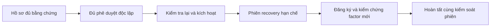

# Approval separation of duties: phân tách nhiệm vụ khi phê duyệt khôi phục tài khoản

## 1. Tại sao recovery cần phân tách nhiệm vụ?

Một quy trình khôi phục tài khoản có thể cho phép người yêu cầu đăng ký lại MFA, thay passkey hoặc lấy lại quyền truy cập sau khi mất thiết bị xác thực. Nếu một nhân viên có thể tự tạo hồ sơ, tự xác nhận bằng chứng, tự phê duyệt và tự cấp quyền recovery, toàn bộ kết quả phụ thuộc vào quyết định của một người. Một sai sót, một phiên quản trị bị chiếm hoặc một hành vi nội gián có thể trở thành đường chiếm tài khoản.

**Separation of duties**, viết tắt SoD, là việc phân chia các trách nhiệm có xung đột để một chủ thể không thể tự mình hoàn thành chuỗi hành động nhạy cảm. Trong phê duyệt recovery, cách phổ biến là người lập yêu cầu không được tự phê duyệt. Với mức rủi ro cao hơn, chính sách có thể yêu cầu nhiều người độc lập cùng chấp thuận hoặc tách thêm người thực thi.

Trong `SECURITY_AUTHENTICATION_ACCOUNT_RECOVERY`, SoD phục vụ việc khôi phục an toàn khi người dùng mất mật khẩu, MFA, passkey hoặc thiết bị xác thực. Nó phải đi cùng xác minh danh tính, đánh giá rủi ro, token dùng một lần, chống lạm dụng và quản lý phiên. Hai người cùng bấm “Approve” không biến bằng chứng danh tính yếu thành bằng chứng mạnh.

Mục tiêu của bài là thiết kế một quyết định phê duyệt mà hệ thống có thể giải thích và cưỡng chế: ai được tham gia, những người nào phải độc lập, họ đã duyệt chính xác điều gì, quyết định còn hiệu lực hay không và ai được phép kích hoạt recovery sau đó.

## 2. Tách trách nhiệm trước khi đặt tên role

Các role chỉ hữu ích khi chúng biểu diễn những trách nhiệm rõ ràng. Bắt đầu bằng các hành động nghiệp vụ, sau đó mới ánh xạ chúng sang quyền ứng dụng.

| Trách nhiệm | Công việc | Điều cần phân tách |
| --- | --- | --- |
| Người đề xuất | Mở hồ sơ và đề nghị phạm vi recovery | Không tự trở thành người duyệt độc lập cho hồ sơ đó |
| Người xác minh | Đánh giá bằng chứng theo phương thức được chấp nhận | Không được tự tạo bằng chứng giả rồi coi quyết định của mình là kiểm tra độc lập |
| Người phê duyệt | Chấp thuận hoặc từ chối một đề xuất cụ thể | Phải đáp ứng điều kiện độc lập và quyền trên tài khoản đích |
| Người hoặc dịch vụ thực thi | Kích hoạt quyền recovery đã được duyệt | Không tự đổi phạm vi hoặc tự tạo phê duyệt còn thiếu |
| Người kiểm toán | Kiểm tra lịch sử và dấu hiệu lạm dụng | Quyền xem lịch sử không tự bao gồm quyền cấp recovery |

Không nhất thiết mọi hệ thống phải dùng năm người cho năm trách nhiệm. Một chính sách có thể cho phép người đề xuất cũng thu thập bằng chứng, nhưng bắt buộc người phê duyệt khác người đề xuất. Tài khoản đặc quyền có thể cần thêm một người duyệt từ bộ phận an ninh. Các tổ hợp được phép cần xuất hiện trong chính sách, không để từng nhân viên tự hiểu.

Tách dịch vụ kỹ thuật cũng không tự tạo SoD. Nếu một nhân viên kiểm soát cả API lập hồ sơ và API phê duyệt, hai microservice riêng vẫn có thể cho người đó tự duyệt. Ngược lại, một ứng dụng duy nhất có thể cưỡng chế SoD nếu nó có mô hình định danh, chính sách và kiểm soát trạng thái đúng.

## 3. Độc lập phải được tính theo chủ thể thực, không theo số tài khoản

Một người có thể có tài khoản hỗ trợ thông thường, tài khoản quản trị và tài khoản break-glass. Đếm ba username đó thành ba người phê duyệt sẽ phá vỡ mục tiêu phân tách nhiệm vụ.

Hệ thống nên có cách phân giải về một **định danh chủ thể chuẩn hóa** khi chính sách yêu cầu độc lập theo con người. Các tài khoản thao tác liên quan tới cùng một người phải được nhận diện là cùng chủ thể cho việc kiểm tra xung đột và tính quorum.

Những trường hợp cần xử lý rõ:

- Hai tài khoản quản trị thuộc cùng một nhân viên.
- Một tài khoản được ủy quyền hành động thay người khác.
- Một service account thực hiện lệnh theo yêu cầu của nhân viên.
- Tài khoản đích thuộc chính người đang đề xuất hoặc phê duyệt recovery.
- Người dùng đồng thời là quản trị viên của tenant chứa tài khoản cần khôi phục.

Danh tính người thực hiện và người được đại diện đều có thể liên quan tới kiểm tra xung đột. Không để một người vượt qua quy tắc “không tự duyệt” bằng cách đổi sang tài khoản phụ hoặc dùng chức năng impersonation.

Tùy chính sách, độc lập còn có thể yêu cầu khác nhóm công việc hoặc khác tuyến quản lý. Điều kiện “hai người khác nhau” và “hai người từ hai bộ phận độc lập” là hai điều kiện khác nhau. Nếu cần điều kiện thứ hai, hệ thống phải dùng dữ liệu nhóm có thẩm quyền, không dựa vào nhãn phòng ban mà người duyệt tự nhập.

Việc phân tách nhiệm vụ làm giảm rủi ro một người thao túng toàn bộ luồng; nó không loại bỏ thông đồng. Kiểm toán độc lập, giới hạn quyền, giám sát bất thường và chất lượng bằng chứng vẫn cần thiết.

## 4. Chính sách phê duyệt phải gắn với rủi ro và tài nguyên

Không có một số lượng người duyệt phù hợp cho mọi loại recovery. Chính sách nên được máy chủ lựa chọn từ loại tài khoản, hành động yêu cầu, phạm vi tenant và mức rủi ro hiện tại.

Một ma trận minh họa:

| Trường hợp | Điều kiện phê duyệt minh họa | Ràng buộc bổ sung |
| --- | --- | --- |
| Người dùng thường mất một factor | Một người duyệt khác người đề xuất | Bằng chứng hợp lệ và chỉ thay factor đã chỉ định |
| Quản trị viên tenant mất toàn bộ factor | Hai người duyệt độc lập theo nhóm được chỉ định | Không người duyệt nào là người thụ hưởng; áp dụng hạn chế sau recovery |
| Tài khoản đang có dấu hiệu bị chiếm | Chuyển đánh giá an ninh trước khi cấp quyền | Không kích hoạt chỉ vì đã đủ số chữ ký |
| Nhân viên hỗ trợ tự cần recovery | Chuyển sang người xử lý và người duyệt khác | Tài khoản hỗ trợ phụ không được coi là người độc lập |

Các con số trong bảng là ví dụ thiết kế, không phải yêu cầu tuân thủ áp dụng cho mọi tổ chức. Điều quan trọng là chính sách được công bố, có phiên bản và được thực thi nhất quán.

Một cấu hình khái niệm có thể biểu diễn:

```yaml
policyId: privileged-account-factor-recovery
policyVersion: 7
requiredDistinctApprovers: 2
minimumIndependentGroups: 2
requesterMayApprove: false
beneficiaryMayApprove: false
executorMayBeApprover: false
approvalMustMatchCaseVersion: true
freshAdminAuthenticationRequired: true
```

Cấu hình này vẫn cần định nghĩa ai thuộc nhóm đủ quyền, cách xác minh chủ thể, thời hạn phê duyệt, điều kiện bằng chứng và hành động thực thi. Một file cấu hình có đủ cờ không tự tạo ra kiểm soát nếu API hoặc dịch vụ nền bỏ qua chúng.

Không cho người gửi request tự chọn `requiredDistinctApprovers=1`, tự khai báo mức rủi ro thấp hoặc thay danh sách người duyệt bằng những người không đủ quyền. Các tham số quyết định phải được máy chủ tính hoặc kiểm tra từ chính sách có thẩm quyền.

## 5. RBAC cho phép hành động, SoD quyết định có được làm trên hồ sơ này

Một nhân viên có role `RECOVERY_APPROVER` chưa chắc được duyệt mọi recovery case. Cần kiểm tra cả quyền hành động lẫn điều kiện trên tài nguyên cụ thể.

Ví dụ, Lan là người phê duyệt của tenant A. Lan có thể duyệt một hồ sơ thuộc tenant A nếu không có xung đột. Lan không được duyệt hồ sơ tenant B, hồ sơ do chính Lan lập nếu chính sách cấm, hoặc recovery cho tài khoản cá nhân của Lan.

Các điều kiện máy chủ cần đánh giá có thể gồm:

1. Người duyệt có quyền hiện hành đối với tenant, nhóm tài khoản và loại hành động không?
2. Người duyệt đã xác thực quản trị đủ mạnh, còn mới và hoàn thành step-up theo yêu cầu chưa?
3. Người duyệt có trùng người đề xuất, người thụ hưởng hoặc chủ thể trong chuỗi ủy quyền bị cấm không?
4. Hồ sơ có đang ở trạng thái cho phép duyệt và chưa hết hạn không?
5. Phạm vi hiển thị cho người duyệt có khớp phạm vi quyết định được lưu không?
6. Quyết định có đáp ứng yêu cầu về người độc lập và nhóm độc lập không?

Ẩn nút “Approve” trên giao diện chỉ giúp trải nghiệm sử dụng. Cùng một kiểm tra quyền phải tồn tại tại API và các đường thực thi khác như tác vụ nền hoặc công cụ quản trị. Client không được gửi một giá trị `isIndependent=true` rồi khiến máy chủ tin đó là kết quả kiểm tra SoD.

Quyền xem bằng chứng cũng cần theo phạm vi. Người duyệt phải có đủ thông tin để đánh giá, nhưng không mặc nhiên được tải mọi giấy tờ cá nhân trong hệ thống. Có thể trình bày kết quả xác minh và tham chiếu bằng chứng theo quyền của từng vai trò.

## 6. Người duyệt phải chấp thuận một quyết định cụ thể

Phê duyệt “hồ sơ số 42” mà không khóa nội dung là nguy hiểm. Người đề xuất có thể thay factor, kênh giao token hoặc tài khoản đích sau khi đã có chữ ký.

Một quyết định nên ràng buộc với ít nhất các thành phần liên quan:

```text
tenantId + accountId + recoveryAction + targetFactorReferences
requestedCapability + approvedDeliveryChannelReference
caseVersion + evidenceVersion + policyVersion
maximumRecoveryExpiry + postRecoveryRestrictions
```

Có thể dùng snapshot bất biến hoặc digest của nội dung chuẩn hóa để nhận diện phạm vi đã duyệt. Digest giúp kiểm tra nội dung có đổi, không thay thế việc xác thực người duyệt và bảo vệ bản ghi phê duyệt.

Người duyệt cần nhìn thấy ý nghĩa nghiệp vụ: thay factor nào, cấp capability gì, kênh nào sẽ nhận quyền recovery và còn hạn chế gì sau khi hoàn tất. Một hộp thoại chỉ ghi “Approve recovery?” không cung cấp đủ ngữ cảnh cho quyết định có trách nhiệm.

Nếu thay nội dung có ảnh hưởng tới quyết định, hồ sơ phải tăng phiên bản và thu thập lại các phê duyệt cần thiết. Những thay đổi thuần trình bày có thể không cần duyệt lại nếu chính sách phân biệt rõ, nhưng không được tự xếp thay tài khoản hoặc thay kênh nhận token vào nhóm “sửa ghi chú”.

Phê duyệt cũng có thời hạn. Bằng chứng từng hợp lệ không có nghĩa luôn còn hợp lệ. Khi kích hoạt, máy chủ cần kiểm tra lại rủi ro, trạng thái tài khoản, hiệu lực phê duyệt và các điều kiện đã có thể thay đổi.

## 7. Quorum: đủ người chưa chắc đủ điều kiện

Quorum là điều kiện số lượng cần đạt để một đề xuất có thể đi tiếp. Đối với recovery, đếm số bản ghi `APPROVED` là chưa đủ.

Một cách tính khái niệm:

```text
validApprovals = các phê duyệt của đúng hồ sơ và phiên bản,
                 khớp phạm vi và chính sách,
                 còn hạn và chưa thu hồi,
                 do chủ thể đủ quyền hiện hành thực hiện,
                 đáp ứng điều kiện độc lập

quorum = số chủ thể chuẩn hóa khác nhau trong validApprovals

eligible = quorum đạt ngưỡng
           AND đủ nhóm độc lập theo chính sách
           AND bằng chứng còn hợp lệ
           AND không có điều kiện chặn
```

Một người bấm lại nhiều lần không tạo thêm phiếu. Hai tài khoản của cùng người cũng không tạo hai phiếu độc lập. Nếu chính sách cần một người từ bộ phận an ninh, ba người chỉ thuộc bộ phận hỗ trợ vẫn có thể không đạt điều kiện.

Cần định nghĩa ý nghĩa của từ chối. Trong một chính sách, bất kỳ quyết định từ chối hợp lệ nào có thể đóng hồ sơ và yêu cầu mở lại bằng đánh giá mới. Trong chính sách khác, từ chối đưa hồ sơ về trạng thái cần bổ sung. Không tự biến một phiếu từ chối thành phiếu trắng rồi tiếp tục xin chữ ký cho đến khi đủ người đồng ý.

Việc thay người duyệt được chỉ định, rút phiếu hoặc mất quyền cần cập nhật điều kiện quorum theo chính sách hiện hành. Lịch sử chữ ký vẫn được giữ lại; không xóa bản ghi cũ để làm như quyết định chưa từng tồn tại.

## 8. Ví dụ Java: kiểm tra các phê duyệt độc lập

Đoạn mã sau minh họa việc lọc phê duyệt và đếm chủ thể chuẩn hóa. Đây là cổng quyết định thuần, chưa thực hiện cập nhật trạng thái hoặc cấp token. Các trường như `currentlyAuthorized`, `canonicalPersonId` và `independenceGroup` phải được phía máy chủ xác minh từ nguồn có thẩm quyền, không được lấy nguyên từ request của người duyệt.

Để tập trung vào SoD, ví dụ giả định mọi ID bắt buộc đã được kiểm tra không rỗng, `scopeDigest` bao phủ các trường nhạy cảm đã nêu và mỗi người có một nhóm độc lập được chính sách xác định. Hệ thống có quan hệ nhóm phức tạp cần bộ đánh giá chính sách phù hợp hơn.

```java
import java.time.Instant;
import java.util.HashSet;
import java.util.List;
import java.util.Objects;
import java.util.Set;

public final class RecoveryApprovalGate {
    public record CaseSnapshot(
            String tenantId,
            String caseId,
            long version,
            String scopeDigest,
            String policyVersion,
            Instant expiresAt,
            boolean evidenceValid,
            boolean blocked,
            Set<String> excludedPersonIds) {
        public CaseSnapshot {
            excludedPersonIds = Set.copyOf(excludedPersonIds);
        }
    }

    public record Policy(int requiredPeople, int requiredGroups) {}

    public record Approval(
            String tenantId,
            String caseId,
            long caseVersion,
            String scopeDigest,
            String policyVersion,
            String canonicalPersonId,
            String independenceGroup,
            Instant approvedAt,
            Instant expiresAt,
            boolean revoked,
            boolean currentlyAuthorized,
            boolean requiredAuthenticationSatisfied) {}

    public record Decision(
            boolean eligible, int people, int groups, String reason) {}

    public static Decision evaluate(
            CaseSnapshot recoveryCase,
            Policy policy,
            List<Approval> approvals,
            Instant now) {
        Objects.requireNonNull(recoveryCase);
        Objects.requireNonNull(policy);
        Objects.requireNonNull(approvals);
        Objects.requireNonNull(now);

        if (policy.requiredPeople() < 1 || policy.requiredGroups() < 1
                || policy.requiredGroups() > policy.requiredPeople()) {
            return new Decision(false, 0, 0, "INVALID_POLICY");
        }
        if (recoveryCase.blocked() || !recoveryCase.evidenceValid()
                || recoveryCase.expiresAt() == null
                || !now.isBefore(recoveryCase.expiresAt())) {
            return new Decision(false, 0, 0, "CASE_NOT_ELIGIBLE");
        }

        Set<String> people = new HashSet<>();
        Set<String> groups = new HashSet<>();

        for (Approval approval : approvals) {
            boolean boundToCase =
                    recoveryCase.tenantId().equals(approval.tenantId())
                    && recoveryCase.caseId().equals(approval.caseId())
                    && recoveryCase.version() == approval.caseVersion()
                    && recoveryCase.scopeDigest().equals(approval.scopeDigest())
                    && recoveryCase.policyVersion().equals(approval.policyVersion());

            boolean valid = boundToCase && !approval.revoked()
                    && approval.currentlyAuthorized()
                    && approval.requiredAuthenticationSatisfied()
                    && approval.approvedAt() != null
                    && !approval.approvedAt().isAfter(now)
                    && approval.expiresAt() != null
                    && now.isBefore(approval.expiresAt())
                    && !recoveryCase.excludedPersonIds()
                            .contains(approval.canonicalPersonId());

            if (valid && people.add(approval.canonicalPersonId())) {
                groups.add(approval.independenceGroup());
            }
        }

        boolean eligible = people.size() >= policy.requiredPeople()
                && groups.size() >= policy.requiredGroups();
        return new Decision(eligible, people.size(), groups.size(),
                eligible ? "QUORUM_MET" : "INDEPENDENT_APPROVALS_REQUIRED");
    }
}
```

`excludedPersonIds` phải bao gồm người đề xuất, người thụ hưởng và các chủ thể xung đột mà chính sách quy định. Nếu người thực thi cũng phải độc lập với người duyệt, danh sách khi kiểm tra để thực thi cần tính cả người thực thi. Bước ghi nhận từng phê duyệt phải áp dụng cùng điều kiện để từ chối ngay hành động không hợp lệ, thay vì chỉ âm thầm không đếm phiếu ở cuối luồng.

Danh sách truyền vào chỉ chứa các quyết định chấp thuận đang được xét; một quyết định từ chối có quyền chặn phải được phản ánh trong trạng thái hồ sơ trước khi gọi hàm. Trong ví dụ, `blocked=true` làm cổng quyết định đóng lại.

Giá trị `eligible=true` chỉ có nghĩa snapshot hiện tại đạt điều kiện tính toán. Nó không phải credential để mở khóa tài khoản và không bảo đảm trạng thái vẫn đúng sau khi một giao dịch khác thay đổi hồ sơ.

## 9. Kiểm soát đồng thời khi ghi phiếu và kích hoạt recovery

Phân tách nhiệm vụ có thể bị phá vỡ bởi cạnh tranh dữ liệu dù từng màn hình đều kiểm tra đúng. Ví dụ, người duyệt đang xác nhận phiên bản 8 trong khi người đề xuất đổi kênh bàn giao token và tạo phiên bản 9. Nếu API chỉ lưu `approved=true` vào hồ sơ hiện tại, chữ ký cho phiên bản cũ có thể bị áp dụng sang nội dung mới.

Khi ghi nhận phê duyệt, máy chủ cần đọc và kiểm tra một snapshot nhất quán, rồi chỉ ghi nếu phiên bản và phạm vi vẫn khớp. Có thể dùng khóa phù hợp hoặc optimistic concurrency với điều kiện phiên bản.

Một ràng buộc dữ liệu minh họa:

```sql
CREATE UNIQUE INDEX uq_case_approver_version
ON recovery_approval (
    tenant_id,
    case_id,
    case_version,
    canonical_approver_person_id
);
```

Ràng buộc này hỗ trợ ngăn một người được đếm nhiều lần cho cùng phiên bản. Nó không tự kiểm tra người đó có quyền, có xung đột, còn làm việc hay đã hoàn thành step-up. Nếu thiết kế lưu sự kiện phê duyệt theo dạng append-only, cần mô hình tương đương cho quyết định hiện hành và giữ các sự kiện thay đổi trong lịch sử.

Trước khi kích hoạt recovery:

```text
BEGIN TRANSACTION
  khóa hoặc xác minh phiên bản case và trạng thái recovery của tài khoản
  xác nhận case chưa bị từ chối, thu hồi hoặc hết hạn
  đọc phạm vi, phê duyệt, bằng chứng và chính sách có hiệu lực
  kiểm tra lại quyền và điều kiện độc lập
  tính quorum cho đúng snapshot
  chuyển APPROVED -> ACTIVATING đúng một lần
  tạo capability recovery hạn chế
  ghi audit và outbox trong cùng giao dịch
COMMIT
```

Kiểm tra phiên bản chỉ trên case chưa đủ nếu bảng phê duyệt hoặc trạng thái tài khoản có thể thay đổi độc lập. Cần bảo vệ tập dữ liệu liên quan để một lần rút phiếu hoặc thu hồi hồ sơ không bị bỏ qua trong lúc kích hoạt.

Trong hệ thống có dịch vụ danh tính hoặc rủi ro bên ngoài, một transaction local không thể khóa mọi nguồn. Thiết kế cần định nghĩa cách kiểm tra hiệu lực, dấu phiên bản hoặc tín hiệu thu hồi và cách từ chối khi không có đủ thông tin. Không dùng cache quyền cũ vô hạn chỉ để giảm độ trễ.

Điểm kích hoạt là ranh giới cần xác định rõ: nếu thu hồi xảy ra trước khi kích hoạt hợp lệ thì phải chặn; nếu xảy ra sau, hệ thống cần thu hồi capability đã cấp và xử lý những thay đổi đã có thể xảy ra. Không chỉ đổi nhãn case về `REVOKED` trong khi token vẫn sử dụng được.

## 10. Phê duyệt không phải thực thi, thực thi không phải đăng nhập đầy đủ

Nên tách ít nhất ba kết quả:



Một hồ sơ đã được phê duyệt chỉ cho phép hệ thống cân nhắc kích hoạt trong phạm vi đã duyệt. Dịch vụ thực thi không được tự thay `REPLACE_FACTOR` thành “xóa mọi factor”, đổi kênh nhận token hoặc tăng thời hạn.

Khi cấp capability recovery, máy chủ cần ràng buộc nó với hồ sơ và phiên bản, giới hạn mục đích, đặt thời hạn và kiểm soát dùng một lần. Token không nên được hiển thị cho người phê duyệt hoặc lưu trong ticket hỗ trợ. Quyền duyệt không cần đi kèm quyền sử dụng capability thay người dùng.

Phiên recovery chỉ được thực hiện những thao tác cần thiết như đăng ký factor thay thế và xem trạng thái recovery. Nó không mặc nhiên có quyền đọc dữ liệu riêng tư, tạo API key, thay quản trị viên hoặc thực hiện giao dịch nhạy cảm.

Khi hoàn tất, hệ thống còn phải xem xét factor cũ, recovery code và các phiên hoặc token thuộc diện thu hồi. Phê duyệt tốt không bù được việc để kẻ tấn công tiếp tục sử dụng một refresh token còn sống. Các hạn chế sau recovery phải được thực thi bằng chính sách phiên và quyền, không chỉ bằng nội dung thông báo cho người dùng.

## 11. Mất quyền, ủy quyền và các ngoại lệ vận hành

### Người duyệt mất quyền trước khi thực thi

Một phê duyệt từng được tạo hợp lệ vẫn là sự kiện lịch sử hợp lệ. Tuy nhiên, việc nó còn được tính cho phép thực thi hay không phải theo chính sách hiện tại. Chính sách bảo thủ có thể yêu cầu mọi người duyệt vẫn đủ quyền tại thời điểm kích hoạt; ví dụ Java áp dụng lựa chọn đó.

Nếu tổ chức muốn giữ hiệu lực của một số phê duyệt sau thay đổi nhân sự, điều này phải được định nghĩa rõ, kèm điều kiện về thu hồi do sự cố. Không để hành vi phụ thuộc ngẫu nhiên vào thời gian sống của cache role.

### Người duyệt được ủy quyền

Ủy quyền cần có phạm vi, thời hạn và chủ thể rõ ràng. Không tự coi người đại diện là một người độc lập bổ sung nếu cùng một người vẫn kiểm soát cả hai quyết định. Audit phải giữ cả người thực hiện và người mà họ đại diện.

### Không đủ người duyệt đang trực

Không đủ quorum là một tình huống vận hành cần điều phối, không phải lý do âm thầm giảm ngưỡng. Hệ thống có thể chuyển tới nhóm thay thế đã được chính sách cho phép hoặc đưa yêu cầu vào hàng chờ. Tài khoản khẩn cấp cần quy trình break-glass được thiết kế trước với giới hạn quyền, thời hạn và ghi nhận độc lập thích hợp.

Hậu kiểm bổ sung hữu ích cho đường khẩn cấp, nhưng hậu kiểm không biến một thao tác tự duyệt thành tuân thủ chính sách SoD thông thường. Ngoại lệ phải được ghi nhận đúng tên và đúng thẩm quyền.

### Dịch vụ tự động tham gia quyết định

Một hệ thống rủi ro có thể cung cấp điều kiện chặn hoặc đề xuất. Nếu chính sách yêu cầu hai người phê duyệt, hai service account hoặc hai lần chạy cùng một bộ đánh giá không được tính thành hai người. Với chính sách cho phép phê duyệt tự động, loại chủ thể và trách nhiệm của quyết định cần được mô hình hóa riêng.

## 12. Audit: chứng minh được tính độc lập và phạm vi

Chỉ lưu `approvedBy` cuối cùng sẽ mất thông tin về đề xuất ban đầu, những phiếu đã rút, phạm vi từng phiên bản và các lần từ chối. Audit nên giữ chuỗi sự kiện để tái dựng quyết định.

Những trường hữu ích gồm:

- Case, tài khoản đích, tenant, hành động và factor được yêu cầu.
- Phiên bản hồ sơ, bằng chứng, chính sách và tham chiếu snapshot phạm vi.
- Tài khoản thao tác, chủ thể chuẩn hóa, người được đại diện nếu có.
- Vai trò hoặc nhóm độc lập được dùng để đánh giá quyền tại thời điểm quyết định.
- Kết quả chấp thuận, từ chối, rút phiếu hoặc hết hạn cùng mã lý do.
- Kết quả kiểm tra SoD, thời gian và tham chiếu ngữ cảnh xác thực quản trị.
- Actor thực thi, capability được tạo theo tham chiếu và kết quả thu hồi liên quan.

Không ghi bí mật token, secret MFA, mật khẩu, mã dự phòng hoặc toàn bộ giấy tờ cá nhân vào log. Tham chiếu bằng chứng cần đủ cho điều tra nhưng chỉ người có quyền mới truy cập được dữ liệu gốc.

Các sự kiện nghiệp vụ và audit cần được ghi bền vững theo cách tránh “recovery đã kích hoạt nhưng không có lịch sử phê duyệt”. Việc gửi log hoặc thông báo sang hệ thống khác có thể dùng outbox và xử lý idempotent; tính nhất quán ở nơi ra quyết định vẫn phải được bảo vệ.

Giám sát có thể phát hiện một cặp nhân viên liên tục duyệt cho nhau, thời gian duyệt ngắn bất thường, nhiều recovery cho tài khoản đặc quyền hoặc một người dùng nhiều tài khoản để tham gia cùng hồ sơ. Đây là tín hiệu điều tra cần đặt trong ngữ cảnh, không phải kết luận tự động rằng mọi trường hợp đều có thông đồng.

## 13. Ví dụ xuyên suốt: khôi phục cho quản trị viên tenant

Hùng là quản trị viên tenant A và mất các thiết bị xác thực. Nhân viên hỗ trợ Mai mở hồ sơ đề xuất đăng ký lại một factor, sau khi thu thập bằng chứng theo chính sách. Vì tài khoản có quyền quản trị, chính sách yêu cầu hai người duyệt độc lập, trong đó có đại diện an ninh, và không cho người đề xuất hoặc người thụ hưởng làm người duyệt.

Lan thuộc nhóm hỗ trợ có thẩm quyền và Phúc thuộc nhóm an ninh xem cùng một snapshot của hồ sơ. Mỗi người hoàn thành xác thực quản trị cần thiết rồi đưa ra quyết định. Hệ thống lưu định danh chủ thể chuẩn hóa, nhóm độc lập, phiên bản phạm vi và thời hạn cho từng phê duyệt.

Nếu Mai đăng nhập bằng một tài khoản quản trị khác và thử phê duyệt, yêu cầu bị chặn vì vẫn là cùng chủ thể đã đề xuất. Nếu Lan gửi hai lần, hệ thống chỉ tính một người. Nếu một người ở tenant B thử phê duyệt bằng cách thay `caseId`, kiểm tra quyền trên tài nguyên từ chối hành động đó.

Sau hai phê duyệt, Mai phát hiện kênh bàn giao quyền recovery ghi sai và sửa hồ sơ. Hệ thống tạo phiên bản mới; các chữ ký cho phiên bản cũ không được dùng cho phạm vi mới. Lan và Phúc cần xem lại thay đổi và quyết định cho đúng snapshot.

Khi đủ điều kiện lần nữa, dịch vụ kiểm tra lại quyền, bằng chứng, rủi ro và quorum trước khi tạo capability một lần. Hùng chỉ có phiên recovery hạn chế để đăng ký và kiểm chứng factor mới. Hoàn tất còn bao gồm xử lý factor cũ, các phiên thuộc diện thu hồi và hạn chế sau recovery theo chính sách.

Nếu Phúc rút phê duyệt trước thời điểm kích hoạt, quorum không còn đủ và luồng phải dừng ở trạng thái cần phê duyệt. Nếu việc thu hồi diễn ra sau khi capability đã được cấp, hệ thống phải vô hiệu hóa capability còn sống và xử lý tác động liên quan; chỉ sửa số lượng chữ ký trên màn hình là chưa đủ.

## 14. Các lỗi thiết kế thường gặp

| Lỗi | Vì sao không đáp ứng mục tiêu SoD | Cách thiết kế phù hợp |
| --- | --- | --- |
| Kiểm tra tên tài khoản khác nhau | Một người có thể có nhiều tài khoản | Dùng chủ thể chuẩn hóa và quan hệ ủy quyền |
| Chỉ ẩn nút tự duyệt | Có thể gọi API hoặc công cụ khác | Cưỡng chế chính sách ở máy chủ trên mọi đường ghi |
| Đếm mọi bản ghi `APPROVED` | Bao gồm phiếu trùng, hết hạn hoặc sai phiên bản | Lọc điều kiện hợp lệ rồi đếm người độc lập |
| Duyệt theo `caseId` nhưng nội dung được sửa tự do | Chữ ký cũ có thể cấp quyền cho yêu cầu mới | Ràng buộc phạm vi, phiên bản và duyệt lại khi cần |
| Role duyệt áp dụng toàn hệ thống | Người có quyền ở tenant này ảnh hưởng tenant khác | Kiểm tra quyền theo tài nguyên và tenant |
| Đủ quorum thì bỏ qua rủi ro | Người duyệt không thay thế kiểm soát danh tính | Giữ bằng chứng và cổng rủi ro là điều kiện độc lập |
| Thu hồi phê duyệt nhưng giữ token | Quyền recovery vẫn có thể được sử dụng | Liên kết hiệu lực capability với trạng thái thu hồi |
| Dùng service account làm phiếu người thứ hai | Cùng nguồn kiểm soát nhưng được đếm nhiều lần | Phân biệt người, dịch vụ và yêu cầu của chính sách |
| Cho phép hỗ trợ giảm ngưỡng khi bận | Ngoại lệ trở thành đường bỏ qua thường xuyên | Có hàng chờ và đường khẩn cấp được định nghĩa trước |

Phân tách nhiệm vụ chỉ có ý nghĩa khi hệ thống thực sự chặn được chuỗi thao tác do một chủ thể kiểm soát, đồng thời giữ đúng phạm vi mà những người độc lập đã đánh giá. Chất lượng của quy trình nằm ở mối liên kết giữa định danh, quyền trên tài nguyên, bằng chứng, phiên bản hồ sơ, quyết định còn hiệu lực và bước thực thi có kiểm soát.
