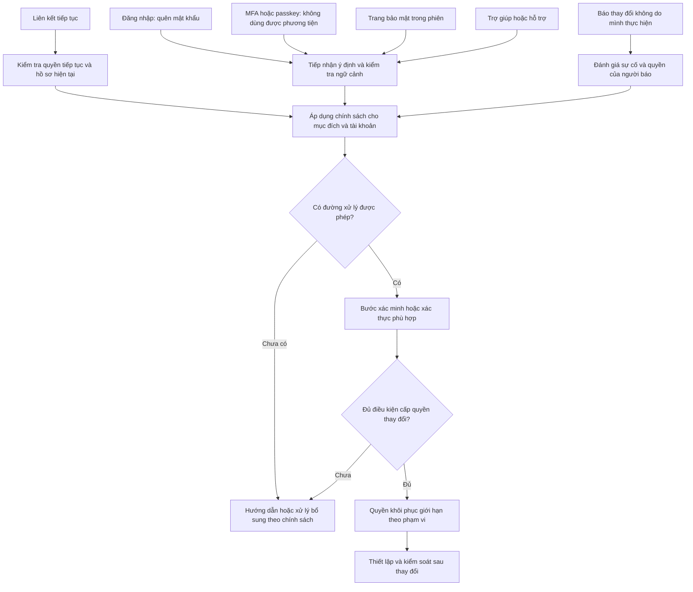

# Các điểm vào của hành trình khôi phục tài khoản

## 1. Điểm vào khôi phục có vai trò gì?

**Điểm vào hành trình khôi phục — recovery journey entry point — là nơi người dùng bắt đầu hoặc tiếp tục một yêu cầu lấy lại khả năng kiểm soát tài khoản khi không thể sử dụng phương tiện xác thực như dự kiến.** Đó có thể là liên kết “Quên mật khẩu”, lựa chọn “Không dùng được phương thức này”, trang hỗ trợ chính thức hoặc liên kết tiếp tục một yêu cầu đã được tạo.

Trong chương Recovery Journey của module `SECURITY_AUTHENTICATION_ACCOUNT_RECOVERY`, điểm vào cần phục vụ cả mất mật khẩu, MFA, passkey và thiết bị xác thực. Mục tiêu là giúp người dùng tìm được một đường xử lý phù hợp, đồng thời không tạo ra đường tắt để người khác chiếm tài khoản.

Một điểm vào tốt cần trả lời được ba câu hỏi:

1. Người dùng đang gặp vấn đề gì và muốn khôi phục khả năng nào?
2. Hệ thống đang biết gì một cách đáng tin cậy về tài khoản, phiên và yêu cầu?
3. Bước tiếp theo nào được chính sách cho phép trong ngữ cảnh đó?

Việc mở được trang khôi phục không chứng minh người truy cập là chủ tài khoản. Việc nhập đúng email cũng không cấp quyền thay mật khẩu. Điểm vào chỉ tiếp nhận ý định, xác lập ngữ cảnh ban đầu và dẫn người dùng tới bước kiểm tra phù hợp.

Ví dụ, một người bấm “Mất điện thoại” tại màn hình MFA. Hệ thống biết người đó đang đi qua một ngữ cảnh đăng nhập nào đó, nhưng chưa thể kết luận họ được phép xóa MFA, đổi email khôi phục hoặc tạo session đầy đủ. Những quyền này cần quyết định riêng dựa trên bằng chứng và chính sách.

## 2. Phân biệt bắt đầu, tiếp tục và báo sự cố

Các vị trí đều có thể dẫn tới khu vực trợ giúp tài khoản nhưng không mang cùng ý nghĩa:

| Loại điểm vào | Chức năng chính | Điều không được suy diễn |
| --- | --- | --- |
| Khám phá trợ giúp | Giải thích các lựa chọn khi không đăng nhập được | Người xem đã tạo yêu cầu khôi phục |
| Khởi tạo yêu cầu | Tiếp nhận mục tiêu và dữ liệu tối thiểu để xử lý | Tài khoản đã được xác minh hoặc đã được thay đổi |
| Tiếp tục yêu cầu | Đưa người giữ ngữ cảnh hoặc bằng chứng hợp lệ về đúng bước | Mọi quyền khôi phục đều đã được cấp |
| Quản lý trong phiên đã đăng nhập | Xử lý mất phương tiện hoặc bổ sung phương án dự phòng trong ngữ cảnh có phiên | Phiên hiện tại đủ mạnh cho mọi thay đổi bảo mật |
| Báo thay đổi không do mình thực hiện | Tiếp nhận tín hiệu nghi chiếm đoạt để xử lý sự cố | Người gửi báo cáo được quyền đặt lại toàn bộ tài khoản |

Một liên kết trong email đặt lại mật khẩu thường là điểm tiếp tục của yêu cầu đã có. Trang “Tôi không yêu cầu thay đổi này” là điểm báo sự cố. Cả hai không nên bị gom thành một nút có tác dụng cấp ngay quyền quản lý tài khoản.

Tương tự, liên kết “Đăng nhập lại” sau khi session hết hạn vẫn có thể chỉ dẫn đến luồng xác thực thông thường. Chỉ khi người dùng không còn sử dụng được phương tiện xác thực, hệ thống mới cần đưa ra lựa chọn khôi phục phù hợp.

Sự phân biệt này giúp thông điệp sản phẩm chính xác: “Đã tiếp nhận yêu cầu” khác với “Đã xác minh”, “Đã gửi hướng dẫn” khác với “Đã hoàn tất”.

## 3. Những điểm vào thường gặp

### 3.1. Từ màn hình đăng nhập bằng mật khẩu

Liên kết “Quên mật khẩu” cần dễ tìm tại nơi người dùng nhập hoặc chọn cách xác thực bằng mật khẩu. Điểm vào này thường tiếp nhận định danh tài khoản, rồi áp dụng chính sách để quyết định có thể gửi hướng dẫn qua kênh nào.

Không nên mặc định yêu cầu này còn cho phép:

- Xóa MFA đang được đăng ký.
- Đổi email hoặc số điện thoại khôi phục.
- Đăng ký passkey do người yêu cầu chọn.
- Đăng xuất mọi thiết bị chỉ vì biểu mẫu công khai đã được gửi.

Nếu người dùng đặt lại được mật khẩu nhưng vẫn mất MFA, hệ thống cần cho họ một đường xử lý tiếp theo đúng phạm vi. Không nên âm thầm bỏ MFA để biến một lần đặt lại mật khẩu thành đăng nhập thành công.

### 3.2. Từ màn hình yêu cầu MFA

Người dùng có thể nhớ mật khẩu nhưng mất điện thoại, khóa bảo mật hoặc không còn mã dự phòng. Lựa chọn “Không dùng được phương thức này” nên xuất hiện tại bước MFA để họ không phải quay lại tìm một biểu mẫu đặt lại mật khẩu không giải quyết đúng vấn đề.

Trước hết, hệ thống có thể cho chọn một phương tiện khác còn hợp lệ nếu chính sách cho phép. Dùng một phương tiện đã đăng ký để hoàn tất đăng nhập không nhất thiết là một lần khôi phục tài khoản.

Chỉ khi cần thay đổi hoặc thiết lập lại phương tiện, yêu cầu mới đi vào nhánh khôi phục tương ứng. Ngữ cảnh đã nhập đúng mật khẩu có thể được sử dụng theo chính sách, nhưng không tự đủ để vô hiệu hóa yêu cầu yếu tố bổ sung.

### 3.3. Từ trải nghiệm đăng nhập bằng passkey

Một thao tác passkey không thành công có thể do người dùng hủy hộp thoại, chọn nhầm thiết bị, thiết bị không sẵn sàng hoặc không còn phương tiện phù hợp. Không nên coi mọi lỗi hoặc lần hủy là bằng chứng passkey đã mất.

Giao diện có thể cung cấp lựa chọn thử lại, dùng phương tiện đã đăng ký khác hoặc tìm trợ giúp khôi phục. Các lựa chọn này cần phản ánh những khả năng sản phẩm thực sự hỗ trợ.

Nếu người dùng mất phương tiện cuối cùng, luồng cần đánh giá bằng chứng khôi phục trước khi cho đăng ký passkey mới. Một nút “Tạo passkey mới” xuất hiện sau lỗi đăng nhập không được trở thành cách bỏ qua việc chứng minh quyền với tài khoản.

### 3.4. Từ trang bảo mật khi vẫn còn session

Người dùng có thể còn đăng nhập trên máy tính nhưng đã mất điện thoại dùng cho MFA. Trang quản lý bảo mật là một điểm vào có ích vì người dùng vẫn giữ một phần ngữ cảnh truy cập.

Tuy nhiên, session có thể đã cũ, bị đánh cắp hoặc chưa đáp ứng mức xác thực cần thiết. Hệ thống cần xác định những thay đổi nào đòi hỏi xác thực lại, bằng chứng bổ sung hoặc một quy trình khôi phục riêng.

Một session đang hoạt động không mặc nhiên cho phép thay kênh khôi phục, xóa mọi phương tiện rồi đăng ký lại. Tài khoản đích của thao tác trong phiên cũng cần được lấy từ ngữ cảnh máy chủ có thẩm quyền, không chỉ từ trường định danh do trình duyệt gửi.

Nếu người dùng còn đủ phương tiện để thực hiện quản lý thông thường, nên dẫn đến chức năng quản lý phương tiện phù hợp. Không cần buộc họ khai báo mất toàn bộ khả năng truy cập để thêm một phương án dự phòng.

### 3.5. Từ trang trợ giúp hoặc nhân viên hỗ trợ

Trang trợ giúp chính thức cần giúp người dùng nhận diện tình huống và tìm đúng đường xử lý. Nhân viên có thể tiếp nhận hồ sơ, giải thích bước tiếp theo và xử lý ngoại lệ trong phạm vi được cấp.

Việc nói chuyện được với nhân viên, cung cấp mã phiếu hỗ trợ hoặc biết thông tin hồ sơ không tự chứng minh quyền sở hữu tài khoản. Nhánh hỗ trợ phải tuân theo chính sách xác minh và thẩm quyền phù hợp, thay vì trở thành cách đi vòng qua những điều kiện của nhánh tự phục vụ.

Nhân viên không nên yêu cầu người dùng đọc mật khẩu mới, OTP, mã dự phòng hoặc bí mật thiết lập MFA qua điện thoại hay ghi chú hỗ trợ. Bước nhập bí mật cần diễn ra trên bề mặt được thiết kế cho mục đích đó.

### 3.6. Từ thông báo hoặc liên kết tiếp tục

Email, tin nhắn và thông báo có thể đưa người dùng về một yêu cầu đang chờ. Hệ thống cần kiểm tra quyền tiếp tục, thời hạn, mục đích và trạng thái hiện tại của yêu cầu.

Liên kết có thể hết hạn, đã được dùng, bị chuyển tiếp hoặc được mở trên một trình duyệt khác. Mỗi tình huống cần có kết quả rõ ràng, nhưng thông báo lỗi không được tiết lộ thông tin tài khoản cho người không có quyền xem.

Nếu liên kết được mở bởi trình xem trước hoặc công cụ kiểm tra thư, thao tác mở không nên tự hoàn thành thay đổi bảo mật hoặc tiêu thụ quyền thay đổi một lần. Việc tiếp tục tới hành động có tác động cần một bước được kiểm soát riêng.

### 3.7. Từ ứng dụng dùng nhà cung cấp danh tính bên ngoài

Với đăng nhập liên kết, ứng dụng và nhà cung cấp danh tính có thể sở hữu các phần khác nhau của hành trình. Điểm vào cần xác định thành phần nào có thẩm quyền khôi phục phương tiện đang bị mất.

Nếu mật khẩu do nhà cung cấp danh tính quản lý, ứng dụng không thể sửa mật khẩu đó bằng một biểu mẫu nội bộ. Việc dẫn sang hệ thống phù hợp cần dựa trên cấu hình được tin cậy, không lấy một URL chuyển hướng tùy ý do người dùng gửi.

Không nên tự tạo một phương thức đăng nhập cục bộ yếu hơn chỉ để giúp người dùng bỏ qua nhà cung cấp đang yêu cầu xác minh. Một phương án thay thế chỉ hợp lệ khi đã được sản phẩm thiết kế và chính sách cho phép.

## 4. Chọn đúng luồng từ thông tin đầu vào

Các điểm vào khác nhau nên hội tụ về những quy tắc quyết định nhất quán. Khác biệt về giao diện không phải lý do để cùng một thay đổi nhận yêu cầu xác minh yếu hơn ở một kênh khác.

Một cách phân loại ban đầu:

| Tình huống người dùng nêu | Điều cần làm rõ | Hướng xử lý có thể phù hợp |
| --- | --- | --- |
| Quên mật khẩu | Còn phương án xác minh nào được chấp nhận? | Đặt lại mật khẩu; vẫn giữ các yêu cầu MFA có hiệu lực |
| Không dùng được một yếu tố MFA | Có yếu tố khác hoặc phương án dự phòng hợp lệ không? | Dùng phương án còn lại, hoặc khôi phục yếu tố theo chính sách |
| Không đăng nhập được bằng passkey | Đây là lỗi thao tác, vấn đề thiết bị hay mất phương tiện? | Thử lại, chọn phương tiện khác hoặc bắt đầu khôi phục |
| Mất thiết bị nhưng còn session | Session hiện tại có thẩm quyền đến đâu? | Xác thực bổ sung hoặc khôi phục để thay phương tiện và xử lý truy cập cũ |
| Mất mọi phương án đã đăng ký | Có đường xác minh thay thế đáng tin cậy không? | Xét nhánh bổ sung được cho phép; không cam kết chắc chắn khôi phục |
| Nghi tài khoản bị chiếm | Có thay đổi trái phép và đường truy cập nào cần xử lý? | Chuyển nhánh rủi ro phù hợp, vượt ra ngoài việc chỉ thay mật khẩu |

Người dùng chọn lý do là cung cấp một lời khai về vấn đề đang gặp. Lựa chọn đó không được trực tiếp điều khiển những trường như “bỏ qua MFA”, “đã xác minh” hoặc “cấp session đầy đủ”.

Địa chỉ liên hệ mới do người yêu cầu nhập cũng chỉ là dữ liệu được khai báo. Không nên gửi quyền khôi phục vào đó rồi coi việc nhận được quyền ấy là bằng chứng độc lập rằng họ kiểm soát tài khoản cũ.

Nếu không có phương án nào đáp ứng chính sách, hệ thống cần giải thích hướng xử lý còn được hỗ trợ. Khả năng hỗ trợ người dùng không đồng nghĩa phải có một đường khôi phục thành công cho mọi trường hợp.

## 5. Hợp đồng của bước khởi tạo yêu cầu

### 5.1. Dữ liệu tối thiểu và nguồn tin cậy

Một yêu cầu khởi tạo có thể gồm định danh tài khoản, vấn đề đang gặp, ngôn ngữ và ngữ cảnh cần thiết để quay lại ứng dụng. Không phải trường nào do trình duyệt gửi cũng có cùng độ tin cậy.

| Dữ liệu | Cách sử dụng phù hợp |
| --- | --- |
| Định danh tài khoản do người dùng nhập | Tìm đối tượng theo quy tắc chuẩn hóa của hệ thống; chưa phải bằng chứng |
| Lý do khôi phục | Chọn nhánh cần đánh giá; chưa cấp quyền thực hiện |
| Session hoặc thử thách đăng nhập trước đó | Kiểm tra tại máy chủ trước khi sử dụng làm ngữ cảnh |
| Nguồn truy cập do giao diện gửi | Gợi ý điều hướng hoặc phân tích; không quyết định thẩm quyền |
| Gợi ý tổ chức | Đối chiếu với cấu hình và quan hệ tài khoản đáng tin cậy |
| Địa chỉ quay lại | Chỉ chấp nhận đích thuộc chính sách cho phép |
| Kênh liên hệ mới | Dữ liệu cần xác minh trong quy trình riêng; không tự là kênh khôi phục tin cậy |

Ví dụ minh họa cho một yêu cầu công khai:

```http
POST /recovery/intents
Content-Type: application/json

{
  "account_hint": "nguoi-dung@example.invalid",
  "journey_reason": "LOST_AUTHENTICATOR",
  "entry_surface": "MFA_CHALLENGE",
  "return_to": "/signin"
}
```

Tên endpoint và trường chỉ có tính minh họa. Máy chủ cần giới hạn dữ liệu, kiểm tra các giá trị cho phép và gắn ngữ cảnh xác thực thực sự bằng cơ chế của mình. Giá trị `entry_surface` do client gửi không chứng minh người đó đã vượt qua bước mật khẩu.

Không nhận các trường công khai như `verified=true`, `skip_mfa=true` hoặc `approved_actions` rồi dùng chúng làm quyết định bảo mật.

### 5.2. Phản hồi khởi tạo không phải kết quả khôi phục

Với một yêu cầu được tiếp nhận để xử lý, phản hồi có thể mang thông điệp nhất quán:

```json
{
  "status": "RECEIVED",
  "message": "Nếu thông tin phù hợp với điều kiện khôi phục, hướng dẫn sẽ được gửi qua kênh được hỗ trợ."
}
```

Phản hồi này không khẳng định tài khoản tồn tại, thư đã đến, bằng chứng đã đạt hoặc thay đổi đã được cho phép. Thực tế xử lý cần được quản lý riêng.

Nếu sử dụng mã tiếp nhận để hiển thị tiến độ, mã đó không tự là quyền xem mọi dữ liệu hồ sơ. Việc tra cứu phải bảo vệ thông tin tài khoản và không mở ra một đường dò tài khoản khác.

### 5.3. Không thay đổi bảo mật chỉ vì đã nhận yêu cầu

Bước khởi tạo công khai không nên tự đặt lại mật khẩu, vô hiệu hóa MFA, xóa passkey hay thu hồi toàn bộ session của tài khoản được nhập.

Nếu một người ngoài chỉ cần điền email là làm chủ tài khoản mất khả năng truy cập, biểu mẫu khôi phục đã trở thành công cụ gây gián đoạn. Những biện pháp ứng phó rủi ro cần có căn cứ và thẩm quyền tương ứng, tách khỏi thao tác tiếp nhận thông thường.

## 6. Các kiểm soát cần có ngay tại điểm vào

### 6.1. Hạn chế dò tìm tài khoản

Một biểu mẫu có thể làm lộ tài khoản tồn tại qua thông điệp, mã trạng thái, kích thước phản hồi, thời gian xử lý hoặc dữ liệu trả về. Chỉ đổi câu “email không tồn tại” thành câu chung chưa chắc đã che được các khác biệt khác.

Ở bề mặt chưa xác minh, nên thiết kế phản hồi nhất quán và giảm các khác biệt có thể quan sát giữa những định danh tồn tại và không tồn tại. Những chi tiết như tài khoản có MFA gì, có passkey hay không hoặc kênh khôi phục cụ thể nào không nên được hiển thị tùy tiện.

Xử lý bất đồng bộ có thể giúp tách việc tiếp nhận khỏi gửi thông báo và giảm một số khác biệt, nhưng không tự bảo đảm chống dò tìm. Cần xét cả hành vi của hệ thống khi bị giới hạn tần suất, khi kênh gửi lỗi và khi người dùng tra cứu tiến độ.

Thông tin chi tiết hơn có thể được cung cấp sau khi đã thiết lập ngữ cảnh có quyền phù hợp. Ranh giới này cần được xác định theo chính sách, không chỉ theo việc người truy cập đã biết một địa chỉ email.

### 6.2. Hạn chế gửi hàng loạt và gây phiền nhiễu

Kẻ tấn công có thể sử dụng điểm vào để gửi liên kết liên tục, thử nhiều định danh hoặc ép bộ phận hỗ trợ mở hàng loạt hồ sơ.

Kiểm soát nên xét nhiều chiều, chẳng hạn nguồn truy cập, định danh đích, ngữ cảnh thiết bị và hành vi toàn hệ thống. Chỉ giới hạn theo địa chỉ IP có thể bỏ sót nguồn phân tán và gây ảnh hưởng người dùng cùng mạng.

Các biện pháp có thể gồm giới hạn tốc độ, gộp yêu cầu lặp, giới hạn gửi lại và thử thách chống tự động hóa khi phù hợp. Thử thách chống bot không phải bằng chứng sở hữu tài khoản; nó chỉ xử lý một phần vấn đề tự động hóa.

Không nên khóa đăng nhập hợp lệ hoặc vô hiệu hóa phương tiện hiện có chỉ vì người ngoài gửi nhiều yêu cầu khôi phục. Khi phải áp dụng hạn chế, cần giữ đường xử lý cho người dùng hợp lệ và tránh phản hồi làm lộ trạng thái tài khoản.

### 6.3. Giữ nguyên yêu cầu chính sách khi đổi kênh

Một người có thể thử bắt đầu ở web, chuyển sang ứng dụng rồi gọi hỗ trợ để tìm nhánh ít kiểm tra nhất. Nếu cùng một thay đổi được thực hiện qua nhiều kênh, các kênh phải tuân theo các điều kiện bảo mật áp dụng cho thay đổi đó.

Điều này không bắt buộc mọi kênh dùng giao diện giống hệt nhau. Nhánh thủ công có thể thu thập bằng chứng khác, nhưng phải có căn cứ để bằng chứng ấy đáp ứng chính sách. Không được tự hạ yêu cầu chỉ vì thao tác đến từ nhân viên hoặc vì người dùng chọn “thử cách khác”.

Trạng thái quan trọng cần nằm ở máy chủ và có quy tắc chuyển tiếp rõ ràng. Việc làm mới trang hoặc mở ứng dụng không được biến “đang chờ xác minh” thành “đã phê duyệt”.

### 6.4. Bảo vệ yêu cầu có trạng thái

Các thao tác sử dụng cookie hoặc phiên để tiếp tục cần được bảo vệ trước việc bị khởi tạo từ ngữ cảnh ngoài ý muốn. Tùy kiến trúc, cơ chế có thể gồm kiểm tra nguồn yêu cầu, token chống CSRF và cấu hình cookie phù hợp.

Một yêu cầu khôi phục cần liên kết đúng tài khoản, mục đích và bước hiện tại. Không cho phép lấy bằng chứng của hồ sơ A rồi áp dụng thay đổi lên tài khoản B bằng cách sửa tham số trong trình duyệt.

Trạng thái ngắn hạn trên trình duyệt cũng cần được bảo vệ theo chức năng của nó. Không đặt token khôi phục dài hạn trong bộ nhớ dễ bị nhiều thành phần đọc chỉ để tiện chuyển trang. Khi sử dụng cookie để giữ một phiên khôi phục, cần giới hạn quyền, thời hạn và đường sử dụng của phiên đó.

### 6.5. Kiểm soát đích quay lại và nguồn liên kết

Sau khôi phục, sản phẩm thường muốn đưa người dùng về đúng trang hoặc ứng dụng. Tham số như `return_to` không được trở thành URL chuyển hướng mở tới bất kỳ miền nào.

Một thiết kế có thể ưu tiên đường dẫn nội bộ được cho phép, đối chiếu đích với cấu hình tin cậy và lưu ngữ cảnh quay lại phía máy chủ. Nếu có nhiều ứng dụng hoặc tổ chức, cần ràng buộc đích với ứng dụng, tổ chức và yêu cầu tương ứng.

Khi tạo liên kết gửi ra ngoài, nên sử dụng địa chỉ gốc đã được cấu hình tin cậy. Không tự xây URL khôi phục từ một giá trị host do yêu cầu công khai cung cấp mà chưa kiểm tra.

Người dùng cũng cần nhận diện được miền và ứng dụng chính thức để tránh bị dẫn sang trang giả. Các hướng dẫn phải dẫn tới bề mặt do sản phẩm kiểm soát, thay vì yêu cầu người dùng gửi bí mật qua một cuộc trò chuyện bất kỳ.

## 7. Liên kết tiếp tục và chuyển giữa web, ứng dụng, thiết bị

### 7.1. Phân biệt truy cập liên kết với tiêu thụ quyền

Một liên kết chứa token là một cách mang quyền hoặc bằng chứng có giới hạn. Nó cần được kiểm tra về tài khoản đích, mục đích, thời hạn và trạng thái sử dụng theo thiết kế.

Tuy nhiên, lần truy cập đầu tiên có thể do hệ thống xem trước thư thực hiện. Vì vậy, mở một URL bằng yêu cầu đọc không nên tự đặt mật khẩu, vô hiệu hóa yếu tố hoặc tiêu thụ quyền thay đổi không thể lấy lại chỉ vì có một lượt tải trang.

Có thể tách bước hiển thị hoặc kiểm tra khả năng tiếp tục khỏi bước xác nhận có tác động. Bước áp dụng thay đổi vẫn phải kiểm tra lại điều kiện hiện tại và tiêu thụ quyền một lần bằng cơ chế nhất quán.

Quyền được kiểm tra trước đó không được coi là còn hợp lệ mãi. Hồ sơ có thể đã hoàn tất, token có thể đã bị thu hồi hoặc một thay đổi quan trọng có thể làm quyết định cũ mất hiệu lực.

### 7.2. Tránh làm rò rỉ token trong hành trình

URL chứa token có thể đi vào lịch sử, nhật ký, hệ thống phân tích hoặc dữ liệu được gửi kèm khi tải tài nguyên khác. Cần hạn chế nơi token xuất hiện và những thành phần có thể nhận nó.

Một thiết kế có thể đổi token ban đầu sang một ngữ cảnh khôi phục giới hạn sau khi kiểm tra phù hợp, rồi chuyển người dùng sang một URL sạch. Cách thực hiện phải giữ đúng thời điểm tiêu thụ quyền và khả năng tiếp tục; không mặc định rằng bất kỳ lần đổi token nào cũng đã hoàn tất khôi phục.

Các trang mang dữ liệu khôi phục cần cân nhắc tài nguyên bên thứ ba, chính sách referrer và việc ghi log tại proxy hoặc dịch vụ giám sát. Không ghi token nguyên vẹn vào sự kiện phân tích chỉ để đo nguồn truy cập.

### 7.3. Chuyển sang ứng dụng không làm tăng độ tin cậy

Liên kết mở ứng dụng cần sử dụng cơ chế liên kết và xác minh đích phù hợp với nền tảng. Việc một ứng dụng nhận được tham số từ URL không đủ chứng minh quyền thay đổi tài khoản.

Backend vẫn phải kiểm tra token, hồ sơ và phạm vi. Tránh dựa hoàn toàn vào một tham số như `approved=true` hoặc việc ứng dụng đã mở thành công.

Nếu ứng dụng không được cài, đường quay về web cần giữ được ý nghĩa của hành trình và không gửi người dùng qua một chuỗi chuyển hướng ngoài kiểm soát. Đường dự phòng phải giữ nguyên yêu cầu xác minh.

### 7.4. Đổi trình duyệt hoặc mở lại liên kết

Có những thiết kế yêu cầu ngữ cảnh cùng trình duyệt; có những thiết kế cho phép tiếp tục trên thiết bị khác bằng bằng chứng riêng. Điều quan trọng là nêu rõ điều kiện và xử lý nhất quán.

Không nên buộc người dùng mở cùng thiết bị đã mất mà không cung cấp hướng xử lý được hỗ trợ. Ngược lại, cho phép đổi thiết bị cũng không có nghĩa bỏ mọi kiểm tra gắn kết yêu cầu.

Nếu ngữ cảnh không hợp lệ, giao diện cần nói rõ cách tiếp tục an toàn hoặc bắt đầu lại. Không nên hiển thị lỗi chung rồi tự mở một yêu cầu mới vô hạn mỗi khi người dùng bấm lại liên kết.

Một liên kết đã dùng có thể đưa người có quyền tới kết quả đã ghi nhận, nhưng không được cấp thêm một lần thay đổi. Một mã hồ sơ hoặc địa chỉ URL dễ chia sẻ không tự cấp quyền xem chi tiết tài khoản.

## 8. Trải nghiệm người dùng và thông điệp ở điểm vào

### 8.1. Dùng tên lựa chọn mô tả vấn đề

Người dùng thường biết mình mất gì, nhưng không biết tên nội bộ của từng luồng. Các lựa chọn có thể mô tả vấn đề trực tiếp:

| Ngữ cảnh | Lựa chọn có thể hiển thị |
| --- | --- |
| Đăng nhập bằng mật khẩu | “Quên mật khẩu” |
| Đang yêu cầu một yếu tố bổ sung | “Không dùng được phương thức này” |
| Gặp khó khăn với passkey | “Thử lại” hoặc “Dùng cách đăng nhập khác” nếu được hỗ trợ |
| Mất thiết bị xác thực | “Tôi bị mất thiết bị xác thực” |
| Phát hiện thay đổi lạ | “Tôi không thực hiện thay đổi này” |
| Đã có yêu cầu đang xử lý | “Tiếp tục yêu cầu” trong ngữ cảnh được phép |

Lựa chọn nên dẫn đến hành vi thực tế được sản phẩm hỗ trợ. “Dùng cách khác” không nên kết thúc bằng việc yêu cầu lại chính phương tiện mà người dùng vừa khai báo đã mất.

Không nên đặt một hướng dẫn duy nhất như “Hãy đăng nhập để liên hệ hỗ trợ” trên mọi nhánh của người đang không thể đăng nhập. Nếu có kênh tiếp nhận ngoài phiên, cần nêu rõ rằng tiếp nhận hồ sơ chưa phải xác minh danh tính.

### 8.2. Nói rõ điều đã xảy ra và bước tiếp theo

| Trạng thái thực tế | Thông điệp phù hợp |
| --- | --- |
| Đã nhận biểu mẫu công khai | Đã tiếp nhận; hướng dẫn sẽ được gửi nếu yêu cầu phù hợp với điều kiện |
| Đang chờ người dùng thực hiện bước được cấp | Nêu bước tiếp theo trong ngữ cảnh có quyền xem |
| Liên kết không còn cho phép tiếp tục | Giải thích không thể dùng liên kết này; cung cấp đường xử lý an toàn |
| Người dùng chưa đủ bằng chứng | Nêu các lựa chọn được chính sách hỗ trợ, không hứa cấp quyền |
| Thay đổi đã được áp dụng nhưng còn công việc bắt buộc | Nêu phần đã xảy ra và phần đang xử lý, nếu người xem có quyền biết |
| Khôi phục đã hoàn tất | Nêu phạm vi đã hoàn tất và yêu cầu đăng nhập hoặc xác thực tiếp theo |

Thông điệp cần tránh tạo cảm giác đã chiếm lại tài khoản khi hệ thống mới gửi thư. Cũng không nên nói “mọi thiết bị đã đăng xuất” nếu nơi thực thi truy cập chưa bảo đảm điều đó.

Với người dùng dùng trình đọc màn hình, bàn phím hoặc thiết bị có hạn chế, các điểm vào vẫn cần dễ tìm và thao tác được. Một cơ chế chống lạm dụng không truy cập được có thể đẩy người dùng sang hỗ trợ thủ công mà vẫn không giải quyết được rủi ro ban đầu.

### 8.3. Giữ thông tin hỗ trợ ở mức cần thiết

Trước xác minh, không nên liệt kê phương tiện, địa chỉ liên hệ hoặc tiến độ chi tiết chỉ để người dùng thấy hành trình có vẻ cá nhân hóa.

Sau khi có quyền xem phù hợp, thông tin gợi ý có thể giúp người dùng chọn đúng phương án. Phạm vi hiển thị cần theo chính sách; che một phần địa chỉ không tự làm mọi dữ liệu trở nên an toàn để công khai.

Giao diện cũng cần tránh yêu cầu quá nhiều dữ liệu nhạy cảm ở bước đầu. Việc thu thập bằng chứng nên có mục đích rõ ràng, quyền truy cập phù hợp và vị trí lưu trữ được kiểm soát.

## 9. Ví dụ xuyên suốt: còn mật khẩu nhưng mất điện thoại MFA

Mai không còn điện thoại dùng cho MFA nhưng vẫn nhớ mật khẩu. Mai bấm “Quên mật khẩu”, nhận hướng dẫn đặt lại mật khẩu, rồi lại bị chặn tại bước MFA. Đây là một hành trình có điểm vào dễ tìm nhưng định tuyến chưa giải quyết đúng nhu cầu.

Một thiết kế phù hợp hơn có thể diễn ra như sau:

1. Tại màn hình MFA, Mai chọn “Không dùng được phương thức này”.
2. Máy chủ kiểm tra ngữ cảnh đăng nhập hiện tại và cho xem các phương án tiếp tục mà ngữ cảnh đó được phép biết.
3. Nếu Mai còn phương tiện đã đăng ký khác, hệ thống có thể cho dùng phương tiện đó theo chính sách. Hoàn tất xác thực bằng phương án khác chưa nhất thiết là khôi phục.
4. Nếu cần thay yếu tố đã mất, Mai đi vào yêu cầu khôi phục có mục đích rõ ràng là thay yếu tố đó.
5. Hệ thống đánh giá bằng chứng, chống lạm dụng và cấp quyền thiết lập có giới hạn nếu đủ điều kiện.
6. Mai xác nhận thiết lập phương tiện mới; hệ thống xử lý phương tiện cũ, session và quyền khôi phục theo kịch bản.
7. Khi các điều kiện bắt buộc đạt, hồ sơ được hoàn tất; việc đăng nhập và quyền sử dụng tiếp theo được xử lý theo chính sách.

Nếu Mai chuyển từ web sang ứng dụng tại bước 4, quyền không được tự tăng lên. Nếu Mai gọi hỗ trợ, nhân viên cần làm việc với trạng thái và chính sách tương ứng, không mở một đường xóa MFA thiếu căn cứ.

Nếu Mai báo điện thoại đã bị đánh cắp và có hoạt động lạ, luồng cần đánh giá cả quyền truy cập đang tồn tại. Đây là thông tin thay đổi phạm vi rủi ro, không chỉ là một nhãn giao diện khác.

Ví dụ cho thấy điểm vào tốt phải giúp tìm đúng vấn đề, giữ ngữ cảnh phù hợp và ngăn sự nhầm lẫn giữa “chọn cách xử lý” với “đã được phép thực hiện thay đổi”.

## 10. Mô hình hội tụ các điểm vào



Sơ đồ chỉ minh họa sự hội tụ của chính sách; không yêu cầu mọi điểm vào tạo cùng một loại hồ sơ. Một người đã có bằng chứng hợp lệ có thể tiếp tục tại bước phù hợp thay vì luôn đi lại từ đầu.

Điểm cần giữ là mọi quyết định cấp quyền đều dựa trên ngữ cảnh và bằng chứng đã được kiểm tra. Nguồn truy cập, tên nút hay kênh hỗ trợ không tự là bằng chứng.

## 11. Quan sát hành trình mà không làm lộ dữ liệu khôi phục

Đội sản phẩm cần biết người dùng có tìm được điểm vào và có bị đưa nhầm luồng hay không. Đội an ninh cần phát hiện lạm dụng. Việc quan sát nên sử dụng dữ liệu tối thiểu và phân quyền phù hợp.

Những mốc có thể theo dõi gồm:

- Điểm vào đã được hiển thị và được chọn.
- Nhóm vấn đề người dùng khai báo.
- Kết quả tiếp nhận theo mã nội bộ có kiểm soát.
- Việc chuyển kênh hoặc tiếp tục yêu cầu.
- Bước mà người dùng dừng lại hoặc cần hỗ trợ.
- Số lần gửi lại và hành vi bị giới hạn.
- Thời điểm đủ điều kiện, áp dụng thay đổi và hoàn tất.

Không ghi mật khẩu, OTP, token đầy đủ hoặc URL chứa token vào sự kiện phân tích. Nếu cần liên kết các mốc, dùng định danh phù hợp và kiểm soát ai có quyền tra ngược về tài khoản. Không coi một định danh đã biến đổi là dữ liệu vô hại trong mọi hoàn cảnh.

Cũng cần phân biệt nguồn do client khai báo với nguồn được máy chủ kiểm chứng. Một đối thủ có thể gửi `entry_surface=HELP_DESK`; giá trị đó không chứng minh thao tác thực sự do nhân viên hỗ trợ có thẩm quyền tạo ra.

Các chỉ số có ý nghĩa khác nhau:

| Chỉ số | Cho biết điều gì? | Không chứng minh điều gì? |
| --- | --- | --- |
| Số lượt chọn điểm vào | Mức sử dụng lựa chọn | Có bấy nhiêu chủ tài khoản hợp lệ |
| Số yêu cầu tiếp nhận | Khối lượng khởi tạo được xử lý | Mọi tài khoản đều tồn tại hoặc đủ điều kiện |
| Số hướng dẫn được gửi | Kết quả bước gửi theo định nghĩa vận hành | Người dùng đã nhận, đã đọc hoặc đã khôi phục |
| Tỷ lệ chuyển nhánh | Khả năng chọn nhầm luồng hoặc cần phương án khác | Mọi lần chuyển đều là tấn công |
| Số hồ sơ hoàn tất | Số kết quả đạt điều kiện hoàn tất đã định nghĩa | Mọi người dùng đã đăng nhập lại hoặc mọi sự cố đã được xử lý xong |

Tỷ lệ hoàn tất cao do bỏ bớt xác minh không phải là cải thiện đúng mục tiêu. Cần xem đồng thời tính thuận tiện, khả năng chống lạm dụng và kết quả kiểm soát tài khoản.

## 12. Các tình huống cần giữ đúng hành vi

| Tình huống | Hành vi cần giữ |
| --- | --- |
| Nhập một định danh không tồn tại | Phản hồi công khai không tạo khác biệt tiết lộ không cần thiết |
| Gửi nhiều lần vào tài khoản của người khác | Hạn chế lạm dụng; không tự khóa mọi phương tiện của chủ tài khoản |
| Hủy hộp thoại passkey | Không tự xóa phương tiện hoặc kết luận mất tài khoản |
| Còn mật khẩu nhưng mất MFA | Dẫn đúng nhánh; không hạ yêu cầu MFA chỉ vì đã biết mật khẩu |
| Còn session nhưng muốn thay phương tiện | Kiểm tra thẩm quyền hiện tại và yêu cầu xác thực bổ sung phù hợp |
| Chọn địa chỉ quay lại ngoài phạm vi | Từ chối hoặc dùng đích an toàn đã định nghĩa |
| Công cụ xem trước thư mở liên kết | Không tự áp dụng thay đổi hoặc tiêu thụ quyền thay đổi một lần |
| Mở liên kết đã dùng | Không phát sinh lần thay đổi mới; chỉ cung cấp kết quả nếu có quyền |
| Sửa tài khoản đích khi tiếp tục | Không áp dụng bằng chứng của hồ sơ này sang tài khoản khác |
| Chuyển từ tự phục vụ sang hỗ trợ | Giữ yêu cầu chính sách và phạm vi đã được kiểm tra |
| Đăng nhập qua nhà cung cấp danh tính | Dẫn tới đúng nơi có thẩm quyền; không tự tạo đường bỏ qua yếu hơn |
| Báo thay đổi trái phép | Tiếp nhận và đánh giá; không tự cấp quyền khôi phục đầy đủ cho người báo |

Khi đặc tả một điểm vào, hãy nêu nơi nó xuất hiện, mục đích được tiếp nhận, dữ liệu nào đáng tin cậy, bước tiếp theo được phép và các thay đổi tuyệt đối chưa được thực hiện tại thời điểm đó. Những thông tin này giúp đội giao diện, backend và hỗ trợ cùng hiểu một hành trình, từ lúc người dùng tìm trợ giúp đến khi có đủ điều kiện khôi phục an toàn.
