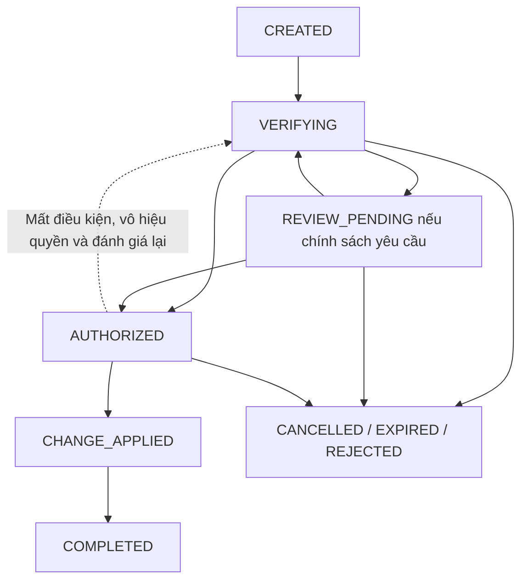

# Recovery journey state transitions: chuyển trạng thái trong hành trình khôi phục tài khoản

Một luồng khôi phục không kết thúc ở việc người dùng nhập đúng mã. Hệ thống còn phải quyết định bằng chứng đó đủ cho quyền nào, áp dụng thay đổi đúng một lần, xử lý session và cho biết kết quả nào đã thực sự có hiệu lực.

**Recovery journey state transitions** là các bước chuyển trạng thái của một giao dịch khôi phục tài khoản, kèm điều kiện được phép chuyển, tác động và cách xử lý khi có lỗi. Mô hình này giúp backend phân biệt một yêu cầu chưa tin cậy với một quyền recovery đã được cấp và một thay đổi đã được thực hiện.

Bài học thuộc chủ đề **Recovery Journey**, trong phạm vi khôi phục an toàn khi người dùng mất mật khẩu, MFA, passkey hoặc thiết bị xác thực. Các trạng thái dưới đây là mô hình thiết kế minh họa, không phải bộ tên bắt buộc cho mọi hệ thống.

## 1. Vì sao cần mô hình trạng thái ở backend?

Giả sử giao diện có ba màn hình: nhập email, nhập OTP, đặt mật khẩu. Nếu backend chỉ kiểm tra màn hình hiện tại hoặc một cờ `verified = true`, nó khó trả lời những câu hỏi quan trọng:

- OTP được xác minh cho tài khoản nào, mục đích nào và trong giao dịch nào?
- Người yêu cầu đã đủ quyền đặt mật khẩu hay mới chứng minh nhận được email?
- Giao dịch có hết hạn hoặc bị hủy sau khi màn hình được mở không?
- Hai yêu cầu gửi đồng thời có thể cùng dùng một quyền recovery không?
- Mật khẩu đã đổi nhưng bước thu hồi session thất bại thì hệ thống đang ở đâu?
- Người dùng mất kết nối sau khi nhấn xác nhận thì lần thử lại nên làm gì?

Một mô hình trạng thái buộc mỗi câu hỏi có một kết quả xác định. Trình duyệt hiển thị tiến trình; backend quyết định chuyển trạng thái.

### 1.1. Trạng thái không phải bằng chứng xác thực

Nếu trình duyệt gửi `state = AUTHORIZED`, đó chỉ là dữ liệu do bên yêu cầu cung cấp. Backend phải tự đọc trạng thái và căn cứ đã lưu.

Tương tự, tên màn hình “Xác minh thành công” không tạo ra quyền thay thông tin xác thực. Chỉ quyết định chính sách được thực thi ở backend mới cấp quyền đó.

### 1.2. Những bất biến cần giữ

Một số bất biến nền tảng:

1. Chưa đủ bằng chứng thì chưa cấp quyền thay thông tin xác thực.
2. Quyền recovery gắn với đúng tài khoản, tenant nếu có, mục đích và giao dịch.
3. Giao dịch đã hủy, bị từ chối hoặc hết hạn trước khi áp dụng thay đổi không được tiếp tục áp dụng bằng một yêu cầu cũ.
4. Một quyền dùng một lần không thể tạo ra nhiều thay đổi độc lập.
5. Yêu cầu chưa được xác minh không tự khóa mọi session hoặc xóa phương tiện hợp lệ.
6. Thay đổi đã được áp dụng không bị mô tả như chưa xảy ra chỉ vì bước thông báo lỗi.
7. Hoàn tất recovery không mặc định đồng nghĩa có phiên đăng nhập đầy đủ hoặc mọi quyền quản trị.

Các bất biến này phải được giữ khi retry, khi có nhiều tab và khi nhiều dịch vụ xử lý cùng một giao dịch.

## 2. Tách các lớp trạng thái

Một hành trình thường có nhiều đối tượng với vòng đời riêng. Dùng một field cho tất cả dễ dẫn đến quyết định sai.

| Đối tượng | Ví dụ trạng thái | Ý nghĩa |
| --- | --- | --- |
| Giao dịch recovery | VERIFYING, AUTHORIZED, CHANGE_APPLIED | Toàn bộ yêu cầu đang ở giai đoạn nào |
| Thử thách xác minh | ACTIVE, CONSUMED, EXPIRED | Một mã hoặc thử thách cụ thể còn sử dụng được không |
| Công việc gửi thông điệp | QUEUED, SENT, DELIVERY_FAILED | Việc gửi tới kênh đã tiến triển đến đâu |
| Bằng chứng đã kiểm tra | Đã xác minh, hết độ mới, bị vô hiệu | Kết quả kiểm tra nào còn dùng được cho chính sách |
| Quyền recovery | ACTIVE, CONSUMED, REVOKED, EXPIRED | Một quyền cụ thể còn cho phép thay đổi không |
| Tài khoản | Phiên bản bảo mật, trạng thái phương tiện | Cấu hình bảo mật hiện tại của tài khoản |
| Session | Có hiệu lực, bị thu hồi, bị hạn chế | Chủ thể có thể truy cập những gì |
| Tác động sau thay đổi | PENDING, DONE, RETRY_REQUIRED | Thu hồi ở hệ thống liên quan hoặc gửi thông báo đã hoàn tất chưa |

Ví dụ, `SENT` chỉ có nghĩa bước gửi đã đạt kết quả theo cơ chế gửi; nó không chứng minh người dùng nhận được thông điệp, càng không chứng minh họ nhập đúng mã.

Một thử thách có thể hết hạn trong khi giao dịch vẫn còn thời gian để dùng một phương án khác. Một quyền đã tiêu thụ có thể đi cùng giao dịch đang hoàn tất các tác động sau thay đổi.

## 3. Một mô hình trạng thái giao dịch

Có thể dùng các trạng thái chính sau:

| Trạng thái | Điều đã biết | Điều chưa được suy ra |
| --- | --- | --- |
| CREATED | Hệ thống đã tiếp nhận và tạo giao dịch hợp lệ về cấu trúc | Chưa xác minh quyền của người yêu cầu |
| VERIFYING | Đang thu thập, kiểm tra bằng chứng theo phương án được phép | Chưa mặc định đủ quyền thay phương tiện |
| REVIEW_PENDING | Đang chờ một bước thẩm định hoặc phê duyệt đã được chính sách quy định | Người hỗ trợ chưa có quyền bỏ qua phần bằng chứng bắt buộc |
| AUTHORIZED | Có quyết định cấp quyền recovery cụ thể, còn hiệu lực tại thời điểm cấp | Chưa áp dụng thay đổi; quyền có thể hết hạn hoặc bị vô hiệu |
| CHANGE_APPLIED | Thay đổi cốt lõi đã được ghi nhận và quyền tương ứng đã được tiêu thụ | Chưa chắc mọi tác động bắt buộc ở hệ thống liên quan đã hoàn tất |
| COMPLETED | Các điều kiện hoàn tất được định nghĩa cho giao dịch đã được đáp ứng | Không tự có quyền truy cập ngoài chính sách |
| CANCELLED | Giao dịch được hủy hợp lệ trước khi áp dụng thay đổi | Không có nghĩa mọi session của tài khoản bị thu hồi |
| EXPIRED | Giao dịch không còn hiệu lực để áp dụng thay đổi | Không đồng nghĩa tài khoản bị khóa |
| REJECTED | Có quyết định kết thúc không cho phép tiếp tục theo giao dịch này | Không mặc định người yêu cầu là kẻ tấn công |

Trong mô hình này, CANCELLED, EXPIRED và REJECTED là trạng thái kết thúc trước thay đổi. Sau CHANGE_APPLIED, hệ thống không chuyển sang các trạng thái đó để giả vờ rằng thay đổi chưa từng xảy ra.



Sơ đồ rút gọn các nhánh kết thúc từ CREATED. Mỗi hệ thống cần chỉ định chính xác trạng thái nào được hủy, thời hạn nào áp dụng và sự kiện nào có quyền tạo chuyển tiếp.

### 3.1. Sự kiện không tự có thẩm quyền chuyển bước

Phân biệt ba việc:

- **Lệnh:** người dùng hoặc dịch vụ đề nghị thực hiện thao tác, như kiểm tra OTP hoặc đặt mật khẩu.
- **Điều kiện chuyển:** backend kiểm tra trạng thái, quyền, bằng chứng, thời hạn và phiên bản liên quan.
- **Sự kiện đã xảy ra:** hệ thống ghi nhận kết quả sau khi thao tác thực sự thành công.

Một callback từ nhà cung cấp nói “đã gửi email” không thể chuyển giao dịch sang AUTHORIZED. Một nhân viên ghi chú “đã liên hệ khách hàng” cũng không tự tạo bằng chứng đủ để thay MFA.

## 4. Đặc tả từng bước chuyển

Mỗi bước nên có ít nhất bốn thành phần: trạng thái nguồn, lệnh hoặc sự kiện, điều kiện cho phép và tác động.

| Chuyển tiếp | Điều kiện chính | Tác động được kiểm soát |
| --- | --- | --- |
| Không có giao dịch → CREATED | Yêu cầu hợp lệ về cấu trúc, qua kiểm soát lạm dụng thích hợp | Tạo định danh giao dịch; chưa thay tài khoản |
| CREATED → VERIFYING | Xác định phương án được phép cho mục đích và chính sách | Tạo thử thách hoặc bước thu thập bằng chứng phù hợp |
| VERIFYING → VERIFYING | Một bằng chứng được kiểm tra nhưng còn thiếu điều kiện khác | Lưu kết quả có ràng buộc; chưa mở rộng quyền |
| VERIFYING → REVIEW_PENDING | Đạt điều kiện tiếp nhận của đường thẩm định đã thiết kế | Chuyển hồ sơ đúng thẩm quyền; chưa cấp quyền cuối |
| REVIEW_PENDING → VERIFYING | Cần bổ sung bằng chứng theo chính sách | Yêu cầu phần bổ sung, giữ nguyên ranh giới quyền |
| VERIFYING hoặc REVIEW_PENDING → AUTHORIZED | Bộ bằng chứng còn hợp lệ, đủ mới, đạt chính sách và điều kiện rủi ro | Cấp quyền có phạm vi, thời hạn và căn cứ rõ ràng |
| AUTHORIZED → CHANGE_APPLIED | Quyền còn hợp lệ, đúng thao tác; kiểm tra lại điều kiện bảo mật tại điểm áp dụng | Áp dụng thay đổi và tiêu thụ quyền một cách nhất quán |
| CHANGE_APPLIED → COMPLETED | Các tác động bắt buộc trong định nghĩa hoàn tất đã được xác nhận | Kết thúc giao dịch với kết quả có thể giải thích |
| Trạng thái trước CHANGE_APPLIED → CANCELLED | Chủ thể có quyền hủy và điều kiện hủy còn đúng | Vô hiệu quyền và thử thách của giao dịch theo chính sách |
| Trạng thái trước CHANGE_APPLIED → EXPIRED | Mốc thời gian liên quan đã qua theo quy tắc máy chủ | Không cho áp dụng thay đổi bằng giao dịch đó |
| Trạng thái trước CHANGE_APPLIED → REJECTED | Có quyết định từ chối hợp lệ | Kết thúc giao dịch, ghi lý do nội bộ phù hợp |

Đây là bảng quyết định, không phải các thao tác mà client được tùy chọn bằng cách gửi tên trạng thái.

### 4.1. Thử sai không nhất thiết kết thúc toàn bộ hành trình

Một lần nhập sai mã có thể chỉ tăng bộ đếm thử của thử thách. Nó không nhất thiết làm giao dịch REJECTED ngay.

Chính sách cần xác định khi nào được thử lại, khi nào thử thách không còn hiệu lực và khi nào giao dịch phải kết thúc. Các giới hạn cần bao phủ cả việc tạo nhiều thử thách, không chỉ số lần nhập trên một mã.

Lỗi mạng hoặc nhà cung cấp gửi chậm cũng không phải bằng chứng người dùng trái phép. Không gom mọi lỗi vào một trạng thái FAILED duy nhất rồi xóa thông tin về phần đã thực hiện.

## 5. Vòng đời của thử thách và kết quả xác minh

Một giao dịch có thể có nhiều thử thách: nhận mã email, chứng minh sử dụng passkey còn lại, nhập mã dự phòng hoặc hoàn tất một bước thẩm định.

Trạng thái của từng thử thách cần độc lập với trạng thái giao dịch.

| Trạng thái thử thách | Ý nghĩa | Hành vi khi nhận yêu cầu kiểm tra |
| --- | --- | --- |
| ACTIVE | Chưa hết hạn, chưa dùng, còn trong giới hạn thử | Kiểm tra mã hoặc phản hồi theo giao thức tương ứng |
| CONSUMED | Đã được dùng để ghi nhận một kết quả hợp lệ | Không tạo thêm bằng chứng hoặc quyền mới từ cùng thử thách |
| EXPIRED | Đã quá thời hạn | Từ chối dùng lại; hướng đến bước được phép tiếp theo |
| SUPERSEDED | Đã bị thay bằng một thử thách khác theo chính sách | Không chấp nhận mã cũ dù còn trong thời hạn ban đầu |
| INVALIDATED | Bị vô hiệu do hủy giao dịch hoặc thay đổi bảo mật liên quan | Không chấp nhận tiếp tục |

Không lưu trạng thái “đúng mã” chỉ trong trình duyệt. Kết quả cần được ghi ở backend và gắn với tài khoản, giao dịch, mục đích, loại bằng chứng, thời điểm kiểm tra và thử thách tương ứng.

### 5.1. Kiểm tra đúng mã và tiêu thụ thử thách phải nhất quán

Nếu hai tiến trình cùng thấy một mã chưa dùng, cả hai có thể cùng chấp nhận nếu việc kiểm tra và cập nhật bị tách rời không có đồng bộ.

Một thao tác xác minh cần bảo đảm rằng:

1. Giao dịch vẫn cho phép bước xác minh đó.
2. Thử thách đúng tài khoản, mục đích và bước hiện tại.
3. Mã còn hạn và chưa vượt giới hạn thử.
4. Phản hồi là hợp lệ.
5. Thử thách được tiêu thụ và bằng chứng được ghi nhận nhất quán.

Chỉ một lần sử dụng được tạo ra kết quả mới. Retry của cùng thao tác có thể nhận kết quả đã ghi theo cơ chế thích hợp, nhưng không tạo thêm quyền độc lập.

Thử thách có thể đã tiêu thụ trong khi giao dịch vẫn VERIFYING vì còn thiếu bằng chứng khác. Không cần cho mã cũ sống lại để tiếp tục hành trình.

### 5.2. Gửi lại mã không được khởi động lại toàn bộ kiểm soát lạm dụng

Giả sử sản phẩm chọn chỉ giữ một mã ACTIVE cho một bước. Khi gửi lại, nó cần quy định mã cũ chuyển sang SUPERSEDED ở thời điểm nào và mã mới có hiệu lực ra sao.

Các tình huống cần xử lý:

- Email cũ đến sau email mới.
- Công việc gửi mã cũ được retry muộn.
- Người dùng nhập mã từ thông điệp đến chậm.
- Hai tab cùng yêu cầu gửi lại.
- Đối thủ tạo giao dịch khác để cố làm mất hiệu lực giao dịch của nạn nhân.

Quyền tiếp tục giao dịch và chính sách gửi lại phải được kiểm tra ở backend. Không cho một yêu cầu công khai mới tùy ý vô hiệu mọi thử thách đã được người dùng hợp pháp thiết lập trên toàn tài khoản.

Bộ đếm giới hạn có thể cần nằm ở nhiều phạm vi như thử thách, giao dịch, tài khoản, kênh và nguồn yêu cầu. Tạo mã mới không nên xóa mọi giới hạn tích lũy.

### 5.3. Trạng thái gửi không thay thế trạng thái xác minh

Một nhà cung cấp có thể trả về kết quả gửi, báo lỗi hoặc gửi callback muộn. Các thông tin đó chỉ cập nhật công việc gửi tương ứng sau khi được kiểm tra nguồn và ràng buộc.

Chúng không được:

- Làm sống lại thử thách đã hết hạn.
- Đổi người nhận sau khi bằng chứng đã được gắn với một kênh khác.
- Tự chuyển giao dịch sang AUTHORIZED.
- Đặt lại bộ đếm thử mã.
- Gỡ trạng thái CANCELLED hoặc EXPIRED.

Nếu việc gửi thất bại, hệ thống có thể retry hoặc cho dùng một phương án khác được chính sách chấp nhận. Nó không tự hạ mức bằng chứng để giữ cho hành trình luôn thành công.

## 6. Từ bằng chứng đến quyền recovery

Một phản hồi hợp lệ chỉ là một đầu vào cho quyết định cấp quyền. Có thể cần nhiều điều kiện khác trước khi chuyển sang AUTHORIZED.

Ví dụ, một mã SMS đúng có thể chứng minh người yêu cầu nhận được mã qua số đó. Chính sách vẫn có thể không chấp nhận căn cứ này là đủ để gỡ MFA hoặc thay passkey.

### 6.1. Kiểm tra tại thời điểm cấp quyền

Backend cần xem xét:

- Bằng chứng có thuộc đúng tài khoản và giao dịch không.
- Nó được kiểm tra cho đúng mục đích không.
- Nó còn đủ mới và chưa bị vô hiệu không.
- Các bằng chứng được tính riêng có độc lập trước đối thủ đang xét không.
- Có đủ điều kiện phê duyệt hoặc thẩm định theo chính sách không.
- Có tín hiệu hoặc thay đổi bảo mật khiến phải xác minh thêm không.
- Phạm vi quyền sắp cấp có vượt kết quả được phép không.

Một IP quen thuộc không thay thế phần bằng chứng bắt buộc. Thời gian chờ kết thúc cũng không tự tạo ra sự đồng ý của chủ tài khoản.

Nếu có REVIEW_PENDING, người thẩm định phải dùng đúng thẩm quyền và căn cứ đã được thiết kế. Một ghi chú tùy ý không thể biến thành lệnh bỏ qua chính sách.

### 6.2. Quyền được cấp cần có phạm vi

Một quyền minh họa có thể chứa hoặc tham chiếu:

```text
recovery_grant:
  grant_id
  transaction_id
  account_id
  tenant_id_if_applicable
  allowed_operation
  evidence_references
  policy_version
  account_security_version
  issued_at
  expires_at
  consumed_at
  status
```

Đây là mô hình nội bộ. Không cần trả toàn bộ dữ liệu cho client và không lưu bí mật của bằng chứng trong các trường tham chiếu.

Một quyền đặt mật khẩu mới không mặc định cho đổi email, thay MFA, thêm passkey hoặc tạo phiên đầy đủ.

Nếu người dùng thay mục tiêu trong hành trình, backend phải đánh giá lại cho thao tác mới. Không mang một cờ đã xác minh từ bước ít quyền sang bước nhiều quyền.

### 6.3. Bằng chứng mới không tự nối người yêu cầu với tài khoản cũ

Nhận mã ở email vừa được nhập chỉ chứng minh người yêu cầu kiểm soát email mới. Tạo passkey mới chỉ chứng minh họ có thể sử dụng khóa mới.

Quyền gắn kênh hoặc khóa mới vào tài khoản đích phải đến từ bằng chứng và quyết định recovery phù hợp. Không dùng việc đăng ký mới làm căn cứ duy nhất cho chính quyền đăng ký đó.

## 7. Áp dụng thay đổi đúng một lần

Chuyển AUTHORIZED → CHANGE_APPLIED là ranh giới nhạy cảm nhất. Ở đây hệ thống thay thông tin xác thực hoặc cấu hình bảo mật thật.

Không nên thực hiện theo cách:

```text
kiểm tra quyền còn dùng được
đổi mật khẩu
đánh dấu quyền đã dùng
```

Nếu các bước không được bảo vệ bằng giao dịch hoặc cơ chế đồng bộ tương ứng, hai yêu cầu có thể cùng vượt kiểm tra trước khi quyền bị đánh dấu đã dùng.

### 7.1. Mã giả cho thay đổi trong cùng miền giao dịch

```text
applyRecoveryChange(context, transactionId, grantId, operation, input, requestKey):
    require context may continue this transaction
    require input is valid for the requested operation

    begin atomic transaction:
        tx = lockRecoveryTransaction(transactionId)

        previous = findIdempotentResult(
            context, tx.id, operation, requestKey
        )
        if previous exists:
            require request content matches previous request
            return previous safe result

        require tx.state == AUTHORIZED

        grant = lockRecoveryGrant(grantId)
        account = lockAccountSecurityState(tx.accountId)

        require grant belongs to tx and account
        require grant is active, unused and not expired
        require operation is within grant.allowedOperation
        require transaction deadline is still satisfied
        require account security state matches the authorized decision
        require applicable policy still permits this change

        result = applyValidatedCredentialChange(account, operation, input)

        consume grant
        update account security version as required
        record required local session or token changes
        set tx.state = CHANGE_APPLIED
        record safe idempotent result
        append durable events for remaining effects

    commit atomic transaction
    return result
```

Đây là mã giả, không phải mã chạy trực tiếp. Tên khóa và cấu trúc giao dịch phụ thuộc kho dữ liệu và kiến trúc.

Việc khóa, kiểm tra phiên bản hoặc cập nhật có điều kiện phải thực sự ngăn các thay đổi cạnh tranh vượt qua cùng một quyết định. Một field `version` được lưu nhưng không kiểm tra khi ghi không tạo ra bảo đảm đó.

### 7.2. Phiên bản bảo mật giúp phát hiện quyết định đã cũ

Giữa lúc cấp quyền và áp dụng thay đổi, tài khoản có thể đã:

- Đổi hoặc thu hồi kênh recovery liên quan.
- Thu hồi phương tiện đang được dùng làm bằng chứng.
- Hoàn tất một giao dịch recovery khác.
- Bị đặt hạn chế theo một quyết định xử lý sự cố có thẩm quyền.
- Thay đổi role hoặc điều kiện tổ chức ảnh hưởng đến quyền được cấp.

Backend phải kiểm tra các điều kiện còn phù hợp tại điểm áp dụng. Khi chúng không còn đúng, quyền cũ phải bị vô hiệu hoặc giao dịch phải được đánh giá lại theo quy tắc rõ ràng.

Nếu cho chuyển AUTHORIZED trở lại VERIFYING, cần vô hiệu quyền cũ và những kết quả không còn giá trị. Không chỉ đổi tên trạng thái rồi để token trước đó tiếp tục được API khác chấp nhận.

### 7.3. Idempotency khác với dùng một lần

**Dùng một lần** ngăn cùng một quyền tạo nhiều thay đổi độc lập.

**Idempotency** giúp một lần thử lại của cùng thao tác nhận kết quả nhất quán, ví dụ khi phản hồi bị mất sau khi backend đã đổi mật khẩu.

Khóa idempotency cần gắn với giao dịch, thao tác và nội dung yêu cầu tương ứng. Nó không phải bằng chứng xác thực và không đủ để xem kết quả của người khác.

Nếu cùng khóa được dùng với một mật khẩu hoặc phương tiện khác, backend không được lặng lẽ coi đó là cùng yêu cầu. Nó cần xử lý xung đột theo giao thức đã thiết kế.

Kết quả lưu cho retry không nên chứa mật khẩu, mã dự phòng hoặc token nhạy cảm không cần thiết. Một phản hồi an toàn có thể cho biết thao tác đã hoàn thành mà không phát lại bí mật.

## 8. Thay đổi đã áp dụng và các tác động còn lại

CHANGE_APPLIED cho biết thay đổi cốt lõi đã được ghi nhận. Một số tác động có thể vẫn cần thực hiện ở các thành phần khác:

- Thu hồi session hoặc refresh token theo chính sách.
- Làm nơi kiểm tra truy cập nhận biết phiên bản bảo mật mới.
- Vô hiệu quyền recovery còn liên quan.
- Cập nhật hạn chế sau recovery.
- Gửi thông báo và ghi nhận kết quả vận hành.

Cần định nghĩa tác động nào là điều kiện bắt buộc trước COMPLETED và tác động nào được theo dõi riêng. Ví dụ, gửi email thông báo lỗi không nên khiến hệ thống nói mật khẩu chưa đổi; nhưng một hiệu lực thu hồi bắt buộc chưa được thực thi không nên bị báo như đã hoàn tất.

### 8.1. Không hứa một giao dịch nguyên tử qua mọi hệ thống nếu kiến trúc không có

Nếu thay mật khẩu nằm trong một kho dữ liệu còn thu hồi token ở dịch vụ khác, cần có cách bảo đảm công việc còn lại không bị quên.

Một phương án thiết kế là ghi **outbox** cùng giao dịch cập nhật cốt lõi: bản ghi mô tả các sự kiện cần xử lý sau được lưu bền vững, rồi worker chuyển chúng tới nơi thực hiện.

Outbox không tự bảo đảm mọi nơi đã xử lý. Thành phần nhận vẫn cần:

- Nhận diện sự kiện đã xử lý để không lặp tác động.
- Kiểm tra định danh, phiên bản và phạm vi liên quan.
- Xử lý sự kiện đến muộn hoặc sai thứ tự.
- Retry lỗi tạm thời và có đường đối soát khi không thể hoàn tất.

Không đẩy token recovery nguyên vẹn hoặc bí mật phương tiện vào sự kiện chỉ để tiện debug.

### 8.2. Lỗi sau khi thay đổi không phải quay về trạng thái chưa thay đổi

Nếu mật khẩu đã đổi nhưng tác động bắt buộc còn lỗi, giữ thông tin CHANGE_APPLIED cùng trạng thái công việc còn lại. Hệ thống có thể retry, hạn chế truy cập hoặc chuyển đối soát theo chính sách.

Không chuyển giao dịch sang EXPIRED rồi cho người dùng hiểu rằng mật khẩu cũ vẫn còn hiệu lực.

Nếu cần hoàn nguyên hoặc sửa một thay đổi, đó là một thao tác mới có thẩm quyền và dấu vết riêng. Một sự kiện lỗi từ hệ thống gửi thông báo không được tự phục hồi phương tiện cũ có thể đã bị lộ.

## 9. Hết hạn, hủy và các cuộc đua chuyển trạng thái

Các nhánh kết thúc cần cùng cơ chế kiểm soát đồng thời với nhánh áp dụng thay đổi. Không thể coi chúng là công việc dọn dẹp ít quan trọng.

### 9.1. Hết hạn phải được kiểm tra ngay cả khi bộ dọn dẹp chưa chạy

Một công việc nền có thể đánh dấu giao dịch quá hạn. Tuy nhiên, API áp dụng thay đổi vẫn phải kiểm tra thời hạn bằng mốc thời gian có thẩm quyền của máy chủ.

Không chấp nhận một quyền đã hết hạn chỉ vì field trạng thái chưa được công việc nền cập nhật.

Các thời hạn cần phân biệt:

| Thời hạn | Hết hạn có nghĩa gì? |
| --- | --- |
| Thử thách | Phản hồi cho thử thách đó không còn được chấp nhận |
| Độ mới bằng chứng | Kết quả kiểm tra có thể không còn đủ mới để cấp quyền |
| Quyền recovery | Không được dùng quyền đó để áp dụng thay đổi mới |
| Giao dịch | Không tiếp tục theo giao dịch đó ngoài quy tắc được thiết kế |
| Session hạn chế | Không tiếp tục truy cập chỉ vì giao dịch từng thành công |

Sản phẩm cần chỉ định thời điểm kiểm tra hạn đối với bước áp dụng thay đổi. Quy tắc phải được thực hiện cùng thao tác ghi để không có khoảng trống giữa kiểm tra thời gian và sử dụng quyền.

Một giao dịch đã CHANGE_APPLIED không bị bộ dọn dẹp chuyển thành EXPIRED chỉ vì thời hạn dùng quyền cũ đã qua.

### 9.2. Hủy giao dịch cần quyền phù hợp

Biết định danh giao dịch không mặc định đủ quyền hủy. Hệ thống cần kiểm tra ngữ cảnh có quyền tiếp tục hoặc quyền hủy được cấp riêng theo thiết kế.

Nếu dùng liên kết hủy trong thông báo, quyền đó cần có phạm vi và giới hạn rõ. Nó không được trở thành quyền thay mật khẩu hoặc khóa toàn bộ tài khoản.

Một GET khi mở liên kết chỉ nên hiển thị bước phù hợp; không nên tự áp dụng thay đổi nhạy cảm chỉ vì trang được tải. Công cụ xem trước hoặc quét liên kết có thể mở URL mà không thể hiện ý định của chủ tài khoản.

Hành động xác nhận cần được thực hiện theo cơ chế có kiểm tra quyền và chống giả mạo yêu cầu phù hợp với kiến trúc.

### 9.3. Hủy và áp dụng thay đổi đến cùng lúc

Giả sử hai tiến trình xử lý cùng giao dịch:

```text
Tiến trình A: yêu cầu áp dụng thay đổi
Tiến trình B: yêu cầu hủy
```

Cả hai không được cùng trả về kết quả mâu thuẫn. Cơ chế khóa hoặc cập nhật có điều kiện cần xác định một thứ tự nhất quán:

- Nếu hủy thắng trước, quyền bị vô hiệu và thao tác áp dụng không được thành công.
- Nếu áp dụng thắng trước, giao dịch đã CHANGE_APPLIED; hủy không được tuyên bố đã ngăn thay đổi.
- Nếu người dùng báo yêu cầu trái phép sau đó, mở đường xử lý sự cố phù hợp.

Thông báo hủy thành công không được làm người dùng hiểu rằng một thay đổi đã áp dụng đã được hoàn nguyên.

### 9.4. Giao dịch khác không tự có quyền phá giao dịch hiện tại

Một tài khoản có thể có nhiều yêu cầu do người dùng thử lại hoặc do đối thủ gửi. Cần quy định giao dịch nào được tiếp tục, bằng chứng có được chia sẻ không và lúc nào các quyền liên quan bị vô hiệu.

Một lựa chọn là sau khi một thay đổi bảo mật hợp lệ hoàn tất, tăng phiên bản bảo mật và vô hiệu các giao dịch cũ có quyết định không còn phù hợp. Điều này khác với hủy tất cả chỉ vì có một yêu cầu công khai mới.

Không tự ghép bằng chứng từ các giao dịch khác nhau nếu chưa có cơ chế liên kết và quyết định chính sách rõ ràng.

## 10. Tiếp tục hành trình qua nhiều tab hoặc thiết bị

Người dùng có thể bắt đầu trên máy tính, nhận email trên điện thoại rồi quay lại máy tính. Hệ thống cần hỗ trợ tình huống hợp lệ mà không cho bất kỳ ai biết mã giao dịch chiếm quyền tiếp tục.

### 10.1. Ngữ cảnh tiếp tục không chỉ là một ID

Định danh giao dịch giúp định tuyến yêu cầu, nhưng không nên tự đóng vai trò bằng chứng duy nhất cho mọi bước.

Tùy thiết kế, quyền tiếp tục có thể dựa trên một ngữ cảnh được bảo vệ, token có phạm vi hoặc bằng chứng vừa được xác minh. Các bí mật này cần có thời hạn, được bảo vệ khỏi lộ qua log, lịch sử hoặc chuyển tiếp không chủ đích.

Một liên kết chứa bearer token thực tế mang theo một quyền cho người giữ nó. Không nên gọi nó là “chỉ có ID” nếu token đó đủ để tiếp tục.

### 10.2. Quy tắc nhiều tab phải do backend quyết định

Tab A có thể vẫn hiển thị AUTHORIZED trong khi tab B đã hoàn tất hoặc hủy. Khi A gửi yêu cầu, backend đọc trạng thái hiện tại và trả kết quả phù hợp.

Không cập nhật trạng thái máy chủ theo dữ liệu cũ trong local storage.

Với bước gửi lại mã, giao diện cần giải thích mã nào còn dùng được theo chính sách, nhưng backend vẫn là nơi quyết định. Nếu người dùng mất ngữ cảnh cần thiết, sản phẩm cần hướng đến bước tiếp tục an toàn hoặc bắt đầu lại.

### 10.3. Chuyển thiết bị cần được thiết kế rõ

Nếu cho mở liên kết trên thiết bị khác, cần xác định quyền được chuyển tới đâu, tài khoản nào đang được xử lý và các bước nào còn bắt buộc.

Không tự tạo phiên đăng nhập đầy đủ trên thiết bị chỉ vì nó mở một liên kết dành cho một quyền recovery hẹp.

Ràng buộc cứng vào IP có thể cản người dùng đổi mạng; IP cũng không phải bằng chứng quyền sở hữu tài khoản. Những tín hiệu thiết bị hoặc mạng cần được dùng theo vai trò rủi ro, cùng một cơ chế chuyển ngữ cảnh có kiểm soát.

## 11. Dữ liệu và giao diện API hỗ trợ mô hình trạng thái

Một giao dịch minh họa có thể lưu:

```text
recovery_transaction:
  id
  account_id
  tenant_id_if_applicable
  purpose
  state
  revision
  policy_version
  account_security_version_at_decision
  created_at
  expires_at
  authorized_at
  change_applied_at
  completed_at
  termination_reason_if_applicable
```

Các thử thách, bằng chứng, quyền, kết quả idempotency và công việc sau thay đổi có thể nằm trong các bản ghi riêng, liên kết bằng định danh nội bộ.

Không cần lưu mọi thứ trong một JSON do client có thể sửa. Cũng không lưu OTP, mật khẩu hoặc mã dự phòng nguyên vẹn để phục vụ việc đọc trạng thái. Cách lưu giá trị kiểm tra phải phù hợp loại bí mật; với mã ngắn, chỉ băm đơn giản không tự ngăn được việc thử hết không gian mã khi dữ liệu bị lộ.

### 11.1. API mô tả hành động, không cho client tùy ý đặt trạng thái

Ví dụ các lệnh ở mức khái niệm:

```text
POST /recovery/requests
POST /recovery/requests/{id}/evidence
POST /recovery/requests/{id}/apply
POST /recovery/requests/{id}/cancel
GET  /recovery/requests/{id}/status
```

Backend tự xác định trạng thái đích sau khi kiểm tra điều kiện. Tránh endpoint cho phép client gửi một tên trạng thái bất kỳ rồi lưu thẳng vào cơ sở dữ liệu.

Các yêu cầu thay đổi cần được kiểm tra quyền trên đúng giao dịch. Đường đọc status cũng cần bảo vệ vì kết quả có thể làm lộ tài khoản, kênh hoặc tiến trình xác minh.

### 11.2. Trạng thái nội bộ và thông điệp công khai có thể khác nhau

Với người ngoài chưa xác minh, phản hồi cần hạn chế tiết lộ tài khoản có tồn tại hay không, phương tiện nào đã đăng ký hoặc giao dịch có đạt bước xác minh nhạy cảm không.

Với ngữ cảnh hợp lệ của người đang thực hiện recovery, giao diện nên cung cấp bước tiếp theo có ích:

| Tình trạng thực tế | Thông điệp có thể dùng trong ngữ cảnh được phép |
| --- | --- |
| Còn thiếu một bằng chứng | “Cần hoàn tất bước xác minh tiếp theo.” |
| Thử thách không còn dùng được | “Mã này không còn hiệu lực. Hãy tiếp tục bằng lựa chọn được hiển thị.” |
| Thay đổi đã áp dụng, còn bước bắt buộc | “Thay đổi đã được ghi nhận; một số bước bảo mật đang được hoàn tất.” |
| Giao dịch đã kết thúc trước thay đổi | “Yêu cầu này không thể tiếp tục. Bạn có thể bắt đầu lại theo hướng dẫn.” |
| Hoàn tất nhưng chưa mở phiên | “Đã hoàn tất thay đổi. Hãy đăng nhập theo yêu cầu hiện tại.” |

Thông điệp cần khớp trạng thái thực thi. Không báo “mọi thiết bị đã đăng xuất” nếu chỉ mới gửi một sự kiện yêu cầu thu hồi.

## 12. Ví dụ xuyên suốt: mất ứng dụng MFA

Giả sử Minh mất ứng dụng TOTP nhưng còn mật khẩu và mã dự phòng. Dịch vụ giả định chấp nhận bộ điều kiện này cho việc thay MFA, cùng các kiểm tra giao dịch và rủi ro đã quy định.

| Mốc | Sự kiện | Trạng thái và kết quả |
| --- | --- | --- |
| T0 | Minh bắt đầu yêu cầu thay MFA | CREATED; tài khoản chưa bị thay đổi |
| T1 | Hệ thống chọn đường dùng phương án dự phòng | VERIFYING |
| T2 | Minh đáp ứng bước kiểm tra mật khẩu | Vẫn VERIFYING vì chưa đủ bộ điều kiện |
| T3 | Mã dự phòng hợp lệ được kiểm tra và tiêu thụ, kết quả được gắn với giao dịch | Bộ bằng chứng được đánh giá theo chính sách |
| T4 | Đủ điều kiện cấp quyền thay MFA | AUTHORIZED; quyền chỉ dành cho thao tác đó |
| T5 | Minh thiết lập yếu tố mới trong ngữ cảnh tạm thời và chứng minh sử dụng được nó | Chưa tự mở quyền khác; backend chuẩn bị thay đổi được phép |
| T6 | Backend kiểm tra lại quyền và trạng thái bảo mật, áp dụng thay MFA nhất quán | CHANGE_APPLIED; quyền tương ứng đã tiêu thụ |
| T7 | Các tác động bắt buộc sau thay đổi được xác nhận | COMPLETED theo định nghĩa của dịch vụ |

Xác nhận yếu tố mới tại T5 chứng minh phương tiện mới hoạt động. Quyền gắn phương tiện đó với tài khoản đến từ quyết định recovery, không phải từ chính khóa hoặc bí mật mới tạo.

### 12.1. Phản hồi tại T6 bị mất

Minh không nhận được phản hồi nên nhấn xác nhận lần nữa. Với cùng khóa idempotency và cùng nội dung, backend trả kết quả đã ghi sau khi kiểm tra ngữ cảnh, thay vì thay MFA thêm một lần.

Nếu không có cơ chế retry tương ứng, backend vẫn phải từ chối dùng lại quyền đã tiêu thụ và cung cấp đường đọc kết quả an toàn. Không thể giải quyết bằng cách cho quyền đã dùng hoạt động lại.

### 12.2. Người ngoài yêu cầu recovery khác giữa T4 và T6

Yêu cầu công khai của người ngoài không tự có quyền xóa MFA hoặc vô hiệu mọi session của Minh.

Nếu một thay đổi bảo mật khác có thẩm quyền thực sự xảy ra trong thời gian đó, backend kiểm tra phiên bản hiện tại tại T6. Khi quyết định cũ không còn hợp lệ, nó không áp dụng theo quyền cũ.

### 12.3. Thu hồi ở một dịch vụ liên quan tạm thời thất bại

Nếu thu hồi đó là điều kiện bắt buộc để hoàn tất, giao dịch vẫn ở CHANGE_APPLIED với công việc còn chờ. Hệ thống retry hoặc chuyển đối soát; không nói rằng MFA chưa được thay.

Không cần Minh nhập lại mã dự phòng đã tiêu thụ chỉ để hệ thống làm nốt công việc sau thay đổi. Đồng thời không cấp lại một quyền thay MFA mới chỉ vì tác động bên ngoài đang lỗi.

## 13. Nhật ký và các tình huống cần đặc tả

Nhật ký nên tái dựng được chuỗi chuyển tiếp, gồm định danh giao dịch, trạng thái trước và sau, revision, loại lệnh, chủ thể hoặc dịch vụ thực hiện, phiên bản chính sách, tham chiếu bằng chứng và kết quả tác động.

Cần phân biệt lệnh đã nhận với sự kiện đã hoàn tất. “Đã yêu cầu thu hồi session” khác với “nơi thực thi đã xác nhận hiệu lực thu hồi”.

Không ghi OTP, token recovery nguyên vẹn, mật khẩu hoặc bí mật mã dự phòng. Dữ liệu liên hệ và hồ sơ thẩm định cũng cần quyền truy cập phù hợp.

| Tình huống | Bảo đảm cần mô tả |
| --- | --- |
| Client tự gửi trạng thái AUTHORIZED | Không có quyền chuyển nếu backend chưa đủ điều kiện |
| Đúng mã nhưng sai mục đích hoặc tài khoản | Không tạo bằng chứng dùng cho thao tác đích |
| Hai tiến trình kiểm tra cùng thử thách | Không tạo nhiều kết quả sử dụng mới |
| Gửi lại mã rồi callback cũ đến muộn | Không làm sống lại thử thách bị thay thế |
| Mã hết hạn nhưng bộ dọn dẹp chưa chạy | API vẫn từ chối mã quá hạn |
| Hủy và áp dụng xảy ra đồng thời | Chỉ một kết quả nhất quán được ghi nhận |
| Giao dịch hoặc quyền hết hạn trước áp dụng | Không thay thông tin xác thực bằng quyền đó |
| Thay đổi bảo mật sau khi cấp quyền | Đánh giá lại, không dùng quyết định đã cũ |
| Hai lần áp dụng cùng một quyền | Không tạo hai thay đổi độc lập |
| Retry sau khi phản hồi bị mất | Trả kết quả nhất quán hoặc hướng đọc kết quả an toàn |
| Lỗi sau khi thay đổi đã áp dụng | Giữ dấu vết phần đã xong và phần còn chờ |
| Công việc hết hạn chạy sau CHANGE_APPLIED | Không biến thay đổi thật thành một giao dịch chưa xảy ra |
| Người ngoài biết định danh giao dịch | Không tự đọc được dữ liệu nhạy cảm, hủy hoặc tiếp tục mọi bước |
| Mở liên kết bằng trình quét | Không tự hoàn tất thay đổi nhạy cảm chỉ bằng tải trang |
| Đã hoàn tất recovery nhưng thiếu điều kiện đăng nhập | Không tự cấp phiên đầy đủ hoặc quyền quản trị |

Đây là đầu vào cho đặc tả và kiểm thử triển khai. Một mô hình trạng thái chỉ có ích khi các điều kiện chuyển được thực thi thật ở backend, kể cả khi có lỗi, retry và xử lý đồng thời.

Hành trình recovery cần làm rõ ba ranh giới: **đã kiểm tra được bằng chứng**, **đã cấp quyền cho một thao tác** và **đã áp dụng thay đổi cùng các tác động cần thiết**. Giữ được ba ranh giới này giúp hệ thống hỗ trợ người dùng mất phương tiện xác thực mà không biến một bước xác minh đơn lẻ thành quyền kiểm soát tài khoản ngoài dự kiến.
