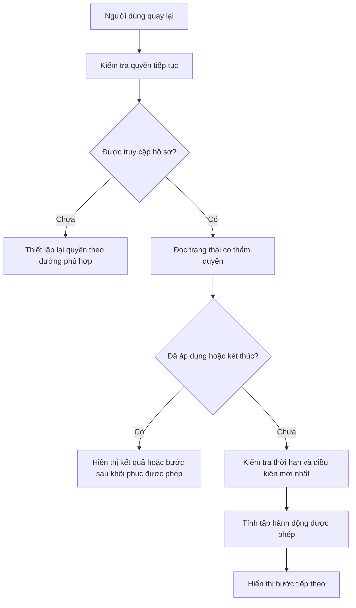

# Recovery journey resumption: Tiếp tục hành trình khôi phục sau gián đoạn

Trong chương **Recovery Journey** của `SECURITY_AUTHENTICATION_ACCOUNT_RECOVERY`, **recovery journey resumption** là khả năng tiếp tục một hồ sơ khôi phục đang tồn tại sau khi người dùng đóng trình duyệt, mất mạng, đổi thiết bị hoặc quay lại sau một khoảng thời gian. Mục tiêu là giữ được tiến trình hợp lệ mà không làm sống lại bằng chứng hết hạn, cấp lại quyền đã dùng hoặc cho người khác tiếp quản hồ sơ.

Người dùng có thể đang khôi phục mật khẩu, MFA, passkey hoặc thiết bị xác thực. Vì vậy, cơ chế tiếp tục không được mặc định rằng họ vẫn giữ trình duyệt cũ, có session đăng nhập đầy đủ hoặc còn dùng được yếu tố đã mất. Đồng thời, việc biết mã hồ sơ hay mở được trang tiến trình không tự chứng minh quyền thay đổi tài khoản.

Bài học tập trung vào cách lưu và đọc lại trạng thái, thiết lập quyền tiếp tục, kiểm tra lại chính sách, xử lý yêu cầu đồng thời và kết thúc thay đổi một cách có kiểm soát.

## 1. Mục tiêu học tập

Sau bài học, bạn có thể:

- Phân biệt tiếp tục hồ sơ với xác minh lại và cấp quyền thay credential.
- Thiết kế trạng thái có thẩm quyền ở máy chủ để giao diện không tự quyết định bước tiếp theo.
- Phân biệt thời hạn hồ sơ, bằng chứng, token tiếp tục và grant áp dụng thay đổi.
- Xử lý việc quay lại từ trình duyệt hoặc thiết bị khác mà không hạ yêu cầu xác minh.
- Ngăn một thao tác khôi phục bị thực hiện hai lần khi mất phản hồi hoặc gửi request đồng thời.
- Thiết kế trải nghiệm cho hồ sơ hết hạn, bị hủy, đã hoàn tất hoặc đang chờ tác vụ sau khôi phục.

## 2. Tiếp tục tiến trình không đồng nghĩa tiếp tục toàn bộ niềm tin

Giả sử An đã nộp một bằng chứng dự phòng để thay MFA, sau đó đóng trình duyệt khi đang chờ duyệt. Khi An quay lại, hệ thống có thể còn hồ sơ, kết quả xác minh và quyết định phê duyệt. Nhưng hệ thống vẫn cần xác định người đang quay lại có quyền tiếp tục hồ sơ hay không và các điều kiện cũ còn hiệu lực hay không.

Nên tách ba câu hỏi:

| Câu hỏi | Nội dung cần xác định |
|---|---|
| Đây là hồ sơ nào? | Định danh hồ sơ, tài khoản, tenant và thao tác khôi phục |
| Bên đang truy cập được làm gì với hồ sơ? | Xem trạng thái, nộp bằng chứng, xác nhận thay đổi hay áp dụng thao tác |
| Thay đổi hiện tại có còn được phép không? | Bằng chứng, phê duyệt, chính sách, thời hạn và trạng thái bảo mật mới nhất |

Một `case_id` chỉ giải quyết việc tìm hồ sơ. Một token tiếp tục có thể cấp quyền xem trạng thái hoặc thực hiện một số bước hẹp. Grant thay credential là quyền khác, chỉ được cấp khi đạt chính sách tương ứng.

Ngay cả khi một thiết kế dùng cùng một phương tiện mang nhiều quyền, các quyền đó vẫn phải được kiểm tra riêng về mục đích và điều kiện. Không nên coi mọi token liên quan đến khôi phục đều có thể dùng thay thế cho nhau.

### Những gián đoạn cần dự kiến

- Trình duyệt bị đóng hoặc trang bị tải lại sau khi nộp bằng chứng.
- Mất mạng trong lúc máy chủ đã áp dụng thay đổi nhưng chưa trả phản hồi.
- Người dùng mở email khôi phục trên điện thoại, còn hồ sơ được tạo ở máy tính.
- Người dùng mất luôn thiết bị từng bắt đầu hồ sơ.
- Hồ sơ phải chờ kiểm tra thủ công hoặc khoảng chờ theo chính sách.
- Hai tab, hai thiết bị hoặc một request thử lại cùng tác động lên hồ sơ.

Mỗi tình huống cần một hành vi xác định trước. Nếu không có cơ chế tiếp tục, người dùng dễ tạo nhiều hồ sơ mới; nếu cơ chế quá rộng, đối phương có thể dùng nó để bỏ qua các bước còn thiếu.

## 3. Lưu trạng thái có thẩm quyền ở máy chủ

Giao diện có thể nhớ vị trí hiển thị để thuận tiện, nhưng không được tự gửi `step = verified` rồi được máy chủ coi là đã xác minh. Những dữ liệu quyết định quyền phải được quản lý và kiểm tra phía máy chủ.

| Nhóm dữ liệu | Ví dụ | Ý nghĩa khi tiếp tục |
|---|---|---|
| Định danh và phạm vi | `case_id`, `subject_id`, `tenant_id`, `operation` | Ngăn trộn hồ sơ, tài khoản hoặc mục đích |
| Trạng thái | `status`, `state_version` | Xác định chuyển trạng thái hợp lệ và phát hiện request cũ |
| Chính sách | Phiên bản chính sách, tầng bảo vệ, nội dung thay đổi | Xác định có cần đánh giá lại không |
| Bằng chứng | Loại, tham chiếu kết quả, thời điểm, thời hạn, mục đích | Giữ lại kết quả còn hợp lệ; không khôi phục bí mật đã tiêu thụ |
| Phê duyệt | Người duyệt, phạm vi, phiên bản nội dung, thời hạn | Ngăn dùng quyết định cũ cho thay đổi mới |
| Ngữ cảnh bảo mật | Phiên bản bảo mật tài khoản và các điều kiện liên quan | Phát hiện thay đổi credential hoặc kênh trong thời gian gián đoạn |
| Quyền tiếp tục | Phạm vi, thời hạn, trạng thái thu hồi | Xác định bên đang truy cập được làm gì |
| Kết quả áp dụng | Định danh lệnh, kết quả, thời điểm và tác vụ đang chờ | Nhận biết thao tác đã hoàn tất thay vì thực hiện lại |

Không cần lưu lại OTP, recovery code hoặc token nguyên văn chỉ để hỗ trợ tiếp tục. Với bí mật dùng một lần, hệ thống có thể lưu trạng thái đã dùng và kết quả xác minh gắn với hồ sơ. Hồ sơ tiếp tục không được làm mã đã tiêu thụ dùng lại được ở một hồ sơ khác.

### Chỉ phục hồi bản nháp không có giá trị cấp quyền

Một số dữ liệu nhập dở có thể được khôi phục nếu có ích và không nhạy cảm. Không nên lưu mật khẩu mới, OTP hoặc recovery code trong local storage, URL, analytics hay bản nháp hỗ trợ. Khả năng giữ lại tiến trình không phải lý do để lưu bí mật lâu hơn cần thiết.

Thông tin như email khôi phục, loại yếu tố và chi tiết phê duyệt cũng có thể nhạy cảm. Chỉ trả về phần cần thiết sau khi bên truy cập đã có quyền xem tương ứng; trước đó có thể dùng thông báo chung.

## 4. Mô hình trạng thái và sự kiện quay lại

Một mô hình khái niệm có thể dùng các trạng thái sau:

```text
AWAITING_EVIDENCE
  -> AWAITING_REVIEW       nếu chính sách yêu cầu
  -> READY_TO_APPLY
  -> APPLIED
  -> POST_RECOVERY_PENDING nếu còn bước sau thay đổi
  -> COMPLETED

Các kết thúc trước khi áp dụng:
  CANCELLED, EXPIRED, DENIED
```

Trong triển khai cụ thể, các nhánh tùy chọn cần được diễn đạt bằng chuyển trạng thái rõ ràng. Không phải hồ sơ nào cũng trải qua mọi trạng thái.

**Quay lại là một sự kiện truy cập, không phải bằng chứng rằng trạng thái được nâng lên.** Hồ sơ đang chờ bằng chứng vẫn chờ bằng chứng sau khi mở lại; hồ sơ đang chờ duyệt không tự thành được duyệt chỉ vì người dùng đã chờ lâu.



Nếu credential đã được thay thành công, việc session tiếp tục hết hạn không đảo ngược thay đổi đó. Hồ sơ có thể còn việc sau khôi phục, nhưng không được quay về bước thay credential và áp dụng lại chỉ vì giao diện cũ còn mở.

## 5. Phân biệt các loại thời hạn

| Loại thời hạn | Điều hết hiệu lực khi tới hạn | Không tự được suy ra |
|---|---|---|
| Hồ sơ | Khả năng tiếp tục các bước chưa áp dụng theo chính sách | Mọi credential đã thay trước đó phải được hoàn tác |
| Token hoặc session tiếp tục | Quyền của ngữ cảnh đang truy cập | Bằng chứng còn hạn trong hồ sơ chắc chắn bị xóa |
| Challenge hoặc bằng chứng | Giá trị của kiểm tra cụ thể đối với bước quyết định | Hồ sơ luôn phải bị xóa và làm lại hoàn toàn |
| Phê duyệt | Quyền dựa trên quyết định đã xét | Một lần mở lại có thể tự gia hạn phê duyệt |
| Grant áp dụng | Khả năng thực hiện thao tác được cấp | Hồ sơ đã áp dụng được phép thực hiện thao tác lần nữa |
| Phiên sau khôi phục | Quyền truy cập sau thay đổi | Token tiếp tục cũ có thể tạo một phiên đầy đủ khác |

Thời gian phải được máy chủ kiểm tra bằng nguồn thời gian đáng tin cậy. Đồng hồ đếm ngược trên client chỉ phục vụ hiển thị. Tải lại trang hoặc gọi endpoint xem trạng thái không được tự kéo dài mọi thời hạn vô hạn.

Nếu có cơ chế gia hạn hoạt động, cần giới hạn thời hạn tuyệt đối và chỉ rõ điều gì được gia hạn. Ví dụ, làm mới session tiếp tục không tự làm mới thời điểm xác minh danh tính hoặc biến challenge hết hạn thành hợp lệ.

Một kết quả xác minh còn hạn chỉ được tái sử dụng trong phạm vi mà chính sách cho phép, với đúng hồ sơ và mục đích. Cần đánh giá lại độ mới ngay trước bước cấp quyền và áp dụng, không chỉ lúc phục hồi giao diện.

## 6. Thiết lập quyền tiếp tục mà không mở rộng quyền khôi phục

### Trình duyệt còn ngữ cảnh hợp lệ

Nếu trình duyệt còn session khôi phục có phạm vi phù hợp, máy chủ có thể dùng session đó để xác định quyền truy cập hồ sơ. Session khôi phục cần được phân biệt với session đăng nhập đầy đủ. Cookie chứa quyền tiếp tục phải có các thuộc tính bảo vệ phù hợp như `Secure`, `HttpOnly` và chính sách `SameSite`; thao tác thay đổi trạng thái dựa vào cookie còn cần bảo vệ CSRF theo thiết kế.

Không nên lưu bearer token khôi phục trong local storage để đạt tiện ích nhớ tiến trình. Nếu script không tin cậy đọc được token, đối phương có thể tiếp quản phạm vi quyền mà token mang.

### Token hoặc liên kết tiếp tục

Một token tiếp tục cần khó đoán, có mục đích, phạm vi và thời hạn xác định. Với token ngẫu nhiên, dùng nguồn ngẫu nhiên mật mã và có thể lưu giá trị băm phía máy chủ. Token cần gắn với đúng hồ sơ, tài khoản, tenant và các điều kiện sử dụng liên quan; client không được đổi các thuộc tính đó.

Phải quyết định token được dùng một lần để đổi lấy ngữ cảnh tiếp tục hay được chấp nhận nhiều lần trong một thời hạn giới hạn. Cả hai cách đều cần chống phát lại trong phạm vi đã thiết kế, khả năng thu hồi và giới hạn quyền rõ ràng. Token dùng một lần không ngăn người đánh cắp sử dụng trước chủ tài khoản.

Liên kết trong email có thể bị trình quét bảo mật mở tự động hoặc bị rò rỉ qua URL, referrer, log và tài nguyên bên thứ ba. Request `GET` hiển thị trang không nên tự thay credential, xác nhận phê duyệt hoặc tiêu thụ quyền có tác động bảo mật. Có thể dùng một bước xác nhận phù hợp trước khi trao đổi token hoặc thực hiện thao tác, nhưng việc nhấn nút không tự chứng minh danh tính.

Khi đã xác lập ngữ cảnh phía máy chủ, tránh tiếp tục mang bí mật trong URL. Trang xử lý liên kết cần hạn chế rò rỉ và tránh tải tài nguyên không cần thiết có thể nhận thông tin nhạy cảm. Không ghi URL chứa token nguyên văn vào analytics, log hay hồ sơ hỗ trợ.

### Không kế thừa bằng chứng chỉ vì tìm được hồ sơ

Nếu token chỉ được cấp quyền xem trạng thái, máy chủ không được dùng nó cùng với một dòng “đã xác minh” có sẵn trong hồ sơ để tự cấp quyền thay MFA. Ngữ cảnh đang tiếp tục phải đạt mức bảo đảm cần thiết cho bước hiện tại, bao gồm điều kiện duy trì hoặc thiết lập lại quyền của bên thao tác.

Nếu một thiết kế cho token khả năng chuyển giao quyền mạnh hơn, phải coi token đó là bí mật có giá trị tương ứng và bảo vệ đúng mức. Không thể gọi nó là liên kết tiện ích rồi bỏ qua nguy cơ tiếp quản hồ sơ khi liên kết bị lấy.

### Ràng buộc thiết bị có giới hạn

Ràng buộc ngữ cảnh với trình duyệt hoặc thiết bị có thể giảm một số rủi ro. Tuy nhiên, một chính sách chỉ chấp nhận cookie trên thiết bị đã mất sẽ làm mất ý nghĩa của luồng khôi phục. Cần có đường thiết lập lại quyền trên thiết bị khác bằng bằng chứng phù hợp.

Địa chỉ IP, user agent hoặc dấu hiệu thiết bị là tín hiệu hỗ trợ, không phải căn cước chắc chắn. Thay mạng không tự là gian lận, còn dùng cùng IP không chứng minh cùng chủ tài khoản.

## 7. Tiếp tục từ cùng thiết bị và từ thiết bị khác

| Tình trạng khi quay lại | Hướng xử lý |
|---|---|
| Còn ngữ cảnh tiếp tục hợp lệ | Đọc trạng thái máy chủ và kiểm tra lại điều kiện trước khi cho phép bước tiếp theo |
| Ngữ cảnh hết hạn nhưng hồ sơ còn hiệu lực | Thiết lập lại quyền tiếp tục qua đường được chính sách chấp nhận; không mặc định xóa toàn bộ tiến trình |
| Mở liên kết trên thiết bị khác | Kiểm tra mục đích và phạm vi token, xác lập ngữ cảnh mới và yêu cầu thêm bằng chứng nếu bước hiện tại cần |
| Không còn liên kết hoặc cookie | Cho phép tìm lại qua quy trình phù hợp; không cấp quyền chỉ từ mã hồ sơ, email hoặc thông tin cá nhân |
| Không còn quyền kiểm soát kênh đã nhận liên kết | Chuyển đường khôi phục kênh hoặc xác minh khác theo chính sách; không tự gửi quyền tới địa chỉ mới |
| Hồ sơ đã kết thúc | Chỉ hiển thị kết quả hoặc hướng dẫn được phép; không khôi phục lại grant đã dùng |

### Không hỏi lại một mã đã tiêu thụ như thể chưa từng dùng

Nếu recovery code đã được chấp nhận và tiêu thụ cho hồ sơ, lần quay lại không nên yêu cầu dùng lại mã đó như một bí mật mới. Kết quả kiểm tra có thể được giữ trong hồ sơ theo thời hạn và phạm vi của nó. Quyền của người quay lại vẫn cần được thiết lập riêng theo chính sách.

Nếu người dùng mất cả ngữ cảnh tiếp tục và mọi đường xác minh còn lại, việc mã đã từng đúng trong một hồ sơ không đủ để chứng minh người đang liên hệ là người đã nộp mã. Cần một đường xử lý phù hợp; không làm mã cũ có hiệu lực trở lại để giải quyết khó khăn này.

### Tìm lại hồ sơ không được trở thành dò tìm tài khoản

Chức năng gửi lại liên kết hoặc tìm hồ sơ cần phản hồi công khai hạn chế tiết lộ việc tài khoản tồn tại và mức tiến triển của nó. Giới hạn tần suất phải xét nguồn, tài khoản và hành vi liên quan. Một người lạ yêu cầu gửi lại không nên tự thu hồi mọi ngữ cảnh hợp lệ của chủ tài khoản.

Nếu dùng cơ chế chỉ một liên kết còn hiệu lực, việc phát hành và xoay vòng cần có điều kiện rõ ràng để giảm rủi ro gây gián đoạn. Không để bất kỳ ai biết email cũng liên tục làm hỏng liên kết mà người dùng thật đang dùng.

## 8. Tính lại bước tiếp theo từ trạng thái mới nhất

Quy trình đọc lại không nên chỉ lấy `last_screen` rồi chuyển hướng. Nó cần xác định các hành động hiện được phép, dựa trên trạng thái và quyền đang có.

```text
resume_view(context, case_reference):
    establish_or_validate_continuation_context(context)
    case = load_case_for_authorized_context(case_reference, context)
    require context may view this case

    if case has an applied result or is terminal:
        return permitted_result_or_post_recovery_view(case, context)

    current_policy = resolve_current_policy(case.subject, case.operation)
    account_state = load_relevant_security_state(case.subject)

    assessment = reassess(
        case = case,
        current_policy = current_policy,
        account_state = account_state,
        evidence_freshness = server_time,
        continuation_authority = context
    )

    return safe_view(
        status = assessment.status,
        allowed_actions = assessment.allowed_actions,
        required_checks = assessment.required_checks,
        version = case.state_version
    )
```

Đây là mã khái niệm. Việc đọc trạng thái không tự cấp grant hoặc áp dụng thay đổi. Những chuyển trạng thái cần ghi dữ liệu phải đi qua thao tác có quyền phù hợp và kiểm soát đồng thời.

### Các sự kiện có thể làm kết luận cũ không còn đúng

- Tài khoản vừa đổi mật khẩu, MFA, passkey hoặc kênh khôi phục qua một luồng khác.
- Người dùng hoặc hệ thống đã hủy hồ sơ, báo mất token hoặc phát hiện dấu hiệu chiếm quyền.
- Tài khoản được cấp thêm đặc quyền nên thao tác cần mức bảo vệ cao hơn.
- Bằng chứng hoặc phê duyệt hết hạn, hoặc nội dung yêu cầu đã bị thay đổi.
- Chính sách có hiệu lực mới yêu cầu đánh giá lại hồ sơ đang chờ.
- Một hồ sơ khác đã áp dụng thay đổi khiến trạng thái ban đầu không còn phù hợp.

Khi cần kiểm tra lại một bước, có thể giữ lịch sử và những kết quả vẫn hợp lệ thay vì xóa hồ sơ. Giao diện nên giải thích điều kiện nào cần bổ sung mà không tiết lộ dữ liệu nhạy cảm không cần thiết.

Điều kiện bảo mật quan trọng phải được kiểm tra lại khi áp dụng, vì chúng có thể đổi sau khi trang vừa hiển thị. Danh sách `allowed_actions` là dữ liệu giúp giao diện hoạt động, không phải quyền bất biến gửi lại từ client.

## 9. Mất phản hồi, thử lại và tính idempotent

Một tình huống dễ xử lý sai:

```text
Client gửi yêu cầu thay credential.
Máy chủ áp dụng thành công.
Kết nối mất trước khi client nhận phản hồi.
Client không biết kết quả và gửi lại.
```

Nếu lần gửi lại được coi là một yêu cầu mới, hệ thống có thể tạo thêm credential, tiêu thụ thêm mã hoặc phát nhiều session. Nếu luôn báo token đã dùng mà không có đường xem kết quả, người dùng có thể hiểu nhầm rằng thao tác trước thất bại.

### Tách định danh lệnh khỏi quyền thực hiện lệnh

Một khóa idempotency hoặc `command_id` giúp nhận diện cùng một ý định thao tác. Nó phải gắn với tài khoản, tenant, hồ sơ, loại thao tác và nội dung yêu cầu. Khóa này không phải bằng chứng danh tính hoặc quyền khôi phục.

Khi nhận lại cùng khóa và cùng nội dung trong phạm vi được phép, máy chủ trả kết quả đã ghi nhận hoặc trạng thái đang xử lý, thay vì áp dụng lần nữa. Cùng khóa nhưng payload khác phải bị từ chối hoặc xử lý xung đột rõ ràng.

Quyền truy cập vẫn cần được kiểm tra trước khi trả kết quả. Biết `command_id` không được dùng để tra thông tin bảo mật hoặc lấy lại token bí mật. Kết quả trả lại nên là biên nhận phù hợp, không phải bản sao của recovery code hoặc bí mật đã chỉ hiển thị một lần.

### Grant đã dùng không được làm sống lại

Lần áp dụng đầu tiên phải kiểm tra grant còn hiệu lực và chưa dùng. Sau thành công, request gửi lại được nhận diện bằng kết quả lệnh đã lưu; không sửa grant về trạng thái chưa dùng để cho request chạy lại.

Nếu ngữ cảnh cũ không còn quyền xem kết quả, người dùng cần thiết lập lại quyền qua đường phù hợp. Một grant đã bị tiêu thụ không tự cho phép truy cập mọi API kết quả chỉ vì client báo rằng trước đó bị mất mạng.

### Hai tab và nhiều thiết bị

`state_version` có thể hỗ trợ kiểm soát cập nhật có điều kiện. Khi hai tab gửi lệnh dựa trên cùng phiên bản, một cập nhật thành công làm thay đổi phiên bản; yêu cầu còn lại phải nhận kết quả đã có hoặc xung đột phù hợp.

Ngoài phiên bản hồ sơ, phải xét trạng thái bảo mật của tài khoản. Hai hồ sơ khác nhau không được cùng dựa vào một trạng thái cũ để áp dụng các thay đổi xung đột. Kiểm tra tài khoản và tiêu thụ quyền cần có cơ chế đồng bộ thích hợp ở phía máy chủ.

Khóa nút trên giao diện chỉ giảm thao tác nhầm; nó không ngăn request đồng thời, request phát lại hoặc lời gọi trực tiếp tới API.

## 10. Phối hợp thay đổi và tác vụ sau khôi phục

Một lần áp dụng thường liên quan đến nhiều dữ liệu: credential, grant dùng một lần, trạng thái hồ sơ và biên nhận lệnh. Các cập nhật cần được thực hiện trong giao dịch hoặc cơ chế có bảo đảm tương đương để không xuất hiện quyền đã dùng nhưng thay đổi chưa có, hoặc credential đã thay mà hồ sơ vẫn cho phép thay lại.

Các tác vụ như gửi thông báo và lan truyền thu hồi sang dịch vụ khác có thể nằm ngoài giao dịch đó. Có thể ghi sự kiện bền vững cùng thay đổi rồi xử lý bằng cơ chế như transactional outbox, với định danh sự kiện và logic chống thực hiện lặp phù hợp ở bên nhận.

Phải phân biệt “credential đã được thay” với “mọi tác vụ sau khôi phục đã hoàn tất”. Nếu thông báo chưa gửi được, không nên chạy lại thao tác đổi credential để cố gửi thông báo. Nếu một dịch vụ chưa thực thi thu hồi, không nên khẳng định mọi phiên đã mất hiệu lực ngay.

Với access token tự chứa, đổi mật khẩu hoặc tăng phiên bản bảo mật chỉ có hiệu lực thu hồi sớm nếu bên sử dụng token thực sự kiểm tra cơ chế đó. Việc tiếp tục hành trình cần hiển thị kết quả đúng với trạng thái thực thi, đồng thời giữ hạn chế truy cập theo chính sách.

Token tiếp tục cũng không được tự biến thành session đăng nhập đầy đủ sau khi hồ sơ hoàn tất. Nếu có bước cấp phiên sau khôi phục, cần quyết định riêng mức xác thực, quyền, thời hạn và cơ chế ngăn phát hành lặp. Nếu không đủ điều kiện, người dùng được hướng dẫn đăng nhập qua luồng phù hợp.

## 11. Trải nghiệm quay lại phải phản ánh đúng trạng thái

Người dùng thường không biết mình mất quyền tiếp tục, hồ sơ hết hạn hay chỉ có một tác vụ đang chờ. Giao diện nên giải thích khác nhau cho các trường hợp này, sau khi đã xác định quyền xem phù hợp.

| Trạng thái thực tế | Cách hướng dẫn phù hợp |
|---|---|
| Chưa xác minh đủ | Cho biết loại bước tiếp theo được phép và cách thực hiện qua kênh chính thức |
| Đang chờ xét duyệt | Hiển thị trạng thái và cách nhận cập nhật; không yêu cầu liên tục tạo hồ sơ mới |
| Token tiếp tục hết hạn, hồ sơ còn hiệu lực | Hướng dẫn thiết lập lại quyền tiếp tục thay vì khẳng định mọi tiến trình đã mất |
| Bằng chứng không còn đủ mới | Yêu cầu kiểm tra lại đúng phần cần thiết, không tự dùng kết quả cũ |
| Hồ sơ hết hạn trước áp dụng | Giải thích cần bắt đầu hoặc được xử lý lại theo chính sách, không phục hồi grant cũ |
| Đã áp dụng, còn việc sau khôi phục | Xác nhận thay đổi đã xảy ra và nêu bước còn lại trong phạm vi được phép |
| Đã hoàn tất | Cho hướng dẫn đăng nhập hoặc kiểm tra bảo mật phù hợp; không áp dụng thay đổi lần nữa |
| Bị hủy hoặc từ chối | Nêu đường hỗ trợ hoặc yêu cầu khác được phép, không tự bỏ trạng thái kết thúc |

Không hiển thị lại mật khẩu mới, OTP hay mã dự phòng để chứng minh tiến trình được giữ nguyên. Nếu người dùng đã đóng trang hiển thị bí mật chỉ một lần, cần một quy trình cấp lại hoặc thay thế được cho phép riêng; không biến lịch sử hồ sơ thành nơi tải lại bí mật.

### Chọn trang tiếp theo từ danh sách cho phép

Địa chỉ quay lại sau một bước không nên là URL tùy ý do client gửi. Máy chủ có thể trả tên hành động hoặc đích thuộc danh sách cho phép. Điều này giảm nguy cơ chuyển người dùng cùng token hoặc ngữ cảnh bảo mật sang một trang do đối phương kiểm soát.

Nút Back, trang được lưu trong bộ nhớ đệm hoặc một tab cũ có thể hiển thị thông tin đã lỗi thời. Trước khi cho thao tác nhạy cảm, giao diện cần lấy trạng thái hiện tại; máy chủ vẫn phải kiểm tra lại ngay khi xử lý lệnh. Không tin hidden field lưu bước đã hoàn tất.

### Hỗ trợ người không còn thiết bị ban đầu

Luồng cần có hướng dẫn cho việc đổi trình duyệt, mở liên kết bằng một thiết bị khác và mất quyền truy cập kênh cũ. Hỗ trợ có thể dùng mã hồ sơ để tìm đúng vụ việc trong phạm vi được phép, nhưng không coi việc đọc được mã đó là xác minh chủ tài khoản.

Không yêu cầu người dùng đọc token hoặc recovery code nguyên văn cho nhân viên chỉ để “khôi phục tiến trình”. Nhân viên nên hướng dẫn dùng giao diện chính thức và chỉ xem kết quả, trạng thái cùng dữ liệu cần cho nhiệm vụ.

## 12. Tình huống thực tế: Đóng trình duyệt và mất phản hồi

Minh quên mật khẩu nhưng còn một authenticator dự phòng được chính sách của dịch vụ chấp nhận để xác minh yêu cầu đặt lại mật khẩu. Hồ sơ chỉ cho thao tác `password.reset`; các phương thức MFA khác không nằm trong phạm vi thay đổi.

### Lần đầu thực hiện

1. Máy chủ mở hồ sơ và xác minh bằng chứng theo chính sách, lưu kết quả với mục đích và thời hạn cụ thể.
2. Trình duyệt có ngữ cảnh tiếp tục với phạm vi phù hợp cho hồ sơ. Bằng chứng được lưu ở máy chủ; mật khẩu mới chưa được lưu thành bản nháp.
3. Minh đóng trình duyệt trước khi xác nhận mật khẩu mới.

### Khi quay lại cùng trình duyệt

1. Máy chủ kiểm tra ngữ cảnh tiếp tục, đọc hồ sơ và đánh giá độ mới của bằng chứng cùng trạng thái bảo mật hiện tại.
2. Nếu mọi điều kiện còn đạt, giao diện cho Minh nhập mật khẩu mới. Việc không phải lặp lại mọi bước là kết quả của ngữ cảnh và bằng chứng còn hợp lệ, không phải do client nhớ đang ở bước cuối.
3. Nếu bằng chứng đã hết hiệu lực hoặc tài khoản vừa thay đổi bảo mật, hệ thống yêu cầu kiểm tra lại theo chính sách.

### Khi phản hồi áp dụng bị mất

1. Client gửi lệnh có định danh gắn với hồ sơ và nội dung thay đổi.
2. Máy chủ kiểm tra quyền, thay mật khẩu, tiêu thụ grant, ghi kết quả lệnh và cập nhật trạng thái trong cơ chế nhất quán.
3. Kết nối mất trước khi client nhận phản hồi. Thông báo và thu hồi ở các thành phần khác có thể đang được xử lý.
4. Lần quay lại hoặc thử lại truy vấn kết quả theo quyền hiện có. Máy chủ trả trạng thái đã áp dụng, không đổi mật khẩu lần nữa và không phát hành thêm grant từ cùng bằng chứng đã tiêu thụ.
5. Giao diện hướng dẫn bước đăng nhập hoặc xử lý sau khôi phục theo chính sách, đồng thời không khẳng định thu hồi toàn hệ thống đã hoàn tất nếu chưa có cơ sở.

Nếu Minh quay lại từ trình duyệt khác chỉ với mã hồ sơ, hệ thống chưa có đủ quyền để cho bước nhập mật khẩu mới. Minh cần thiết lập ngữ cảnh phù hợp bằng đường được chính sách chấp nhận. Một liên kết chỉ cho xem tiến trình không được nâng thành quyền đặt lại mật khẩu chỉ vì hồ sơ đã có bằng chứng từ lần trước.

## 13. Chống lạm dụng, thu hồi và quan sát vận hành

Cần theo dõi các mẫu như thử nhiều token, tìm nhiều mã hồ sơ, gửi lại liên kết liên tục, nhiều ngữ cảnh cùng tranh chấp một hồ sơ hoặc request cũ xuất hiện sau thay đổi bảo mật. Những tín hiệu đó hỗ trợ điều tra, không tự chứng minh mọi lần đổi mạng là tấn công.

Giới hạn tần suất nên bảo vệ endpoint tiếp tục, đổi token, nộp bằng chứng và xem kết quả theo mức nhạy cảm. Không tự khóa vĩnh viễn tài khoản hay hủy hồ sơ hợp lệ chỉ vì một nguồn lạ liên tục thử truy cập.

### Phạm vi thu hồi phải được định nghĩa

Chính sách cần xác định việc hủy hồ sơ, báo mất liên kết, phát hiện chiếm quyền hoặc áp dụng một thay đổi khác sẽ vô hiệu hóa những gì: token tiếp tục, session khôi phục, challenge, phê duyệt hay grant chưa dùng. Các đối tượng này không mặc nhiên cùng có một vòng đời.

Nếu một thay đổi đã được áp dụng, hủy phần còn lại của hồ sơ không tự khôi phục credential cũ. Nếu cần xử lý một thay đổi sai, đó là hành động bảo mật mới cần quyền và quy trình phù hợp.

### Dữ liệu audit nên ghi gì?

Nên ghi định danh hồ sơ và lệnh, phiên bản trạng thái, loại hành động, tác nhân hoặc ngữ cảnh, thời điểm, quyết định và kết quả. Có thể ghi loại bằng chứng và lý do cần xác minh lại mà không ghi bí mật hay ảnh chụp dữ liệu vượt nhu cầu.

Để điều tra lỗi sau mất mạng, cần phân biệt request đã nhận, quyền đã tiêu thụ, thay đổi đã commit, sự kiện đã phát và tác vụ đã hoàn tất. Một log “recovery success” duy nhất thường không đủ để biết thay đổi nào thực sự đã xảy ra.

Không ghi token, mật khẩu hoặc mã dùng một lần vào log. Giới hạn quyền xem và thời hạn giữ dữ liệu hồ sơ; khi hồ sơ hết thời gian lưu, có thể giữ biên nhận tối thiểu cần thiết theo chính sách mà không duy trì mọi dữ liệu xác minh vô thời hạn.

## 14. Các tình huống kiểm tra thiết kế

| Tình huống | Kết quả kỳ vọng |
|---|---|
| Client gửi mã hồ sơ và tự khai bước đã xác minh | Không được nâng quyền; máy chủ dùng bằng chứng và trạng thái có thẩm quyền |
| Tải lại trang còn ngữ cảnh hợp lệ | Hiển thị bước hiện được phép, không tự áp dụng thay đổi |
| Token tiếp tục hết hạn nhưng hồ sơ còn hạn | Có đường thiết lập lại quyền theo chính sách; không tự gia hạn bằng chứng |
| Mở liên kết chỉ xem trạng thái rồi gọi API thay MFA | Bị từ chối vì thiếu quyền cho thao tác |
| Trình quét email mở liên kết bằng request đọc trang | Không tự thay credential hoặc tiêu thụ quyền có tác động bảo mật |
| Mã dự phòng đã được tiêu thụ ở hồ sơ A | Không được phục hồi để dùng tiếp ở hồ sơ B |
| Chính sách hoặc trạng thái bảo mật đổi khi người dùng vắng mặt | Đánh giá lại trước khi cấp và áp dụng quyền |
| Hai tab gửi lệnh trên cùng phiên bản | Chỉ có kết quả phù hợp với kiểm soát đồng thời; không áp dụng hai lần |
| Retry cùng định danh lệnh nhưng payload khác | Báo xung đột hoặc từ chối; không coi là cùng thao tác |
| Máy chủ đã commit nhưng phản hồi bị mất | Có thể lấy biên nhận theo quyền phù hợp mà không làm lại thay đổi |
| Gửi thông báo thất bại sau khi đổi credential | Thử lại tác vụ thông báo riêng, không chạy lại thao tác đổi credential |
| Hồ sơ đã hoàn tất nhưng tab cũ tiếp tục gửi lệnh | Không tạo grant hoặc session đầy đủ mới từ ngữ cảnh cũ |

Đây là các tiêu chí để xác minh một triển khai, không phải khẳng định mọi hệ thống đã đáp ứng chúng. Cần xét cả chuyển thiết bị, thời hạn, lỗi mạng, hành động đồng thời và phạm vi quyền khi quay lại.

## 15. Bài tập áp dụng

**Đề bài:** Một ứng dụng lưu `case_id` và `current_step` trong local storage. Khi người dùng mở lại trang, client gửi hai giá trị này; nếu `current_step` là bước cuối, máy chủ cho đổi mật khẩu. Endpoint cũng tạo session đầy đủ. Nếu request gặp lỗi mạng, client tạo một request mới và gửi lại toàn bộ dữ liệu. Liên kết tiếp tục tự tiêu thụ token ngay khi được mở.

**Yêu cầu phân tích:**

1. Chỉ ra dữ liệu nào đang bị dùng sai vai trò giữa định danh, trạng thái và quyền.
2. Thiết kế cách xác lập ngữ cảnh tiếp tục, nhất là khi người dùng mất thiết bị cũ.
3. Nêu các thời hạn và thay đổi bảo mật phải kiểm tra lại trước khi áp dụng.
4. Đề xuất cách ghi kết quả để retry sau mất phản hồi không tạo thay đổi hoặc session lặp.
5. Thiết kế phản hồi khi hồ sơ đã áp dụng nhưng thông báo hoặc thu hồi còn đang chờ.

**Gợi ý:** Chuyển trạng thái cấp quyền về máy chủ, giới hạn quyền token tiếp tục, kiểm tra riêng grant cho thao tác và không tin bước do client khai. Gắn định danh lệnh với nội dung cùng phạm vi, ghi kết quả nhất quán với thay đổi và cung cấp đường xem biên nhận có kiểm soát. Request mở trang không được tự thực hiện thay đổi bảo mật; việc cấp session sau khôi phục phải có quyết định riêng.

## 16. Điều cần ghi nhớ

Tiếp tục hành trình là phục hồi tiến trình được phép từ trạng thái có thẩm quyền, kèm việc kiểm tra lại niềm tin còn hiệu lực. Nó không phải phục hồi mọi quyền mà giao diện cũ từng hiển thị.

Thiết kế tốt giữ được kết quả hợp lệ, yêu cầu lại đúng phần đã hết hiệu lực và nhận biết thay đổi đã áp dụng. Ràng buộc hồ sơ, quyền tiếp tục, bằng chứng, grant và kết quả lệnh giúp người dùng quay lại sau gián đoạn mà không tạo đường chiếm tài khoản, phát lại hoặc thực hiện thay đổi nhiều lần.