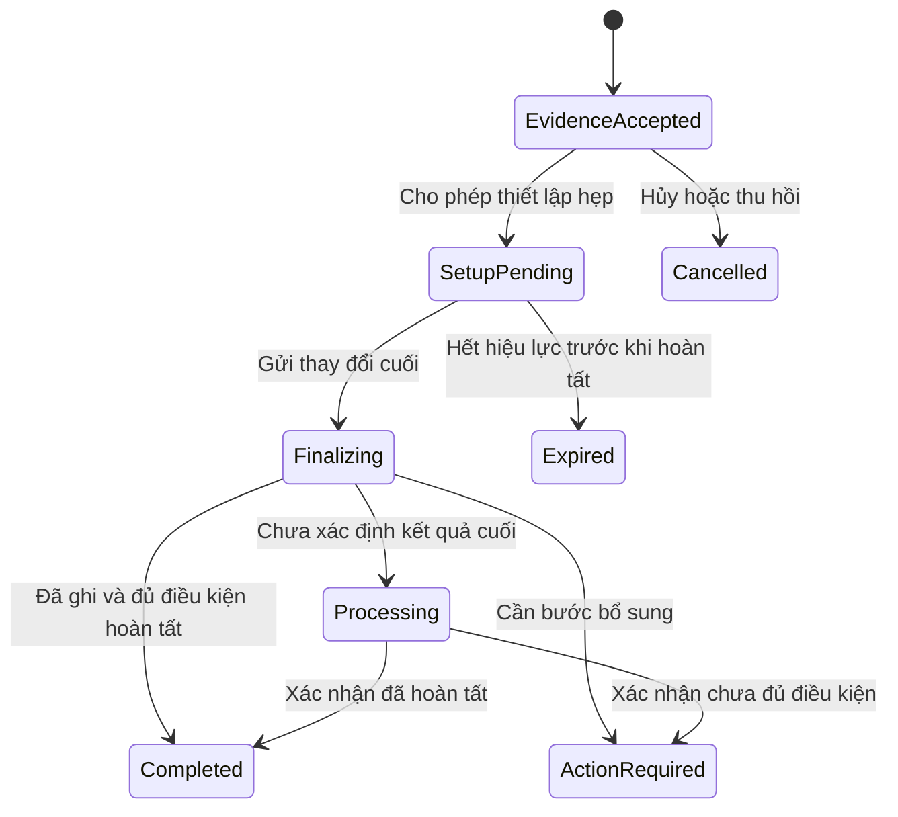

# Màn hình hoàn tất hành trình khôi phục tài khoản

## 1. Vai trò của màn hình hoàn tất

**Màn hình hoàn tất khôi phục — recovery journey completion screen — xác nhận kết quả mà backend đã ghi nhận, giải thích những thay đổi liên quan và chỉ rõ bước tiếp theo người dùng được phép thực hiện.** Đây là một điểm kết thúc có ý nghĩa bảo mật, không chỉ là trang có biểu tượng dấu tích.

Trong module `SECURITY_AUTHENTICATION_ACCOUNT_RECOVERY`, người dùng có thể vừa lấy lại tài khoản sau khi mất mật khẩu, MFA, passkey hoặc thiết bị xác thực. Họ cần biết:

- Thao tác khôi phục nào đã thực sự hoàn tất.
- Phương tiện nào đã được thiết lập, thay thế hoặc thu hồi.
- Họ đã đăng nhập hay cần đăng nhập lại.
- Những session và quyền khôi phục cũ đã được xử lý đến đâu.
- Còn bước bắt buộc hoặc tác vụ nào đang chờ.
- Phải làm gì nếu thay đổi không phải do họ thực hiện.

Nếu trang báo thành công quá sớm, người dùng có thể đóng trình duyệt trong khi phương tiện mới chưa được lưu hoặc tài khoản vẫn chưa sử dụng được. Nếu trang vô tình cấp quyền sử dụng rộng, một token vốn chỉ dùng để khôi phục có thể trở thành đường vượt qua đăng nhập.

Ví dụ, An mất điện thoại chứa ứng dụng MFA. An đã xác minh bằng chứng theo chính sách và hoàn tất đăng ký phương tiện mới. Trang cuối cần xác nhận đúng việc đặt lại MFA, nêu trạng thái của phương tiện cũ và hướng dẫn đăng nhập theo điều kiện hiện tại. Không nên chỉ nói “Mọi thứ đã an toàn” hoặc tự khẳng định đã đăng xuất mọi thiết bị khi chưa có cơ chế xác nhận điều đó.

## 2. Phân biệt hoàn tất với các mốc gần giống

### 2.1. Mỗi thông điệp phải gắn với một kết quả cụ thể

| Mốc backend đã đạt | Thông điệp phù hợp | Điều chưa được suy ra |
| --- | --- | --- |
| Đã nhận yêu cầu | “Đã tiếp nhận yêu cầu khôi phục” | Chưa chứng minh người yêu cầu có quyền lấy lại tài khoản |
| Đã gửi hướng dẫn | “Nếu thông tin phù hợp, hướng dẫn sẽ được gửi” | Chưa xác minh được người dùng, không nên xác nhận tài khoản tồn tại |
| Đã chấp nhận một bằng chứng | “Đã xác minh bước này” trong ngữ cảnh được phép | Chưa nhất thiết được thay phương tiện hoặc mở session |
| Đang chờ duyệt hay chờ thời hạn | “Yêu cầu đang được xử lý” | Chưa được coi là hoàn tất khôi phục |
| Đã cấp quyền thiết lập hẹp | “Bạn có thể thiết lập phương tiện mới” | Chưa chứng minh phương tiện mới đã được đăng ký thành công |
| Thay đổi cuối đã được ghi và đáp ứng điều kiện hoàn tất | “Đã hoàn tất đặt lại…” | Không tự chứng minh có session sử dụng thông thường |
| Chỉ một phần thay đổi đã hoàn tất | Nêu riêng phần đã xong và phần còn chờ | Không được gộp thành “Tài khoản đã được khôi phục đầy đủ” |

Tên trạng thái nội bộ có thể khác giữa sản phẩm. Điều quan trọng là ý nghĩa của chúng phải được xác định trước khi viết nội dung trên trang.

### 2.2. Không dùng URL hoặc trạng thái giao diện làm bằng chứng thành công

Các dấu hiệu sau không đủ để báo hoàn tất:

- Đã điều hướng tới đường dẫn `/recovery/success`.
- Có tham số `success=true` trong URL.
- Một promise ở trình duyệt đã chạy xong.
- Màn hình thiết lập đã gửi request nhưng chưa nhận kết quả có thẩm quyền.
- Token khôi phục vẫn còn thời hạn.
- Người dùng tự bấm “Tôi đã hoàn tất”.

Trang cần lấy kết quả từ trạng thái backend mà người xem có quyền biết. Nếu chưa xác định được kết quả do lỗi mạng, phản hồi đúng là đang kiểm tra hoặc chưa thể xác nhận, không tự đổi thành thành công hay khẳng định thao tác thất bại.

## 3. Định nghĩa điều kiện hoàn tất trước khi thiết kế trang

### 3.1. Hợp đồng giữa backend và giao diện

Đội sản phẩm và kỹ thuật cần thống nhất điều kiện hoàn tất cho từng mục đích. Ví dụ với thay MFA:

1. Yêu cầu còn hợp lệ theo trạng thái tài khoản và chính sách hiện hành.
2. Những bằng chứng bắt buộc đã được chấp nhận và còn hiệu lực tại điểm quyết định.
3. Phương tiện mới đã được kiểm chứng theo quy trình đăng ký và được lưu thành công.
4. Phương tiện cũ được xử lý đúng phạm vi yêu cầu.
5. Quyền thiết lập được tiêu thụ, không thể dùng lại để tạo thêm thay đổi độc lập.
6. Quyết định xử lý session và quyền khôi phục liên quan đã được thực hiện theo bảo đảm đã định nghĩa.
7. Kết quả cuối được lưu để có thể truy vấn lại khi phản hồi mạng bị mất.

Các nghĩa vụ như thông báo hoặc thu hồi ở hệ thống ngoài cần được phân loại. Nếu một nghĩa vụ là điều kiện bắt buộc trước khi cấp quyền tiếp, chưa thực hiện được thì không được hiển thị trạng thái đã đáp ứng toàn bộ điều kiện. Nếu là tác vụ có thể hoàn tất sau, trang phải diễn đạt đúng phạm vi đã xong và trạng thái còn lại.

Không cần mọi tác vụ vận hành đều chặn màn hình cuối. Nhưng cần có một quyết định rõ ràng, thay vì để giao diện tự đoán từ việc API trả mã thành công.

### 3.2. Ghi kết quả nhất quán

Việc ghi phương tiện mới, tiêu thụ quyền thiết lập và đánh dấu yêu cầu hoàn tất cần có cơ chế nhất quán phù hợp. Nếu chỉ lưu trạng thái `COMPLETED` rồi mới cố lưu phương tiện mới, trang có thể báo thành công cho một thay đổi chưa tồn tại.

Với các tác vụ ngoài giao dịch, có thể ghi sự kiện cần xử lý cùng kết quả nghiệp vụ rồi gửi tiếp bằng cơ chế có khả năng xử lý lại. Tuy nhiên, “đã ghi sự kiện thu hồi session” khác với “mọi điểm truy cập đã từ chối session cũ”. Nội dung trang phải theo đúng bảo đảm thực tế.

### 3.3. Luồng trạng thái minh họa



Sơ đồ biểu diễn một mô hình minh họa. Một request frontend bị timeout không tự làm trạng thái backend chuyển từ `Finalizing` sang thất bại. Giao diện có thể hiển thị “Đang kiểm tra kết quả” trong khi backend đã hoàn tất.

## 4. Cấu trúc thông tin trên màn hình

### 4.1. Thứ tự người dùng cần đọc

Một màn hình thường nên trình bày theo thứ tự:

1. **Kết quả chính:** thao tác nào đã xong hoặc đang chờ.
2. **Phạm vi thay đổi:** phương tiện liên quan và hậu quả quan trọng.
3. **Trạng thái truy cập:** đã có session phù hợp hay cần đăng nhập lại.
4. **Việc cần làm tiếp:** một hành động chính rõ ràng.
5. **Hướng xử lý an toàn:** thông báo, kiểm tra bảo mật hoặc trợ giúp khi có bất thường.

Không đưa mã lỗi nội bộ, revision chính sách hay thông tin trace lên phần chính. Nếu cần một mã tham chiếu hỗ trợ, mã đó phải không chứa bí mật và không tự cấp quyền truy cập hồ sơ.

### 4.2. Nói rõ điều đã thay đổi

Ví dụ:

> Đã đặt lại mật khẩu. Bạn có thể đăng nhập bằng mật khẩu mới. Các phương tiện MFA hiện có vẫn được yêu cầu khi đăng nhập.

Câu này giúp phân biệt đặt lại mật khẩu với bỏ MFA. Nếu phương tiện MFA cũng thay đổi, cần nêu riêng theo đúng kết quả.

Với passkey, không suy rằng xóa đăng ký passkey trên dịch vụ đã xóa bản sao khóa khỏi mọi thiết bị hoặc kho đồng bộ. Có thể nói “Passkey cũ không còn được chấp nhận trên dịch vụ này” nếu backend thực sự đã thu hồi đăng ký đó.

Tương tự, thu hồi một thiết bị tin cậy không có nghĩa đã xóa dữ liệu trên thiết bị. Những phạm vi khác nhau cần dùng câu chữ khác nhau.

### 4.3. Hành động chính theo trạng thái truy cập

| Trạng thái hiện tại | Hành động chính có thể dùng | Điều kiện |
| --- | --- | --- |
| Đã hoàn tất nhưng chưa có session thông thường | “Đăng nhập” | Chuyển tới luồng đăng nhập theo chính sách hiện hành |
| Có session phù hợp được cấp riêng | “Tiếp tục” | Backend đã xác nhận quyền truy cập, không dựa vào trang hoàn tất |
| Chỉ có quyền xem kết quả khôi phục | “Đăng nhập” hoặc “Đóng trang” | Không dùng quyền xem kết quả để mở trang tài khoản nhạy cảm |
| Đang chờ xử lý | “Kiểm tra trạng thái” hoặc hướng dẫn chờ | Không chạy lại thay đổi cuối khi chỉ muốn đọc trạng thái |
| Cần hành động bổ sung | “Tiếp tục xác minh” | Đúng request, đúng bước và quyền còn hiệu lực |

Các liên kết như “Xem thiết bị” hoặc “Kiểm tra hoạt động tài khoản” phải kiểm tra quyền phù hợp tại điểm đến. Việc đặt chúng trên trang cuối không biến người xem thành người đã đăng nhập.

### 4.4. Tránh thông điệp tuyệt đối

Các câu dễ gây hiểu sai gồm:

- “Tài khoản của bạn đã an toàn tuyệt đối.”
- “Mọi thiết bị đã đăng xuất” khi mới gửi yêu cầu thu hồi.
- “Đã lấy lại toàn bộ tài khoản” khi chỉ thay mật khẩu.
- “Không ai khác có thể truy cập” khi hệ thống chưa xác minh hết các đường truy cập.
- “Bạn đã đăng nhập” chỉ vì đã hoàn tất xác minh khôi phục.

Nên nêu sự kiện đã được xác nhận và hành động tiếp theo. Một thông điệp chính xác giúp người dùng quyết định tốt hơn một cam kết rộng mà hệ thống không thực thi được.

## 5. Thích ứng với loại phương tiện bị mất

| Tình huống | Nội dung cần nêu khi hoàn tất | Điểm cần tránh |
| --- | --- | --- |
| Mất mật khẩu | Mật khẩu mới có hiệu lực, cách đăng nhập và yêu cầu MFA còn lại | In lại mật khẩu hoặc ngầm bỏ MFA |
| Mất MFA | Phương tiện mới đã đăng ký, phương tiện nào bị thay thế | Hiển thị seed hoặc QR MFA trên trang cuối như dữ liệu công khai |
| Mất passkey hoặc thiết bị chứa passkey | Đăng ký mới nào có hiệu lực, đăng ký cũ nào bị thu hồi | Khẳng định đã xóa khóa khỏi mọi thiết bị vật lý |
| Mất thiết bị tin cậy | Trạng thái thu hồi quyền thiết bị và session theo phạm vi thực tế | Nhầm thu hồi quyền với xóa dữ liệu từ xa |
| Cập nhật kênh khôi phục trong phạm vi được phép | Kênh mới đã xác minh và kênh nào còn được dùng | Hiển thị thông tin liên hệ đầy đủ cho người chỉ có quyền xem kết quả hạn chế |

Không bắt buộc mọi loại khôi phục đều dùng cùng nội dung. Một khung giao diện có thể dùng chung, nhưng phần tóm tắt phải xuất phát từ thao tác thật đã được phép và thực hiện.

Nếu sản phẩm cấp mã dự phòng mới, cần có bước lưu giữ an toàn được thiết kế riêng. Không tự hiển thị lại mã sau mỗi lần tải trang hoặc giữ mã trong lịch sử duyệt web. Việc xác nhận người dùng đã được hướng dẫn lưu mã có thể là bước bắt buộc trước khi hoàn tất, tùy chính sách; không được bịa rằng họ đã lưu nếu chỉ mới hiển thị.

## 6. Quyền xem trang và bảo vệ thông tin

### 6.1. Biết đường dẫn không đồng nghĩa được xem kết quả

Endpoint trạng thái có thể tiết lộ tài khoản tồn tại, đang khôi phục, đã thay MFA hoặc có một kênh liên hệ cụ thể. Do đó, không cho phép truy vấn theo email hay `request_id` tùy ý rồi nhận toàn bộ kết quả.

Quyền xem có thể dựa vào session phù hợp, ngữ cảnh khôi phục đã được ràng buộc hoặc một khả năng xem kết quả có phạm vi hẹp. Nếu dùng một handle bí mật làm khả năng truy cập, phải coi nó là thông tin nhạy cảm; tính khó đoán của handle không thay cho việc giới hạn phạm vi và thời hạn.

Một biên nhận kết quả không nên đồng thời cho quyền đổi mật khẩu, thêm passkey hay đọc dữ liệu tài khoản. Quyền xác nhận kết quả và quyền thao tác phải được phân biệt ở backend.

### 6.2. Hiển thị tối thiểu theo quyền được biết

Người đã có session thông thường có thể được xem chi tiết nhiều hơn người chỉ có quyền đọc kết quả của một request. Ngay cả thông tin đã che một phần cũng có thể giúp nhận diện tài khoản hoặc kênh liên hệ.

Một trang không còn đủ quyền xem có thể hiển thị thông điệp trung tính và hướng dẫn đăng nhập. Không đưa trạng thái chi tiết vào HTML rồi chỉ ẩn bằng CSS.

### 6.3. Không mang bí mật sang màn hình cuối

Không đưa vào trang, query string, log hoặc công cụ phân tích:

- Mật khẩu mới.
- OTP, mã dự phòng hay seed MFA.
- Token đặt lại phương tiện hoặc quyền thiết lập còn sử dụng được.
- Dữ liệu định danh thô không cần thiết.
- Toàn bộ nội dung bằng chứng người dùng đã nộp.

Nếu luồng ban đầu nhận token qua liên kết, cần trao đổi và xử lý token theo thiết kế an toàn, giảm việc để bí mật tiếp tục xuất hiện trong URL, lịch sử điều hướng hay tham chiếu gửi tới bên khác. Chỉ xóa chuỗi khỏi thanh địa chỉ bằng JavaScript không thay thế việc vô hiệu hóa token ở backend.

Trang nhạy cảm cần chính sách cache phù hợp, chẳng hạn không cho lưu phản hồi nhạy cảm trong cache thông thường, và kiểm soát nội dung bên thứ ba. Chính sách cache không ngăn người dùng chụp ảnh màn hình hoặc mọi hình thức ghi lại trên thiết bị; không nên hứa mức bảo vệ đó.

## 7. Tải lại, nút quay lại và lỗi mạng

### 7.1. Tách thao tác thay đổi khỏi việc đọc biên nhận

Một mô hình thường hữu ích là:

```text
Gửi thao tác hoàn tất có kiểm tra quyền
    -> backend ghi kết quả và tiêu thụ quyền đúng một lần
    -> trả định danh hoặc ngữ cảnh đọc kết quả
    -> điều hướng sang trang đọc biên nhận được phép
```

Lần tải trang sau chỉ đọc kết quả. Nó không đặt lại mật khẩu lần nữa, không tạo thêm passkey và không tự phát hành một bộ mã dự phòng khác.

Một request `GET` tới trang cuối không nên thực hiện thao tác thay phương tiện hoặc tiêu thụ bằng chứng xác minh. Trình duyệt, công cụ xem trước liên kết hoặc phần mềm quét có thể tải một URL trước khi người dùng chủ động mở nó.

Ngược lại, thao tác thay đổi cuối cần có kiểm tra quyền, trạng thái và biện pháp chống yêu cầu giả mạo phù hợp với cơ chế xác thực đang dùng. Việc nút “Hoàn tất” nằm trong một giao diện đáng tin không tự bảo vệ endpoint.

### 7.2. Hoàn tất đúng một lần, nhưng cho phép đọc lại an toàn

Các yêu cầu lặp có thể xuất hiện khi người dùng bấm hai lần, trình duyệt retry hoặc kết nối bị gián đoạn. Cần bảo đảm cùng một ý định hoàn tất không tạo nhiều thay đổi độc lập.

Một khóa chống thực hiện lặp có thể giúp định danh ý định, nhưng phải được ràng buộc với tài khoản, request và nội dung thao tác. Không dùng lại khóa cho một payload khác rồi trả nhầm kết quả cũ. Khóa đó cũng không thay thế kiểm tra quyền.

Nếu backend đã hoàn tất và người dùng retry cùng thao tác hợp lệ, có thể trả kết quả đã ghi hoặc hướng tới biên nhận theo chính sách. Không cần mở lại quyền dùng một lần chỉ để hiển thị lại màn hình.

Sau khi hoàn tất, bản ghi kết quả và quyền xem kết quả có thể có vòng đời khác token thiết lập. Token thiết lập đã dùng phải tiếp tục không hợp lệ, dù biên nhận vẫn còn có thể xem trong phạm vi được phép.

### 7.3. Khi phản hồi cuối bị mất

Ví dụ, backend đã lưu MFA mới nhưng phản hồi bị đứt kết nối. Nếu giao diện nói “Thiết lập thất bại, hãy làm lại”, người dùng có thể xóa cấu hình vừa tạo hoặc tạo thêm thay đổi ngoài dự kiến.

Cách xử lý nên là:

1. Hiển thị rằng chưa xác nhận được kết quả.
2. Dùng ngữ cảnh được phép để truy vấn trạng thái có thẩm quyền.
3. Nếu đã hoàn tất, hiển thị biên nhận đã ghi.
4. Nếu chưa hoàn tất và còn được phép tiếp tục, hướng dẫn đúng bước.
5. Nếu vẫn chưa xác định được, giữ trạng thái chờ hoặc cung cấp đường trợ giúp; không đoán kết quả.

Polling, nếu có, cần khoảng cách phù hợp, giới hạn thời gian và dừng khi trang không còn cần theo dõi. Không liên tục phát lại thao tác hoàn tất để “kiểm tra xem đã được chưa”.

### 7.4. Quay lại trang thiết lập không được hồi sinh quyền cũ

Người dùng có thể bấm nút quay lại và thấy biểu mẫu cũ còn trong bộ nhớ trình duyệt. Backend vẫn phải từ chối quyền đã dùng hoặc thu hồi.

Giao diện nên đồng bộ lại trạng thái khi được mở lại, khóa hành động không còn hợp lệ và dẫn về kết quả hoặc bước hiện hành. Chỉ vô hiệu hóa nút bằng JavaScript không đủ nếu endpoint vẫn chấp nhận request cũ.

## 8. Trạng thái một phần và tác vụ bất đồng bộ

### 8.1. Xác định phần nào là điều kiện bắt buộc

Cần phân loại tác vụ theo hợp đồng của từng luồng:

| Tác vụ | Câu hỏi cần quyết định | Hệ quả với màn hình |
| --- | --- | --- |
| Lưu phương tiện mới | Đây có phải thay đổi cốt lõi đã cam kết? | Chưa ghi thành công thì không báo phương tiện đã có hiệu lực |
| Thu hồi phương tiện cũ | Có bắt buộc trước khi coi thay thế đã hoàn tất không? | Nếu bắt buộc mà còn chờ, không báo đã thay thế đầy đủ |
| Thu hồi session | Phạm vi nào, điểm thực thi nào và độ trễ nào được chấp nhận? | Nêu đúng kết quả, không gộp yêu cầu gửi đi với thu hồi hoàn tất |
| Gửi thông báo | Là điều kiện chặn hay tác vụ theo dõi sau? | Nếu không chặn, không biến lỗi gửi thành yêu cầu đặt lại từ đầu |
| Lưu dấu vết quyết định bắt buộc | Có ghi cùng kết quả hay cần cơ chế khác? | Không hiển thị cam kết mà không có trạng thái đáng tin cậy |
| Đồng bộ một hệ thống ngoài | Có ảnh hưởng tới quyền truy cập tiếp theo không? | Chỉ mở các hành động khi điều kiện liên quan đã đạt |

Không có một đáp án chung rằng mọi lỗi gửi thông báo đều phải khóa tài khoản, hoặc mọi lỗi bên ngoài đều có thể bỏ qua. Cần đặt nghĩa vụ vào đúng mức rủi ro và thực thi nhất quán.

### 8.2. Báo trạng thái còn chờ bằng phạm vi cụ thể

Ví dụ, nếu chính sách cho phép đổi mật khẩu hoàn tất trước khi tất cả session ngoài hệ thống xác nhận thu hồi, có thể trình bày:

> Mật khẩu mới đã được lưu. Yêu cầu đăng xuất các phiên cũ đang được xử lý. Bạn có thể kiểm tra lại trạng thái tại đây.

Câu này chỉ phù hợp nếu sản phẩm thực sự cho phép kết quả như vậy và có đường kiểm tra có thẩm quyền. Không dùng nó để che một lỗi mà chính sách yêu cầu phải chặn quyền tiếp theo.

Nếu thu hồi session là điều kiện bắt buộc để tiếp tục, trang cần báo đang hoàn tất các bước bảo vệ và chưa mở chức năng bị điều kiện đó chi phối.

### 8.3. Không bắt người dùng khởi động lại để sửa lỗi hậu kỳ

Nếu thay đổi chính đã commit nhưng gửi thông báo thất bại, việc yêu cầu chạy lại toàn bộ khôi phục có thể gây:

- Mất hiệu lực của phương tiện vừa thiết lập.
- Phát hành thêm mã hoặc token.
- Đặt lại ngân sách chống lạm dụng.
- Tạo nhiều sự kiện khó phân biệt.
- Làm người dùng không biết thông tin nào đang có hiệu lực.

Tác vụ hậu kỳ cần retry có kiểm soát ở backend, có giới hạn và theo dõi. Trang chỉ cho phép hành động tương ứng với trạng thái thực, không dùng nút “Thử lại” chung cho cả thay đổi tài khoản lẫn gửi thông báo.

## 9. Session, điều hướng và bước tiếp theo

### 9.1. Hoàn tất khôi phục không tự tạo session thông thường

Một luồng có thể chọn đưa người dùng trở về đăng nhập. Một luồng khác có thể cấp session sau khi các điều kiện xác thực và cấp quyền hiện tại đã được đáp ứng. Cả hai cần được thiết kế rõ ràng.

Không dùng token khôi phục hoặc cookie chỉ dành cho luồng khôi phục như một session sử dụng toàn bộ tài khoản. Nếu cấp session mới, cần có quyết định riêng về:

- Mức xác thực đã đạt và yêu cầu còn thiếu.
- Quyền được cấp.
- Vòng đời và thay thế định danh session theo thiết kế.
- Tình trạng tài khoản tại thời điểm cấp.
- Phạm vi thu hồi session trước đó.
- Các hạn chế tạm thời sau khôi phục, nếu có.

Một session giới hạn chỉ cho phép hoàn tất thiết lập không nên được giao diện gọi là “Đã đăng nhập đầy đủ”.

### 9.2. Hướng người dùng kiểm tra bảo mật theo quyền hiện có

Sau khi đăng nhập phù hợp, có thể hướng dẫn xem hoạt động gần đây, thiết bị, phương tiện xác thực và kênh khôi phục. Các bước này giúp phát hiện thay đổi bất thường nhưng không thay cho kiểm soát bắt buộc trước khi hoàn tất.

Nếu còn một bước bắt buộc, chẳng hạn xác nhận phương tiện mới hoạt động hoặc lưu thông tin dự phòng theo chính sách, cần đặt nó trong luồng và trạng thái tương ứng. Không giấu bước bắt buộc ở một liên kết phụ trên trang “Đã hoàn tất”.

### 9.3. Điều hướng phải có đích được kiểm soát

Nút “Tiếp tục” có thể trở thành điểm chuyển người dùng sang trang phishing nếu lấy trực tiếp đích từ `returnUrl` không được kiểm tra.

Nên dùng đích nội bộ hoặc tập đích được phép, gắn với hành trình thực tế. Với ứng dụng di động hoặc luồng nhiều thiết bị, cần kiểm soát cơ chế chuyển ứng dụng và không đưa token có quyền rộng vào liên kết chuyển tiếp.

Không tự chuyển trang quá nhanh trước khi người dùng đọc được thay đổi quan trọng. Nếu có điều hướng tự động theo thiết kế, cần cách người dùng kiểm soát được và không làm mất thông tin cần hành động.

## 10. Mẫu nội dung và một tình huống xuyên suốt

### 10.1. Đã đặt lại mật khẩu, chưa đăng nhập

Giả sử backend xác nhận mật khẩu mới đã được lưu, quyền đặt lại đã tiêu thụ và các session thuộc phạm vi thông báo dưới đây đã thực sự được chặn:

```text
Đã đặt lại mật khẩu

Bạn có thể đăng nhập bằng mật khẩu mới.
MFA hiện có vẫn được yêu cầu khi đăng nhập.

Các phiên truy cập cũ của ứng dụng này đã bị thu hồi.

[Đăng nhập]

Sau khi đăng nhập, hãy kiểm tra hoạt động gần đây
và các phương tiện khôi phục của bạn.
```

Cụm “của ứng dụng này” giới hạn phạm vi. Chỉ dùng câu về thu hồi khi cơ chế thực thi đã đạt đúng điều kiện đó. Không suy trạng thái session ở nhà cung cấp danh tính bên ngoài từ việc đặt lại mật khẩu của ứng dụng.

### 10.2. Đã thay MFA, chỉ có quyền xem kết quả

Giả sử An đã đăng ký và kiểm chứng phương tiện mới, backend đã thu hồi phương tiện bị thay thế, nhưng chưa cấp session sử dụng thông thường:

```text
Đã hoàn tất đặt lại MFA

Phương tiện MFA mới đã được đăng ký.
Phương tiện bị thay thế không còn được chấp nhận trên dịch vụ này.

Bạn chưa đăng nhập vào tài khoản.
Hãy đăng nhập bằng phương tiện theo yêu cầu hiện tại.

[Đăng nhập]

Nếu bạn không thực hiện thay đổi này,
hãy mở hướng dẫn xử lý tài khoản có dấu hiệu bị truy cập trái phép.
```

Nếu thiết kế giữ lại một số phương tiện khác, có thể nêu điều đó trong ngữ cảnh được phép. Không mặc định đặt lại một phương tiện đồng nghĩa xóa mọi phương tiện khác.

### 10.3. Chưa xác nhận được kết quả do lỗi kết nối

```text
Đang kiểm tra kết quả

Kết nối bị gián đoạn sau khi bạn gửi thao tác hoàn tất.
Chúng tôi chưa xác nhận được trạng thái cuối cùng.

[Kiểm tra trạng thái]

Bạn không cần gửi lại thay đổi khi hệ thống đang kiểm tra.
```

Nút này chỉ đọc trạng thái. Nếu backend xác nhận đã hoàn tất, trang chuyển sang biên nhận. Nếu xác nhận chưa thực hiện thay đổi, giao diện mới hướng dẫn bước tiếp theo phù hợp.

### 10.4. Diễn biến của An

| Bước | Điều xảy ra | Hành vi cần có |
| --- | --- | --- |
| 1 | An mất điện thoại chứa MFA | Chọn luồng khôi phục tương ứng, không mặc định đây là quên mật khẩu |
| 2 | An hoàn tất bằng chứng theo chính sách | Có quyền thiết lập hẹp, chưa được coi là đã thay MFA |
| 3 | An đăng ký phương tiện mới | Backend kiểm chứng và ghi phương tiện theo quy trình |
| 4 | An gửi hoàn tất, kết nối bị đứt | Không tự báo thất bại hoặc cho tạo lại vô hạn |
| 5 | Trình duyệt truy vấn kết quả bằng ngữ cảnh được phép | Nhận biên nhận backend đã lưu |
| 6 | Trang xác nhận phạm vi đã thay đổi | Nêu rõ phương tiện mới, phương tiện bị thu hồi và trạng thái đăng nhập |
| 7 | An tải lại trang | Đọc lại cùng kết quả, không tạo thêm phương tiện |
| 8 | An đăng nhập | Đi qua các yêu cầu xác thực và hạn chế hiện hành |

Nếu có hai tab cùng hoàn tất, chỉ một thay đổi hợp lệ được chấp nhận theo cơ chế phối hợp. Tab còn lại phải nhận kết quả phù hợp, không tạo quyền mới chỉ vì chưa kịp cập nhật giao diện.

## 11. Khả năng tiếp cận, ngôn ngữ và trợ giúp

### 11.1. Không chỉ dựa vào màu hoặc biểu tượng

Màu xanh và dấu tích có thể hỗ trợ nhưng không thay thế câu xác nhận bằng chữ. Cần phân biệt rõ thành công, đang xử lý, cần hành động và không thể tiếp tục.

Tiêu đề trang, thứ tự đọc, nhãn nút và thông báo động cần dễ hiểu với bàn phím và công cụ hỗ trợ. Khi điều hướng sang màn hình mới, cần có cách người dùng nhận biết tiêu đề và nội dung chính. Khi chỉ cập nhật trạng thái nền, tránh liên tục cướp focus hoặc đọc lại toàn bộ trang.

Các trạng thái chờ nên có thông báo phù hợp, không dùng cùng một biểu tượng thành công rồi đặt dòng “đang xử lý” ở vị trí khó thấy.

### 11.2. Trình bày thời gian theo dữ liệu có thẩm quyền

Nếu còn thời gian chờ hoặc thời hạn xem kết quả, lấy mốc từ backend. Đồng hồ đếm ở client chỉ là cách hiển thị, không quyết định quyền được tiếp tục.

Nên diễn đạt rõ múi giờ khi hiển thị một thời điểm cụ thể. Không chỉ nói “ngày mai” nếu người dùng ở múi giờ khác có thể hiểu sai. Nếu thời gian chờ chưa kết thúc, đó là màn hình trạng thái của quy trình, không phải hoàn tất toàn bộ.

### 11.3. Hướng dẫn an toàn khi có thay đổi ngoài ý muốn

Đường trợ giúp cần dễ nhận ra và đi tới một đích đáng tin cậy. Một người xem trang hoặc nhận thông báo không nên bị hướng dẫn gửi mật khẩu, OTP hay mã dự phòng cho nhân viên hỗ trợ.

Thông báo về hoàn tất nên được gửi tới các kênh phù hợp theo chính sách, đặc biệt phải cân nhắc trường hợp kênh mới được thêm trong chính luồng khôi phục. Không coi việc gửi tới kênh mới chưa xác minh là đủ để cảnh báo chủ tài khoản cũ.

Không hứa nút “Không phải tôi” có thể lập tức hoàn tác mọi thay đổi nếu hệ thống không cung cấp được điều đó. Nếu hành động này mở một quy trình bảo vệ hoặc điều tra, cần nói rõ và kiểm soát quyền của thao tác tiếp theo. Một liên kết GET trong email không nên tự thay phương tiện hoặc khóa tài khoản vĩnh viễn chỉ vì bị công cụ quét mở.

### 11.4. Chuyển thiết bị không được bỏ ràng buộc

Người dùng có thể mở email trên điện thoại khác hoặc muốn tiếp tục trên máy tính. Cần có đường chuyển thiết bị được thiết kế riêng nếu sản phẩm hỗ trợ.

Không bỏ qua ràng buộc chỉ vì người dùng giải thích “tôi đổi máy”. Nếu không có quyền đọc kết quả trên thiết bị mới, có thể yêu cầu đăng nhập hoặc thực hiện bước chuyển tiếp có bằng chứng. Không tiết lộ toàn bộ kết quả chỉ từ một mã tham chiếu hỗ trợ công khai.

## 12. Theo dõi hành trình và các thuộc tính cần giữ

### 12.1. Phân biệt hoàn tất nghiệp vụ với xem màn hình

Có ít nhất hai sự kiện khác nhau:

- Backend đã ghi nhận hoàn tất một thay đổi khôi phục.
- Một người xem được màn hình kết quả.

Sự kiện thứ nhất có thể xảy ra dù trình duyệt đóng trước khi tải trang. Sự kiện thứ hai có thể xảy ra nhiều lần do tải lại. Vì vậy, không dùng lượt xem `success_page` làm số tài khoản khôi phục thành công hoặc tự phát sinh thêm hành động bảo mật.

Có thể theo dõi thêm thời gian từ hoàn tất tới đăng nhập, tỷ lệ chưa xác định được kết quả, số tác vụ hậu kỳ còn chờ và số người cần trợ giúp. Các số liệu cần phân biệt loại khôi phục, trạng thái truy cập và lý do lỗi, trong phạm vi dữ liệu được phép thu thập.

Không đưa bí mật hoặc dữ liệu định danh không cần thiết vào sự kiện phân tích. Mã tương quan nội bộ giúp điều tra mà không cần sao chép toàn bộ nội dung khôi phục.

### 12.2. Các thuộc tính hành vi cần xác minh ở giai đoạn kiểm tra

| Tình huống | Kết quả cần bảo đảm |
| --- | --- |
| Mở trực tiếp URL có chữ “success” | Không báo hoàn tất dựa riêng vào URL |
| Đã xác minh nhưng chưa lưu phương tiện mới | Không hiển thị khôi phục đã hoàn tất |
| Backend đã ghi nhưng phản hồi bị mất | Có thể đọc kết quả có thẩm quyền, không bắt tạo thay đổi lại |
| Tải lại hoặc dùng nút quay lại | Không hồi sinh quyền đã dùng và không tạo thêm phương tiện |
| Hai request hoàn tất đồng thời | Không phát sinh nhiều thay đổi độc lập trái chính sách |
| Người chỉ có quyền xem biên nhận | Không dùng biên nhận để vào dữ liệu hoặc thao tác tài khoản |
| Người chưa có quyền xem đoán request ID | Không đọc được kết quả hoặc thông tin tài khoản |
| Một tác vụ thu hồi còn chờ | Nội dung phản ánh đúng phạm vi, quyền tiếp theo tuân theo điều kiện bắt buộc |
| Đã thay mật khẩu nhưng MFA không đổi | Nội dung và luồng đăng nhập vẫn thể hiện yêu cầu MFA |
| Nhận đích điều hướng từ client | Không chuyển tới đích ngoài phạm vi được phép |
| Công cụ xem trước mở liên kết | Không thực hiện thay đổi tài khoản chỉ bằng GET |
| Xem HTML, URL, log và sự kiện phân tích | Không thu được bí mật khôi phục hoặc bằng chứng thô |
| Dùng công cụ hỗ trợ hoặc bàn phím | Nhận biết được kết quả và thao tác tiếp theo mà không dựa vào màu sắc |
| Đổi thiết bị hoặc hết quyền xem kết quả | Có hướng dẫn phù hợp, không tự mở quyền rộng hơn |

Màn hình hoàn tất cần trả lời chính xác: điều gì đã thay đổi, người dùng hiện có quyền gì và bước tiếp theo là gì. Nội dung ngắn gọn trên trang chỉ đáng tin khi dựa vào trạng thái backend, quyền xem phù hợp và cơ chế ngăn thực hiện lặp của toàn bộ hành trình khôi phục.
