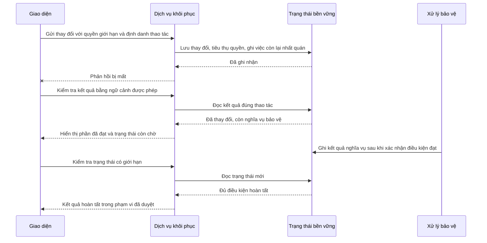

# Màn hình thất bại trong hành trình khôi phục tài khoản

## 1. Màn hình thất bại cần bảo đảm điều gì?

**Màn hình thất bại của hành trình khôi phục — recovery journey failure screen — là bề mặt giải thích vì sao người dùng chưa thể tiếp tục hoặc chưa nhận được kết quả mong muốn, đồng thời cung cấp bước tiếp theo phù hợp với trạng thái thực tế và quyền của người xem.**

Trong chương Recovery Journey của module `SECURITY_AUTHENTICATION_ACCOUNT_RECOVERY`, tình huống này xuất hiện khi người dùng khôi phục sau mất mật khẩu, MFA, passkey hoặc thiết bị xác thực. Màn hình không chỉ phục vụ trải nghiệm người dùng. Nội dung và nút thao tác của nó có thể làm lộ tài khoản, tạo vòng gửi token hoặc dẫn người dùng vào một lần thay đổi bảo mật mới ngoài ý muốn.

Một màn hình tốt cần giúp người dùng hiểu:

1. Hệ thống biết chắc điều gì ở thời điểm hiện tại?
2. Có thể tiếp tục, cần chờ, cần kiểm tra kết quả hay phải dùng một đường xử lý khác?
3. Hành động tiếp theo có tác động gì và còn cần điều kiện nào?

Không phải mọi lỗi hiển thị đều có nghĩa khôi phục đã thất bại. Trình duyệt có thể mất phản hồi sau khi mật khẩu mới đã được lưu. Việc thu hồi session có thể còn chờ dù yếu tố MFA mới đã được thiết lập. Một liên kết hết hiệu lực cũng không tự chứng minh tài khoản không tồn tại.

**Màn hình phải phản ánh kết quả mà hệ thống có căn cứ xác nhận, đồng thời không tiết lộ những thông tin mà người đang xem chưa có quyền biết.**

## 2. Tách ba lớp trạng thái trước khi viết thông điệp

Một lỗi mạng, một quyết định từ chối và một quyền đã hết hạn là ba sự kiện khác nhau. Thiết kế nên tách ít nhất ba lớp:

| Lớp | Câu hỏi cần trả lời | Ví dụ |
| --- | --- | --- |
| Giao tiếp và giao diện | Trình duyệt có nhận được phản hồi phù hợp không? | Mất kết nối, tải trang lỗi, phản hồi quá thời gian |
| Yêu cầu khôi phục | Hồ sơ đang ở bước nào và có được phép tiếp tục không? | Đang xác minh, chưa đủ bằng chứng, quyền tiếp tục hết hạn |
| Tác động bảo mật | Thay đổi nào đã có hiệu lực và nghĩa vụ nào còn lại? | Mật khẩu đã đổi, MFA chưa thay, thu hồi session đang chờ |

Nếu chỉ dùng một biến `error=true`, hệ thống dễ hiển thị “Không có thay đổi nào” cho cả trường hợp backend đã đổi mật khẩu nhưng client mất phản hồi.

Tương tự, mã HTTP không đủ mô tả mọi kết quả nghiệp vụ. Một phản hồi lỗi kỹ thuật có thể xảy ra sau một phần thay đổi; một phản hồi được tiếp nhận cũng chưa chứng minh yêu cầu đủ điều kiện khôi phục.

Ví dụ:

```text
Trình duyệt:
  Chưa nhận được phản hồi cuối.

Backend:
  Mật khẩu mới đã lưu.
  Quyền đặt lại đã được tiêu thụ.
  Nghĩa vụ xử lý session đang chờ.

Kết luận:
  Không thể hướng dẫn gửi lại toàn bộ thao tác như thể chưa có gì xảy ra.
```

Màn hình là cách trình bày một trạng thái, không phải nguồn quyết định trạng thái. Nội dung lỗi trên URL, dữ liệu cache hoặc một cờ phía client không được tự làm hồ sơ chuyển sang thất bại, hoàn tất hoặc được phép thử lại.

## 3. Phân loại tình huống và chọn hướng xử lý

| Nhóm tình huống | Hệ thống biết gì? | Hướng xử lý chính |
| --- | --- | --- |
| Dữ liệu nhập cần sửa | Một giá trị chưa đáp ứng điều kiện của bước hiện tại | Cho sửa tại đúng trường nếu vẫn được phép |
| Liên kết không dùng được | Quyền từ liên kết không cho phép tiếp tục trong ngữ cảnh hiện tại | Cung cấp đường bắt đầu lại hoặc trợ giúp được hỗ trợ |
| Bị hạn chế thao tác | Chính sách đang giới hạn hành vi hoặc gửi lại | Hướng dẫn chờ hoặc chuyển xử lý phù hợp |
| Lỗi tạm thời, chắc chắn chưa áp dụng | Bước thực thi chưa tạo tác động bảo mật theo kết quả đáng tin cậy | Cho thử lại nếu quyền và điều kiện vẫn hợp lệ |
| Chưa xác định kết quả | Không biết thao tác trước đã được áp dụng hay chưa | Đối soát hoặc kiểm tra kết quả trước khi tạo tác động mới |
| Đã áp dụng một phần | Biết thay đổi đã xảy ra nhưng còn nghĩa vụ bắt buộc | Hiển thị trạng thái đang xử lý và theo dõi phần còn lại |
| Không được phê duyệt | Quyết định hiện tại chưa cho phép thay đổi | Nêu hướng xử lý được chính sách hỗ trợ |
| Backend đã hoàn tất | Kết quả hợp lệ đã tồn tại dù giao diện trước báo lỗi | Đưa người có quyền tới kết quả đã ghi nhận |

Các nhóm này là mô hình khái niệm. Một sản phẩm có thể đặt tên khác, nhưng không nên mất đi sự phân biệt giữa “chưa thực hiện”, “chưa biết kết quả” và “đã thực hiện một phần”.

Một hồ sơ đang chờ thẩm định cũng không nhất thiết là thất bại. Nếu đang chờ là trạng thái dự kiến, giao diện nên nói đúng điều đó thay vì yêu cầu người dùng gửi một hồ sơ mới.

### 3.1. Khi chỉ cần lỗi tại trường nhập

Ví dụ, trường mật khẩu mới chưa đáp ứng yêu cầu hoặc người dùng bỏ trống một giá trị bắt buộc. Giao diện nên chỉ rõ cách sửa trong phạm vi có thể công bố, giữ ngữ cảnh hợp lệ và tránh bắt đầu lại cả hành trình.

Với mã xác minh chưa được chấp nhận, thông điệp cần phù hợp với ngữ cảnh đã được cấp. Không nên tiết lộ mã sai ở chữ số nào hoặc dữ liệu bí mật mà người nhập chưa được biết.

Giao diện có thể kiểm tra định dạng để giúp người dùng, nhưng máy chủ vẫn phải kiểm tra điều kiện bảo mật, số lần thử và hiệu lực của quyền. Sửa mã JavaScript không được làm mất các giới hạn này.

### 3.2. Khi cần một màn hình riêng

Một liên kết không còn cho phép tiếp tục, kết quả không rõ hoặc bước bảo vệ còn chờ thường cần một màn hình riêng vì hành động tiếp theo đã khác với việc sửa một trường nhập.

Màn hình riêng cần tránh đưa người dùng trở lại một biểu mẫu có nút gửi vẫn hoạt động dù quyền không còn hiệu lực. Đồng thời, không nên xóa mọi ngữ cảnh khi hệ thống vẫn có thể cung cấp một bước kiểm tra kết quả an toàn.

## 4. Thông điệp phải phù hợp với quyền của người xem

### 4.1. Trước khi có ngữ cảnh đáng tin cậy

Người ngoài có thể mở trang công khai, nhập email của người khác hoặc sửa tham số lỗi trên URL. Thông điệp không nên tiết lộ những dữ liệu như:

- Tài khoản có tồn tại hay không.
- Tài khoản có MFA hoặc passkey loại nào.
- Địa chỉ khôi phục, kể cả dạng gợi ý không được phép công khai.
- Tài khoản có đang bị điều tra hoặc có session nào đang hoạt động.
- Quy tắc chấm điểm rủi ro, nguyên nhân từ chối chi tiết hoặc giới hạn riêng của tài khoản.

Ví dụ, thay vì hiển thị “Email này chưa đăng ký” hoặc “Tài khoản này không có MFA để đặt lại”, biểu mẫu công khai có thể nói: “Không thể tiếp tục yêu cầu theo cách này. Hãy dùng hướng dẫn khôi phục được hỗ trợ.”

Mức chi tiết cần thống nhất cả ở nội dung, mã phản hồi, dữ liệu API và hành vi quan sát được. Một câu chung trên màn hình không che được trường `account_exists=false` mà API vẫn trả về.

### 4.2. Trong một bước khôi phục có quyền xem phù hợp

Sau khi máy chủ đã xác lập ngữ cảnh giới hạn, có thể cung cấp thông tin cụ thể hơn cho bước đó. Ví dụ, người có quyền đặt lại mật khẩu có thể được hướng dẫn sửa mật khẩu mới chưa đáp ứng chính sách.

Quyền xem chi tiết và quyền thực hiện thay đổi vẫn cần phân biệt. Một ngữ cảnh được phép xem kết quả cũ không tự cho phép đặt mật khẩu thêm lần nữa.

Mức chi tiết cũng không được suy ra chỉ từ việc người dùng biết mã hồ sơ. Mã tiếp nhận giúp định vị một sự kiện; nó không mặc nhiên là bằng chứng cho phép đọc toàn bộ hồ sơ.

### 4.3. Với nhân viên hỗ trợ

Nhân viên có thể cần xem mã nguyên nhân nội bộ và tình trạng xử lý để giúp người dùng. Quyền này cần được phân theo nhiệm vụ và phạm vi tài khoản.

Những mã như “bằng chứng không đạt”, “phụ thuộc chưa xác nhận thu hồi” hoặc “chờ đối soát” có thể hữu ích trong công cụ nội bộ. Không nên tự động sao chép toàn bộ thông tin đó vào màn hình công khai.

Nhân viên cũng không cần biết mật khẩu, token, OTP hoặc bí mật MFA để giải thích lỗi. Mã hỗ trợ trên màn hình không nên trở thành lý do yêu cầu người dùng gửi những bí mật này.

## 5. Cấu trúc một màn hình lỗi có ích

Một màn hình nên có các phần rõ ràng, với lượng thông tin phù hợp cho ngữ cảnh:

| Thành phần | Mục đích | Ví dụ |
| --- | --- | --- |
| Tiêu đề | Gọi đúng tình trạng hiện tại | “Chưa xác nhận được kết quả” |
| Giải thích ngắn | Nêu điều đã biết và giới hạn của kết luận | “Kết nối bị gián đoạn khi yêu cầu đang được xử lý.” |
| Hành động chính | Dẫn tới bước an toàn tiếp theo | “Kiểm tra trạng thái” nếu có quyền tra cứu |
| Hành động phụ | Cung cấp đường hỗ trợ hoặc quay lại hợp lệ | “Mở trợ giúp khôi phục” |
| Thông tin thời gian | Giải thích khi nào có thể tiếp tục nếu biết chắc | Thời điểm thử lại do máy chủ cho phép |
| Mã tham chiếu | Giúp hỗ trợ tìm đúng sự kiện | Một mã không chứa bí mật, không tự cấp quyền |

Nên ưu tiên một hành động chính. Nếu cùng lúc đặt các nút “Gửi lại”, “Bắt đầu lại”, “Xác nhận lần nữa” và “Đăng nhập ngay”, người dùng khó biết lựa chọn nào có thể làm phát sinh thay đổi.

### 5.1. Thông điệp mẫu theo trạng thái

| Điều kiện đã được xác nhận | Nội dung có thể dùng | Hành động cần cân nhắc |
| --- | --- | --- |
| Liên kết không còn cho phép tiếp tục | “Không thể dùng liên kết này để tiếp tục khôi phục.” | Bắt đầu yêu cầu mới nếu được phép hoặc mở trợ giúp |
| Một dữ liệu trong bước hợp lệ cần sửa | “Hãy kiểm tra thông tin được đánh dấu rồi gửi lại.” | Sửa dữ liệu tại bước hiện tại |
| Hệ thống chưa nhận thực thi và có thể thử lại | “Chưa thực hiện được bước này. Bạn có thể thử lại.” | Thử lại sau khi kiểm tra quyền hiện tại |
| Không rõ kết quả thao tác trước | “Chưa xác nhận được kết quả. Hãy kiểm tra trạng thái trước khi gửi lại.” | Kiểm tra kết quả có kiểm soát |
| Phương tiện mới đã thiết lập, còn việc bắt buộc | “Phương thức mới đã được thiết lập. Hệ thống đang hoàn tất các bước bảo vệ còn lại.” | Theo dõi trạng thái |
| Chưa đủ điều kiện khôi phục | “Yêu cầu hiện chưa đáp ứng điều kiện khôi phục.” | Xem lựa chọn được hỗ trợ |
| Bị hạn chế gửi lại | “Hiện chưa thể thực hiện thêm yêu cầu này. Hãy làm theo hướng dẫn để tiếp tục.” | Chờ hoặc dùng đường hỗ trợ hợp lệ |

Các thông điệp này là ví dụ thiết kế, không phải mẫu dùng chung cho mọi quyền xem. Chỉ hiển thị việc phương tiện đã thay khi người xem được phép biết kết quả của tài khoản đó.

Không nên khẳng định “không có thay đổi nào” nếu hệ thống chưa xác nhận điều đó. Cũng không nên hiển thị “đã gửi thông báo” khi tác vụ mới được đưa vào hàng đợi.

### 5.2. Tránh biến câu chữ thành cam kết sai

Một màn hình không nên tự hứa “hãy chờ vài phút rồi mọi thứ sẽ xong” khi backend không có bảo đảm tương ứng. Nếu biết thời điểm có thể thử lại, dùng dữ liệu hiện tại từ máy chủ; nếu không biết, nói rõ hướng kiểm tra hoặc hỗ trợ.

Không nên dùng câu “tài khoản của bạn đã an toàn” chỉ vì một lỗi đã được giải quyết. Đặt lại mật khẩu, thay MFA, thu hồi session và xử lý sự cố có thể là những nghĩa vụ khác nhau.

Nếu phiên khôi phục hết hạn, không mặc định rằng mọi session ứng dụng cũng đã bị đăng xuất. Nếu người dùng bấm hủy, không mặc định rằng các thay đổi đã áp dụng được đảo ngược.

## 6. Quy tắc an toàn cho nút “Thử lại”

### 6.1. Thử lại bước đọc khác với thực hiện lại thay đổi

Tải lại thông tin trạng thái và gửi lại yêu cầu đặt mật khẩu mới không có cùng tác động. Nút thử lại cần xác định rõ đang làm việc nào.

Một thao tác chỉ đọc vẫn cần phân quyền và giới hạn tần suất, nhưng không nên phát hành thêm token, mở hồ sơ mới hoặc thay phương tiện. Các tác động đó cần hành động riêng với điều kiện tương ứng.

Không tự động lặp một thao tác thay đổi bảo mật chỉ vì thư viện mạng nhận lỗi. Lỗi phản hồi không chứng minh lần gửi trước chưa được áp dụng.

### 6.2. Xử lý lặp an toàn không phải cấp thêm quyền

Với cùng một thao tác đã được chấp thuận, hệ thống có thể nhận diện lần gửi lại và trả về kết quả đã ghi nhận thay vì tạo thêm tác động. Cơ chế này thường được gọi là xử lý lặp an toàn hoặc idempotency.

Định danh thao tác cần gắn với nội dung, tài khoản và phạm vi phù hợp. Không được cho phép tái dùng cùng một định danh để gửi mật khẩu khác hoặc thay tài khoản đích mà vẫn nhận xử lý như một yêu cầu hợp lệ.

Định danh lặp cũng không tự là bằng chứng xác thực. Nếu quyền thay đổi đã được tiêu thụ, một lần tra cứu hoặc nhận lại kết quả phải có ngữ cảnh được phép riêng theo thiết kế. Không mở lại token một lần chỉ để nút “Thử lại” hoạt động.

### 6.3. Điều kiện phải được kiểm tra tại lúc hành động

Một nút đang hiển thị không chứng minh quyền còn hiệu lực. Khi người dùng bấm, máy chủ cần kiểm tra trạng thái, phạm vi, thời hạn và các điều kiện liên quan.

Nếu hai tab cùng mở, tab cũ có thể vẫn cho thấy biểu mẫu hợp lệ trong khi tab kia đã hoàn tất. Lần gửi từ tab cũ cần được xử lý nhất quán, không làm thay đổi thêm hoặc ghi đè kết quả đã được chấp thuận.

Nếu người dùng không còn quyền xem kết quả, giao diện cần dẫn tới bước xác thực hoặc khôi phục phù hợp. Không nên đưa chi tiết tài khoản vào một đường tra cứu công khai chỉ vì trước đó đã xảy ra lỗi.

## 7. Kết quả chưa rõ và thất bại sau một phần thay đổi

### 7.1. Mất phản hồi không đồng nghĩa chưa thực hiện

Giả sử người dùng gửi mật khẩu mới. Backend lưu thành công và tiêu thụ quyền đặt lại, nhưng kết nối bị ngắt trước khi phản hồi đến trình duyệt.

Nếu giao diện nói “Đổi mật khẩu thất bại, hãy nhập một mật khẩu khác rồi thử lại”, người dùng có thể tạo yêu cầu mâu thuẫn với trạng thái đã tồn tại. Nếu hệ thống mở lại token đã dùng, việc sửa lỗi trải nghiệm còn làm yếu đi thuộc tính dùng một lần.

Hướng xử lý phù hợp là giữ một định danh thao tác và một cơ chế kiểm tra kết quả có kiểm soát. Khi có đủ quyền, giao diện có thể hỏi hệ thống kết quả của lần thực hiện đó. Nếu không còn quyền tra cứu, cần hướng dẫn tiếp tục qua một ngữ cảnh hợp lệ.

Trong lúc chưa đối soát xong, thông điệp nên nói “chưa xác nhận được kết quả” thay vì khẳng định thành công hoặc thất bại. Điều này giúp người dùng không làm thêm một thay đổi chỉ để kiểm tra xem thay đổi trước đã xảy ra hay chưa.

### 7.2. Thay đổi chính đã có hiệu lực nhưng còn nghĩa vụ bảo vệ

Ví dụ, yếu tố MFA mới đã được xác nhận nhưng việc chặn session liên quan đến thiết bị mất chưa được bảo đảm. Nếu chính sách yêu cầu bước đó trước khi hoàn tất, hồ sơ chưa đạt điều kiện hoàn tất.

Màn hình dành cho người có quyền có thể nói yếu tố mới đã thiết lập và hệ thống đang hoàn tất các bước bảo vệ. Không được nói “chưa có thay đổi nào” hoặc “mọi thiết bị đã đăng xuất” nếu không đúng.

Phần việc còn lại phải được ghi bền vững và xử lý tiếp. Một nút trên trình duyệt không nên là cơ chế duy nhất để kích hoạt lại nhiệm vụ thu hồi. Người dùng đóng trang không được làm hệ thống quên nghĩa vụ bảo mật đã phát sinh.

Nếu buộc chuyển hỗ trợ, nhân viên cần nhìn được phần nào đã xảy ra để không khởi động lại toàn bộ quá trình và cấp thêm quyền ngoài ý muốn.

### 7.3. Hủy, quay lại và hoàn tác là ba việc khác nhau

Bấm “Quay lại đăng nhập” có thể chỉ thay đổi vị trí giao diện. Bấm “Hủy yêu cầu” có thể yêu cầu kết thúc quyền chưa dùng nếu còn được phép. Không thao tác nào tự chứng minh mật khẩu cũ, session cũ hoặc phương tiện cũ đã được khôi phục.

Không nên giữ mật khẩu cũ để có thể trả lại khi luồng lỗi. Với yếu tố hoặc kênh có khả năng đã bị lộ, việc phục hồi lại cấu hình trước đó cũng có thể tái mở đường truy cập trái phép.

Nếu có quy trình bù trừ hoặc khắc phục, đó phải là một hành động có chính sách và dấu vết riêng. Giao diện cần nói đúng tác động, không dùng từ “hủy” để che giấu một thay đổi bảo mật mới.

## 8. Xử lý liên kết, giới hạn tần suất và đường thay thế

### 8.1. Liên kết hết hiệu lực, đã dùng hoặc không hợp lệ

Người mở liên kết chưa chắc có quyền biết lý do chi tiết. Một thông điệp chung như “Không thể dùng liên kết này để tiếp tục” có thể phù hợp cho nhiều trường hợp trước xác minh.

Nếu ngữ cảnh cho phép nói liên kết đã hết hạn, giao diện có thể nêu rõ và cung cấp đường xin hướng dẫn mới. Tuy nhiên, việc tạo yêu cầu mới vẫn cần chính sách chống lạm dụng; không tự gửi thư mỗi lần tải màn hình lỗi.

Liên kết đã dùng không được mở lại quyền thay đổi. Nếu hệ thống hỗ trợ xem kết quả, phải kiểm tra quyền xem riêng thay vì coi token cũ là giấy phép hoạt động vô hạn.

Cần xét cả công cụ xem trước và kiểm tra thư. Truy cập một URL để hiển thị trang không nên tự hoàn tất thay đổi bảo mật hoặc tiêu thụ quyền thay đổi một lần. Nếu chính lần tải trang làm người dùng hết quyền, màn hình lỗi có thể che giấu một vấn đề thiết kế phía trước.

### 8.2. Bị hạn chế số lần thử hoặc gửi lại

Màn hình có thể yêu cầu chờ, nhưng thời gian cần dựa trên dữ liệu được phép công bố và trạng thái máy chủ. Bộ đếm phía client chỉ phục vụ hiển thị; chỉnh đồng hồ hoặc sửa mã trang không được vượt qua giới hạn.

Không nên công khai ngân sách thử riêng của tài khoản trên một bề mặt ai cũng xem được. Nếu cung cấp thời điểm thử lại, cần xác định nó thuộc ngữ cảnh nào và không làm lộ thông tin ngoài phạm vi.

Nút “Gửi lại mã” cần có giới hạn độc lập phù hợp. Không tự phát hành mã mới trong một vòng lặp mỗi khi người dùng nhận lỗi; điều đó có thể gây gửi hàng loạt và làm người dùng nhầm lẫn giữa nhiều mã.

Yêu cầu khôi phục công khai cũng không nên làm tài khoản mất mọi phương tiện hợp lệ chỉ vì có nhiều lần thất bại. Hạn chế lạm dụng và khóa quyền truy cập của chủ tài khoản là các quyết định khác nhau.

### 8.3. Đường thay thế không được làm yếu yêu cầu xác minh

Các nút “Thử phương thức khác” và “Liên hệ hỗ trợ” cần phản ánh những đường thực sự được chính sách chấp nhận. Không được tự bỏ MFA vì người dùng đã nhập sai nhiều lần.

Với passkey, thao tác bị hủy hoặc thiết bị tạm thời không sẵn sàng có thể dẫn tới thử lại hoặc dùng phương tiện hợp lệ khác. Không nên vì một lỗi đăng ký mà coi khóa chưa được máy chủ chấp nhận là đã gắn thành công.

Nếu mất toàn bộ phương tiện và không còn bằng chứng phù hợp, hệ thống có thể cần nhánh xác minh bổ sung hoặc chưa cho phép khôi phục. Một màn hình thân thiện không có nghĩa phải hứa rằng hỗ trợ sẽ luôn mở được tài khoản.

## 9. Hợp đồng giữa backend và giao diện

### 9.1. Trả về một trạng thái trình bày có giới hạn

Backend có thể chuyển trạng thái nội bộ thành một mô hình dành cho giao diện, dựa trên quyền hiện tại của người xem. Không cần đưa nguyên cấu trúc hồ sơ, điểm rủi ro và ngoại lệ kỹ thuật xuống trình duyệt.

Ví dụ dưới đây áp dụng cho một ngữ cảnh đã có quyền kiểm tra kết quả của đúng thao tác:

```json
{
  "view": "RESULT_UNCONFIRMED",
  "message_key": "recovery.result_unconfirmed",
  "available_actions": [
    "CHECK_STATUS",
    "OPEN_RECOVERY_HELP"
  ],
  "retry_at": null,
  "support_reference": "RCV-7K2M"
}
```

Các trường chỉ minh họa hợp đồng. Giá trị `support_reference` giúp hỗ trợ tìm sự kiện, không tự cấp quyền xem hồ sơ. Quyền kiểm tra kết quả phải đến từ cơ chế riêng có phạm vi và thời hạn phù hợp.

Danh sách hành động là gợi ý hiển thị, không phải một chứng thư cấp quyền. Khi nhận hành động, máy chủ vẫn phải kiểm tra lại điều kiện. Không cho phép client tự thêm `RESET_MFA` vào danh sách rồi thực hiện được thao tác đó.

### 9.2. Xác định nguồn dữ liệu có thẩm quyền

Một quy trình ánh xạ có thể thực hiện theo thứ tự:

1. Kiểm tra ngữ cảnh truy cập và xác định người xem được biết những gì.
2. Đọc trạng thái đáng tin cậy của hồ sơ và thao tác liên quan.
3. Xác định có kết quả cuối, kết quả một phần hay cần đối soát.
4. Chọn thông điệp và hành động trong phạm vi được phép.
5. Kiểm tra lại quyền tại thời điểm người dùng thực hiện hành động tiếp theo.

Không lấy câu `message` hoặc mã trạng thái từ URL rồi coi đó là sự thật nghiệp vụ. Nếu hỗ trợ tham số điều hướng, chỉ ánh xạ các giá trị được cho phép và đọc lại trạng thái khi cần.

Thông báo lỗi không được phản chiếu dữ liệu người dùng nhập thành HTML chưa được xử lý an toàn. Không đưa stack trace, câu truy vấn, tên dịch vụ nội bộ hoặc token vào màn hình để “giúp hỗ trợ”.

Những trang và phản hồi chứa dữ liệu nhạy cảm cần có chính sách lưu đệm phù hợp. Chuyển sang tài khoản khác hoặc bấm quay lại không được làm lộ màn hình kết quả của người trước do cache dùng sai ngữ cảnh.

### 9.3. Xử lý lỗi chưa nhận diện

Giao diện có thể gặp một mã mới hoặc phản hồi không đọc được. Khi đó cần thông điệp dự phòng an toàn và đường hỗ trợ phù hợp; không đoán rằng mọi mã lạ đều là quyền đã hết hạn hoặc chắc chắn chưa thực hiện.

Với một thao tác thay đổi đang chờ kết quả, lỗi không nhận diện vẫn có thể thuộc nhóm kết quả chưa rõ. Giao diện không nên tự chuyển sang một lần gửi mới chỉ vì không hiểu mã phản hồi.

Có thể giới hạn việc kiểm tra trạng thái và điều chỉnh khoảng kiểm tra theo dữ liệu hệ thống. Tránh tải liên tục không giới hạn hoặc để nhiều tab cùng tạo tải lớn khi một phụ thuộc đang gặp sự cố.

## 10. Khả năng tiếp cận và xử lý dữ liệu trên màn hình

Một người vừa mất thiết bị xác thực có thể phải dùng thiết bị lạ, kết nối kém hoặc công cụ hỗ trợ tiếp cận. Màn hình cần dễ hiểu trong các điều kiện này:

- Tiêu đề và nội dung phải mô tả vấn đề bằng chữ; không chỉ dùng màu đỏ hoặc biểu tượng.
- Lỗi tại trường cần liên kết với đúng trường nhập, có thể tìm và sửa bằng bàn phím.
- Khi chuyển sang một trang lỗi riêng, vị trí focus cần giúp người dùng nhận biết nội dung mới.
- Trạng thái cập nhật động cần được công bố phù hợp cho công cụ hỗ trợ, tránh đọc lại toàn bộ trang ở mỗi lần kiểm tra.
- Nút đang bị giới hạn cần có lý do và hướng tiếp tục, không chỉ trở nên mờ.
- Ngôn ngữ và tên thao tác cần thống nhất với các bước còn lại của hành trình.

Giữ lại dữ liệu không nhạy cảm có thể giảm công nhập lại. Tuy nhiên, không lưu mật khẩu mới, OTP hoặc token trong URL, sự kiện phân tích hay bộ nhớ lưu trữ lâu dài chỉ để khôi phục một biểu mẫu lỗi.

Khi ngữ cảnh không còn hợp lệ, cần xử lý dữ liệu bí mật phù hợp thay vì giữ biểu mẫu hoạt động vô thời hạn. Nếu yêu cầu người dùng nhập lại một giá trị, nên giải thích ngắn gọn trong phạm vi an toàn.

Chức năng sao chép mã hỗ trợ chỉ nên sao chép dữ liệu cần thiết. Không đính kèm toàn bộ URL khôi phục hoặc nội dung token vào một gói “thông tin chẩn đoán” mà người dùng có thể gửi qua kênh không phù hợp.

## 11. Ví dụ: mất phản hồi sau khi đặt mật khẩu mới

Lan quên mật khẩu nhưng vẫn còn phương tiện MFA. Chính sách của tình huống này cho phép đặt lại mật khẩu sau khi đủ bằng chứng và yêu cầu xử lý một nhóm session cũ trước khi hồ sơ hoàn tất.

Lan gửi mật khẩu mới. Backend lưu thay đổi, tiêu thụ quyền đặt lại và ghi công việc xử lý session. Ngay sau đó, phản hồi tới trình duyệt bị mất.

| Mốc | Trạng thái có căn cứ | Cách trình bày phù hợp |
| --- | --- | --- |
| T1 | Đã gửi thao tác, client chưa có kết quả cuối | Hiển thị đang xử lý, không cho gửi lặp tự do |
| T2 | Backend đã lưu mật khẩu, client mất kết nối | Chưa xác nhận được kết quả tại client; cung cấp bước kiểm tra có quyền |
| T3 | Tra cứu hợp lệ xác nhận mật khẩu đã cập nhật, xử lý session còn chờ | Nêu thay đổi đã có hiệu lực và phần bảo vệ đang tiếp tục |
| T4 | Các điều kiện bắt buộc đã đạt | Hiển thị hoàn tất đúng phạm vi |
| T5 | Lan bắt đầu đăng nhập mới | Vẫn áp dụng yêu cầu MFA còn hiệu lực |

Nếu tại T2 màn hình khẳng định “mật khẩu chưa đổi”, Lan sẽ nhận thông tin sai. Nếu nút “Thử lại” mở lại quyền đặt lại, hệ thống phá vỡ giới hạn một lần. Nếu tại T3 nói “mọi thiết bị đã đăng xuất”, hệ thống lại mô tả quá mức bảo đảm thực tế.

Một luồng đối soát minh họa:



Ngữ cảnh kiểm tra kết quả cần được thiết kế riêng để không phụ thuộc vào việc mở lại quyền thay đổi đã tiêu thụ. Mã hỗ trợ xuất hiện trên màn hình không thay thế ngữ cảnh đó.

Việc hoàn tất đặt lại mật khẩu không có nghĩa Lan đã đăng nhập, cũng không cho phép bỏ MFA mà Lan vẫn còn. Nếu Lan đồng thời mất MFA, cần một phạm vi khôi phục phù hợp thay vì sửa thông điệp lỗi để che phần việc chưa được thực hiện.

## 12. Nhật ký, hỗ trợ và đánh giá hành vi màn hình

### 12.1. Ghi nhận nguyên nhân mà không ghi bí mật

Một sự kiện màn hình lỗi có thể gồm loại bước, mã nguyên nhân nội bộ được kiểm soát, trạng thái thao tác, mã tham chiếu, phiên bản thông điệp và hành động được chọn.

Không ghi mật khẩu, mã xác minh, token đầy đủ hoặc toàn bộ URL chứa token. Những dữ liệu kỹ thuật như exception và request body cũng cần được xử lý để không vô tình đưa bí mật vào hệ thống quan sát.

Có thể cần tách thông tin công khai và thông tin nội bộ:

```text
Nội dung cho người dùng:
  Chưa xác nhận được kết quả.
  Mã hỗ trợ: RCV-7K2M.

Thông tin vận hành có phân quyền:
  Tham chiếu thao tác.
  Phần thay đổi đã có hiệu lực.
  Nghĩa vụ còn chờ.
  Trạng thái đối soát.
  Nguyên nhân kỹ thuật đã được làm sạch dữ liệu nhạy cảm.
```

Nhân viên hỗ trợ cần xác minh quyền của người liên hệ trước khi tiết lộ chi tiết hoặc thực hiện thay đổi. Việc người đó đọc đúng mã hỗ trợ không đủ để cấp một token mới.

### 12.2. Đo đúng đơn vị và kết quả

Số lượt hiển thị màn hình lỗi không đồng nghĩa số tài khoản khôi phục thất bại. Một người có thể tải lại nhiều lần, còn backend có thể đã hoàn tất trong cùng khoảng thời gian.

Các chỉ số có thể giúp phát hiện vấn đề gồm:

| Chỉ số | Cách diễn giải cần giữ |
| --- | --- |
| Số lần hiển thị theo nhóm lỗi | Phân biệt số lượt xem, số thao tác và số hồ sơ |
| Số lần bấm thử lại | Không coi mọi lần bấm là một thay đổi mới hợp lệ |
| Thời gian ở trạng thái chưa rõ | Đo từ lúc cần đối soát đến khi có kết quả đáng tin cậy |
| Số hồ sơ chờ nghĩa vụ bảo vệ | Tách khỏi hồ sơ chưa áp dụng thay đổi |
| Tỷ lệ chuyển hỗ trợ | Xem cả ngữ cảnh và loại lỗi, không mặc định là gian lận |
| Số trường hợp backend hoàn tất nhưng UI vẫn báo lỗi | Nhận diện sai lệch giữa trạng thái nghiệp vụ và cách trình bày |

Một thông điệp dễ hiểu có thể giảm gửi lặp và giảm hồ sơ hỗ trợ. Tuy nhiên, giảm số màn hình lỗi bằng cách bỏ xác minh hoặc báo thành công sớm sẽ làm sai mục tiêu an toàn.

### 12.3. Các tình huống dùng để đặc tả màn hình

| Tình huống | Hành vi cần được đặc tả rõ |
| --- | --- |
| Người ngoài nhập định danh không tồn tại | Không trả chi tiết làm lộ tài khoản hoặc phương tiện |
| Liên kết đã dùng được mở lại | Không cấp thêm quyền thay đổi |
| Client mất phản hồi sau khi mật khẩu đã lưu | Không khẳng định chưa thay đổi; có đường đối soát phù hợp |
| Thiết lập MFA xong nhưng thu hồi session còn chờ | Không báo hoàn tất nếu bước thu hồi là điều kiện bắt buộc |
| Người dùng hủy thao tác passkey | Không tự coi phương tiện đã mất hoặc đã bị xóa |
| Backend chưa chấp nhận kết quả đăng ký passkey | Không hiển thị đã đăng ký thành công chỉ vì thiết bị báo đã tạo |
| Hai tab cùng gửi một quyền dùng một lần | Không tạo hai tác động độc lập ngoài phạm vi cho phép |
| Sửa mã lỗi hoặc tài khoản trên URL | Không làm đổi thẩm quyền hoặc lộ hồ sơ khác |
| Một mã phản hồi chưa được giao diện nhận diện | Có thông điệp dự phòng an toàn; không tự gửi lại thay đổi |
| Bị giới hạn số lần thử | Không để bộ đếm phía client thay thế kiểm soát máy chủ |
| Người dùng bấm quay lại hoặc đóng trang | Không hứa hoàn tác; công việc bảo mật còn lại vẫn được theo dõi |
| Chuyển sang hỗ trợ sau nhiều lỗi | Không tự hạ yêu cầu xác minh hoặc mở lại token đã tiêu thụ |

Khi viết đặc tả, nên mô tả trạng thái thực tế, quyền của người xem, thông điệp được phép và tác động của từng nút. Nhờ đó, màn hình thất bại trở thành một bước có kiểm soát trong hành trình khôi phục, giúp người dùng tiếp tục đúng cách ngay cả khi giao tiếp, bằng chứng hoặc các phụ thuộc kỹ thuật gặp vấn đề.
