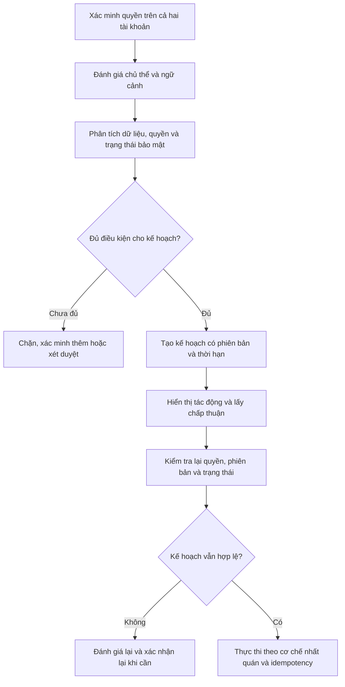

# Account merge eligibility

## 1. Account merge giải quyết vấn đề gì?

Một người có thể tạo nhiều tài khoản ngoài ý muốn: đăng ký một lần bằng email cá nhân, một lần bằng đăng nhập liên kết, hoặc tạo tài khoản mới sau khi mất thiết bị MFA. Khi lấy lại được tài khoản cũ, người đó có thể muốn gom dữ liệu và hoạt động về một tài khoản duy nhất.

**Account merge eligibility** là tập điều kiện xác định một cặp tài khoản có được phép hợp nhất trong một phạm vi cụ thể hay không. Việc đánh giá phải xem xét quyền kiểm soát tài khoản, quan hệ chủ thể, tính tương thích dữ liệu, quyền truy cập, trạng thái bảo mật và khả năng thực hiện an toàn.

Trong module account recovery, hợp nhất đặc biệt nhạy cảm vì người yêu cầu có thể vừa trải qua một quy trình khôi phục với mức bảo đảm khác với đăng nhập thông thường. Nếu hệ thống chỉ yêu cầu đăng nhập được vào một tài khoản rồi cho phép chọn tài khoản khác để nhập dữ liệu, chức năng merge có thể trở thành một đường chiếm đoạt tài khoản.

Mục tiêu không phải hợp nhất càng nhiều tài khoản càng tốt. Mục tiêu là chỉ cho phép một thay đổi đã xác định rõ khi có đủ căn cứ cho cả hai tài khoản và không làm mở rộng quyền hoặc làm mất dữ liệu ngoài phạm vi được cho phép.

## 2. Phân biệt merge, link, transfer và recovery

Những thao tác dưới đây có thể cùng xuất hiện trong trải nghiệm người dùng nhưng có ranh giới bảo mật khác nhau:

| Thao tác | Kết quả chính | Câu hỏi phải giải quyết |
|---|---|---|
| Account recovery | Lấy lại khả năng truy cập một tài khoản | Người yêu cầu có đủ bằng chứng để khôi phục tài khoản này không? |
| Account linking | Thiết lập liên kết giữa các danh tính hoặc cách đăng nhập | Ai có quyền gắn liên kết và liên kết cho phép điều gì? |
| Account merge | Hợp nhất những phần được phép của hai tài khoản về một kết quả đã chọn | Cả hai tài khoản và dữ liệu có đủ điều kiện hợp nhất không? |
| Ownership transfer | Chuyển quyền sở hữu tài nguyên hoặc tài khoản cho chủ thể khác | Ai có quyền chuyển và ai có quyền nhận? |

Hợp nhất không chỉ là đổi email của một tài khoản thành email của tài khoản còn lại. Nó cũng không mặc nhiên là phép hợp các tập quyền. Một thiết kế merge có thể chỉ chuyển dữ liệu học tập cá nhân, trong khi giữ nguyên các bản ghi giao dịch và không chuyển quyền tổ chức.

Ví dụ, tài khoản A chứa tiến độ học tập cá nhân, còn tài khoản B chứa tiến độ khác của cùng một người. Một sản phẩm có thể cho hợp nhất tiến độ sau khi xác minh đầy đủ. Nhưng nếu B còn là thành viên của một doanh nghiệp, quyền sử dụng tài nguyên doanh nghiệp không tự động đi theo dữ liệu cá nhân sang A.

Nếu mục tiêu chỉ là thêm một cách đăng nhập cho cùng tài khoản, account linking có thể phù hợp hơn merge. Nếu mục tiêu là chuyển tài nguyên giữa hai người, đó là bài toán chuyển quyền sở hữu với điều kiện riêng; không nên gọi là merge để bỏ qua kiểm soát.

## 3. Xác định cặp tài khoản và hướng hợp nhất

Một yêu cầu cần chỉ rõ:

- **Source account:** tài khoản có dữ liệu được xem xét chuyển hoặc hợp nhất.
- **Target account:** tài khoản dự kiến tiếp tục tồn tại như tài khoản sử dụng chính.
- **Merge scope:** chính xác những loại dữ liệu, định danh và quan hệ nào nằm trong phạm vi.
- **Surviving identity:** định danh nội bộ nào tiếp tục đại diện cho tài khoản sau khi hoàn tất.
- **Conflict policy:** cách xử lý những mục có giá trị khác nhau hoặc không thể kết hợp.

Hai hướng `A → B` và `B → A` có thể có kết quả khác nhau. Chúng có thể khác về thông tin đăng nhập được giữ, quyền sở hữu tài nguyên, hồ sơ thanh toán hoặc liên kết với tổ chức. Vì vậy, bằng chứng chấp thuận cho một hướng không nên dùng lại cho hướng đảo ngược.

Định danh nội bộ của tài khoản cần được dùng để ràng buộc thao tác. Email hoặc tên hiển thị có thể thay đổi, nên không đủ để xác định cặp tài khoản trong toàn bộ vòng đời xử lý.

Hệ thống cũng phải từ chối yêu cầu source và target là cùng một tài khoản. Nếu một tài khoản đã được hợp nhất trước đó, cần nhận diện trạng thái và tham chiếu hiện tại theo chính sách, không âm thầm tạo một chuỗi hợp nhất mới chỉ từ một alias cũ.

## 4. Các nhóm điều kiện đủ tư cách

Một mô hình hữu ích tách điều kiện bắt buộc khỏi tín hiệu hỗ trợ:

```text
Eligible(A, B, scope) =
    DistinctAccounts(A, B)
    AND AuthorizedForBoth(A, B)
    AND AllowedSubjectRelationship(A, B)
    AND CompatibleAccountContexts(A, B)
    AND CompatibleDataPlan(A, B, scope)
    AND NoDisqualifyingSecurityState(A, B)
    AND SufficientConsentAndApproval(A, B, scope)
    AND ExecutableUnderCurrentVersions(A, B, scope)
```

Đây là biểu diễn tư duy, không phải một biểu thức nên được tính từ các cờ do client gửi lên. Mỗi điều kiện cần có nguồn dữ liệu, cách kiểm tra và cách xử lý khi chưa đủ thông tin.

| Nhóm | Ví dụ điều kiện | Ví dụ chưa đủ căn cứ |
|---|---|---|
| Thẩm quyền | Có bằng chứng phù hợp để cho phép thao tác trên cả hai tài khoản | Chỉ đăng nhập được vào target |
| Chủ thể | Quan hệ giữa hai tài khoản phù hợp với chính sách merge | Tên hiển thị hoặc ảnh đại diện giống nhau |
| Ngữ cảnh | Loại tài khoản và ranh giới tổ chức tương thích | Cùng tên miền email nhưng khác tenant |
| Dữ liệu | Có kế hoạch xử lý từng nhóm dữ liệu và xung đột | Chỉ thấy tổng số bản ghi có vẻ giống nhau |
| Bảo mật | Không có trạng thái đang chặn merge | Một tài khoản vừa recovery nhưng chưa đánh giá giới hạn sau recovery |
| Chấp thuận | Đồng ý với hướng, phạm vi và kết quả đã trình bày | Đồng ý chung chung với điều khoản sử dụng |

Không nên cộng các yếu tố thành một điểm tổng rồi cho phép điểm tốt bù cho điều kiện bắt buộc bị thiếu. Nhiều dấu hiệu hai tài khoản có vẻ cùng người vẫn không thay thế thẩm quyền hợp lệ trên tài khoản chưa được xác minh.

## 5. Chứng minh quyền đối với cả hai tài khoản

### 5.1. Phiên của một tài khoản không chứng minh tài khoản còn lại

Một người đăng nhập vào B có thể biết email, username hoặc số khách hàng của A. Những dữ liệu đó không cho phép người đó nhập dữ liệu của A vào B.

Thiết kế an toàn cần một cách xác minh quyền đối với từng tài khoản. Tùy chính sách, có thể yêu cầu xác thực lại riêng cho A và B, hoặc hoàn tất recovery của tài khoản không còn truy cập được trước khi đánh giá merge. Một luồng hành chính khác chỉ hợp lệ khi có căn cứ và thẩm quyền riêng được quy định rõ; không dùng khả năng của nhân viên hỗ trợ để thay thế bằng chứng còn thiếu một cách tùy tiện.

Các bằng chứng cần được ràng buộc với đúng cặp tài khoản và mục đích hợp nhất. Một OTP được cấp để đổi mật khẩu của A không tự động trở thành quyền chuyển toàn bộ dữ liệu của A sang B.

### 5.2. Quyền kiểm soát và quan hệ chủ thể là hai câu hỏi khác nhau

Một người có thể kiểm soát hai tài khoản nhưng chính sách vẫn không cho hợp nhất. Ví dụ, một tài khoản đại diện cho hoạt động cá nhân, tài khoản còn lại đại diện cho một đơn vị có tài nguyên thuộc tổ chức.

Ngược lại, có nhiều bằng chứng cho thấy hai hồ sơ thuộc cùng một người nhưng một tài khoản đang bị chiếm quyền hoặc bị chặn recovery. Sự tương đồng về danh tính không cấp quyền thực hiện merge ngay lập tức.

Nếu sản phẩm cho phép người đại diện hoặc quản trị viên thực hiện một phần thao tác, cần thể hiện rõ phạm vi đại diện. Quyền quản trị tenant có thể cho phép quản lý thành viên mà không cho phép chuyển dữ liệu cá nhân sang tài khoản ngoài tenant.

### 5.3. Hai lần xác minh không luôn là hai nguồn độc lập

Hai tài khoản cùng dùng một hộp thư hoặc hai địa chỉ chuyển tiếp về cùng một nơi có thể cùng bị ảnh hưởng bởi một sự cố. Việc gửi hai OTP đến những địa chỉ đó không tạo ra hai nguồn kiểm soát độc lập chỉ vì có hai mã khác nhau.

Hệ thống cần đánh giá mức bảo đảm thực tế và loại thao tác. Không mô tả số lần nhập mã như một bảo đảm mạnh hơn những kênh thực sự được sử dụng. Với thao tác rủi ro cao, chính sách có thể cần thêm xác thực, thời gian chờ hoặc xét duyệt phù hợp.

## 6. Những thuộc tính không đủ để kết luận cùng chủ thể

### 6.1. Email giống nhau hoặc được chuẩn hóa thành giống nhau

Email có thể thay đổi, được tái cấp hoặc bị chiếm quyền. Một email đã từng được xác minh ở thời điểm trước không chứng minh người hiện giữ email là chủ hợp lệ của mọi tài khoản có liên quan trong lịch sử.

Không tự áp dụng quy tắc như bỏ dấu chấm hoặc bỏ mọi phần sau dấu `+` cho tất cả nhà cung cấp email rồi coi hai tài khoản là một. Ý nghĩa của những phần này phụ thuộc hệ thống email; chuẩn hóa quá mức có thể gộp những địa chỉ thực sự khác nhau.

Ngay cả khi hệ thống có quy tắc chuẩn hóa phù hợp cho việc tra cứu, kết quả trùng chỉ là một đầu vào đánh giá, không phải quyền hợp nhất.

### 6.2. Danh tính liên kết

Với đăng nhập liên kết, một định danh thường cần được hiểu trong phạm vi nhà phát hành tương ứng. Hai giá trị subject giống nhau từ hai nhà phát hành khác nhau không mặc nhiên đại diện cho cùng một người. Email do một bên cung cấp cũng không nên thay thế định danh liên kết ổn định của bên đó.

Nếu thay đổi cấu hình liên kết hoặc chuyển tổ chức quản lý danh tính, cần có quy trình xác minh riêng. Không dùng merge như một cách tự động sửa mọi xung đột định danh phát sinh từ cấu hình.

### 6.3. Dữ liệu hồ sơ và hành vi

Tên, ngày sinh, số điện thoại, ảnh, địa chỉ IP và lịch sử thiết bị có thể hỗ trợ tìm hồ sơ hoặc đánh giá rủi ro. Chúng cũng có thể bị biết trước, dùng chung hoặc bị giả mạo. Một thuật toán tìm tài khoản trùng không nên tự thực hiện merge dựa trên độ giống nhau.

## 7. Tương thích loại tài khoản và ranh giới tenant

Một cặp tài khoản có thể thuộc các loại khác nhau: cá nhân, thành viên doanh nghiệp, tài khoản quản trị, tài khoản dịch vụ hoặc tài khoản dùng chung theo mô hình của sản phẩm. Không nên giả định mọi cặp đều có cùng quy tắc hợp nhất.

| Cặp ngữ cảnh | Vấn đề cần làm rõ |
|---|---|
| Cá nhân với cá nhân | Quan hệ chủ thể, dữ liệu trùng, phương thức đăng nhập sẽ giữ |
| Cá nhân với tài khoản do tổ chức quản lý | Quyền của tổ chức đối với dữ liệu, khả năng đăng nhập và giới hạn chuyển |
| Hai tài khoản ở hai tenant | Thẩm quyền của từng tenant và tính hợp lệ của việc di chuyển dữ liệu |
| Tài khoản đặc quyền với tài khoản thường | Nguy cơ kế thừa đặc quyền hoặc thay đổi đường xác thực quản trị |
| Tài khoản người dùng với tài khoản dịch vụ | Khác mục đích, vòng đời thông tin xác thực và quyền sở hữu |

Trong nhiều thiết kế, một số cặp nên bị từ chối merge và được hướng sang quy trình khác. Đây là một lựa chọn an toàn có chủ đích, không phải lỗi cần “sửa” bằng cách sao chép dữ liệu trực tiếp.

Hai tài khoản thuộc cùng tenant cũng chưa chắc tương thích. Chúng có thể gắn với hai đơn vị khác nhau hoặc những tài nguyên có ranh giới quyền riêng. Ngược lại, nếu sản phẩm hỗ trợ chuyển xuyên tenant, điều đó cần một contract cụ thể chứ không suy ra từ quyền merge thông thường.

Quy tắc về lưu giữ, phân loại và quyền xử lý dữ liệu phải đến từ chính sách có thẩm quyền của tổ chức. Công cụ merge thực thi những ranh giới đã xác định, không tự quyết định rằng dữ liệu nào cũng có thể chuyển vì người dùng đã nhấn đồng ý.

## 8. Không hợp quyền theo phép cộng

Một rủi ro lớn là dùng cách triển khai đơn giản: lấy toàn bộ role, membership, quyền tài nguyên và entitlement của A cộng vào B. Khi đó, một tài khoản được recovery bằng luồng yếu hơn có thể trở thành tài khoản mang quyền mạnh hơn.

Đánh giá eligibility phải chỉ rõ phần nào được giữ, phần nào được tính lại và phần nào không được chuyển:

- Quyền quản trị và quyền được ủy quyền cần được xem xét theo chính sách cấp quyền hiện tại.
- Membership của tổ chức cần tiếp tục tuân theo quyền của tổ chức và điều kiện gia nhập.
- Giấy phép, gói dịch vụ hoặc hạn mức cần quy tắc sản phẩm riêng; không mặc nhiên cộng dồn.
- Khóa API, mật khẩu ứng dụng và bí mật tích hợp cần kế hoạch xử lý rõ ràng.
- Các quyền đã hết hạn hoặc bị thu hồi không được sống lại qua tài khoản đích.

Một merge hợp lệ về dữ liệu vẫn có thể bị từ chối nếu chưa có cách bảo đảm kết quả quyền truy cập. Nếu chỉ một phần dữ liệu tương thích, hệ thống có thể đề xuất phạm vi nhỏ hơn, nhưng phải trình bày lại và lấy chấp thuận cho chính phạm vi đó.

Chủ thể hợp lệ và dữ liệu hợp lệ không làm mọi phương thức đăng nhập của source trở nên phù hợp cho target. Những thông tin xác thực cũ, đặc biệt khi source vừa bị nghi ngờ chiếm đoạt, cần được đánh giá riêng thay vì chuyển nguyên trạng.

## 9. Kiểm kê dữ liệu và xử lý xung đột trước khi cho phép

Eligibility không chỉ là kiểm tra bảo mật danh tính. Hệ thống cần biết có thể thực hiện một kế hoạch hợp nhất nhất quán hay không.

| Nhóm dữ liệu | Câu hỏi cần trả lời trước merge |
|---|---|
| Hồ sơ cá nhân | Giữ giá trị nào, lấy xác nhận nào khi giá trị khác nhau? |
| Tiến độ hoặc lịch sử hoạt động | Hợp theo khóa nào, xử lý bản ghi trùng ra sao? |
| Tài nguyên do người dùng tạo | Ai là chủ sau merge, những người khác còn quyền gì? |
| Thành viên và chia sẻ | Có làm lộ dữ liệu sang nhóm hoặc tenant khác không? |
| Giao dịch và hóa đơn | Giữ tham chiếu lịch sử thế nào, có được đổi chủ thể hiển thị không? |
| Thông tin xác thực | Giữ, thu hồi hay đăng ký lại loại nào? |
| Audit | Làm sao giữ được actor và tài khoản gốc của sự kiện cũ? |
| Dữ liệu đang chờ xử lý | Job, yêu cầu xóa hoặc quy trình recovery đang hoạt động sẽ ra sao? |

Một số dữ liệu không nên được viết lại như thể luôn thuộc về target. Ví dụ, bản ghi audit cần giữ được tài khoản đã thực hiện hành động trong quá khứ, cùng liên kết giải thích việc hợp nhất sau đó. Nếu thay toàn bộ actor lịch sử bằng target, khả năng điều tra có thể bị mất.

Nếu có xung đột chưa có quy tắc giải quyết, trạng thái phù hợp là cần làm rõ hoặc không đủ điều kiện cho phạm vi hiện tại. Không nên cho phép trước rồi để một tác vụ nền tùy ý chọn dữ liệu nào còn lại.

## 10. Trạng thái bảo mật có thể chặn merge

Một tài khoản có thể có trạng thái đăng nhập hoạt động nhưng vẫn chưa đủ điều kiện merge. Những tình huống cần chính sách rõ gồm:

- Có dấu hiệu account takeover chưa được giải quyết.
- Recovery đang diễn ra hoặc vừa hoàn tất với giới hạn hậu recovery.
- Yếu tố xác thực hay kênh liên hệ vừa thay đổi theo cách làm tăng rủi ro.
- Tài khoản đang bị hạn chế vì lạm dụng hoặc chờ xác minh.
- Có một yêu cầu merge khác đang hoạt động.
- Tài khoản đang trong quy trình xóa, khóa dữ liệu hoặc xử lý nghiệp vụ xung đột.

Không cho merge trở thành cách né các biện pháp hạn chế. Nếu source bị cấm một hành động, việc chuyển dữ liệu sang target không nên tự làm mất dấu vết hoặc khôi phục khả năng thực hiện hành động đó.

Thời gian chờ có thể là một lớp bảo vệ sau recovery hoặc thay đổi yếu tố. Thời lượng và trường hợp áp dụng cần đến từ chính sách rủi ro của sản phẩm, không từ một con số dùng chung cho mọi hệ thống. Hết thời gian chờ cũng không thay thế việc giải quyết cảnh báo đang tồn tại.

Các tín hiệu như IP hay thiết bị mới nên được đánh giá trong ngữ cảnh. Chúng có thể làm tăng yêu cầu xác thực hoặc chuyển xét duyệt, nhưng không nên được dùng như bằng chứng duy nhất rằng hai tài khoản thuộc cùng một người.

## 11. Chấp thuận phải gắn với kế hoạch cụ thể

Trước khi người dùng xác nhận, hệ thống cần trình bày những tác động có ý nghĩa:

1. Tài khoản nào sẽ được giữ để tiếp tục đăng nhập.
2. Những nhóm dữ liệu sẽ được chuyển hoặc hợp nhất.
3. Những dữ liệu không được chuyển và các xung đột chưa giải quyết.
4. Những thay đổi về phương thức đăng nhập, phiên và liên kết tổ chức.
5. Phần nào không thể hoàn tác bằng thao tác thông thường.

Chấp thuận phải ràng buộc với định danh source, target, hướng merge, phạm vi, phiên bản kế hoạch và thời hạn. Một màn hình ghi “Tôi đồng ý hợp nhất tài khoản” nhưng không nêu tài khoản nào sống sót là chưa đủ rõ để xác nhận tác động.

Nếu kế hoạch thay đổi, chẳng hạn bổ sung dữ liệu doanh nghiệp hoặc đổi target, xác nhận cũ không còn áp dụng. Không dùng một token cho phép A → B để thực hiện A → C dù người yêu cầu có cùng phiên đăng nhập.

Với dữ liệu hoặc quyền do tổ chức quản lý, chấp thuận của cá nhân có thể chưa đủ. Hệ thống cần lấy đúng phê duyệt có thẩm quyền theo chính sách đã đặt ra. Người có quyền duyệt phải được kiểm tra độc lập với quyền của người yêu cầu.

## 12. Kết quả đánh giá không chỉ có có hoặc không

Một mô hình kết quả có thể dùng các trạng thái sau:

| Kết quả | Ý nghĩa | Hành động tiếp theo |
|---|---|---|
| `ELIGIBLE` | Đủ điều kiện cho kế hoạch hiện tại tại thời điểm đánh giá | Tạo kế hoạch có hạn, chờ xác nhận hoặc thực thi theo quy trình |
| `REQUIRES_VERIFICATION` | Thiếu bằng chứng bắt buộc nhưng có đường xác minh được phép | Hoàn tất xác minh rồi đánh giá lại |
| `REQUIRES_REVIEW` | Cần quyết định của người có thẩm quyền theo chính sách | Chuyển hồ sơ và giữ nguyên ràng buộc |
| `TEMPORARILY_BLOCKED` | Có trạng thái tạm thời đang ngăn merge | Giải quyết trạng thái hoặc chờ điều kiện hợp lệ |
| `INELIGIBLE` | Cặp tài khoản hoặc phạm vi không được hỗ trợ theo chính sách | Không thực hiện merge; trình bày lựa chọn khác nếu có |

`ELIGIBLE` không phải quyền merge vĩnh viễn. Nó chỉ có ý nghĩa với cặp tài khoản, kế hoạch và phiên bản đã được đánh giá.

`REQUIRES_REVIEW` cũng không phải một lối đi cho phép reviewer bỏ qua mọi điều kiện bắt buộc. Ví dụ, một ngoại lệ về cách xử lý dữ liệu có thể được xét nếu chính sách cho phép, nhưng chưa xác định được ai có quyền đối với source thì không được giải quyết bằng một nút “approve anyway”.

Thông báo cho người chưa chứng minh quyền đối với cả hai tài khoản cần tránh làm lộ việc một tài khoản tồn tại, trạng thái bảo mật hay liên kết tổ chức của tài khoản đó. Chi tiết lý do có thể được lưu nội bộ và hiển thị có kiểm soát sau khi quyền truy cập đã được xác minh.

## 13. Mô hình bằng chứng và kế hoạch có phiên bản

Một kế hoạch hợp nhất có thể tham chiếu những dữ liệu sau:

```text
mergePlanId
sourceAccountId
targetAccountId
direction
scope
sourceSecurityVersion
targetSecurityVersion
sourceDataVersion
targetDataVersion
proofReferences
consentReference
approvalReferences
policyVersion
planDigest
createdAt
expiresAt
status
```

`proofReferences` là tham chiếu tới kết quả xác minh được kiểm soát phía máy chủ. Không lưu mật khẩu, OTP còn hiệu lực hoặc token recovery thô trong kế hoạch hay log. Nếu một bằng chứng được dùng để tạo kế hoạch theo mục đích cụ thể, việc đánh giá lại không được vô tình biến nó thành một quyền có thể phát lại cho những cặp tài khoản khác.

Các phiên bản bảo mật giúp phát hiện việc đổi yếu tố xác thực, thu hồi phiên hoặc thay đổi quyền quan trọng sau preflight. Các phiên bản dữ liệu giúp phát hiện rằng một phần của kế hoạch không còn đúng với trạng thái đã được người dùng xem.

Không phải hệ thống nào cũng có một số phiên bản duy nhất bao phủ mọi dữ liệu. Cần xác định các mốc hoặc snapshot phù hợp cho từng loại tài nguyên, đồng thời nêu rõ thay đổi nào buộc đánh giá lại. Một timestamp tùy ý do client gửi không thay thế kiểm soát đồng thời ở máy chủ.

## 14. Pseudocode đánh giá eligibility

Pseudocode sau tập trung vào các cổng kiểm soát. Nó không triển khai thuật toán di chuyển dữ liệu và không phải mã production:

```java
EligibilityDecision evaluateMerge(MergeRequest request,
                                  AuthenticatedActor actor) {
    require(!request.sourceId().equals(request.targetId()));

    // Xác minh thẩm quyền trên cả hai trước khi trả chi tiết tài khoản.
    PairAuthority authority = proofVerifier.requirePairAuthority(
        actor,
        request.sourceId(),
        request.targetId(),
        request.proofReferences());

    AccountPair pair = accounts.loadConsistentPair(
        request.sourceId(), request.targetId());
    MergePolicy policy = policies.resolve(pair, request.scope());

    if (!policy.allowsSubjectRelationship(pair, authority)) {
        return EligibilityDecision.ineligible("SUBJECT_RELATIONSHIP");
    }
    if (!policy.allowsAccountContexts(pair)) {
        return EligibilityDecision.ineligible("ACCOUNT_CONTEXT");
    }
    if (securityStates.blocksMerge(pair, policy)) {
        return EligibilityDecision.blocked("SECURITY_STATE");
    }

    DataCompatibility compatibility = dataPlanner.analyze(
        pair, request.scope(), policy);
    if (!compatibility.hasCompleteAllowedPlan()) {
        return EligibilityDecision.needsResolution("DATA_COMPATIBILITY");
    }
    if (!privilegePlanner.hasAllowedResult(pair, compatibility, policy)) {
        return EligibilityDecision.ineligible("PRIVILEGE_RESULT");
    }
    if (policy.requiresIndependentReview(pair, compatibility)) {
        return EligibilityDecision.requiresReview(
            plans.createReviewCandidate(pair, authority, compatibility, policy));
    }

    return EligibilityDecision.eligible(
        plans.createBoundCandidate(pair, authority, compatibility, policy));
}
```

Các mã lý do trong ví dụ là nội bộ. API không nhất thiết trả nguyên văn cho mọi người gọi. Một quyết định từ chối quyền cũng cần có phản hồi phù hợp, không để việc khác nhau về thông báo trở thành công cụ dò tài khoản.

`loadConsistentPair` và kế hoạch được tạo phải gắn với trạng thái đã đọc. Nếu có thay đổi giữa lúc phân tích và lúc lưu kế hoạch, cần cơ chế phát hiện hoặc tạo lại kế hoạch. Một kiểm tra thuần đọc không tự ngăn thay đổi xảy ra sau đó.

Tạo candidate plan chưa thực thi merge và chưa làm người dùng mất quyền đăng nhập vào source. Hành động thực thi cần xác nhận, bằng chứng còn hiệu lực và kiểm tra lại các ràng buộc hiện tại.

## 15. Từ đủ điều kiện đến thực thi: kiểm tra lại điều gì?

Một cặp tài khoản đủ điều kiện lúc 10 giờ có thể không còn đủ điều kiện lúc 10 giờ 05. Một tài khoản có thể vừa bị khóa, xuất hiện cảnh báo chiếm đoạt hoặc nhận thêm dữ liệu không được chuyển.



Trước thực thi, cần kiểm tra kế hoạch chưa hết hạn hoặc bị hủy, proof và consent đúng phạm vi, phê duyệt còn áp dụng, quyền và trạng thái hiện tại đáp ứng chính sách, đồng thời không có merge khác đang xung đột.

Các thao tác đồng thời như `A → B` và `A → C` phải được phối hợp để không cùng chiếm một source. Tương tự, hai hướng `A → B` và `B → A` không được chạy như hai công việc độc lập. Có thể dùng đặt chỗ, ràng buộc duy nhất hoặc khóa với thứ tự ổn định tùy kiến trúc.

Nếu dữ liệu ở nhiều dịch vụ, một transaction cơ sở dữ liệu không tự bao phủ toàn bộ quá trình. Eligibility cần đánh giá khả năng thực thi kế hoạch bằng cơ chế xử lý lỗi, retry và khôi phục phù hợp. Trạng thái “đủ điều kiện” không bảo đảm không có lỗi hạ tầng, nhưng hệ thống phải biết giữ tính nhất quán khi lỗi xảy ra.

Khóa idempotency ngăn thực hiện trùng một lệnh không thay thế bằng chứng quyền. Request retry vẫn cần được nhận diện và phân quyền phù hợp, đồng thời phải khớp cặp tài khoản và digest kế hoạch đã lưu.

## 16. Phiên, token và định danh sau merge

Kế hoạch phải nêu rõ những phiên và thông tin xác thực nào tiếp tục có hiệu lực. Nếu một phiên cũ của source tự động truy cập toàn bộ dữ liệu mới ở target, merge có thể mở rộng quyền cho bất kỳ ai đang giữ phiên đó.

Các lựa chọn thiết kế có thể bao gồm thu hồi những phiên bị ảnh hưởng, yêu cầu đăng nhập lại, vô hiệu hóa token recovery cũ, kiểm tra lại các liên kết đăng nhập và cho người dùng đăng ký lại yếu tố khi cần. Lựa chọn phải theo rủi ro và được thực thi ở nơi xác nhận quyền, không chỉ xóa cookie trong trình duyệt hiện tại.

Không tự cộng recovery codes hoặc coi toàn bộ thiết bị đã tin cậy ở hai tài khoản đều tiếp tục đáng tin. Một thiết bị được tin cậy trước sự cố của source có thể không phù hợp để truy cập dữ liệu target sau merge.

Định danh source có thể cần được giữ dưới dạng bản ghi ngừng hoạt động hoặc ánh xạ có kiểm soát để bảo toàn tham chiếu. Ánh xạ này không được trở thành một cách đăng nhập thay thế bỏ qua kiểm tra. Cũng cần tránh tái sử dụng một định danh cũ theo cách khiến chủ mới nhận dữ liệu hay thông báo của chủ trước.

## 17. Tình huống phân tích

### 17.1. Hai tài khoản cá nhân của cùng một người

Người dùng đăng nhập được vào cả A và B, thực hiện xác thực theo yêu cầu và muốn giữ B. Dữ liệu chỉ gồm hai tập tiến độ học tập có quy tắc gộp rõ ràng; không có quyền đặc biệt hoặc trạng thái chặn.

Cặp này có thể đủ điều kiện nếu chính sách cho phép, kế hoạch giải quyết được các mục trùng, và người dùng chấp thuận tác động. Hệ thống vẫn cần kiểm tra lại trước thực thi và xử lý các phiên cũ theo kế hoạch.

### 17.2. Đăng nhập được vào B nhưng chỉ biết email của A

Người yêu cầu nói A là tài khoản cũ và cung cấp email trùng một hồ sơ. Chưa có bằng chứng phù hợp về quyền trên A.

Không đủ điều kiện merge. Hệ thống hướng người dùng vào luồng xác minh hoặc recovery được phép cho A, đồng thời tránh tiết lộ dữ liệu của A. Việc lịch sử học tập ở B có vẻ giống A không sửa được thiếu sót này.

### 17.3. Tài khoản vừa recovery và tài khoản có đặc quyền

A vừa được khôi phục sau mất MFA. B có quyền quản trị tổ chức. Người yêu cầu muốn nhập B vào A và giữ các phiên đang hoạt động của A.

Ngay cả khi cùng chủ thể, kế hoạch này có thể tạo ra đường truy cập yếu hơn tới quyền mạnh hơn. Cần áp dụng chính sách hậu recovery, quyền quản trị và phiên. Kết quả có thể là chặn, xét duyệt hoặc chỉ cho phép một phạm vi dữ liệu không chuyển đặc quyền; không có phép cộng quyền mặc định.

### 17.4. Dữ liệu thuộc tổ chức khác

A là tài khoản cá nhân, B thuộc tenant doanh nghiệp. Người dùng kiểm soát cả hai nhưng muốn đưa toàn bộ tài nguyên chia sẻ của B sang A.

Quyền kiểm soát tài khoản không đồng nghĩa quyền chuyển mọi tài nguyên. Cần tôn trọng phạm vi sở hữu, chia sẻ và phê duyệt của tổ chức. Nếu sản phẩm không hỗ trợ kế hoạch phù hợp, cặp hoặc phạm vi này là không đủ điều kiện.

### 17.5. Source đang bị hạn chế vì lạm dụng

A bị hạn chế và B hoạt động bình thường. Người yêu cầu muốn merge để tiếp tục dùng các chức năng đã bị chặn ở A.

Hệ thống phải xem xét tác động của biện pháp hạn chế đối với kết quả. Không xóa lịch sử hay khôi phục quyền bị chặn chỉ vì định danh đích khác đi. Nếu chưa giải quyết được trạng thái, merge không được dùng làm đường vòng.

## 18. Những lỗi thiết kế thường gặp

| Lỗi | Nguy cơ | Hướng kiểm soát |
|---|---|---|
| Cùng email là tự hợp nhất | Nhầm chủ thể hoặc chiếm đoạt qua email | Xác minh thẩm quyền và quan hệ chủ thể riêng |
| Chỉ xác thực target | Người giữ một tài khoản có thể lấy dữ liệu của tài khoản khác | Căn cứ hợp lệ cho cả source và target |
| Gộp toàn bộ role và membership | Leo thang đặc quyền hoặc vượt tenant | Kế hoạch quyền rõ ràng, cấp quyền theo chính sách hiện tại |
| Dùng proof recovery cho mọi thao tác | Một token vượt mục đích ban đầu | Ràng buộc proof với loại hành động và kế hoạch |
| Giữ mọi phiên cũ sau merge | Người giữ phiên source nhận dữ liệu target | Đánh giá lại phiên và thu hồi theo phạm vi tác động |
| Cho phép rồi mới tìm cách xử lý dữ liệu | Mất dữ liệu hoặc kết quả không nhất quán | Hoàn tất phân tích tương thích và xung đột trước |
| Kế hoạch không có phiên bản | Consent và phê duyệt áp dụng nhầm nội dung | Digest, mốc phiên bản và kiểm tra lại trước thực thi |
| Tự đổi actor lịch sử thành target | Mất khả năng điều tra | Giữ nguồn gốc và liên kết merge có kiểm soát |
| Xét duyệt thủ công bỏ qua quyền sở hữu | Nhân viên trở thành đường chiếm đoạt | Chỉ cho ngoại lệ đúng thẩm quyền và điều kiện được phép |
| Retry tạo merge lần hai | Chuyển dữ liệu trùng hoặc xung đột | Idempotency ràng buộc với lệnh và điều phối tài khoản |

Một cặp tài khoản đủ điều kiện hợp nhất khi có căn cứ cho cả hai phía, phạm vi dữ liệu và quyền được xác định, trạng thái bảo mật cho phép, và kế hoạch có thể được thực hiện nhất quán. Trong account recovery, merge cần duy trì mức bảo đảm đó đến thời điểm thực thi để việc lấy lại quyền truy cập không trở thành cách lấy thêm quyền đối với tài khoản khác.
