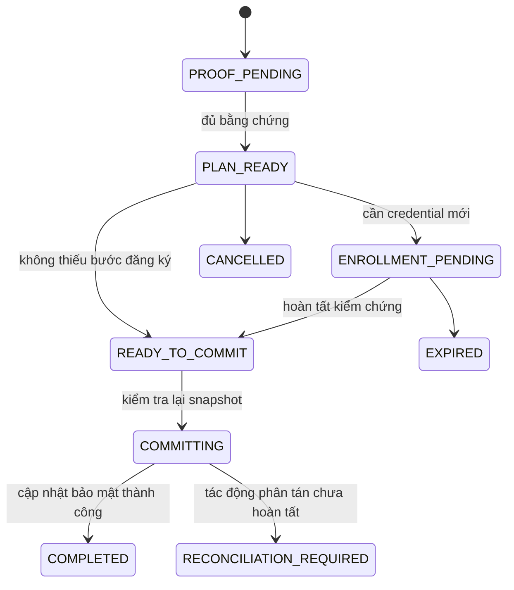

# Credential conflict resolution: xử lý xung đột thông tin xác thực khi gộp tài khoản

## 1. Gộp tài khoản đồng nghĩa thay đổi ranh giới xác thực

Một người dùng có thể vô tình tạo hai tài khoản: tài khoản A đăng nhập bằng mật khẩu và TOTP, tài khoản B dùng nhà cung cấp danh tính bên ngoài. Khi mất thiết bị xác thực của A, người đó đăng nhập được B và yêu cầu gộp để lấy lại dữ liệu. Nếu hệ thống chỉ chuyển dữ liệu A sang B rồi chấp nhận mọi credential của cả hai, bất kỳ ai đang giữ một credential cũ có thể được hưởng phạm vi truy cập lớn hơn trước.

**Credential conflict resolution** là quá trình xác định credential nào được giữ, loại nào cần đăng ký lại, liên kết nào phải xác minh lại và credential nào phải bị thu hồi khi hai tài khoản trở thành một danh tính truy cập thống nhất.

Trong `SECURITY_AUTHENTICATION_ACCOUNT_RECOVERY`, việc gộp tài khoản phải kết hợp xác minh danh tính, đánh giá rủi ro, token dùng một lần, chống lạm dụng và kiểm soát phiên. Account merge không được trở thành đường bỏ qua recovery của tài khoản mà người yêu cầu chưa chứng minh quyền kiểm soát.

Bài này dùng hai khái niệm:

- **Tài khoản nguồn — source:** tài khoản sẽ ngừng hoạt động như một chủ thể đăng nhập độc lập.
- **Tài khoản đích — survivor:** tài khoản tiếp tục tồn tại sau khi gộp.

Chiều gộp phải được chọn rõ. “Gộp A và B” chưa đủ để xác định mật khẩu nào còn hiệu lực, các factor thuộc về ai hoặc phiên cũ có được phép truy cập dữ liệu mới hay không.

## 2. Những dạng xung đột cần nhận diện

Xung đột không chỉ là hai bản ghi trùng khóa trong cơ sở dữ liệu. Có xung đột về quyền sở hữu, độ tin cậy và ngữ nghĩa sử dụng.

| Dạng xung đột | Ví dụ | Rủi ro nếu tự động hợp nhất |
| --- | --- | --- |
| Hai mật khẩu khác nhau | A có mật khẩu mới, B có mật khẩu cũ bị lộ | Mật khẩu yếu hơn mở được toàn bộ tài khoản sau gộp |
| Hai tập MFA | A có khóa bảo mật, B chỉ có TOTP | Tập factor mới làm yếu chính sách của tài khoản nhạy cảm |
| Hai danh tính liên kết | Hai tài khoản gắn với các subject khác nhau của cùng provider | Liên kết nhầm người hoặc tạo thêm đường đăng nhập không được chấp thuận |
| Cùng định danh đăng nhập | Hai bản ghi dùng cùng email theo dữ liệu cũ | Chọn bản ghi tùy ý dẫn tới chiếm tài khoản |
| Trạng thái xác minh khác nhau | Email được xác minh ở A nhưng chưa được xác minh ở B | Cờ verified bị sao chép sang một liên kết chưa được chứng minh |
| Credential đang bị nghi lộ | Source vừa có sự kiện takeover | Credential nguy hiểm được đưa vào survivor |
| Phiên và token còn sống | Refresh token của B còn hiệu lực | Chủ thể giữ phiên cũ nhận thêm dữ liệu hoặc quyền của A |

Một liên kết đăng nhập có thể không chứa bí mật nhưng vẫn là đường vào tài khoản. Ví dụ, bản ghi liên kết danh tính bên ngoài quyết định một subject upstream sẽ được ánh xạ đến tài khoản local nào. Vì vậy, liên kết đó cần được xử lý như một phần của bề mặt xác thực.

Quyền truy cập và credential cũng phải tách riêng. Gộp credential không tự cho phép cộng mọi role, quyền quản trị, membership tenant hoặc entitlement của hai tài khoản. Các xung đột phân quyền cần chính sách riêng; không suy ra quyền mới từ việc hai tài khoản được xác nhận cùng người.

## 3. Chứng minh quyền kiểm soát cả hai tài khoản

Đăng nhập thành công vào survivor không chứng minh quyền sở hữu source. Cùng tên, cùng ảnh đại diện hoặc cùng chuỗi email cũng không đủ để khẳng định hai tài khoản thuộc cùng một chủ thể.

Một quy trình an toàn cần một trong các đường được chính sách cho phép:

1. Người dùng xác thực lại với từng tài khoản bằng phương thức đủ mạnh và còn mới.
2. Nếu không thể xác thực một bên, hoàn thành recovery được chấp thuận cho chính tài khoản đó trước khi cho phép gộp.
3. Với trường hợp doanh nghiệp có cơ chế quản trị danh tính, dùng quy trình xác minh và phê duyệt được định nghĩa cho đúng phạm vi tổ chức.

Mỗi bằng chứng cần ràng buộc với tài khoản, mục đích gộp và hồ sơ hiện tại. Không dùng một token reset mật khẩu chung cho A làm bằng chứng không giới hạn rằng người nhận được phép chuyển mọi dữ liệu A sang bất kỳ tài khoản B nào.

Một hồ sơ gộp có thể tham chiếu:

```yaml
mergeCaseId: merge_example_15
sourceAccountId: account_source
survivorAccountId: account_survivor
tenantScope: tenant_example
sourceProofReference: proof_source_example
survivorProofReference: proof_survivor_example
purpose: ACCOUNT_MERGE
state: PROOF_PENDING
```

Các giá trị chỉ minh họa cấu trúc. Bằng chứng thật được máy chủ xác minh, có thời hạn và phạm vi, không phải các chuỗi mà client tự khai báo là hợp lệ.

Tài khoản thuộc hai tenant hoặc hai miền chính sách khác nhau cần đánh giá riêng. Không cho phép một merge thông thường vượt qua ranh giới tenant chỉ vì email trùng nhau. Tài khoản đặc quyền, tài khoản có chủ thể sở hữu khác nhau hoặc tài khoản đang bị điều tra có thể phải bị chặn hoặc chuyển sang quy trình chuyên biệt.

## 4. Xây dựng merge plan trước khi thay đổi credential

Một merge plan là danh sách quyết định rõ ràng cho từng loại credential và tác động liên quan. Nó phải được tạo từ snapshot hiện tại của cả source và survivor, rồi được xác nhận theo chính sách.

Các nội dung quan trọng:

- Chiều gộp và tài khoản tiếp tục tồn tại.
- Danh sách credential, factor, liên kết danh tính và trạng thái của chúng.
- Kết quả xác minh quyền kiểm soát mỗi tài khoản.
- Credential được giữ, thu hồi, thay thế hoặc cần xác minh bổ sung.
- Các bước đăng ký mới bắt buộc trước khi hoàn tất.
- Chính sách thu hồi phiên, refresh token, recovery code và thiết bị tin cậy.
- Các định danh đăng nhập nào tiếp tục được dùng sau gộp.
- Điều kiện chặn và hạn chế sau khi gộp.

Ví dụ rút gọn:

```yaml
planVersion: 4
sourceCredentialVersion: 12
survivorCredentialVersion: 8
policyVersion: merge-recovery-policy-example
passwordDecision: SET_FRESH_FOR_SURVIVOR
totpDecision: REENROLL_FOR_SURVIVOR
passkeyDecision: EXPLICIT_REVIEW_OR_REENROLL
recoveryCodeDecision: REVOKE_BOTH_AND_REGENERATE
federationDecision: REVERIFY_EACH_PROPOSED_LINK
sessionDecision: REVOKE_PRE_MERGE_SESSIONS
apiCredentialDecision: EXPLICIT_REVIEW_AND_ROTATION
```

Đây là một chính sách minh họa thiên về thận trọng trong recovery, không phải quy tắc bắt buộc cho mọi sản phẩm. Một hệ thống có thể giữ một số credential khi chứng minh được việc giữ đó không làm thay đổi ranh giới bảo mật ngoài phạm vi đã duyệt. Quyết định giữ cần có lý do và điều kiện, không phải hành vi mặc định của thao tác chuyển khóa ngoại.

Phê duyệt hoặc xác nhận của người dùng phải gắn với merge plan và phiên bản của hai tài khoản. Nếu có thêm factor, đổi email, thay liên kết provider hoặc thay bằng chứng, hệ thống cần đánh giá lại các quyết định chịu ảnh hưởng.

## 5. Xung đột mật khẩu: không hợp nhất hai bí mật

Password hash không phải dữ liệu để nối, chọn theo thứ tự sắp xếp hoặc so sánh độ mạnh của mật khẩu. Hai hash khác nhau có thể đến từ cùng mật khẩu do salt khác nhau; nhìn vào hash không cho biết mật khẩu nào do chủ tài khoản hợp lệ kiểm soát.

Các chính sách có thể áp dụng gồm:

- Giữ mật khẩu survivor sau xác thực lại đủ mạnh, đồng thời vô hiệu hóa mật khẩu source.
- Yêu cầu đặt mật khẩu mới cho survivor trong phiên merge hạn chế đã được cấp đúng thẩm quyền.
- Chuyển sang mô hình không mật khẩu nếu sản phẩm và chính sách đã hỗ trợ, sau khi người dùng hoàn tất phương thức xác thực yêu cầu.

Không nên chấp nhận đồng thời cả mật khẩu A và B cho cùng tài khoản sau gộp chỉ để giảm thao tác người dùng. Cách đó giữ lại thêm một đường tấn công và khiến việc đổi mật khẩu trở nên khó giải thích: đổi mật khẩu nào mới thực sự chấm dứt quyền của người đang biết mật khẩu cũ?

Nếu phải đặt mật khẩu mới, bước đó phải có quyền hạn riêng được ràng buộc với hồ sơ merge và survivor. Người vận hành không được biết mật khẩu mới. Mật khẩu phải được xử lý theo cơ chế hash an toàn của hệ thống; merge không phải lý do xuất plaintext hoặc ghi hash vào log để “đối chiếu”.

Trạng thái lịch sử mật khẩu, thời điểm đổi gần nhất và các yêu cầu đổi lại cần được xử lý theo chính sách, không chỉ lấy giá trị thuận tiện nhất từ hai tài khoản. Một quyết định recovery không nên làm mất dấu rằng tài khoản vừa trải qua một thay đổi xác thực nhạy cảm.

## 6. MFA, TOTP, HOTP và recovery code

### TOTP và HOTP

Sao chép secret TOTP của source sang survivor không chứng minh người đang gộp hiện còn kiểm soát authenticator. Nó còn có thể đưa một secret bị nghi lộ sang tài khoản có nhiều dữ liệu hơn.

Chính sách thận trọng là tạo factor thay thế cho survivor, yêu cầu người dùng hoàn tất kiểm chứng và thu hồi factor cũ theo kế hoạch. Nếu giữ factor hiện có, cần xác thực lại bằng factor đó và xác nhận rằng chính sách cho phép nó bảo vệ tài khoản sau gộp. Không tự đánh dấu tất cả factor là verified chỉ vì người dùng vượt qua một factor bất kỳ.

HOTP có trạng thái counter; TOTP có các kiểm soát thời gian và chống chấp nhận lại theo triển khai. Không gộp secret hoặc reset trạng thái chống replay tùy tiện. Chuyển dữ liệu factor như một bản ghi thông thường có thể phá vỡ những bảo đảm mà verifier đang dựa vào.

### Recovery code

Recovery code của cả hai tài khoản là các bí mật dự phòng có thể vẫn nằm trên thiết bị cũ hoặc đã bị sao chép. Với luồng gộp có recovery, một lựa chọn rõ ràng là vô hiệu hóa các bộ cũ và tạo bộ mới cho survivor sau khi đạt điều kiện cần thiết.

Không hợp nhất hai danh sách code còn lại rồi coi đó là tập dự phòng mới. Phải giữ cơ chế lưu verifier an toàn, tiêu thụ một lần và chống cạnh tranh khi sử dụng. Bộ code mới chỉ được hiển thị hoặc bàn giao theo chính sách cho chủ thể hợp lệ, không gửi cho nhân viên phê duyệt.

### Mức bảo vệ của tài khoản

Giả sử A có quyền quản trị và yêu cầu khóa bảo mật, còn B có TOTP. Gộp A vào B không tự biến TOTP thành phương thức được phép cho quyền quản trị. Chính sách factor của survivor phải được tính theo phạm vi sau gộp, đồng thời quyền quản trị vẫn cần được đánh giá riêng.

## 7. Passkey và khóa bảo mật: tránh đổi chủ sở hữu chỉ bằng khóa ngoại

Với credential khóa công khai, khóa riêng nằm ở authenticator hoặc cơ chế lưu trữ của người dùng; máy chủ thường giữ public key và metadata. Merge không cho phép máy chủ tái tạo khóa riêng bị mất.

Một credential còn có các ràng buộc giao thức như RP, credential ID và user handle. Nếu chỉ thay `account_id` của bản ghi, dữ liệu mà authenticator trả về có thể không còn nhất quán với định danh người dùng mà máy chủ đang kỳ vọng. Xử lý assertion cũng có thể khác giữa luồng có tên người dùng và luồng dùng discoverable credential.

Do đó, cần lựa chọn có chủ đích:

1. Đăng ký credential mới cho survivor theo đúng luồng đăng ký và kiểm chứng của hệ thống.
2. Hoặc giữ credential theo một thiết kế di chuyển danh tính đã được hỗ trợ rõ ràng, bảo toàn ràng buộc giao thức và kiểm tra quyền kiểm soát hiện tại.

Lựa chọn thứ hai không phải thao tác sao chép chung áp dụng cho mọi triển khai. Nếu hệ thống chưa định nghĩa cách xử lý user handle, định tuyến đăng nhập và các phiên bản credential, yêu cầu đăng ký lại thường dễ giải thích và kiểm soát hơn.

Nếu cùng một credential ID xuất hiện dưới hai chủ thể do dữ liệu cũ hoặc lỗi nhập, không dùng “bản ghi cập nhật gần nhất thắng”. Cần chặn kế hoạch bị ảnh hưởng, xác định phạm vi uniqueness thực tế của credential và làm rõ liên kết nào có thẩm quyền. Không bỏ lỗi duplicate bằng `INSERT IGNORE` rồi thông báo merge thành công.

Credential mới phải được đăng ký trong ngữ cảnh survivor và phiên merge được giới hạn. Việc thêm một public key vào cơ sở dữ liệu chưa đủ; máy chủ phải hoàn tất xác minh ceremony tương ứng trước khi cho phép dùng nó để đăng nhập.

## 8. Danh tính liên kết và định danh đăng nhập

### Không dùng email thay subject của provider

Một danh tính bên ngoài cần được nhận diện bằng định danh ổn định do provider cung cấp trong phạm vi cấu hình tin cậy, chẳng hạn issuer và subject đối với một tích hợp OIDC. Cần xét cả namespace của tích hợp khi thiết kế khóa local; không chỉ so sánh trường email hiển thị.

Hai địa chỉ email giống nhau không bảo đảm hai subject là cùng người. Ngược lại, cùng một người có thể có subject khác nhau giữa các ứng dụng hoặc cấu hình provider. Chính sách không nên suy ra liên kết từ việc so sánh chuỗi email.

Trước khi đưa một liên kết vào survivor, cần xác minh lại quyền kiểm soát theo chính sách và kiểm tra liên kết đó chưa thuộc một tài khoản khác ngoài cặp đang gộp. Nếu có tài khoản thứ ba, đó là xung đột cần giải quyết; không được âm thầm lấy liên kết khỏi tài khoản đó.

### Tách liên kết đăng nhập khỏi membership

Một subject upstream được chấp thuận cho đăng nhập survivor không tự mang mọi quyền của một tenant khác. Nếu provider truyền nhóm hoặc role, quá trình ánh xạ quyền vẫn phải kiểm tra phạm vi tổ chức và chính sách hiện hành. Merge không được làm credential của tenant A mở quyền quản trị tenant B.

### Email, số điện thoại và cờ verified

Định danh liên lạc có thể phục vụ đăng nhập, nhận thông báo hoặc recovery. Các vai trò này cần được xét riêng. Một email được thêm để nhận thông báo không mặc nhiên trở thành địa chỉ được dùng để reset mật khẩu.

Không sao chép `emailVerified=true` hay `phoneVerified=true` như thuộc tính chung của survivor. Ý nghĩa xác minh phải gắn với đúng giá trị, đúng liên kết và phương thức chứng minh. Nếu địa chỉ hoặc số điện thoại thay đổi, bằng chứng cũ không tự áp dụng cho giá trị mới.

Nếu giữ định danh cũ của source như alias đăng nhập, hệ thống cần phân biệt việc định tuyến người dùng tới survivor với việc chấp nhận credential. Alias không được khiến mật khẩu, token hoặc challenge cũ của source được sử dụng như credential hợp lệ của survivor.

## 9. Ví dụ Java: tạo quyết định xử lý credential

Đoạn mã sau minh họa một bộ lập kế hoạch thuần cho chính sách recovery thận trọng. Nó không đọc bí mật, không sửa dữ liệu và không thực thi merge. Các bằng chứng quyền kiểm soát và trạng thái liên kết phải được máy chủ xác minh trước, không lấy từ boolean do client gửi.

```java
import java.util.List;
import java.util.Objects;

public final class CredentialMergePlanner {
    public enum Kind {
        PASSWORD, TOTP, HOTP, PASSKEY, RECOVERY_CODES,
        FEDERATED_IDENTITY, API_CREDENTIAL, DEVICE_TRUST
    }

    public enum Action {
        RETIRE_AND_SET_FRESH,
        RETIRE_AND_REENROLL,
        REVOKE_AND_REGENERATE,
        LINK_AFTER_REVERIFICATION,
        REVOKE_AND_REISSUE_IF_REQUIRED,
        CLEAR,
        BLOCK
    }

    public record CredentialView(
            String reference,
            Kind kind,
            boolean suspectedCompromised,
            boolean identityLinkReverified,
            boolean linkedOutsideMergePair,
            boolean unresolvedIdentifierCollision) {}

    public record Decision(
            String credentialReference, Action action, String reason) {}

    public record Plan(List<Decision> decisions, boolean blocked) {
        public Plan {
            decisions = List.copyOf(decisions);
        }
    }

    public static Plan plan(List<CredentialView> credentials) {
        Objects.requireNonNull(credentials);
        List<Decision> decisions = credentials.stream()
                .map(CredentialMergePlanner::decide)
                .toList();
        boolean blocked = decisions.stream()
                .anyMatch(item -> item.action() == Action.BLOCK);
        return new Plan(decisions, blocked);
    }

    private static Decision decide(CredentialView credential) {
        Objects.requireNonNull(credential);
        Objects.requireNonNull(credential.kind());

        if (credential.unresolvedIdentifierCollision()) {
            return new Decision(credential.reference(), Action.BLOCK,
                    "UNRESOLVED_IDENTIFIER_COLLISION");
        }
        if (credential.kind() == Kind.FEDERATED_IDENTITY) {
            if (credential.suspectedCompromised()
                    || credential.linkedOutsideMergePair()
                    || !credential.identityLinkReverified()) {
                return new Decision(credential.reference(), Action.BLOCK,
                        "FEDERATED_LINK_REQUIRES_REVIEW");
            }
            return new Decision(credential.reference(),
                    Action.LINK_AFTER_REVERIFICATION,
                    "LINK_REVERIFIED_FOR_EXPLICIT_MERGE_SCOPE");
        }

        Action action = switch (credential.kind()) {
            case PASSWORD -> Action.RETIRE_AND_SET_FRESH;
            case TOTP, HOTP, PASSKEY -> Action.RETIRE_AND_REENROLL;
            case RECOVERY_CODES -> Action.REVOKE_AND_REGENERATE;
            case API_CREDENTIAL -> Action.REVOKE_AND_REISSUE_IF_REQUIRED;
            case DEVICE_TRUST -> Action.CLEAR;
            case FEDERATED_IDENTITY -> throw new IllegalStateException();
        };
        String reason = credential.suspectedCompromised()
                ? "DO_NOT_PRESERVE_SUSPECTED_CREDENTIAL"
                : "CONSERVATIVE_RECOVERY_MERGE_POLICY";
        return new Decision(credential.reference(), action, reason);
    }
}
```

`RETIRE_AND_SET_FRESH` và `RETIRE_AND_REENROLL` là quyết định cho credential cũ, không phải lệnh tạo một credential mới cho từng bản ghi. Bộ điều phối cần tổng hợp yêu cầu đăng ký mới cho survivor, kiểm chứng chúng và chọn thời điểm thu hồi đúng theo trạng thái giao dịch.

Ví dụ cố ý không tự giữ password hoặc passkey. Nếu sản phẩm hỗ trợ giữ lại, cần bổ sung nhánh quyết định với điều kiện cụ thể thay vì đổi hành động mặc định thành “copy tất cả”. Credential bị nghi lộ cũng có thể cần được thu hồi ngay bằng quy trình bảo vệ tài khoản, không chờ hồ sơ merge hoàn tất.

Một `Plan` không bị chặn vẫn chưa đủ điều kiện thực thi: cả hai tài khoản phải được chứng minh quyền kiểm soát, rủi ro phải được chấp nhận, các đăng ký mới bắt buộc phải hoàn thành và snapshot phải còn khớp. Hành động đối với phiên được lập kế hoạch riêng, không suy ra từ danh sách credential trong ví dụ.

## 10. Token và phiên merge phải ràng buộc với cả hai tài khoản

Phiên đăng nhập của một bên không nên tự trở thành phiên toàn quyền cho cả hai. Có thể cấp một capability merge hạn chế sau khi các điều kiện cần thiết đã đạt, với phạm vi tối thiểu:

```text
purpose = ACCOUNT_MERGE
sourceAccountId + survivorAccountId
mergeCaseId + planVersion + planDigest
sourceCredentialVersion + survivorCredentialVersion
allowedActions + expiresAt + singleUseState
```

Credential thật của capability cần được bảo vệ, khó đoán hoặc có cơ chế xác thực phù hợp, có khả năng thu hồi và không được ghi vào log. Máy chủ lấy phạm vi từ trạng thái có thẩm quyền; không tin một JSON mà client tự khai báo là đã hoàn tất proof.

Capability dùng để đăng ký factor mới hoặc xác nhận merge không nên cho phép đọc toàn bộ dữ liệu của cả hai tài khoản. Nó cũng không được tái sử dụng cho một cặp tài khoản khác hoặc cho chiều gộp ngược lại.

Việc tiêu thụ quyền hoàn tất phải nguyên tử với chuyển trạng thái tương ứng để hai request đồng thời không gộp một source sang hai survivor. Một token ký hợp lệ vẫn cần cơ chế theo dõi dùng một lần và thu hồi nếu chính sách yêu cầu các tính chất đó.

Nếu người dùng đổi credential sau khi capability được cấp, các phiên bản đã ràng buộc có thể không còn khớp. Hệ thống cần buộc đánh giá lại hoặc cấp capability mới theo chính sách, không bỏ kiểm tra phiên bản chỉ vì token chưa hết hạn.

## 11. Kiểm soát đồng thời, uniqueness và trạng thái gộp

Hai tài khoản có thể đang nhận yêu cầu đổi mật khẩu, thêm factor, reset MFA và đăng nhập trong lúc merge diễn ra. Không kiểm soát cạnh tranh sẽ tạo ra những credential nằm ngoài kế hoạch hoặc làm sống lại đường truy cập đã định thu hồi.

Một mô hình trạng thái minh họa:



Trạng thái tạm phải giới hạn những đường cập nhật có thể làm thay đổi kế hoạch. Không nhất thiết khóa toàn bộ chức năng vô thời hạn; có thể chặn riêng việc cấp credential và kích hoạt recovery liên quan, hoặc dùng version fence để buộc mọi writer phát hiện merge đang diễn ra.

Một trình tự local khái niệm:

```text
BEGIN TRANSACTION
  khóa hai tài khoản theo thứ tự ID cố định
  xác nhận source chưa merge và survivor còn hợp lệ
  kiểm tra tenant, bằng chứng, rủi ro và plan version
  kiểm tra credential versions của cả hai tài khoản
  xác nhận credential mới bắt buộc đã được kiểm chứng
  kiểm tra uniqueness của các định danh và liên kết được giữ
  tiêu thụ capability hoàn tất đúng một lần
  cập nhật credential theo plan và tăng authentication epochs
  đánh dấu source không còn là chủ thể đăng nhập độc lập
  ghi audit và outbox phục vụ thu hồi phiên, thông báo
COMMIT
```

Khóa trên hai tài khoản chỉ hiệu quả nếu các đường ghi credential khác cũng tuân thủ cơ chế nhất quán tương ứng. Một API thêm passkey bỏ qua trạng thái merge vẫn có thể tạo credential ngoài kế hoạch.

Các khóa duy nhất cho liên kết danh tính và credential phải phản ánh đúng namespace của hệ thống. Kiểm tra “chưa tồn tại” ở tầng ứng dụng rồi insert không có constraint thích hợp dễ bị race. Khi constraint phát hiện xung đột, cần dừng và đánh giá lại; không bỏ lỗi để tiếp tục với một phần kế hoạch.

Trong kiến trúc nhiều dịch vụ, một transaction local không thể tự cập nhật nguyên tử mọi nơi. Cần cơ chế điều phối, xử lý idempotent và trạng thái reconciliation rõ ràng. Khi chưa chắc mọi ràng buộc bảo mật đã áp dụng, không công bố tài khoản là đã merge hoàn chỉnh hoặc cho các phiên cũ nhận thêm quyền.

## 12. Phiên cũ, refresh token và credential máy

Giả sử một kẻ tấn công có refresh token của source trước merge. Nếu refresh service chỉ tìm `source -> survivor` rồi phát access token mới cho survivor, kẻ đó có thể tiếp tục đăng nhập dù mọi credential tương tác đã được thay.

Vì vậy, cần lập kế hoạch cho từng nhóm:

| Tài nguyên | Cách xử lý cần được quyết định |
| --- | --- |
| Phiên trình duyệt của cả hai tài khoản | Thu hồi hoặc yêu cầu xác thực lại trong ngữ cảnh survivor |
| Refresh token và token family | Thu hồi theo phạm vi đã duyệt, không tự ánh xạ sang survivor |
| Access token tự chứa | Dùng kiểm tra epoch, danh sách thu hồi hoặc giới hạn hiệu lực phù hợp với thiết kế |
| Challenge đăng nhập hoặc reset đang chờ | Hủy hoặc làm mất hiệu lực bằng phiên bản và trạng thái |
| Thiết bị tin cậy, remembered MFA | Xóa hoặc đánh giá lại; không dùng để bỏ MFA sau merge |
| API key, PAT, credential tích hợp | Quyết định thu hồi hoặc phát lại theo scope và chủ sở hữu đã duyệt |
| Phiên merge | Kết thúc khi hoàn tất, hủy, hết hạn hoặc bị thu hồi |

Tăng `authenticationEpoch` chỉ hữu ích nếu verifier thật sự kiểm tra epoch hoặc nhận thông tin thu hồi theo cơ chế có hiệu lực. Token tự chứa được kiểm tra chữ ký đơn thuần không tự mất hiệu lực khi một bản ghi trong cơ sở dữ liệu đổi.

Credential tích hợp cần chú ý đặc biệt: một API key của source có thể vốn chỉ được phép đọc một tập dữ liệu hẹp. Chuyển owner sang survivor rồi giữ nguyên quyền mặc định có thể làm tăng phạm vi thực tế. Nếu phát lại, cần xác định scope và sự chấp thuận mới thay vì sao chép credential hoặc cộng quyền.

Sau merge, lần đăng nhập tiếp theo nên được đánh giá theo credential và chính sách của survivor. Không sửa lịch sử xác thực để biểu diễn rằng phiên cũ đã chứng minh quyền kiểm soát credential mới hoặc vượt qua MFA mới.

## 13. Hủy, thất bại giữa chừng và thu hồi sau merge

Nếu merge bị hủy trước khi commit, cần thu hồi capability tạm, xử lý credential đang chờ đăng ký và giữ nguyên lịch sử hồ sơ. Credential mới chưa hoàn tất không được trở thành một đường đăng nhập hoạt động vào tài khoản khác.

Không tự khôi phục credential đã được thu hồi vì nghi xâm phạm chỉ để “rollback cho giống ban đầu”. Trạng thái bảo mật trước giao dịch không nhất thiết còn an toàn. Rollback dữ liệu nghiệp vụ và xử lý credential cần phân biệt theo từng giai đoạn.

Khi có tác động phân tán đã được áp dụng một phần, hệ thống cần biết chính xác dịch vụ nào hoàn tất, bước nào có thể retry và điều gì đang chặn đăng nhập. Các tác vụ phải có khóa idempotency gắn với merge case và phiên bản để retry không tạo thêm credential hoặc liên kết.

Nếu sau merge phát hiện nhầm người hoặc gian lận, ưu tiên bảo vệ tài khoản: thu hồi phiên và capability còn sống, đình chỉ credential liên quan, khóa thao tác nhạy cảm theo chính sách và chuyển xử lý sự cố. Không tự “unmerge” bằng cách chép ngược mọi credential sang hai tài khoản, vì dữ liệu có thể đã bị truy cập và các credential cũ có thể không còn đáng tin.

Lịch sử source có thể được giữ dưới dạng tombstone hoặc liên kết phục vụ điều tra theo thiết kế. Liên kết lịch sử đó không phải quyền cho phép credential cũ xác thực vào survivor. Phân giải ID phục vụ truy vết và ánh xạ chủ thể cho authorization phải được phân biệt rõ.

## 14. Audit, thông báo và quyền riêng tư

Audit cần giải thích được vì sao hệ thống chấp nhận gộp và đã xử lý từng đường xác thực như thế nào. Các trường hữu ích gồm:

- Merge case, source, survivor, tenant và chiều gộp.
- Actor yêu cầu, người phê duyệt nếu có và dịch vụ thực thi.
- Tham chiếu bằng chứng cho từng tài khoản và phiên bản chính sách.
- Phiên bản kế hoạch, credential versions và digest phạm vi đã xác nhận.
- Quyết định giữ, thu hồi, đăng ký lại hoặc chặn cho từng credential reference.
- Các epoch hoặc phiên bản phiên sau thay đổi và trạng thái thu hồi.
- Trạng thái hoàn tất, lỗi, retry và reconciliation.

Không ghi mật khẩu, password hash, secret TOTP, mã dự phòng, private key, token recovery hoặc session cookie vào log. Credential reference và trạng thái đủ để truy vết quyết định mà không sao chép bí mật ra hệ thống logging.

Thông báo nên được gửi đến các kênh đã được đánh giá phù hợp của hai tài khoản, nêu chiều gộp, những thay đổi xác thực chính và cách báo cáo nếu không phải người dùng yêu cầu. Không gửi token merge hoặc toàn bộ dữ liệu nhạy cảm trong thông báo an ninh.

Giao diện hiển thị kế hoạch cũng cần hạn chế lộ thông tin. Một người chỉ đăng nhập được survivor chưa nên xem đầy đủ email, số điện thoại, credential hay dữ liệu riêng tư của source chỉ vì biết ID tài khoản đó. Có thể hiển thị thông tin tối thiểu và chỉ mở thêm khi bằng chứng cần thiết đã được xác minh.

## 15. Ví dụ xuyên suốt: hai tài khoản với các đường đăng nhập khác nhau

An có tài khoản A chứa dữ liệu học tập, đăng nhập bằng mật khẩu và TOTP. An mất điện thoại TOTP, rồi đăng nhập được tài khoản B bằng provider bên ngoài. An đề nghị gộp A vào B.

Hệ thống không dùng email giống nhau làm kết luận. Nó yêu cầu bằng chứng quyền kiểm soát B còn mới và hoàn thành recovery theo chính sách cho A. Chỉ sau đó, hệ thống mới tạo merge plan với B là survivor.

Kế hoạch minh họa yêu cầu đặt mật khẩu mới cho B, đăng ký factor thay thế, vô hiệu hóa recovery code cũ và xác minh lại liên kết provider được giữ. Những passkey hoặc liên kết khác, nếu có, được xét từng credential. Phạm vi và phiên bản của kế hoạch được An xác nhận theo quy trình.

Trong lúc An đăng ký factor mới, có một yêu cầu khác thêm factor vào A. Version fence phát hiện thay đổi và buộc kế hoạch được tính lại. Hệ thống không bỏ qua credential mới đó chỉ vì danh sách đã hiển thị trước đó không có nó.

Khi mọi điều kiện đạt, bước commit kiểm tra lại cả hai tài khoản, tiêu thụ capability hoàn tất và cập nhật các credential theo kế hoạch. Các phiên cũ thuộc diện thu hồi mất hiệu lực; A ngừng là chủ thể đăng nhập độc lập. Token cũ của A không được tự đổi thành token của B.

Sau gộp, An đăng nhập theo chính sách của B với credential được chấp nhận. Nếu có quyền nhạy cảm liên quan, chúng tiếp tục chịu đánh giá authorization và hạn chế sau recovery. Quyền kiểm soát hai tài khoản không tự biến thành quyền quản trị mới.

Điểm cốt lõi của xử lý xung đột credential là quyết định có bằng chứng cho từng đường đăng nhập, giữ đúng phạm vi đã duyệt và đóng được các đường cũ còn rủi ro. Một merge hoàn tất cần giải thích được credential nào xác thực survivor, credential nào đã bị thu hồi và vì sao không có một bí mật cũ vô tình mở ra quyền truy cập lớn hơn.
